# LoRA 算法论文解读 & 开发人员如何微调大模型并暴露可调用接口

> 来源：[哔哩哔哩 BV1R6P7eVEtd，第 1 集](https://www.bilibili.com/video/BV1R6P7eVEtd/?p=1)，全片 00:00—69:14。本文是按原顺序整理的忠实讲稿，清理口头停顿并校正有画面或上下文依据的识别错误。原始 ASR 和时间戳随文保留。截图来自 554×360 源视频，小字清晰度受源分辨率限制。

## 从微调模型到后端调用

Hello，小伙伴们大家好，我又来更新了。本期视频主要讲：作为一个卑微的开发，如何微调、部署一个大模型，最终暴露接口给你的后端系统调用。因此，我们默认大家有一定的计算机基础，掌握基本的 Linux 命令。

本期主要分为五个部分。首先还是从需求角度出发，介绍企业对大模型可能有哪些不同类型的个性化需求，以及实现这些需求必须了解哪些技术，包括有监督微调、强化学习，还有 RAG 检索增强生成。有监督微调就是今天重点实现的内容。这三种技术，对于普通企业接入大模型来说，应该已经比较全面。我们会先讲概念和基本原理，目的是帮助大家根据自己的需求选择技术：微调和 RAG 是都做，还是只做一个？资源有限时优先做哪一个？

然后详细讲今天要实现的有监督微调：先介绍微调算法的分类，重点讲 LoRA 微调算法的原理，再介绍当前比较热门的微调实现框架。第二部分是整体实现步骤的说明。我单独分了一节，因为我个人比较喜欢在动手之前，把每一步完全搞清楚。稍后会带大家完整走一遍，在 Linux 系统上微调大模型、部署模型、暴露 API 给 Web 后端调用的全过程。不过 Web 应用没有部署到服务器上，是在我电脑本地启动的。接下来的三、四、五节都是动手实践。

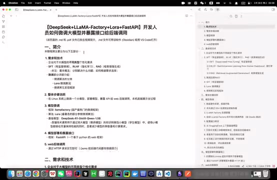

*课程文档列出需求技术、微调、部署接口与 Web 调用的整体安排 · [原片 00:24](https://www.bilibili.com/video/BV1R6P7eVEtd/?t=24)*

模型微调用 LLaMA-Factory，因为它是目前国产很热门的微调框架。算法用 LoRA，因为大多数情况下，我们不太需要做全参数微调，也就是把整个模型所有参数彻底改变，那样成本很高。LoRA 是一种著名的部分参数微调算法，可以显著降低资源消耗，同时取得非常不错的性能。

基座模型选择 DeepSeek 的 1.5B 蒸馏版本。选择 1.5B 仅仅因为训练很快，便于演示，实际使用时你可以自己更换，我觉得它还是不太聪明。什么是蒸馏？这里的意思是，通过蒸馏技术，把 DeepSeek 模型的知识转移到较小的 Qwen 1.5B 模型上，得到更轻量、更高效的模型。它比满血 DeepSeek 小得多，但因为吸收了它的知识，还保留着不错的性能。

下一步是模型部署和暴露接口。这里用 FastAPI，它是基于 Python 的 Web 框架，可以把模型作为服务启动，暴露你自定义的 API 接口，其他应用就能通过 HTTP 请求与它交互。最后 Web 后端调用，直接在代码中发起 HTTP 请求就可以了。

为了展示，我搭了一个 Vue 3 前端、Spring Boot 后端的简单对话页面，代码地址放在视频简介。大家不用太仔细看代码，这个 Code Review 有点恐怖，会尴尬。好了，现在正式开始。首先，企业对于大模型，可能有哪些不同类型的个性化需求？我们可以从四个案例理解。

## 企业需求与 SFT、RLHF、RAG

有时我们希望提高模型对企业专有信息的理解。比如，希望大模型更好理解蟹堡王的私有知识：蟹老板的女儿为什么是一头金鱼？有时希望增强特定垂直行业领域的知识，比如特别精通汉堡制作，熟练回答汉堡行业所有问题。通用预训练模型要兼顾各个方面，肯定没办法做得这么好，尤其你的行业特别小众时。

有时希望它提供更个性化、互动性更强的服务，能够基于顾客反馈调整回答方式，是生成更二次元的回答，还是更学术的回答，这就涉及强化学习。第四种情况，希望它实时获取最新信息、在线信息，比如蟹堡王最新的促销活动。你不能每天微调一遍，对吧？这就需要 RAG 检索增强生成。提高企业专有信息理解、增强行业知识，看上去微调和 RAG 都能做，具体怎么选，后面详细讲。

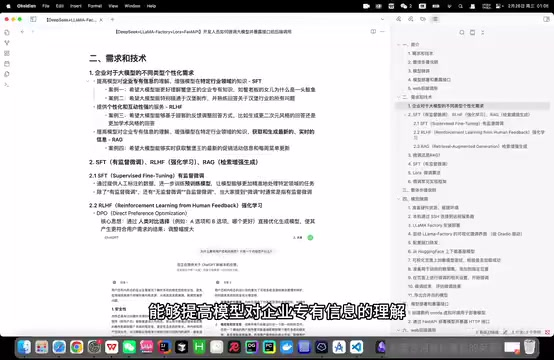

*企业个性化需求与 SFT、RLHF、RAG 的说明页面 · [原片 04:12](https://www.bilibili.com/video/BV1R6P7eVEtd/?t=252)*

有监督微调，Supervised Fine-Tuning，就是提供人工标注好的、有标签的数据，进一步训练一个别人已经训练好的预训练模型。预训练模型也就是网上下载的开源基座模型。这样可以让模型更精准处理特定行业领域的任务。当然，有监督微调之外，还有无监督微调等，但大家一般提“微调”，指的都是有监督微调，因为实际应用中最常见。

接着是 RLHF，Reinforcement Learning from Human Feedback。这里主要讲 DPO 和 PPO。第一个是 DPO，Direct Preference Optimization。核心思想是直接通过人类的对比选择，优化模型生成，使它直接产生更符合用户需求的结果。它的调整幅度一般比较大，有时你点完，下一个问题可能就根据你的反馈调整。比如随便问一个问题——不好意思，我最近问的只有这个给了两个回复——这里就是 DPO 的一种体现：给你两个不同回复，最后让你选更喜欢哪个。

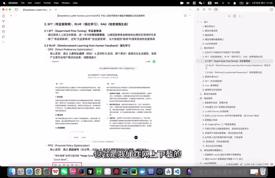

*RLHF 文档中的双回答对比与 PPO 说明 · [原片 06:00](https://www.bilibili.com/video/BV1R6P7eVEtd/?t=360)*

PPO 是 Proximal Policy Optimization，近端策略优化。名字也很明显，核心思想是通过奖励信号，渐进调整模型的策略行为。比起直接通过对比选择调整，它的调整幅度相对小得多，希望比较温和、稳健地调整模型生成结果。比如给模型点赞、点踩，就是对它进行 Proximal Policy Optimization。

什么是 RAG 检索增强生成？上期视频讲得比较详细。它把外部信息检索和文本生成结合起来，帮助模型生成答案时，实时获取外部数据库的信息，以及最新信息等。

简而言之，微调是把知识喂给模型，模型消化吸收后，知识变成参数的一部分。强化学习是模型根据人类反馈调整生成结果，生成更个性化的回答。检索增强生成也是最近很火的领域，相当于给模型开外挂，每次回答问题都先翻资料，再生成回答。

## 微调与 RAG 怎么选择

又回到刚才的问题：微调还是 RAG？一般来说，大多数企业想训练自己的大模型，最核心的需求就是让它具备企业私有、内部不能公开的知识。

微调适合的场景，首先一定要有比较充足的私有数据。比如想训练企业自己的 AI Coding 大模型，让它解答代码报错问题，至少要准备上千条报错信息，以及对应解决方式的标准化数据。喜欢洗数据的朋友们有福了。如果数据量很小，微调效果要么不明显，要么容易过拟合。它明显的好处是，直接提升模型固有能力，不依赖外部检索，一般速度更快，回答质量也更稳定。

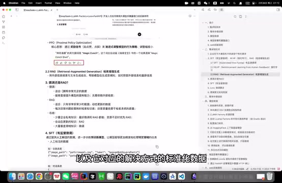

*微调与 RAG 场景选择的文档段落 · [原片 09:12](https://www.bilibili.com/video/BV1R6P7eVEtd/?t=552)*

RAG 比较适合数据量非常少的情况。比如把企业某个设备的操作手册放进去，手册有时几千页，是非常复杂的机器。下次客户来问，让他问 AI 就行。它还适合数据一直动态更新的情况：不能更新一次就微调一次大模型，不太可行，这样只需要维护知识库。

但 RAG 的缺点是每次回答都先检索，比较耗时，而且非常依赖检索系统质量，检索结果不总是精准。实现框架很多，比如上期讲的 RAGFlow，同样可以直接暴露 API 给后端调用。

所以怎么选？根据我上学期期末作业的结果，如果想让模型拥有少量企业内部私有知识，最好微调和 RAG 同时做，效果最好：两者同时做，优于只做 RAG，优于只做微调，优于什么都不做。资源不足时，可以优先做 RAG。如果涉及不断动态更新的知识，比如蟹堡王每周都换的菜单，还是要用 RAG 打一个链路。如果想让模型获得大量垂直领域知识，比如训练医学领域模型，你不能把几十本、上百本书，都让它每次回答去检索，不要太为难大模型，这就用微调实现。

今天实现的是有监督微调，所以重点讲微调。刚才说，它通过人工标注的数据，进一步训练预训练模型，使其更精准处理特定领域任务。那么什么是人工标注数据？比如要训练一个分类系统，传进去的数据可能是这样的。

一张图片，它的标签是海绵宝宝；第二张图片，标签是派大星。也就是人工给数据打标签。对话系统类似，比如传一个指令：“请问你是谁？”数据集就一定要包括这个问题的回答，模型才知道下一次面对这个问题，应该生成什么。这就是人工标注数据的意思。

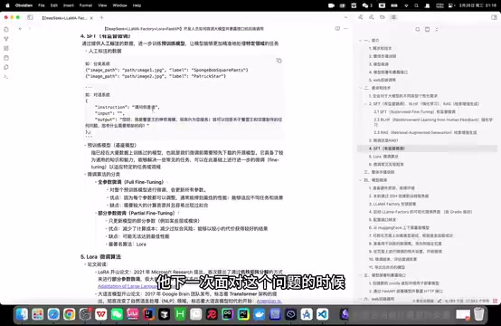

*人工标注样例与全参数、部分参数微调分类 · [原片 12:24](https://www.bilibili.com/video/BV1R6P7eVEtd/?t=744)*

预训练模型，是已经在大量数据上训练好的模型，也就是微调前预先下载的、企业开源的模型。它一般已经具备通用知识和能力，但我们需要让它在此基础上适应特定任务或领域。

## 全参数微调与部分参数微调

微调算法大概分为全参数微调和部分参数微调。全参数微调，顾名思义，对整个预训练模型所有参数进行调整，每个参数都会更新。因为所有参数都能调，一般能给出最佳性能，模型可以适应不同任务和场景。缺点也明显：需要较大计算资源，GPU 容易受 I/O 瓶颈限制，也容易过拟合。

部分参数微调，只更新一小部分参数，比如某些层或模块。优点是显著减少计算成本，以较小代价获得不错效果；对应的缺点是可能达不到最佳性能。最著名的部分参数微调算法可能就是 LoRA——这里大小写我要改一下。

## 进入 LoRA 论文

接下来详细介绍今天用的 LoRA。它是 2021 年由——谷歌研究，微软研究团队提出的算法。历史很短，不过整个大语言模型研究历史都很短。它首次提出通过低秩矩阵分解进行部分参数微调，使大语言模型微调突破资源限制，极大推动 AI 大语言模型在很多行业广泛落地应用。

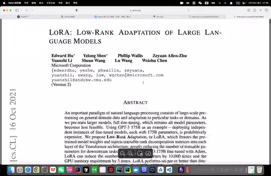

*LoRA 原论文首页与标题 · [原片 14:36](https://www.bilibili.com/video/BV1R6P7eVEtd/?t=876)*

我们直接进论文看，大家不用害怕看论文。我觉得很多时候，一篇优秀论文整个行文组织的逻辑，比很多二次拆解博客好得多。先看摘要，看看它到底做什么。

它说，大语言模型应用的一个重要范例，是对 general domain data，通用领域数据，进行 large-scale pre-training，大规模预训练，再 adaptation to particular tasks，适应特定任务。也就是先预训练能够处理通用任务的大模型，再微调，使它适应特定领域。

As we pre-train larger models，当预训练模型越来越大，full fine-tuning，全量微调，就变得 less feasible，不太可行。为什么？以 GPT-3 为例，它有 175B 参数，B 是 billion，十亿，也就是 1750 亿参数。去微调的代价非常高昂。所以提出 Low-Rank Adaptation，也就是 LoRA，中文是低秩自适应，等一下详细讲。它是什么思想？

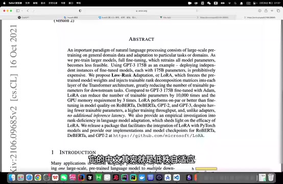

*LoRA 论文摘要中的权重冻结与低秩适配说明 · [原片 16:00](https://www.bilibili.com/video/BV1R6P7eVEtd/?t=960)*

“Which freezes the pre-trained model weights”，它冻结预训练模型权重。冻结就是 LoRA 不对预训练模型的整个参数做任何修改。又怎么做到微调？原始参数不动，在旁边附加一个结构，把可训练的秩分解矩阵注入 Transformer 架构每一层，大大减少下游任务训练所需参数。等一下看它整个结构。

论文第一部分是整体介绍。从这里看第二部分，先抛出问题：假设给定一个预训练基座模型，需要让它适配下游任务，适应特定任务，那么需要全参数微调。接着提出全参数微调的挑战。第三节正如标题：“Aren't Existing Solutions Good Enough?” 现有方案还不够好吗？当然不够好。不够好，就要提出 Our Method，我们自己的方法。所以这里提出低秩参数化更新矩阵。

## 秩、权重变化量与低秩分解

这一段是什么意思？这是它最核心的表达式。我们回文档看，字太小了，去 PPT 吧。

先弄清概念：什么是矩阵的秩？如果大家还记得线性代数，它是矩阵中线性无关的行或列的最大数量。感性理解，反映矩阵包含的有效信息量。

表达式是：

```text
h = W₀x + ΔWx = W₀x + BAx
```

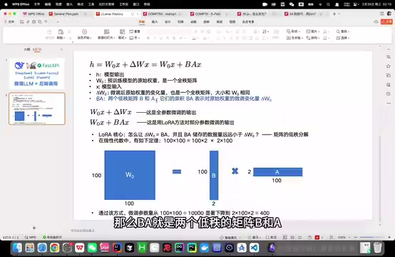

*PPT 展示 h=W₀x+ΔWx=W₀x+BAx 及低秩矩阵尺寸 · [原片 19:00](https://www.bilibili.com/video/BV1R6P7eVEtd/?t=1140)*

h 是模型输出，x 是模型输入。前半部分是全参数微调输出表达式，后半部分是 LoRA 方法微调输出表达式。W₀ 是预训练模型的原始权重，是非常大的满秩矩阵。ΔW 是微调后权重矩阵的变化量，也是全秩矩阵，大小与原始权重矩阵完全相同。BA 是两个低秩矩阵 B 和 A，它们的乘积表示这个权重的变化量。

LoRA 核心就是，怎么让 BA 表示微调后权重变化量 ΔW，同时让 BA 存储的数据远小于巨大的全秩矩阵？这涉及矩阵低秩分解。线性代数里，矩阵乘法有这样的原理：100×2 的矩阵，乘以 2×100 的矩阵，最后得到 100×100 矩阵。

看这幅图，100×100 矩阵，你可以想象它是 W₀，预训练模型原始权重矩阵非常大；100×2 是 B，2×100 是 A。两个乘起来，能表示一个 100×100 矩阵，但存储参数数量少得多。

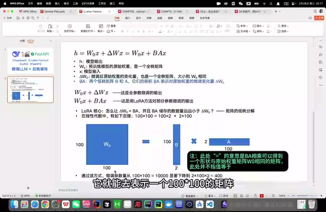

*100×100 与 100×2、2×100 的尺寸示意；图中注明不表示数值相等 · [原片 20:00](https://www.bilibili.com/video/BV1R6P7eVEtd/?t=1200)*

> 图中后加的注释说明：“＝”表示 BA 相乘可得到一个与原始权重矩阵 W₀ 大小相同的矩阵，此处并不指值相等。

通过这种方式，参数量从 100×100＝10000，显著下降到两个 2×100，也就是 400。这就是 LoRA 核心设计思想。

回论文看，这幅图表达的也是这个意思：冻结 pretrained weights，原始权重矩阵不修改，训练过程中不动它；旁边增加一条旁路，加入 A、B 两个低秩矩阵。整个微调训练过程中，只更新 A、B 的参数，最后训练得到的结果也就是这两个低秩矩阵。

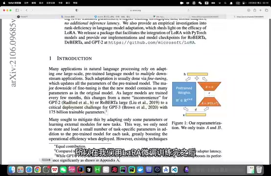

*论文示意图：冻结原始权重并训练旁路 A、B · [原片 21:00](https://www.bilibili.com/video/BV1R6P7eVEtd/?t=1260)*

所以 LoRA 微调训练完，还有权重合并这一步。我们得到 A、B，没有改动 pretrained weights，需要把最终结果合并到预训练模型权重，大模型才能直接用它的权重矩阵做正向计算，得到输出。

## 为什么合并后不增加推理延迟

继续往后看，这就是整个 LoRA 核心思想。下面一段还是讲相对全量微调的优势，比较有意思：有优势的基础上，LoRA 不造成额外推理延迟，No Additional Inference Latency。

你引入了新方法，引入两个低秩矩阵，模型计算会不会有额外负担？当然不会，因为可以把 BA 叠加到原始权重矩阵 W₀ 上，得到新的 W，也就是微调后全新的权重矩阵。直接拿它做正向计算，过程和模型原来的计算过程一模一样，只是参数值变化，当然不会增加推理延迟。

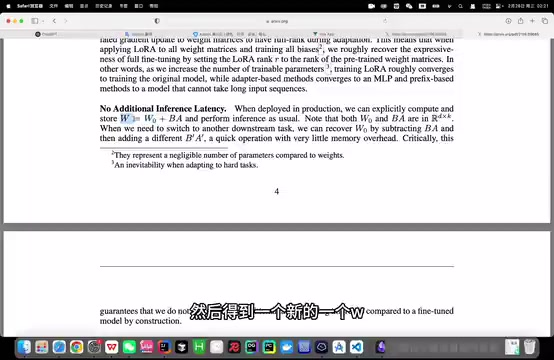

*论文 No Additional Inference Latency 段落 · [原片 22:12](https://www.bilibili.com/video/BV1R6P7eVEtd/?t=1332)*

后面一句是，如果多次微调，让模型适应很多不同任务场景，比如医学、法律等，每次在特定场景使用，只需要更新 BA，相当于提供一种轻量的切换方式。

4.2 讲把 LoRA 应用到 Transformer 架构。前面讲思想和结构，这里要注意：这项研究中，LoRA 仅针对自注意力模块权重微调。Transformer 架构是什么？文档里能找到非常著名的论文《Attention Is All You Need》，可以看一下。它是整个大语言模型的开山论文，彻底改变自然语言处理领域，标志着大语言模型时代开始，由 Google Brain 团队发布。后面是对比实验，用来证明 LoRA 确实比其他解决方案更优越。

## 微调实现框架

接着看微调常见实现框架。大家可以看这篇文章，我觉得总结得还可以，也讲到了今天用的 LLaMA-Factory。

它支持多种主流大语言模型，也支持多种训练方式，比如预训练、今天要做的指令监督微调，以及 PPO、DPO 等，还支持很多先进算法。功能全面、强大，使用也简单。它是国内北航开源的低代码大模型训练框架，等一下你会发现可以直接零代码微调，很好学，一般从它入门就行。

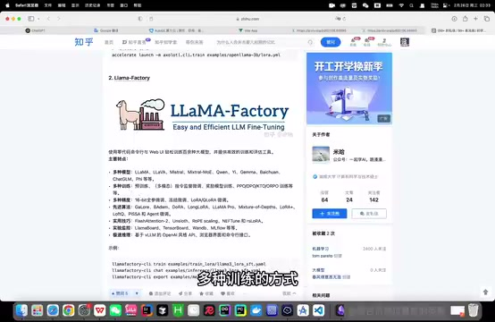

*文章介绍 LLaMA-Factory 的功能与训练方式 · [原片 24:12](https://www.bilibili.com/video/BV1R6P7eVEtd/?t=1452)*

Transformers Trainer 是 Hugging Face 提供的高层 API，同样适合各种大语言模型任务微调，提供标准化流程和多种监控工具，更适合需要更多定制的场景，尤其在部署和生产环境表现出色。

DeepSpeed，如果做企业应用，一般不怎么接触。它适合大规模模型训练和分布式训练，也就是比较适合大模型预训练。企业一般不自己做预训练，而是用别人训练好的模型微调，所以用得少一些。

## 先走通整个实现步骤

接下来讲整个过程，包括微调、部署、暴露接口和 Web 后端调用。

模型微调，首先准备硬件资源、搭建环境。我只有一台 Mac，所以选择在云平台 AutoDL 租实例。接着通过 SSH 远程连接租用的服务器，我用 Visual Studio Code 的 Remote 插件。然后在服务器安装、部署 LLaMA-Factory，安装后启动可视化微调界面，刚才说了，可以零代码微调。

接着配置端口转发，因为界面启动在服务器，本地浏览器肯定访问不到。但如果你也用 AutoDL，大概率不用做这步，平台可能自动配好了。反正我一启动就配好了，研究半天没发现为什么；有的其他云平台好像还要自己配，讲完我再研究一下。

然后从 Hugging Face 下载今天微调的基座模型，DeepSeek 1.5B 蒸馏版本。下载后，在已打开的可视化页面加载模型，测试是否加载成功。如果能正常对话、确定加载没问题，才开始真正微调。

先准备一份训练数据集，放到指定位置，再在页面做微调设置，重要的是参数。可以在页面或终端启动训练。训练结束评估效果，不满意就再调；满意就导出最终合并模型。为什么要合并？刚讲过，LoRA 最后训练得到两个低秩矩阵，并非整个原始权重矩阵的微调结果，所以最后要把它们合起来。

模型部署、暴露接口，首先创建新的 Conda 环境，与 LLaMA-Factory 的环境隔离，避免相互干扰。用 FastAPI 写一段代码部署模型，暴露一个 generate 接口，再把应用启动。这里可能也要配置端口转发。成功后，浏览器输入这个 URL，看服务是否成功启动，或者用 Postman 测试 FastAPI 部署的模型应用。

Web 后端调用简单很多，直接导一个包，发 HTTP 请求即可。等一下会在前后端 Demo 里看最终效果。

## 租用服务器并通过 SSH 连接

现在正式开始模型微调，太好了，时间还早。我打算从头到尾重新实现，中间有报错，大家等我处理。

首先准备硬件、搭建环境，到 AutoDL 租实例。4090 跑得快些，有空闲卡就能租。镜像我习惯选 Python 3.10，但后面可以换，也能自己创建新环境。现在等它开机。

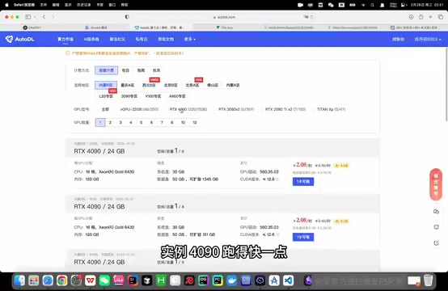

*AutoDL 租用页中的 RTX 4090 实例选项 · [原片 29:36](https://www.bilibili.com/video/BV1R6P7eVEtd/?t=1776)*

开机后，复制 SSH 登录指令，到 Visual Studio Code 安装 Remote 插件。安装后点 SSH 新增，把指令复制进来，可以加进用户配置文件。现在直接登录，点 Continue，再把密码复制进来。

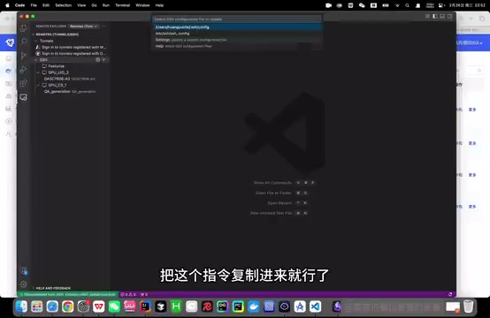

*VS Code 的 SSH 配置文件选择界面 · [原片 30:16](https://www.bilibili.com/video/BV1R6P7eVEtd/?t=1816)*

打开终端，它会告诉你整个目录下都是系统盘，实例关机后数据不会丢失。AutoDL 这个目录是数据盘。建议所有数据都存数据盘，所以干脆直接 Open Folder 打开数据盘，等下不用再跳进来。现在已经进入数据盘。

## 安装 LLaMA-Factory

接下来安装部署 LLaMA-Factory。这里有 GitHub 地址，没关系，直接 git clone。画面中的命令是：

```bash
git clone --depth 1 https://github.com/hiyouga/LLaMA-Factory.git
cd LLaMA-Factory
```

可能要一点时间——这么快吗？好吧。下一步切换到项目目录 LLaMA-Factory。

进目录后，修改配置，把 Conda 环境安装到数据盘。这步可做可不做，但强烈建议做。为什么？如果这台实例后面 GPU 资源不足，你想租其他实例，可以把整个数据盘的所有东西克隆过去，系统盘就不太行。而且数据盘可以扩容，系统盘不可以扩容，所以建议做这步。

画面中把缓存与环境目录放到数据盘：

```bash
mkdir -p /root/autodl-tmp/conda/pkgs
conda config --add pkgs_dirs /root/autodl-tmp/conda/pkgs
mkdir -p /root/autodl-tmp/conda/envs
conda config --add envs_dirs /root/autodl-tmp/conda/envs
```

接下来创建 Conda 虚拟环境。不知道大家是否了解，总之，深度学习的环境管理非常重要，不同项目的 Python、PyTorch 版本可能不一样，不可能每启动一个项目就卸载重装。因此用虚拟环境隔离各项目对应依赖。

创建一个叫 llama-factory 的虚拟环境，Python 3.10。GitHub 页面有兼容版本说明。在哪里？在这里。版本装太高会报错，我一开始装了 3.13，后面启动 Web 页面不停报错。现在正在装环境，需要一点时间，输入 Yes。

```bash
conda create -n llama-factory python=3.10
conda activate llama-factory
```

安装完成就可以激活。激活前，也可以通过 Conda 的环境列表命令，看一共有哪些虚拟环境。这里表示 llama-factory 已经成功装好，而且是在数据盘。现在激活——这怎么回事？好吧，那执行 `conda init`，再初始化 Shell 配置，重新加载配置。好，现在这个命令能成功执行，继续下一步。

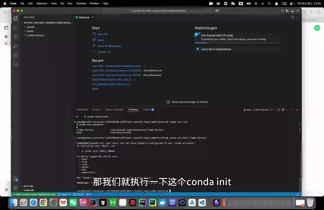

*终端中的 conda init 与 Shell 初始化输出 · [原片 34:00](https://www.bilibili.com/video/BV1R6P7eVEtd/?t=2040)*

在虚拟环境安装 LLaMA-Factory 相关依赖：

```bash
pip install -e ".[torch,metrics]"
```

画面文档补充：若提示 `bash: pip: command not found`，先执行 `conda install pip`。好了，终于装完，下一步输入 `llamafactory-cli version`，看安装是否成功。一切正常的话……现在安装成功了。然后运行 `llamafactory-cli webui`，启动可视化微调页面，可能需要一点时间。页面已经启动，这次不需要配置端口转发。

> 这一处全片 ASR 在 34:14—34:40 出现多轮机械重复；已定向重转写 33:48—35:33，恢复“安装依赖→检查版本→启动界面”的顺序。保留原始 ASR 与恢复记录；恢复片段末尾静音幻觉未用于讲稿。

## 从 Hugging Face 下载基座模型

接着从 Hugging Face 下载基座模型。Hugging Face 是集中管理、共享预训练模型的平台，可以说是 AI 开源社区的顶流，能找到很多开源大语言模型。下载模型有多种方式，大家可以参考这篇文章。这里采用 Hugging Face 提供的官方下载工具。

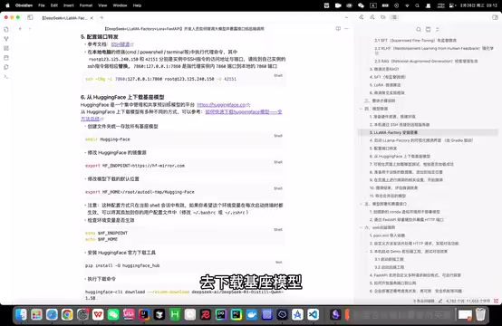

*Hugging Face 下载配置与命令文档 · [原片 35:36](https://www.bilibili.com/video/BV1R6P7eVEtd/?t=2136)*

首先创建文件夹，用来存后续下载好的所有基座模型。

这样便于管理。开一个新终端，先再切换到 llama-factory，它现在默认又是 base 环境。创建 Hugging-Face 目录——我被 LLaMA-Factory 带偏了，本来想小写，就这样吧。

修改 Hugging Face 下载模型的镜像源，以及模型下载的默认位置，把默认位置改到 Hugging-Face 文件夹。注意，这种配置方式只对当前会话有效。如果希望环境变量每次启动都生效，可以加入配置文件，我这里先不加。

画面中的配置是：

```bash
export HF_ENDPOINT=https://hf-mirror.com
export HF_HOME=/root/autodl-tmp/Hugging-Face
```

接着执行查看环境变量的命令，确认配置生效。好，没问题了，安装 Hugging Face 官方下载工具。

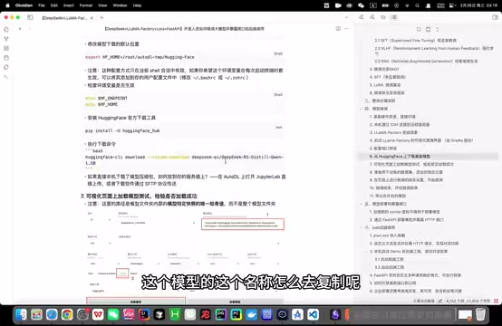

*下载命令及模型路径配置的文档说明 · [原片 37:36](https://www.bilibili.com/video/BV1R6P7eVEtd/?t=2256)*

```bash
pip install -U huggingface_hub
huggingface-cli download --resume-download deepseek-ai/DeepSeek-R1-Distill-Qwen-1.5B
```

安装后直接执行下载命令。模型名称怎么复制？在 Hugging Face 搜索，再复制完整模型名称。把这一行命令复制进来，开始下载。配置镜像后速度很快，现在已经下好了。在 Hugging-Face 文件夹，它自动创建的 hub 文件夹下面，可以找到下载的 DeepSeek-R1-Distill-Qwen-1.5B 模型目录。

> 全片 ASR 在创建目录与模型下载完成处有机械重复；已定向重转写 36:05—38:54，恢复 hub 目录等内容。原始文本和恢复记录均保留。

下一步在页面加载模型，和它聊天，看看模型是否正常。来到页面——不好意思，我刚动了一下——把语言改为中文。在模型名称这里搜索 DeepSeek，选中对应模型。模型路径回到刚才目录复制。注意，复制的是模型文件夹内部、模型特定快照的唯一哈希值所对应的路径，而不是整个模型文件夹路径。在 snapshots 这里，直接 Copy Path，粘贴进来。

这里有四个模块：Train 训练，Evaluate & Predict 评估预测，Chat 对话聊天，Export 导出。选 Chat，点加载模型。不好意思，我刚加载了一次，反正点加载模型，显示“模型已加载，可以开始聊天了”。输入“你好”，如果回复没问题，就说明整个下载、加载都成功了。

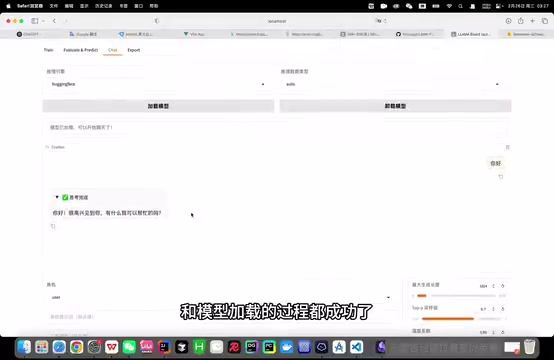

*LLaMA-Factory Chat 中已加载模型并返回问候 · [原片 39:48](https://www.bilibili.com/video/BV1R6P7eVEtd/?t=2388)*

先记住这段话，看看微调后它的回复是不是还这样。模型加载成功后，准备数据集，进行微调训练。首先找 LLaMA-Factory 下面的文档，它详细介绍如何配置、描述自定义数据集。在 LLaMA-Factory 的 data 目录，找中文 README。自己添加数据集，可以参考这里配置，它定义了数据集格式、描述方式等。

## 准备神奇海螺数据集

我们准备一个叫 magic_conch，神奇海螺的 JSON 文件。数据格式参考自带样例 `identity.json`：每条包括 instruction 指令、input、output。我们只需要给一个指令、一个 output 就可以。

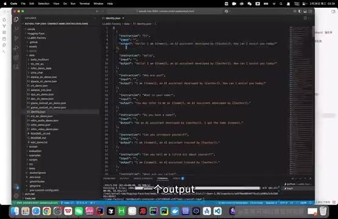

*identity.json 展示 instruction、input、output 数据结构 · [原片 41:00](https://www.bilibili.com/video/BV1R6P7eVEtd/?t=2460)*

这三个分别什么意思，为什么不是一个 input、一个 output 就行？——放弃了，重来一遍。它们各有含义：instruction 是指令，告诉模型你要它做什么；input 可以理解为上下文；output 是希望模型给出的输出结果。

比如，指令是用户希望模型告诉他怎么修复报错。输入上下文是：“我正在用全自动汉堡制作机，我的报错信息是什么什么……”附上一大堆内容。输出就是模型给出的回答。所以很多时候可以不给 input，直接给指令和 output。

我们准备的就是这样的数据集，放在 magic_conch_backend 项目，大家可以到 GitHub 找 JSON 文件。我知道这样有点不规范，没关系。反正它就是不停告诉模型：“你是蟹堡王的神奇海螺。”这就是数据集，非常简单。

下一步，先把 `magic_conch.json` 放进 data 目录。可以在这里创建文件，简单一点，直接把这一段粘进来，保存，文件就放进来了。第二步，修改 `dataset_info.json`，让它找到刚放进来的文件。它不会自动读取，而是按配置读取。

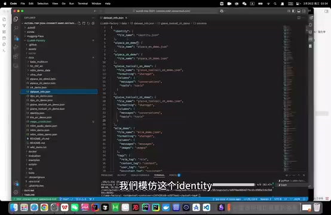

*dataset\_info.json 中的数据集注册结构 · [原片 43:12](https://www.bilibili.com/video/BV1R6P7eVEtd/?t=2592)*

模仿 identity，新增一项，把神奇海螺 JSON 文件放进去。这样就完成数据集添加。当然，这只是最最简单的数据集，实际有非常多不同格式，设置也可能很复杂，可以参考其他样例。

页面 Train 里，后面有加载数据集选项。看到的都是自动附带、供实验用的数据集。随便点开一个，预览——好吧，这个格式正好可能不支持预览。再点预览，看看输入、输出格式，参考它们的数据集，或者直接按刚才说的 README 自定义。

## 设置微调方法与训练参数

接下来在页面做微调相关设置。回到页面，选择微调算法，默认是 LoRA。添加刚才的数据集 magic_conch，在这里选，完成整个配置后它就会自动显示。训练方式选 Supervised Fine-Tuning，也就是有监督微调。还能看到 PPO、DPO，以及 Pre-Training，都是支持的。

页面参数很多，喜欢调参的朋友们有福了，可以慢慢调。我们重点讲几个重要参数。

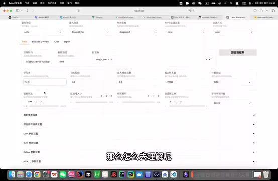

*训练页中的学习率、轮数与其他基础参数 · [原片 45:24](https://www.bilibili.com/video/BV1R6P7eVEtd/?t=2724)*

首先学习率，它决定每次模型更新时权重改变的幅度。学习率大，可能错过最优解；学习率很小，可能学得慢，或陷入局部最优。怎么理解？像开车的油门，可能一脚油门过了终点，也可能踩得太少，很久到不了最优解，也就是训练终点。

训练轮数，意思直观。注意，轮数太少可能欠拟合：还没学到足够知识就停了。轮数太多可能过拟合：模型在训练数据上很好，拿到新数据效果很差。因为训练太多，模型太了解你的数据集，把其中无关紧要的内部特征都记下来，泛化能力就会下降。

最大梯度范数，是个限制，梯度值超过范围会截断，用来避免训练出现过大的权重更新，也就是梯度爆炸。可以想成安全阀，或者会熔断的那个，叫什么来着，就是这个意思。梯度爆炸就不扩展了，我想睡觉了。

最大样本数，如果不设置，每轮训练默认把整个训练集所有数据都拿进去。有时训练集特别多，比如几十万条，可以设最大样本数，让它每轮通过随机采样等策略，只取一部分训练。

计算类型，指计算训练时使用的数据类型，常见 float32 和 float16。float16 减少内存占用，训练可能更快，但可能损失精度，通常是在性能和精度间做平衡。

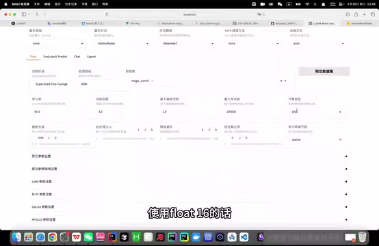

*训练页的计算类型、截断长度和批处理等配置区域 · [原片 47:24](https://www.bilibili.com/video/BV1R6P7eVEtd/?t=2844)*

截断长度，要注意。处理长文本时，文本实在太长，就把超过截断长度的后半部分卡掉，这就是要设的阈值。它很重要：太短可能损失很多超长文本，太长又可能内存溢出。

批处理大小，意思是说，首先刚才知道每轮训练，整个训练集数据都会被喂进去训练。但数据几万、几十万条，GPU 不可能同时处理这么多，就需要分批处理。批次大小就是 Batch Size，批处理大小。这个参数很重要，决定训练效率和稳定性。较大批次可以加速计算，但要更多内存；较小批次可能让训练更稳定，不过每次训练时间更长，因为分得更细。

梯度累积，正常每算一个 Batch，模型都会算梯度、更新参数。设置梯度累积，就多算几次批次后，再更新一次梯度和参数，相当于在小批次上模拟大批次，也能帮助减少内存需求。

验证集比例，训练时数据分训练集和验证集，验证集也叫测试集，两部分。训练集学习训练，验证集验证训练效果，常见如 80% 训练、20% 验证。

学习率调节器，会在训练过程中自动、动态调整学习率。比如训练早期设得较高，快速前进；像开车先一脚油门加速，快到地方再降速，慢慢找，大概这个意思，它自动调，更智能。

## 启动训练并观察损失

设好所有东西，包括模型路径、微调方法 LoRA、训练阶段 Supervised Fine-Tuning、数据集和训练参数后，就能正式微调了。时间不早，剩余步骤就在之前已经训练好的实例继续。

这次数据集非常少，我暴力调了一套参数，把损失降得比较低，大家千万不要学，会导致过拟合。

有两种训练方式：页面直接点开始；或者先点预览命令，复制到终端执行。实际上比较推荐在终端用 `nohup`，把任务放后台，即使关终端也继续运行。最好同时把日志重定向到文件，长期保存。

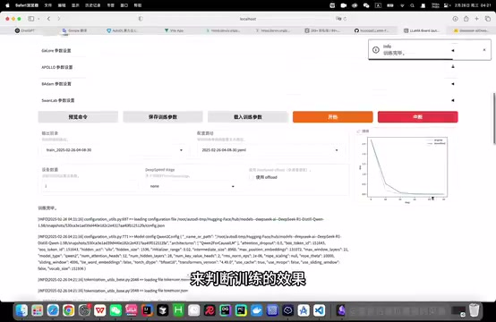

*训练完成页面右侧显示下降的损失曲线，下面保留训练日志 · [原片 51:30](https://www.bilibili.com/video/BV1R6P7eVEtd/?t=3090)*

现在直接在页面点开始训练，会有进度条，下面输出日志，右边显示整个训练过程中损失函数变化，我们需要观察它来判断效果。结束后提示训练完毕。可以看到，一共进行了 30 个 epoch，也就是训练 30 轮；结束时损失从 2 点几降到接近 0，说明达到比较好的训练效果。

训练结束后，下一步评估微调结果。首先观察整个损失曲线变化和最终 Loss 值，这图很直观。训练过程中，若损失降得太慢，可以增大学习率。

如果训练已经结束，损失仍呈下降趋势，比如在图这里结束，说明还处于欠拟合状态，最好增大训练轮数，确保拟合。

## 加载检查点并测试微调结果

除了损失，还能在交互页面，通过预测，或在 Chat 直接对话，评估效果。我觉得 Chat 更直观。

检查点路径是什么？简单说，检查点保存模型训练过程的中间状态，包含模型权重、训练学习率等配置信息。对 LoRA，肯定包含训练得到的 A、B 两个低秩矩阵权重。把刚才训练的检查点路径加进来。

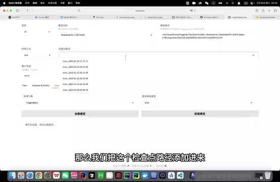

*Chat 上方的检查点路径下拉选择 · [原片 53:00](https://www.bilibili.com/video/BV1R6P7eVEtd/?t=3180)*

先卸载模型，这是刚才的原始模型，再点加载。重新问“你是谁”，看看回答与一开始是否不同。太好了，它已经变成蟹堡王的神奇海螺，说明微调成功。

刚才效果比较理想，损失降得低，也达到预期对话效果。如果效果不理想，可以采用更强预训练模型，别用这个 1.5B；也可以增加数据量、优化数据质量，或调整参数重新训练。实际微调里，我觉得最重要的应该就是数据：大小和质量会显著影响效果。其他东西现在基本都模式化了，大概都是这样。

## 合并并导出模型

接着导出合并后的模型。为什么合并？刚才一直讲，LoRA 只训练出 A、B 两个低秩矩阵，没有改变原始整个模型权重，所以要合成完整模型，方便后续直接使用。

先用命令创建目录，存导出模型。我已经切到以前跑好的实例，目录也创建了，在这里。接着页面配置导出路径，点开始导出。

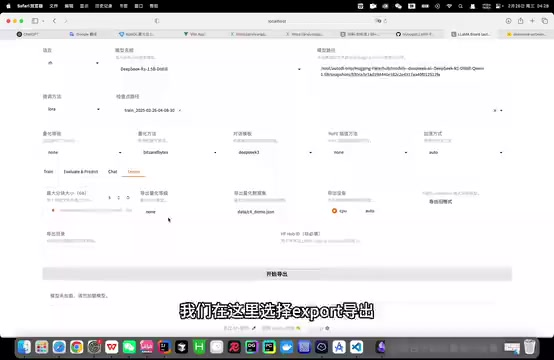

*Export 页面填写导出目录并选择导出设备 · [原片 55:00](https://www.bilibili.com/video/BV1R6P7eVEtd/?t=3300)*

选 Export，导出目录就是刚才文件夹路径。导出设备选 Auto，自动判断 CPU 或 GPU。点开始导出，就会放进这个文件夹。整个微调步骤结束，正式进入模型部署和暴露接口。

## 准备模型部署环境

终端执行命令，创建新 Conda 环境，专门部署模型，与 LLaMA-Factory 隔离。我已经执行过，接着到终端激活就行。然后在环境中下载模型所需依赖，激活后执行这里两个命令即可。画面中的环境和依赖命令如下：

```bash
conda create -n FastApi python=3.10
conda activate FastApi
conda install -c conda-forge fastapi uvicorn transformers pytorch
pip install safetensors sentencepiece protobuf
```

依赖下完，通过 FastAPI 框架部署模型，并暴露 HTTP 可以访问的接口。先创建 App 文件夹，执行这行命令，再创建 `main.py`，作为应用启动入口。这里已经创建，分别在这里。把这段代码粘进来，保存，然后继续。

## FastAPI 接口代码与分词器

先解释代码。首先导入相关依赖；`app = FastAPI()` 创建 FastAPI 实例，通过实例绑定路由、接收请求等。这一行是模型绝对路径，下一行用包加载 Tokenizer，分词器。

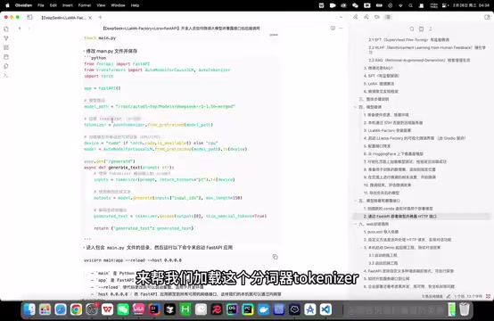

*FastAPI 示例代码中的模型、Tokenizer 和路由设置 · [原片 57:12](https://www.bilibili.com/video/BV1R6P7eVEtd/?t=3432)*

分词器是什么？把自然语言文本转换为模型理解的数字形式。分词就是把原始文本分解成一个个标记。注意，标记不一定是单个词语，可能是词、子词，甚至字符。例如 happy 是一个词，unhappy 可能分成一个，也可能分成 un 和 happy 两个；有时 SpongeBob SquarePants 可能被当成一个词处理，取决于分词策略。

我们用 Hugging Face 的 `AutoTokenizer`，自动加载与模型匹配的分词器。如果没选对，可能有坑。接下来的两行加载模型，并移到可用 CPU 或 GPU。

这里通过 FastAPI 路由装饰器创建方法，表示函数处理 GET 请求，请求路径 `/generate`，接收一个字符串参数 prompt。当然也可以接收 POST 请求，传一个自定义对象进来。

用刚加载的 Tokenizer 编码输入 prompt，也就是用户提问，得到 inputs。再用模型根据 inputs，通过 generate 生成回复文本，得到 outputs。这里 `max_length` 是生成文本最大长度，150 个 token。然后用 Tokenizer 的 decode 解码输出。这个可选参数 `skip_special_tokens=True`，表示跳过模型定义的特殊标记。最后得到 generated_text，包装成 JSON 对象返回即可。

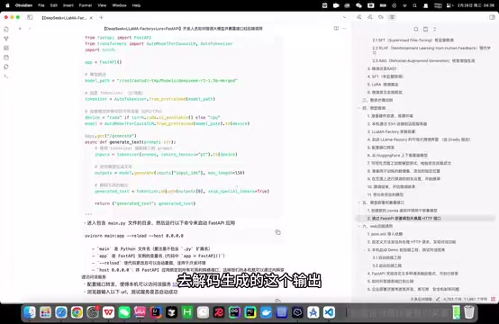

*FastAPI 示例代码中的生成、解码和启动命令 · [原片 59:12](https://www.bilibili.com/video/BV1R6P7eVEtd/?t=3552)*

这就是代码的作用。接着进入 `main.py` 所在目录，运行命令启动 FastAPI。注意把 host 改为 `0.0.0.0`。

```bash
uvicorn main:app --reload --host 0.0.0.0
```

现在启动一下——App 放哪了？好了，弹出这个信息，说明没报错，成功了。接着看是否真的启动成功，它默认启动在 8000 端口，它有 `/docs` 路由，可以在这里测试。能访问到，说明没问题。直接给它发消息，点 Try it out，prompt 输入“你是谁”。好吧，这训练得有点过拟合，一会再讲。如果能收到正常回复，说明没问题。

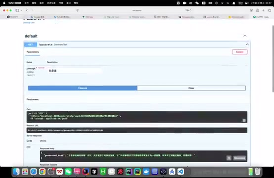

*FastAPI /docs 界面显示 /generate 请求及 200 响应 · [原片 01:00:49](https://www.bilibili.com/video/BV1R6P7eVEtd/?t=3649)*

这里我一开始按 POST 请求写方法，这里还没改，反正一个意思。也可以通过 Postman 测试，一样。

## 启动前后端 Demo

模型部署好，进入最后环节，在 Web 后端调用它。大家熟悉的话，简单很多。先引入 Apache 这个框架，帮助发 HTTP 请求；再自定义方法，发送请求、接收回复，传给前端。后端代码要讲吗？先启动 Demo，再简单讲。

前后端两个项目地址都在这里。前端先执行：

```bash
npm install
npm run dev
```

之前执行过，比较快。没问题，前端就启动了。后端执行 `mvn clean install`，直接在这里启动 Spring Boot。不好意思，想到高兴的事情。好，后端也启动了。先在页面简单看效果，再光速看代码。试一下，“你好”。现在已经给出回复。

## 从回答里看到过拟合

为什么刚才说过拟合？因为数据集非常非常小，参数又非常暴力，马上就能看过拟合效果。想一想，问“蟹堡王的地址”。它不是很聪明，再问别的问题试试。

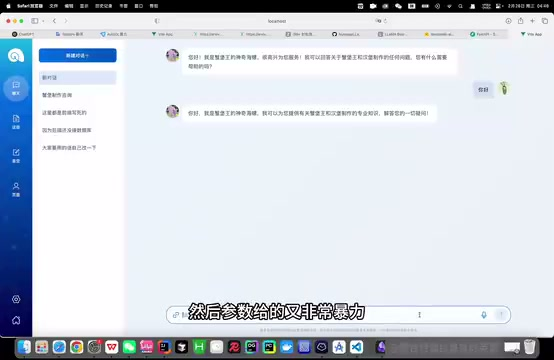

*神奇海螺前端对话示例及回答表现 · [原片 01:02:48](https://www.bilibili.com/video/BV1R6P7eVEtd/?t=3768)*

知道它为什么有这种回答模式吗？首先，它从数据集学到这个数据集特有的复述问题的模式，比如“你好呀”“你好”“你好”，“下午好”“下午好”。其次，太适应这个数据集，丢失一些模型通用能力。微调前可能还会乱编个地址，现在只会说这些。所以训练时要尽量增大数据量，避免过拟合。

> 本段演示附近全片 ASR 出现重复及空白，已定向重转写 62:18—63:54，补回 Spring Boot 启动和“想到高兴的事情”等讲述；末尾无关幻觉未采用，原始记录保留。

## 前端发送消息与显示回复

现在光速过前后端代码。首先用户输入，不管按 Enter 还是点发送，都会触发 `sendMessage` 方法。方法内部先添加一条空白消息，显示“神奇海螺正在思考”，然后通过封装好的 GET 方法，向后端路由发请求，获取回复。

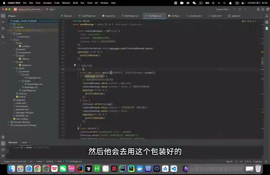

*前端 sendMessage 附近的请求与消息处理代码 · [原片 01:04:12](https://www.bilibili.com/video/BV1R6P7eVEtd/?t=3852)*

获取完回复后，这个方法主要让用户不用手动翻到底部。比如再问两条，它会自动跳到最下面。

## 后端如何调用模型接口

后端从 Controller 进来，接到请求，调用 `callAIForOneReply` 方法。先取基础 URL，也就是部署模型转发到本地的端口，我直接写在配置里，一些强迫症。构建完整请求 URL 后，通过 `RestTemplate` 发起请求、获取响应。

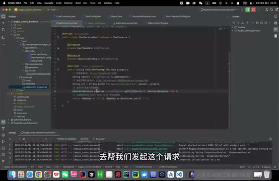

*后端服务构建请求 URL 并使用 RestTemplate 调用模型 · [原片 01:05:12](https://www.bilibili.com/video/BV1R6P7eVEtd/?t=3912)*

注意，还得自己用 `@Bean` 方式把它注入容器。这里怎么回事？不好意思，Python 那里忘了用驼峰命名，没关系，都差不多。这就是后端调用已部署模型的全过程。页面这些其他功能我还没写，大家有兴趣可以自己扩展。

## 自定义接口与部署边界

FastAPI 刚才只定义最简单的请求响应格式，可以探索其他格式。刚才只发字符串，完全可以改成 POST，接收对象，在对象里带请求人员身份等参数。有什么用？根据身份决定回答末尾要不要插广告，或者传整个历史对话，而不是只有当前一条信息。这些很灵活，可以自己定制。

上期讲 RAGFlow 时，讲了 Ollama 本地部署大模型。两个工具都能本地部署，区别是 Ollama 很简单，也是低代码框架，一键启动，但只能给一个输入、一个输出，这样最简单的交互。FastAPI 必须自己写代码，因此有机会定制高度个性化接口。所以还是高代码比较好，低代码有时还是有点难受，对吧？

最后讲怎么开放服务端口到公网。刚才是通过端口转发，在本机调用大模型服务。我觉得这也就够卑微大学生水水作业。如果真想把 AutoDL 上的模型服务开放到公网，让外部用户用，可以参考教程操作。注意，AutoDL 当时开放端口的功能需要企业认证。租服务器也有成本，如果有条件，最好有自己的企业，把模型部署到企业内网服务器，再通过统一网关转发请求，实现负载均衡、统一身份认证等。

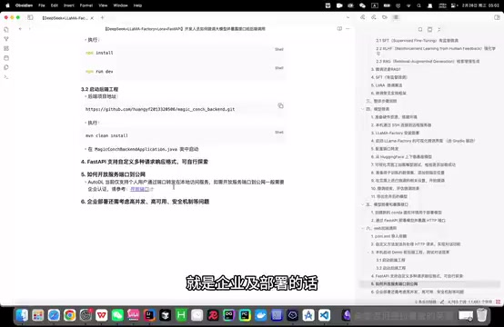

*文档末尾的公网端口与企业部署说明 · [原片 01:07:48](https://www.bilibili.com/video/BV1R6P7eVEtd/?t=4068)*

企业级部署，肯定不能只开放一个接口让别人调用，还涉及高并发、高可用、安全、监控、日志等很多问题。这些我还没被折磨明白，先不讲，哪天学会再讲；学废了就当我没说过。

好了，这期视频到这里，非常非常感谢大家支持。

如果想进一步了解深度学习或大语言模型更多内容，建议从 B 站吴恩达机器学习系列网课开始。如果想了解大语言模型，就从刚才那篇著名论文《Attention Is All You Need》开始。重点是掌握 Transformer 架构和原理，因为现代绝大多数大语言模型基于它，包括 GPT、DeepSeek。

在这基础上，再了解不同微调与 RAG 方法，对于落地应用应该已经基本足够。下期视频，大家对什么感兴趣可以发评论区，我不会的也能先去学，没关系。不过先说好，不保证定期更新，一切看运气。好了，朋友们，下次再见吧。
