# MLflow 最佳实践｜2020 年分享忠实整理稿

> 来源：[20200424-机器学习：MLflow最佳实践](https://www.bilibili.com/video/BV1UK4y197LT/) · 红楼明月 · 单集完整范围 00:00—43:16.599。
>
> 本文按原讲述顺序清理口语，保留演示、提问、解释与限定。内容处于 2020 年的技术语境；页面、API 和版本行为按当时讲述保留。配图为本视频真实截图，源分辨率 640×360，代码小字不保证可辨。原始 ASR、修时及局部恢复记录随文保存。

## 开始共享屏幕，以及为什么要记录实验

这个东西其实太多广告了。行，我们开始吧。怎么没有那个屏幕演示呢？是这样子，对，是这样子。行，我们开始吧。

我们做机器学习，每次都要搞训练，还有那些参数，其他保存都挺麻烦的。后面要做共享，或者最简单的，你要让别人看你的工作量，就很难。因为很难记录到每一个训练的参数、结果，还有它们关联的关系。

以前我们用 iModel，那种在线的其实可以解决这个问题。但是在线的有一个问题：它会绑得很死，不够自由。你能够从里面选择那些算法，数据处理的过程在线上可以帮你做。所以它又走向了另外一个极端：虽然可以用拖动、可视化的形式训练一个模型，但是那种非常古板，非常古板。

如果我们完全基于 Notebook 来做，又会有另外一个问题：很难记录。如果基于 Notebook 来做，最好的办法就是拿一张纸，画一个表格，每训练一次就记一下：我用的参数是什么，我的指标是什么，训练耗时多少。用一张纸，或者用一个表格把它记录起来。

你不记录这些，后面就会忘记。后面回头看的时候已经忘了，包括平时训练……不行，因为有时候是要回头看的。过一段时间，客户再找你，你回头看就忘记了。[此处个别口语识别不清。] 把那个麦关一下。[会议中的短暂确认。]

那就有一个工具，就是这个 MLflow。我先看一下。它从刚出来，其实我那个 iModel 当时做的时候，就是参考这个做的。但是这个会更加灵活。iModel 做成可视化之后，反而……我觉得它里面最好的功能，就是参数的跟踪，跟踪你每一次实验的指标和结果。

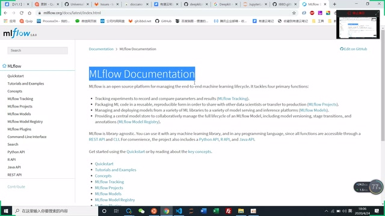

*MLflow 文档首页及实验跟踪功能（原视频 360p，小字以原图可辨程度为限） · [原片 03:48](https://www.bilibili.com/video/BV1UK4y197LT/?t=228)*

## 安装、启动界面和访问端口

看它有没有截图可以看，好像没有，反正我们一会儿就可以看到。安装很简单。我现在在 Notebook 里面开一个 Notebook，这个命令就安装了：`!pip install mlflow`。我就不安装了，因为已经安装好了。

然后在 Notebook 里面启动一个界面，就是这个命令：`!mlflow ui --host 0.0.0.0`。如果你是 Windows，只是自己访问，前面就可以了；如果你要让别人通过你的 IP 能访问到，就要加上这个 host，后面四个零。

它默认的端口在这里会显示，默认端口是 5000。我们看一下效果。这样它就已经启动了一个监听服务。启动之后，还会多一个这个目录，这是它启动时自己创建的。

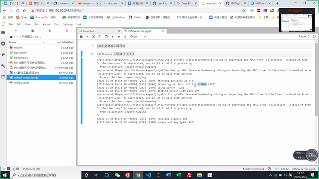

*Notebook 中启动 MLflow UI，输出显示端口 5000（原视频 360p，小字以原图可辨程度为限） · [原片 05:00](https://www.bilibili.com/video/BV1UK4y197LT/?t=300)*

我们看一下界面。端口是 5000，不过因为这个是在服务器上，我做了一个映射，把 25000 映射到内部的 5000。如果你是在 Windows 上自己启动……它这个页面其实很简单，就这样一个页面。

如果是第一次，这里应该都是没有的，是空白的。因为我之前测试的时候用过，所以这里有一些值。我先简单看一下这个页面的东西，或者先训练吧，先训练，后面再看。先大概讲一下这里面的要素。

## 实验列表、运行记录和筛选

首先有一个实验，这边是实验的列表。你可以创建很多个实验。每一个实验……这些是一些基础信息，主要信息都在这个列表里面。它会记录每一次训练、每一次训练的时间，还有应该是有耗时的，可以选择。运行的这些，我觉得其实不用管它。

还有这些，是我记录的参数。有时候参数太多，会被隐藏起来。这里是指标。它非常方便：无论你训练多少次，还能够排序。想找那些比较好的指标，直接排序。

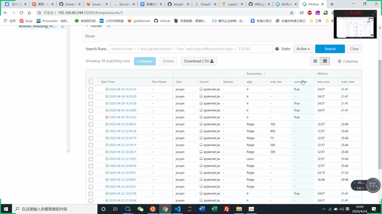

*实验中的运行列表，参数列和指标列并排显示（原视频 360p，小字以原图可辨程度为限） · [原片 07:12](https://www.bilibili.com/video/BV1UK4y197LT/?t=432)*

这里还可以做筛选。比如说，我把算法也放在里面，只要筛选线性回归算法的那种，就可以在这里写。这里会有提示，就是这种。我这里……忘记它那个写法了，我看一下。[演示中先后出现字符串未加引号、条件不完整的报错，再补全筛选条件。] 对，补成 `params.algo = 'lr'`，它就能够把我指定要的结果筛选出来，非常方便。

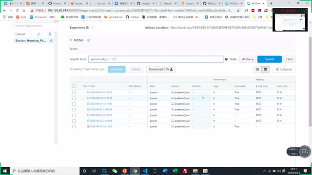

*按算法参数筛选后的运行列表（原视频 360p，小字以原图可辨程度为限） · [原片 08:36](https://www.bilibili.com/video/BV1UK4y197LT/?t=516)*

这个界面先大概讲这些，接下来我们看实际怎么使用。

## 创建实验与开始一次运行

我们在另外一个 Notebook 里面，前面这些就不讲了：都是加载一个数据，把它拆成训练集和测试集，X、Y 这样子，都比较常见。因为用 sklearn，所以把我们要用的这两个包加载进来：`import mlflow`、`import mlflow.sklearn`。

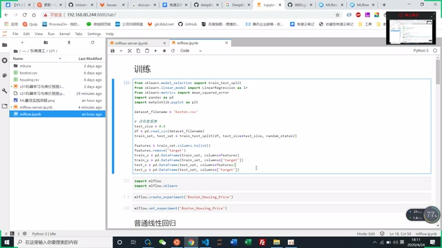

*加载和拆分数据的 Notebook 代码（原视频 360p，小字以原图可辨程度为限） · [原片 09:12](https://www.bilibili.com/video/BV1UK4y197LT/?t=552)*

首先会先创建一个实验。因为我已经创建了这样一个实验，再创建它会报错。我们可以……里面用中文的名称，中文也可以。创建一个实验，在这边就会有一个列表，进来就是空的；创建多少个，这边就有多少个。通常我觉得一个需求创建一个实验，应该就可以。但重复创建，它会报错。创建完之后设置一下，设置当前的实验。

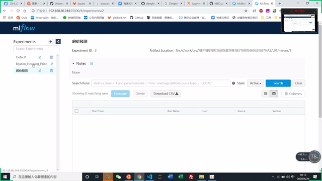

*新建房价预测实验后，列表仍为空（原视频 360p，小字以原图可辨程度为限） · [原片 10:12](https://www.bilibili.com/video/BV1UK4y197LT/?t=612)*

接下来有第二个概念，就是运行。一次运行就会产生一条这样的记录。首先得开始运行，通常这里的运行写法就是这样，用 `with mlflow.start_run():`。当然也可以先 start，后面再加 end，它有对应的 end。但是这样写比较简洁，可读性比较好。

第一个模型，我准备用 LR 来训练。所以这里把 LR 当成一个参数，把它 log 记录下来。这样会记录一个参数，也就是这边的参数。我们先在这里记录一个参数。然后这是训练，这里算训练误差和测试误差，分别把指标记录起来，记录到这两个。这里用 `mlflow.log_param("algo", "lr")` 记算法，用 `mlflow.log_metric` 记 `train_mse`、`test_mse`；这个函数是记录指标的。

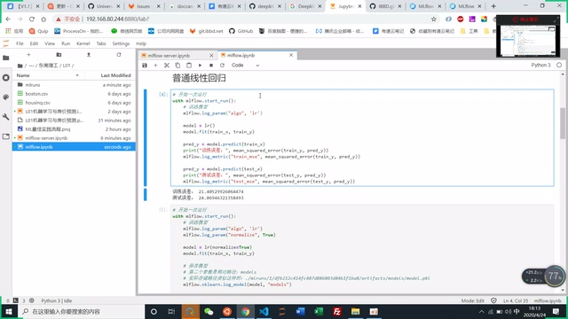

*普通线性回归中的运行上下文、参数和指标记录（原视频 360p，小字以原图可辨程度为限） · [原片 11:24](https://www.bilibili.com/video/BV1UK4y197LT/?t=684)*

我们运行一下，这样就运行了一次。回头看，因为我用了这个，这里就会有这样一条记录，有我们的参数，有指标。这样其实非常简单，非常简单。不过这里只是简单训练，还没有讲保存模型。我们看一个保存模型的。

## 记录关注的参数，并保存模型

其实每一次运行，都得先有这样一个语句。这里我只加载了一个参数，然后训练这个模型。我加了 `normalize=True` 这个参数，也会把它记录起来。所谓参数，就是我们要关注的、这次训练要关注的那些因素，所以都可以记录起来。

这里比较正常。然后 `mlflow.sklearn.log_model(model, "models")` 这一句是保存模型的，因为我们用 sklearn，它有内置函数。如果不是 sklearn，其他也有对应的函数，大家可以自己看一下。如果你自己写了一个方法、一个模型，比如时间序列的模型，或者其他类型的模型……

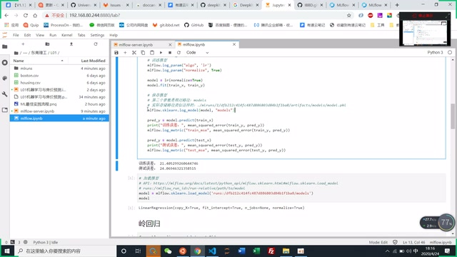

*带模型保存的线性回归代码（原视频 360p，小字以原图可辨程度为限） · [原片 14:12](https://www.bilibili.com/video/BV1UK4y197LT/?t=852)*

这里这个 model 是模型，这个是一个路径。其实每一次运行，都会在这个目录下面有一个……这个是运行 ID，是它自己生成的，其实不用管。前面这部分也不用管，它应该是根据运行 ID 自动生成的。后面这些是它自己的路径，这个 `models` 就是指定的路径，在这里是对应的，是保存文件的名字。后面这些都一样。

我们运行一下。这样又运行了一次。这里不太好的地方是，没法自动更新，要手动更新。这是时间，看时间就知道，这是最近一次运行。多了一个参数。因为这个数据集，改这个参数，效果完全一样。

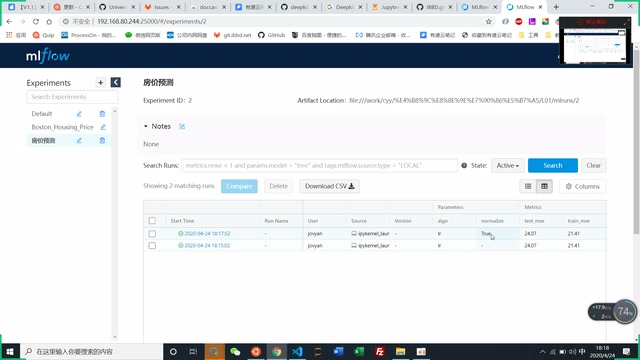

*刷新后出现两次运行及 normalize 参数（原视频 360p，小字以原图可辨程度为限） · [原片 16:00](https://www.bilibili.com/video/BV1UK4y197LT/?t=960)*

## 用运行 ID 找到和加载模型

刚才记录了一个模型，现在要做的是把模型的路径找出来。这里可以点击，点进来看。这里有模型，这个是运行的 ID，我们拿这个就能拿到对应的模型。

其实一开始，不用关注模型保存在哪里。因为我们会不断训练，训练很多次之后，再找一个最好的模型。如果最好的模型能够达到要求，就可以结束这次实验。

结束实验的时候，假如这是最好的，就找到这个 ID。通过这个 ID，就能这样加载它对应的模型。前面这部分是它自己的语法，然后是 ID，这个 `models` 是在这里指定的，这两个地方对应。这样就能把模型加载出来。加载出来以后，就可以这样使用，跟上面的使用完全一样。这个是加载模型的。

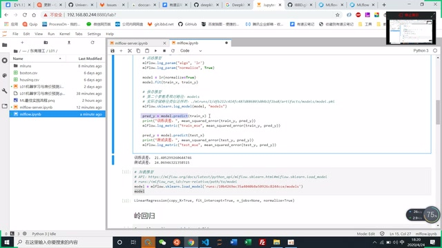

*使用 runs 路径加载已保存模型的代码与返回对象（原视频 360p，小字以原图可辨程度为限） · [原片 17:48](https://www.bilibili.com/video/BV1UK4y197LT/?t=1068)*

所以我们可以看一下对应的路径在哪里。其实就在这里面，但到底在哪个地方，得继续看。可以看到在这样一个路径：有一个 2，2 下面那个 10……就在这里，就在这个地方。要找就是这样找。这里有完整路径，不过没有完全显示出来。

它这个模型的那些参数，这里都会有记录。你用的那些参数是什么，这里会有。刚才那个表格页面，其实都是从这里直接弄出去的，里面所有数据都会有记录。上面看不到，我们可以看这边，记录了很多很多信息。

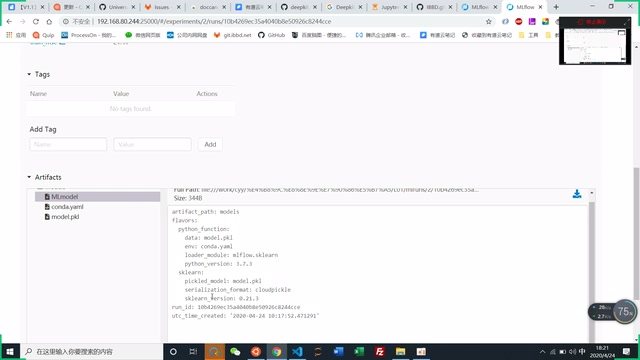

*Artifacts 下的 MLmodel、conda.yaml 和 model.pkl（原视频 360p，小字以原图可辨程度为限） · [原片 19:00](https://www.bilibili.com/video/BV1UK4y197LT/?t=1140)*

这里是参数，会记录你记录的每一个参数。这里是指标。其实如果你多次写在同一个指标上面，它会记录多个。还有标签，因为我没有用到。

如果一个指标写多个值，特别是那种，假如这个模型要跑 100 步，每一步都可以记录一个指标，就可以有这样的体现。把 100 个值写到同一个指标里，就能查到一条变化趋势。假如你训练 100 步，每一步记录一个指标，它就能够算一条曲线出来。这里只有一个值，就不会有那个曲线。

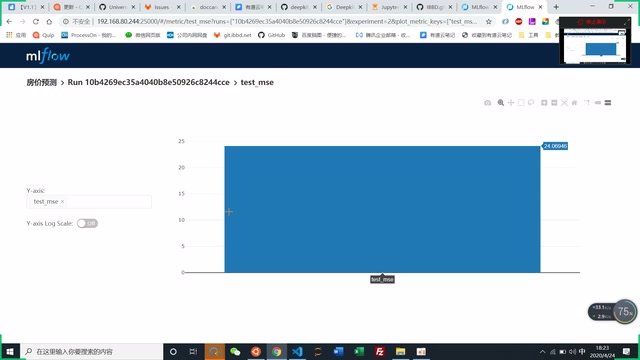

*点击 test\_mse 后的指标图；本次只有一个指标值（原视频 360p，小字以原图可辨程度为限） · [原片 20:36](https://www.bilibili.com/video/BV1UK4y197LT/?t=1236)*

## 我建议的最佳实践流程

这就是主要用法。当然还有很多其他用法，但那些我觉得可能没那么必需。这几个我觉得比较好，涉及的函数就几个，后面其实就是重复，没有什么特别好说的。

大概流程就是先创建实验，然后开始运行。后面选择算法、调参，这些是模型自己的事情。然后记录参数，就是这种。训练、保存模型，刚才那个地方有 `log_model`，其实还有一个 `save_model` 的函数。保存模型，记录指标，然后结束运行。

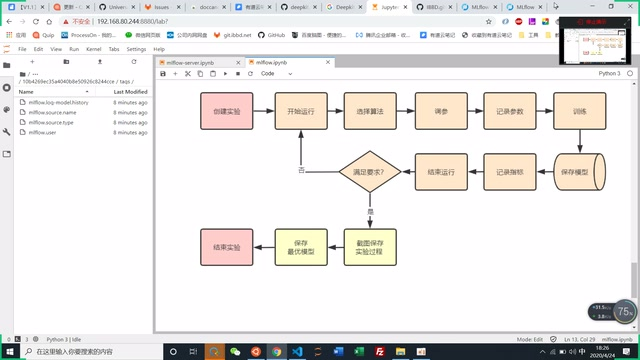

*最佳实践流程图：实验、运行、记录、判断和保存（原视频 360p，小字以原图可辨程度为限） · [原片 24:00](https://www.bilibili.com/video/BV1UK4y197LT/?t=1440)*

结束运行之后，就可以来到这个页面，判断模型是否符合要求。如果不符合，就继续迭代运行，迭代地调参、选择算法这些。如果满足要求……这个地方应该还要做一个步骤：截图，做一个保存。

截图保存之后，后面的就比较简单。就算模型丢了，有这个图，我也知道训练的时候用了什么算法、什么参数，也能够把它重现出来。

截图保存以后，还应该把最优的模型保存起来，这可能是要交付的模型。保存起来，那就结束实验。这样可以建多个、很多个实验，看自己的需要。

大概就是这样。这里还可以下载，其实不用截图，下载就可以，把这个 CSV 文件下载回去。下载 CSV 文件，跟那个模型，这两个保存起来就可以了。

## 问答：深度学习、命名与循环运行

深度学习也可以。等于自己控制，自己决定保存哪些参数、哪些指标，自己决定就可以。

问：这个时候可以写个循环，让它自己去迭代？刚才那个 LR，它没有迭代？

对。LR 只是我那个线性回归的缩写。我这个参数还记录了算法名字，我的意思是这个。

问：那你怎么知道它记录的是什么？

这个是我自己对应的，你自己知道就可以了。我是说，你去获取它的值的时候，自己知道这个 LR 对应什么，你自己跑的。其实问题不大，只要自己知道就可以。这东西太长了，我就把它弄成……[此处用词识别不清，按上下文指简短名称。]

问：我有个疑问，看每一次就跑一次模型，那边记录提出的参数。假如我想一个循环，里面的值有一些递增，比如从一到十，我改了一个参数，从一改到十，要跑十次模型，那边能不能把结果都记录下来？

如果你写在同一个参数里面，就会有刚才那个效果，就这里这个地方，同一个参数的值会记录在这里。[讲述中此处称“参数”；随后演示的是同一指标多次记录的曲线，保留原称呼。] 它有一个图，会生成折线图。通常用在那种模型训练要跑 100 步，每一步记录它的指标，就会出来这样一条曲线，通常递增和递减的那条曲线。

问：参数是不是可以那么设定？比如做深度，我从二开始往上做，那个值感觉可以了……比如第一次训练这个模型，深度是五，然后往上加。因为我要做遍历，可能加上一个循环。第一步深度五，第二次深度六，第三次深度七。否则训练出来以后都散了，不知道哪个是五、哪个是六。

你可以加一个参数，深度什么的。加一个参数叫深度，就可以。

问：问题是深度改变了五次。

是这样的，你先设计一下要保存的结果大概是什么，然后就这样子。刚才说这两次，在各个字段的值一样……[这句交流个别词不清。] 每次要保存什么，你要明确。

问：那参数还要放在 for 循环里面？参数的赋值要放在……

对，放在外面，那五个结果全都做了。[原交流此处指代不完整。]

我感觉不太需要这种情况，因为调参就是这么调。手动调，就是这样调，但是一个一个调太慢了。一般做个循环，一般就是把这个东西封装成一个函数，在外面传参数进来。把它封装成函数，外面传参数进来。

## 问答：随机搜索及保存最优参数

其实调参通常不是要去循环的，应该用的是……sklearn 里面应该有三种，一种是网格搜索，一种是随机搜索，还有贝叶斯。贝叶斯我们没有具体用过。如果只是对比网格搜索和随机搜索，可能随机的会好一些，随机可能会好一些，但随机会有些不稳定，因为它是随机的。

那种其实用起来挺简单。我这里写了一个，就是这种。先定义一个参数字典，这是它的步长。我这里从十到一千，每十个取一个。这个是它的求解器，但有一些放进去会报错。

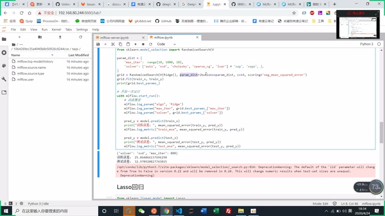

*RandomizedSearchCV 参数字典与最优参数记录代码（原视频 360p，小字以原图可辨程度为限） · [原片 31:54](https://www.bilibili.com/video/BV1UK4y197LT/?t=1914)*

这是随机搜索的，这里是岭回归。我把参数传进去，先定义，其实这里设置一个指标，然后这个就训练了。训练会得到一个最优的参数，我就直接把最优的参数保存起来就行了。

如果是循环，就把这一块包装成一个函数，它就可以把每一个结果……再重新一下。[末句操作指代不清。] 很好用，大概就是这些。

用起来还是很好用。它不会像以前做的那种可视化，绑得很死，只能够照着它做，只能够用上面提供的参数去调。而且跟 Notebook 也很难联系，数据清洗的时候就很麻烦。这种基本上不会太干扰原来训练的流程，只是在要记录的地方，把它记录起来就可以。

大概就是这些，有什么问题？

## 问答：其他框架与自定义模型的保存

其实用其他算法，要注意它支持的算法。它内置支持的包就是这些。你自己的一些函数，比如现在用到的时间序列那种，里面没有支持的包，就只有刚才这些。那就自己实现，它也有 save model 之类的，自己去实现。

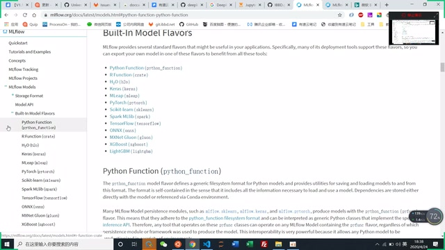

*文档中的 Built-In Model Flavors 列表（原视频 360p，小字以原图可辨程度为限） · [原片 36:00](https://www.bilibili.com/video/BV1UK4y197LT/?t=2160)*

模型其实就是一个文件，就是保存文件那个地方不一样。这里可以用内置实现的方法保存文件。保存文件其实还有一些技巧：训练很多次，每一次训练其实都应该保存一个模型，但是保存的模型又要跟那次训练对应起来。

如果自己保存模型，得先……它有函数能拿到训练的 ID，拿到这个值之后，再根据这个值保存模型。就是每一个训练 ID 都保存一个模型，其实类似它这个目录结构：每一次训练的 ID，都保存一个模型，要这样子。

[35:45—35:55：接上文的一句口语无法可靠辨认；35:55—36:19 主要为简短确认和停顿，ASR 多次生成连续“对”。]

还有很多……很多。[36:19—36:40 的零碎词句只能恢复“还有很多”“打开”“比如”“一些”，不能连成可靠解释。]

大概就这些东西。对，看这个也有……[36:40—36:55 后半句不清。]

我看见它上面应该有些例子，它要用的时候，就已经找到那边，它是有一些例子。[36:55—37:25：结合两次局部识别只能恢复上述大意，末句重复的具体说法不清；同期屏幕翻阅 Python Function 和 R API 文档。37:25—37:29 为衔接。]

以上各处保留可恢复的短句；未把 ASR 连续“会”“谢谢大家”当成有效解释。

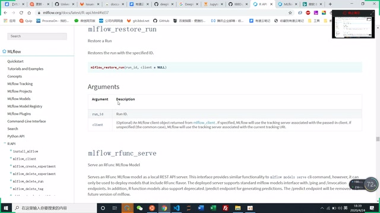

*MLflow R API 文档中的 restore\_run 与 rfunc\_serve（原视频360p，小字以原图可辨程度为限） · [原片 37:24](https://www.bilibili.com/video/BV1UK4y197LT/?t=2244)*

大概如果是自己其他类型的模型，不一样的地方就是保存模型。保存模型通常要跟训练 ID 对应，每一个训练 ID，都能够根据它找到模型，后面才比较好操作。

因为我最后才决定要哪个模型。最后决定的时候，只有这个东西，有训练的 ID，就要根据这个 ID 找到对应的模型。重点在这里，保存模型的时候，按这个点就能找到对应的模型。

## 问答：自定义损失函数与 MLflow 的关系

问：如果自定义损失函数，或者评价函数，也一样，需要重新写它的方法？

不需要，不需要。

问：我记得以前用 Keras，重新定义一个损失函数，调用的时候加载进来，就预测不了，说没有那个东西。模型可以保存，保存以后，再把模型加载进来预测就用不了。它说需要……[提问末尾涉及所缺定义的用词不清。]

这个 MLflow 跟你训练、跟你原来是完全没有关系的。原来的指标是什么，那这个指标是你实现的。MLflow 做的东西，就是把你这个指标记录起来。你传什么就是什么，这跟 MLflow 没关系。

传什么都可以，叫什么名字也可以，自己比较好理解就可以，这跟 MLflow 没关系。就算这里不用 MSE，用其他东西放进去也可以。就算这里写错了，直接写一个值在这里，它都可以，只是这个东西是你自己写错了。

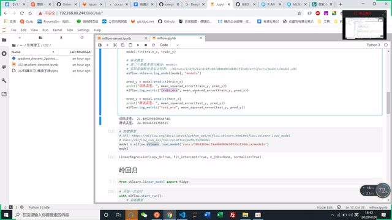

*示例中的 train\_mse、test\_mse 指标记录代码（原视频 360p，小字以原图可辨程度为限） · [原片 39:48](https://www.bilibili.com/video/BV1UK4y197LT/?t=2388)*

## 问答：调参搜索能否保存每一组结果

问：如果用了网格搜索，或者随机搜索那种调参方法，会记录每一次设定的结果吗？

这个好像没有提供每一次的值，我把最优的值……[这段对搜索结果接口的交流存在低置信识别。] 每一次设置，它会……网格搜索……会有结果。[原问答中间多句无法可靠恢复，保留此缺口，不据猜测补出接口名称或返回结构。]

刚刚不是讨论，如果想记录每一次，就写个 for 循环？它会得到你那些结果。那就是自己写的网格搜索。

对，所以要这样做，可能就这样。自己写一个 for 循环实现。

问：可是它自带的那个，应该是优化过的；直接自己来，可能得……[后半句识别不清。]

对。其实如果要观察每一种值，随着参数值变化的趋势，可能自己写一个函数还是有必要的，因为这样才能看到趋势。

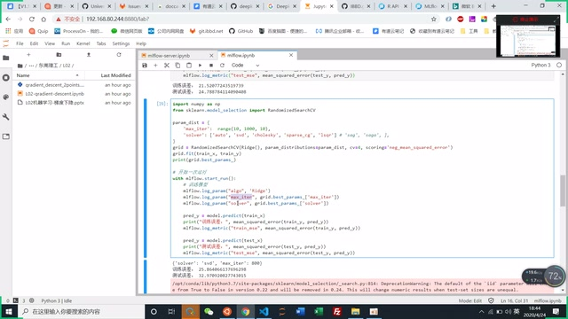

*随机搜索代码及其输出、警告区域（原视频 360p，小字以原图可辨程度为限） · [原片 41:48](https://www.bilibili.com/video/BV1UK4y197LT/?t=2508)*

我觉得大家在训练的时候，可以采取这种形式，能够把自己的训练过程记录下来。那样子……[连接句识别不清。] 而且有时很难把训练和模型对应起来，因为模型是一个文件，很难跟它对应起来。

我做的量小，我想你们深度学习的训练都要好长时间。[末句个别用词不清。]

行啊。没什么就这样。好，好，谢谢。
