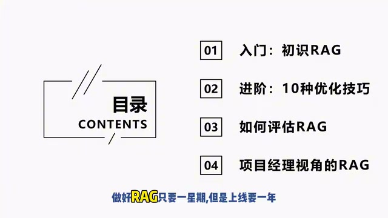
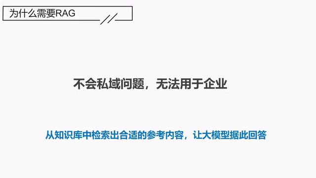
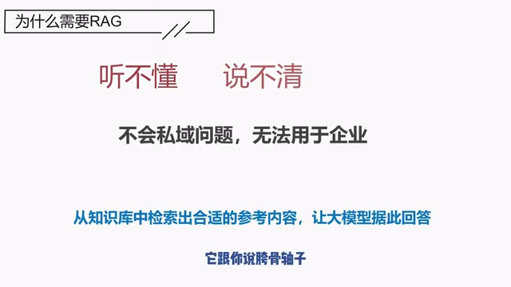
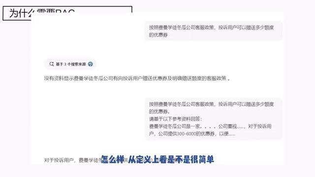
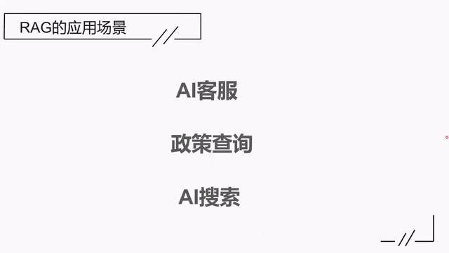
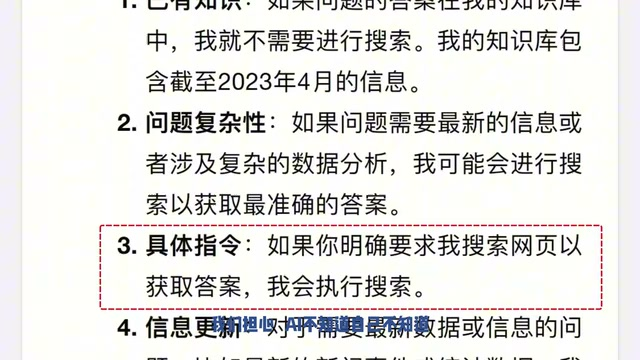
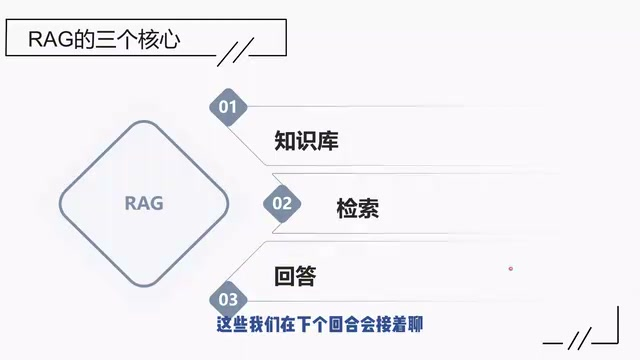

# 01：为什么需要 RAG

> 整理方式：按原顺序清理口语的忠实图文讲稿。来源为第 1 集，范围 00:00—07:45。截图保留视频原始 640×360 分辨率；画面里的细小文字以原图为准，正文保留讲者实际讲到的内容。

## 课程开场：做好 RAG 只要一星期，但是上线要一年

这是我们这一次的课程。整个课程其实说起来，背后包含着一句后面你们会经常听到的话：做好 RAG 只要一星期，但是上线要一年。

*课程目录展示四个部分，并强调做好 RAG 与上线的时间差。 · [原片 00:24](https://www.bilibili.com/video/BV1Ev6ZYiE8T/?t=24)*

## 为什么企业需要 RAG：大模型不知道私域知识

首先，我们还是来简单地了解一下 RAG 是什么。大模型爆火到现在已经有两年了，大家肯定没少用。作为个人用户，大模型的厉害之处，我觉得我们都感受到了。但是作为企业用户来看，大模型其实有一些缺陷。这些缺陷很多，包括幻觉、知识更新不及时等等。但是在我看来，最重要的缺陷是：大模型天然无法回答私域问题，以至于它没有办法深入地用于企业。

什么是私域问题呢？答案藏在你企业内部的问题，就叫作私域问题。我们都知道，大模型所有的知识是来自它的训练数据，训练数据以外的知识，它是不知道的。今天大模型主要的训练数据来自公开的互联网，藏在你企业内部的数据没有被用于训练，大模型自然不懂。

*“为什么需要 RAG”页强调私域问题，并显示从知识库检索参考内容再回答的思路。 · [原片 01:12](https://www.bilibili.com/video/BV1Ev6ZYiE8T/?t=72)*

说句题外话，虽然数据都是来自互联网，但是根据最近的人工智能大会上专家的消息来说，目前数据已经能用的都被用光了。专家说，人类只有一个互联网，只有一个互联网，数据已经被用光了。当然，这是他们的事情，我们不管，我们接着说。

那我们举个例子，为什么说不能回答私域问题？比如说你问大模型：“按照费曼学徒公司的客服政策，投诉用户可以赠送多少额度的优惠券？”这大模型就做不好。为什么？因为你们公司的客服政策是存在你们企业内部的，大模型从来没有用过，自然就没有办法准确回答。

但如果回答不了私域的问题，那大模型说白了，也只是好玩，并不能好用，因为它没有办法深入运用到企业内部。大模型具备强大的理解和总结能力，其实在很多企业的场景里面是可以有所作为的。

## 客服机器人的问题：听不懂、说不清

比如说客服机器人。以前的客服机器人，大家都接触过。比如你去京东或者淘宝上买东西，会有个机器人蹦出来给你回答问题，就是那个。那么以前的客服机器人，它有两个问题，一个是听不懂，一个是说不清。经常是你跟它说“前门楼子”，它跟你说“胯骨轴子”，各聊各的，它听不懂你在问啥。

*课件用“听不懂、说不清”概括旧客服机器人的两个问题。 · [原片 02:52](https://www.bilibili.com/video/BV1Ev6ZYiE8T/?t=172)*

好不容易有一个听懂的，结果它要让你自己从它给的文字里面去找答案。但是它给的材料里面通常杂乱无章，非常非常地乱。所以相当于什么呢？相当于让你去屎里淘金。每次遇到机器人，我都条件反射地选择：“人工，人工，人工！”赶紧把人工客服给我召唤上来。

但是这个问题就可以用大模型解决。大模型的理解能力很好，它的问题不是听不懂，是不知道，所以你要让它知道。那怎么让它知道呢？很简单，你把参考材料给它。比如说对于我们刚刚的那个问题，费曼学徒公司的客服政策，你就给它一段参考材料，大模型就能够回答。

## 给参考材料，大模型就能回答

那我就在大模型上面尝试了。比如大家看一下这个图，“按照费曼学徒……”你看，我这里就问它。第一次问它的时候，它还去找了资料，然后说不知道。第二次的时候，我除了问它问题，我这里还加了一句，让它基于参考材料去回答。那我给的参考材料里面提到费曼学徒是一家什么样的公司，关键是里面有一句：公司会提供 300 到 6000 的优惠券。有了这个信息之后，大模型就能够回答了。

*同一个客服政策问题，图中对比没有参考材料与加入参考材料后的回答。 · [原片 04:36](https://www.bilibili.com/video/BV1Ev6ZYiE8T/?t=276)*

各位，这个就是 RAG 了。简单来说，就是根据给定的问题，从知识库中检索到合适的参考内容，然后让大模型据此回答，这个就是 RAG 的核心。怎么样？从定义上看是不是很简单？事实上就是这么简单。在这里面，找到合适的文档是 RAG 的核心，这个后面我们会细说。

## RAG 的应用：AI 客服、政策查询和 AI 搜索

不要看 RAG 看起来好像很简单，作用其实不少。比如说还有什么用处呢？AI 客服，我们刚刚已经说了。

政策查询。我之前就一直在问公积金怎么商转公，问到一些细节，一搜索就是一堆材料，我经常自己琢磨了半天。但如果你用上 RAG，把相关的政策材料作为知识库，让 RAG 系统根据提问去检索可能的材料，然后再总结，再组织语言来回答，这个效果就会好很多。而且这个过程，我们还可以不断地追问，直到把这个问题搞清楚。

*课件列出 AI 客服、政策查询、AI 搜索三个应用场景。 · [原片 05:12](https://www.bilibili.com/video/BV1Ev6ZYiE8T/?t=312)*

再比如说 AI 搜索。AI 搜索引擎用的也是 RAG，最典型的就是我们刚刚看到的 Kimi。你没有发现，你现在问 Kimi，它经常是到了网上去搜索相关的资料，然后才来回答你的。

我们可以自己看一下 Kimi 是怎么说的。我问 Kimi：“为什么有些时候你搜索网页，有些时候不搜呢？”它说了一堆，总的来说就是，当它懂的时候，它没去搜；它不懂的时候，它就去搜了。

注意这里第三条，说我们经常提到的这个技巧：有些时候，你可以明确要求它要搜索网页，那它就一定会去搜索。就是有些时候，我们担心 AI 不知道自己不知道，所以会直接要求它搜索网页之后再来做的。

*Kimi 回答截图中，第三条说明明确要求搜索网页时会执行搜索。 · [原片 06:00](https://www.bilibili.com/video/BV1Ev6ZYiE8T/?t=360)*

## Kimi 用的是不是 RAG？

那很有趣的是，当我问它“你用的是 RAG 技术吗”，它说不是，它也不确定。它搜了 21 个网页，了解什么是 RAG 之后，觉得自己不一样。那我只能继续对它循循善诱，它还是觉得不是。理由是，虽然大家都是先检索再回答，但 RAG 中这两个步骤是统一的，它是分开的。

在这里，Kimi 了解得就有点狭隘了，就是 RAG 的这两个步骤也是可以分开的。事实上，今天 RAG 有很多品种，很多种范式。我继续给它抽丝剥茧，这一次它终于悟了，终于说自己用的是 RAG 技术了。我这可不是逼供，也不是诱供，我这是以德服人，以理服人。

*课件并排展示追问 Kimi 是否使用 RAG 的对话过程。 · [原片 06:48](https://www.bilibili.com/video/BV1Ev6ZYiE8T/?t=408)*

## RAG 的三个核心：知识库、检索和回答

那到这里，相信你已经明白什么是 RAG，以及 RAG 有什么作用了。按照这个定义，我们可以发现 RAG 有三个核心：知识库、检索和回答。

知识库，对 Kimi 来说，互联网就是它的知识库。对企业来说，也要构建自己的知识库，问题是怎么建？

检索，RAG 的核心是找到合适的参考内容。你如果给 AI 错误的材料，AI 也只能给你错误的答案，所以怎么检索很重要。

生成，你检索出了 20 个文档，哪些文档放前面，哪些文档放后面？是一起甩给大模型，还是分批给？会不会有不一样的生成效果？这是生成阶段要考虑的问题。那这些，我们在下一个回合会接着聊。

*结尾课件展示 RAG 的知识库、检索、回答三个核心。 · [原片 07:44](https://www.bilibili.com/video/BV1Ev6ZYiE8T/?t=464)*
