# 02：RAG的基本流程：为什么说上手RAG只要一星期

> 本文为按原顺序整理的忠实图文讲稿。原视频约24分57秒，原始分P为1。识别疑点在相邻文字标注；图片为640×360源视频原帧。

## RAG的简易流程：知识库准备与线上提问

首先我们来介绍一下RAG的简易流程。这个就是RAG的流程，红色和蓝色分开看，中间是数据的处理环节，红色和蓝色是各自的数据。

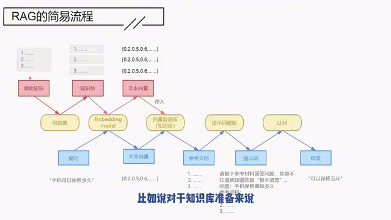

*RAG流程：红色知识库准备、蓝色线上提问 · [原片 00:24](https://www.bilibili.com/video/BV1zv6ZYiE8Q/?t=24)*

先看一下红色的。红色是知识库的准备过程，蓝色是线上的提问过程。比如对于知识库准备来说，一开始你会有一个文档，然后这个文档需要通过切割器进行切分。切分之后，我们就得到了具体的、一个一个的知识块。这些知识块不会直接存入数据库，它要先转化成为向量，然后才把这个向量存入数据库。这样，知识库就准备好了。

有了知识库之后，就可以开始用于线上的提问环节。比如你这里问了一个问题，它会先把这个问题也转化成为向量，然后拿着这个向量到知识库里面，去寻找最匹配的参考文档。拿到参考文档之后，把参考文档和之前提问的东西一起输入到提示词模板，你就得到了提示词。比如这里就是我们的提示词。这个提示词输入到大模型之后，就会得到反馈的结果了。

整个流程应该来说还是比较清晰的。这里有一些节点，可能没接触过RAG的同学一定会有疑问：比如这里为什么要切割？为什么要转成向量？首先，为什么要切割呢？举个例子，比如我问你《西游记》里面孙悟空有几种变化，让RAG来回答的话，你不可能把整个《西游记》丢给它，对不对？即便这个模型可以从《西游记》里面提取出他有几变，即便它可以回答这个问题，但这也不是一种推荐的做法，因为这个很浪费电嘛，是不是？

## 在线、离线与索引、检索、生成三个阶段

我们现在来看一下整个流程的划分。刚说的蓝色，我们称它为在线过程，就是你在线应用的阶段；红色是一个离线准备的过程，所以这两个阶段是可以分开的。

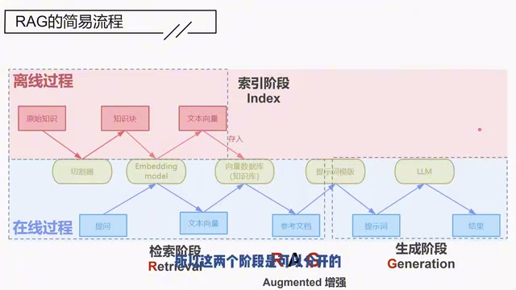

*离线索引与在线检索、生成阶段 · [原片 02:24](https://www.bilibili.com/video/BV1zv6ZYiE8Q/?t=144)*

更具体地来看，红色我们称它为索引阶段，蓝色这里这一块我们称它为检索阶段，这里称为生成阶段。检索阶段的目的，就是要检索出相关的文档；生成阶段是拿着检索到的材料去生成结果。索引阶段是指，你在这里建知识库的时候，也建好相关的索引，这个索引用于检索阶段。

RAG里面的R就是指检索，G指生成，中间这个A指增强，所以RAG是指检索增强生成。怎么样，现在对于这三个字母、对于RAG这个名词，有深刻的了解了吧？接下来我们来仔细讲一下每一个环节。

## 准备知识库：收集知识

首先是知识的收集。在知识收集阶段，我们要根据RAG的应用场景来决定收集哪些知识。比如你做产品的AI客服，是对公司的相关产品进行回答的吧？那你就不能把公司的规章制度放进来，对不对？所以知识是根据你的场景去进行收集的。

在收集知识的时候，我们有几个注意要点。比如你的知识存在哪里？是有Word、PDF、Excel，还是数据库里面就有？不同的知识存储的地方，有不同的数据处理方式。比如PDF一直以来就是一个比较大的难点，它存的其实是一个图片。针对这种PDF，你可能还要用一些OCR手段，处理起来就比较麻烦。

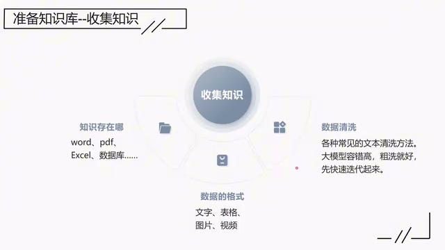

*收集知识时的存储位置、数据格式与清洗 · [原片 04:24](https://www.bilibili.com/video/BV1zv6ZYiE8Q/?t=264)*

另外，你要考虑数据的格式是什么：文字、表格、图片或者视频。文字比较简单；如果还涉及到图片和视频，你就要考虑是不是要用上多模态。

完成这些数据、知识的抽取之后，你要对这些知识进行相应的清洗。我个人感觉，大模型的容错性比较高，所以你在建设RAG系统的时候，先粗洗就好。这是收集知识。

## 切分文档的核心：语义连贯性

完成知识收集之后，下一阶段就要进行文档的切分。文档的切分也有很多种，我们今天会举一些例子。但是不管你用什么样的文档，最终的核心，就是你在切分的时候要保障语义的连贯性。要保障语义的连贯性，就是你应该尽量保障划分后的同一段文本里面，语义是统一的、完全的。

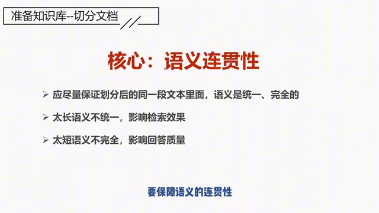

*切分文档的核心：语义连贯性 · [原片 05:00](https://www.bilibili.com/video/BV1zv6ZYiE8Q/?t=300)*

这也就意味着你的文档不能太长，也不能太短。如果太长，语义不统一，会影响检索效果。所谓语义不统一，是指一个文本块里面可能包含多种语义。比如这个文本块里面又讲到A，又讲到B，又讲到C，是不是？当你对A进行提问的时候，由于文本块里面又有B又有C，这一定程度上会影响检索效果。太长不好。

第二个，太短也不好。太短的话语义不完全，会影响回答质量。比如同一个文本块，你虽然介绍的是A，但是你没有介绍齐全，这就会导致我们对A进行提问的时候，它的回答质量可能会受到影响。所以记住这个核心，不管你用什么方法，核心是保障语义的连贯性。

## 切分文档的四种方法

接下来具体介绍一下有哪些方法。我们这里举四种例子。第一个是固定大小切分，按字符数或者按token数。比如给定一个文档是1000字，这1000字可能可以分成500个token。你按固定大小去切分，比如每100个token一个段落，那么这个文档就可以分成5个段落。或者按100个字符一个知识块，那么1000字的文档就可以分成10个。这是按固定大小去切分。

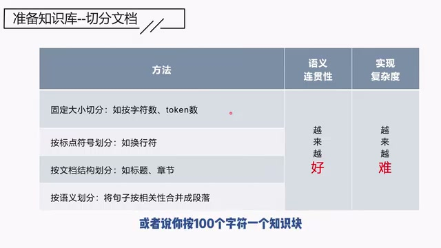

*四种文档切分方式及语义连贯性、实现复杂度 · [原片 06:36](https://www.bilibili.com/video/BV1zv6ZYiE8Q/?t=396)*

你一看就知道，这个效果肯定不会好，对不对？效果肯定是比较糟糕的，但是实现方法比较简单。

第二种是按照标点符号划分。这个相比第一个可能会好一点，因为它起码保证了同一个句子不会被切开。用第一种方法，同一个句子有可能被切成两段；但你用标点符号去划分，比如用句子或者用换行符，起码保证一个完整的句子、一个完整的段落不会被切开，相对也会好一点。

第三个是按照文档结构进行划分，比如按标题和按章节。这其实就是一定程度上考虑文档可能潜在的语义是什么样的。比如它认为一个小标题就是讲同一件事情，或者一个章节讲的都是某一个相似的事情，那么就可以把文档按照标题或者按照章节去划分。

下一个是什么呢？按照语义划分。按照语义划分，是指我们在划分阶段先按句子去划分。因为基本上按照我们的书写习惯，一个句子基本上最多只包含一种语义，就是一个句子里面包含的语义比较统一，但是有可能统一却不完整，对不对？

所以我们先按句子去划分，但是要再做一个动作，就是按照相关性把句子再做一个整合。因为你按照相关性去整合，这样就会保证把语义相似的这些句子最后拼在一起，所以又保证了语义是独立的，又保证了语义是完整的。所以按语义划分也是一个方案。

这些方法按照语义连贯性，从上到下越来越好，实现复杂度相应地肯定越来越难。我们再强调一遍：具体怎么划分，要根据你的知识来定。我觉得没有固定的套路，核心就是要保证语义的连贯性。

有一种场景，如果原本已经有丰富的那种问题、答案对，那其实就很好做了。以前如果自己做过知识库，或者做过那种问答库，你已经构建好了问题和答案对，那么可能连切分都不用做。你的问题天然地就是已经切分好的知识块，连切分都不用做了。

## 文本向量：为什么转，怎么转

好，完成知识切分的讲解之后，我们就得到了知识块。下一步我们讲知识块怎么转化为向量。

说到文本向量，很多人最大的困惑是：好好的一个文字，你为什么把它转成向量？以及你凭什么把它转换成这一段向量呢？转成向量，最简单地说，是为了让计算机能够处理文字。文字直接给计算机，它处理不了，它只能处理数字，所以你一定要把它转成数字。问题是怎么转化？其实文本向量的转化，从历史到现在衍生出了很多种做法。我们来举个例子，比如现在有两段文本，然后你要把它转成向量。第一种最简单的叫做去重词袋法。

假设我们已经分好词了，就是“猴头”是一个词语，“留着”也是一个词语，然后把所有词语去重之后成为表头，就成为字段名。对于每一个文本，我去判断这个文本里面有没有“猴头”这个词，有的话标记为1，没有的话标记为0。

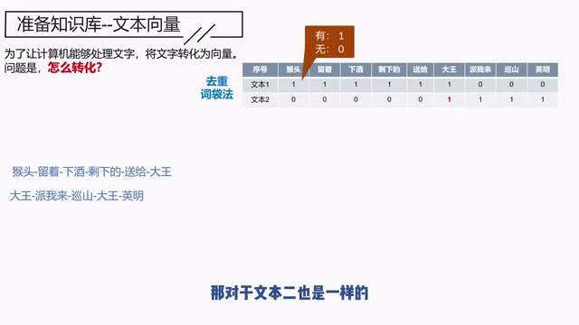

*去重词袋法：文本与词汇的0/1对应 · [原片 10:48](https://www.bilibili.com/video/BV1zv6ZYiE8Q/?t=648)*

对于第一个文本来说，“猴头”有，“留着”有，这一段都有：“猴头留着下酒，剩下的送给大王”，这些词都有，所以都标记为1。然后“派我来”“巡山”“英明”没有，所以就标记为0。

对于文本二也一样。文本二有“大王”“派我来”“巡山”，有这几个词，所以标记为1，其他的标记为0。这就是一种把文本转化为向量的方法。

为什么称它为去重词袋法呢？去重词袋法是我只管你有没有，不管你有多少。像“大王”这个词，在文本二里面出现了两次，但是我只给它标记为一次，所以这叫去重词袋法。对应的，也有一种叫做不去重词袋法，就是不去重。这种都比较简单。

类似的，后面还衍生出一种叫做TF-IDF的方法。TF-IDF方法比较复杂，但其实本质上也是要先把这个词摘出来，放到表头。不同的是，TF-IDF对于词的数值，不再用1或者具体的数量来表达，而是会用TF-IDF里面定好的一个公式来计算。这个公式我们不打算讲，因为我觉得不是这个课程的重点，往下一讲就太拖沓了。总而言之，也是一种类似的方法。

这几个方法的共性特点是什么呢？稀疏，就是稀疏。稀疏是指，在这么长的一个向量里面，大部分都是0，只有少部分有数值。用这个案例你可能还看不出来，你要想象一下：这还只是两个文本，只抽取出了大概十个左右的词汇。我要是把《三国演义》放进来，里面可以摘取出来的词就不得了了，万把个是不在话下的。给定一个文本，比如500字的文本，在这万把个词汇里面，你肯定只占据其中一部分，所以就会导致向量非常稀疏：大部分都是0，少部分有数值。以上这些都称为稀疏向量。

## 稠密向量与词嵌入

后来又衍生出一种，我们称为稠密向量，也就是现在在用的、基于词嵌入的方法。词嵌入阶段，上面的维度就不再是词汇。事实上，上面这些维度没有特别的意思，所以我们直接用维度1、维度2，直到维度1024来表示。也不一定是1024个维度，有可能是512，有可能是768，这取决于你在训练阶段用的是多少维度。也就是用这种方法，维度就确定下来，不管给什么样的文本、不管是什么样的词，它都是这么多维度。这是我们的词向量。

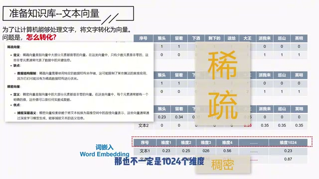

*稀疏向量与词嵌入稠密向量示意 · [原片 13:24](https://www.bilibili.com/video/BV1zv6ZYiE8Q/?t=804)*

它有什么特点，最大的优点是什么呢？语义的相关性，它可以捕捉得很好。语义的相关性，它可以捕捉得很好。比如它可以捕捉到“快乐”和“高兴”是同义词，也可以捕捉到“北京之于中国，等于巴黎之于法国”，可以捕捉到这种关系。因为对于中国来说，北京是它的首都，所以如果让它填词汇，它会在这个格子里面填巴黎。这是它的一个优点，就是语义相关性捕捉得很好。

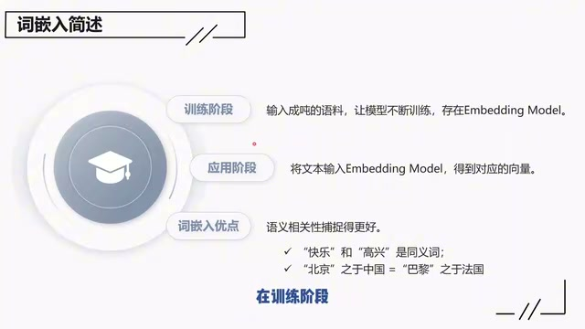

*词嵌入的训练、应用与语义关系 · [原片 14:24](https://www.bilibili.com/video/BV1zv6ZYiE8Q/?t=864)*

我们这里也介绍了，它在训练和应用阶段分别是怎么做的，大家做一个了解。因为通常我们不会自己去训练，我们都是直接应用。在训练阶段，你要输入成吨的语料，最后得到一个Embedding Model；在应用阶段，把文本输入这个模型，就得到了对应的向量。

## 选择Embedding Model

对我们应用者来说，我觉得只要关注一点，就是如何选择合适的向量模型。我们这边也给了一个建议，就是Hugging Face。你可以到上面去搜索，点击这个网站，然后再点击Retrieval，因为我们这里介绍的是Retrieval环节，再点击中文，你就可以知道现在用来检索的向量模型哪个比较好了。OK。

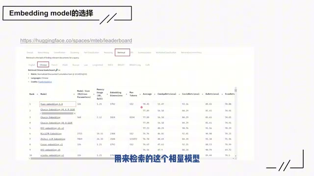

*原视频展示的Hugging Face检索模型榜单 · [原片 15:00](https://www.bilibili.com/video/BV1zv6ZYiE8Q/?t=900)*

## 向量存储与向量数据库

接下来继续说向量怎么存储。如果说到数据库，大家肯定会想到MySQL、Oracle之类的数据库。但是对于存储向量，对于向量这么特殊的数据，其实有更好的数据库，就是向量数据库。

向量数据库主要有三种作用：一个是嵌入文本。就是刚提到的上面那个环节，其实在实际开发过程中，你不需要自己去做，向量数据库基本上可以帮你做完这件事情。你只要在构建向量数据库的时候，把向量模型指定给它，当你在进行存储的时候，它会直接帮你完成嵌入的操作。

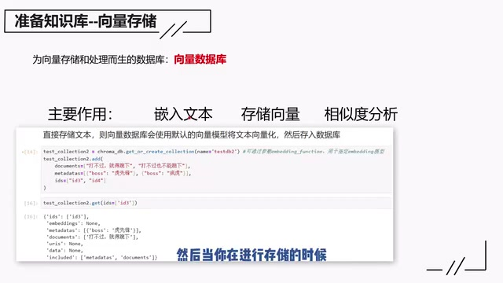

*向量数据库的三种作用与原视频嵌入文本操作示意 · [原片 15:48](https://www.bilibili.com/video/BV1zv6ZYiE8Q/?t=948)*

一个是嵌入文本，一个是存储向量，另外一个是相似度分析。你完成向量存储之后，后面肯定要应用，应用时很大的一个场景，就是检索相似度较高的文档，这个步骤向量数据库也可以帮你完成。比较常见的数据库，这是我比较常见的，但是向量数据库现在也很多了。举两个例子，就是分别是“谷歌的这个向量数据库”，还有FAISS。

> 识别与原述说明：此处画面列出的是“Chromadb、FAISS等”；转写在约16:20识别为“谷歌的这个向量数据库”。这里保留原述识别，不据此改写ChromaDB的归属。

## 检索阶段：基于相似度的检索

现在继续介绍检索阶段和生成阶段。检索阶段这里，向量过程已经介绍了，所以我们只要介绍如何根据给定的文本向量，从知识库中找到对应的参考文档。我们会介绍两种方法。

第一种是基于相似度的检索。本质上现在的问题是什么？就是你有一个问题向量，然后要找到合适的知识块向量。从数学角度考虑，就是要怎么样衡量两个向量之间的相似度。这其实是一个纯粹的数学问题。

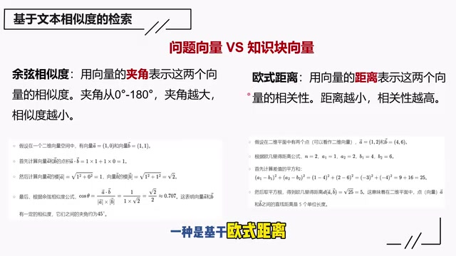

*余弦相似度与欧氏距离的检索示意 · [原片 17:12](https://www.bilibili.com/video/BV1zv6ZYiE8Q/?t=1032)*

这个问题在数学上起码有两种处理方法：一种基于余弦相似度，一种基于欧氏距离。基于余弦相似度，是因为你可以用向量的夹角来表示两个向量的相似度。夹角可以从0度到180度，夹角越大，相似度就越小。另外一种是欧氏距离，是说两个向量之间的距离越小，它的相关性就越高。

这两种方法都比较简单，我们这里也介绍了一个实现过程，但是不打算细讲，有兴趣的自己暂停看一下。这是第一种，基于文本相似度的检索方法。

## 检索阶段：基于关键词的检索

下一种是基于关键词的检索。我们先介绍整个过程。首先第一个阶段，要构造出关键词和对应文档的映射表。怎么做呢？在构建知识库的过程中，会拿到很多文档，假设这些都是文档，那么要进行各种分词、去重，反正各种操作，最终，从这些文档里面提取到关键词。比如这个关键词“下酒”，这个文档的关键词是“下酒”，它对应这个文档，我们把它记录一下。同时它还有个关键词是“大王”，对应的文档也是这个，我们也记录一下。对这个文档来说，就有两个关键词可以对应。

接下来是“跪下”这个关键词，它会对应两个文档，因为这两个都有“跪下”。接下来是“袈裟”，袈裟对应这个。把这个步骤执行完成，把所有文档的关键词抽取完成，就会得到一个关键词和文档的映射表。这是在第一阶段。

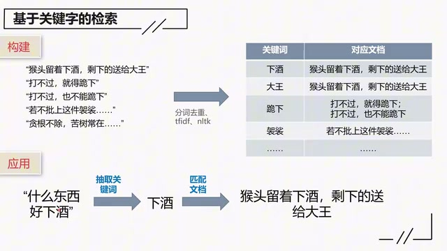

*关键词—文档映射表与下酒问题的检索 · [原片 19:00](https://www.bilibili.com/video/BV1zv6ZYiE8Q/?t=1140)*

第二阶段是应用。应用就是你会拿到一个问题，比如“什么东西好下酒”，然后要从这个句子里面抽取关键词，比如抽取到的关键词是“下酒”，拿着“下酒”到表里面去匹配，最终会匹配到相应的文档。比如可能匹配到这句话：“猴头留着下酒，剩下的送给大王。”这就会成为你的参考文档。

所以你就会把“什么东西好下酒”，以及“猴头留着下酒，剩下的送给大王”，把它构造成一个提示词，然后丢给大模型。大家可以猜一下，什么东西好下酒？我看这个很明显，是吧？

## 两种检索方法的区别与适用场景

这两种方法，就是基于余弦相似度和关键词，两者的区别在哪里？基于余弦相似度的方法能够深入地理解语义，可以挖掘用户问题的真正意图。即使问题的表述方式比较复杂，或者有一些隐喻、一些间接表达方式，它也能够找到相关的知识。比如问它：“天空中飞行的铁鸟如何保证不掉下来？”这里面没有提到飞机，但是当它检索相关参考文档时，会找到跟飞机相关的介绍。因为它有可能知道，你问的问题其实是飞机为什么在空中不会掉下来，对吧？所以它有可能会检索到飞机飞行安全的相关知识。

对于关键词检索，语义理解就比较有限，因为它只是单纯匹配关键词，没有办法理解关键词之间的语义关系，以及跟用户意图之间有什么关系。但是它在有些场景比较有效：当用户的问题很具体，并且知识库文本表述和关键词能够完整契合的时候，效果就比较好。

比如在法律知识库中查找某特定法律条款的具体内容，只要条款编号和名称等关键词匹配，就能够快速找到对应的法律条文。

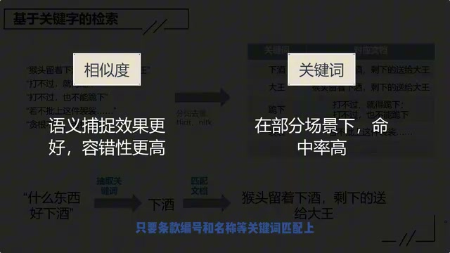

*原视频比较相似度检索与关键词检索 · [原片 21:00](https://www.bilibili.com/video/BV1zv6ZYiE8Q/?t=1260)*

所以这两个各有场景。说白了，具体用哪个，还要根据你的场景来应用，看提问方式和知识的契合程度。可能有人就会问，能不能把两个结合起来？这个我们在优化阶段，会提到怎么把这两种方法结合起来。

## 生成阶段：构造提示词

接下来继续往下说生成阶段。生成阶段，一个是提示词的构造，一个是模型的选择。

首先说一下提示词的构造。这里的主要任务，是把用户的原始问题和参考文档结合起来，组装成一个提示词，然后丢给大模型。在提示词里面，如果你对大模型有什么特别要求，也可以在提示词里面构造。最常见的，比如如果大模型不知道，你希望它怎么回答？

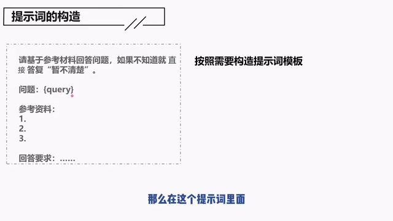

*提示词模板中的问题、参考资料与回答要求 · [原片 21:48](https://www.bilibili.com/video/BV1zv6ZYiE8Q/?t=1308)*

实际应用过程中，我们通常会把这些通用要求写成一个模板。在这个模板里面，只有问题和参考文档是变化的，其他都是固定的，用起来就比较方便。

## 模型的选择：开源与闭源

接下来说一下模型选择。模型选择无非两点：是选择开源，还是选择闭源？模型选择还是比较重要的。因为今天之所以提到做RAG，还是因为大模型展现了强大的理解能力和总结能力。模型的强大是我们做RAG的原因，但是如果最终选择的模型本身不够强大，那就失去做RAG的意义了。

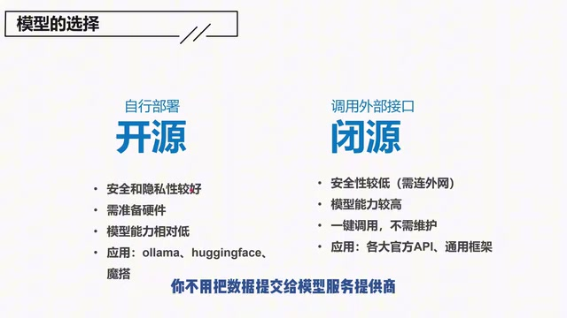

*开源自行部署与闭源外部接口的选择 · [原片 23:00](https://www.bilibili.com/video/BV1zv6ZYiE8Q/?t=1380)*

有两种选择：开源还是闭源，也是各有优缺点。开源就意味着，要自己下载开源模型，然后自己部署。它带来的第一个，首先是安全，隐私性会比较好。你不用把数据提交给模型服务提供商，对吧？不用把数据送出去。第二个，需要准备硬件，这意味着需要更大的投入。然后模型的能力相对会较低，就是开源模型肯定会比闭源模型整体上差一点。

> 视频画面补充：讲者在此处加入了后期纠正画面，写着“这话估计武断了”，补充内容为：2024年12月底，“来自东方的神秘力量”、“AI界的拼多多”深度求索公司发布了DeepSeek-V3开源模型，某些测试排名仅次于榜首的OpenAI o1大模型；关键是成本极低，便宜又大碗，未来可期！！此为原视频自己的补充，保留在此，不把前面的判断改写为新结论。

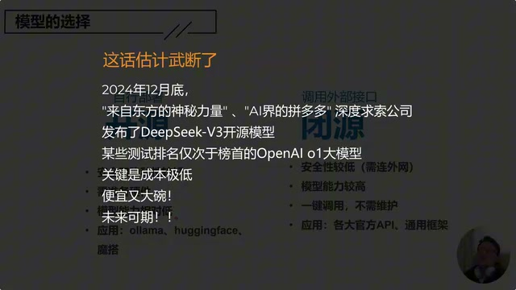

*原视频对开源模型能力判断加入的后期纠正 · [原片 23:20](https://www.bilibili.com/video/BV1zv6ZYiE8Q/?t=1400)*

具体应用来说，可以用Ollama，也可以用Hugging Face，国内也有魔搭，这些大家可以自己了解。

对于闭源来说，一个是安全性肯定比较低，因为要连接外网。在很多项目里面，这一点已经足够成为否决项了。它的好处是什么？模型能力可能比较高，也比较方便，一键调用，不需要维护。具体应用有各大官方API，或者一些通用框架。

## 回顾索引、检索与生成

到现在我们已经完成RAG流程的介绍了，我们总结一下。RAG包含索引、检索、生成三个阶段。索引阶段的目的是搭建一个知识库，支撑后面的文档检索。

这里的核心是怎么切割知识，怎么找到合适的Embedding模型。检索阶段的目的是找到合适的参考文档，核心是检索方式的选择。生成是最后一个阶段，是将提问和找到的文档编成一个提示，然后提交给模型，核心我觉得是大模型的选择。

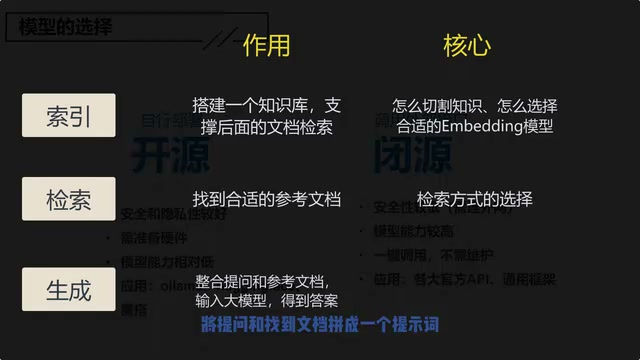

*原视频回顾索引、检索与生成的作用和核心 · [原片 24:30](https://www.bilibili.com/video/BV1zv6ZYiE8Q/?t=1470)*

目前已经完成了第一阶段：简易RAG。很简易，对不对？这也就是为什么说上手只要一周。如果从这个流程来看，你会发现其实真的很简单。接下来会介绍一些优化方案，通过这些优化方案告诉你，为什么上线要一年，因为可以调的真的太多了。好，我们下节课见。

> 校阅说明：讲稿保留讲者原有技术判断、限定和自我纠正，未根据外部资料更新课程内容。已逐窗对照全文和原视频画面，所有最终截图逐张查看。浏览器file协议预览在本次会话被拒绝，因此未进行浏览器桌面/窄屏布局与图片缩放交互测试；未使用服务器或其他协议绕过。
