# 03：RAG的10个优化技巧：为什么RAG不是算法问题，是工程问题

> 本文是按原顺序整理的忠实图文讲稿，保留讲者的解释、例子与判断。视频范围：00:00—20:37；原视频第1分P。截图来自640×360原视频，小字清晰度受源分辨率限制。

首先，我们对原来的流程图做一个简化，方便我们后面讲解。我们刚说了，这里嵌入是自动完成的，所以不需要，我们把这个拿掉。然后流程图就变成了这样子，我们放着，一会儿对比使用。

接下来我们介绍十种优化技巧，希望一定程度上能够让你理解：为什么说RAG不是个算法问题，是一个工程问题。

## 检索优化：small to big

首先介绍五种检索优化的技巧。前三种，我们称它为small to big。我们之前都说过，知识块太大、太小都不好：太大的话影响检索效果，太小影响生成效果。那有没有可能，我们在检索阶段的时候用小的文本块，在生成阶段的时候用大的文本块？可以的。这些方法我们就称为small to big。

### 1. 摘要检索

第一种方法是摘要检索。摘要检索是指，在进行知识库准备的时候，知识块可以切大一点，然后用大模型对这个知识块进行总结，得到它的文本摘要，存入数据库，并且记录原来的这个知识块的内容。

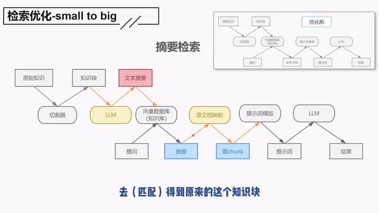

*摘要检索：先检索摘要，再通过原文映射取得原chunk。 · [原片 01:30](https://www.bilibili.com/video/BV1Jv6ZYiEg4/?t=90)*

第二步，在检索的时候，根据提问对这个摘要去进行检索。得到匹配的摘要之后，不是直接用这个摘要，而是拿着这个摘要，去得到原来的这个知识块，用原来的知识块去进行内容的生成。

那这里由于对摘要进行了提炼，所以它的语义会更简练，因此能够提升检索的效果。在生成阶段，又是使用原来的知识块，所以又保证了生成的质量。

### 2. 子问题检索

接下来是子问题检索。这个是指，在这个阶段，知识块同样不是直接存入数据库。

通过把这个知识块递给大模型，大模型会针对这个知识块生成几个问题，然后我们把这几个问题存入到数据库里面去。

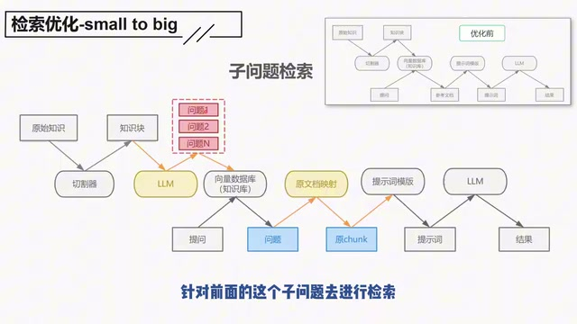

*子问题检索：知识块生成多个问题，检索问题后映射回原chunk。 · [原片 02:20](https://www.bilibili.com/video/BV1Jv6ZYiEg4/?t=140)*

应用阶段，拿到用户的问题之后，针对前面的这些子问题去进行检索，找到最匹配的这个问题，然后再找到这个问题原来的文档映射，最终仍然是拿到原来的知识块去进行生成。

那这样做的好处是什么呢？就是我们之前提过，一个知识块里面可能会有多个语义。我们通过这个步骤，就可以找到这多个语义对应的子问题。最终的话，这个知识块是可以回答多个问题的，那这样就提升了它的检索效果。

比如说，一个知识块里面可能对应着A、B、C几个语义。A问题，我可能可以找到这个问题一；那如果我提的是问题B，我可以找到问题二。我最终都是检索得到这个知识块。这样的话，我对A、B、C问题都可以有一个比较好的检索匹配效果。这是针对子问题的检索。

### 3. 句子窗口检索

下一个是针对句子窗口的检索。这个前面也介绍过了：我们在进行切割的时候，尽量切割成最小的语义知识块，可能是一个段落，也可能是一个句子。

在应用阶段，拿到匹配得到的这个句子之后，我们对前后文档再进行一个拼接。可能比如说，前三句、后三句，把它拼接起来，最终拿到这个拼接后的文档去进行生成。

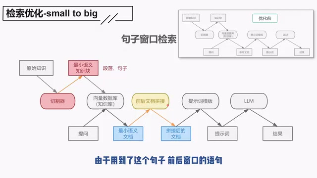

*句子窗口检索：最小语义知识块检索后，进行前后文档拼接。 · [原片 03:50](https://www.bilibili.com/video/BV1Jv6ZYiEg4/?t=230)*

这个由于用到了句子前后窗口的语句，所以称为句子窗口检索。那这样的好处是什么呢？就是一个句子或者一个段落，在一定程度上，它减少了歧义和误解，可以一定程度上提高检索的质量。但是在回答的时候，通过扩展了上下文的窗口，获取的信息会更全面、更连贯，就有助于提供完整的答案。这是三种small to big的方法。

### 4. 多路召回

接下来再介绍下一种，多路召回。多路召回是现在提得非常多的，基本上很多人都在推荐你要用多路召回，以及后面我们会介绍的Rerank。

多路召回，就是我们前面提到的：我在进行检索的时候，有多种检索方案，比如说关键词检索、相似度检索，或者其他种检索方式。我有很多种检索，但是我最终要找到一个方式，把这些检索结果整合起来，然后给到一个确定答案。这就是我们的多路召回。

那这里面的核心是什么呢？核心是，不同的检索方式找出来的文档，我要用一个什么样的方式去对它们进行综合评估呢？所以我们要给出一个算法。我们这里介绍两种方案，首先来看第一种。

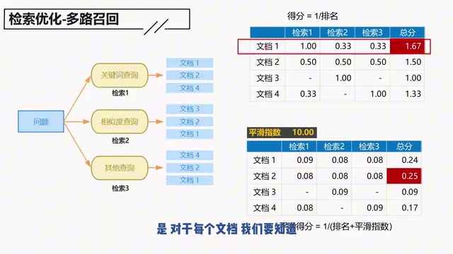

*多路召回：按文档横向查看各路排名得分，并合计总分。 · [原片 05:20](https://www.bilibili.com/video/BV1Jv6ZYiEg4/?t=320)*

注意，你在看这个表格的时候，不要这样竖下来看，要这样横过来看。因为我们这里综合检索的评估是：对于每一个文档，我们要知道它在不同检索方式里面的得分，然后我们算到一个总分。

比如说，得分的计算方式是排名分之一。那么对于文档一来说，它在检索一里面排的是第一名，所以它的分数是一分。然后文档一在检索二里面排的是第三名，所以就是三分之一，是0.33；同样，在检索三也是第三名，也是0.33。

接下来看一下文档二。文档二在第一个检索里面是第二名，是二分之一；那这里也是第二名，这里也是第二名，所以都是二分之一。

那文档三呢？在第一个检索里面没有它，所以零分，那就啥都没有。

在检索二里面是第一名，所以是一分；那在检索三也没有它，所以又是零分。

通过这样的方式，我们就可以得到所有的文档，它在每一个检索里面的得分。把这些得分加总起来，就是它的总分。因此我们发现，最终的这种计算方式下来，谁会胜出呢？文档一会胜出。如果你最终只选一个文档的话，那就是拿着文档一去进行增强生成。

但是这里大家可能会感觉到一个问题：文档二可能会不服气，对不对？文档二觉得，我在这三个检索里面都是第二名，我很稳定。但文档一，它有两个是第三名，只有一个是第一名。你这要是三局两胜的话，怎么说也是第二名要胜出，是不是？

所以我们就发现，这种计算方式下面，排在越前面的，它的权重其实相当于是越高的。有些文档，一拿那个第一名，你就无敌了。所以我们需要做一些适当的处理，降低这种情况，不要使得排名越靠前，它的权重一下子加这么大。我们称这个为平滑指数。

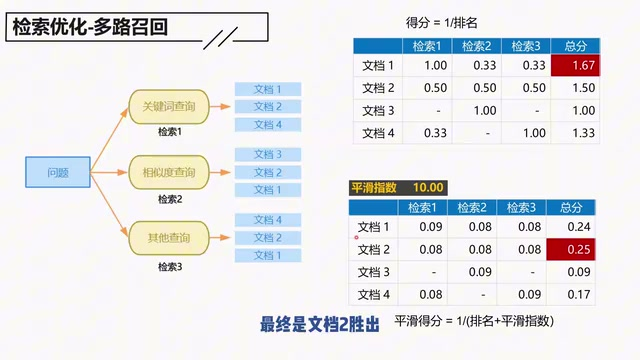

*平滑指数为10的示例：平滑后的总分使文档2胜出。 · [原片 07:40](https://www.bilibili.com/video/BV1Jv6ZYiEg4/?t=460)*

经过这个平滑之后，我们的公式就变成了这样子：平滑得分等于1除以这个分母，分母是排名加平滑指数。

通过这种方式，我们重新再计算一下它的得分，再计算一下每个文档的得分。计算过程我们就不说了，大家可以自己看。但总而言之，通过这种方式，最终是文档二胜出。这样的话可能会更符合实际。

那这个平滑指数，大家可以自己去设定。有人设定50或者60，我这个10只是一个案例。这个就是多路召回。

### 5. Rerank

下一个方法是Rerank。Rerank其实是选择了两次：第一次我们称它为粗筛，第二次是精选。我们来看一下这个流程。

还是给定一个问题，你可能会经过传统的这种搜索方式：关键词或者相似度等各种搜索方式。注意，这里面不是说三种都要，你可以只有其中一种。我们这里假设是有了若干种。

根据这若干种传统的查找方法，你就会得到多个文档。这些多个文档，你进行去重之后，比如说得到一、二、三、四。注意，我这里是直接去重，我不是直接评分，我直接去重，得到一、二、三、四。

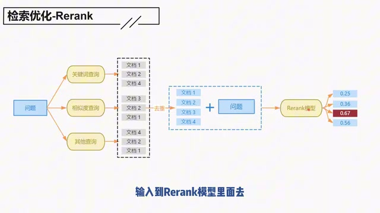

*Rerank：传统检索结果去重后，与问题一起进入Rerank模型评分。 · [原片 08:40](https://www.bilibili.com/video/BV1Jv6ZYiEg4/?t=520)*

然后拿着这一、二、三、四文档，每个文档都分别拿着这个问题，输入到Rerank模型里面，去进行四次运算。最终会得到每个文档和这个问题的相关性得分。这每一个分数对应的是每一个文档和这个问题的相关性得分。最终我们选择得分比较高的这个文档，来作为上下文。这个就是整个Rerank的过程。

这里的核心是这个Rerank模型。Rerank模型的机制，我们这里也不介绍，大家只要知道它的作用就好了。它的作用就是，你输入两个文本块，它会告诉你这两个文本之间的相似度。

这里的核心是什么呢？就是你前面的这些检索方法，说实在，它是有点粗糙了。你不管是关键词检索，还是相似度的检索，这些方案整体来说都是比较粗糙的。那这种效果整体会比较好一点。

为什么一开始不就直接使用这种效果呢？就是，为什么不把这个砍掉，你直接把这个问题跟所有的文档输入到Rerank模型里面去，然后得到所有的相似度，直接用这个方法不就好了？

这里的问题是，Rerank模型是比较耗资源的，效率是比较低的。你如果把所有的潜在文档都放进来的话，这个性能就会比较慢，系统的响应速度也会比较慢，也会比较浪费GPU的资源。

我们用这种方式，相当于是先初步筛选了一道，把显著无关的排除在外，把可能相关的放进来，然后再进行二次筛选。这是一种兼顾效率和准确度的方法。兼顾效率和准确度，这个是非常重要的。这个就是Rerank模型。

我们在具体的应用过程中，肯定要考虑到模型的选择。具体的选择方法，跟我们前面的embedding模型是一样的，大家可以自己看一下。

好，到这里，我们就完成了五种检索方案的优化介绍。接下来我们会介绍其他种优化方案。

## 生成优化：如何利用众多参考文档

首先我们说一下，生成阶段的优化是在优化啥？这个阶段的优化，我觉得主要是指如何利用众多的参考文档。默认对这些参考文档的做法是：拿到之后就直接堆叠，然后就直接丢到大模型里面去。

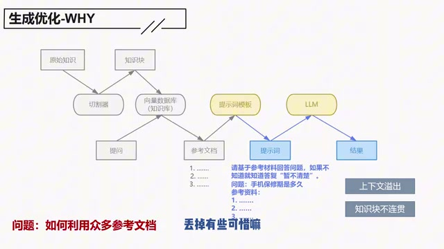

*生成阶段直接堆叠参考文档，会面临上下文溢出和知识块不连贯。 · [原片 11:20](https://www.bilibili.com/video/BV1Jv6ZYiEg4/?t=680)*

这里有两种问题。第一个是可能会上下文溢出。有人说，你上下文溢出，把溢出的那部分切掉不就可以了？可以是可以，也的确有这样的做法。那你好不容易检索出这些文档，你丢掉有些可惜嘛。这可能会影响生成的效果，是不是？

第二个的话是，直接堆叠的效果有可能也不好，因为你这个知识语义是不连贯的。就好比问你一个问题，然后给你的参考答案，这参考答案有十个。这十个里面东一句、西一句的，是你的话，你也回答不来，是不是？那怎么整呢？

我们后面的这几个优化方式，主要是参考了这本书。我觉得还有点意思，所以把它放出来，大家有兴趣也可以自己看一下。

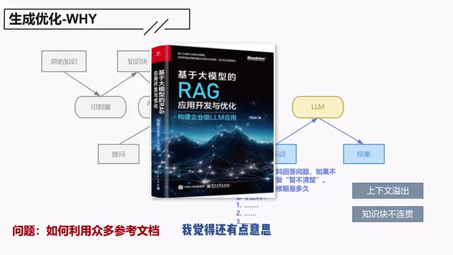

*讲者展示的参考书封面，主标题可辨为《基于大模型的RAG应用开发与优化》。 · [原片 11:50](https://www.bilibili.com/video/BV1Jv6ZYiEg4/?t=710)*

### 6. refine模式：“葫芦救爷爷”

有几种方法。一种方式，我称它为“葫芦救爷爷”的模式，因为它是把这些文档排着队，一个一个地送给大模型。如果第一个没搞定的话，第二个接着上。所以我觉得它是葫芦救爷爷。

那具体怎么说呢？比如说，你检索到了从一到N这么多的文档。你可以先把第一个知识块和提问一起送给大模型，然后它会生成一个答案。你看一下这个答案是不是你想要的：如果是的话，那你就有了最终答案；如果不满足，接下来把第二个知识块继续送进去，再看一下；你还不满足，把第三块也送进去。

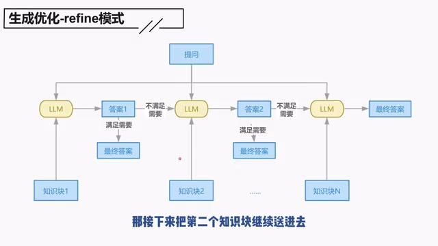

*refine模式：依次利用知识块，满足需要时取得最终答案。 · [原片 12:30](https://www.bilibili.com/video/BV1Jv6ZYiEg4/?t=750)*

这样的话，直到你用光了所有的知识块，那么你一定只能得到这个最终答案。所以，最后一个知识块进去，答案也不是你想要的话，那也没办法，也只能得到这个最终答案。那你就只有七个葫芦啊，没办法。

这种方案，它就可以利用到所有的知识块，同时也可以避免上下文的溢出，所以就兼具两者。但是你肯定一下子就看出了，它肯定也存在一些问题，是不是？这模式存在什么问题？太败家了，是吧，太败家了。

你这得调用几次模型？如果你用的是商业模型的接口，那么你费钱；如果模型是你自己部署的，那你费电，最终也是费钱，是不是？所以你这个文档一旦多的话，那还了得，是吧？我们得考虑一下，如果文档很多的情况下怎么办。

### 7. 多文档场景的refine

这就要介绍下一种方法，多文档场景下的“葫芦救爷爷”的模式——不是，多文档场景下的refine模式。

其实也没什么特别，就是你先把这么多的文档先打个包，然后分批地送给大模型。这就可以有效地、显著地降低模型的调用次数，对吧？

比如说，你生成了很多文档，我这里举了例子，你可以打三个包。第一个包有一到X这么多个文档，然后第二个的话一到Y，第三个的话一到Z。

除了有一个打包的动作，其他的流程就都一样了，我就不多说了。

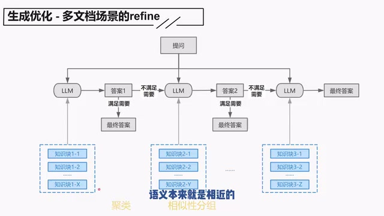

*多文档场景的refine：知识块先分包，再依次送给模型。 · [原片 14:30](https://www.bilibili.com/video/BV1Jv6ZYiEg4/?t=870)*

这里的打包方式可以有很多种。你可以纯粹地直接堆叠，也行，是吧？或者再复杂一点，你做一个聚类，或者做一下相似性的分组。就是说，每一次的包里面，可能这些知识块的语义本来就是相近的，然后丢给大模型。这样的话，也可以一定程度上，既不要超出上下文，又希望有一个更好的回答，同时大模型的调用次数也不要太多，就省点钱。

### 8. tree_summarize

下一种方法，我觉得有点意思，也把它放出来，就是tree_summarize的方法。我们直接看流程：一样，你在这里会检索出很多的知识块，然后这些知识块，一样会进行一个分组。

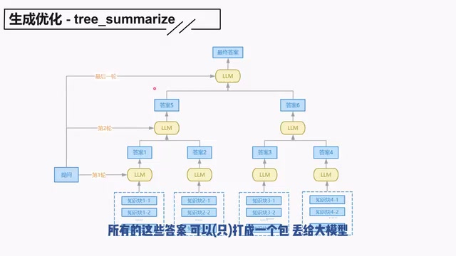

*tree\_summarize：第一轮使用知识块，后续逐轮组合答案。 · [原片 15:30](https://www.bilibili.com/video/BV1Jv6ZYiEg4/?t=930)*

在第一轮的时候，这些分组后的知识块，你都分别丢给大模型，那么相应地就会得出各种各样的答案。接下来是第二轮，第二轮其实是执行第一轮的步骤：你一样要先对这些答案进行一个打包，然后每个包，比如说这是一个包，再丢给大模型，再生成下个答案；这是一个包，再丢给大模型，再生成下个答案。

这里如果你有很多答案的话，你可以继续执行下个步骤，直到最终所有的这些答案可以打成一个包，丢给大模型，生成这个最终答案，那这个流程就结束了。

这个场景比较有意思的是，所有的知识块的利用在第一个环节就结束了。后面的话，它其实是会把后面的答案继续当成参考文档，然后继续往下送。把后面的答案当成参考文档，继续往下送，这是它不一样的一个点。

这个的话，我觉得适用于那种参考文档真的非常多的场景。其实我可能感觉，我不知道实际上会不会用到，只是我觉得有点意思，所以拿来讲一下。到这里，生成优化三种也结束了。

## 9. 改写提问

接下来我们介绍下一种，叫作改写提问，如何针对用户的提问进行改写。

首先我们说，提问改写是什么？就是有些时候，针对用户的提问，是不能直接进行文档检索的。因为在生产过程中，用户会怎么提问，你根本就想不到，各种乱七八糟的提问都有。这些提问可能不能直接用，那在这样的情况下，我们就要对提问进行改写。

具体来说，我们看一下什么情况下要改写。比如说，第一个是提问不规范，语义模糊、歧义、语句不通顺，这些都有可能是要改写的。

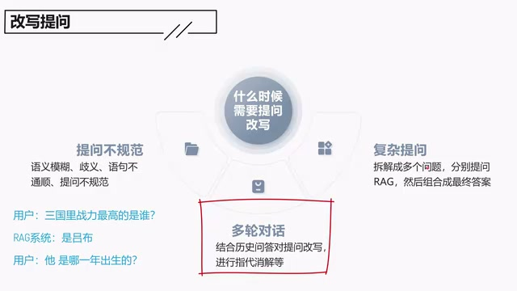

*改写提问：提问不规范、多轮对话和复杂提问三类场景。 · [原片 17:10](https://www.bilibili.com/video/BV1Jv6ZYiEg4/?t=1030)*

第二个是多轮对话的场景。多轮对话的场景，通常有了多轮对话，就意味着用户在第二次对话起，你通常要进行指代消解。比如说，他第一次可能会问你，三国里面战力值最高的英雄是谁？大模型可能给了一个回答，然后接下来他会问：“他是哪一年出生的？”这个“他”是指谁？这个就是要通过改写提问来进行指代消解的，不然可能会有歧义，对不对？这是一个例子。

还有一种场景是复杂的提问。我随便举个例子，比如可能会给你一个提问是：“目前比较值得买的A股股票是哪一只？”这是一个很复杂的提问。针对这种问题，可能要进行拆解，拆解成多个问题，然后分别RAG，最终组合成为一个最终的答案。

具体的改写方法，有基于规则的，也有基于大模型的，这个大家可以做一个了解。

我再举一个场景。在一个常见的Text to SQL里面，它可能会有推荐问句的样例，比如说这个。

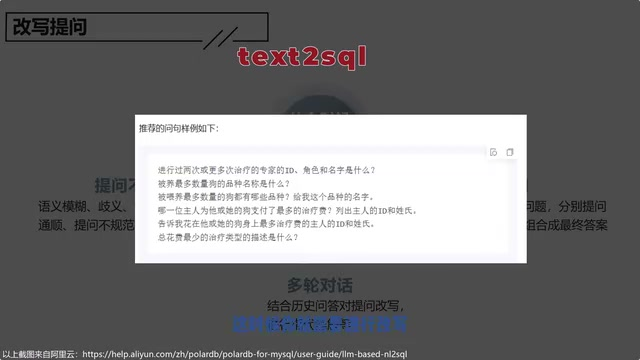

*画面展示text2sql推荐问句样例；小字受源分辨率限制，不逐字转录。 · [原片 18:10](https://www.bilibili.com/video/BV1Jv6ZYiEg4/?t=1090)*

但是用户可能不见得会这么提问，这时候你就需要进行改写。这个改写，有些时候也只是一个简单的规则替换。好，这是改写提问。

## 10. 合理利用元数据

接下来说最后一个优化方案，合理地利用元数据。元数据是指对文档的描述，比如说类型、作者、创建日期和来源等等，这些相关的描述就是元数据。也就是说，元数据不是文档本身，它是对文档的描述。

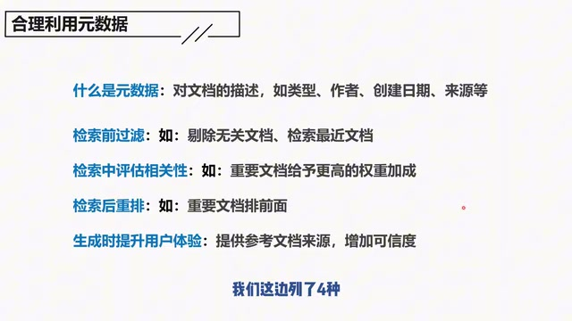

*元数据：文档描述，以及检索前、检索中、检索后和生成阶段的用途。 · [原片 18:40](https://www.bilibili.com/video/BV1Jv6ZYiEg4/?t=1120)*

那么它有哪些作用呢？我们这边列了四种。

第一种是检索前过滤。比如说，你可以在检索的时候，就剔除无关的文档。有些文档，你知道肯定是没有关系的，你就检索都不要去检索了。比如说，我问你是谁倒拔垂杨柳，你搜《红楼梦》干什么？

*讲者讲“倒拔垂杨柳”时插入的画面：图中提示词为“画一张 林黛玉倒拔垂杨柳 的图”。 · [原片 19:00](https://www.bilibili.com/video/BV1Jv6ZYiEg4/?t=1140)*

我问你房价是多少，你把2000年的房价返回给我，有意义吗？没有意义，是不是？

第二个是检索的过程中，可以用来评估相关性。这个是指，重要的文档可以给予更高的权重加成。在我们之前的检索过程中，其实所有文档对我们来说，重要性可能是一致的。那其实你可以根据文档的元数据，去对它进行权重的加成，对吧？

比如说，如果我问你，接下来房价是会涨还是会跌，那专家答的跟狗答的能一样吗，对不对？这显然狗答的要给更高的权重，是不是？因为狗答的只是随机，那专家可能没安好心。

下一个是检索后重排。检索后重排的作用，其实跟上面差不多，就是把更重要的放在前面。

还有一点是在生成阶段，可以提升用户体验。这个主要是你可以提供相关的参考来源，来增加你的可信度。这个在AI搜索引擎里面，已经用得比较广泛了。

## 下一节：如何评估RAG

OK，RAG常见的优化方式我们都讲完了。接下来我们会介绍如何评估RAG。评估在我看来，是数据分析、机器学习、人工智能很重要的一个领域。没有评估，就没有优化的方向。我们下一节见。
