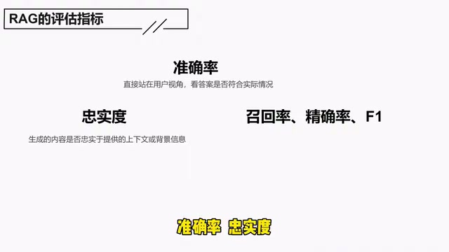
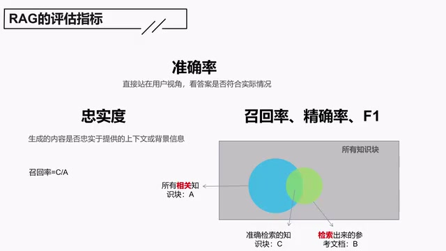
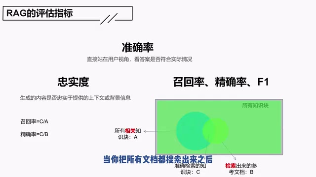
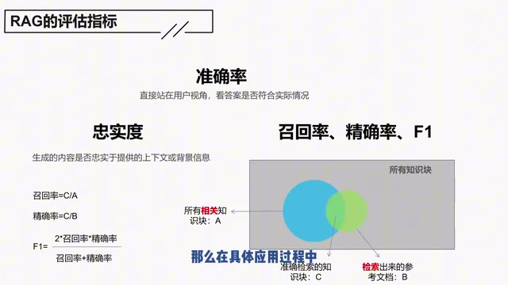
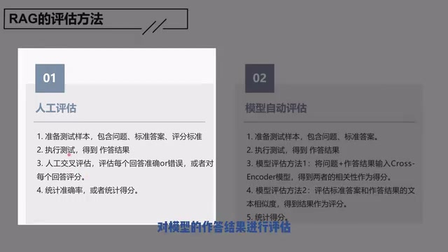
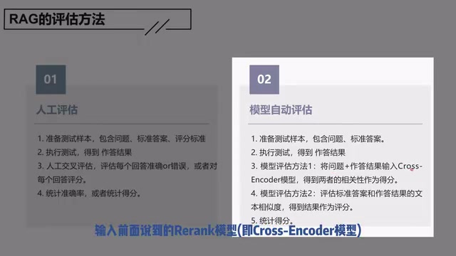
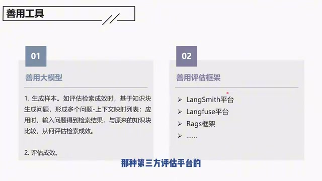

# 04：RAG的评估方法：没有评估，就没法优化

> 按原讲述顺序整理的忠实图文稿；保留第一人称与讲解过程。范围 00:00–07:58.378，原片第 1 分 P。

## 为什么要评估 RAG

评估 RAG 的核心目的是为了量化成效，然后快速迭代。RAG 很多环节都可以进行评估，我们这里会聚焦最终结果的准确性，聚焦大模型的能力，也会介绍一下如何评估检索阶段的检索成效。

### 准确率与忠实度

这里我们介绍这几个指标：准确率、忠实度，还有召回率、精确率、F1。

*准确率、忠实度与检索阶段指标的总览 · [原片 00:24](https://www.bilibili.com/video/BV1Jv6ZYiEWC/?t=24)*

准确率是直接站在用户的视角，看答案是否符合实际情况。也就是说，不管你过程怎么回事，我就看最终这个结果到底是不是我想要的。这是用户视角最直接的，也是我觉得最重要的一个评估指标。

下面这些其实是分阶段的评价指标。比如说忠实度，它其实是评估大模型的能力，用来评估生成的内容是否忠实于提供的上下文情景或信息。

什么意思呢？就是说，我已经准确地检索出了相关的参考文档，然后把提问和参考文档一起给大模型。大模型的答复，它有没有依据参考文档来给出？如果有，忠实度高；如果没有，忠实度就不行。如果忠实度不行，你这个大模型就得替换。因为参考文档我已经准确地找出来了，但是大模型回答不好，那这是大模型的问题。

### 召回率、精确率和 F1

接下来，另外的召回率、精确率和 F1，其实是评估你的参考文档有没有准确、完整地给找出来。检索环节比较重要，这里也有多个评估指标，分别来介绍一下召回率、精确率和 F1 是什么。

如果有做过机器学习的同学，对这些已经很熟悉了。没做过的可能有一些陌生，而且这个名词说实在不太好理解，所以我们介绍一下。

首先，我们假设这个是所有的知识块，就是你在进行知识库建设的时候，所有的知识块。蓝色的这个，是你在某一次检索的时候，所有相关的知识块。比如说，你提了个问题，跟这个问题所有相关的知识块，就是蓝色的这个。绿色的这个是你实际检索出来的参考文档。

这两个概念首先区分：一个是所有准的，一个是你实际找到的，对吧？这两个中间就有一个交集，这个交集就是你找到的，并且准确的，我们称它为 C。

*蓝色 A、绿色 B 与准确检索交集 C；召回率为 C/A · [原片 02:36](https://www.bilibili.com/video/BV1Jv6ZYiEWC/?t=156)*

那么召回率就是 C 除以 A，就是召回率。所以你很容易就知道，这个召回率是指，你有没有把所有可能相关的参考文档尽可能多地找出来，就是参考文档完不完整，这是召回率。

你想一下，如果要实现召回率百分之百的召回，你最简单的方法是什么呢？就是把所有的知识块——你把这个绿色的圈进一步放大，是吧？把这个绿色的圈放大。如果你把所有的知识块都召回，那么是不是意味着召回率这时候是百分之百，对不对？

但是实际上肯定不可能这么做，对不对？因为你把所有的文档都筛选出来，你这个指标——精确率——就会下降。精确率是 C 除以 B，就是中间交集的这一块，除以你检索出来的。当你把所有文档都搜索出来之后，你这个分母就会变得很大，那么精确率就会变得非常糟糕。

*绿色检索范围扩大到所有知识块，精确率分母随之增大 · [原片 03:30](https://www.bilibili.com/video/BV1Jv6ZYiEWC/?t=210)*

所以召回率和精确率，其实一定程度上来说，它们是一个你降我升、你升我降的关系。那么 F1，其实是对这两者的综合评估，用这么一个公式来对这两者进行综合评估。

F1 = 2 × 召回率 × 精确率 /（召回率 + 精确率）。

*召回率 C/A、精确率 C/B，以及 F1 的综合公式 · [原片 04:00](https://www.bilibili.com/video/BV1Jv6ZYiEWC/?t=240)*

这个就是召回率、精确率、F1。那么在具体应用过程中，可能会更关注哪一块呢？我个人感觉，可能要更关注召回率一点。你如果关注召回率，可能也会把一些无关的文档放进来。但是我觉得现在大模型对这个噪声的容忍程度、容忍性是比较高的。它不能无中生有，你没给它，它回答不了；但是你给它错了，它可能可以排除。

所以一定程度上，我是倾向尽量去提升这个召回率。在 GPU 资源或者性能各方面能够允许的情况下，尽可能地提升召回率。这是几个评估指标。大模型的评估指标其实不止这些，还有其他指标，只是我就只介绍这些，更多的大家可以自己再去了解一下。

## RAG 的评估方法

RAG 的评估方法可以分为人工评估，也可以分为模型评估。

### 人工评估

人工评估的话，你要先准备样本，包括问题、标准答案，就是每个问题它的答案是什么，以及评分标准。接下来，你就可以拿着这些问题去执行测试，得到模型的作答结果。

*人工评估：准备样本、执行测试、交叉评价和统计 · [原片 05:12](https://www.bilibili.com/video/BV1Jv6ZYiEWC/?t=312)*

接下来，人工就可以交叉对模型的作答结果进行评估：评估每个回答准不准确，或者对每个回答进行评分。如果你是判断回答准不准确，你就会得到一个准确率；如果你是评分，你就可以统计得到一个评分。

### 模型自动评估

然后这个是模型的自动评估。模型自动评估也一样，前面要准备测试样本，包含问题和标准答案。接下来，一样是要把这些问题丢给模型，得到作答结果。

接下来就开始执行模型的评估方法了。我们这里介绍了两种，当然实际不止。第一种方法是，你可以将问题和作答结果输入到我们前面说到的 Rerank 模型，然后可以得到两者的相关性，作为一个得分。这是第一种。

*模型自动评估的两种方法，课件明确标出 Cross-Encoder · [原片 05:48](https://www.bilibili.com/video/BV1Jv6ZYiEWC/?t=348)*

第二种的话，是你可以把标准答案和作答结果的文本相似度进行计算，然后将这个结果作为评分。就是你原本的标准答案和模型得到的答案，如果相似度越高，我们就认为它准确度越高。

这里的话，是认为你输入的问题和作答结果相关性越高，那得分就越高。在这种方案下，你甚至连标准答案都不需要，甚至连标准答案都不需要，就能够初步评分了。

我个人建议，你前面在建设的过程中，可以通过模型去进行初评，没有关系。但是你最终上线的时候，最好让人工介入体验一下。这样你得到的准确评估会更有参考价值，因为毕竟要上线了，是不是？这是评估方法。

## 善用工具

最后一个，我们建议要善用工具。因为人工毕竟还是太耗时费力的，所以要善用大模型。包括生成样本的时候，其实你在评估检索成效的时候，也可以通过大模型去进行样本的生成，是可以极大地节省工作量的。

*善用大模型生成样本；右侧列出 LangSmith、Langfuse 平台与 Rags 框架 · [原片 07:24](https://www.bilibili.com/video/BV1Jv6ZYiEWC/?t=444)*

另外一个，是要善用评估框架。目前市面上有很多种第三方评估平台。在这些平台上面，你注册一下，然后当你在运行这个 RAG 框架的时候，你在这个平台上就可以找到所有相关的过程：包括它找到了什么样的上下文，它用了什么样的上下文，然后得到的结果是什么。检索环节效果怎么样、生成环节效果怎么样，它都会一站式地给你评估，这是相关的平台。

同样，除了平台之外，也有相关的框架，这个框架大家也可以了解一下。

那以上的话，就是这个评估环节了。

> 结尾辨识说明：冻结转写与尾部定向 ASR 将末句识别为“平台环节”；477 秒原画字幕清楚显示“就是这个评估环节了”，因此按原画校正为“评估环节”；不确定性限于 ASR 与原画的局部识别分歧。片内尾部单独的“对”未作为新的论述。原始冻结转写和定向 ASR 均保留在 sources 中。
