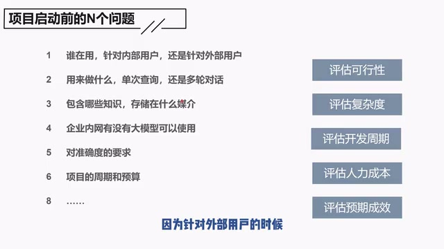
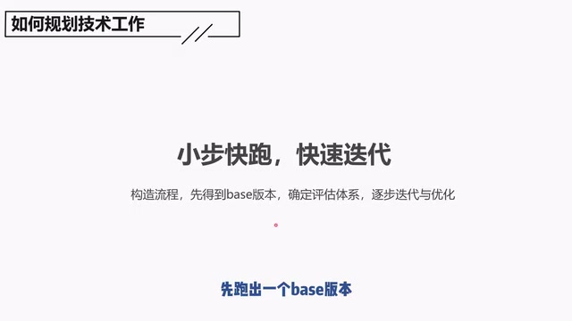
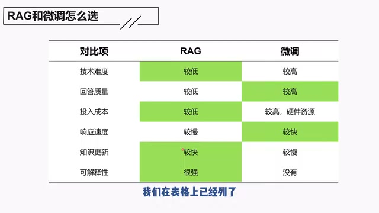
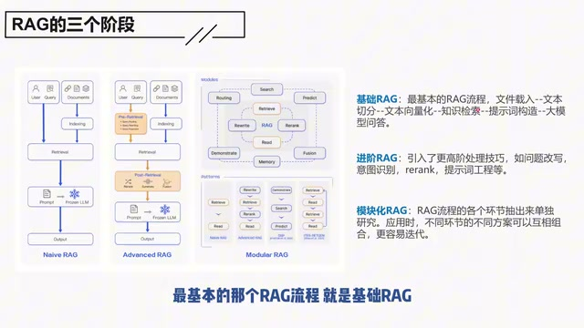
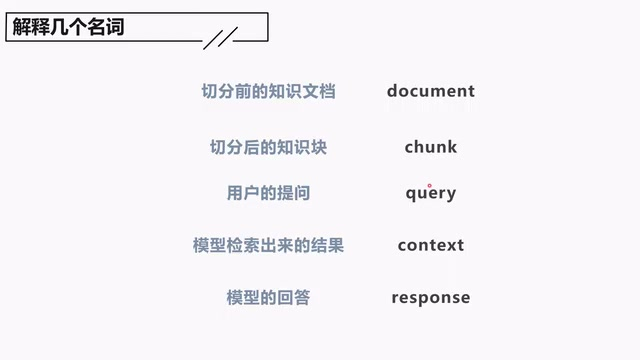

# 05：项目经理视角的RAG：需求评估要细，技术迭代要快

> 忠实整理稿｜原视频第1分P，00:00—08:44。按讲述顺序清理停顿与明显识别错误；保留讲者判断与限定。配图为640×360源视频实际帧。

## 项目启动前，要先评估这些问题

最后，因为我本身是个项目经理，所以忍不住站在项目经理的视角多聊几句。

我们在要启动一个项目之前，起码要做这些评估，包括但不限于这些：你必须要评估可行性，必须要评估复杂度，评估开发周期、人力成本，还要评估预期的成效。

要评估可行性，比如说，你要对你的技术同事负责。最终这个项目必须可行，你才能够把它给谈下来，否则你是在给技术同事挖坑。作为一个项目经理，你要评估这个项目大概要做多久，要投入多少人，项目复不复杂，最终能不能做起来，能够做到什么样的效果。要把这些事情都考虑进去。

*项目启动前的调研问题与五类评估项 · [原片 01:05](https://www.bilibili.com/video/BV1Jv6ZYiEWj/?t=65)*

基于这些考虑，你在做项目启动的时候，面向客户，就要有一些东西要调研。比如说，你得调研一下是谁在用，是针对内部用户，还是针对外部用户。因为针对外部用户的时候，一般对准确率、对效果会有更严格的要求，复杂度肯定也更高。

第二个问题，比如说，你这个项目是用来做什么的，是单次查询，还是多轮对话？多轮对话也会更复杂。

项目包含哪些知识，存储在什么媒介？如果有包含视频和图片等相关的知识，处理起来也会更复杂。

企业内网有没有大模型可以使用？提这一点是因为，有一些企业内部甚至不具备应用大模型的条件，因为他们根本没有GPU资源。如果连这个东西都没有，你要么在做项目的时候就得明确地提出来，要么这个项目根本就做不了。

> 画面补充：01:40的原字幕还注明“也不许调外网模型接口”，与没有GPU资源共同构成这里举出的企业限制。

然后，以及客户对准确度的要求，以及他们对项目的周期和预算是什么样的，这些都是要通盘去了解的。这是你在项目启动前要了解的内容。

## 如何规划技术工作：小步快跑，快速迭代

下一个是，项目启动之后，怎么样去规划你的技术工作？我觉得简单来说，就是小步快跑，快速迭代。当然，这个说法对很多项目其实都适用，只是我觉得对RAG来说，更要严格地去执行。

你要尽快先把这个流程构造起来，先跑出一个base版本，然后确定你的评估体系，然后赶紧抓紧地去迭代和优化。不要陷入具体的某个环节、某个细节里面去，不要陷在里面。

*小步快跑、快速迭代：构造流程、base版本、评估体系与优化 · [原片 02:25](https://www.bilibili.com/video/BV1Jv6ZYiEWj/?t=145)*

## RAG和微调怎么选

再谈一个：RAG和微调怎么选。因为基本上很多RAG相关的材料和视频，都会把这两个进行比较，所以我们不妨也比一下。

要聊RAG和微调怎么选，首先就得聊一下，为什么RAG和微调能够放在一起比较？因为RAG和微调都可以解决我们前文提到过的，没办法回答私域问题的这个缺陷。

对RAG来说，它是通过提供外部知识，来让大模型回答私域问题。对微调，它是通过把这些内部知识，让大模型重新去学习。这是两种不一样的方法。

具体它们的差异，我们在表格上已经列了。

*讲者用于比较RAG与微调的六项对照表 · [原片 03:30](https://www.bilibili.com/video/BV1Jv6ZYiEWj/?t=210)*

对于技术难度来说，我觉得RAG相对来说比较低，微调相对来说比较高。因为RAG虽然很复杂，但其实这些工程性的问题，门槛都不高。但是对微调来说，如果要调出一个模型，真的有成效，那它是要有一些算法功底的。我觉得这个相对来说比较困难。

从回答质量的角度来说，一个是根据参考资料去进行回答，一个是把相关知识都内化。对于微调来说，它可能会有比较高的上限，因为它对这些知识有一些通盘的了解。

当然，我说的是它上限高。上限高不意味着你就能够做出实际更高的成效，因为我们前面说了，它的技术复杂度比较高。也就是说，你不见得能够达到这个上限，它只是理论上的上限高。

然后再一个是投入成本。RAG显然成本也会比较低。微调的话，你又要找到人才，又要有硬件资源，成本比较高。

就响应速度来说，微调是会比较快的。因为对RAG来说，它还得去检索；对微调来说，它已经提前把这些知识给内化了，它的响应速度显然就比较快。就好比你考试的时候，你是开卷考，你还要查书；另外一个是把答案都背下来了，那显然微调会来得快。

在知识更新这块，显然是RAG有优势，它的速度肯定比较快。微调模型的话，知识更新就比较慢了，每次都要把这些新增知识拿给模型重新微调一下，那这个肯定比较慢。

对于可解释性来说，微调就没有任何优势了，它就是个黑盒子，你根本不知道它这个回答是对还是不对。但是对于RAG来说，它的可解释性就很强了：我告诉你这个答案，还可以告诉你为什么是这个答案。可解释性更强，可信服度也更强。

所以通常如果让我建议怎么选择的话，我现阶段肯定无脑选择RAG。

而且微调还有个问题是什么呢？就是，所说的还是那个问题——技术难度比较高。你对原本已经训练好的一个模型，进行参数的二次调整，你不见得能够调得更好，它是有一些不确定性的。

而且，本来已经具备的一些能力，可能会被你调掉。所以它是一个有风险的动作。这是RAG和微调。

## RAG的三个阶段

下一个是RAG的三个阶段。之所以要聊这个，也是因为现在网上很多知识都会提这个图。所以我放这个图的意思就是，你听我讲完，下次看到这个图，就可以直接pass了。

*基础、进阶、模块化RAG的流程对照和文字说明 · [原片 06:40](https://www.bilibili.com/video/BV1Jv6ZYiEWj/?t=400)*

RAG的三个阶段是指基础RAG、进阶RAG和模块化RAG。

基础RAG很简单，就是最基本的那个RAG流程，就是基础RAG。

进阶RAG是指，在基础RAG的基础上，会引入包括rerank、问题改写等一些更高阶的方法，所以称为进阶RAG。

模块化RAG是指，把RAG流程里面的各个环节都抽出来单独研究。应用的时候，不同方案、不同环节可以互相组合，更容易迭代。

如果从这个定义来看，我们这个课程起码讲了基础RAG和进阶RAG。

## 解释几个名词，方便继续学习

最后，我们给几个名词来解释。因为对于RAG学习来说，只看我这个课程肯定不够，大家后面肯定还要进一步去了解。网上很多知识，他们都喜欢用英文，担心大家看不懂，担心大家有疑问——不至于看不懂。所以我把这些常见的几个翻译放在这里，方便大家以后进一步了解其他材料。

*document、chunk、query、context、response的中英文对照 · [原片 07:25](https://www.bilibili.com/video/BV1Jv6ZYiEWj/?t=445)*

> 画面词汇对照：切分前的知识文档是document；切分后的知识块是chunk；用户的提问是query；模型检索出来的结果是context；模型的回答是response。

## 课程结束，学习还要继续

到这里，我们的课程基本上就讲完了。但是对RAG学习来说，其实还没有结束，因为我们还有很多知识没有介绍到。比如说，现在很流行结合知识图谱进行RAG，在多模态相关的这块应用也越来越多。再比如说，现在也提出了很多RAG相关的范式，我们都没有提。大家后面进一步自己去了解。而且，如果你是个开发的话，那么进一步动手是更不可少的。

总而言之，学习还要继续。用丘吉尔的一句名言来说：“这不是结束，这甚至不是结束的开始，这只是开始的结束。”

好，我们这个课程就到这里。感谢大家，下个课程见。

*课程结束时的感谢观看画面 · [原片 08:31](https://www.bilibili.com/video/BV1Jv6ZYiEWj/?t=511)*

> 结尾证据说明：冻结转写在约08:34之后出现重复“对”和混杂残词，定向补充转写在08:31.40—08:32.54确认“下个课程见”，并在08:39.12—08:44.12仅识别到“下个课程”。末端画面已从感谢页切到“生成优化-refine模式”流程页；没有可靠的新增讲解可据以补写该流程。原始转写、范围修复审计与补充转写一并保存在sources，未改写冻结输入。
