# RK3588 NVR及后端产品

> 忠实整理讲稿 · L01 · 原片第1部分，00:00–01:07:31.861。保留讲者原序、第一人称、条件、例子及重复强调；非逐字听写。SDK版本与性能表述按原发布时期保留。
> 来源：[哔哩哔哩原视频](https://www.bilibili.com/video/BV1md4y1d7UH/?p=1)。原视频720×360，小字清晰度受源片限制。方括号为整理者识别说明或课件注解。

## 开场与 SDK 的定位（00:00）
各位小伙伴，大家好。我是第一系统产品部的谢志军，平时主要负责后端类的3568、3588的NVR以及后端类产品开发。今天主要讲一下3588 NVR及后端类产品开发的一些主要场景，以及我们在开发过程中一些常见的问题，借这个平台给大家解释一下。

今天的内容主要有四大块。第一块是RK3588 NVR SDK简介，等一下会介绍怎么获取SDK、怎么用。第二块是RK3588后端类产品几个典型场景，包括NVR、拼接屏、录播等场景。第三部分是我们收集的一些常见问题分析。今天所讲的问题分析，也会体现在SDK里面的文档，以及后续的MPI FAQ文档里，陆续更新出去，大家可以关注近期简报。第四部分就是答疑，看看小伙伴们有没有问题，我们一起分享、一起探讨。

## RK3588 NVR Lite SDK（01:53）
有开发过RK平台的小伙伴应该知道，我们有一个Linux SDK，那个SDK比较大，可以支持桌面系统，也带Buildroot这些东西，也带一些示例。如果用在后端产品上，可能显得比较臃肿，有些小伙伴说用起来不是很顺手。

RK3588 NVR Lite SDK是基于那个Linux SDK裁剪而来的精简版Linux SDK。搭配这个SDK的是RK的MPI套件。RKMPI是我们基于Rockit开发的一整套用于后端类、类NVR产品用到的模块，后面会有比较详细的介绍。

这个RK3588 NVR SDK主要用于NVR，以及类NVR的会议系统、录播系统、拼接屏等，对多窗口以及对桌面系统没有要求的、基于Linux的产品开发。

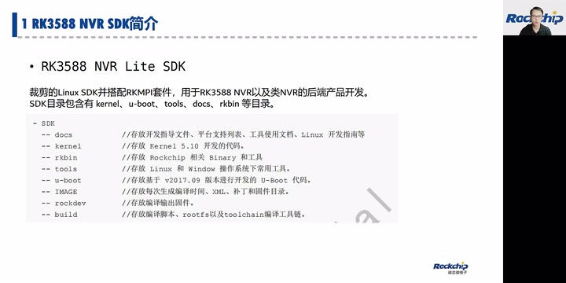

*NVR Lite SDK的定位与SDK目录 · [原片 02:30](https://www.bilibili.com/video/BV1md4y1d7UH/?t=150)*

SDK目录主要包含几个目录，其实只有这几个。一个是kernel目录，里面放Kernel 5.10的代码。这里要提一下，3588的Kernel版本跟3568不一样：3588是5.10，3588是5.10。3568是4.19。第二个比较重要的目录是u-boot，用于存放U-Boot代码。3588的U-Boot跟3568的U-Boot基于同一个分支开发，没有非常明显的差异。

还有tools目录，主要存放跟SDK平台相关的一些、适合Linux和Windows下常用的工具。有一个docs目录，用来存放开发指导文件、平台支持列表、工具使用文档、开发指南之类的东西。一会儿我们要重点介绍docs下面的3588目录，那个目录针对3588平台；其他common那些目录，实际上是所有RK平台通用的。大家应该发现，common目录跟其他SDK看到的也是一样的东西。

rkbin主要存放Rockchip相关二进制文件，包括没有开源的、跟系统底层和芯片底层相关的一些bin及工具。还有几个辅助目录：build主要用于存放编译脚本、toolchain工具链以及rootfs根文件系统。3588的toolchain版本跟3568不一样，rootfs里的glibc版本也不一样。移植时，比如你之前做过3568产品，想直接把3568的rootfs拿到3588上用，应该是不可以的，需要重新用我们这边的rootfs来裁剪成你们的版本，因为glibc版本不一样。

### SDK 获取与 RKMPI 更新（06:24）
SDK获取方式推荐使用repo。项目评估立项完成后，可以从业务端或者我们FAE团队获取RK3588 Linux NVR SDK的repo下载地址。跟下载安卓一样，用repo sync就可以获取完整SDK。NVR SDK比较小，只有几个G，下载很快。

RK3588 NVR SDK目前更新到最新的版本是V1.3，是8月份才刚更新的。RK3568 NVR SDK目前更新到V1.4，我们很快即将更新V1.5版本，会增加一些多CPU拼接同步接口，大家可以关注一下。

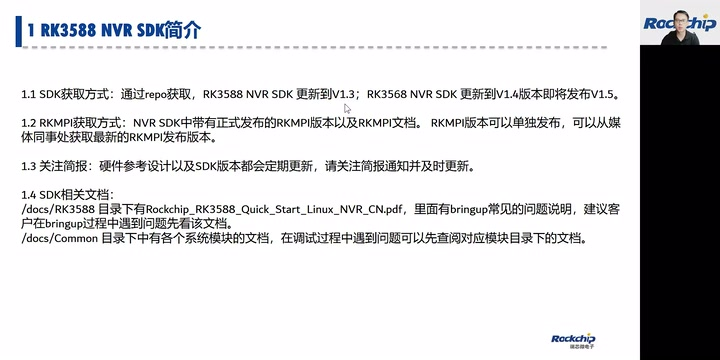

*SDK、RKMPI获取方式及开发文档 · [原片 07:00](https://www.bilibili.com/video/BV1md4y1d7UH/?t=420)*

刚才提到，配套NVR SDK的上层媒体开发套件RKMPI，在NVR SDK正式发布版本里也会带有RKMPI版本和文档。这里要提一下，因为NVR SDK更新节奏没有那么快，所以RKMPI版本可以单独发布更新，不一定跟SDK一起发布。也可以单独从我们媒体同事那里获取最新的RKMPI发布版本。NVR SDK里面带的是正式版本，有可能偏旧。

没有那么及时更新，有一些最近刚开发的功能没有带，大家关注一下这个事情。

还有就是提醒大家关注我们的简报。有些开发小伙伴可能忽略掉更新。在你们还没有量产之前，我们其实都建议跟着SDK版本走。因为SDK更新过程中，会修复其他产品，或者我们自己压测、开发过程中遇到的问题，都及时更新到SDK版本里。每次SDK版本更新，我们都会有简报通知，请大家关注。

### 开发文档与入手路径（08:55）
刚才提到docs目录下是RK SDK相关文档。重点提一下，docs/RK3588目录下面有一个Rockchip_RK3588_Quick_Start_Linux_NVR_CN.pdf。这个文档记录我们适配过程中发现的客户常见问题，包括编译，如何编译应用、如何编译SDK、如何bring-up板子，以及一个FAQ章节，记录常见问题。

建议刚入手的开发者或小伙伴通过这个目录入手。这个目录下的文档可以帮助大家快速上手，遇到问题可以先看一下是不是已经有记载，先查一下有没有。docs/Common目录下是内核、U-Boot、各个模块的文档。在调试过程中，如果做对应模块开发，可以查看对应模块目录下的文档。

第一部分先讲到这里。大家如果下载到SDK，可以看看目录，其实跟3568的NVR SDK保持一致。只是Kernel版本、toolchain、glibc版本有更新，其他目录结构、用法基本都跟3568一样。

## 典型场景：RK3588 NVR（10:49）
我们看第二部分，介绍RK3588几个典型使用场景。首先是RK3588做NVR产品。底下是我们推荐的几个产品配置，大家当然可以根据自己实际需要挑选规格。

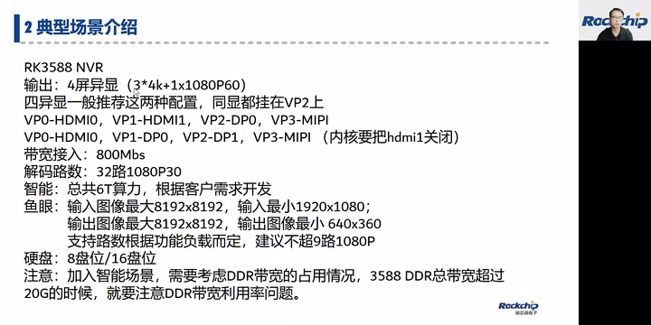

*RK3588 NVR的输出、带宽、鱼眼和硬盘配置 · [原片 11:30](https://www.bilibili.com/video/BV1md4y1d7UH/?t=690)*

3588的输出，我们推荐做到四屏异显，其中三屏支持4K，一屏只能支持到1080P。四屏异显一般推荐两种配置。一个是用HDMI0、HDMI1这两个原生HDMI接口，第三屏用DP0去转，挂在VP2上；第四屏用MIPI或者BT.1120去转，挂在VP3上。还有一种配置是VP0用原生HDMI0，VP1用DP0去转HDMI。

然后VP2用DP1转HDMI，第四屏用MIPI接口，挂在VP3上。这个配置需要把HDMI1关掉，我们SDK默认HDMI1是开着的。这两组配置的差别主要体现在同显需求上，两种配置能满足的同显需求不一样。

3588网络带宽接入，我们推荐640到800Mbps，具体也是根据客户实际产品定位、产品规格决定。解码路数是32路1080P30，解码路数的接入也跟产品定位息息相关。比如有的产品要求预览路数比较多，有的产品要求支持的IPC分辨率比较大，总的解码能力不能超过：H.264是8K30，H.265是8K60。总的解码能力是这么多。

RK3588带有6T算力。智能也需要根据产品需求来看。我们图形、NPU团队那边也推出一些RockIVA[套件名英文拼写按上下文整理]开发工具和模型，其实已经有很多客户用RK的模型落地了。

3588也支持鱼眼矫正。输入图像最大规格8192×8192，输入最小分辨率1920×1080；输出图像最大8192×8192，输出最小640×360。支持路数根据系统功能负载而定。如果接入路数多、输出屏幕多，接入带宽大、解码路数多，也会影响鱼眼功能。我们建议不要超过9路1080P。

硬盘盘位，各种盘位都有。比较经典的是8盘位、16盘位，或者更多。3588支持RAID 5磁盘阵列、软RAID，也有客户用软RAID开发一些功能。

有一点需要注意：加入智能的场景，需要考虑DDR总体带宽。比如智能模型需要占很大DDR带宽，就要注意DDR带宽占用率。一般DDR总带宽超过20G时，就要注意哪个模块占用比较多，看看有没有办法分解，把对应模块带宽再优化一下。一般超过20G的时候，我们就需要考虑。

根据目前我们的模型和客户使用情况来看，如果没有开启智能，DDR带宽是很足够的。NVR场景就介绍到这里。

## 单颗 RK3588 多屏拼接显示（16:29）
第二个场景是用RK3588做多屏拼接。3588有四个VP口，可以支持三个4K加一个1080P，多VP可以输出四个设备。一般推荐RK3588做三路4K60输出同步，用三个VP口分别驱动三个屏幕，这三个屏幕可以做输出同步。

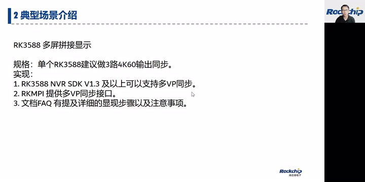

*单颗RK3588多VP同步的版本和接口 · [原片 17:10](https://www.bilibili.com/video/BV1md4y1d7UH/?t=1030)*

在RK3588 NVR SDK V1.3及后续版本上，都可以支持多VP同步。内核已经支持，RKMPI提供多VP同步接口，很方便就可以把这个功能用起来。具体在Quick Start文档的FAQ章节里，有多屏拼接显示的详细步骤及注意事项。大家拿到SDK可以看一下，这里不展开详细说明，因为涉及内容比较多。

## 多颗 RK3588 同步拼接显示（17:58）
随着拼接场景越来越多，多颗芯片级联做拼接的需求也越来越多。最近针对V1.3 SDK，以及以后版本，也可以支持多CPU同步拼接显示。这里简单罗列几个实现要点。

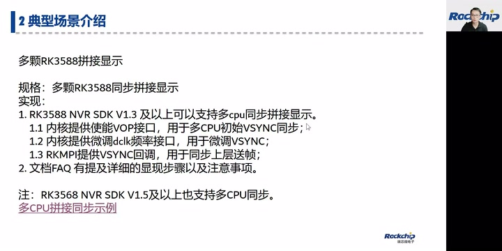

*多颗RK3588同步拼接的实现要点 · [原片 19:10](https://www.bilibili.com/video/BV1md4y1d7UH/?t=1150)*

第一点，内核提供使能VOP接口，用于多CPU初始VSYNC同步。多颗CPU同步完时间之后，可以约定同一个时刻调用VP使能接口，做初始VSYNC同步，这样可以保证初始VSYNC基本同步。根据我们的测试及客户应用来看，调用接口初始化VSYNC，初始差异大概是几个微秒级别。

第二点，内核提供微调DCLK频率接口，用于微调VSYNC。因为多颗3588 CPU板子的晶振可能存在偏差，跑的过程中VSYNC偏差可能慢慢变大，达到某个程度就会导致错帧。内核提供微调DCLK接口，用户可以用接口微调VSYNC。保持两颗CPU VSYNC同步的算法，每家客户其实不一样，每家会有自己的同步VSYNC算法。

还没有这种同步算法的小伙伴，也可以联系我们，获取一个简单的同步VSYNC demo。我们自己也做了一些比较粗浅、比较简单的同步算法，大家可以参考。

第三点，RKMPI提供VSYNC回调，用于同步上层送帧。同一个VSYNC送同一帧，这也是非常重要的，是一个基础。多CPU如何保证同一时刻送入同一帧数据，每家客户会有自己的积累和方法。我们也有一个比较简单的demo，有需要大家也可以参考。

Quick Start文档FAQ章节也有提及多CPU同步拼接显示的详细步骤以及注意事项。这里“详细”还写错了，大家可以去文档里看一下。

要提一下，RK3568 NVR SDK V1.5，就是即将发布的V1.5，也可以支持以上多CPU拼接同步。只是一些限制不一样，但是也支持，接口一样。在RK3568 Quick Start FAQ章节，到时候也会体现。

### 两颗 RK3568 拼接同步的演示（22:06）
这里给大家展示一下我们自己做的、比较粗浅的拼接同步示例。这个视频演示两个3568做拼接同步。每个3568解码两路1080P的数据，最后两个CPU的数据看起来完全同步。[22:27–22:35的定向ASR对路数、分辨率仍误连；这里依据紧接着22:55–23:36讲者重复解释的“两路1080P”整理。]

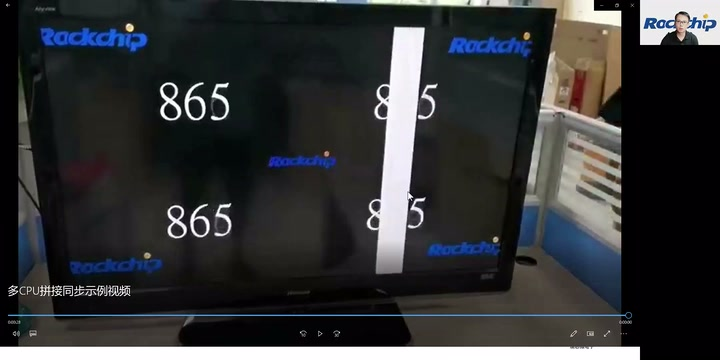

*两颗RK3568经分屏器进行左右拼接的演示 · [原片 23:30](https://www.bilibili.com/video/BV1md4y1d7UH/?t=1410)*

刚才视频里面，左半边这两个视频，是同一个3568解的；右边这两个，也是同一个3568解的。每颗3568解码两路。这边左上角、左下角，是同一个CPU解出来的两路1080P数据，取同一个画面中的同一帧。右边是一颗3568解出来两个1080P视频，取同一帧，最后做拼接显示。

这里展示的拼接，是通过分屏器接进来的，就是两个3568的HDMI输出进来，经过分屏器拼在一起，做左右拼接。大家如果有拼接同步相关需求，也可以通过我们的业务端或者售前，联系到我们这边。

## 常见问题：SATA 16 盘位及以上拓展（24:24）
现在进入第三部分，常见问题分析。刚才NVR使用场景说到16盘位以上的SATA硬盘柜场景。这里有一个问题要跟大家明确一下：RK3588有三个原生SATA口，跟PCIe 2.1、USB3复用。每个SATA口开启FBS之后，最多只支持5个盘，详细可以查看TRM章节。

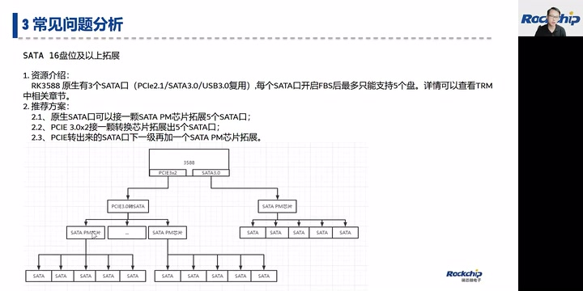

*SATA 16盘位以上的扩展拓扑 · [原片 26:15](https://www.bilibili.com/video/BV1md4y1d7UH/?t=1575)*

一般PM芯片是1拓5，那就不能达到16盘位以上。有的小伙伴可能想到用两级PM芯片来拓，行不行？实际应用中发现，很多PM芯片不支持，会有问题，超过15个盘之后会识别不到。

所以推荐使用原生SATA口接一个PM芯片，拓出5个SATA。另外一路通过PCIe 3.0×2接转换芯片，通过PCIe转出来，注意不是直接用PM芯片从SATA口转出来：用PCIe 3.0转SATA，1转5，然后在PCIe转SATA的基础上再接一级PM芯片。大概示意图就这样，这样能达到16盘位以上。

最终能接多少盘位，也跟PCIe转SATA的能力有关。有需求需要找PCIe转SATA供应商，了解具体限制。我们已经有16盘位方案落地。最大能做到多少盘位，就看转换芯片能力，以及对速度的要求。大家在做产品设计的时候要注意。

## 多 CPU 级联：PCIe 与 USB（27:06）
第二类比较常见的问题是多CPU级联。比较常见的方式是用PCIe接Switch来级联。RK3588 PCIe作为EP时，不支持直接从PCIe启动，需要外接存储，把EP启动到SPL或U-Boot之后，才能初始化PCIe相关功能。所以从机需要外接存储设备，可以小一点，只支持到U-Boot就可以。但是不支持RC直接去启动EP。

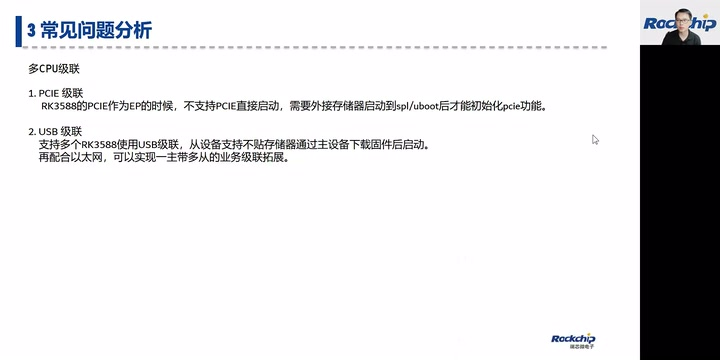

*PCIe与USB级联的启动条件 · [原片 27:40](https://www.bilibili.com/video/BV1md4y1d7UH/?t=1660)*

如果有这种一主带多从的级联需求，还有一种方案是USB级联。用USB级联，从设备不需要贴存储器。

主3588可以直接通过USB给从设备下载固件，然后从设备直接启动。这样从机就不用带存储芯片，所有固件都来自主机，通过主机下载，再配合以太网，就可以实现一主带多从的业务拓展需求。已经有客户用这种方案落地了挺多产品。比如一个3588可以支持32路1080P30，如果需要拓展到64路，就可以用一拖一，甚至一拖二、一拖三这样的方式级联。

## RKMPI 文档、示例与各模块（29:20）
接下来看刚才提到的RKMPI媒体套件，放在SDK的build/app/RKMPI_Release目录下。RKMPI附带各模块示例代码，以及一个做多屏拼接显示、叫vplay[示例名称识别待核]的串联demo，都在example目录下。也提供很详细的说明文档，在doc目录下。

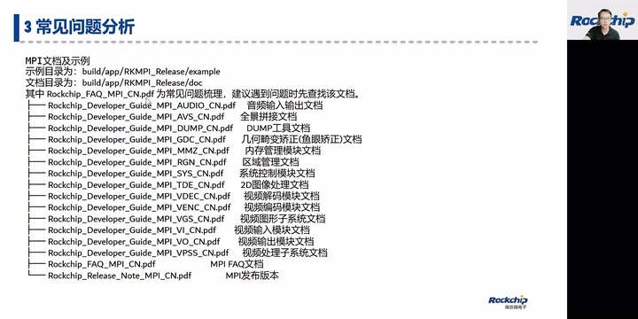

*RKMPI示例目录与各模块文档 · [原片 30:30](https://www.bilibili.com/video/BV1md4y1d7UH/?t=1830)*

首先还是要强调，大家可以先看Rockchip_FAQ_MPI这个常见问题梳理文档。碰到问题先在里面查一下，很可能找到答案。针对这个FAQ，我们最近也在收集整理，不久后会更新，把最近对接、开发过程中遇到的常见问题补充进去。

其他是MPI各模块文档。大概看一下：音频audio，包括AI跟AO，都放在一起。AVS要说明一下，后端SDK默认不带AVS功能，这个全景拼接主要在IPC SDK那边用。

DUMP是一个工具，可以把MPI各模块参数打出来，也可以配合命令，把各模块当前中间数据暂存、保存下来看。建议大家详细看一下这个dump工具，有助于排查问题。给我们反馈问题时，一般也会要求提供dump信息。

另外GDC是几何畸变矫正模块，一般叫鱼眼矫正。MMZ是内存管理模块。RGN是区域管理模块，主要控制区域叠加、OSD叠加之类。SYS是基础控制模块，TDE是做2D图像处理的模块。

接下来VDEC是视频解码，VENC是视频编码，VGS是视频图形子系统；VI用来做视频输入，VO做视频输出；还有VPSS，视频处理子系统。开发过程中遇到问题，可以先看文档，里面包含接口、数据结构、常见错误值，以及一些比较重要函数的示例代码。

## 显示模块：输出设备与 VOP 的连接（33:00）
接下来重点看显示模块常见问题。首先看RK3588输出设备和VOP连接关系。RK3588芯片的VOP控制器有四个port，可以支持DP、HDMI、eDP、MIPI，还有BT.656、BT.1120输出接口。

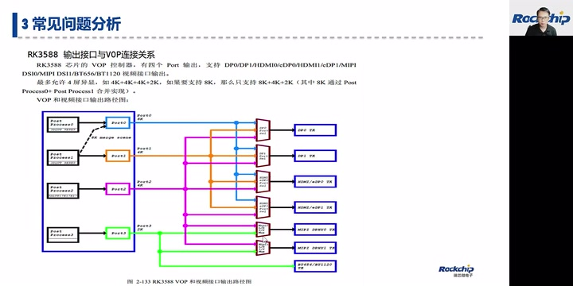

*VOP四个port与显示接口的连接关系 · [原片 34:00](https://www.bilibili.com/video/BV1md4y1d7UH/?t=2040)*

异显支持四屏，三个4K加一个2K。如果支持8K，就只能变成三屏：8K加4K加2K，port0和port1合并成一个8K输出。首先要提，每个port能支持的输出设备能力不一样。port0、port1只支持DP、原生HDMI或者eDP，eDP跟HDMI是combo的。VP2在前两个VP基础上，还支持MIPI，所以VP2能接的显示设备类型最多，一般推荐同显场景挂在VP2上。

VP3比较特殊，能力比较弱，只能支持2K，能支持的显示设备也有限，只支持MIPI或者BT.656、BT.1120。设计显示通路时，特别注意VP3。

### VOP 图层能力（34:46）
3588 VOP总共八个图层：四个Cluster、四个Esmart。最主要区别是Cluster支持FBC压缩格式，Esmart不支持。其他比如缩放、RGB，这两种图层能力一样。针对Cluster的YUV格式要提一下：Cluster只支持压缩格式的YUV。后面讲显示直通还会提，很多人会在这里踩坑。

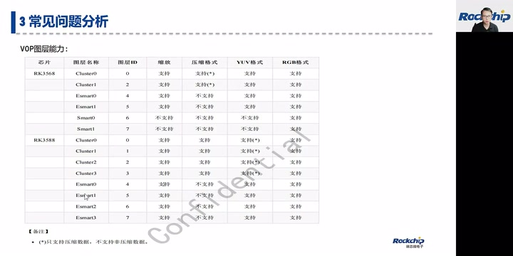

*VOP图层能力：Cluster与Esmart · [原片 35:00](https://www.bilibili.com/video/BV1md4y1d7UH/?t=2100)*

## RKMPI 切换分辨率（35:39）
我们经常碰到客户切换分辨率时遇到挺多问题：切着切着内存泄漏，或者功能异常，这里说明几个常见问题。

一个是VO图层跟VO device的绑定关系，不支持动态切换。就是说VO device使能的时候，不支持这个时候去绑定和解绑。

所有解绑、绑定动作都需要在VO device未使能情况下做。有些客户有这种需求，比如同一个鼠标层或者UI层，想动态绑定在第一、第二、第三、第四个显示屏上切换，目前支持不太好，不能在使能情况下切，只能在disable情况下切。disable的话，屏幕就会黑一下。

关闭VO device时，首先需要关闭该设备上所有通道和图层，最后才关闭设备。如果有图层没有关闭，会造成部分内存没有释放，最终可能内存泄漏。特别是使用独立UI图层的场景，很多客户可能忘记关闭UI图层。如果使用独立UI图层，切分辨率时记得也要关闭。

第三点，RK3588输出8K时，VP0和VP1合并，只能操作VP0，这时VP1不能操作，操作还会报错，只能操作VP0。

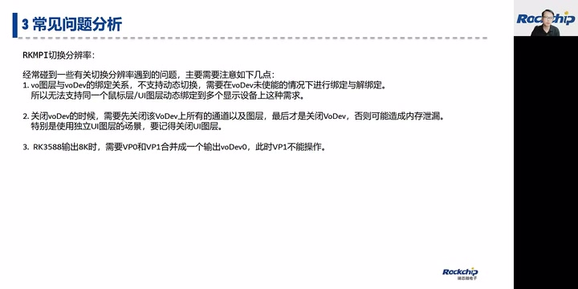

*切换分辨率时图层绑定和关闭要求 · [原片 37:00](https://www.bilibili.com/video/BV1md4y1d7UH/?t=2220)*

这里是RKMPI完整切换流程。首先关闭WBC，解除它跟后级绑定关系，然后disable；关闭通道、关闭图层；关闭设备，包括unregister VSYNC回调、disable、unbind这些。然后再开起来：bind layer、enable、register，开启图层、开启通道，然后再开启WBC。大家可以看到，关闭跟开启，整个流程顺序是反过来的。做切换时需要看一下这个流程。

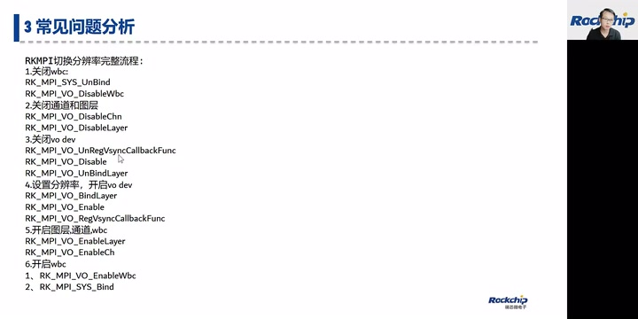

*RKMPI切换分辨率的完整API流程 · [原片 38:15](https://www.bilibili.com/video/BV1md4y1d7UH/?t=2295)*

> 画面中的接口顺序：RK_MPI_SYS_UnBind → RK_MPI_VO_DisableWbc；RK_MPI_VO_DisableChn → RK_MPI_VO_DisableLayer；RK_MPI_VO_UnRegVsyncCallbackFunc → RK_MPI_VO_Disable → RK_MPI_VO_UnBindLayer。重新设置后依次RK_MPI_VO_BindLayer → RK_MPI_VO_Enable → RK_MPI_VO_RegVsyncCallbackFunc；RK_MPI_VO_EnableLayer → RK_MPI_VO_EnableChn；最后RK_MPI_VO_EnableWbc → RK_MPI_SYS_Bind。

## VO 的拼接模式与直通模式（38:46）
VO有两种显示模式，一种拼接模式，一种直通模式。什么叫拼接模式？主要用于多宫格拼接显示，不管图层中有几个通道，都会经过拼接模块，最后送到VOP图层显示。比较常见的场景就是多宫格拼接显示。

怎么使能拼接模式？图层属性有一个bBypassFrame，设成false，这时就是拼接模式。还有直通模式，把图层属性bBypassFrame设为true，指定图层为直通模式。

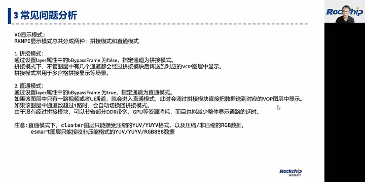

*VO拼接模式与直通模式的条件、格式限制 · [原片 40:00](https://www.bilibili.com/video/BV1md4y1d7UH/?t=2400)*

直通模式下，如果图层中只有一路视频或一路UI，会进入直通模式，跳过——这里“跳过”写错了——跳过拼接模块，直接把数据送到VOP图层显示。如果图层中通道数超过一路，也会自动切回拼接模式。因为没有经过拼接模块，可以节省一部分DDR带宽资源，以及GPU资源，也会减少整体通路延时。比如一些对通路延时比较敏感的产品，我们可以想办法把直通模式用起来。

这里要注意，Cluster图层只支持压缩格式YUV，RGB格式压缩、非压缩都支持。如果直接给VO图层送数据，记得只能送压缩YUV数据，或者RGB，两种RGB都支持。Esmart只能接收非压缩格式。针对显示通路比较敏感的产品，FAQ里也提到怎么优化整体显示通路，有需要可以看一下。

## AFBC 压缩及 JPEG 抓图（41:22）
接下来介绍AFBC压缩格式。RK3588编解码以及显示全通路都支持AFBC压缩，可以有效减少中间数据量传输，降低DDR带宽和其他资源消耗。正常情况下，推荐VDEC、VPSS、VO、VENC都开启压缩模式，把enCompressMode设成COMPRESS_AFBC_16x16。

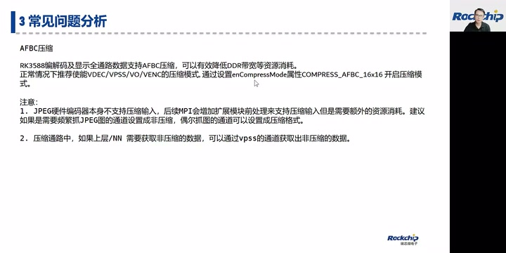

*AFBC压缩与JPEG、非压缩数据获取注意事项 · [原片 41:50](https://www.bilibili.com/video/BV1md4y1d7UH/?t=2510)*

有一点要注意，JPEG硬件编码器本身不支持压缩输入。针对3588，后续MPI会增加一个拓展模块来支持：直接给压缩数据过来，直接变成JPEG。但是需要额外模块转换，消耗额外资源。

所以针对编JPEG场景要区分看。如果需要频繁抓JPEG图，建议这个通道配成非压缩，避免VENC那边频繁转换，效率比较低。如果偶尔抓图，比如一秒抓一张、一秒抓两三张，推荐配成压缩格式。

压缩通路中，如果要送给上层CPU，或者智能那边，需要获取非压缩数据的场景，可以通过一个VPSS通道，通过VPSS的GetChnFrame，把压缩数据转成非压缩，再给后级处理。

## VDEC 常见问题：SendStream 返回 Buffer Full（43:14）
接下来看VDEC常见问题。第一个，调用VDEC SendStream返回Buffer Full，这个客户经常碰到。导致问题有几个原因。

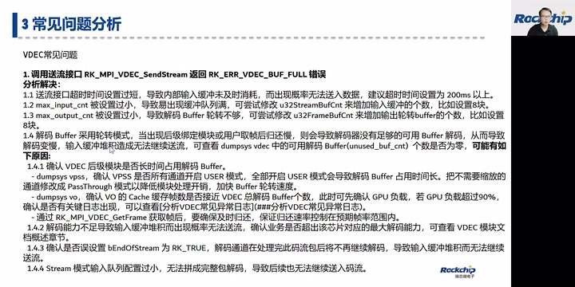

*VDEC SendStream返回Buffer Full的排查条目 · [原片 45:00](https://www.bilibili.com/video/BV1md4y1d7UH/?t=2700)*

第一，设置接口超时时间太短，内部buffer未及时消耗。建议超时时间设在200毫秒左右，当然也要看实际产品和代码架构。

还有输入buffer配置太小，u32StreamBufCnt是缓存输入帧的。如果buffer配太小，会导致你送不进来，建议配成8块。

默认也是8块。还有，解码后轮转buffer配置不够大，也就是u32FrameBufCnt。配置太小，某些特殊码流，比如带B帧或者带Interlace的码流，会解不出来。常规码流建议8个，如果带Interlace，可以配到12个或者更大。

这个解码输出buffer可能被后级拿去用，后级把buffer占住，也会导致解码没有buffer可用，卡在这里，最终输入buffer满，送不进来。这种情况可以通过dump VDEC看可用解码buffer个数unused_buf_cnt。如果个数为0，就代表解码模块没有buffer可用。轮转buffer被后级占用，比如被VPSS或VO占用，可以通过dump确定是不是被占掉。

还有超规格，某些情况下也会导致送流送不进去，因为已经达到最大解码规格。还有错误地把bEndOfStream设成true，这样通道解完这一包就不会再解码，输入缓存一直堆到满，无法再送。还有Stream模式下配置队列过小，无法解包、无法解码。

### 输出帧率不足、播放卡顿（46:33）
另一个常见问题是输出帧率不足、显示播放卡顿。比较常见的原因是送数据帧率不足。给VDEC送的数据帧率没有达到预期，比如60帧视频只送到50几帧，那也只能到50几帧。

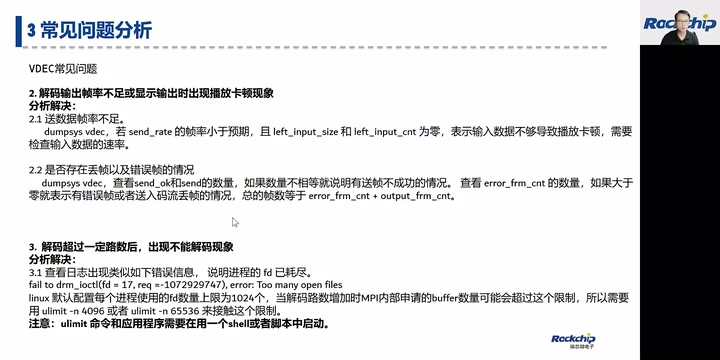

*VDEC帧率、错误帧与FD上限问题 · [原片 47:45](https://www.bilibili.com/video/BV1md4y1d7UH/?t=2865)*

可以通过dump VDEC看left_input_size、left_input_cnt。如果为0，就代表解码模块没有堆积，没有待解码包，这时要看送给VDEC的输入stream接口，调用频率是不是不够。有些客户单线程送很多路，也会出现送不够。

还有存在错误帧或丢帧。比如送给解码器的数据丢掉了，内部会解出错误帧。可以dump VDEC看send_ok和send数量，如果不相等，说明有的帧没送成功。重点看error_frm_cnt，如果有值，说明解码过程中发现错误帧，要排查是不是丢帧了，或者码流有错误帧。

第三，解码模块超过一定路数后，创建解码失败。比较大的可能原因是FD耗尽。

Linux默认每个进程使用的FD数量是1024。解码数量增大时，MPI内部申请buffer会占用FD，可能超过限制，导致申请失败，log一般提示“Too many open files”。可以通过ulimit -n把限制加大，根据需求设4096或者65536。[后一个数，幻灯片显示65536。]注意ulimit命令需要跟程序在同一个shell或者脚本中启动。

## VPSS：花屏、缓存一致性与帧释放（48:56）
接下来看VPSS常见问题。GetChnFrame、GetGrpFrame获取到花屏数据，常见原因有：图像虚宽高没对齐；如果有CPU参与，需要注意cache一致性；还有源数据本来就是花的。这里罗列了对应排查方法。

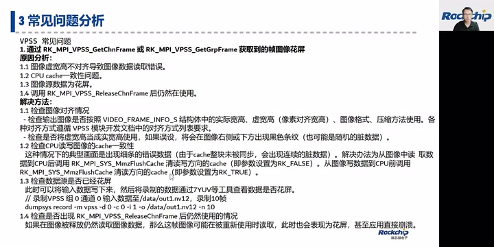

*VPSS花屏与cache一致性排查 · [原片 50:00](https://www.bilibili.com/video/BV1md4y1d7UH/?t=3000)*

第一，虚宽高没对齐，要看VPSS开发文档里的对齐要求。第二，数据如果有CPU参与，就需要刷cache。为了提高cache利用率，MPI里面申请的都是带cache的buffer，所以CPU参与之后要flush cache，注意flush参数。[对应课件：CPU读取前调用RK_MPI_SYS_MmzFlushCache，参数为RK_FALSE；CPU写入后供后级使用前调用，参数为RK_TRUE。]

VPSS可以通过这里这样的命令，把输入数据dump下来，查看输入源数据是不是已经花屏。第四，GetFrame和ReleaseFrame要成对调用。

## VPSS 模式与资源消耗（50:33）
接下来比较常见的是VPSS模式。VPSS功能比较强大，同时会占用很多系统资源，所以需要客户特别注意。优先推荐PassThrough模式，然后Auto模式，最后才User模式。

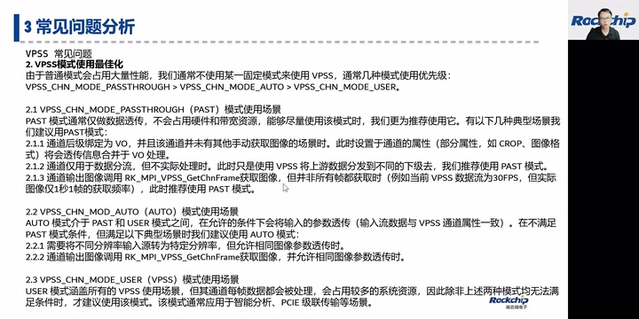

*VPSS PassThrough、Auto、User模式的适用场景 · [原片 51:50](https://www.bilibili.com/video/BV1md4y1d7UH/?t=3110)*

PassThrough仅仅对数据做透传，不需要针对每一帧处理，所以使用资源最少，优先推荐。比较典型的使用场景：通道直接绑定VO，不需要把里面数据拿出来，直接给VO显示。这时裁剪、缩放直接配到VPSS通道属性，透传给VO统一处理。

第二种，不用做数据处理，只做数据分流，也可以用PassThrough。第三种，偶尔调用VPSS GetChnFrame，比如一秒获取一帧、两帧，也可以用PassThrough。

第二种Auto模式，介于PassThrough和User之间，允许在特定条件下对输入参数透传。不满足PassThrough、但满足以下场景时，推荐Auto。

比如不同分辨率转为特定分辨率，但允许相同分辨率数据透传，推荐Auto。还有通过VPSS GetChnFrame获取图像，但相同图像参数做透传，也推荐Auto。

最后User模式，可以涵盖所有VPSS使用场景，但是对每帧数据都处理，占用较多系统资源。所以需要评估前两种模式都无法满足时，才使用User。通常用于取出非压缩数据给后级处理，比如智能，或者PCIe级联传输。节奏先加快一点。

## VENC 常见问题（53:19）
VENC可以支持缩放、裁剪编码，具体可以在VENC文档里看。有关编码输出分辨率，如果使能缩放功能，就按照设置的分辨率输出；如果没有配置，默认编码器会自适应分辨率，根据实际输入分辨率输出。

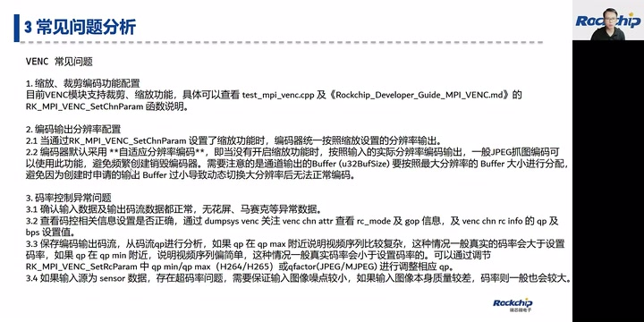

*VENC缩放裁剪、输出分辨率和码率异常 · [原片 54:10](https://www.bilibili.com/video/BV1md4y1d7UH/?t=3250)*

典型场景就是抓各种分辨率的JPEG图。这样不用频繁创建、销毁编码通道，只要动态给通道送不同分辨率编码数据进来就可以。但是buffer要按照支持的最大分辨率去开。

关于码率异常，经常碰到几种情况：输入数据有花屏、马赛克；码控相关参数配置不对；如果输入源是sensor，数据很多噪点之类，也会导致码率比较大。

VENC支持压缩格式输入。但是刚才提到JPEG不支持，我们会拓展出来支持压缩格式输入，但会占用其他资源。第五点，动态参数设定，需要在创建通道之后、启动编码之前设置。还有StopRecvFrame之后，建议调用一下ResetChn，或者把最后输出的编码数据取走。不然可能把buffer占住，没还回去，导致上一级没办法释放这块buffer。

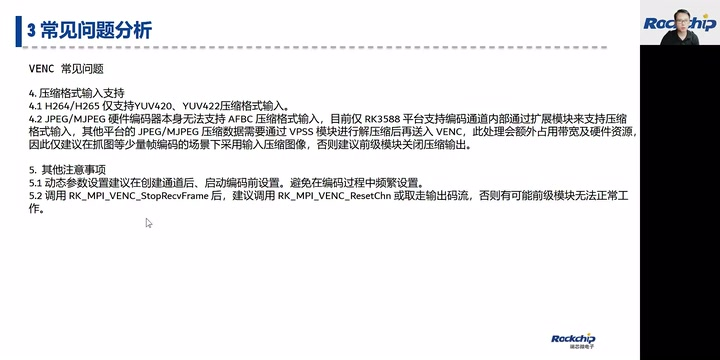

*VENC压缩格式、动态参数与停止后的buffer处理 · [原片 55:20](https://www.bilibili.com/video/BV1md4y1d7UH/?t=3320)*

## VI 常见问题（55:39）
VI如何查看支持的分辨率、查看分辨率，其实都可以通过v4l2命令看。具体命令，文档里面都有介绍。

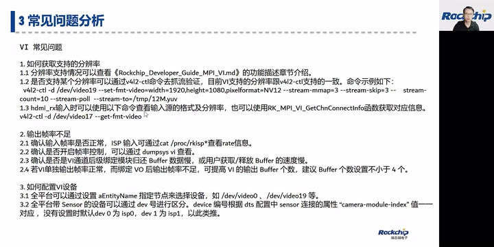

*VI分辨率、输入帧率和设备配置 · [原片 56:00](https://www.bilibili.com/video/BV1md4y1d7UH/?t=3360)*

第二，输入帧率不足，需要排查输入源数据是不是就不足，是不是开启了采集帧率控制，还有是不是VI buffer被后级拿去用却没还。

导致没有buffer可用。这些问题在媒体FAQ也会介绍。

第三，VI采集的name通过entity name指定。如果没有指定，就有默认匹配关系。

### 一帧数据都获取不到（56:55）
还有一种VI常见问题是无法获取码流，一帧数据都获取不到。建议先用v4l2看能不能获取码流。如果不能，确认硬件、驱动是否正常。第二，看分辨率是不是对的。第三，看当前配置格式是不是不支持。第四，通过返回错误码来看，比如8004就说明通道没有使能。[幻灯片给出的完整错误码为0xA0088004。]

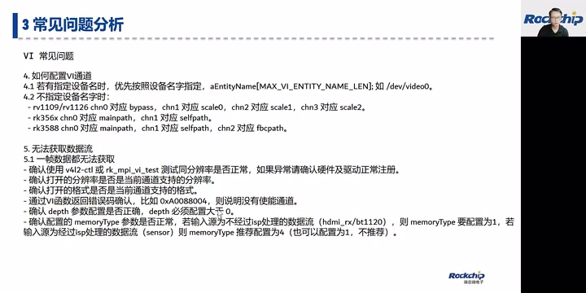

*VI取流失败时的错误码、depth和memory type · [原片 57:40](https://www.bilibili.com/video/BV1md4y1d7UH/?t=3460)*

第五，depth参数配置不对。depth要大于0才能获取数据。最后注意memory type：输入原始数据没经过ISP，比如HDMI In或者BT.1120进来的，memory type要配成1；如果经过ISP处理，推荐配成4。

### 取到一半停止、用户图片与 VI 的边界（58:05）
如果码流取到一半突然不能取流，比较大概率是驱动没采集到数据，或者buffer没还回来。还有用户比较关心的用户图片功能，比如没有数据进来时显示一张图片，插入用户图片。目前支持指定YUV图、RGB背景色。

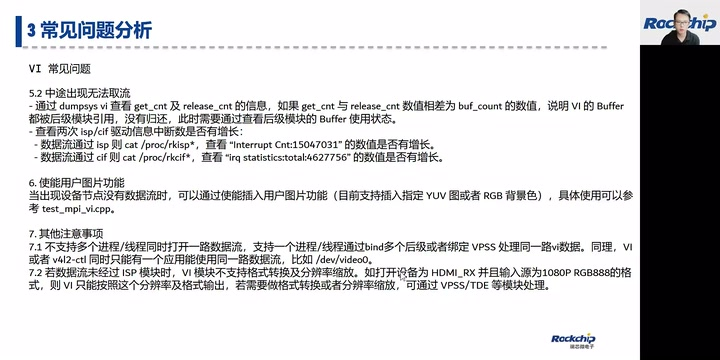

*VI取流中断、用户图片和采集模块能力边界 · [原片 59:10](https://www.bilibili.com/video/BV1md4y1d7UH/?t=3550)*

其他注意事项：现在VI不支持多个进程、多个线程同时打开同一路流，但这种需求可以通过bind多个后级来处理。同一个VI数据，可以bind多个后级分流给不同后级。

VI跟v4l2也不能同时用。比如正在用v4l2抓流，再调用VI抓同一个设备的流，会失败。还要注意，VI模块本身没有数据处理、格式转换、缩放能力。比如HDMI RX输入1080P RGB888格式，VI也只能采集这个格式，不能说缩放到720P、4K，或者把RGB888转为YUV。VI目前没有这个能力。如果需要格式转换，只能在VI之后通过VPSS、TDE等模块来做。

今天直播就是这些内容。各位小伙伴如果有疑问，可以通过二维码或其他渠道反馈给我们，通过业务、售前或FAE，把对应需求提到我们这边。

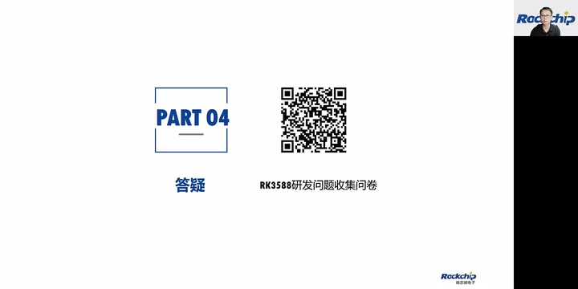

*答疑部分与RK3588开发问题收集问卷 · [原片 01:00:00](https://www.bilibili.com/video/BV1md4y1d7UH/?t=3600)*

## 现场答疑（01:00:22）
我们来看目前客户提的一些问题。

### Linux SDK 为什么不支持 Rockit？
这个也是支持的，但是NVR跟Linux SDK现在是不同部门维护。Linux SDK版本也支持Rockit，只是版本比较旧一点。有相关问题也可以提到Redmine上，以三部那边的同事为主处理。

很高兴今天跟大家分享这些问题。Linux跟NVR不是一套SDK：桌面系统SDK跟Linux NVR Lite SDK，不是同一套。NVR Lite SDK不支持Linux桌面。很多小伙伴可能没搞明白。如果有[此处两个桌面组件名识别不清，局部ASR为“VLAN/Western”]这种多窗口、有桌面需求的，现在只能用Linux SDK这套去开发。

### Linux 下编解码能力为什么达不到手册宣传值？
看一下直播间还有没有其他小伙伴提问题。我这里之前整理了一些，稍等一下。有一个问题，Linux下视频编解码能力达不到手册宣传值，为什么？可能主要是刚才讲的几个点。

一个是送帧帧率不够。还有测试码流码率会不会很大，比如那种很大码率的。我们测试，以及后端NVR测试片源，一般用实时流，码率没有很大，而且没有B帧，没有Interlace那种片源。

还有测试解码或编解码时，是不是同时跑NN或其他东西？同时跑的东西太多，系统带宽达到一定值，比如20G以上，可能出现带宽瓶颈。

### 能接多少路 4K、8Mbps 的 IPC？
还有小伙伴问，能接多少路4K、8Mbps IPC？3588解码能力按8K60来算：如果4K60，就是4路；如果4K30，就是8路。

### NPU 使用案例、教程比较少？
还有一个朋友说，NPU使用案例、教程比较少。NPU发布以及答疑是我们图形那边的同事在跟进。据我所知，Toolkit[英文套件全名识别不清，定向ASR为“Locky的TourKit”]里面提供常见模型示例，应该基本每个模型都有覆盖。还有RK自己的模型，比如人脸检测、人车非、动检、周界，都有对应模型。发布套件叫RockIVA[英文拼写按上下文整理，画面未展示套件名]，到时候可以通过业务端[渠道名ASR仍不清]，找图形那边申请。

### Linux SDK 会引入 RKMPI 吗？
这个也会，都有。Linux SDK在external/rockit[目录拼写按上下文整理，画面未展示路径]目录下有对应的RKMPI套件。

### 多路 VPSS 缩放后 GPU 到 80% 怎么办？
“[问题前部缩写识别不清]绑定8个VPSS，缩到1080P，GPU到80%。”这个就是刚才说的VPSS模式，需要具体分析VPSS整个通路配置是不是最优。优先推荐PassThrough，然后Auto，最后User；User会占比较多资源。

### 1080P 可以到 36 路解码吗？
有朋友说1080P有到36路解码，可以了。其实要看对应码流码率，还有当前系统负载。标称的是我们实测比较保守的数据，具体实用场景，用户可以测在自己的产品里能起多少路1080P。3588 H.265性能比H.264好一点，如果H.265源比较多，可以接更多路1080P。

### Wi-Fi Display 无法投屏？
有朋友问Wi-Fi Display无法投屏。这个不是本次直播涵盖的内容，是安卓端的，可以通过安卓端同事或者Redmine去了解。

今天的课程直播分享到这里。很感谢各位小伙伴，这么耐心听我啰嗦一个小时。如果还有问题，或者对SDK有什么意见，可以及时反馈给我们。我们看看怎么把SDK做得更加成熟、更加容易使用。
