# RKNN模型精度优化指南

> RK3588 精品公开课 · L02 · Kevin Du · [原课程](https://www.bilibili.com/video/BV1jY4y1u7GK/?p=1) · 原始时间轴 00:00–59:24。
> 本文为按原序整理的完整忠实讲稿，清理口吃与无新增信息的机械重起，保留讲者口吻、例子、条件、操作和问答；不是逐字逐音记录。SDK 支持范围、默认参数及性能口径均为课程发布时讲述。
> 源画面为 640×320。小字精度数值不能可靠辨认的地方已就地注明；原转写与三段本地定向 ASR 附证均随稿保存。

## RKNN-Toolkit2 的模型转换框图

[00:00](https://www.bilibili.com/video/BV1jY4y1u7GK/?p=1&t=0) 我们现在七点了，然后我们的课程正式开始，我们的课程今天是讲 RKNN精度优化相关的一个课程，然后这个课程的话，里面的话会用到很多，RKNN-Toolkit2，就是会大量使用到RKNN-Toolkit2这个工具。所以说我这边会先介绍一下，Toolkit 2这个工具的整体的框图。

[00:34](https://www.bilibili.com/video/BV1jY4y1u7GK/?p=1&t=34) 首先RKNN-Toolkit2它是模型转换的工具，就是把我们的外部的公开模型转换成我们RKNN 私有模型，那我们现在目前支持的话，有六种框架的模型，一个是Caffe的模型，还有TensorFlow的模型，ONNX的模型，PyTorch的模型，TFLite的模型还有Darknet的模型。

[01:01](https://www.bilibili.com/video/BV1jY4y1u7GK/?p=1&t=61) 然后我们这个转换器，会先将这些模型转换成我们的一个中间 IR 表达，就是转换成一个中间的模型，然后这个模型之后，第一步会先进入到我们这个图优化的一个环节，Graph Optimizer，然后这个环节里面会做很多跟图优化相关的事情，比如说常量折叠，还有OP的融合，OP的转换。

[01:29](https://www.bilibili.com/video/BV1jY4y1u7GK/?p=1&t=89) 那目的的话就是将我们原始导进来的一个模型，或者一个图，尽量的进行精简，然后提高运行效率。紧接着我们这个IR的话会进入我们的量化器，然后这个量化器会里面也包含一些，比如说per-layer量化，Channel量化，MMSE量化还有混合量化。

[02:00](https://www.bilibili.com/video/BV1jY4y1u7GK/?p=1&t=120) 这几种量化方式的话，我们后面都会介绍到，然后经过这些量化之后的话，我们还会再进入一个量化优化器，进行最终的量化传播的优化，然后经过量化之后的话，这时候我们就得到了一个比较好的一个量化参数，然后这时候我们就会将这些量化参数，以及我们的IR，一起传入 Compiler 模块。

[02:30](https://www.bilibili.com/video/BV1jY4y1u7GK/?p=1&t=150) 然后这个模块负责将我们的中间 IR 模型转换成我们真正的RKNN模型，然后里面做的事情，有做一个比较底层硬件级别的OP融合，还有做一些OP的Tiling的一个操作，然后同时里面也有内存管理相关的事情，然后接着的话，就可以生成我们RKNN的一个模型，那生成RKNN模型之后。

[02:58](https://www.bilibili.com/video/BV1jY4y1u7GK/?p=1&t=178) 我们可以选择在我们的Toolkit2的一个，simulator，也就是仿真器上面进行一个仿真，然后我们这个仿真器的话，可以进行一个模型的推理，然后同时我们内部还有个功能叫精度分析，我们可以通过这个模块的精度分析的功能，对我们的精度进行一个校验，同时我们Toolkit2的话也支持连接我们的硬件开发板。

[03:25](https://www.bilibili.com/video/BV1jY4y1u7GK/?p=1&t=205) 进行一个连板的一个调试，那这里面的连接主要是通过USB来进行连接，然后进行调试的，那今天这个框图里面的话涉及到，跟精度相关的话其实有两个模块，一个是我们这边说的一个量化器，然后还有一个是我们的仿真器，仿真器里面的包括我们的精度分析。

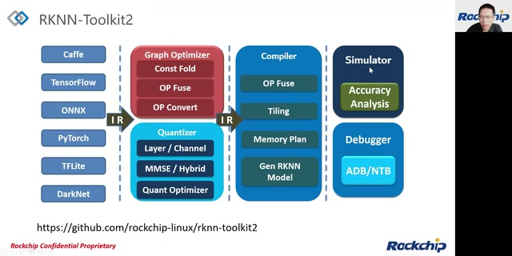

*RKNN-Toolkit2 的完整转换、仿真和调试框图 · [原片 03:50](https://www.bilibili.com/video/BV1jY4y1u7GK/?t=230)*

[03:53](https://www.bilibili.com/video/BV1jY4y1u7GK/?p=1&t=233) 这个工具，那我这边讲一下，接下来开始我们讲 RKNN 模型的精度优化。

## 为什么部署后会有精度问题

[04:02](https://www.bilibili.com/video/BV1jY4y1u7GK/?p=1&t=242) 我这边提出一个问题：，我们训练好的模型为什么在转RKNN部署之后，会出现一个精度的问题，那浮点模型的精度下降，其实它在转换之后，或者说量化之后，它的精度会变差的最主要的原因，其实是模型的量化，当然也有可能是我们在转模型的时候，我们的转换参数配置不当，然后另外的话也有可能是我们比如说我们工具端。

[04:39](https://www.bilibili.com/video/BV1jY4y1u7GK/?p=1&t=279) 或者说我们Runtime的一个驱动，本身也有Bug，然后这也会导致我们的精度变差，最后的话有可能出现是用户，就是我们自己写的C 代码，程序本身也有Bug导致的。那这边我先介绍一下，我们RKNN使用的一个量化的一个方法。

## 非对称量化与误差来源

[05:01](https://www.bilibili.com/video/BV1jY4y1u7GK/?p=1&t=301) 我们使用的是非对称量化，那非对称量化的话，有两个一个参数，一个叫scale，一个叫zero_point，那scale的参数的含义，其实就是将我们一个浮点的一个数值区间，与我们的量化的一个数值区间的一个比例，那比如说我们的，假设我们一个tensor的浮点的范围区间是-1到正1，那它实际上它的区间范围就是2。

[05:31](https://www.bilibili.com/video/BV1jY4y1u7GK/?p=1&t=331) 然后如果我们的量化的类型是I8的话，那它的量化区间实际上是 -128 到 127，它的范围是255。所以说我们这个scale就是2除以255，那zero_point的话，其实它代表的含义是，就是将一个，比如说我们的一个浮点值为0的时候，然后这时候它映射到我们的量化区间的时候。

[05:55](https://www.bilibili.com/video/BV1jY4y1u7GK/?p=1&t=355) 它的数值是多少。所以说zero_point其实是一个偏移，那一个浮点跟量化之间的转换是怎么转换的。

[06:06](https://www.bilibili.com/video/BV1jY4y1u7GK/?p=1&t=366) 那我们这边一般是这么称的，就如果我们一个浮点数值要转换成一个量化数值的话，我们这个过程我们叫量化，那如果是一个量化数值转成浮点数值的话，我们称之为反量化，那量化的公式的话，我们这边可以看到，一个浮点的数值，我们是先除以我们前面介绍的scale，然后再做一个round 的操作，round 的这边是一个四舍五入的一个操作。

[06:34](https://www.bilibili.com/video/BV1jY4y1u7GK/?p=1&t=394) 之后再加上zero_point，然后这时候就得到我们的一个量化的数值，那因为我们的scale跟zero_point，有可能会超出，就设定有可能会超出我们量化数值的一个范围。所以说我们这边还要做一个clip的操作，比如说把我们的量化数值，约束在-128到127这样子，然后反量化就是一个相反的操作。

[06:57](https://www.bilibili.com/video/BV1jY4y1u7GK/?p=1&t=417) 然后反量化是将我们的量化数值减去zero_point，然后再乘以scale，那为什么我们的量化计算精度会下降呢？

[07:08](https://www.bilibili.com/video/BV1jY4y1u7GK/?p=1&t=428) 其实最主要的原因就是前面的这个round 的这个操作，因为它是一个四舍五入。

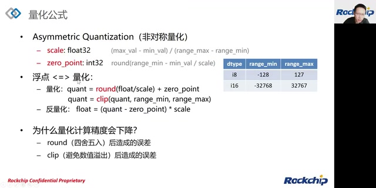

*非对称量化公式、i8/i16范围及 round、clip 误差 · [原片 07:10](https://www.bilibili.com/video/BV1jY4y1u7GK/?t=430)*

[07:13](https://www.bilibili.com/video/BV1jY4y1u7GK/?p=1&t=433) 它是把一个浮点值转化成一个定点值，那这里面就会造成比较大的误差，然后下面的这个clip的操作的话，同样的因为它是为了避免数值的溢出。所以说它会做一个clip的操作。所以说也会造成误差，那我今天，然后接下来我讲一下我们整个的精度问题的一个排查的整体流程。

## 精度问题排查的整体流程

[07:39](https://www.bilibili.com/video/BV1jY4y1u7GK/?p=1&t=459) 首先如果我们发现我们在我们的开发板，或者说在我们的NPU上部署一个模型，发现它的Runtime的精度比较差，然后这时候的话我们可以先在模拟器上进行我们FP16的精度的一个验证，如果我们在我们的工具的模拟器的FP16精度验证下，发现精度也是异常的，然后这时候我们就需要去检查一下。

[08:09](https://www.bilibili.com/video/BV1jY4y1u7GK/?p=1&t=489) 我们的一些跟FP16精度异常相关的一些参数，比如说第一个参数是mean 跟 std，就是归一化的参数。然后第二个参数是模型的输入输出的节点的选择参数。（现场短暂插话：放掉了，对，干净，没错，OK。）。然后第三个参数是 input_size_list，这个是我们模型输入的一个 shape 参数，第四个有可能是我们的推理接口的一个参数。

[08:44](https://www.bilibili.com/video/BV1jY4y1u7GK/?p=1&t=524) 当然另外还有可能是我们的模型，比如说我们的模型的中间feature，就训练的时候我们的中间feature超出了我们的FP16的一个表达范围，然后这时候也会造成我们模拟器精度的FP16的精度的下降，然后如果排查完上述的问题之后，然后这时候我们就可以得到一个FP16精度正常的一个模型。

[09:09](https://www.bilibili.com/video/BV1jY4y1u7GK/?p=1&t=549) 然后紧接着我们就可以进行一个正常的量化，然后量化之后的话我们就可以来检查一下我们模拟器量化精度，如果发现精度异常的话，同样的也有可能跟下面这些配置有关，那第一个配置是我们的量化的数据类型 quantized_dtype，第二个是 quant_img_RGB2BGR 的一个标志，这个是控制我们的量化图像的读取的一个操作。

[09:35](https://www.bilibili.com/video/BV1jY4y1u7GK/?p=1&t=575) 第三个是一个优化等级。然后第四个是我们的比较重要的一个dataset，就是量化校正集的设定，然后还有就是我们可以尝试一下切换我们的量化方法，以及我们的量化算法，甚至使用混合量化的方式，然后最后也可以使用QAT，就是量化感知训练的方式来提升我们的量化精度，然后在上述问题排查，完之后的话。

[10:05](https://www.bilibili.com/video/BV1jY4y1u7GK/?p=1&t=605) 那这时候我们就可以得到一个在模拟器上，然后量化精度正常的一个模型。

[10:11](https://www.bilibili.com/video/BV1jY4y1u7GK/?p=1&t=611) 或者说量化精度满足我们需求的一个模型。紧接着我们就可以进入到我们的连板精度的一个检查，那一般我们是会在连接板子的情况下进行一个推理，然后如果我们发现推理的结果并不好，或者说精度不够。这时候，

[10:33](https://www.bilibili.com/video/BV1jY4y1u7GK/?p=1&t=633) 我们就可以尝试我们的连板的一个精度分析，因为出现这种情况的话，比较有可能是因为我们的Runtime的一个驱动，可能里面有某些OP实现有bug导致的，然后这时候我们就可以进行连板精度分析，然后将我们的一个分析结果，然后反馈给我们瑞芯微的NPU团队，然后我们来进行修复，然后如果修复完的话。

[11:01](https://www.bilibili.com/video/BV1jY4y1u7GK/?p=1&t=661) 我们或者说连板精度也是正常的话，那这时候我们就可以真正的部署到我们的开发板上面，也就是部署到，就是使用我们Runtime的API来进行部署，当然我们在部署的时候，也有可能出现我们精度的一个问题，那这时候的话，我们就需要去看一下我们的使用Runtime API的时候，一些配置参数是不是正常。

[11:28](https://www.bilibili.com/video/BV1jY4y1u7GK/?p=1&t=688) 是不是正确的，还有我们的输入的一个前处理，或者说我们输出的一个后处理是否正确，那这些都排查完毕了之后的话，这时候我们就可以得到一个比较好的部署的一个量化模型，那所以说今天这张流程图的话。

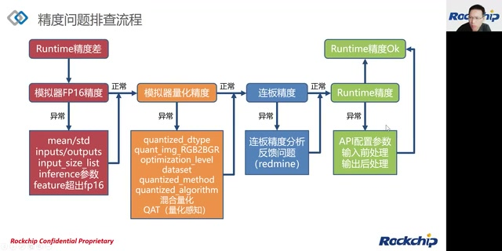

*精度排查完整流程图 · [原片 11:40](https://www.bilibili.com/video/BV1jY4y1u7GK/?t=700)*

[11:47](https://www.bilibili.com/video/BV1jY4y1u7GK/?p=1&t=707) 就是我们整个课程的一个框图，那我们等一下会围绕这个流程图来进行介绍。

## 课程目录与精度分析工具

[11:56](https://www.bilibili.com/video/BV1jY4y1u7GK/?p=1&t=716) 那这边是我们的一个目录，首先我们第一个小节的话，我们可以简单的介绍一下我们的精度分析工具的一个使用。然后第二个部分的话，我们会重点介绍一下模拟器精度的一个排查。

[12:11](https://www.bilibili.com/video/BV1jY4y1u7GK/?p=1&t=731) 那第三部分的话，我们会介绍一个板端的Runtime的精度的一个排查，然后第四部分的话就是我们最后的提问环节。那首先我们介绍一下我们的精度分析的一个工具，那RKNN-Toolkit2的提供了精度分析工具的话，它实际上它是进行一个浮点和量化的一个推理，然后把中间的每一层feature的数据获取出来。

[12:39](https://www.bilibili.com/video/BV1jY4y1u7GK/?p=1&t=759) 然后再做一个量化精度的一个分析，那使用的方式的话其实是比较简单的，我们在 RKNN build 之后，然后就是说我们在量化之后的话，我们就可以直接调用 RKNN 的 accuracy_analysis 接口，那这个接口的话有四个参数，那第一个参数是用来设定我们输入的图像的一个路径的列表。

[13:07](https://www.bilibili.com/video/BV1jY4y1u7GK/?p=1&t=787) 就是这个本身是一个列表，如果说我们的模型有多个输入的话，这里面应该有多项，还有第二个的，还有它我们支持的格式是，一般是图像或者说是NumPy的一个npy的格式。然后第二个参数是output_dir，这个是一个设定输出目录的一个参数，然后这里面在我们设定的这个输出目录的话，就是在我们做完精度分析之后的话。

[13:35](https://www.bilibili.com/video/BV1jY4y1u7GK/?p=1&t=815) 会导出一个golden的一个目录，还有一个simulator的目录，还有一个Runtime的目录，那这三个目录分别对应的是一个浮点真值的一个输出，还有一个是我们量化仿真的一个输出，还有一个是我们在板子上Dump出来的一个输出，然后以及这些目录的一个分析的结果。那第三个参数是target的参数。

[13:58](https://www.bilibili.com/video/BV1jY4y1u7GK/?p=1&t=838) target的参数是用来设定我们是使用模拟器，还是NPU硬件平台来进行一个精度分析，然后如果说这个target我们不设置的话，那我们默认使用的是模拟器的精度分析，那如果我们设置了这个target的话。

[14:13](https://www.bilibili.com/video/BV1jY4y1u7GK/?p=1&t=853) 我们不仅会做模拟器的一个精度分析，同时我们也会通过连板的我们会把硬件上的一个Dump的一个信息抓回来，然后做一个分析，那最后一个device_id的话，这个其实就是用来当我们比如说我们的target的连接的多台设备的话，这时候我们需要指定一个device_id。

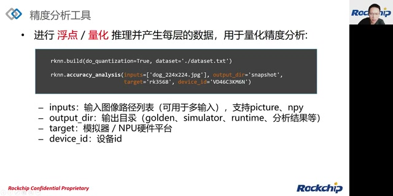

*accuracy\_analysis 的调用与四个参数 · [原片 14:30](https://www.bilibili.com/video/BV1jY4y1u7GK/?t=870)*

## 怎样读精度分析结果

[14:33](https://www.bilibili.com/video/BV1jY4y1u7GK/?p=1&t=873) 那这张图的话就是我们精度分析的一个结果，从左边我们可以看到，左边实际上是层名，这边更准确的来说，这里面这些名字其实是一个中间feature的一个名字，然后右侧的话，这边是我们这里面的数值表示的是一个余弦距离，表示的是我们每一层的精度情况，那这里面其实还分两列，一列叫entire。

[15:04](https://www.bilibili.com/video/BV1jY4y1u7GK/?p=1&t=904) 然后一列叫per-layer，那entire这边的解释实际上是我们entire是对比golden数据跟simulator的数据的一个差异，也就是说这entire这边是我们模型的真实的一个量化精度，然后per-layer的话这个是单层的一个量化精度，这entire的这个精度的它的精度它是有累积的。

[15:33](https://www.bilibili.com/video/BV1jY4y1u7GK/?p=1&t=933) 就是说它下一层会受上一层的影响，那per-layer的话的精度的话，其实它是用于评估我们每一层自己本身的一个精度损失情况。所以说我们可以看到这边的per-layer的精度是比这边entire的精度更高一点的。

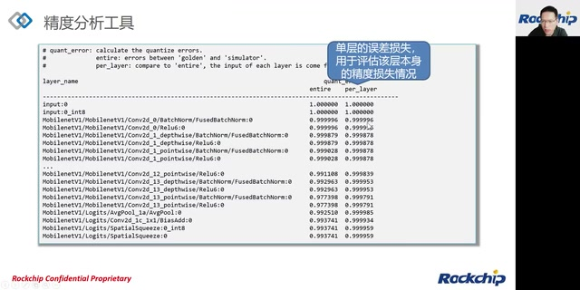

*精度分析中的 entire 与 per\_layer 两列 · [原片 15:40](https://www.bilibili.com/video/BV1jY4y1u7GK/?t=940)*

[15:48](https://www.bilibili.com/video/BV1jY4y1u7GK/?p=1&t=948) 那per-layer这边的精度是用于我们后面使用混合量化的时候作为一个依据，那这个第二张图的话我们发现它跟第一张图有一个多的一部分多的这部分Runtime这就是因为我们我这张图是将我们的前面说的target的设置成，比如说设置成RK3568这样子，然后它会它会连板然后将我们的NPU上面的一些数据拉回来。

[16:18](https://www.bilibili.com/video/BV1jY4y1u7GK/?p=1&t=978) 然后做一个整体的分析，然后这里面同样也有两项，第一项是simu_err，那simu_err这边有解释，simu_err实际上就是就是，就是simulator跟Runtime之间的一个误差，还有一个golden_err。

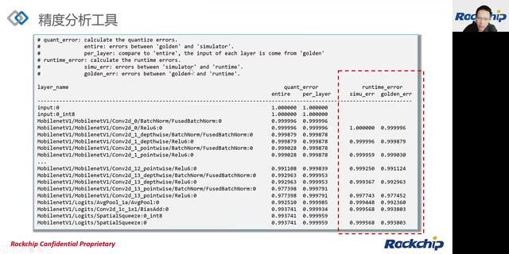

*连板精度分析新增 Runtime 误差列 · [原片 16:30](https://www.bilibili.com/video/BV1jY4y1u7GK/?t=990)*

[16:32](https://www.bilibili.com/video/BV1jY4y1u7GK/?p=1&t=992) golden_err其实就是我们的真值，就是浮点真值跟Runtime之间的一个误差，那精度分析里面的余弦距离。

## 余弦距离与数据集精度

[16:43](https://www.bilibili.com/video/BV1jY4y1u7GK/?p=1&t=1003) 实际上它是不能作为最终的一个精度的一个标准。所以说它仅做一个参考。但是，

[16:51](https://www.bilibili.com/video/BV1jY4y1u7GK/?p=1&t=1011) 它又可以作为我们在量化优化调优过程中的精度是否有改善的一个依据，就是这个比较可以比较快速的检查出我们的精度是否有改善。当然最后的话其实我们还是得做一个数据集的一个完整的精度对比，也就是说使用我们的后处理验证结果的准确性，然后呢我们尽量使用比较大的一个数据集进行测试。

[17:17](https://www.bilibili.com/video/BV1jY4y1u7GK/?p=1&t=1037) 那这里面一般情况下像分类网络的话，我们会去比较Top1到Top5的一个精度的情况，然后如果是检测网络的话，我们则会比较mAP或Recall等等，接下来第二部分我这边重点介绍一下模拟器精度的一个排查。

## 模拟器精度：先验证 FP16

[17:36](https://www.bilibili.com/video/BV1jY4y1u7GK/?p=1&t=1056) 那对应的内容的话就是对应前面这个框图里面的前半部分，包括模拟器的FP16精度以及模拟器的量化精度，我们为什么要检查我们模拟器的精度呢？

[17:55](https://www.bilibili.com/video/BV1jY4y1u7GK/?p=1&t=1075) 这是因为模拟器的结果正确是我们板端就是我们的Runtime推理正确的一个前提，然后呢我们为什么又要检查我们的FP16的一个精度呢？

[18:07](https://www.bilibili.com/video/BV1jY4y1u7GK/?p=1&t=1087) 那同样的因为FP16的模型结果的正确，同样也是我们量化精度正确的一个前提。所以说我们一般在存在精度问题的时候，我们其实是会推荐大家优先验证一下我们FP16模型的正确性。

[18:23](https://www.bilibili.com/video/BV1jY4y1u7GK/?p=1&t=1103) RKNN 目前 NPU 上是不支持 FP32 的计算方式。所以说我们这边还说是不量化的情况下是FP16的一个精度，然后如果我们排除了FP16模型的问题的时候，这时候我们就可以进行模型的量化，然后验证我们的量化的一个精度，那FP16精度的一个验证方法的话，其实有两个第一个是用推理来验证。

[18:54](https://www.bilibili.com/video/BV1jY4y1u7GK/?p=1&t=1134) 就是我们在调用 rknn.build 的时候，我们需要把 do_quantization 设置成 False，设置成 False 的话，就是说明我们这时候不启用量化，那我们就是NPU上FP16的一个精度，在 build 之后，接着会调用 init_runtime，来初始化我们的模拟器。

[19:16](https://www.bilibili.com/video/BV1jY4y1u7GK/?p=1&t=1156) 然后初始化完之后的话，然后我们就可以调用Inference接口，然后来进行一个仿真推理，那将我们的输入数据，以及输入数据的 layout 传进去，然后推理结束之后的话，我们就可以拿到一个输出，然后这时候我们就可以去检查一下，我们这个输出跟我们原始模型，就是原始的浮点模型，输出结果是否是一致的。

[19:45](https://www.bilibili.com/video/BV1jY4y1u7GK/?p=1&t=1185) 然后第二个方法是使用我们精度分析的这个功能，那因为我们前面介绍了精度分析的话，其实它更多的是用来检查模型当中的tensor 的精度情况。那这边我们可以看到这边是我们的FP16的一个精度的一个分析结果。

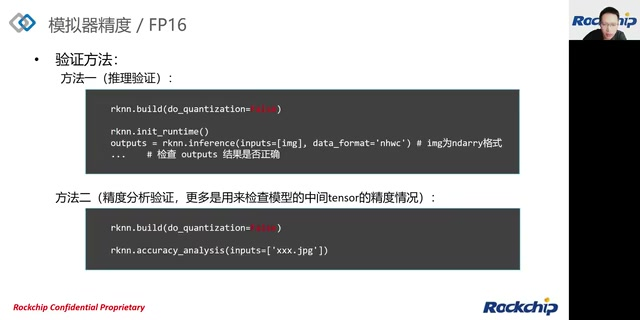

*FP16 的推理验证与精度分析验证代码 · [原片 20:00](https://www.bilibili.com/video/BV1jY4y1u7GK/?t=1200)*

[20:07](https://www.bilibili.com/video/BV1jY4y1u7GK/?p=1&t=1207) 我们可以看到FP16的话，其实它跟浮点的精度是很接近的，它的余弦距离基本上在四个九，基本上都是四个九，那我们如果说出现FP16精度异常的话。

## FP16 异常的原因

[20:22](https://www.bilibili.com/video/BV1jY4y1u7GK/?p=1&t=1222) 那它原因可能有如下。

[20:24](https://www.bilibili.com/video/BV1jY4y1u7GK/?p=1&t=1224) 第一个是我们的配置问题，那配置问题的话就包含一个，mean/std 归一化的一个配置有可能出问题，还有一个是我们模型的输入输出的一个节点设置，可能会有也会导致我们的精度问题，然后还有一个是我们输入模型的，我们模型的输入的shape也会导致，另外一个就是我们的推理的接口参数，如果设置不当的话。

[20:48](https://www.bilibili.com/video/BV1jY4y1u7GK/?p=1&t=1248) 也有可能会导致FP16精度的异常，然后还有一种情况就是模型本身有问题，就是这种情况比较少见，一般这种情况的话体现在我们精度分析里面就，我们就发现精度分析里面有很多inf，那这种情况下是因为我们中间的一个feature，超出了FP16的一个表达范围。所以说如果碰到这种模型的话。

[21:13](https://www.bilibili.com/video/BV1jY4y1u7GK/?p=1&t=1273) 一般这种模型是不适合做FP16以及量化的。所以说可能我们必须得添加一些必要的 BN 层，然后并进行重新的一个训练。然后第三个原因的话可能就是我们工具端的一个bug，然后因为我们工具端的话会，实际上会将我们的原始模型转化成我们RKNN的一个中间IR，然后如果这个转换过程中不等效的话。

[21:39](https://www.bilibili.com/video/BV1jY4y1u7GK/?p=1&t=1299) 那就会导致FP16精度的问题，然后还有可能是我们的工具的一个仿真端就是simulator，本身内部也有bug，然后也会导致我们FP16精度的一个异常，那接下来我们介绍一下FP16的一个配置问题。

## FP16 配置与输入数据

[21:55](https://www.bilibili.com/video/BV1jY4y1u7GK/?p=1&t=1315) 那第一个是的参数就是我们的一个，第一个参数就是 mean 跟 std，这个是一个模型的归一化参数，那一般是针对图像的输入，比如说是U8类型的一个输入，那一般原始模型的输入的归一化处理，一般都会放在模型之外，比如说我们拿到一个 ONNX 模型，然后呢？

[22:18](https://www.bilibili.com/video/BV1jY4y1u7GK/?p=1&t=1338) 我们的归一化处理，我们需要在外面先处理好，然后将处理后的数据再，在丢给ONNX的推理接口。

[22:27](https://www.bilibili.com/video/BV1jY4y1u7GK/?p=1&t=1347) 那我们的RKNN 模型的话，实际上是可以包含mean，跟std的处理的。所以说这个参数的话不仅用于我们RKNN 的一个推理，也用于我们整个量化校正的过程当中。所以说这边需要确保这个参数跟我们的原始模型使用的参数是一致的。

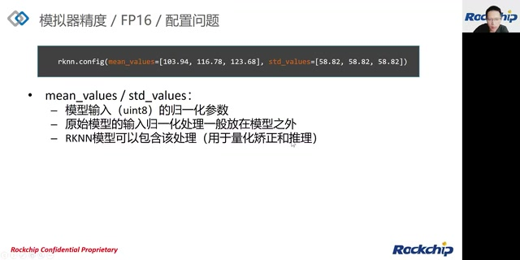

*mean\_values 与 std\_values 的配置及说明 · [原片 22:40](https://www.bilibili.com/video/BV1jY4y1u7GK/?t=1360)*

[22:45](https://www.bilibili.com/video/BV1jY4y1u7GK/?p=1&t=1365) 否则肯定会导致精度下降的，第二个参数是 inputs 跟 outputs，就是我们模型的输入输出节点的一个配置，然后我们目前有两个接口可以支持，就是TensorFlow跟ONNX，我们可以支持这个输入输出节点的一个配置，然后如果这个输入输出节点配置错误的话，当然也会导致一个错误的推理结果。

[23:09](https://www.bilibili.com/video/BV1jY4y1u7GK/?p=1&t=1389) 还有一个就是我们的input_size_list，这个就是输入节点的 shape 信息，那配置错误的话，就会导致输出 shape 的错误，那接下来是rknn.inference的一个推理接口的一个参数。

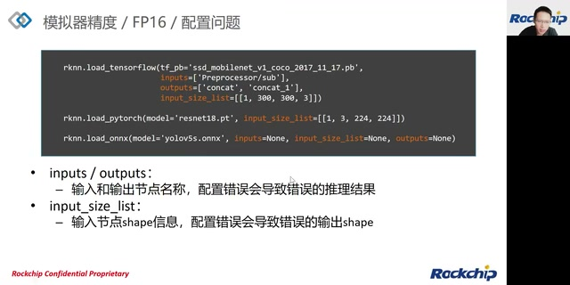

*输入输出节点与 input\_size\_list 配置 · [原片 23:20](https://www.bilibili.com/video/BV1jY4y1u7GK/?t=1400)*

[23:27](https://www.bilibili.com/video/BV1jY4y1u7GK/?p=1&t=1407) 然后这个推理接口的话，它有两个参数，一个是 inputs，一个是 data_format，那分别分别表示推理的一个输入数据以及推理输入数据的一个layout，这里面的话有一种情况如果输入数据 img 来自 OpenCV 的 imread。

[23:55](https://www.bilibili.com/video/BV1jY4y1u7GK/?p=1&t=1435) 因为opencv的imread读到的数据的，他的通道格式是bgr的，然后他的layout是nhwc的，那对于如果说我们这个模型是Caffe模型的话，因为大部分Caffe模型的输入其实是bgr的。所以说Caffe模型的话，我们这个读到的输入图像，我们是可以直接使用的，直接传递到inference的接口里面去。

[24:18](https://www.bilibili.com/video/BV1jY4y1u7GK/?p=1&t=1458) 但是其他框架，就大部分模型框架的输入其实都是rgb。所以说我们都需要做一个，调用 OpenCV 做 BGR 到 RGB 的转换。

[24:29](https://www.bilibili.com/video/BV1jY4y1u7GK/?p=1&t=1469) 然后我们这边的data_format的默认值其实就是nhwc。所以说如果通过opencv的imread读到的这个数值的话，其实是可以不需要进行设置的，然后如果我们的输入数据不是来自于 OpenCV 的 imread。

[24:49](https://www.bilibili.com/video/BV1jY4y1u7GK/?p=1&t=1489) 然后但是他如果还是图像数据的话，那我们也是要保证他的rgb顺序，跟模型的输入的rgb顺序是一致的，然后同时呢我们也必须清楚的知道这个输入数据的，他的layout是什么。

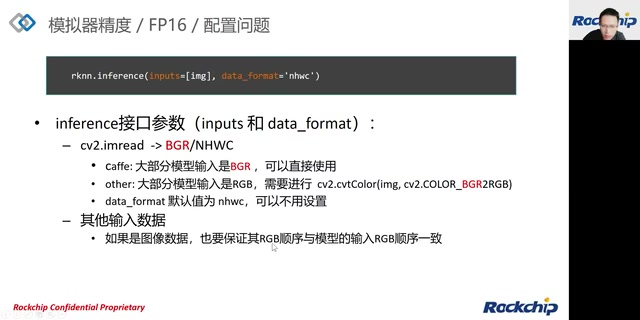

*输入 RGB/BGR 顺序和 data\_format 的注意事项 · [原片 25:00](https://www.bilibili.com/video/BV1jY4y1u7GK/?t=1500)*

[25:05](https://www.bilibili.com/video/BV1jY4y1u7GK/?p=1&t=1505) 然后并正确的设置我们这个data_format的一个参数，在FP16配置正确之后就是说我们经过上面的配置之后。

## 量化配置问题

[25:17](https://www.bilibili.com/video/BV1jY4y1u7GK/?p=1&t=1517) 我们的FP16精度正常，然后就开始进行量化，但是发现量化精度有问题的时候，然后这时候有可能的原因就是出在我们的量化配置上面，那我们这里面涉及到了量化配置参数有第一个量化的 quantized_dtype，第二个是quant_img_RGB2BGR的一个配置，第三个是我们的Toolkit2 的 optimization_level 优化等级选项。

[25:43](https://www.bilibili.com/video/BV1jY4y1u7GK/?p=1&t=1543) 第四个是我们的data set也就是我们的量化校正集，然后我们还可以尝试修改我们的量化方法以及量化算法，然后如果说我们这个模型真的是对量化比较不友好的话，因为某些op可能确实对量化是比较不友好了，然后这时候我们可以尝试使用混合量化或者说qat也就是量化感知学，也就是量化感知训练的这种方式来提升我们的量化精度。

[26:10](https://www.bilibili.com/video/BV1jY4y1u7GK/?p=1&t=1570) 那我们接下来介绍一下量化的一个配置问题，那第一个参数的话就是我们的量化的 quantized_dtype，那就是量化类型的一个选择，那目前可选项是非对称量化i8以及非对称量化i16，那目前的话我们是支持非对称量化i8，那i16目前正在支持中。

[26:30](https://www.bilibili.com/video/BV1jY4y1u7GK/?p=1&t=1590) 所以说这个参数的话我们直接就选择非对称量化i8就可以了，第二个参数的话是quant_img_RGB2BGR，那这个参数的话其实是在我们的量化过程中，因为量化过程中我们需要加载量化校正集的图像，然后加载完图像之后的话，然后我们是不是要做我们需要做一个RGB to BGR的一个转换。

[26:54](https://www.bilibili.com/video/BV1jY4y1u7GK/?p=1&t=1614) 那就有这个标志来控制。所以说这个标志的话，控制的这个通道必须与我们训练时候这个图像的通道是要一致的，否则肯定也会造成精度下降。比如说 Caffe 模型，因为它的输入就是 BGR，所以这个参数一般需要设置成 True。第三个是优化等级，默认值是3；3是速度优先的配置。如果精度有问题，我们可以尝试设置成2，2表示精度优先。这时候会屏蔽掉一些对提升速度、提升性能有帮助的 pass，但是这些 pass 有可能略微影响到精度。

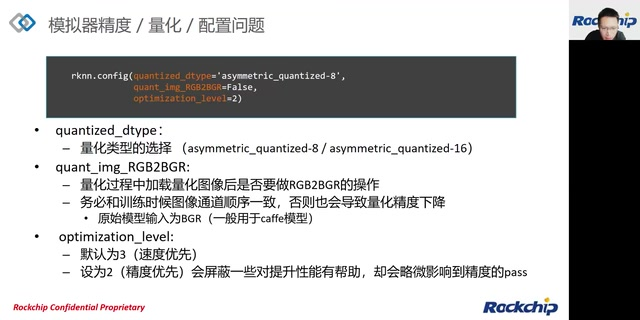

*量化类型、quant\_img\_RGB2BGR 与优化等级 · [原片 27:40](https://www.bilibili.com/video/BV1jY4y1u7GK/?t=1660)*

## 选择与验证量化校正集

[27:57](https://www.bilibili.com/video/BV1jY4y1u7GK/?p=1&t=1677) 因为我们在量化过程中实际上我们是需要找到我们模型中，每个feature的一个合适的量化参数也就是前面我们介绍的一个scale跟zero_point，但是这些量化参数的选择的话，实际上它是要依赖我们实际的输入也就是我们量化校正集的输入来确定的，一般情况下，我们从训练集或者校验集。

[28:23](https://www.bilibili.com/video/BV1jY4y1u7GK/?p=1&t=1703) 里面选择一个比较有代表的一个子集作为我们的校正集。所以说我们如果选择了跟我们实际部署场景不太一致的校正集的话。

[28:33](https://www.bilibili.com/video/BV1jY4y1u7GK/?p=1&t=1713) 那这可能导致会导致我们的精度下降，那一般情况下我们建议客户选择校正集的数量是100到200张之间，需要尽量选择特征比较鲜明的一些图像，然后我们后面介绍了后面会介绍一个叫MMSE量化，因为MMSE量化的话它本身耗时比较长。所以说如果如果是MMSE量化的话我们这时候可以根据我们的实际情况。

[29:04](https://www.bilibili.com/video/BV1jY4y1u7GK/?p=1&t=1744) 适当的减少我们的图像张数，那我们这边怎么判断我们的设置的一个量化校正集，选择是否合理呢？

[29:13](https://www.bilibili.com/video/BV1jY4y1u7GK/?p=1&t=1753) 假设前面已经选择了100张量化校正图像，然后发现我们的量化精度不够或者说量化精度比较差，这时候呢我们就可以尝试我们的量化跟推理只使用同一张的图像，也就是说我们的dataset的里面只配置了一张图像，然后这时候再进行推理，然后如果发现说这时候单张图像的精度提升比较多的话。

[29:46](https://www.bilibili.com/video/BV1jY4y1u7GK/?p=1&t=1786) 那这说明有可能我们先前选择了那100张的量化校正集，可能选择的不是很合理，然后我们这时候可以重新选择，一些跟部署场景比较吻合的一些图像，然后如果这时候单张图像的精度提升并不明显，那这说明精度降低的问题可能不出在dataset上面。

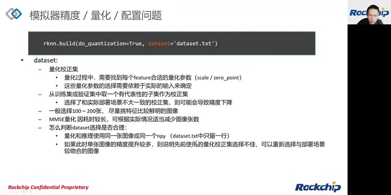

*dataset 校正集选择与单张图像验证方法 · [原片 30:00](https://www.bilibili.com/video/BV1jY4y1u7GK/?t=1800)*

[30:10](https://www.bilibili.com/video/BV1jY4y1u7GK/?p=1&t=1810) 如果经过前面的配置，我们的量化精度还是没办法满足要求。

## 从逐层损失选择优化方向

[30:21](https://www.bilibili.com/video/BV1jY4y1u7GK/?p=1&t=1821) 这时候我们可以通过我们前面介绍的精度分析工具做一个精度的分析，然后如果我们发现分析的结果发现每一层的精度损失其实都是差不多的。

[30:33](https://www.bilibili.com/video/BV1jY4y1u7GK/?p=1&t=1833) 但是它的累积的损失会比较大的情况下，这时候我们可以尝试调整我们的量化方法，就是把我们的per-layer量化方法调成per-channel或者我们的量化算法由我们的normal调成MMSE，然后如果我们发现是有个别层的精度损失比较多的话，然后这时候说明这层的数据分布其实像他对量化是不友好的。

[30:58](https://www.bilibili.com/video/BV1jY4y1u7GK/?p=1&t=1858) 比如说他的分布范围比较不均衡，然后这时候的话我们可以尝试能够修改了我们的量化算法，比如说我们把我们的normal改成MMSE，然后或者说我们使用混合量化的方式，那以前一个比较常见的现象就是当我们的网络中存在大量的depthwise的时候，这时候我们模型的整体精度是会不足的。

[31:21](https://www.bilibili.com/video/BV1jY4y1u7GK/?p=1&t=1881) 然后原因是因为per-layer的这种量化方式对depthwise其实是不友好的。所以说我们会建议采用channel的量化方式，那接下来我讲一下这两个的量化方法跟量化算法怎么配置，然后量化方法。

## 量化方法与量化算法

[31:40](https://www.bilibili.com/video/BV1jY4y1u7GK/?p=1&t=1900) 那量化方法的话，我有两个选项一个是layer，然后我们默认是channel，但是我们早期的版本，实际上我们设置的是layer。所以说如果原先的程序里面，或者原先的脚本里面设置的是layer的话，我们可以尝试改成channel，然后量化算法的话，同样选择也有两个一个是normal一个是MMSE。

[32:00](https://www.bilibili.com/video/BV1jY4y1u7GK/?p=1&t=1920) 那默认也是normal，然后如果说我们原先就是选择normal的话，那这时候我们可以尝试改成MMSE，进行试一下进行精度的调优，那MMSE一般情况下它出来的话精度会比较高了。

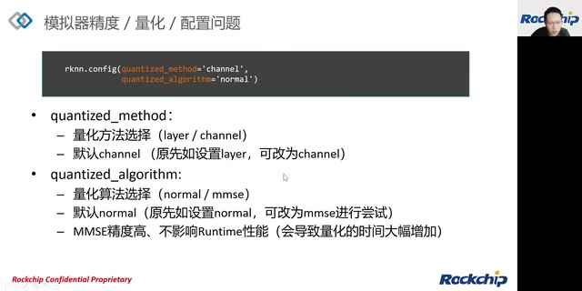

*quantized\_method 与 quantized\_algorithm 配置 · [原片 32:10](https://www.bilibili.com/video/BV1jY4y1u7GK/?t=1930)*

[32:14](https://www.bilibili.com/video/BV1jY4y1u7GK/?p=1&t=1934) MMSE 不影响 Runtime 的性能。但是有个副作用，就是会导致量化时间大幅增加。

## Layer 与 Channel 的区别

[32:34](https://www.bilibili.com/video/BV1jY4y1u7GK/?p=1&t=1954) 接下来讲量化方法 layer 跟 channel 的基本区别。layer 的话，模型里面的 weight 跟激活都采用 per-layer 量化。

[32:50](https://www.bilibili.com/video/BV1jY4y1u7GK/?p=1&t=1970) 这种量化方式就是每个 tensor 只有一套量化参数，即一个 scale 和一个 zero_point，那channel的话跟layer相比的话，它的weight的话，它采用的是channel的一个量化方式，那channel量化方式的区别，就在它的每个通道都有一套量化参数。因为 channel 的量化参数比 layer 更多。

[33:16](https://www.bilibili.com/video/BV1jY4y1u7GK/?p=1&t=1996) 所以说它的精度的话实际上是比layer更高的，在我们的npu平台上面的话，这两种方式的话，他们的性能实际上是接近的，然后这边我们可以看到这是 MobileNet V1，然后在per-layer下的一个精度的情况。我们可以看到最后一层的精度是0.91，然后如果我们把它的量化方法改成channel的话。

[33:46](https://www.bilibili.com/video/BV1jY4y1u7GK/?p=1&t=2026) 我们就可以看到，最后一层的精度由 0.91，直接提升到0.993。

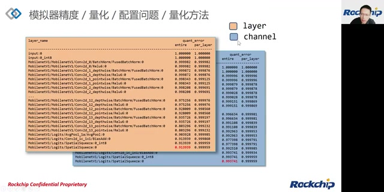

*MobileNet V1 的 layer 与 channel 精度对比 · [原片 33:50](https://www.bilibili.com/video/BV1jY4y1u7GK/?t=2030)*

[33:52](https://www.bilibili.com/video/BV1jY4y1u7GK/?p=1&t=2032) 这个提升的幅度是蛮大的，那另外不只是最后一层的精度提升，中间每一层的精度提升，其实都是比较明显的，那量化算法的话。

## Normal、MMSE 与实测精度

[34:02](https://www.bilibili.com/video/BV1jY4y1u7GK/?p=1&t=2042) 量化算法的话，我们第一个量化算法是normal，然后normal的话，这个是一个比较简单高效的一个算法，它实际上它是直接根据我们的校正集，然后直接计算我们的量化参数，那MMSE的话，MMSE这种量化算法的话，它全称叫最小均方误差，它本质上是一种暴力迭代的一个量化，优化的方式。

[34:30](https://www.bilibili.com/video/BV1jY4y1u7GK/?p=1&t=2070) 也就是为了寻找比较优的scale跟zero_point。

[34:34](https://www.bilibili.com/video/BV1jY4y1u7GK/?p=1&t=2074) 然后它的精度会比较高，但是优化速度会比较慢一些，同时MMSE它是一种纯软件的优化方式，它不需要我们特别的支持。所以说我们的Runtime的性能是保持不变的，然后我们这边可以看到这张蓝色的图，是前面使用 channel 方式的精度。

[34:54](https://www.bilibili.com/video/BV1jY4y1u7GK/?p=1&t=2094) 这张蓝色的图是前面的 channel，就是使用channel方式的一个精度，最后一层精度是 0.993，然后如果我们在channel 这种量化方法下叠加我们的MMSE的一个算法的话，然后我们会发现我们最后一层的精度由0.993提升到0.998，然后我们还可以看到，这边红色标出的中间层精度也会提升；原转写为“0.99977 的精度提升到 0.993”。（这两组数字识别存疑，与画面小字无法可靠对应，请结合本段原片核对。）。

[35:26](https://www.bilibili.com/video/BV1jY4y1u7GK/?p=1&t=2126) 也就是说我们MMSE在我们channel这种已经比较高精度的一个方式下的话。

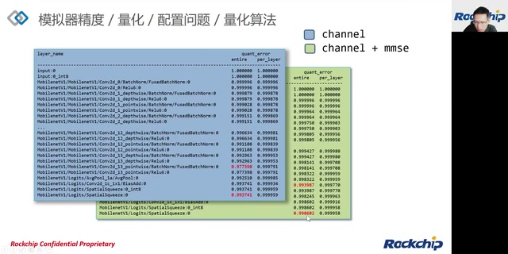

*channel 与 channel 加 MMSE 的逐层精度对比 · [原片 35:20](https://www.bilibili.com/video/BV1jY4y1u7GK/?t=2120)*

[35:32](https://www.bilibili.com/video/BV1jY4y1u7GK/?p=1&t=2132) 它还能有所提升，这张图是我们实际测试的一些分类模型，在 3588 上，然后不同的配置的精度情况，那第一排的精度是FP32的一个原始浮点的一个精度，然后第二排是不使用量化就是FP16的一个精度，第三排是启用layer的就是我们单纯使用layer的这种量化算法的一个量化的一个精度。

[36:01](https://www.bilibili.com/video/BV1jY4y1u7GK/?p=1&t=2161) 第四个是layer加MMSE的一个精度情况。

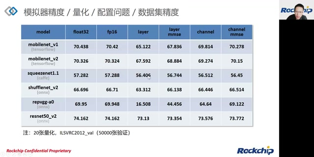

*3588 分类模型在不同配置下的数据集精度 · [原片 36:00](https://www.bilibili.com/video/BV1jY4y1u7GK/?t=2160)*

[36:05](https://www.bilibili.com/video/BV1jY4y1u7GK/?p=1&t=2165) 接下来是channel的一个量化精度，还有最后一排是我们channel叠加MMSE的一个精度，然后我们可以看到FP16的精度实际上跟FP32是很接近的，然后我们的channel精度其实也还是跟FP16或者FP32也也是蛮接近的，那最后的一个叠加MMSE会在channel的基础上进一步的提升精度。

[36:28](https://www.bilibili.com/video/BV1jY4y1u7GK/?p=1&t=2188) 那如果说我们已经使用了channel以及加了MMSE这种量化后。

## 量化不友好：混合量化与 QAT

[36:38](https://www.bilibili.com/video/BV1jY4y1u7GK/?p=1&t=2198) 还会出现我们精度的一个下降，那就说明我们的模型有些op对量化并不友好，比如说卷积的 weight 分布很不均匀的情况下，那这时候我们可以尝试使用混合量化，那混合量化的话它实际上就是让我们模型中的精度损失较大的 OP，使用更高精度的一个运算类型，那我们这边通常都是fp16，然后也可以采用量化感知训练的方式来解决一个精度的量化问题。

[37:09](https://www.bilibili.com/video/BV1jY4y1u7GK/?p=1&t=2229) 这个量化的一个精度问题，然后量化感知训练的话，一般我们叫qat，然后这种方式的话，实际上是提升我们的量化模型精度的一个终极的一个方式，那接下来介绍一下混合量化。

## 混合量化的迭代与使用方法

[37:27](https://www.bilibili.com/video/BV1jY4y1u7GK/?p=1&t=2247) 那混合量化的话，它是可以让我们的模型中不同的 OP使用不同的一个量化运算类型，然后呢用来改进模型的一个精度，然后它基本用法的话就是我们先使用我们的精度分析的接口来对我们模型进行一个分析，然后找出我们精度下降比较多的层然后记下来，然后在使用混合量化的一个过程当中，我们可以将我们找出的这些层的输出的一个tensor名。

[37:57](https://www.bilibili.com/video/BV1jY4y1u7GK/?p=1&t=2277) 然后写入到混合量化的一个配置文件当中，然后接着完成我们的混合量化的一个步骤，然后这时候再测试一下精度情况，也就是继续使用我们的精度分析的工具来测试，然后如果提高不明显或者说提高的不够的话，那我们这时候可以尝试将更多的精度下降的层加入到我们的混合量化配置当中，当然这个也是有个副作用了。

[38:28](https://www.bilibili.com/video/BV1jY4y1u7GK/?p=1&t=2308) 因为使用了混合量化的话，它必然会降低我们运行时的速度，因为我们的fp16的运算性能，是比我们的量化的运算性能差的。

[38:38](https://www.bilibili.com/video/BV1jY4y1u7GK/?p=1&t=2318) 同时，因为需要在 INT8 和 FP16 之间不停切换，这时候切换也会带来开销的。所以说一般情况下混合量化的话，需要用户自己来权衡精度以及速度，那我这边简单介绍一下混合量化的一个使用方法，然后我们一般正常的量化，其实我们只需要调用 rknn.build 这个接口，然后来进行量化就可以了。

[39:10](https://www.bilibili.com/video/BV1jY4y1u7GK/?p=1&t=2350) 但是混合量化的话，我们将这个接口一拆为拆成两个函数，一个叫step1一个叫step2，然后在step1的时候，我们会产生两个临时文件，一个叫.model，一个叫.data的一个临时文件，同时呢？

[39:28](https://www.bilibili.com/video/BV1jY4y1u7GK/?p=1&t=2368) 我们也会产生一个 .quantization.cfg 配置文件（讲述中简称配置文件），然后这时候我们就可以手动修改我们这个配置文件，将我们前面说的，我们认为精度下降了一些层，加入到这个配置文件当中，然后紧接着调用我们step2，然后将前面这三个文件都传到step2的接口里面，这样就完成了一个跟上面build 一样的效果。

[39:53](https://www.bilibili.com/video/BV1jY4y1u7GK/?p=1&t=2393) 一个样的量化效果。

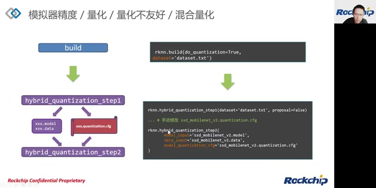

*混合量化 step1、临时文件和 step2 流程 · [原片 40:00](https://www.bilibili.com/video/BV1jY4y1u7GK/?t=2400)*

[39:57](https://www.bilibili.com/video/BV1jY4y1u7GK/?p=1&t=2397) 那这个是我们的一个量化配置文件，然后我们可以看到这个量化配置文件，最前面有一个 custom_quantize_layers 的字段，然后这个红色部分是我们手动填充的内容，填充的内容，前面是 tensor 名，然后后面是一个我们需要的一个混合的混合量化的一个数值类型。

[40:24](https://www.bilibili.com/video/BV1jY4y1u7GK/?p=1&t=2424) 然后一般都是fp16。

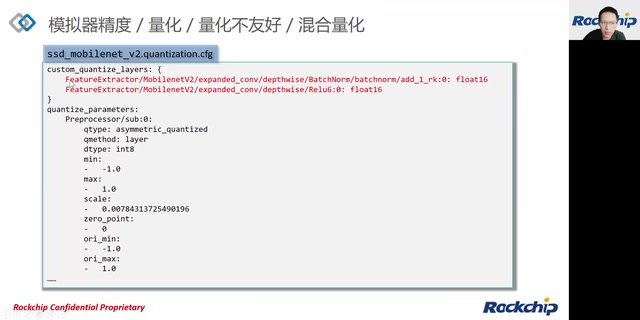

*混合量化配置中的 custom\_quantize\_layers · [原片 40:20](https://www.bilibili.com/video/BV1jY4y1u7GK/?t=2420)*

[40:26](https://www.bilibili.com/video/BV1jY4y1u7GK/?p=1&t=2426) 然后当然我们还提供了一个工具，就是在我们step1的话，还有一个叫proposal的一个参数，如果这个参数设置成 True，这时候产生的这个配置文件的话。

[40:40](https://www.bilibili.com/video/BV1jY4y1u7GK/?p=1&t=2440) 其实让它会自动帮我们填充一些，它会自动去计算一些对精度影响比较大的层，比如说这些层的话，它一般都会按对精度的一个敏感度的顺序，然后自动填充，然后后面的话，这边实际上也附加出说我们选择了这些层之后，它的精度的一个情况，当然使用这个参数的话，这会导致我们这个step1的一个调用时间的一个增加。

[41:05](https://www.bilibili.com/video/BV1jY4y1u7GK/?p=1&t=2465) 这会导致 step1 调用时间增加。如果混合量化后的精度还是不够，或者精度够了，但是运行性能反而不足，这时候可以使用 PyTorch 或者 TensorFlow 进行量化感知训练，得到量化后的模型，再将这个模型转换成最终部署的 RKNN 模型。量化感知我们叫 QAT。

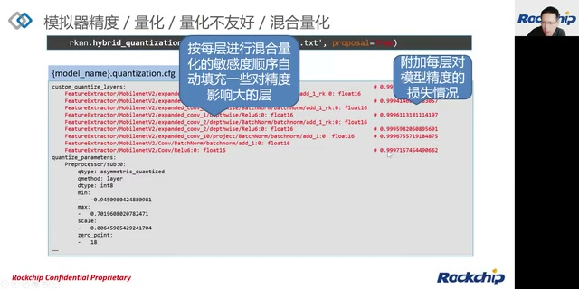

*proposal 自动填充敏感层与精度损失信息 · [原片 41:10](https://www.bilibili.com/video/BV1jY4y1u7GK/?t=2470)*

## QAT 量化感知训练

[41:46](https://www.bilibili.com/video/BV1jY4y1u7GK/?p=1&t=2506) 那我们前面说的一些量化的算法，或者说量化的过程，我们都可以称之为叫后量化的一种方式，也就是说我们前面的这种量化算法，不管多么厉害，他都造成一个信息的丢失，然后造成精度的下降，那PyTorch跟TensorFlow的话，他提供了一种QAT的方式进行训练，那这种训练的原理，他一般是在浮点模型的每个节点的前后插入类似。

[42:14](https://www.bilibili.com/video/BV1jY4y1u7GK/?p=1&t=2534) 类似 Quantize/DeQuantize 的节点，然后插入这些节点之后的话，他就相当于说把我们的量化误差，当做一种噪声来训练，也就是说我们在训练的时候，模型自己会自己去学习如何最小化这个误差，那训练出来的模型的话就可以适应这种量化的，量化噪声，通过量化感知训练之后，我们就可以得到一个。

[42:41](https://www.bilibili.com/video/BV1jY4y1u7GK/?p=1&t=2561) 带量化权重，以及带量化参数的一个模型，那RKNN-Toolkit2的话，目前支持PyTorch以及TensorFlow，这两种QAT的模型，这两种框架的QAT模型，那我们目前PyTorch支持的会比较好一点。所以说尽量推荐大家使用PyTorch来进行QAT的训练。那这边说一下PyTorch的话。

[43:06](https://www.bilibili.com/video/BV1jY4y1u7GK/?p=1&t=2586) 因为他支持的QAT的，量化模式有两种，一种比较旧的叫 Eager Mode，还有比较新的叫 FX Graph Mode，区别在于旧的 Eager Mode，他是需要手动的去设置我们前面说的就是我们要手动指定哪些东西要进行量化，哪些不进行量化，这种方式比较麻烦，新的 FX Graph Mode。

[43:31](https://www.bilibili.com/video/BV1jY4y1u7GK/?p=1&t=2611) 这种是一个自动量化的一个模式，然后说我们目前只支持这种新的这种模式，那下面这两个链接的话是QAT 训练的介绍，然后大家可以截图。

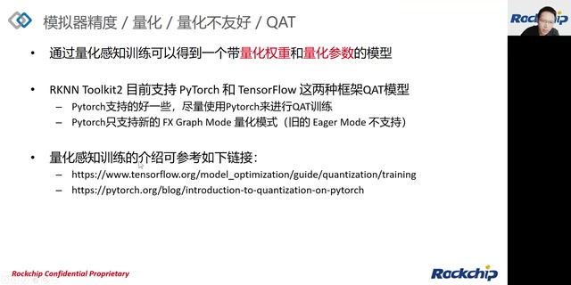

*QAT 框架支持、FX Graph Mode 及学习链接 · [原片 43:50](https://www.bilibili.com/video/BV1jY4y1u7GK/?t=2630)*

[43:43](https://www.bilibili.com/video/BV1jY4y1u7GK/?p=1&t=2623) 然后后面可以去学习一下，然后接下来我们的这个方式，这个方式是一个自动量化的一个模式，然后接下来我们就进入到我们的板端。

## 板端 Runtime 精度排查

[43:56](https://www.bilibili.com/video/BV1jY4y1u7GK/?p=1&t=2636) Runtime 精度排查阶段，对应了我们前面的排查流程图里面的后边后面两个部分，第一个部分是连板的一个精度的一个检查，还有一个是我们Runtime精度的一个检查，也就是说我们前面在模拟器上的精度的话，已经满足要求了，但是我们在板端通过我们的C API进行部署的时候。

[44:21](https://www.bilibili.com/video/BV1jY4y1u7GK/?p=1&t=2661) 然后这时候发现的精度不够，或者说结果根本就不对的情况，这时候的话原因的话有可能是我们自己的C代码，部署代码的Bug导致的，比如说我们这里面的输入数据不对，那输入数据当然包含通道顺序，如果是图像数据的话那他包含通道顺序以及图像的Layout。

[44:44](https://www.bilibili.com/video/BV1jY4y1u7GK/?p=1&t=2684) 然后还有可能是我们运行时的一些参数的配置不对，或者说前处理后处理的代码错误等等都会造成我们的精度不对或者结果不对，然后也有可能是我们板端的Runtime的驱动的Bug导致的。所以说一到这种情况下的话，我们其实是不要先急的去找我们的C的部署代码的问题，我们可以通过我们的工具的一个连板调试来快速的排除到底是我们板端的Runtime的Bug导致的还是我们的还是我们的用户的C代码导致的就是说如果我们排除出来的话Runtime的精度没问题的话。

[45:25](https://www.bilibili.com/video/BV1jY4y1u7GK/?p=1&t=2725) 然后我们这时候再进一步去检查我们C代码的问题，然后我们工具提供一个连板调试的功能。

## 连板推理与连板精度分析

[45:31](https://www.bilibili.com/video/BV1jY4y1u7GK/?p=1&t=2731) 那这个连板调试的话其实支持两个功能，一个是连板的推理还有一个是连板精度分析，那连板的推理的话跟前面的模拟器推理其实是基本上使用方法是一致的。我们可以看到这边差别唯一差别就是我们在Runtime的时候我们会配置一个target等于比如说target等于Rk3568。

[45:52](https://www.bilibili.com/video/BV1jY4y1u7GK/?p=1&t=2752) 然后这时候我们就可以进行连板的推理，同样，连板精度分析跟模拟器精度分析也是一样的，我们只需要多设置一个target的参数就可以做到我们的连板的一个精度分析。所以说这个使用方法跟我们的模拟器的使用方法是完全一致的。

[46:13](https://www.bilibili.com/video/BV1jY4y1u7GK/?p=1&t=2773) 那这张图的话就是我们通过连板调试获取的一个精度分析的一个结果。

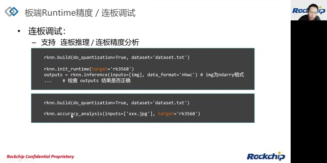

*连板推理和连板精度分析的 target 配置 · [原片 46:10](https://www.bilibili.com/video/BV1jY4y1u7GK/?t=2770)*

[46:24](https://www.bilibili.com/video/BV1jY4y1u7GK/?p=1&t=2784) 然后因为我们模拟器实际上并没有严格的模拟我们的NPU硬件。所以说我们这边输出来的比如说这边最后一排的golden_err，跟我们这边的前面模拟器的第一排的这个entire，其实事实上它没有并没有完全一致，但是他们的相差实际上不会太大。

[46:46](https://www.bilibili.com/video/BV1jY4y1u7GK/?p=1&t=2806) 也就是说我们如果在连板的时候发现这两排就第一排跟最后一排的话，如果接近的话那说明我们就是你这个模型的话，在我们的Runtime上执行并没有什么问题，然后如果说我们通过精度分析发现我们这个。

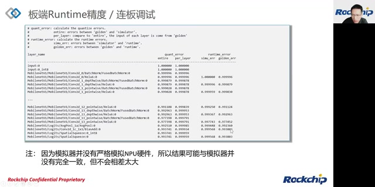

*连板分析结果与模拟器结果比较 · [原片 47:00](https://www.bilibili.com/video/BV1jY4y1u7GK/?t=2820)*

[47:08](https://www.bilibili.com/video/BV1jY4y1u7GK/?p=1&t=2828) 我们的Runtime 的结果跟仿真的量化真值实际上是有明显的差异的话，那这时候我们就可以将刚刚分析结果，还有我们的复现的一个模型返回给我们的NPU团队进行一个修复，然后如果上述的验证没有问题的话。

## 排查 C API 部署代码

[47:27](https://www.bilibili.com/video/BV1jY4y1u7GK/?p=1&t=2847) 那问题就可能出在我们用户的一个C 代码本身上面，那这时候的话我们就需要仔细的检查我们C API的一个接口配置是不是正确的，那还有包括我们的模型的输入的前处理以及后处理的流程是不是正确，也就是说这边的这个这些处理流程其实实际上是需要跟我们模拟端的模拟器端的一个流程要保持完全一致。

[47:56](https://www.bilibili.com/video/BV1jY4y1u7GK/?p=1&t=2876) 然后更详细的C API的一个使用的话可以参考我们这周一的一个RKNN Runtime部署的一个指南，大家可以回放看一下，那我们今天的课程就到此结束，就是全部结束，然后接下来进入QA的环节。

## 问答：平台、量化与部署

[48:17](https://www.bilibili.com/video/BV1jY4y1u7GK/?p=1&t=2897) 大家如果有什么问题的话可以提问，这时候大家也可以进行抽奖，RV1126 是否支持？我前面已经有说过，我前面已经有说过这个精度排查的流程，虽然说目前虽然说今天的课程是针对我们RK NPU2的这个平台，但是对RK NPU1平台实际上也是适用的。

[48:46](https://www.bilibili.com/video/BV1jY4y1u7GK/?p=1&t=2926) 转换 RKNN 模型之后，是不是只能在 RKNN 的开发板上进行模型评估？那这个当然了，因为 RKNN 的格式是我们自己的格式，所以说只能在我们的开发板上进行验证。

[49:03](https://www.bilibili.com/video/BV1jY4y1u7GK/?p=1&t=2943) 模型在 RK 不同系列芯片的 NPU 上，是否需要单独适配？如何根据业务需求挑选合适的 NPU？因为每个 NPU 都不一样，每个 NPU 的支持情况也都不一样，所以相同的模型在 RK 不同芯片上，实际上需要单独适配。根据业务需求，我们就是根据 NPU 的运算性能来选择。

[49:43](https://www.bilibili.com/video/BV1jY4y1u7GK/?p=1&t=2983) 如何具体量化转换过后模型的精度？刚刚课程里面有讲，转换之后最终在板子上部署，需要跑原始模型训练时的数据验证集来验证。这是验证模型精度最好的方式，当然也是比较麻烦的方式。

[50:11](https://www.bilibili.com/video/BV1jY4y1u7GK/?p=1&t=3011) 固件版本对模型的影响大吗？固件一般影响可能不会太大。但是影响比较大的，一般是 Runtime 驱动或者我们的工具，这个对模型的影响会比较大一些。

[50:28](https://www.bilibili.com/video/BV1jY4y1u7GK/?p=1&t=3028) 量化配置里面的 U8、i8、i16：我们 RK NPU2 平台目前支持 i8，i16 后面会支持，U8 不支持。推理速度当然是……U8，i8 会大于 i16 的推理。（这里保留讲者从 U8 改口到 i8 的说法。）RV1126 不支持 Toolkit2。

[51:10](https://www.bilibili.com/video/BV1jY4y1u7GK/?p=1&t=3070) 量化加载模型，同时存在 FP32 跟 FP16 的报错。这个问题能不能在 RKNN 交流群里面发一下？因为具体报错也要看具体情况。

[51:27](https://www.bilibili.com/video/BV1jY4y1u7GK/?p=1&t=3087) 3568 上面跑 RKNN 占 CPU 60%。这个要看你目前使用的 NPU 版本、NPU 驱动版本，以及工具版本。有可能早期版本比较多的 OP 会跑到 CPU 上，后面会慢慢优化到 NPU 上，所以这是有可能的。

[51:51](https://www.bilibili.com/video/BV1jY4y1u7GK/?p=1&t=3111) MMSE 量化会比 Normal 量化慢多少呢？实际上，MMSE 量化会比 Normal 量化慢挺多，可能有十多倍。

[52:03](https://www.bilibili.com/video/BV1jY4y1u7GK/?p=1&t=3123) Toolkit2 算子最近有更新计划吗？我们 Toolkit2，以及 NPU2，近期会有一个大版本更新。

[52:16](https://www.bilibili.com/video/BV1jY4y1u7GK/?p=1&t=3136) MMSE 和 Normal 叠加量化，怎么写配置参数？因为 MMSE 跟 Normal 都是量化算法的选择，所以只能二选一。刚刚课程里面其实有讲，它只是一个量化算法的选择，只是一个参数而已。

[52:41](https://www.bilibili.com/video/BV1jY4y1u7GK/?p=1&t=3161) 多模型部署支持多线程或多进程吗？这个正常情况下支持。因为 Runtime API 支持多线程，多线程支持的情况下，多进程肯定也支持。大家还有没有什么问题？

[53:08](https://www.bilibili.com/video/BV1jY4y1u7GK/?p=1&t=3188) 多线程部署的用例能否进行发布？这个我们后面会考虑出一个 Demo。

[53:23](https://www.bilibili.com/video/BV1jY4y1u7GK/?p=1&t=3203) RV1126 的 YOLOv7 支持情况，我目前不清楚，后面可以问一下。你也可以在交流群里面问，会有人回复。

## 问答：调试工具与模拟器

[53:36](https://www.bilibili.com/video/BV1jY4y1u7GK/?p=1&t=3216) MMSE 是最小均方误差？是的。

[53:42](https://www.bilibili.com/video/BV1jY4y1u7GK/?p=1&t=3222) C 部署要怎么调试？这个调试方法其实跟正常 C 代码调试是一样的，如果是 C 部署的话。

[53:57](https://www.bilibili.com/video/BV1jY4y1u7GK/?p=1&t=3237) PyTorch 版本的 YOLO（具体型号识别不清），为什么要先转 ONNX 再转 RKNN？我们应该也支持直接 PyTorch 输出一个 .pt 文件，然后直接加载这个 .pt 文件。

[54:13](https://www.bilibili.com/video/BV1jY4y1u7GK/?p=1&t=3253) PPT 能否下载？我们可能后面会提供 PDF 格式。

[54:22](https://www.bilibili.com/video/BV1jY4y1u7GK/?p=1&t=3262) 你说希望老师能解答一下我的 Python……一般都是用 VS Code 的，这个问题我不太明白什么意思。C 代码系统调试一般就用 GDB。大家还有没有什么问题？

[54:47](https://www.bilibili.com/video/BV1jY4y1u7GK/?p=1&t=3287) 我下面这边左下角的 RKNN 交流群，如果有的同学还没加进来，可以加一下。

[54:57](https://www.bilibili.com/video/BV1jY4y1u7GK/?p=1&t=3297) 板子和模拟器之间的区别？BSP 是什么呢？我先说一下板子跟模拟器的区别。模拟器是 PC 上的一个工具，实际上只是一个仿真工具。它使用伪量化方式，所以跟板子上真正跑的精度不会完全一致，但是比较接近。

[55:32](https://www.bilibili.com/video/BV1jY4y1u7GK/?p=1&t=3332) 编译器框架，这个问的是什么呢？编译器框架用啥？这是问什么呢？是指什么编译器框架呢？

[55:41](https://www.bilibili.com/video/BV1jY4y1u7GK/?p=1&t=3341) ADB 通过 IP 连接能使用连板模式吗？我们一般 ADB 还是通过 USB 连接，才能使用连板调试。

[55:54](https://www.bilibili.com/video/BV1jY4y1u7GK/?p=1&t=3354) Python 和 C 部署的运算速度一般差多少？Python 的话，如果 Python 运行在主机端，比如 PC 上，这时候来回数据传输会比 C 多这部分消耗。

## 问答：精度指标与性能分析

[56:24](https://www.bilibili.com/video/BV1jY4y1u7GK/?p=1&t=3384) 请大家提问一些跟今天课程相关的问题，就是跟 RKNN 模型精度相关的问题。其他问题建议大家在 RKNN 交流群里面交流或者提问。

[56:45](https://www.bilibili.com/video/BV1jY4y1u7GK/?p=1&t=3405) RKNN 是 C 写的还是 C++？RKNN Runtime 部署，C 也可以，C++ 也可以。

[56:55](https://www.bilibili.com/video/BV1jY4y1u7GK/?p=1&t=3415) perf_debug 的时间指的是什么呢？是 RKNN 模拟器的运算速度吗？感觉跟实际推理速度差好多。RKNN 的 perf_debug，实际上是连板，将板子上每一层的运算速度 dump 出来，传输到工具端显示的一个功能。所以它实际性能应该会比实际部署性能差一些，因为毕竟它可以显示单层速度。

[57:36](https://www.bilibili.com/video/BV1jY4y1u7GK/?p=1&t=3456) 你这边编译器的问题，我不明白你问的是什么编译器。

[57:48](https://www.bilibili.com/video/BV1jY4y1u7GK/?p=1&t=3468) YOLOv5 转出来，INT8 量化余弦相似度好多是 0.97、0.98，我感觉精度损失有点大。一般模型量化出来，0.97、0.98 的话，因为前面说过，余弦相似度只能做参考，最终还是需要在数据集上进行精度验证才能说明问题。有的模型即使是 0.95，出来的精度也是比较好的。

[58:25](https://www.bilibili.com/video/BV1jY4y1u7GK/?p=1&t=3505) 我们目前的工具并没有使用 TVM 这个框架。

[58:34](https://www.bilibili.com/video/BV1jY4y1u7GK/?p=1&t=3514) 就是说实际推理的总时间比 perf_debug 总时间多很多？其实是说，如果你用 perf_debug，时间会比实际推理时间多，特别是有显示一些逐层性能信息的话。

[58:51](https://www.bilibili.com/video/BV1jY4y1u7GK/?p=1&t=3531) 有个 YOLOv5，实际推理速度是 1.3 秒，而 perf_debug 是 62 毫秒。这个问题正常不应该这样。这个问题你可以提个 Redmine，或者在 RKNN 交流群里面提一下。

[59:10](https://www.bilibili.com/video/BV1jY4y1u7GK/?p=1&t=3550) 大家还有没有什么跟精度相关的问题？如果没有什么问题，我们今天的课程到这边就结束了。

[59:20](https://www.bilibili.com/video/BV1jY4y1u7GK/?p=1&t=3560) 如果没有什么问题，我们今天的课程到这边就结束了。我们下期再见。
