# RKNN Runtime部署指南

> 整理方式：按原视频顺序保留讲述的清理稿。来源为公开课发布版本，时间轴为原视频第1分P，0:00—1:01:18。截图源分辨率720×360，细小字请结合源时间链接核对；识别尚不确定处在当地注明。

## RKNPU软硬件：硬件演进

我今天将从以下五个部分展开我的介绍：第一部分是RKNPU软硬件介绍，第二部分是RKNPU部署流程，第三是我们RKNPU的C API，第四个部分是RKNPU的部署调试和优化，第五是Q&A环节。

首先，RKNPU硬件演进过程。第一代RKNPU搭载在RK1808、RK3399 Pro上，它支持INT8、INT16、FP16高效的卷积运算，支持网络参数的无损压缩。

第二代NPU 2.0搭载在RV1109和RV1126上。它原生支持1×N和N×1的卷积，小型网络的MAC利用率大幅提高，网络参数压缩算法也做了优化，压缩率能大幅提高。

而到了第三代NPU 3.0，搭载在RK3566和RK3568上。自研的全新架构，运算效率能够大幅提升；硬件优化设计，AI运算系统全路径零拷贝。同时支持Per Channel量化，量化精度也大幅提高；浮点运算能力也大幅提升，增加了一个BF16类型的数据运算支持。

到了第四代NPU 4.0，搭载在RK3588上，使自研的架构再次升级。超大的单核算力，支持多核扩展以及灵活的算力分配，大幅提升了NPU的可用带宽；同时支持INT4数据运算，提供超强的算力以及能效比，也支持TF32数据类型的运算，模型精度能再度升级。

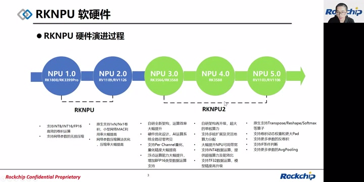

*RKNPU五代硬件演进与芯片对应 · [原片 01:40](https://www.bilibili.com/video/BV1vd4y197Tf/?t=100)*

第五代NPU 5.0搭载在RV1103和RV1106上。它原生支持了Transpose、Reshape、Softmax等算子，能支持卷积动态权重和更大的Pad参数，支持更多参数的反卷积，也支持IF条件判断，还支持更多参数的Average Pooling。

## 推理软件框架与Runtime

这个图是RKNPU推理软件框架。最顶层是开发者各种AI应用，它调用RKNN API，包括多线程、多进程、多核心的调用。在下一层就是我们的RKNN API，它包含一组普通API、一组零拷贝API。再往下一层是我们RKNPU的Runtime层，运行时主要的工作是进行内存分配，还有网络节点调度的工作。再下一层是RKNPU的Driver层，驱动主要做的任务是任务队列的管理，还有寄存器配置。最底下是我们的RKNPU硬件。

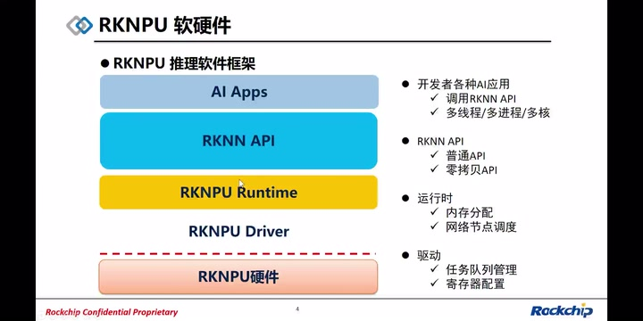

*AI应用、RKNN API、Runtime、驱动与硬件分层 · [原片 03:01](https://www.bilibili.com/video/BV1vd4y197Tf/?t=181)*

而今天的主要内容，RKNPU Runtime，是提供给客户编译链接的一个NPU运行时库。它提供了一套C API，通过调用这套API，我们可以加载AI模型，驱动瑞芯微的NPU，高效地完成AI模型推理任务。

它有以下几个特点：一个是计算图级别的算子优化，例如融合算子、算子任务的切分等操作，能大大地提高性能。第二点，计算图编译和执行分离，能做到轻量级部署。

第三点，我们中间结果的内存可以灵活在SRAM或者DDR上复用，能够减少运行时的内存占用。还有CPU、GPU、NPU多硬件后端支持，能满足不同场景下的接入。第五点，全流程的数据零拷贝，带宽压力小。最后，我们API接口能最大程度地保留和向前兼容，能降低客户的移植难度。

我们RKNPU2里的API，普通API就是兼容接口，跟1109、1808的接口能够做到保留和兼容。

## 部署流程：普通API和零拷贝API

下面介绍我们的C API的推理流程。上面一半部分是普通API的流程：外部数据进来以后，我们会在CPU上做归一化，Normalize、Quantize，还有Layout转换，转换成NPU认识的数据格式。NPU执行完推理，得到输出，我们在CPU上将Layout进行再次转换，然后反量化，得到公开的一些框架的正常Layout的浮点数据。

下半部分是我们的零拷贝流程。数据从外部进来，我们这块Buffer是由NPU分配的，而在NPU上也同样做了Normalize、Quantize，还有模型推理等任务。也就是我们把前面的Layout转换全部放到了NPU上执行。

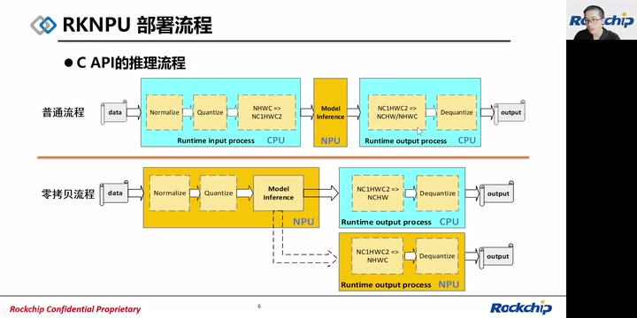

*普通与零拷贝推理流程及CPU/NPU分工 · [原片 05:42](https://www.bilibili.com/video/BV1vd4y197Tf/?t=342)*

NPU得到输出以后，我们会根据外部客户设置的Layout格式，以及最后一层的Target，也就是执行后端，来选择两种路径。一种是我们在CPU上获取NCHW的Layout，再做一个反量化，得到NCHW的浮点数据。另一种，在特定的Shape限制下，我们可以在NPU上执行NC1HWC2换成NHWC的Layout转换，以及Dequantize反量化，得到NHWC的浮点输出。

可以看到这上下两个流程，我们尽可能地将这些运算、处理流程放到了NPU上做，能够大大地提高我们的性能。

> 局部校订证据：6:25—7:10独立本地ASR恢复显示，这里只有一次“可以看到这上下两个流程”。冻结原转写的重复未作为真实重复带入正文；原转写与局部核验均附存，未替换冻结输入。

## 输入预处理和量化融合

而输入数据的预处理和量化，是有一个融合的过程，我们先介绍一下这个过程。x_f是我们的，比如外部输入的图像数据，我们可以做一下归一化、量化，然后得到一个y_q。y_q是我们NPU吃的量化数据。Normalize跟Quantize可以做一个融合，融合成一个定点的乘加运算。这样x_f经过定点乘加，直接就能得到NPU要吃的量化数据，这个模式也称为pass-through模式。

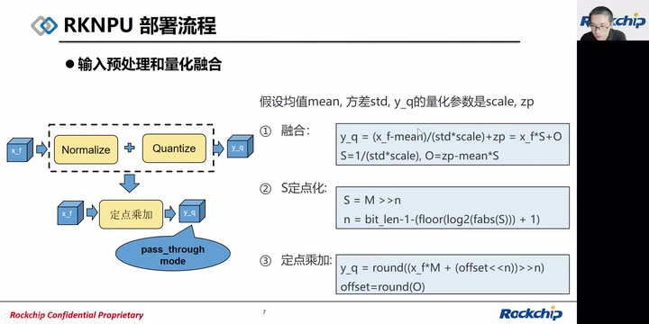

*归一化量化融合、S定点化及定点乘加公式 · [原片 08:03](https://www.bilibili.com/video/BV1vd4y197Tf/?t=483)*

右边我们介绍一下这个过程的推理流程：假设我们均值是mean，方差是std，y_q，也就是NPU输入，它的量化参数是scale和zp，我们这里用的是非对称量化。

首先融合，我们对浮点的公式做一个融合：x_f减去均值，再除以方差，再除以scale，加zp。这个是把浮点数据转换成量化数据。它融合成一个x_f乘以S加O。S是我们的std和scale乘积的倒数，O是zp减去均值乘以我们前面这个大S。

```text
y_q = (x_f - mean)/(std*scale) + zp = x_f*S + O
S = 1/(std*scale)
O = zp - mean*S
```

而第二步，我们会对S这个浮点的数值做定点化。定点化S是用一个int型整数来右移n位得到的浮点数，我们通常使用的是INT16数据类型数据，所以M是一个小于INT16表示范围的数。n是将我们的S移到不超过INT16表示范围的整数，所需要移动的位数。而n就是我们的bit_len减1，减去log2的S绝对值向下取整再加1，得到一个n。

```text
S = M >> n
n = bit_len - 1 - (floor(log2(fabs(S))) + 1)
```

此时我们已经得到一个定点化的M和一个右移的位数，还有一个O。offset是我们的O做一个四舍五入。y_q最终的式子，也就是量化的数据，最终式子就是x_f乘以我们INT16的数据，再加上一个offset左移n位，以后再右移n位，最后做一个四舍五入。这就是我们定点乘加的式子。

```text
offset = round(O)
y_q = round((x_f*M + (offset << n)) >> n)
```

> 上式符号按视频幻灯片保留；讲者在此称std为“方差”，此处保留原讲述用词。

接下来介绍一下我们RKNPU的C API。

## 普通API：调用流程

第一部分是普通API。这个接口不仅在RKNPU2上有支持，RKNPU1也是支持的。第一步，加载RKNN模型，初始化、销毁上下文的接口是`rknn_init`和`rknn_destroy`；查询模型或者上下文信息，我们用的是`rknn_query`；设置输入数据，用的是`rknn_inputs_set`；执行推理是`rknn_run`；获取、释放输出数据，调用`rknn_outputs_get`和`rknn_outputs_release`。

可以看到，我们这组接口是相对比较简单易懂的。右边是我们这组接口的调用流程。首先拿到一个RKNN模型以后，我们会调用`rknn_init`加载RKNN模型，初始化上下文；然后取得外部的输入数据，调用`rknn_inputs_set`将输入数据设置进来；然后调用`rknn_run`执行推理。推理完以后，调用`rknn_outputs_get`获取到NPU的输出。这里中间可能还有其他的处理，等到处理完以后，会调用`rknn_outputs_release`将输出释放掉，再次读取下一帧运行。等到所有数据处理完以后，调用`rknn_destroy`释放掉刚刚RKNN的上下文。

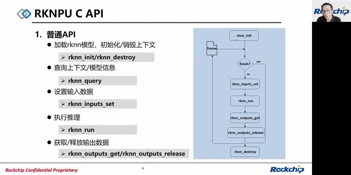

*普通API调用及逐帧输入输出释放流程 · [原片 11:10](https://www.bilibili.com/video/BV1vd4y197Tf/?t=670)*

### 查询模型信息

这里头，获取RKNN模型各种信息的唯一的接口，就是`rknn_query`。它可以获取输入输出的tensor数量，可以获取输入tensor的属性，其中的属性就包含了我们输入的Shape（形状）、Layout，以及数据类型，还有量化参数等信息，输出tensor的属性也一样可以拿到。

传入`RKNN_QUERY_PERF_DETAIL`，我们还可以拿到模型逐层的耗时结果；传入`RKNN_QUERY_PERF_RUN`，还能得到整体的模型性能。`RKNN_QUERY_SDK_VERSION`可以拿到我们整个Runtime的版本号信息。

接下来下面这个`RKNN_QUERY_MEM_SIZE`，是查询这个模型中某种tensor类型需分配的内存大小，这个会在零拷贝API要分配内存时使用到。某类tensor的类型，我们把tensor类型分成input、output，还有中间结果的tensor，还有一些常量，就是weight的tensor，这几类。

接下来`RKNN_QUERY_CUSTOM_STRING`命令，可以查询我们转换模型时存储在RKNN模型里的用户自定义的字符串信息。

下面的四个native，分别是`RKNN_QUERY_NATIVE_INPUT_ATTR`，是指我们查到性能最优输入tensor的属性，这个是跟`RKNN_QUERY_NATIVE_NC1HWC2_INPUT_ATTR`一样的。而`RKNN_QUERY_NATIVE_OUTPUT_ATTR`是我们性能最优输出tensor属性，这个是跟`RKNN_QUERY_NATIVE_NC1HWC2_OUTPUT_ATTR`一样的。

最后两个是`RKNN_QUERY_NATIVE_NHWC_INPUT_ATTR`和`RKNN_QUERY_NATIVE_NHWC_OUTPUT_ATTR`，分别表示性能最优的，并且是NHWC Layout的输入tensor属性，以及输出tensor属性。

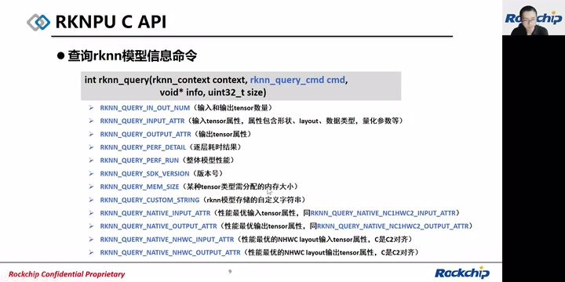

*rknn\_query命令与native属性查询 · [原片 13:20](https://www.bilibili.com/video/BV1vd4y197Tf/?t=800)*

这个C是要求我们跟前面的C2做一个对齐的限制。

### NHWC与NC1HWC2的区别

那我们就解释一下NHWC和NC1HWC2 Layout的区别。左边是我们NHWC Layout的数据。假设C是三通道，这里我们可以认为是一个常见的RGB三通道的数据。数据的排布是它第一个位置，第0个位置的RGB先排布，接下来是第1个位置的RGB，第2个位置的RGB，直到所有的RGB排完以后，然后我们会有一个Pad。

而Pad这个东西，是为了我们硬件能够高效地访问而做的对齐。Pad的要求，是我们能够补到一个硬件对齐的访问，就像这边的内存排布，这一块的内存能够对齐地访问下来。

而这里面就引入一个w_stride的概念。w_stride也是能从query接口里面查询到的一个步长信息，它等于原始的数据宽度加上Pad的宽度。Pad我们这里是补0，而width是原始的有效数据，这样我们得到一个w_stride。

w_stride在3588上面，是要求16 byte对齐，如果是对INT8模型而言。

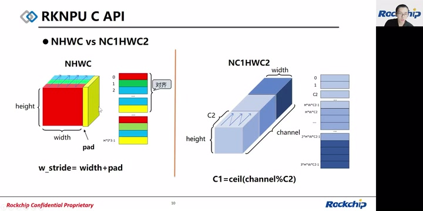

*NHWC与NC1HWC2布局、Pad及w\_stride · [原片 15:30](https://www.bilibili.com/video/BV1vd4y197Tf/?t=930)*

如果是在3566上面，w_stride是要求8 byte对齐，同样是INT8的模型。

到了右边，是我们的native Layout，它是NC1HWC2的格式。也就是将我们原始的、经典框架里面的NHWC通道做了一个拆解，拆成了C1和C2通道。C2通道在低维，然后C1通道在较高的维度。

而我们数据排布是第0个位置的C2个元素一直排布下来，然后接着访问的是第1个位置的C2个元素，然后第2个位置的C2个元素，依次排布。这个方块排布完以后，我们接着排布第2个C2的方块，也是同样的，从第0个位置的C2个元素排布到第1个位置的C2，直到所有的C，也就是C1个这样的小方块排布完了以后，我们的数据整块的内存排布就是右边这样子。

而C1的计算公式，是将channel对C2取模后上取整。

> 原讲述及幻灯片此处写为“取模”/`C1=ceil(channel%C2)`，这里保留发布版本的说法，未改写成其他运算。

## 零拷贝API：内存对象

接着我们介绍一下零拷贝API。零拷贝API思想主要是内存分配灵活，而NPU Runtime获取和管理以FD或者物理地址等形式表示的内存。它包含以下三类接口。第一类是创建各类tensor内存结构体的接口，包括`rknn_create_mem`、`rknn_create_mem_from_fd`、`rknn_create_mem_from_phys`、`rknn_create_mem_from_mb_blk`。而第一个`rknn_create_mem`最简洁，它是由Runtime内部来分配一个内存，然后封装成一个`rknn_tensor_mem`结构体给外部。

下面from这三个，则是由外部分配完内存以后，以FD的形式，或者物理地址，或者MB Block。MB Block是我们RK自定义的一个内存对象，通常用于媒体库那边使用。通过这三个from接口，我们同样也封装出一个`rknn_tensor_mem`。

当创建完这个memory结构体以后，我们需要设置各类tensor的内存结构体。这里面就包括三类，一个是刚刚说的IO类，还有权重，还有中间tensor，这三类分别设置到Runtime当中：`rknn_set_io_mem`、`rknn_set_weight_mem`、`rknn_set_internal_mem`。

最后，是释放tensor内存结构体和Runtime分配内存的接口，`rknn_destroy_mem`。如果内存是内部Runtime分配的，我们会内部释放掉；如果内存是外部分配的，我们则不会释放内存，只会释放掉这样的一个结构体。

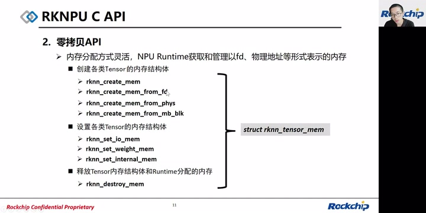

*零拷贝内存创建、设置及释放接口 · [原片 19:00](https://www.bilibili.com/video/BV1vd4y197Tf/?t=1140)*

### 调用流程一：内部配置输入输出内存

讲完零拷贝的接口，我们介绍一下如何使用这样一套零拷贝接口。在一个RGA和NPU参与的情景中，我们RGA是做2D图像的色域转换或者缩放这样的功能，NPU是执行AI模型推理。

此时我们假设是Runtime内部来分配这个内存，输入输出的内存。右边是我们的调用流程：首先RKNN模型通过调用`rknn_init`得到一个`rknn_context`上下文；通过`rknn_query`查询这个上下文，得到模型的输入输出属性信息。根据属性信息，我们有了输入输出的大小、数据类型，然后通过`rknn_create_mem`创建输入输出的内存，再调用`rknn_set_io_mem`将输入输出内存设置给Runtime。

此时RGA会接收外部的流的FD，将它缩放到我们模型大小的Buffer。模型缩放完或者色域转换完，我们会调用`rknn_run`执行RKNN模型推理，然后得到输出以后，再在CPU上做后续的处理流程。接着就继续更新外部RGA输入的FD，做缩放、做推理，直到所有的数据处理完以后，我们要将输入输出的memory释放掉，则是调用`rknn_destroy_mem`，最后调用`rknn_destroy`销毁上下文。

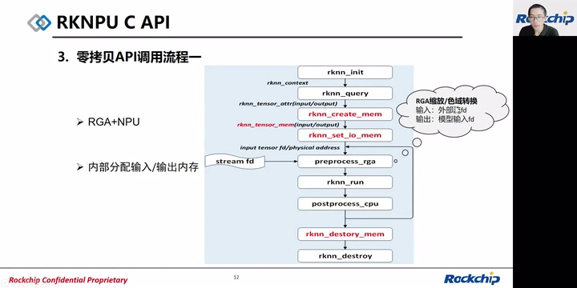

*RGA和NPU：Runtime内部分配输入输出内存 · [原片 21:20](https://www.bilibili.com/video/BV1vd4y197Tf/?t=1280)*

### 调用流程二：外部分配输入输出

而第二种流程，同样也是RGA和NPU同时参与的情况。这与第一种的差别在于，我们第一种情形输入输出也是由Runtime分配的，此时这个场景是输入输出外部分配。首先一样的，我们要调用`rknn_init`加载RKNN模型，得到一个context，然后调用`rknn_query`将输入输出的属性查询到。此时我们会调用外部的分配内存框架，比如DRM，将输入输出数据分配好以后，得到输入输出的FD或者物理地址。利用这个物理地址或者FD，调用`rknn_create_mem_from_fd`或者`rknn_create_mem_from_phys`，来封装出一个`rknn_tensor_mem`。

得到这个memory以后，将这样的内存设置给Runtime，也是调用`rknn_set_io_mem`。以下我们也是RGA将外部的流FD缩放到模型输入大小的FD，然后模型推理。推理以后，我们外部分配的内存有时需要刷新Cache，则要外部自行刷新。刷新完Cache以后，我们会在CPU上再处理，得到最终的结果。

此时会继续处理下一张图片或者视频流。当所有的输入数据处理完以后，我们也是调用`rknn_destroy_mem`以及`rknn_destroy`来做释放。

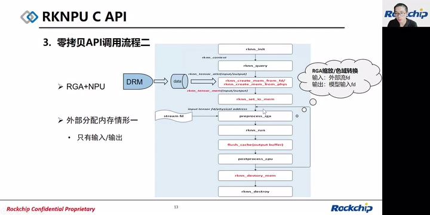

*外部分配输入输出及外部刷新Cache流程 · [原片 23:26](https://www.bilibili.com/video/BV1vd4y197Tf/?t=1406)*

### 调用流程三：外部配置中间tensor、权重和输入输出

而第三种调用流程，是RGA加NPU下面，此时我们不仅将输入输出由外部来管理分配，也包括模型中间的tensor，以及权重这些输入数据，都是由外部来分配。此时我们的初始化接口，需要设置一个标志，`RKNN_FLAG_MEM_ALLOC_OUTSIDE`。

来告诉Runtime，这些内存是由外部分配的，Runtime不进行释放内存的操作。这时查询到我们输入输出数据的大小、weight还有internal的数据大小以后，根据这个大小调用DRM框架，分配出这样的三块Buffer，通过刚刚提到的`rknn_create_mem_from_fd`、`rknn_create_mem_from_phys`这两个接口，将weight、internal、input、output封装成`rknn_tensor_mem`。

得到这样的三类tensor memory以后，我们通过调用`rknn_set_weight_mem`、`rknn_set_internal_mem`以及`rknn_set_io_mem`，将这三类memory设置到Runtime当中。此时Runtime已经有了所有推理所需要的所有Buffer数据。RGA对外部输入流同样做缩放到模型输入大小，然后推理。既然是外部分配的内存，也同样需要外部来做刷Cache的操作。得到正确的输出以后，我们再做后处理，然后接着处理下一张图片。当所有的数据处理完，同样调用`rknn_destroy_mem`以及`rknn_destroy`。

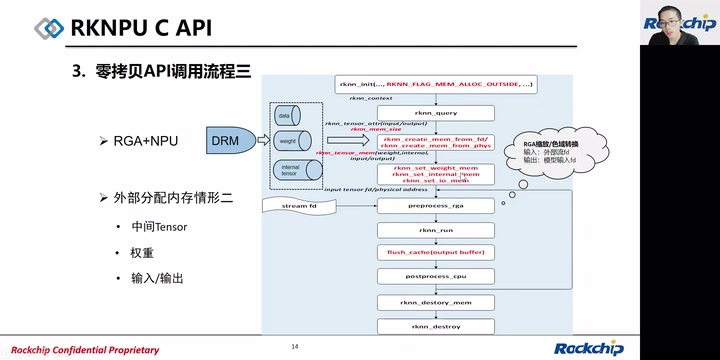

*外部分配中间tensor、权重及输入输出 · [原片 25:25](https://www.bilibili.com/video/BV1vd4y197Tf/?t=1525)*

## 多核API：仅RK3588支持

讲完上面的API，下面介绍一下我们3588上支持的多核API。因为3588是多核心的NPU架构，它的接口是`rknn_set_core_mask`，根据我们传入的`rknn_core_mask`枚举类型，来指定多核运行的组合模式。组合模式包含以下几类：第一类是`RKNN_NPU_CORE_AUTO`，这是一种默认的多核运行方式，我们将会随机选择一个空闲的核心来运行模型。如果所有的核心都空闲，会优先在Core 0上运行。

`RKNN_NPU_CORE_0`或`RKNN_NPU_CORE_1`或`RKNN_NPU_CORE_2`，是指定模型跑在我们的核心0、核心1、核心2上。当然我们头文件中的枚举类型就不会有“或”，而是对应的只有0、1、2。`RKNN_NPU_CORE_0_1`是指定模型跑在核心0和核心1上；最后是`RKNN_NPU_CORE_0_1_2`，将模型指定跑在三个核心上面。

第二个接口是`rknn_set_batch_core_num`，传入的是core_num参数。这个主要用于多batch推理场景下，我们限制执行的核心个数。为什么要限制执行的核心个数呢？因为有一个场景，例如我们运行4 batch的模型，默认情况下，每个核心都会至少跑一个batch的任务。此时如果有另一个模型推理，它的优先级又比较高，这时候就会有阻塞高优先级模型推理的问题。

而使用这个接口，我们可以将刚刚那个4 batch的模型指定在两个核心上跑，这样就空出了一个核心给高优先级的模型推理。这个接口可以增加用户多核调度的灵活性，当然这是一个测试版接口。

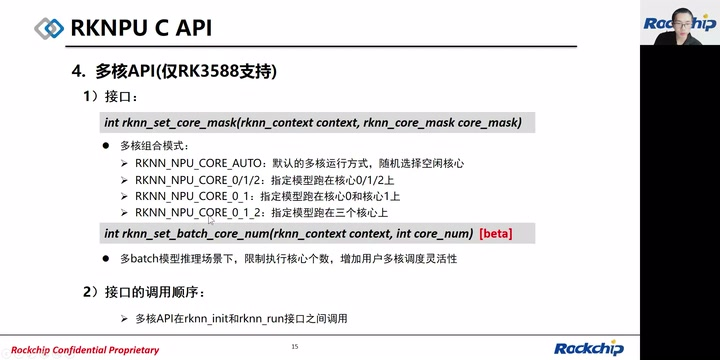

*RK3588多核组合与batch核心数接口 · [原片 27:20](https://www.bilibili.com/video/BV1vd4y197Tf/?t=1640)*

第二，接口的调用顺序：上面的多核API都是在`rknn_init`和`rknn_run`接口之间调用。

## 其他API：共享权重

第五类是其他一些功能的API。第一个功能是共享权重的功能。有右边这样的两个模型，它们的特点是两个模型的输入大小不一样，而权重数据是完全一样的。在这个时候，我们可以在模型转换时将模型A作为主模型，而右边这个模型作为附属模型，将它的权重给删除掉。所以我们有两个RKNN，一个主RKNN是包含权重的，而附属RKNN模型是不包含卷积类权重的，这样可以减少内存占用。它其实是动态Shape的一种模型实现方式。

示例代码可以看到，我们左边模型使用context_A初始化；右边的模型，会使用到这里`rknn_init_extend`这个额外的参数，将context_A的参数传入到init extend的context当中，用它来初始化模型B。同时设置`RKNN_FLAG_SHARE_WEIGHT_MEM`，来告知模型B的context是共享模型A的上下文的。

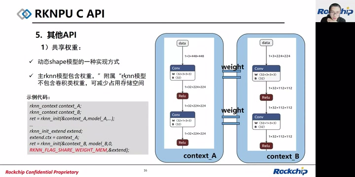

*共享权重示例代码与不同输入尺寸模型 · [原片 30:00](https://www.bilibili.com/video/BV1vd4y197Tf/?t=1800)*

这时候就可以达到B模型使用A context的weight。这里面我们其实有做过测试，对于MobileNet V1这种模型，它原始的主RKNN模型是3.3兆，而附属RKNN模型，也就是去掉权重以后，大小只有300多K。

### 复制上下文

另外还有一个功能是复制上下文的API。它的接口是`rknn_dup_context`，传入的是原context，输出一个新的context。如右边这个场景，我们两个一样的模型，需要对它分别跑在两个线程上。此时会将context_A初始化，context_in，左边这个context_in初始化以后，再dup复制出一个输出的context，叫context_out。

而第二个context_out的模型，同样是调用之前的一些API接口来运行推理。这样的多线程场景，我们可以让两个模型共享Runtime内部的计算图数据结构，这个过程就避免了数据结构的重复构造，能减少运行时的内存占用。

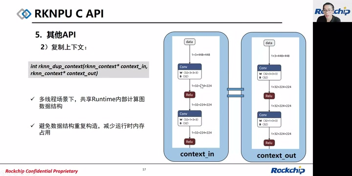

*复制上下文接口及共享内部计算图 · [原片 31:40](https://www.bilibili.com/video/BV1vd4y197Tf/?t=1900)*

## RKNPU部署调试与优化：先验证精度

介绍完C API以后，我们介绍一下RKNPU部署调试与优化。首先拿到一个模型，我们首先是希望能够让它跑对，所以要先做精度验证。

首先要确保输入数据大小正确。使用零拷贝接口时，我们要求使用者使用tensor属性中的`size_with_stride`来分配内存，因为不正确的内存大小会出现“failed to submit”的错误。

第二个，输入数据是使用RGB还是BGR的顺序呢？我们要求输入数据与原始模型训练时的通道顺序一致。举个例子，假设使用Caffe框架来训练，并且使用BGR的图片作为训练集。在转换模型时，我们使用JPG图片作为量化矫正集，则在转换模型配置时，需要传入一个`quant_img_RGB2BGR=True`的参数，来告知工具做量化时，我们的图片是BGR的格式。而在部署时使用RKNN API，将外部输入数据也是以BGR的格式读入，并且将它设置给输入。

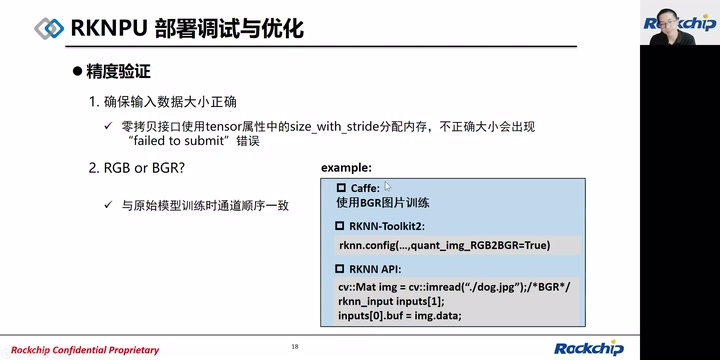

*精度验证：size\_with\_stride、RGB与BGR · [原片 33:30](https://www.bilibili.com/video/BV1vd4y197Tf/?t=2010)*

> 此处参数拼写按幻灯片`quant_img_RGB2BGR`记录；原ASR识成相反顺序，已据画面订正。

### 支持的输入数据格式转换

接下来我们要了解一下支持的输入数据格式转换类型。这个表是我们支持的输入数据，左边第一列是接口设置的数据类型，而横行是模型的数据类型。可以看到，这里面的NA是未定义的数据类型，FLOAT32是未定义的；N则是不支持的格式转换过程，Y是支持的数据格式转换。

如果我们看到这个格式转换，红色部分是说接口设置的数据类型跟模型的数据类型一致，这个肯定能转换。黄色部分则是说不同的输入数据格式，接口设置的跟模型的数据类型不一样的情况下，能支持的组合。能支持包括外面输入最常见RGB这种格式的图像数据，还有FLOAT32数据，我们支持转换成量化模型INT8的输入，以及浮点模型FLOAT16的转换，这两个Y都是支持的。

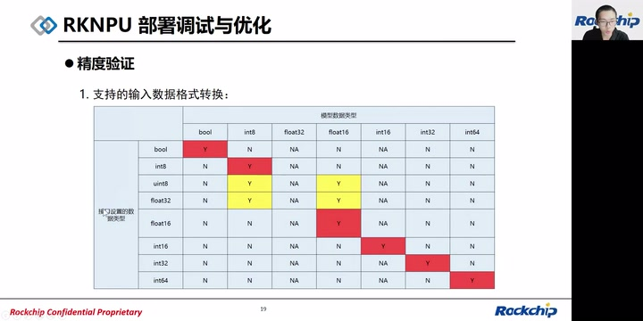

*接口输入类型和模型数据类型转换支持矩阵 · [原片 35:20](https://www.bilibili.com/video/BV1vd4y197Tf/?t=2120)*

### pass-through透传模式

了解完输入数据格式转换以后，客户、用户通常有更高的灵活度，希望我们自己外部来处理数据，而直接能够喂给NPU。NPU这样运行下来，是达到最高效的效率。

那这里就会说明一个叫pass-through的模式，我们也可以叫它透传模式。它与我们之前推理流程的差异、区别，就是输入数据直接跳过了Normalize、Quantize以及Layout转换这三个步骤，而直接喂给NPU做推理。此时希望输入数据格式是由`rknn_query`查询native input attribute命令来获取的。

对于四维输入，默认情况下对于1、3、4通道，Layout要求是NHWC，其他通道要求NC1HWC2。对于非四维输入，我们建议指定Layout等于UNDEFINED。这种情况常见于LSTM的语音类模型。而在pass-through模式下面，量化模型通常指定输入tensor的dtype等于INT8。

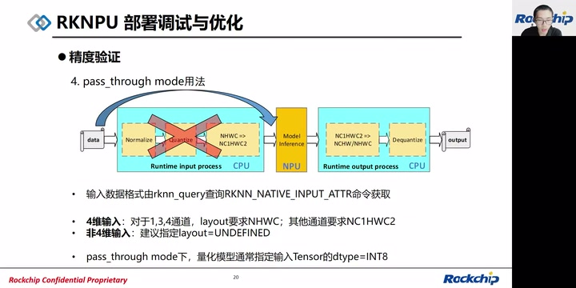

*pass-through输入布局、维度与dtype要求 · [原片 37:10](https://www.bilibili.com/video/BV1vd4y197Tf/?t=2230)*

### 查看逐层数据排查精度

当我们设置了正确的输入以后，如果仍有精度问题，这时候可以查看一下网络逐层数据。可以设置`export RKNN_LOG_LEVEL=5`，它可以dump出网络中间层的浮点结果。而在`RKNN_LOG_LEVEL=5`的基础上，再加一个`RKNN_DUMP_QUANT=1`的环境变量，可以dump出中间层的量化结果。

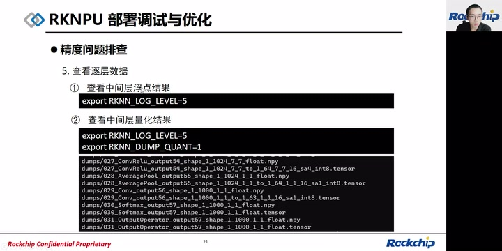

*逐层浮点与量化结果导出设置及文件 · [原片 38:20](https://www.bilibili.com/video/BV1vd4y197Tf/?t=2300)*

可以看到，在dumps目录下面会生成`.npy`和`.tensor`的文件。`.npy`就是Python可以直接读取的NumPy文件，而`.tensor`则是二进制文件。可以看到，它最前面是我们op的索引号，然后接着是Runtime里面op的类型，再往后是层的名称，最后是对应tensor的Shape。

### 硬件环境排查：NPU频率

在设置正确以后，我们通常还要对性能做分析，此时要做硬件环境的排查。我们会先确认NPU频率是否已经设置到预期频率，先调用`cat`这样的命令，查看对应节点中的current frequency这样的频率节点，看一下当前NPU的频率。这里以3588和3566为例，它有不同的节点。

而查看NPU可用频率，则是`cat` NPU节点下面的`available_frequencies`，会得到一组NPU可支持设置的频率。接着根据可用频率，用下面的命令，echo一个userspace到节点下面的governor策略中，并且将频率值设置到userspace下面的set_freq节点，可以达到设置可用频率的目的。

```sh
# RK3588：查看当前与可用NPU频率
cat /sys/class/devfreq/fdab0000.npu/cur_freq
cat /sys/class/devfreq/fdab0000.npu/available_frequencies
# RK3566
cat /sys/class/devfreq/fde40000.npu/cur_freq
cat /sys/class/devfreq/fde40000.npu/available_frequencies
# 幻灯片中的定频示例：RK3588
 echo userspace > /sys/class/devfreq/fdab0000.npu/governor
 echo 1000000000 > /sys/class/devfreq/fdab0000.npu/userspace/set_freq
# RK3566
 echo userspace > /sys/class/devfreq/fde40000.npu/governor
 echo 900000000 > /sys/class/devfreq/fde40000.npu/userspace/set_freq
```

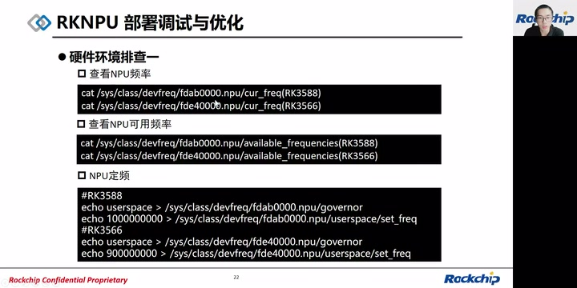

*RK3588/RK3566 NPU频率查看和定频示例 · [原片 39:40](https://www.bilibili.com/video/BV1vd4y197Tf/?t=2380)*

第二个硬件环境排查，是查看一下CPU频率。因为有的模型，算子中有可能会跑到CPU上，这时候会大大地影响性能评估。所以需要将CPU定频，达到稳定的频率值，测出稳定的性能值。可以通过`cat`命令，查看对应CPU节点下的current frequency，或者通过clock的总览搜索CPU，能看到频率。对于CPU定频，我们可以echo一个performance到governor的策略节点中，达到自动定频的效果。

模型运行起来以后，还要查看一下NPU占用率，可以`cat`我们kernel debug rknpu下面的load节点，查看模型跑的占用率情况。最后，如果是3588，我们有可能需要用到多核，可以查看NPU多核心运行情况。通过查看中断数，搜索NPU，就可以看到NPU是否在执行、中断数是否增加。

```sh
cat /sys/devices/system/cpu/cpu0/cpufreq/scaling_cur_freq
cat /sys/kernel/debug/clk/clk_summary | grep cpu
echo performance > /sys/devices/system/cpu/cpufreq/policy0/scaling_governor
cat /sys/kernel/debug/rknpu/load
cat /proc/interrupts | grep npu
```

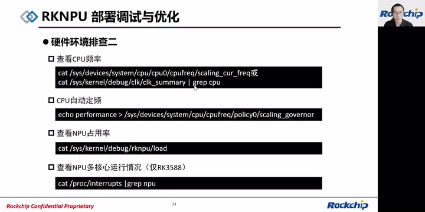

*CPU定频、NPU负载与中断计数查看 · [原片 41:00](https://www.bilibili.com/video/BV1vd4y197Tf/?t=2460)*

### Runtime日志等级

接着是Runtime运行时的日志等级说明。等级0是默认日志等级，仅打印错误日志；1则是在等级0的基础上加警告日志；等级2是在等级1的基础上加提示日志；等级3是在等级2的基础上加调试日志。

等级4是在3的基础上，加上打印每层信息、导出输入输出数据的功能。等级5是最高等级，会导出中间层数据。

```sh
export RKNN_LOG_LEVEL=X
```

> 幻灯片注明：等级4、5的数据导出影响性能。

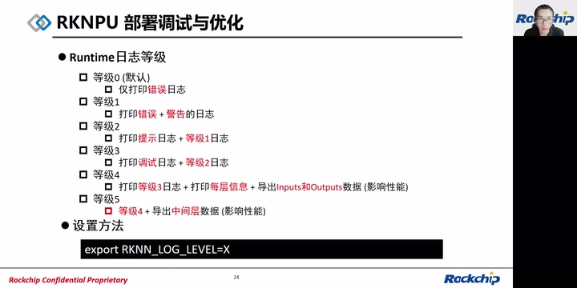

*Runtime日志0至5等级及设置方法 · [原片 41:50](https://www.bilibili.com/video/BV1vd4y197Tf/?t=2510)*

### 逐层性能分析

接下来，有需要分析到模型逐层性能情况，这时候可以把日志等级设置成4，它会打印出以下几个内容：逐层OP类型、输入输出形状这样的信息。在下面的这里，左边Input Operator这种UINT8，还有Shape信息；还有预估的DDR、NPU的cycle数。而这个预估值是怎么算出来的呢？右边DDR cycle是根据这一层的读写数据量，然后乘以NPU频率，再除以硬件上DDR带宽的理论峰值得出的。而NPU的cycle数，则是当前卷积层的MAC次数，再除以NPU的MAC数量，得到NPU的cycle数。

同时也会打印耗时和MAC利用率等信息。MAC利用率等于卷积MAC次数，乘以实际FPS，再除以NPU MAC数量乘以NPU频率得到的。在这边这里，是MAC利用率的打印。最后是NPU各核心负载，这个仅在3588上有打印。

```text
DDR cycles = 读写数据量(bytes) * NPU频率 / DDR带宽
NPU cycles = 卷积MAC次数 / NPU MAC数量
MAC利用率 = 卷积MAC次数 * 实际FPS / (NPU MAC数量 * NPU频率)
```

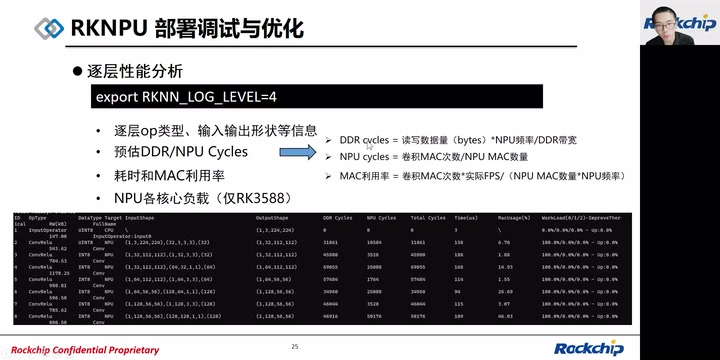

*逐层性能、DDR/NPU cycles与MAC利用率 · [原片 43:10](https://www.bilibili.com/video/BV1vd4y197Tf/?t=2590)*

### 查看内存占用

下面是评估模型内存占用情况的方式。首先会看NPU驱动总分配的总内存，可以在log level等于4以后看到这个打印，有Total Weight Memory、Total Internal Memory和Total Memory，以及Total Allocate Memory。这Total Allocate Memory包含以下五类Buffer：weight buffer、NPU command buffer、NPU task buffer、模型中间tensor buffer，以及输入输出buffer。

可以看到这里Total Memory仅包含weight和internal memory之和，而Total Allocate Memory则大于Total Memory。

为什么会有这个差别呢？因为其实统计方式上，Total Allocate Memory包含了internal的，包含了第二类、第三类以及第五类，而Total Memory只包含weight和internal的buffer。并且Total Allocate Memory是NPU驱动分配的，底下要求4K对齐，因此它会大于等于我们计算出来的Total Memory数值。

第三，我们还会需要查看Runtime进程堆栈的内存，可以通过`cat /proc/<pid>/status`，看到堆栈中的内存占用情况。

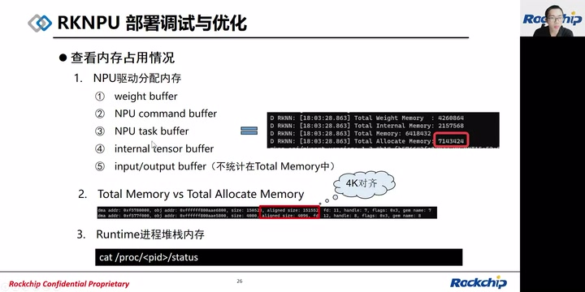

*内存五类Buffer、Total Memory与驱动分配 · [原片 44:40](https://www.bilibili.com/video/BV1vd4y197Tf/?t=2680)*

### 优化：后处理常量预计算

最后讲一下模型部署以后需要做到的优化例子。一个优化通常需要应用、算法和NPU三方联合调整，才能得到最佳性能效果。

这里以后处理常量预计算的优化例子做介绍。假设后处理中，模型输出结果经过Sigmoid函数处理，然后做阈值过滤。x是模型的浮点输出，x_q是对应的量化数值。Sigmoid函数格式如下，它对应有一个反函数，是负ln(1/y−1)。

```text
Sigmoid(x) = 1/(1+e^(-x))
DeSigmoid(y) = -ln(1/y-1)
```

此时正常的逻辑代码中，会有Sigmoid大于我们预设阈值的判断。对于大于号两边，我们取反函数，可以得到x大于DeSigmoid(threshold)。

再对大于号两边做量化，可以得到x_q大于DeSigmoid(threshold)除以scale再加zp。而红框是常量，我们可以预先计算得到；x_q则是NPU的量化输出，这不需要做反量化转换成浮点，可以大大减少反量化的耗时。

```text
if Sigmoid(x) > threshold, ...
x > DeSigmoid(threshold)
if x_q > DeSigmoid(threshold)/scale + zp
```

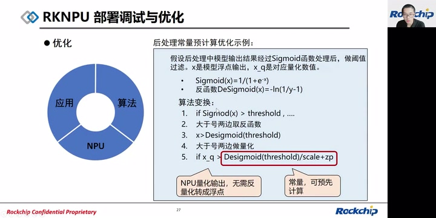

*后处理阈值量化与常量预计算 · [原片 46:45](https://www.bilibili.com/video/BV1vd4y197Tf/?t=2805)*

### 常见系统数据流处理

后面是另一个例子，是常见系统中的数据流处理。参与的硬件包括ISP、RGA、NPU、GPU的场景。ISP采集数据以后，放到一个V4L2的DMA Buffer中。V4L2是Video for Linux 2，是关于视频设备的内核驱动。

通过RGA做色域转换或者缩放，而在上一层它会缩放到User Buffer下面，User Buffer做预处理，包括归一化、量化，传到NPU进行计算。NPU得到输出以后，再拷贝给User Buffer。这时候如果有需要用到GPU做一些后处理，比如Pixel Buffer这种，或者图层叠加，这时候又会从User Space数据输入到GPU，读写到Share Buffer中，处理完以后返回到User Buffer。

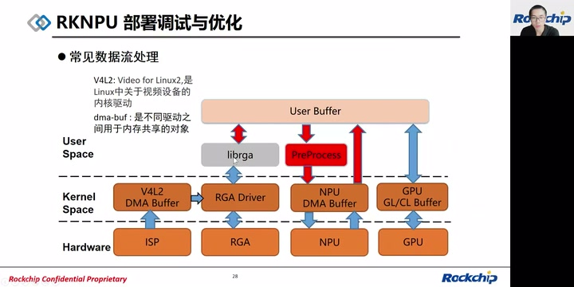

*常见数据流User Buffer与硬件间拷贝 · [原片 48:00](https://www.bilibili.com/video/BV1vd4y197Tf/?t=2880)*

这个过程会包含很多User Space到Kernel Space的拷贝过程。而数据流的优化，可以通过ISP拷贝过来DMA Buffer，得到V4L2的DMA Buffer，然后对RGA直接拿到DMA Buffer输入，它缩放或者色域转换到NPU提供出来的DMA Buffer。而NPU内部模型推理时，使用到SRAM来复用它中间分配的计算结果。然后NPU处理完，会提供一个输出Buffer给GPU。GPU作为消费者，import这块NPU的DMA Buffer以后，进行GPU运算，拿到输出拷贝到User Space。

这里头就减少了Kernel Space到User Space、User Space到Kernel Space的拷贝，大大降低了带宽。

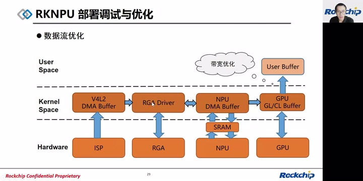

*DMA Buffer共享与SRAM复用的数据流优化 · [原片 49:00](https://www.bilibili.com/video/BV1vd4y197Tf/?t=2940)*

## Q&A：观众提问与现场回答

好的，以上就是我今天介绍的一些内容。现在是问答环节，看一下大家对今天的内容有没有什么疑问，或者任何想问的问题，都可以提出来。

另外，左上角是我们的RKNN交流群，后面进来的同学可以扫一下二维码，加入一下RKNN交流群。有问题的同学可以通过评论区提问。还有，我们会进行RKNN的抽奖，同样也是跟第一轮一样，注意屏幕左上角的福袋，然后点击参与。

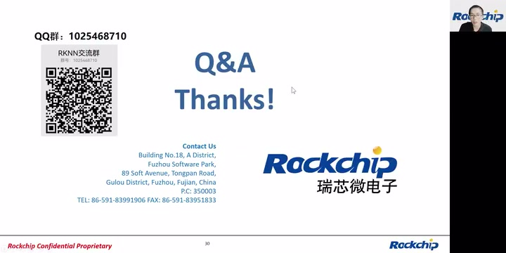

*原课Q&A页面与RKNN交流群提示 · [原片 50:00](https://www.bilibili.com/video/BV1vd4y197Tf/?t=3000)*

**问：为何是NHCW？** [原视频 50:19](https://www.bilibili.com/video/BV1vd4y197Tf/?p=1&t=3019)〔提问中的布局字母顺序按转写保留。〕

您是想问NHWC排布是吗？

因为NHWC排布是在硬件，我们硬件对1、3、4通道的输入数据有一个特殊处理，是支持NHWC紧密的排列传进来的。

**问：3399 Pro 1.7.1的API什么时候更新？** [原视频 50:55](https://www.bilibili.com/video/BV1vd4y197Tf/?p=1&t=3055)

应该是3399 Pro 1.7.1的API，应该已经更新了吧。在我们的RKNN交流群里头应该有一个说明。

**问：零拷贝有哪些芯片支持？** [原视频 51:20](https://www.bilibili.com/video/BV1vd4y197Tf/?p=1&t=3080)

零拷贝的话，其实所有的芯片都是在有限制的条件下支持的。就是说，这些接口每代NPU都有提供对应的接口。

**问：哪个平台支持加算力板？** [原视频 51:40](https://www.bilibili.com/video/BV1vd4y197Tf/?p=1&t=3100)〔此处问题措辞识别不确定。〕

您说是哪个平台支持加算力板？

**问：MPP、RGA和硬件解码吗？** [原视频 51:54](https://www.bilibili.com/video/BV1vd4y197Tf/?p=1&t=3114)

这个可以。后续您可以反馈出来，如果有需求，可以同样整一个课程。

**问：输入数据是灰度图，做零拷贝运行有什么需要注意的吗？** [原视频 52:13](https://www.bilibili.com/video/BV1vd4y197Tf/?p=1&t=3133)

输入数据是灰度图，灰度图注意的内容，主要是你们相当于输入是单通道的。这个主要考虑要不要做归一化、量化。其实它跟三通道的输入是一样的，没有特别需要注意的地方。

一样是模型转换的时候，设置归一化、量化参数，然后在运行时候用零拷贝接口就可以了。这里面唯一需要注意的就是刚刚说到的，我们有一个对齐限制。比如灰度图的宽度需要一个对齐，这就要求你分配的内存是要带stride的大小。

**问：一维数据？** [原视频 53:07](https://www.bilibili.com/video/BV1vd4y197Tf/?p=1&t=3187)

一维数据，没问题，是支持的。

**问：零拷贝相对于普通接口的性能提高多少？** [原视频 53:17](https://www.bilibili.com/video/BV1vd4y197Tf/?p=1&t=3197)

这个有测试过，我今天没有贴出来。但是在3566上面，一个640×640×3的输入，经过YOLOv5模型，就是RGA加YOLOv5模型，大概能省2点多毫秒。

**问：1808支持零拷贝？** [原视频 53:49](https://www.bilibili.com/video/BV1vd4y197Tf/?p=1&t=3229)

1808也是支持零拷贝，它有另一套零拷贝接口。建议你可以看一下1808相关文档。

**问：驱动？** [原视频 54:04](https://www.bilibili.com/video/BV1vd4y197Tf/?p=1&t=3244)

RKNPU的驱动已经开源到SDK当中了，Kernel里面了。拿到SDK的话，就可以编译。

**问：目前主流的一些深度学习算法都支持转换吗？** [原视频 54:21](https://www.bilibili.com/video/BV1vd4y197Tf/?p=1&t=3261)

什么叫主流的一些深度学习算法？是指检测、分类、分割，还有超分这一些深度学习算法吗？

**问：我用在3399上硬解码代码，为什么到3568、3588……** [原视频 54:41](https://www.bilibili.com/video/BV1vd4y197Tf/?p=1&t=3281)〔提问原句未完整识别。〕

硬解码，这个硬解码的内容我不太清楚。这个你们可以找相关工程师了解一下。

**问：共享权重可以实现动态……开发文档上没怎么看到。** [原视频 55:01](https://www.bilibili.com/video/BV1vd4y197Tf/?p=1&t=3301)〔问题中间词语不清。〕

这个目前是已经实现的功能，但是还没有完善到文档里面。我们后续会提供一个稳定版本，这时候会加到文档里头。

**问：后处理有加速方式？** [原视频 55:24](https://www.bilibili.com/video/BV1vd4y197Tf/?p=1&t=3324)

后处理加速，得结合算法和可用硬件来综合考虑。

**问：模型转换的时候设置参数不量化，不量化转换的模型算子都跑在CPU上？** [原视频 55:36](https://www.bilibili.com/video/BV1vd4y197Tf/?p=1&t=3336)

这个不是的。主要是输入部分，因为我们的不量化其实是FLOAT16的数据格式在运行。那输入数据如果是FLOAT32的输入数据的话，其实是要在CPU上做一次转换而已，其余NPU上该支持的算子还是会跑在NPU上。

**问：完整安装SDK。** [原视频 56:17](https://www.bilibili.com/video/BV1vd4y197Tf/?p=1&t=3377)

完整安装SDK，是什么NPU的SDK吗？

**问：支持NCW这种格式数据输入？** [原视频 56:28](https://www.bilibili.com/video/BV1vd4y197Tf/?p=1&t=3388)

NCHW，是指NCHW吗？这个目前是不支持的。

**问：多线程，3588可以同时定义多个RKNN context吗？** [原视频 56:43](https://www.bilibili.com/video/BV1vd4y197Tf/?p=1&t=3403)

可以，这个是可以的。

**问：Build模型……有很多TensorFlow相关的信息，是什么原因？** [原视频 56:53](https://www.bilibili.com/video/BV1vd4y197Tf/?p=1&t=3413)〔提问中模型类型/框架名称未可靠识别，原转写为“iTouch模型”。〕

这个问题是用RKNN-Toolkit还是RKNN-Toolkit2呢？

**问：能支持NPU绑核运算？** [原视频 57:12](https://www.bilibili.com/video/BV1vd4y197Tf/?p=1&t=3432)〔“绑核”的原转写为“版核”，需结合源声核对。〕

绑核运算，3588是可以支持的，因为它有三个核心。

**问：EDK？** [原视频 57:22](https://www.bilibili.com/video/BV1vd4y197Tf/?p=1&t=3442)

EDK的话，目前还没有计划开放。

**问：归一化、量化操作都是在CPU上运行吗？** [原视频 57:37](https://www.bilibili.com/video/BV1vd4y197Tf/?p=1&t=3457)

这个是根据不同的使用接口来决定的。如果是零拷贝API的话，归一化和量化是在CPU上运行，并且输入是1、3、4通道的时候……

> 局部校订说明：冻结转写与57:35—58:20的独立本地ASR补证均识别为CPU。此处与前文零拷贝流程在NPU执行的表述不同；保留本课此处原说法，CPU/NPU字母及句尾仍存在听辨不确定性。

**问：“logX”AI组件库〔名称音近，待核〕会支持3588吗？** [原视频 58:06](https://www.bilibili.com/video/BV1vd4y197Tf/?p=1&t=3486)

是支持的。

**补充：用的RKNN-Toolkit1。**

Toolkit1，是吧？是。因为下面会有一套解析接口，是基于TensorFlow框架的，所以会有一些TensorFlow的信息。

刚进来的同学可以扫一下左上角、左边的RKNN交流群QQ群进群，后续有什么问题都可以在群里面提问，我们会为大家做解答。

**问：RKNN转换时的数据集具体例子是什么？就指txt放多个图片路径？** [原视频 59:03](https://www.bilibili.com/video/BV1vd4y197Tf/?p=1&t=3543)

对，SDK里面的Toolkit工具应该是有demo例子的，最简单的方式就是放多张图片的路径。

**问：1126 NPU，GitHub今年都没有更新，是不打算更新？** [原视频 59:28](https://www.bilibili.com/video/BV1vd4y197Tf/?p=1&t=3568)

这个我们有在更新，近期应该会更新一个版本。

**问：RKNPU例子能加入简单的“能量检测”之类的吗？** [原视频 59:41](https://www.bilibili.com/video/BV1vd4y197Tf/?p=1&t=3581)〔该算法名称疑似ASR误识，暂按冻结转写标记。〕

如果需求只是说，你们想要一个这个“能量检测”的demo的话，其实我们提供的“logX”〔名称音近，待核〕，它就是有这样的功能。它有提供我们的“能量检测”功能，你们可以试用一下。它就是集成了调用RKNN API，上面集成了一些AI算法。其实不仅是“能量识别”，我们还有“能量”和“能量检测、能量识别”，包括车辆的检测、车牌的检测，都是有的。

> 识别待核：上述重复出现的“能量”相关算法名称不可靠；这里保留说话展开方式，未用外部知识猜写具体算法。

刚刚那个RKNN-Toolkit1的log是正常的。

**问：有优化归一化与量化执行耗时的方法吗？有必要去做优化吗？** [原视频 60:33](https://www.bilibili.com/video/BV1vd4y197Tf/?p=1&t=3633)

其实你们如果想看耗时的话，刚刚也说到，可以把RKNN_LOG_LEVEL设成4，可以看到逐层的耗时。逐层的耗时里面，如果说在input层有一个耗时的话，那说明归一化和量化其实就在CPU上做了。如果说几乎接近，就是几十微秒级别的，那这个时候归一化和量化就在NPU上做的，就没有必要再去优化了。

> 源视频到1:01:18结束。末尾不足一秒的冻结转写为“这就是中心的 millions”，未能可靠辨认，未猜写成新结论。视频末画面仍为同一Q&A页。

> 交付校验限制：已逐窗核对原文和画面，并逐张查看最终截帧。当前会话浏览器file协议曾被拒绝，未绕过；桌面/窄屏布局、图片缩放交互和联网源时间跳转未完成浏览器实测。可移植资源和源时间链接由离线结构校验检查。
