# RK3588 多目摄像头拼接产品及技术答疑

> 整理式忠实讲稿，保留讲者原序、例子、条件与问答；不是逐字转录。源视频：BV1kd4y1A7Ls，P1，00:00–1:00:48。技术状态、计划和性能主张保留授课当时口径。识别不稳处在相邻正文标注。

## 开场与 IPC SDK 的特点（00:00）

好的，直播快开始了。我再简单介绍一下，我叫黄林，是瑞芯微的产品工程师。今晚将由我为大家带来 RK3588 多目拼接摄像头的产品介绍及技术答疑。我们现在开始直播。

我先介绍一下 3588 SDK 的特点及状态。如果之前大家用过 RK 通用 Linux 产品，就知道之前通用 Linux 产品的整个 SDK 比较大，编译的时候可能会依赖网络。针对 3588 多目拼接摄像头这个产品品类，我们专门整理了一个 IPC SDK。主要依赖库以 .so 的形式发布，不带源码，这样减少了 SDK 的大小，并且不依赖网络编译，方便大家更快地开发和部署。裁剪完之后，整个 IPC SDK 的大小大概是一 G 多，比之前通用 Linux SDK 的整个包小很多。

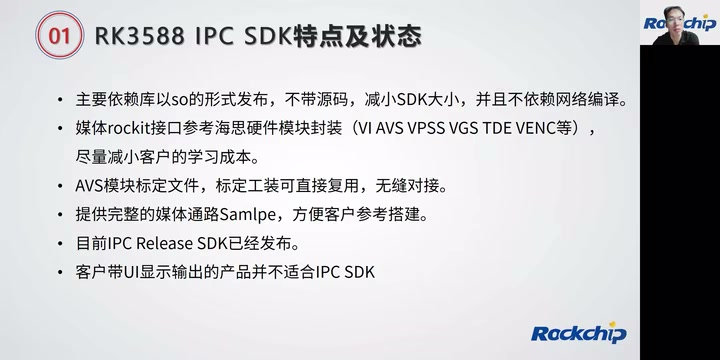

*IPC SDK 的特点及状态：依赖库、媒体接口封装、标定复用与适用产品范围。 · [原片 01:00](https://www.bilibili.com/video/BV1kd4y1A7Ls/?t=60)*

第二点，3588 IPC SDK 的媒体 rockit 接口参考海思的硬件模块封装，尽量减少客户的学习成本。其实 3588 里面的硬件 IP 模块，并没有像海思那样有 AVS、VPSS、VGS、TDE 这些硬件模块。像 AVS 拼接模块，3588 其实是用 GPU 去做的；包括 VPSS、VGS 里面的缩放、格式转换、OSD 功能，其实是由 3588 里面的 RGA 或者 GPU 这两个硬件模块实现的。我们还是把这些硬件模块封装成跟海思一样的硬件接口，这样大家就可以按照之前应用调用的习惯，直接调用这些接口，减少开发成本和学习成本，更快地把整个媒体数据流搭建起来。

但是有一块跟海思那边还是有区别。像 VI 这个模块，海思 ISP 相关的接口也是放在 VI 里面，但是 RK3588 的 ISP 相关接口是通过 AIQ 框架，所以 ISP 这块是比较独立的代码框架，大家要注意一下。其他 AVS、VPSS、VGS、TDE 等等，接口使用方法跟海思那边差不多。

第三个，AVS 模块的标定文件、标定工装，可以直接复用之前的，做到无缝对接。也就是说，如果你之前使用过，比如海思的 359A〔原转写如此，具体型号待核〕，做过一些标定、有标定工装，或者做过标定文件，如果这个多目拼接结构不变，你这个标定文件就可以直接用；包括之前使用的标定工装也可以直接用，这样可以做到无缝对接的效果。

SDK 里面提供了完整的媒体通路的 Sample，方便客户参考搭建。比如 SDK 里面有一个叫 sample 的目录，带了一些 VI 到 AVS、到 VPSS、到 VENC 的 bind 和 unbind 流程；还包括直接从 VI GetFrame，去做比如 JPEG 编码、去做 crop 这些操作的 Sample。有一个比较全的 Sample，可以给大家做参考，方便客户搭建自己的媒体数据流结构。

目前 IPC 的 Release SDK 已经发布了，应该是在五月份发布了一版。我们计划应该在九月初左右发布第二版 Release SDK，把之前没有的一些新技术功能增加进去，比如 1608 加 3588 加 1608、八目的方案支持，编码多 slice 的支持；还包括最近项目量产过程中碰到的一些问题解决，也会把这部分问题修掉，在 SDK 带出去。预计九月份左右会发一版 SDK。〔这里保留讲课当时的发布计划口径。〕

之前也有些客户在问我们，IPC SDK 到底用于什么场景。其实 IPC SDK 不只放在 IPC〔此处原转写重复“SDK”，按上下文整理〕。它有一个比较不太适用的场景：有些客户的产品带 UI 显示输出，比如需要带 Weston 框架，或者 Wayland 这些框架〔两个框架名称据语境辨识，音频识别不稳〕，带这种显示框架就不太适合 IPC SDK。当然，如果显示输出只是简单的比如叠加 OSD 进行显示输出，这样的功能，IPC SDK 还是比较适合的。这部分大家到时候要注意一下。就像刚刚强调的，如果需要带 UI 的显示框架，这个 SDK 可能就不太适合。如果像车载产品，只是带简单叠加 OSD 的输出，不需要任何显示框架，不带任何 UI 操作，这个 SDK 是比较适用的。

## 主要性能指标：CPU、GPU、NPU 与 DDR（06:41）

接下来介绍一下 3588 IPC SDK 这边主要拼接产品的性能指标。第一个，介绍 CPU、GPU、NPU 使用的频率。因为 IPC 这边对 CPU 并不太有低功耗需求，所以我们建议 CPU 直接定频到最高频。目前 IPC SDK 建议客户把 CPU 小核直接定频到 1.8G，大核定频到 2.2G。

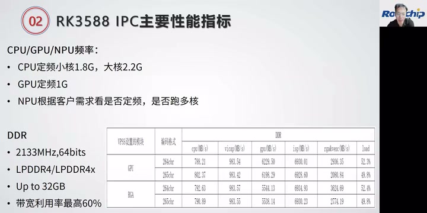

*主要性能指标页：CPU小核1.8G、大核2.2G，GPU 1G，以及DDR条件。右下表格受原视频分辨率限制。 · [原片 07:30](https://www.bilibili.com/video/BV1kd4y1A7Ls/?t=450)*

目前我们在做的拼接产品，发现相关 CPU 占有率并不是非常高。就算业务场景比较复杂的产品，CPU 占有率基本上只会用到百分之十几。因为 3588 四大四小，四核 A5、四核 A73〔原转写核型号不清，保留待核〕，整个 CPU 性能还是很强劲，所以 CPU 性能比较富裕。

开发过程中也碰到过，之前客户的业务比较复杂，之前的平台 CPU 可能比较紧张，造成很多业务为了抢 CPU 资源配置了很多实时线程，其实没必要。按照正常配置下来，3588 的 CPU 性能还是比较够用的。

第二点是 GPU。3588 上 GPU 消耗比较大。就像刚刚介绍的，拼接其实是用 GPU 来做的，包括之前说的 VPSS 模块、VGS 模块，很多模块其实利用到了 GPU 的硬件性能，所以在 3588 上 GPU 性能消耗比较大。举个最简单的数据，六目 2400 万拼接的时候，单单这个拼接，GPU 消耗应该在百分之六十多左右。所以 GPU 我们都是固定定频到 1G。这一点大家在应用过程中要注意一下，因为如果 GPU 放开变频，可能对整个拼接性能有影响。

NPU 这边，最高频率可以跑到 1G，但是可能要具体看客户模型的大小和模型所需性能，根据客户需求决定是否定频、是否跑多核。这是 CPU、GPU、NPU 的频率情况。

第二个是 DDR。目前我们一般用 LPDDR4 跟 LPDDR4x，跑 2133 的频率，用 64 位 DDR，所以 DDR 最高带宽可以到 32GB 左右。目前在 3588 的 IPC 场景下，DDR 带宽利用率最高可以到 60%。〔单位保留讲者和画面口径，画面为“Up to 32GB”。〕

我们在开发过程中发现，DDR 带宽到了 55% 左右，可能就会出现各个 IP，比如编码、GPU 或者 RGA，开始抢带宽的情况。所以，如果拼接需要的分辨率比较高，比如 3200 万，或者 2400 万 HDR〔原转写“两次400万”，此处数值辨识不稳〕，这种场景下带宽消耗还是比较大。大家构建自己的媒体数据流时，还是需要从尽量节省带宽的角度考虑。

旁边这张表格，是四目 3200 万的一个简单例子。应该是四目 3200 万拼接成 8160×3840 输出，然后两路编码时带宽占有的情况。大家可以看到，在这种场景下，H.264 编码时带宽占有应该是 52% 左右。各模块中，GPU 跟 ISP 两个的带宽占有比较大。H.264 为什么比 H.265 带宽占有高？因为 H.264 在编码过程中存在跟 DDR 的交互过程，所以 H.264 比 H.265 的带宽使用率高一些，这也是正常现象。

### 编码与 ISP 能力（11:45）

接下来跟大家过一下编码性能指标。3588 编码的性能是 8K 30 帧，这个 8K 是 7680×4320、30 帧，并不是 8192×8192，这一点大家要注意。编码宽度、高度是没有限制的，

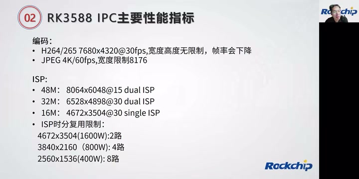

*编码与ISP指标页：H.264/265的7680×4320@30fps、JPEG限制，以及ISP分辨率与时分复用限制。 · [原片 12:00](https://www.bilibili.com/video/BV1kd4y1A7Ls/?t=720)*

但是总分辨率如果超过 7680×4320，自然而然帧率会下降，这个大家要注意。

JPEG 编码是 4K 60 帧左右的性能，宽度限制在 8176。如果超过 8176 的宽度，JPEG 编码怎么办？我们建议客户直接用软件编码就可以了。因为全尺寸分辨率的 JPEG 编码，一般用在 JPEG 抓图上，帧率不会太高。3588 的 CPU 性能比较强，我们测试过，8K 的 JPEG 编码直接用软件编码，大概在 100 毫秒以内，完全可以满足常规抓拍需求。当然，宽度小于 8176，比如 MJPEG 编码，还是建议大家直接用 JPEG 硬件编码模块做编码。

下来是 ISP 性能。规格书上标称的 ISP 性能应该是 3200 万、30 帧。3588 带的是双核 ISP，双核总性能是 3200 万、30 帧。如果需要支持 4800 万，用双核 ISP 可以支持到 15 帧左右。单核 ISP 性能应该是 1600 万；如果只用到 3588 单核 ISP，性能可以到 1600 万、30 帧。其实从这里大概也可以推导出 ISP 时分复用的限制。

如果单目使用的是 1600 万的 sensor，也就是说，3588 最多只能支持两个 sensor 输入。因为单个 ISP 最高只能到 1600 万，把两个 ISP 都用起来，就只能支持两路输入。同理推导，外面用的是 800 万 sensor，就支持四路；400 万 sensor 就是八路输入。

这里有个限制：400 万 sensor 原来可能可以到 2688 的分辨率，但 3588 单个 ISP 超过三路以上，宽度最高只能支持到 2560。所以 sensor 的分辨率，大家也要关注。就是说，单个 ISP 接三路以上 sensor 输入，宽度最多只能 2560。举个最简单的例子，拼接中用得比较多的“2404010”〔原转写型号如此，未能确认〕，常规输出宽度其实是 2688。这部分可能需要 sensor 从 2688 直接裁剪成 2560 宽度输出，这是大家后面要注意的点。

### VICAP 与 sensor 输入接口（16:00）

下来介绍 VICAP 输入的情况。VICAP 其实就是跟外面 sensor 的 MIPI 接口，到底可以接多少个 sensor 进来？

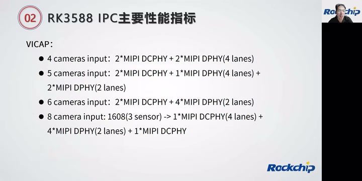

*VICAP输入配置页，列出4、5、6与8个camera时DCPHY/DPHY及lane分配。 · [原片 16:15](https://www.bilibili.com/video/BV1kd4y1A7Ls/?t=975)*

3588 带了两个 DPHY 跟两个 DC 的 Combo PHY。这四个 PHY 分别支持四个 lane 输入。两个 MIPI DPHY 的四个 lane，可以拆成两个 lane、两个 lane 来用。所以如果需要，两个 DPHY 可以接四个 sensor 进来。两个 MIPI Combo PHY，就是 DCPHY，四个 lane 不能拆，不能拆，所以两个 PHY 只能支持两个 sensor 接进来。单个 3588 最多可以支持六个 sensor 输入。

PPT 写了各个组合要怎么配：四个 sensor 输入，两个接 DPHY，两个接 DCPHY；如果需要六个 sensor 输入，就把两个 DPHY 拆成两个 lane、两个 lane 的输入，可以接四个 sensor，另外两个再接两个 sensor。

因为有些客户有八目接入需求，我们后面还开发了 3588 加 1608 的方案，可以接八目 sensor，同时到 3588 做拼接输出。这张图画出了八目拼接，就是 3588 加 1608、八目 sensor 输入的大概示意。大家可以看到左边，八个 sensor 其实都挂在，

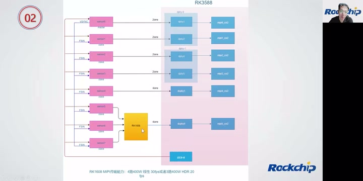

*3588加1608的八目输入示意：五路直入，另外三路经1608汇聚；控制线由3588侧连接。 · [原片 18:55](https://www.bilibili.com/video/BV1kd4y1A7Ls/?t=1135)*

3588 上。八个 sensor 都挂在 3588 上，也就是说，sensor 初始化序列下发，包括曝光设置，都是通过 3588 的 I²C 去配置。然后有三个 sensor 的数据流，通过 1608 传给 3588。这里是用 1608 把三个 MIPI 摄像头数据组合之后传给 3588，3588 在这边拆分，再传给对应 ISP。

上面的示意图就能比较简单明了地说明之前 PPT 的内容。这两个是 DPHY，DPHY0 其实拆成两个 lane、两个 lane 的输入，所以可以接两个 sensor；另一个 DPHY 也是拆成两个 lane、两个 lane 输入，分别接两个 sensor。这个 DCPHY，像刚刚介绍的，它没办法拆，只能四个 lane 直接用。当然，这四个 lane，其实这个 sensor 是两个 lane，这边写得也有点问题，其实也是两个 lane 输入。不过因为 DCPHY 不能拆，这边只能接一个 sensor。所以这里接了五路 sensor。

1608 像刚刚介绍的，三路 sensor 进来，然后这边四个 lane 输入给 DCPHY0，在内部拆解各路流的数据，送给 ISP。〔DPHY/DCPHY名称据当前示意图整理；讲者同时纠正了图上sensor侧lane标注。〕

目前八目方案已经是可以稳定量产的方案，已经有客户在用了。1608 的传输能力，大家这里可以看到，大概支持四目 400 万线性 30 帧或者三路 400 万 HDR 20 帧的水平。所以这个方案最多可以支持九个摄像头输入。当然，目前好像还没有产品用到九路摄像头输入，这个后面看大家实际应用。目前比较常用的可能是八目，八目 1600 万或八目 3200 万，这类产品有一些应用场景。这是跟大家介绍八目产品的简单流程图，也顺便过了一下几个 DPHY 四 lane 拆成两 lane 的用法。

### GPU 与 RGA 的限制和负载均衡（21:08）

下来介绍 GPU 的性能指标。刚刚介绍 GPU 频率时已经说过，在 RK3588 拼接产品上，GPU 负载比较重，包括拼接、缩放、格式转换、OSD、COVER、MOSAIC 等，基本都是在 GPU 做。还有一个硬件模块 RGA，本来也可以做缩放、格式转换、OSD、COVER 这些动作，但 RGA 有个限制：输入宽度不能超过 8176，输出宽度不能超过 8128。

实际上，六目或者八目拼接完，很多时候拼接出来的分辨率宽度是 8192，导致很多时候没办法用 RGA 做缩放。这是有一定限制的，导致很多场景只能用 GPU 做上面的 2D 加速处理，

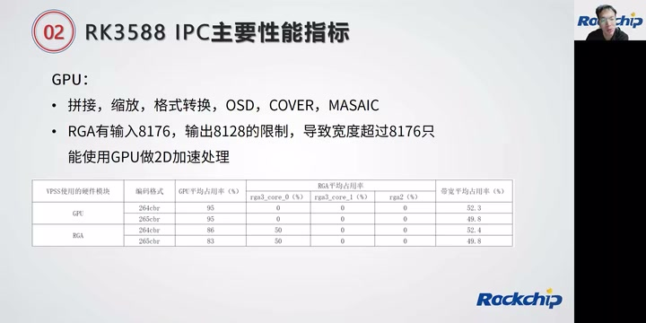

*GPU处理项目及RGA输入8176、输出8128的宽度限制，下面对比不同处理方式的占用。 · [原片 22:10](https://www.bilibili.com/video/BV1kd4y1A7Ls/?t=1330)*

所以 GPU 负载比较重。大家可以看这张表格，媒体流程跟刚刚介绍带宽时一样，就是四目 3200 万拼接输出。如果全用 GPU 做，可以看到 GPU 占用率已经很高，基本快到百分之百。因为刚刚介绍过，它们拼接宽度是 8160 输出，所以可以把缩放这部分挪到 RGA 做，大概可以降低百分之十几的 GPU 利用率。这一块大家开发时，也要想办法尽量做到 GPU 跟 RGA 的负载均衡。

## 典型拼接媒体数据流（23:18）

下来简单介绍一个拼接媒体数据流。这个算是比较典型的拼接媒体数据流流程。我先简单介绍主要数据流，再说这上面几个注意点。

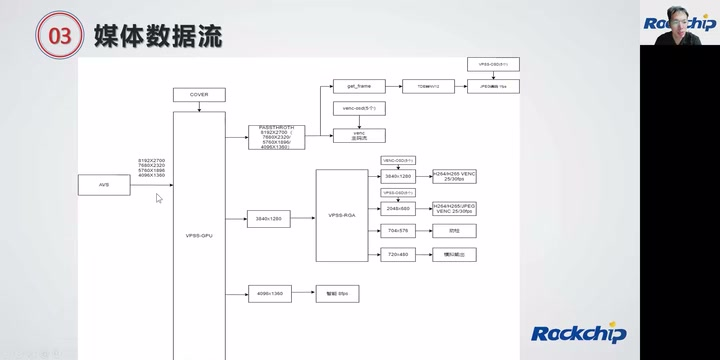

*典型媒体数据流：AVS输出后经VPSS分出主辅码流、动检和模拟输出等支路。 · [原片 24:00](https://www.bilibili.com/video/BV1kd4y1A7Ls/?t=1440)*

这个数据流比较简单，AVS 拼接输出成 8192×2700，这边一路主码流，叠加 OSD 输出。下面是 3840×1280 和 2048×680 两路辅码流编码输出，也是叠加对应 OSD 输出。还有一路缩放成 704×576，做动检，就是运动检测；还有一路 720×480，做模拟输出，因为有的客户有模拟输出需求。

做产品最初的一些调试。还有一路给智能用，做周界或者人形检测等智能算法。

### 把主码流分辨率切换放到 AVS

这张流程图有几个注意点，后续大家开发时可以借鉴。比如主码流分辨率切换，基本上大家编码之后都有切换主码流分辨率的需求，比如从 8192 切换到 5760×1896。如果这个切换流程由 VPSS 来做，其实比较消耗性能和带宽。

在 RK 的 rockit 媒体框架里面，通过 VPSS 做缩放时，如果前后分辨率一致，这一路可以不消耗 VPSS 相关硬件加速模块的性能和带宽，它直接 bypass 过去。如果前后分辨率不一致，就需要 GPU 做缩放，并且消耗一进一出带宽。比如这里 8192×2700，如果用 VPSS 做缩放，相当于消耗 GPU，还会有 8192 进、7680 出的带宽消耗过程。〔此处讲者举到7680，与前面的5760切换例不同，均保留。〕

所以我们把分辨率切换流程挪到 AVS 做，拼接加缩放直接在 AVS 做。比如你主码流需要 5760 分辨率输出，我在这边把拼接加缩放做好，这一路现在直接 bypass 掉就不消耗性能跟带宽，这一点大家要注意。

### 两级 VPSS 分担缩放

另外一点，大家可以看到这边挂了两级 VPSS，为什么？也是为了节省 GPU 性能跟带宽。前面介绍过，RGA 这边有 8192 输入的限制——是 8176 的输入限制。拼接完是 8192 输出，导致第一级 VPSS 没办法使用 RGA 做缩放，一定要用 GPU，可能造成 GPU 负载比较大。

我们就在第二路缩放这边、3840 后面，把后面所需、比 3840 小一级的分辨率，挂到 3840 后面，再挂一级 VPSS。这一级 VPSS 可以使用 RGA；并且在这边做缩放，带宽消耗会比把这几路小分辨率直接挂在第一级 VPSS 上小。

大家可以想想，如果 8192×2700 直接缩放到 2048×680，相当于进的是 8192×2700，出的是 2048×680。如果把流程挪到这边，进的是 3840×1180〔此处转写为1180，前文同支路为1280，待核〕，出的是 2048×680，也就是输入这一级的 DDR 带宽大大缩小。如果后面挂三四个这样的小分辨率，对带宽的节省还是比较可观的，这是另外一个注意点。

第三个注意点，大家看到这边挂了一个 JPEG 编码，JPEG 编码上面需要挂一级 TDE 去转 NV12，为什么？因为 AVS 这边、整个通路，3588 支持一个叫 AFBC 的压缩格式，可以节省带宽。所以我们尽量建议客户用 AFBC 格式走整个媒体通路。目前 GPU、RGA 和编码模块都支持 AFBC；这里编码模块指 H.264、H.265 编码模块。但是 JPEG 编码模块还不支持 AFBC，所以必须在这里把 AFBC 转成 NV12，再送到编码里面做编码。

第四个注意点，主码流 VENC 这边打 OSD，用的是编码打 OSD，这几路也是。但是带 JPEG 的两路，只能使用 VPSS 打 OSD。原因是 JPEG 编码模块也不支持直接打 OSD，所以只能把 RGN attach 到 VPSS，利用 VPSS 打 OSD。其实 VPSS 打 OSD，就是用 GPU 或 RGA 打 OSD。

还有个常规的 COVER，一般直接叠加在组上。目前 3588 可以支持任意四边形的 COVER 和马赛克，都是可以在 VPSS 上做叠加。这就是刚刚说的比较通用、比较典型的拼接媒体数据流，刚刚说了四个注意点。

也就是说，第一个注意点，为了节省 GPU 带宽和使用率，尽量在 AVS 上做分辨率切换。第二个，挂多级 VPSS，先缩放一级相对比较大的分辨率，再在这一级分辨率后面挂一级 VPSS 做缩放，可以节省带宽，也比较容易做到 GPU 跟 RGA 的性能均衡。

第三点，JPEG 编码不支持 AFBC 格式。我们是建议整条媒体通路使用 AFBC 压缩格式，这样可以节省带宽，但是用 AFBC 格式时，JPEG 编码不支持，所以送 JPEG 编码之前，需要把 AFBC 转为 NV12，再送 JPEG 编码。第四点，H.264、H.265 编码支持编码 OSD，但是 JPEG 不支持，所以需要直接 attach 到 VPSS 上做 OSD 叠加。〔这里“attach”的对象承接前文RGN，原口述转写为“编码”，未改写成新增接口动作。〕

## 常见拼接 IPC 产品规格（31:45）

下来说常见 IPC 产品规格。刚刚介绍了，单片 3588 最多可以支持六目 2400 万输入，两个 ISP 最多支持 3200 万、30 帧。所以决定了，单片 3588 基本最多支持四目 3200 万，也就是单个 800 万的 sensor〔原转写“1800”，据总数与上下文辨识〕，还有六目 2400 万的产品规格。当然还可以往下，比如六目 200 万，

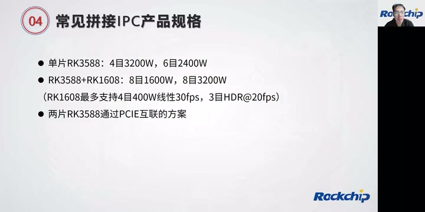

*常见拼接IPC产品规格页：单片3588、3588加1608和两片3588经PCIe互联。 · [原片 32:20](https://www.bilibili.com/video/BV1kd4y1A7Ls/?t=1940)*

就是六目 1200 万，这种产品组合都没问题。如果想支持八目，要 3588 加上 1608 两个组合，可以支持常规的八目 1600 万、八目 3200 万。刚刚也提到，1608 最多支持四目 400 万线性 30 帧，还有三目 HDR 20 帧性能，所以最多可以支持九目输入。当然，目前产品形态可能还没有这种输入。

如果要更高规格，有的可能需要两片 3588 通过 PCIe 互联。其实两片 3588 通过 PCIe 互联，基本就是各自处理 3200 万，中间 PCIe 互联可能只是作为 sensor 同步，或者其他配置同步，通过 PCIe 做信息传输、同步过程。一般还是各自 3200 万输出。这是目前常见的拼接产品规格。

当然，中间带宽消耗，跟客户具体媒体数据流应用有比较大关系，还是要根据各个产品，自己做一些取舍。

## 拼接算法相关注意点（34:01）

第一个是摄像头光学设计要求。第一个要求大家很好理解，摄像头一致性，指一定要用同一个 sensor，镜头参数一定要一样，这是最基本的要求。第二点，摄像头对焦一致，保证相同清晰度。

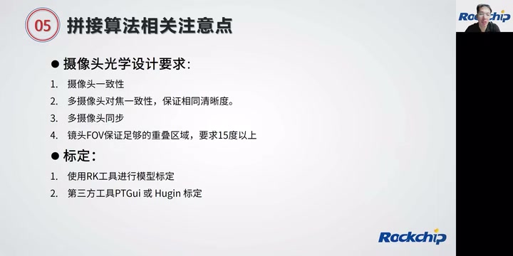

*拼接算法注意点页：摄像头一致性、对焦、同步、FOV重叠，以及标定工具选择。 · [原片 35:30](https://www.bilibili.com/video/BV1kd4y1A7Ls/?t=2130)*

因为我们发现，就算模组厂用了同一个摄像头型号、同一个镜头型号，有时模组跟模组之间，由于生产时没有保证好，摄像头之间清晰度有差别，这样整个拼接效果就不是很好。比如两个挨在一起的摄像头，这个误差、整个效果看起来还是比较明显。所以多摄像头一定要保证对焦一致，保证相同清晰度。〔此处原转写有“cont”和成串机械重复，清理后保留这次强调。〕

### 摄像头的曝光同步

第三个，摄像头同步。拼接算法一定要保证摄像头曝光同步，这样才能保证最基本的拼接效果。目前摄像头同步一般有几种模式。

有的 sensor 自己支持主从模式。比如六目拼接，有个主摄像头，主摄像头出流时，会输出同步信号给其他——其他五个从摄像头。从摄像头收到同步信号之后，过两张或三张，就会把曝光和主摄像头同步上。这个可以通过摄像头初始化序列，配置它的主模式或者从模式。

还有的摄像头没有主从模式功能，需要外面 SoC给它一个同步信号，一般通过 PWM 信号做同步。当然有一点比较要注意，比如很多索尼摄像头还需要行同步。需要行同步时，要关注 PWM 频率是不是满足行同步的频率需求，后面还是要根据摄像头规格书确认。

### FOV 重叠区域与摄像头摆放

第四点，也是大家问得比较多的问题，就是镜头 FOV。RK 算法要保证多大重叠区域？我们算法这边，最小重叠区域应该要有 10 度以上。因为考虑安装时工装上的误差，我们基本要求 15 度以上重叠区域。

举个最简单的例子，六目拼接 270 度时，我们基本要求垂直 FOV。为什么说垂直 FOV？因为摄像头水平 FOV 一般比较大，所以拼接时一般让客户垂直放置，然后用拼接补足垂直 FOV 比较小的这一面。相当于尽量利用水平 FOV 比较大的特性，让它垂直放置。垂直放置时，拼接更关注垂直 FOV 角度。六目拼接时，垂直 FOV 一般要求 60 度以上，这样保证重叠区域 15 度，拼出来角度在 270 度以上。

### 标定工具与量产工装

下来说标定。RK 其实提供了一个比较简单的标定流程和标定工具。就是利用最简单的棋盘格，去拍对应 JPEG 照片，然后使用我们的标定工具做标定。但是这个标定流程比较复杂，说实话，并不太适合用于量产标定工装，可以用于模型机标定。

如果大家之前做过，比如其他平台像海思 359A〔原转写型号，待核〕的标定工作，目前 RK 平台可以保证兼容之前标定的使用、兼容之前标定工装。所以建议大家尽量使用之前的标定流程和工装。当然，对于没有这方面经验的厂家来说，可能就会比较难受。标定这块需要之前有一定技术积累，这个工装、布置标定房间，是比较麻烦、比较复杂的过程。

## RK3588 IPC SDK 目录结构（40:07）

接下来简单介绍 3588 SDK 的目录结构。如果大家下载过 3588 SDK，就知道目录比较简单：一个是文档目录，一个是多媒体编解码、ISP 算法相关的目录，里面包括多媒体编解码和 ISP 相关的 .so 库。

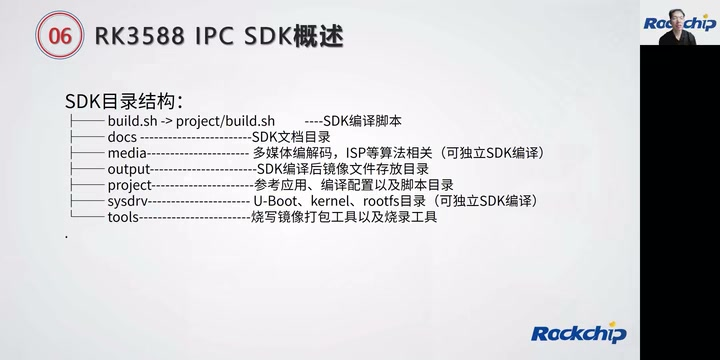

*IPC SDK目录页：build.sh、docs、media、output、project、sysdrv、tools各目录用途。 · [原片 40:30](https://www.bilibili.com/video/BV1kd4y1A7Ls/?t=2430)*

output 目录就是编译之后的镜像目录；project 里面是 RK IPC SDK 带的简单 IPC 应用。sysdrv 目录大家可能会比较经常用，里面是 U-Boot、内核等等，还有 rkbin，基本都在这里。tools 里面带烧写工具和打包工具。这个目录结构应该比较简单明了。

### media 目录与数据流 Sample

媒体目录这边，可以看出几个重要媒体模块：一个是 AVS，拼接算法库在里面，还有 ISP、编码、RGA、rockit 库。samples 目录大家要比较关注，里面带刚刚介绍的、比较完整的媒体数据流相关例程，比如 VI 绑定 AVS、绑定 VPSS、绑定 VENC 输出，以及其他简单 VI 取流，或者 VI 加编码、加 VO 输出。这些简单数据流程，在 samples 里都有相关源代码，大家可以看这里的 Sample 代码。其他几个目录基本放 .so 库。

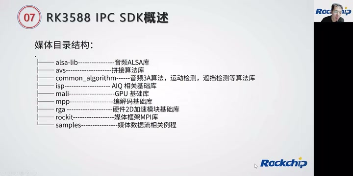

*media目录结构：AVS、ISP、Mali、MPP、RGA、rockit与samples，逐项标明基础库和媒体例程。 · [原片 41:50](https://www.bilibili.com/video/BV1kd4y1A7Ls/?t=2510)*

当然，如果大家想要其他库的源码，除了 rockit 不开放源码，其他像 ISP、RGA 其实都可以开放。目前给出去的 SDK 直接带 .so，如果大家想要这部分源码其实可以提供出去；rockit 的源码，我们不提供。

### rockit 目录与单模块例程

先介绍 rockit 目录结构。说实话，大家比较关注的应该是文档目录，对应文档在 docs 目录下也有，这里也保存了一份。下面这个 Sample 跟之前 Sample 的区别，是这里对应单个模块的例程。前面 Sample 是整个数据流例程，比如这里 AVS 有单独针对 AVS 模块的测试 Demo，VPSS 这里 Sample 也是专门针对这个模块的简单 Demo，没有像前面的 samples 有几个模块绑定的数据流；这里是专门针对单模块的代码例程。

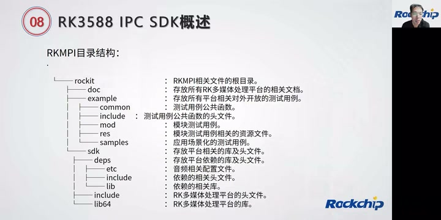

*RKMPI/rockit目录页：文档、example模块测试例程与SDK依赖库。 · [原片 43:20](https://www.bilibili.com/video/BV1kd4y1A7Ls/?t=2600)*

今天整个多目拼接介绍大概到这里，接下来进入问答环节。大家还有什么问题可以问一下，我先看大家提的问题。

## 技术答疑（44:12）

### 有没有 DDR 带宽统计工具？

有个客户问，有没有 DDR 带宽统计使用工具？这个是有的，我们专门提供给客户一个带宽使用统计工具。这个到时候可以在 Redmine 上要一下，或者找技术窗口要一下。〔Redmine由口述语境辨识，原转写“瑞德曼”。〕

### AFBC 比普通格式节省多少带宽？

有网友问，AFBC 比普通格式能节省多少带宽？其实 AFBC 节省带宽跟场景有关。场景比较简单，至少可以节省百分之三四十以上，是有的；但场景比较复杂，比如拍一些都是草地、都是树叶的场景，这时候节省带宽相对有限。

### 水平和垂直维度能同时拼接吗？

还有客户问，想在水平和垂直维度同时做视频拼接，能否用 3588 实现？其实我没太明白你的水平和垂直维度同时做拼接，是个什么应用情况，这个还要多一些具体信息，才能进一步评估。

这样，三乘二拼接，垂直面、六个摄像头。其实如果六个摄像头做 3×2 视频拼接，水平面三个、垂直面两个，可以分成两个 AVS group 输入，这个可以做。主要看摄像头分辨率，如果是 400 万，一个 3588 应该就能做到。就是两个 AVS group 加载不同 Mesh 表，根据自己需求做拼接。

### 1080P 支持几路拼接？

其实 1080P 就像刚刚整个过程中介绍的，单颗 3588 最多支持六个摄像头输入，1080P 六摄像头拼接还是很轻松。如果要八路拼接，外面需要配一个 1608，可以做到八路。一般最多做到八路拼接了，360 度。目前 3588 加 1608 最多支持九路摄像头输入，但是还没有看到这样的应用场景，所以一般来说支持到八路。

### 两个800万摄像头拼接占用多少资源？算法与拼接痕迹如何？

两个 800 万像素做画面拼接，占用多少 CPU，拼接算法用什么，拼接痕迹明显吗？之前介绍了，3588 拼接其实用 GPU 做。两个 800 万摄像头，就是 1600 万，GPU 拼接应该大于 50% 左右。〔“大于50%左右”按原转写保留，数值口述待核，未改成估算保证。〕拼接算法是 RK 提供的拼接算法。拼接痕迹的话，目前 RK 拼接算法，在量产客户那边还是得到客户肯定的。

### 多目的 ISP 调试，支持原厂邮件支持吗？

“多目的 ISP 调试，支持原厂邮件支持吗？”〔问题前半原转写“公布的ISP调试”，按后续回答辨识，具体措辞待核。〕这个，多目其实是这样：拼接调试一般从单个 ISP 开始。先调好单个 ISP 效果，基本上单个 ISP 调好之后，再进行多目 ISP 调试，主要是融合区 3A 曝光调试。目前 RK 的话已经做好了多目 ISP 融合区的曝光融合过程，所以只要做好单目的 ISP 调试就可以。

### 两片3588互联，在拼接上怎样工作？

两片 3588 互联在拼接上，基本上，比如单片 3588 一般最多支持 3200 万的编码和 ISP 输入。有的客户可能有 6400 万需求，相当于单个 3588 负责 3200 万，另外一个也负责 3200 万，两个互联，可以做两边摄像头同步和配置同步，主要做同步输出效果。标定可以直接用 359〔原口述转写型号，待核〕的标定文件，可以直接做。

### 多摄像头同步，应用层怎么做？

第一个，得在摄像头驱动层面保证同步。我们有接口配置使用同步模式还是非同步模式，这个接口有开出来。如果配置同步模式，我们在 AVS 那边会直接把同步做掉。

### 发热量大不大？

其实我可以给个数据：基本上我们在 EVB 板上测试六路拼接的功耗，SoC 在 5 瓦左右，可以根据这个数据设计你们的散热。

### 源码获取有什么条件、从什么渠道获取？

其实需要开我们 SDK 的权限，具体可能要跟业务那边联系。

### RTSP 推流有没有？

RTSP 是个基础功能。我们 SDK 带一个基础 RKIPC 功能，里面其实就有 RTSP 推流流程，包括 Sample 里也有。

### 12路拼接有什么方案？

12 路拼接，要看你们具体规格。目前 3588 加 1608，最多只能支持九路拼接。

### IPC SDK 与另一方案有什么区别？

“IPC SDK 跟 NVR SDK 有什么区别？”〔此处原转写为RTSP，后文55:54再次明确提到IPC SDK/NVR SDK，据片内复述纠正。〕区别还是比较大的，两个针对不同品类。所以如果想开发多目拼接 IPC，最好还是下载 IPC SDK。

### MIPI CSI 没有同步引脚，怎么同步？

“VB CSI 是没有同步引脚”〔问题开头原转写，疑为MIPI CSI，待核〕。可是同步像刚刚介绍的，一个是 sensor 自己做，sensor 带主从模式可以同步；另一个通过 SoC 的 PWM 输出同步信号，接到所有 sensor 的同步脚去。

### AVS 拼接库开源吗？

AVS 拼接库不开源。

### 接入H.264视频，怎样解码输出？

“接入视频如果是 H.264，要怎么解码输出？”目前我们还没有做过这个应用如果 H.264 要解码，只能调用 rockit 解码接口，解码取出来之后，再送 AVS 拼接口，可能这个流程可以，不过这个应用好像比较少。

### RK 拼接是融合拼接吗？

RK 拼接是融合拼接。

### 级联有没有驱动 Demo？

RK 的 PCIe 级联驱动，其实有个简单 Demo，可以在 Redmine 上要一下，我们有做过。

### 拼接算法是公开的，还是需要明确项目？

其实我们 IPC SDK 里已经带拼接算法了。

### 用 PTGui 标定，流程和海思一样吗？

如果用 PTGui〔原转写PTGI，据前面幻灯片工具名纠正〕，使用流程跟海思一样，可以直接支持海思平台出来的标定文件。拼接算法不开源。

### 视频拼接3399支持吗？

3399 不支持。

### 六路1080P实时拼接最高多少帧？

“六路 1080P，实时拼接最大到多少帧？”30 帧肯定没有问题。如果 1080P，拼接性能肯定不止 30 帧。我们可以做到 3200 万拼接、30 帧性能，这边可以大概做个估算。

### 有没有图像拼接 Demo？

拼接 Demo，是指图像吗？图像我们有，两路拼接这样的 Demo。

### 能否拼接同时做多路人像抠图？

能否做拼接同时做多路人像抠图？〔“人像抠图”为原转写的辨识，后文答称ePTZ，问题具体用词待核。〕这其实就是 ePTZ 的功能，这个功能有。到时候新版 SDK 里面可能还会带拼接同时做多路人像抠图的 Demo，我们这个 Demo 目前在写，最新版本 SDK 应该会带出去。

刚刚大概过了一下网友的问题，基本都回复了。大家还有没有其他问题，现在可以提出来，我再同步解答。新版 SDK 预计九月份、九月初发布吧。这个回放，到时候大家关注 RK 的视频，关注瑞芯微电子的视频，可以观看回放。

### 支持在线标定吗？

支持在线标定？哦，可以支持。如果是做 fine tuning 的过程，可以支持在线做 fine tuning。

### IPC SDK 跟 NVR SDK 有什么区别？

刚刚已经说过，两个针对不同产品品类，功能侧重点有区别。如果要开发 IPC 产品，建议直接下载 IPC SDK，因为里面，特别是媒体框架、解决问题的侧重点，可能还是有不一样的地方。

### 支持哪些 AI 功能？

AI 功能一般客户自己去做模型支持。目前拼接 IPC 主要支持周界、人形检测、人车非检测等最基础功能。〔末项原转写“能车废载检测”，据语境辨识为人/车/非，具体算法名待核。〕

### 平时遇到问题，在哪里找支持？

基本通过我们 Redmine 系统做支持。

### 3200万拼接能到30帧吗？

可以到 30 帧。是 3860×2160 输入〔原转写3860；常见3840不据常识替换，待核〕，也就是说单个 800 万摄像头输入。

### 哪个开发板CSI可以同步？

目前常规在外面走的 3588 开发板，可能没有多目摄像头开发板。基本上客户自己做多目摄像头结构，然后接到 3588 开发板。

### 和景嘉微GH920做过对比吗？

和景嘉微 GH920 的对比，没有跟这个做过对比、性能对比。〔品牌/型号按原转写辨识，具体型号待核。〕

### 拼接图像可以用MPP加速吗？

“拼接的图像可以做……是 MPP 进行加速吗？”这个我没看懂是什么意思，因为我们目前拼接就是用 GPU 做加速，MPP 其实是编码硬件模块。

### 六摄像头3×2，最终生成一路视频可以吗？

你说的是六个摄像头做 3×2 拼接，最终生成一路拼接后视频，这个用法还没用过，这个可能我下来还得再了解一下。理论上一路拼接视频，理论上应该可以。

### 有没有效果图？

效果图，我觉得可以看看能不能联系业务要一下，或者在 Redmine 上提一下。我们有个效果图，就是常规 EVB 板上六目拼接效果图这个效果都是有的。

### rockit有没有VO模块？

rockit 有 VO 模块。

### 两个800万摄像头拼接，能实时吗？

两个 800 万摄像头进行画面拼接〔原转写“换物评”、恢复为“换屏幕”，具体问题措辞不清〕，能做到实时吗？肯定没问题，30 帧输出可以，直接用 RK 拼接算法就可以。

### 拼接范围是几米？

这个其实没有固定多少米，比如外围拼接画面，是根据你自己的标定表去做的。

### 640×480六路可以到30帧吗？

640×480，六路可以到 30 帧吗？那肯定可以，肯定可以。我们可以做到六目 2400 万，2400 万也就是说六目的 2560×120……六路可以到 30 帧。〔定向恢复3545–3648秒已去除原转写59:24附近机械循环并确认问答顺序；尺寸仍识别为“2560称120”，数字残缺，保留可辨部分，不推填。〕

### 两个鱼眼镜头可以拼接吗？

两个鱼眼镜头可以拼接，我们支持鱼眼镜头拼接。

### 再次说明多摄像头同步

多摄像头同步，像刚刚介绍的，一个通过 sensor 主从模式同步；如果 sensor 不支持主从模式，SoC 输出 PWM 去做摄像头同步。所以建议直接使用带主从模式的摄像头，这样可以做得比较简单一点。

大家还有其他问题吗？如果没有其他问题，直播时间也大概到了，我们今天的课程就先到这边。抽奖已经结束了是吧？OK，那行，感谢大家今天收听。
