# RK3588 Android开发答疑

> 忠实整理讲稿 · 原视频 P1 · 00:00–61:14.666 · [视频来源](https://www.bilibili.com/video/BV19U4y1673R/?p=1)
> 保留讲者的顺序、理由、例子与限定。原片 720×360，投屏较口述滞后，配图链接使用画面实际源时间；未辨词与口述/画面差异在邻近整理注中说明。

## 00:00 今天的直播安排与多路解码算力

我今天直播的主要内容，就是给大家介绍一下我们 RK3588 的一些参数。相信大家在参数上都已经很熟了，有一些是我们通过实测得到的数据，我这里再给大家介绍一下。还有 RK3588 的主要使用场景。

另外介绍一下 RK3588 的开发，最基础的就是在 Android 上面创建一个自己的产品 lunch，还有部分 DTS 的介绍。这两部分可能是大家在开发时用得比较多的。另外，我会介绍 RK3588 的启动流程，通过一个 RK3588 的启动 log，跟大家一起分析。最后，我们会留一部分时间进行现场答疑。大家在直播过程中有问题，都可以在留言区回复，我们的工作人员会记录，后面统一解答。

好，现在开始第一部分：介绍一下 RK3588 的主要实测参数。首先，大家主要关注的是多路编解码。RK3588 支持的 H.264 硬件算力，可以达到每秒 7680 × 4320 × 30 帧，这是每秒的算力。换算成 1080P、30 帧的话，就是——

## 02:01 多路解码与编码的实测条件

差不多 16 路，也就是可以同时支持 16 路 1080P、30 帧的解码。这 16 路，是按照 14 兆码率的片源实际测试的；片源码率是 14 兆。如果码率不一样，支持的最大路数也会不一样，还可能更多。

下面这个，比如 H.264、1.3 兆码率，最大可以支持到 24 路同时解码；H.264、9.8 兆码率，最大可以支持到 17 路；H.265、4 兆码率，可以支持到 46 路；H.265、11 兆码率，可以支持到 31 路解码。

> 整理注：本段转写中的“24 路”与投屏表格“21 路”不一致。投屏条件写为 Android 12.0、DDR 2113M；1.3M 片源对应 21 路。保留这处差异，不能把口述和表格静默合成一个数字。

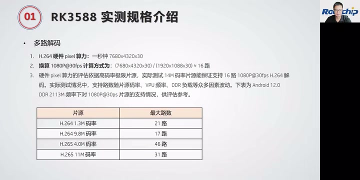

*多路解码实测页：Android 12.0、DDR 2113M 下，不同码率片源对应的最大路数。表格 1.3M 行显示 21 路。 · [原片 03:00](https://www.bilibili.com/video/BV19U4y1673R/?t=180)*

这些测试是在 DDR 最高频率下测的。CPU 消耗不大，主要是 DDR；我们测试时 DDR 跑在 2113 兆。

多路编码的话，H.264、1080P、30 帧、4 兆码率，最大可以支持 11 路；H.264、1080P、30 帧、10 兆，最多支持 7 路同时编码。编码测试因为输入无法保证为 DMA buffer，大部分情况下，还是要拷贝一次再送 VPU。这里再说一下：编码测试的输入无法保证为 DMA buffer，大部分情况下需要拷贝一次送 VPU，因此多路编解码的实际路数，会小于上述按硬件像素算力换算的路数。

## 04:02 编码数据与七路异显

刚刚说的是我们实测的数据。在 RK3588、Android 12、YUV420 的情况下，H.264、1080P、4 兆码率最大支持 11 路，10 兆码率支持 7 路。

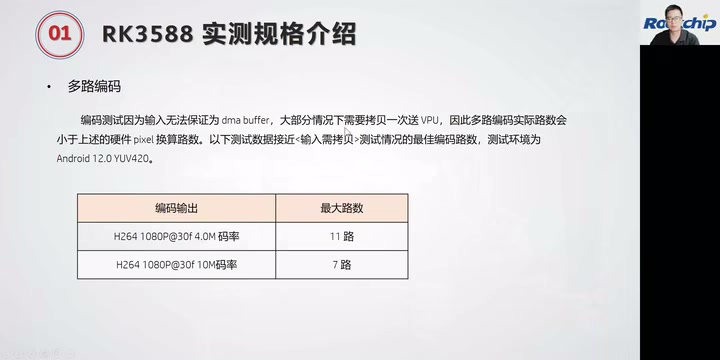

*多路编码表：H.264 1080P@30fps，4.0M 为 11 路、10M 为 7 路；测试环境 Android 12.0 YUV420。 · [原片 04:42](https://www.bilibili.com/video/BV19U4y1673R/?t=282)*

然后是多屏异显。大家知道 RK3588 在显示部分非常强大，最多可以支持 7 路异显。我们的 VOP 支持 Split 模式，可以把左右半屏的数据，同时输出到同一类型的两个显示接口上。可以看这个图：这是一个 VOP 输出，比如这里的长和宽，是两倍的宽；通过 VOP 的 Split 模式分屏，可以把它分成两个，对半分，把这两部分分别送到我们的显示接口，比如 DP0、DP1，或者 MIPI0、MIPI1，送到同一个类型。但是，这个屏的类型要是同一种类型的两个显示接口。

利用 RK3588 的 VOP Split 模式，最多可以支持七屏异显。这边就是我们七屏异显的一个连接方案。

> 整理注：317–347 秒原转写出现机械重复，正文按该区段局部恢复转写补回；DP0/DP1 及后文 HDMI/eDP 等接口同时参照画面确认。

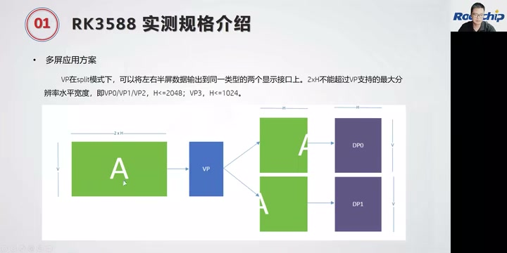

*VP 的 Split 模式示意：左右半屏分别输出到同类型两个显示接口，画面示例为 DP0、DP1。 · [原片 05:42](https://www.bilibili.com/video/BV19U4y1673R/?t=342)*

我们 VP0、VP1 这两路，VP0 接两路 1080P，通过 Split 模式，分别输出给两个 HDMI 或者两个 eDP。那 VP1 呢——

## 06:03 七屏接口分配与 USB/Type-C 注意事项

也是通过 Split 模式，可以同时输出两路 1080P 数据，分别接到两个 DP。VP2 也是两路 1080P，分别送给两路 MIPI。VP3 接一路 1080P，它可以输出到的接口是 BT1120 和 BT656，这样就组成一个七屏异显。

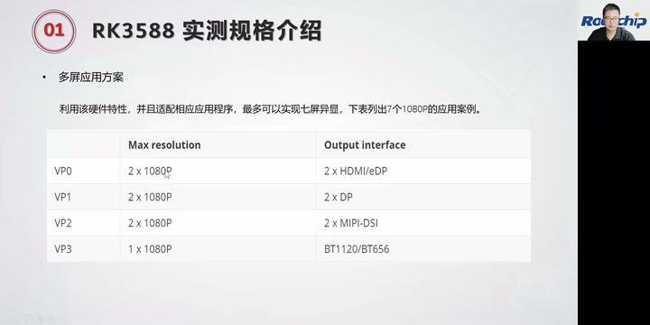

*七路 1080P 异显分配：VP0 对应 HDMI/eDP，VP1 对应 DP，VP2 对应 MIPI-DSI，VP3 对应 BT1120/BT656。 · [原片 06:42](https://www.bilibili.com/video/BV19U4y1673R/?t=402)*

另外是 USB 部分。RK3588 的 USB 有一些注意事项，在这里给大家介绍一下。RK3588 有两路 Type-C 接口，我们一般称为 Type-C0 和 Type-C1。RK3588S 只有一路 Type-C，也就是只有 Type-C0，没有 Type-C1。Type-C0 和 Type-C1 都是 OTG 口，都能够支持 device 和 host 的功能。但是只有 Type-C0 支持固件烧写，所以大家做硬件设计时，固件烧写接口一定要用 Type-C0 来做。优先选用 Type-C0：如果你只想要一个 Type-C，就优先用 Type-C0 作为 OTG 口。

第二个是 Type-C 支持 USB 3.0、DP、PD 充电等多个功能。如果只需要 USB 3.0 或 DP 单独某一个功能，接口就可以根据用户需求，设计成任意形式。如果需要组合功能，一般会设计成 Type-C 标准接口的形式。而且 Type-C 要接一个外挂的 CC 芯片，目前我们支持的 CC 芯片有 FUSB302 和 HUSB311。

## 08:04 Type-C 功能组合与 USB 接口拆分

这是我们目前调过的 CC 芯片。如果要 PD 快充，还是要外挂一个充电 IC。

Type-C 口可以支持以下几种功能组合：USB 2.0 OTG、USB 3.0 OTG、DP、USB 2.0 OTG 加上 4 lane 的 DP，或者 USB 3.0 OTG 再加上 2 lane 的 DP，这是它的组合。

RK3588 有一个和 PCIe、SATA 复用的 USB 3.0 接口。这个接口只有 USB 3.0 的功能，所以一般不单独使用，一般跟另外一个 USB 2.0 口组成一个完整的 3.0 接口。大家一定要注意：这个跟 PCIe 和 SATA 复用的 USB 3 接口，只有 USB 3.0 的功能。

一个 USB 3.0 接口作为 host 时，可以拆分成 2.0 和 3.0 部分，分别接一个 U2 和 U3 设备，也就是 USB 2.0 和 USB 3.0 设备。但是不能把一个 USB 3.0 拆分出来的 2.0 部分和 3.0 部分，一个用作 device，一个用作 host。要么两个都是 device，要么都是 host，不能分别一个 host、一个 device。

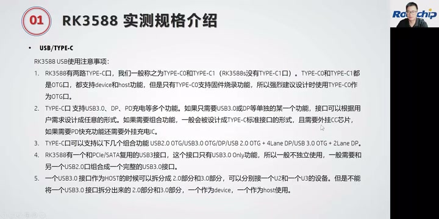

*USB/Type-C 使用注意事项，包含 OTG、功能组合、PCIe/SATA 复用 USB 3.0 及 host 拆分约束。 · [原片 08:44](https://www.bilibili.com/video/BV19U4y1673R/?t=524)*

再看 USB 3.0 的最大传输速率。这是我们测出的数据。USB 3.1 接口，时钟是 5G，理论值可以达到 500 兆，我们实测是 385 兆。

## 10:08 USB、PCIe、SATA 传输速率与测试限制

USB 2.0 的 clock 是 480 兆，理论速度可以达到 60 兆，但是实测是 37 兆。

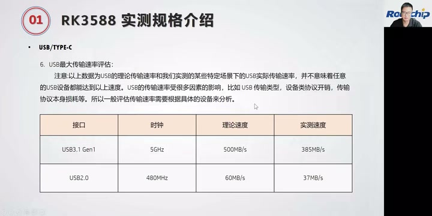

*USB 实测速率页：USB 3.1 Gen1 为 385MB/s，USB 2.0 为 37MB/s，并提醒测试依赖设备及传输场景。 · [原片 11:24](https://www.bilibili.com/video/BV19U4y1673R/?t=684)*

> 整理注：上文速率数字对应投屏的 USB 3.1 Gen1 理论 500MB/s、实测 385MB/s；USB 2.0 理论 60MB/s、实测 37MB/s。冻结转写将口述单位识别成“兆 bit”，此处展示原投屏单位供核对。

以上数据是我们在特定场景下实测的 USB 实际传输速率，并不意味着任意 USB 设备都能达到以上速率。USB 传输速度受到很多因素影响，比如 USB 传输类型、设备协议开销、传输协议本身的损耗等等。所以一般评估传输速率，需要根据具体设备分析。我们这边是在我们的 EVB 板上测试的。

另外是 PCIe 和 SATA。PCIe 的最大传输速率，理论值可以达到 3.8G，我们实测是 3G。PCIe 2.0 的时钟是 5G，理论速率可以达到 500 兆，实测达到 380 兆。SATA 3.0 的时钟是 6G，理论速度可以达到 600 兆，实际测试速率达到 550 兆每秒。

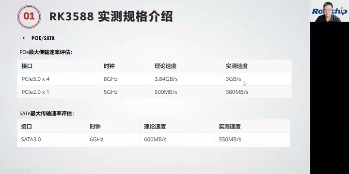

*PCIe/SATA 传输速率表，显示接口代次、lane 数、时钟及理论和实测速度。 · [原片 12:04](https://www.bilibili.com/video/BV19U4y1673R/?t=724)*

> 整理注：投屏逐项标为 PCIe 3.0 ×4、8GHz、理论 3.84GB/s、实测 3GB/s；PCIe 2.0 ×1、5GHz、理论 500MB/s、实测 380MB/s；SATA 3.0、6GHz、理论 600MB/s、实测 550MB/s。保留讲者的概数，并列投屏准确写法，不把冻结转写中的 bit 当作图表单位。

RK3588 的 camera 部分，接口有两个 ISP，还有 MIPI CSI，还有 DVP。然后我们 RK3588 最大——

## 12:10 Camera 数量、像素与七路典型接法

RK3588 最多可以支持 7 个 camera。RK3588S 会少一点，最多可以支持 5 个 camera。

这里列到了 RK3588S 和 RK3588：最大可以支持一个 48 兆，也就是 4800 万像素的 camera，这里是 15 帧。如果是 3200 万像素，帧率可以到 30 帧。还可以同时支持两个 1600 万像素、30 帧的 camera，以及 4 个 800 万像素、30 帧。RK3588S 最大可以支持 5 个 4 兆，也就是 400 万像素、30 帧的 camera 数据处理；RK3588 最多可以支持 7 个 400 万像素、30 帧的 camera。

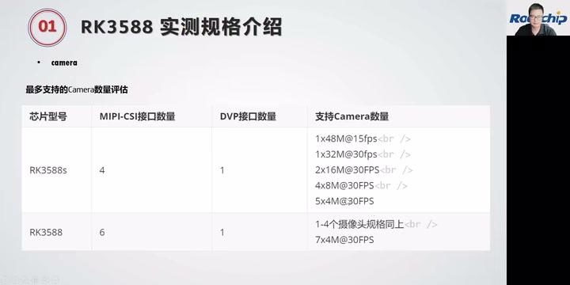

*Camera 支持表：RK3588S 的 4 路 MIPI-CSI 加 1 路 DVP，RK3588 的 6 路 MIPI-CSI 加 1 路 DVP，以及对应像素和帧率组合。 · [原片 13:09](https://www.bilibili.com/video/BV19U4y1673R/?t=789)*

这是 RK3588 的 7 个 camera 的一个典型接法。我们有 camera0、camera1、camera2、camera3、camera4、camera5，这 6 个是 MIPI camera，再加一个 DVP camera，就是从 rkcif 这条通路过来，组成 7 路 camera。这是每一路 camera 的通路。

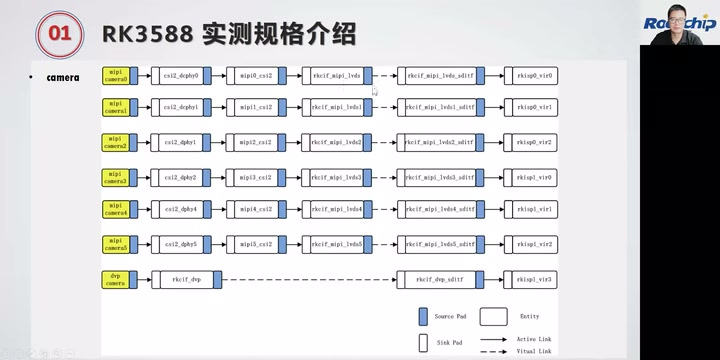

*七路 Camera 典型连接：上方六路 MIPI 摄像头与下方一路 DVP 摄像头，各自经过对应的软件通路。 · [原片 14:45](https://www.bilibili.com/video/BV19U4y1673R/?t=885)*

软件 DTS 配置就以这些名字来配，这里是 CSI D-PHY、CSI，还有 rkcif，就按照这个通路来配。我们 DTS 里提供了对应的参考配置。

> 整理注：此处节点缩写原转写不清，依据画面确认 CSI/D-PHY、rkcif；图中文字较小，具体 DTS 节点全名应参看源图及对应 SDK，不把模糊缩写补造成一份可执行配置。

上面讲的，是我们常用的 RK3588 一些性能的实测数据。

## 14:22 八大使用场景与 Android SDK 的 lunch

RK3588 主要有这八大使用场景。一个是平板，RK3588、RK3588S 作为消费类平板；另外是 ARM PC、智慧大屏，像一体机、最近比较火的教学一体机；还有多目摄像头、高性能的边缘计算、智能 NVR，还有 VR 和 AR 产品，以及智能座舱。智能座舱，也就是车载部分，是我们重点在推的一个产品线。

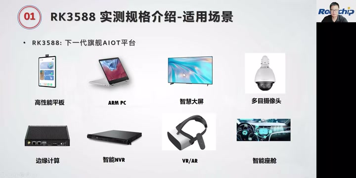

*八大适用场景页：高性能平板、ARM PC、智慧大屏、多目摄像头、边缘计算、智能 NVR、VR/AR、智能座舱。 · [原片 15:33](https://www.bilibili.com/video/BV19U4y1673R/?t=933)*

以上简单介绍了 RK3588。下面给大家介绍一下我们 RK3588 Android SDK 开发的一些东西。

首先介绍一下 Android 上 device 下面的 lunch，以及如何新建自己的产品。这里看一下 Android 上 device 的结构、device 的一些说明，以及如何新建自己的产品目录，也就是添加一个新的 lunch。

RK3588 Android SDK 在编译时，需要先 lunch，选择产品。lunch 会根据不同产品配置对应参数。所以大家做自己的产品开发，最好新建一个自己的产品目录，也就是自己的 lunch。这样就可以用一套代码开发不同产品，然后——

## 16:25 device 分层和各类产品目录

产品上面的差异，都在自己的产品 device 下面做一些差异化配置。

这里介绍一下 RK3588 的 device 结构。通用部分，`device/rockchip/common` 是 Rockchip 平台的一些通用配置。`device/rockchip/rk3588` 里面，是 RK3588 芯片平台的配置，可以配置芯片信息，以及芯片特有的一些模块。

下面是具体产品。这里区分了 RK3588 和 RK3588S。一个主要是我们的 EVB 板，大家可以用这个产品去做行业应用类的产品。另外一个主要给 RK3588S 的平板类产品，或者一些带电池的设备。`rk3588-box` 主要是电视类产品；`rk3588-XR` 主要是 RK3588S 的 AR、VR 产品。

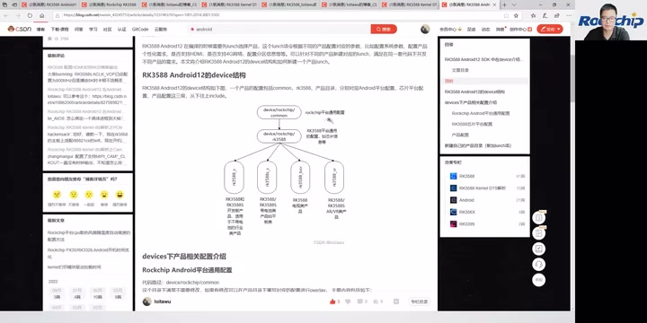

*讲者打开 Android 12 的 device 结构文章，展示通用平台、RK3588 芯片平台及多个产品目录的继承关系。 · [原片 17:36](https://www.bilibili.com/video/BV19U4y1673R/?t=1056)*

> 整理注：原转写将几个产品目录的 s、下划线、连字符混识，源画面又只有 720×360，图中最小的后缀不足以逐字可靠辨认。这里保留讲者对 EVB/行业、平板/电池、box、XR 的用途说明；实际新建目录时，以当时 SDK 目录为准，不把模糊后缀当作可复制命令。

再介绍一下 Rockchip Android 平台通用配置，主要在 common 下面。这里面有一个编译脚本，在 build 下面，是我们编译、打包用的脚本。大家编译时，可以用 `build.sh` 来编译，里面集成了一些编译命令，可以实现一键编译。这是我们推荐的编译方式：用这个脚本来编。

## 18:26 通用配置、芯片配置与 kernel 版本

这里面还包含一些 fstab，就是分区表的一些信息、工具。我们的分区表都是自动生成的，`parameter_tools`，parameter 就是分区表；配置或者它自动生成的编译，都在这里面。

然后是一些 init 服务，我们 RK 平台的服务都在这里面，这是 init.rc。还有 sepolicy，是权限部分的一些配置。

`device.mk` 主要是平台相关配置，比如编译选项，在这里可以控制编译哪个模块、编译哪些 app 等。`BoardConfig.mk` 是平台默认的一些产品属性配置，以及平台功能的一些宏定义，都在这里面配置。

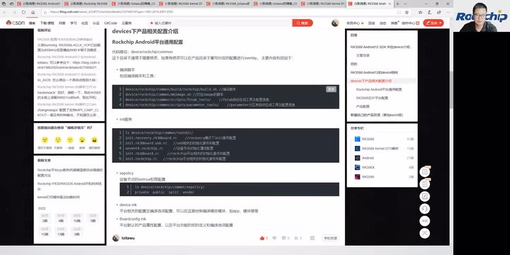

*Rockchip Android 平台通用配置页面，包含编译工具、init、sepolicy、device.mk 和 BoardConfig.mk 的说明。 · [原片 19:24](https://www.bilibili.com/video/BV19U4y1673R/?t=1164)*

RK3588 芯片平台，也就是 RK3588 特有的配置，在 `device/rockchip/rk3588` 里面。这里会配置芯片的信息：这是 ARM64、ARMv8 架构，支持 64 位和 32 位，然后配置 Mali，以及 kernel 版本。

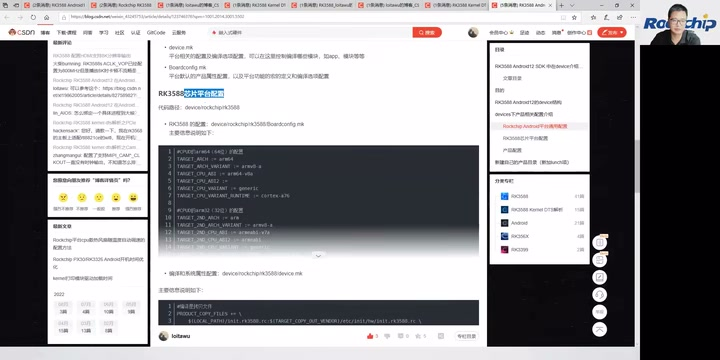

*RK3588 芯片平台配置代码示例；源视频分辨率限制了细小代码与版本值的辨读。 · [原片 20:24](https://www.bilibili.com/video/BV19U4y1673R/?t=1224)*

为什么这里配置一个 kernel 版本？因为 Android 12 支持一些老芯片和新芯片。比如老芯片 356X、3326、3399，这些都有升级到 Android 12；我们的 RK3588 也是 Android 12，但是它们的 kernel 版本不一样。目前，除了 RK3588 用的版本以外，其他都使用 4.19，所以这里做一些区分。

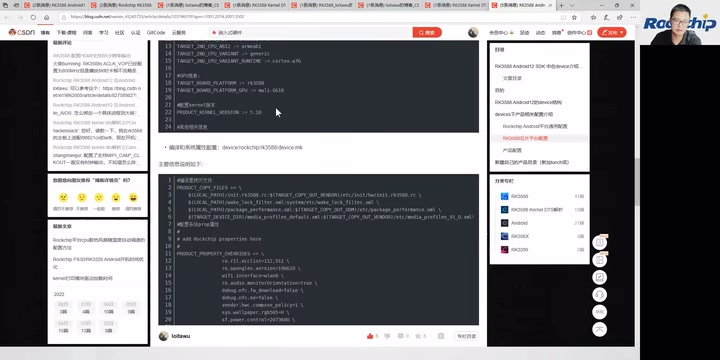

*芯片 BoardConfig 代码的 kernel 配置行，现场页面显示 PRODUCT\_KERNEL\_VERSION := 5.10。 · [原片 21:04](https://www.bilibili.com/video/BV19U4y1673R/?t=1264)*

> 整理注：1215–1217 秒冻结转写和局部恢复转写均识别为“5.0”，口述识别存在歧义；滞后显示的代码行 PRODUCT_KERNEL_VERSION := 5.10 给出配置示例的版本。保留 Android 12、老芯片例子及其他平台使用 4.19 的讲述口径，区分口述识别与屏幕配置证据。

还有，这里是一些——

## 20:29 文件拷贝、产品级配置与新建 lunch

RK3588 的 `device.mk` 里面会做一些文件拷贝。大家编译时要拷贝一些配置文件，可以在这里做拷贝，还有系统属性这些。

这些产品目录下面，还会区分每个子产品的目录，比如 RK3588、RK3588S、box、VR。下面就是每个产品具体的配置信息，是产品级配置。这里的 `BoardConfig` 也是产品信息，比如你要不要 A/B，还有 sensor，以及配置是否支持 USB Camera，这些都在这里配置。

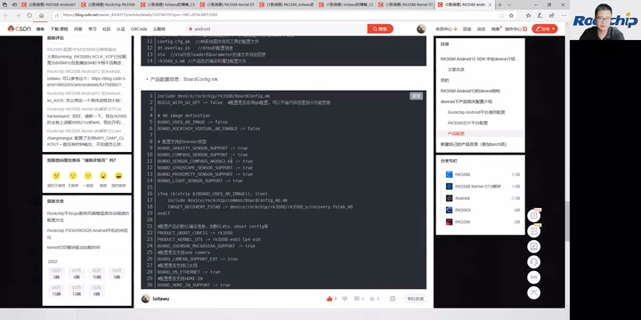

*产品级 BoardConfig 配置示例，涉及产品功能开关；源分辨率下最小字段不宜直接抄录为可执行配置。 · [原片 22:16](https://www.bilibili.com/video/BV19U4y1673R/?t=1336)*

下面介绍一下如何新建自己的 lunch。新建 lunch 其实很简单，先看你的产品类型。如果你是平板类型、消费电子类型、带电池的设备，就直接把对应 RK3588S 平板产品的目录复制一份，再重命名为你自己产品的名字。并且，把这个目录下面所有原产品的字段，全部替换成你自己的产品字段，就可以了。这就是新建 lunch 的介绍。

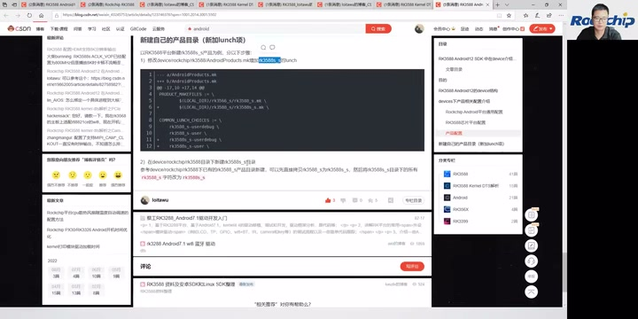

*新建产品 lunch 的页面：复制参考产品目录、重命名，并替换原产品字段。 · [原片 22:52](https://www.bilibili.com/video/BV19U4y1673R/?t=1372)*

> 整理注：源转写的目录后缀不稳定，截图保留现场目录与替换示例；这里只按可确定的产品类型与操作步骤整理。sensor 由相邻 BoardConfig 的多项传感器功能开关校读。

下面再介绍一下 RK3588 开发的 DTS。首先介绍 DTS 架构。大家开发过程中用得比较多的，就是 DTS 配置。我们的 RK3588 DTS 架构是这样子的——

## 22:31 DTS 的芯片层、EVB 层与系统层

这是一个架构图。这里是 RK3588、RK3588S，我们的核心是 RK3588S。大家知道 RK3588 和 RK3588S 的功能差不多，只是 RK3588 比 RK3588S 的功能多一些。所以，`rk3588s.dtsi` 配置 RK3588 和 RK3588S 公共的芯片信息；`rk3588.dtsi` 配置 RK3588 相较于 RK3588S 差异的信息。这两个都是芯片级配置。

我们这里的 EVB 板，`rk3588-evb.dtsi` 放的是 EVB 的配置。因为内部做了好几款 EVB，功能大致一样，但会有一点差异。我们要验证不同模块，所以做了不同板子；每个板子重点验证的模块不一样。所以，会把 EVB 板子的公共部分，都放到 `rk3588-evb.dtsi` 里面。

下面是 EVB1 这块具体板子。RK3588 EVB1 就是我们公开售卖的 RK3588 EVB 板。大家如果拿到这个板子，可以看到用到的 DTSI 就是这里这个；具体用到的 DTS 在下面。

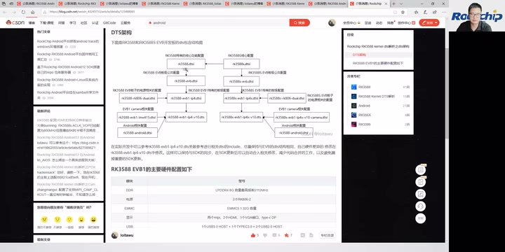

*DTS 架构图，展示 RK3588S 公共芯片层、RK3588 差异层、EVB 公共层、具体板级及 Android/Linux 分支。 · [原片 24:16](https://www.bilibili.com/video/BV19U4y1673R/?t=1456)*

因为要兼容 Android 和 Linux，它们有一些配置不一样。核心部分都在 DTSI 这里。默认没有后缀的是 Android；如果是 Linux，这里会带一个 linux。

> 整理注：架构图中的板级文件名还带板号、版本等后缀，源图细字有限。上文保留芯片公共层、差异层、EVB 公共层、具体板级与系统级的解释，不凭模糊图像补写完整板级文件名。

## 24:31 Camera、Android 和电源配置的包含关系

这个 DTS 里面，会包含 EVB1 的 camera 配置 DTSI。Android 相关配置是 `rk3588-android.dtsi`，这是跟 Linux 的差别。

这里还有一个比较重要的 `rk3588-rk806-dual.dtsi`，是电源部分的相关配置。如果你的硬件设计都是参考我们的硬件设计，这部分基本不用改，这部分基本不用改。我后面也会给大家讲电源部分要怎么配。

我们的电源方案有两种：一种用两个 RK806，称为双 PMIC 方案；另外一种用一个 RK806，再加三个 RK860 的 DC/DC，称为单 PMIC 方案。这两个配置有一点不一样，所以大家硬件设计时，要看清楚用的是单 PMIC 还是双 PMIC。

> 整理注：本段 DC/DC 的 RK860 型号在转写中缺少可核定的后缀，先保留识别出的型号范围，后续按讲者展开的电源配置核对；不把它扩写成未经辨清的具体器件料号。

这边是 RK3588S 的 DTS 架构，它其实跟 RK3588 一样。大家实际开发时，可以参考我们的 RK3588 EVB1。建议直接 include 这个 DTSI：如果你们的参考设计跟我们的 EVB 板差不多，就直接包含 EVB1 的参考 DTSI，然后把这里改成你们自己的 DTS，把差异部分放到自己的 DTS 里面修改。

> 整理注：本段口述的 EVB1 Camera 配置与板级 DTSI 完整文件名，冻结转写存在字符错识，现场架构图见前图，保留包含关系与修改步骤，不把不清的板号/版本后缀当作确切路径。

## 26:31 为什么继承参考 DTSI，以及 EVB1 硬件配置

这样，在我们进行代码更新时，你们比较容易更新到我们 DTS 部分的修改，不会把我们的 DTS 修改漏掉。

这是 RK3588 EVB1 的硬件配置：用的是 LPDDR4、8G 的 DDR，最高频率是 2112 兆；用双 PMIC，两个 RK806；32G eMMC。显示接口有两个 MIPI、两个 HDMI，一个 VGA，还有一个 Type-C 的 DP。

USB 部分，有一个 USB 3.0 host，加一个 Type-C 3.0，另外加两个 USB 2.0 host。还有一个 SATA 接口、一个 HDMI RX。camera 有两个 4 lane 的 MIPI D-PHY TX；以太网是一个 RJ45，加一个 PCIe 的 RJ45，一个 PCIe 接口的。

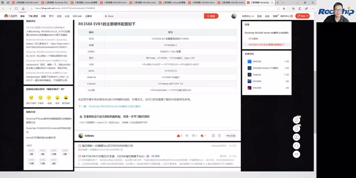

*RK3588 EVB1 主要硬件配置表，列出 DDR、双 PMIC、eMMC、显示、USB、SATA、HDMI RX、Camera 和以太网。 · [原片 28:19](https://www.bilibili.com/video/BV19U4y1673R/?t=1699)*

> 整理注：硬件介绍保留讲者当时的接口与方向口径；MIPI D-PHY TX 由现场硬件配置表所示，不能按摄像头方向常识静默改成 RX。RJ45 的第二路为 PCIe 扩展，以现场表格为核对依据。

这就是开发板的 DTS 架构。下面再介绍怎么建自己的 DTS。建议大家根据自己的硬件设计，直接复制一份我们现有的 DTS。我们的开发板是 EVB1，前面已经介绍了：如果你的硬件配置跟 EVB1 类似，用的是双 PMIC，我建议就参考这个 RK3588 EVB1 的 DTS。那我们现在主要的参考设计——

## 28:34 单 PMIC 的 IoT 参考设计

我们现在主推的都是单 PMIC。你们拿到的应该是这个硬件参考设计，它是单 PMIC，对应软件 DTS 配置是 `rk3588-evb7-lp4-v10` 这个参考 DTS，跟我们发布的 RK3588-IoT 参考设计相匹配。如果你的硬件按我们的参考设计来做，开发时就以这个为基础。

它主要是单 PMIC：一个 RK806，加三个 RK860 DC/DC。DDR 是 LP4、200 球。然后是一个 Type-C 加一个 USB 3.0、两个 USB 2.0，以及一个 SATA 3.0 接口。两个 HDMI 2.1 TX、一个 HDMI 2.0 RX，还有 VGA，以及 SDIO 的 Wi-Fi。

我们的 EVB1，Wi-Fi 用的是 PCIe 接口的 Wi-Fi 6；EVB7 用的是 SDIO 接口。另外还有一个 4 lane 的标准 PCIe 3.0 接口、两个 4 lane 的 MIPI CSI 接口，也就是两个 4 lane 的 MIPI D-PHY RX，接 camera；还有一个 4 lane 的 MIPI D-PHY TX，是接屏的。

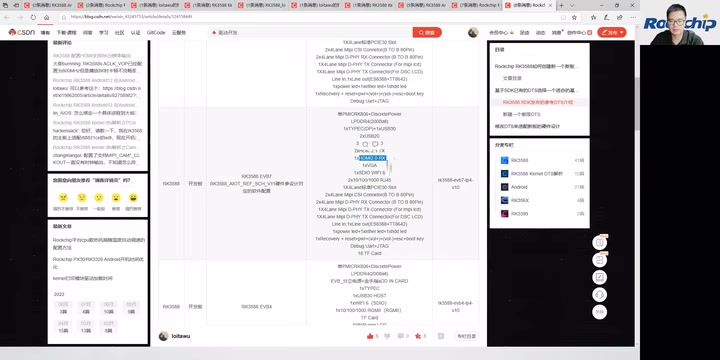

*参考 DTS 选择表中的 RK3588 EVB7 / RK3588-IoT 参考设计，展示单 PMIC、LPDDR4 与接口组合。 · [原片 31:10](https://www.bilibili.com/video/BV19U4y1673R/?t=1870)*

> 整理注：此段接口缩写多处被识别成“SPMI”“私人的米P”等，按现场参考设计表及“camera/屏”的连续讲解校读 HDMI、4 lane、MIPI D-PHY。原段对 RX/TX 出现回绕，正文保留先 camera、后屏的顺序；细小 DTS 完整后缀见截图，不把不清字段变成复制命令。

## 30:37 其他参考 DTS：早期 EVB、NVR 和平板

Codec 用的是 ES8388。我们这里还有电源灯这些，另外是按键。

> 整理注：电源灯一词依据 1800–1860 秒局部恢复转写校读，修复原转写“楼一炮电灯”。恢复尾部出现与课程无关的字幕署名幻觉，不作为讲述内容。

这是我们的参考 DTS。EVB4 这个 DTS 也是单 PMIC，是比较早发布的一个 DTS。有些同学开发时可能参考的是这个 DTS，这个也是单 PMIC，也是可以的。EVB2 这块板子，目前没有在售卖。

NVR 的话，参考 DTS 是 `rk3588-nvr-demo-v10`，这个 DTS 是 NVR 的一款。

RK3588S 的开发板用的是 RK3588S EVB1。这也是我们公开售卖的 RK3588S EVB，屏用的是 eDP，也是双 PMIC。屏是 eDP，其他配置跟 RK3588 的 EVB 一样，这里还有一个 CAN 接口。

> 整理注：RK3588S、eDP、双 PMIC、比较 RK3588 EVB，以及 CAN 接口，依据 1900–1940 秒局部恢复转写校读；原转写 cam/camera 片段按补证确认为 CAN 接口。

然后这个是平板的 `rk3588s-tablet-v10`。平板是双 PMIC，而且带电池。如果你有带电池的产品，可以参考这个 DTS，这个是双 PMIC；后面 V11 是单 PMIC，V11 这个是单 PMIC。

## 32:39 在自己的 DTS 中改硬件差异

其他部分跟 V10 一样，只有 PMIC、电源部分不一样。所以大家选择时，可以根据自己的硬件设计，选择对应的参考 DTS。

新建 DTS，可以直接 include 我们的 DTSI。比如你要参考我们 EVB1、LP4 的 DTSI，就直接 include。在这里 include 你要参考的 DTS，还有 camera 部分、Android 的配置，这些是要 include 的。

然后根据自己板子的硬件差异，在自己的 DTS 里面修改。比如可以改一下背光 GPIO，因为可能用得不一样。还有触摸屏，如果你的触摸屏不一样，可以把我们 EVB 的触摸屏 disable 掉，再在自己的 DTS 添加自己的触摸屏配置。这就是新建一个 DTS。

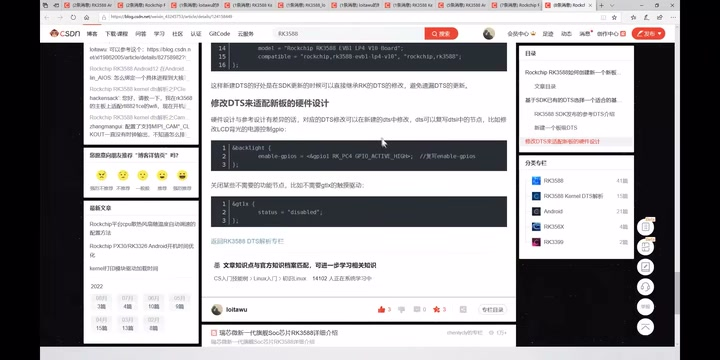

*新板 DTS 的差异修改示例：背光 GPIO 配置以及 disable 原触摸屏节点。 · [原片 35:01](https://www.bilibili.com/video/BV19U4y1673R/?t=2101)*

> 整理注：示例板级 DTSI 的完整版本后缀在冻结转写中不稳定，截图显示其 include 结构。保留“参考板级 / camera / Android 配置 + 自己修改差异”的操作次序，不凭缩写拼造文件路径。

这里再给大家介绍电源部分。主要就是单 PMIC 和双 PMIC，我们现在主推的都是单 PMIC。单 PMIC 方案，一个 RK806 加三个 RK860 DC/DC；双 PMIC 是两个 RK806。

## 34:40 单双 PMIC 不兼容与 U-Boot 保护

单 PMIC 和双 PMIC 在软件上不兼容，大家开发时要注意：软件配置要跟你的硬件设计一致，否则会起不来。

因为这两个相互不兼容，固件如果烧错，有可能损坏芯片。所以为了保护，我们在 U-Boot 阶段做了一个拦截：会检测你当前是双 PMIC 还是单 PMIC。如果配置错，就会打印这个 log，不让你启动，开机失败。大家如果看到这个 log，就去检查是不是 PMIC，也就是电源部分的单双 PMIC 配置错了。

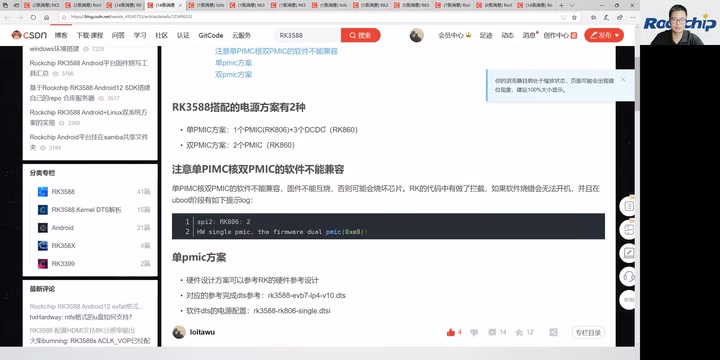

*单双 PMIC 不兼容说明及 U-Boot 阶段保护日志；下方列出单 PMIC 的参考 DTS 与 single 电源 DTSI。 · [原片 36:25](https://www.bilibili.com/video/BV19U4y1673R/?t=2185)*

屏幕日志示例为 `spi2: RK806: 2`，以及 `HW single pmic, the firmware dual pmic(0x8)!`。

单 PMIC 的话，我们在 DTS 里面 include 的是 `rk3588-rk806-single.dtsi`，电源部分配置都在这里。另外，还要配置一下 DC/DC 的配置。

这里上面的接口配置，原局部音频转写对 SPI 与 I²C 缩写识别不稳定；现场代码显示，PMIC RK806 在 SPI2 上，外接 DC/DC 在 I²C 节点下，相关配置写在 DTS 里面。这三个 DC/DC 分别给 CPU big0、CPU big1，还有 NPU 供电。CPU big1 就是 CPU 6 和 7，另一路给 NPU 供电；这里用到了 RK860-2、RK860-3。

> 整理注：2163 秒起原转写出现 DCDC 机械回环。已比较 2140–2215、2153–2185 的恢复转写及独立 small 转写，恢复了接口配置、DTS 和 CPU big0 供电的意思；具体 SPI/I²C 缩写依据实际代码核对，不把不清的一句伪装成准确引语。CPU big0 后面的具体核号口述未可靠恢复；截图注释指向 CPU4–5，属于图像证据。CPU big1 的 6、7 及 NPU 供电由较长恢复片段明确提供。原 RK806-2/3 的错识按图中 DC/DC 型号 RK860-2/3 校读。

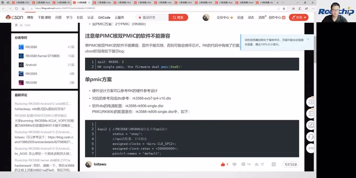

*单 PMIC 方案的电源 DTSI 与 SPI2 配置代码开始部分。 · [原片 36:43](https://www.bilibili.com/video/BV19U4y1673R/?t=2203)*

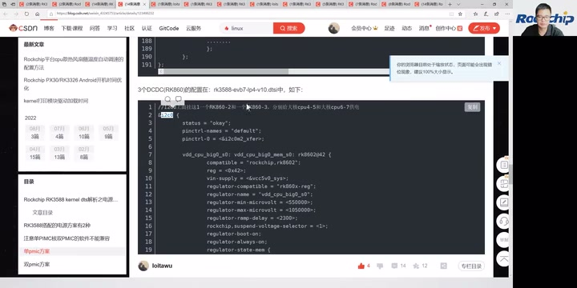

*三个 DC/DC 的配置示例：I²C 节点下的 RK860-2、RK860-3；当前代码显示 CPU big0，图注标出 CPU4–5 和 CPU6–7 的供电分配。 · [原片 38:18](https://www.bilibili.com/video/BV19U4y1673R/?t=2298)*

## 36:42 I²C 地址、外部供电和频点检查

我们把另外一路用 RK860-3，主要差别是 I²C 地址不一样，其他都是一样的。因为同一条 I²C 下面，不能挂两个 I²C 地址一样的器件，所以用了两个不同 I²C 地址的版本。

> 整理注：冻结转写在上一窗末尾和本窗开头将 DC/DC 型号识别为 RK806-2 / RK806-3；现场 DC/DC 代码显示 RK860-2、RK860-3。这里区分 SPI 上的 RK806 PMIC 与 I²C 上的 RK860 DC/DC，上一窗已经结合局部恢复与图中注释保留电源分配；CPU big0 核号的来源限制见上一窗整理注。

另外是外部电源配置。外部电源，是指 PMIC 依赖的电源。在 DTS 配置时，这些电源的配置要在 PMIC 配置前面，这样开机时才能正常初始化。也就是说，我们 PMIC 的电源依赖于外部电源，比如 VCC 12V、VCC 5V，这些都要在比较前面初始化。

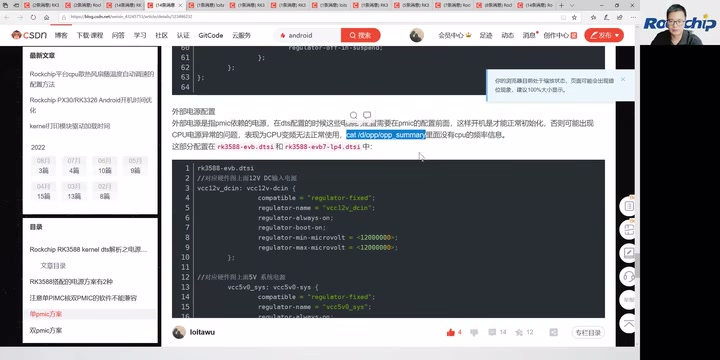

*外部电源配置说明，包含先于 PMIC 初始化的依赖关系、opp\_summary 检查提示和 VCC12V/VCC5V 的示例。 · [原片 40:18](https://www.bilibili.com/video/BV19U4y1673R/?t=2418)*

如果这些电源初始化有异常，CPU、GPU、NPU 这些可能都会有异常。我们可以通过 `cat /d/opp/opp_summary`，来看相关 CPU、GPU、DDR、NPU 的频点有没有出来。如果没出来，可能就是电源配置或者初始化有问题。

双 PMIC 的话，它的电源配置在 `rk3588-rk806-dual.dtsi` 配置文件里，这是电源部分比较容易出错的地方。

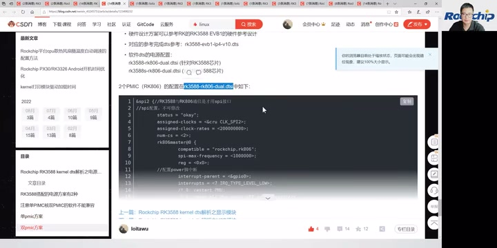

*双 PMIC 配置页，明确显示 rk3588-rk806-dual.dtsi 及 SPI 上 RK806 的配置。 · [原片 40:46](https://www.bilibili.com/video/BV19U4y1673R/?t=2446)*

> 整理注：2306–2309 秒原转写出现机械碎词，局部恢复仍未可靠识别后缀；完整文件名由随后可读的双 PMIC 配置页确认为 dual，并非依据“干6”等 ASR 字符猜写。

## 38:43 从启动 log 看 DDR 与 SPL

这是我们 DTS 的介绍。下面再介绍 RK3588 的启动流程，看一下开机 log，根据 log 来分析启动流程。

这是一份 RK3588 的开机 log。首先，开机的第一条是 DDR，也就是我们最先启动的是 DDR。这里能看到 DDR 的软件版本，这个是 1.07。大家看版本时，可以看到 DDR 的版本。

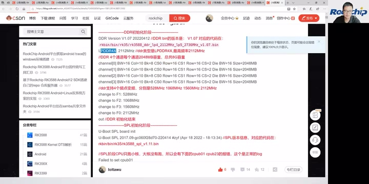

*DDR 初始化 log：V1.07、LPDDR4X、4通道每通道2GB，以及528/1068/1560/2112MHz四个频点。 · [原片 42:06](https://www.bilibili.com/video/BV19U4y1673R/?t=2526)*

DDR 对应的文件，在我们代码的 `rkbin` 下面，bin 目录的 RK3588 DDR 文件；跑的就是这一段。屏幕给出的文件为 `rkbin/bin/rk35/rk3588_ddr_lp4_2112MHz_lp5_2736MHz_v1.07.bin`。下面是 DDR 初始化，能看到 DDR 类型和最高频率。DDR 是 4 个通道，每个通道 2G，这是 8G 容量。它支持 4 个频点，它支持 4 个频点：528、1068、1560，最高 2112。到这里，DDR 初始化结束。

DDR 初始化结束、DDR 跑完，就跑 SPL。SPL 在我们的 loader 里面，这里是它对应的代码、bin 文件以及源文件位置，屏幕对应 `rkbin/bin/rk35/rk3588_spl_v1.11.bin`。这里能看到 SPL 版本。SPL 只跑小核，大核没有跑。所以在开机 log 的时候，我们看到这两个 log——

> 整理注：本视频中投屏落后于口述，配图采用实际 log 出现的源时间。画面显示 LPDDR4X、2112MHz、DDR 版本 V1.07，以及 528/1068/1560/2112MHz 四频点。文件版本后缀还包含频率及多平台信息，不凭模糊转写拼造可复制路径。

## 40:43 启动介质优先级与加载 U-Boot、Trust

这两条 `Failed to set cpu01`、`Failed to set cpu23` 的 log，大家可以忽略。芯片启动时，先从 SPI 存储里面查找固件。如果那里没有固件，就跳到下一级，也就是 SD 卡，再从 SD 卡查找固件。引导的最高优先级是 SPI，然后是 SD 卡，SD 卡之后才从 eMMC 里面加载。也就是说，如果你插了 SD 卡，而且 SD 卡有固件，就优先从 SD 卡启动。

这些在 log 里都能看出来。这里没有接 SD 卡，所以 SD 卡初始化报错；前面都没有找到，就开始从 eMMC 加载固件。这里的 MMC 就是 eMMC。

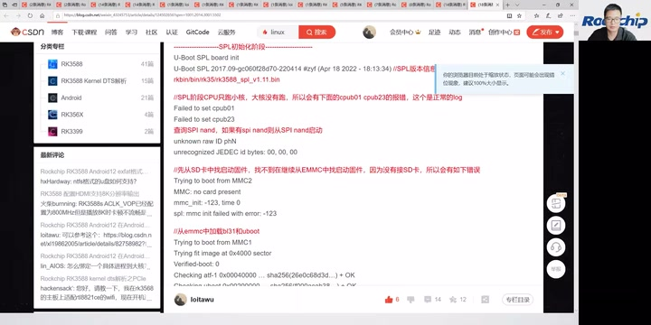

*SPL 正常的小核阶段提示，以及 SPI、SD 卡查询与 SD 卡未插入的初始化错误。 · [原片 43:06](https://www.bilibili.com/video/BV19U4y1673R/?t=2586)*

> 整理注：开头一句冻结及恢复转写均为“可以不用忽略这个 log”，口语有歧义；结合前句只运行小核与画面明确标注“正常的log”，正文按可忽略这些正常提示整理。口述 SPI 类型在原转写中不清，局部恢复的发音近 SPI NOR；现场页面注释写“查询 SPI nand”，并有 `unknown raw ID`、`unrecognized JEDEC id bytes` 等日志。不能把不清的口述直接扩成唯一确定的 NOR 或 NAND 类型，优先级按可确定的 SPI → SD → eMMC 保留。

最开始加载的是 U-Boot 下面的 ATF，也就是我们的 Trust，然后是 U-Boot、FDT，以及 ATF 的各段代码，还有 OP-TEE。屏幕顺序列出 atf-1、uboot、fdt、atf-2、atf-3、atf-4、optee。这是最前面加载的。加载完，跳到 U-Boot。这里是 U-Boot 前面这段的启动耗时。

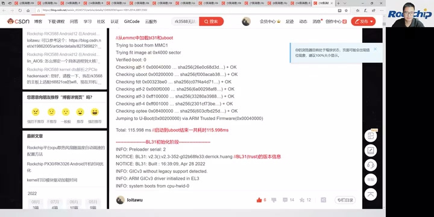

*eMMC 加载和校验各阶段代码，随后跳转 ARM Trusted Firmware；页面显示前段总耗时115.998ms。 · [原片 44:30](https://www.bilibili.com/video/BV19U4y1673R/?t=2670)*

跳转后，最先启动的是 BL31。BL31 就是我们的 Trust。如果以前做过我们 RK 平台，其他旧平台会有一个 `trust.img`；RK3588 没有 `trust.img`——

## 42:44 BL31、BL32、U-Boot 版本与 PMIC 检查

这些都包含在 U-Boot 里面。这里能看到 BL31 的版本，大家核对时可以看这个版本。版本里面带有 commit 信息，主要根据这个 commit 信息来确认版本。

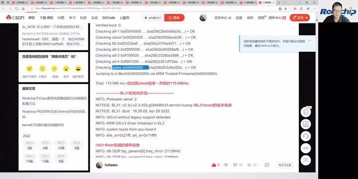

*BL31（Trust）初始化与版本信息，包含commit标识；下方开始展示DDR变频信息。 · [原片 44:42](https://www.bilibili.com/video/BV19U4y1673R/?t=2682)*

这里是 BL31 里面 DDR 变频，主要是 DDR 变频部分。下面是 BL32 初始化。BL32 主要就是 OP-TEE，这里可以看到 BL32 的信息。BL32 初始化完成，就到 U-Boot 阶段，这里可以看到 U-Boot 版本以及编译信息。

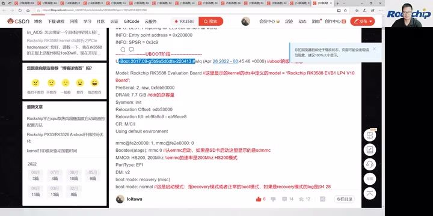

*U-Boot 版本、model、内存容量与 eMMC HS200 启动介质日志 · [原片 46:08](https://www.bilibili.com/video/BV19U4y1673R/?t=2768)*

这里是 DTS 配置的 model，可以确认你的 DTS 是不是对的。这里还能看到内存容量，是 8G。启动是从 eMMC 启动，eMMC 在 U-Boot 这段跑的是 HS200。

boot mode 是启动模式，normal 或者 recovery。如果第一次开机，这里也会显示 recovery。

U-Boot 里面会初始化 PMIC，就是我们前面说的 PMIC。如果这里 PMIC 配置错了，就会打印这一段 log；看到这段，就去检查是不是单双 PMIC 配置错了。最终它会卡在这里，不继续往下走。

## 44:45 PMIC 电压检查、显示与加载 kernel

> 原视频：[本段 44:44](https://www.bilibili.com/video/BV19U4y1673R/?p=1&t=2684.92)

如果配置正确，就继续往下走。这里是双 PMIC，可以看到输出电压都是 0.75V，电压都是 0.75V；如果不是 0.75V，可能就有异常。

然后是单 PMIC。单 PMIC 会先初始化三个 DC/DC，这三个 DC/DC 这里都是 0.85V。如果没有看到这个 0.85V，说明有问题，要检查 DC/DC 的硬件有没有贴错、料有没有用错，或者通信异常。然后是单 PMIC 的 RK806 初始化。到这里，PMIC 初始化结束。

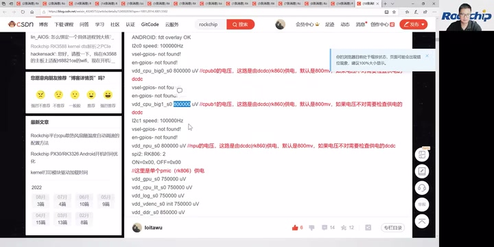

*单 PMIC 的外部 DC/DC 与 RK806 电压日志 · [原片 47:56](https://www.bilibili.com/video/BV19U4y1673R/?t=2876)*

> 整理注：本段口述转写为三个 DC/DC“0.85V”，后续实际日志图写的是 `vdd_cpu_big0_s0 800000 uV`、`vdd_cpu_big1_s0 800000 uV`、`vdd_npu_s0 800000 uV`，即图像示例为 0.8V；保留这处口述识别与屏幕差异，不合并成唯一数字。投屏比口述滞后，配图保留实际出现时间。

这里会显示 DTS 的名称，根据这个可以判断加载的 DTS 是不是对的。这还是在 U-Boot 阶段。下面是 U-Boot 的显示部分，最后 logo 出来，然后是 clock 的一些初始化。

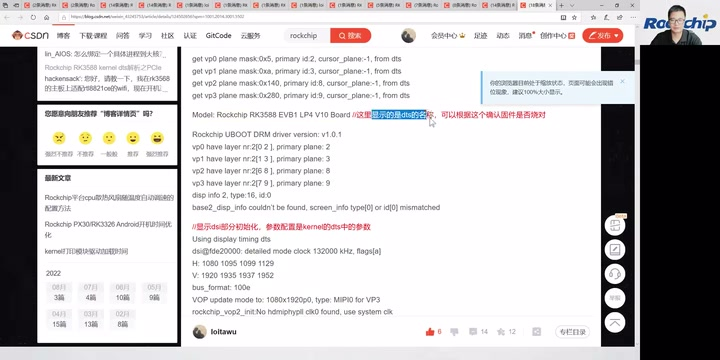

*U-Boot 显示部分与 DTS model 日志 · [原片 48:20](https://www.bilibili.com/video/BV19U4y1673R/?t=2900)*

这是 Android 固件的加载、AVB 校验，校验固件的合法性。如果开了 AVB，就会进行 AVB 部分的校验，校验下一级。

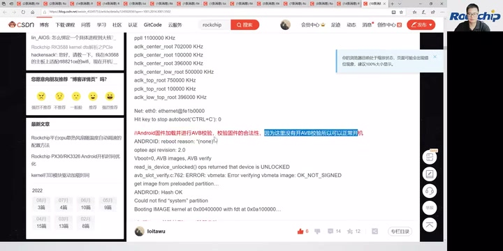

*Android 固件 AVB 校验日志 · [原片 48:44](https://www.bilibili.com/video/BV19U4y1673R/?t=2924)*

然后到这里，开始加载 kernel，进行 kernel 固件加载、kernel 启动。

这里显示 U-Boot 阶段的耗时。如果耗时太大，大于几秒，说明 U-Boot 阶段耗时比较长。正常我们 EVB 的耗时在一秒以内。

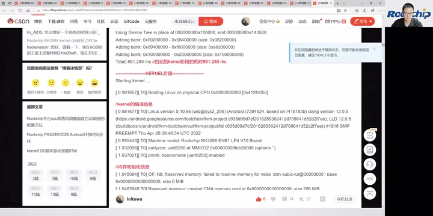

*U-Boot 总耗时 861.280ms 与 kernel 启动编译信息 · [原片 49:08](https://www.bilibili.com/video/BV19U4y1673R/?t=2948)*

下面就是 kernel 启动阶段。U-Boot 启动完，就到 kernel，这里是 kernel 的一些编译信息。

## 46:46 kernel 的电源初始化顺序

> 原视频：[本段 46:45](https://www.bilibili.com/video/BV19U4y1673R/?p=1&t=2805.92)

可以通过版本、时间，确认编译时间、编译信息、版本对不对。这里是 DTS 名字，下面是内存初始化，`reserved memory`，这里是预留的内存。再下面是 CPU 的加载、初始化，以及其他初始化。

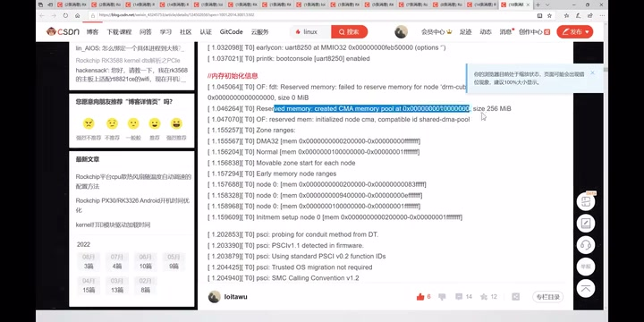

*kernel 编译信息与 reserved memory 初始化 · [原片 49:44](https://www.bilibili.com/video/BV19U4y1673R/?t=2984)*

各路电源的初始化在这里进行，是 kernel 阶段 PMIC 各路电源的初始化。如果在这里没看到初始化，电源初始化是在 CPU 变频之后才开始，就会有问题。PMIC 初始化太晚，会导致 CPU 那些初始化异常。所以要检查前面讲的 DTS 配置，把电源部分提前。

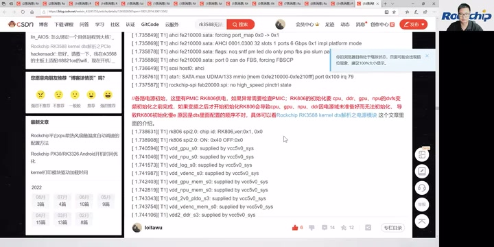

*kernel 阶段 PMIC 各路供电初始化 · [原片 50:20](https://www.bilibili.com/video/BV19U4y1673R/?t=3020)*

这是 CPU 变频的部分，这一步要在电源初始化之后。这个是 DDR 变频的一些初始化。

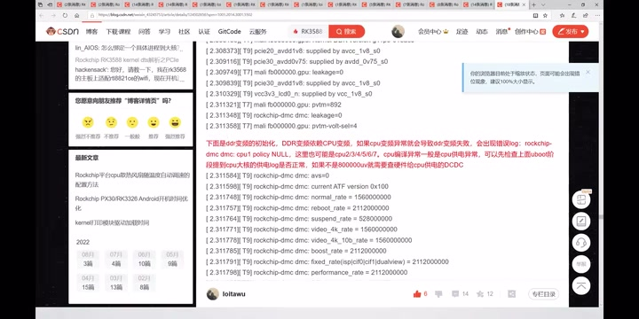

*DDR 变频相关初始化与频率日志 · [原片 51:08](https://www.bilibili.com/video/BV19U4y1673R/?t=3068)*

到这里，就开始 Android 分区的加载。这大概就是 kernel 进入 Android 的过程，开机流程就是这样。

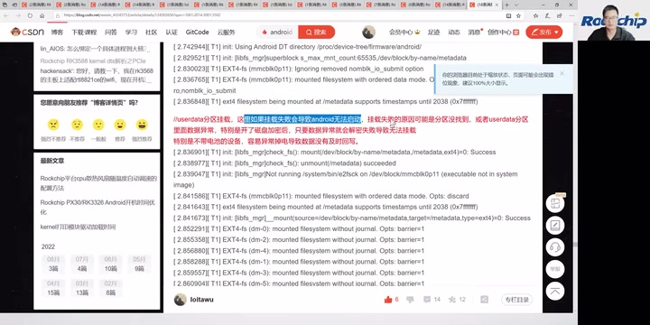

*进入 Android 的分区挂载日志 · [原片 51:20](https://www.bilibili.com/video/BV19U4y1673R/?t=3080)*

上面给大家介绍了一些 Android 开发的东西。接下来是现场答疑，大家有问题可以提，我会针对刚刚留言区的一些问题进行回答。

## 48:46 现场答疑：CPU、显示、Camera 与动态调压

> 原视频：[本段 48:45](https://www.bilibili.com/video/BV19U4y1673R/?p=1&t=2925.92)

我们来看一下大家的问题。低一档的 CPU 方案，比 RK3588 低的就是 RK3399；RK3399 再下面是〔型号未辨清〕，然后有 RK3568、RK3566，再下面就是〔型号音近“RK336”，未辨清〕，〔随后一处音近“比较30”，未辨清〕，就这样子。

> 整理注：2937–2958 秒的芯片型号阶梯，冻结转写含“RK32588”“RK3256”“比较30”等不可靠片段。局部恢复仍识别为“RK388”“RK336”“比较30”，未可靠恢复。本段保留可辨型号、未辨槽位与讲述次序，未辨清的具体型号仍须核听，不据常见产品线补造一条准确排序。

RK3588 支持 4K。它的 HDMI 最高可以支持 8K、60 帧显示；DP 最高支持 8K、30 帧；eDP 可以支持到 6K——4K、60 帧；MIPI 最大也是 4K、60 帧。

> 整理注：eDP 处先有“6K”的口述识别，紧接着是“4K60帧”，正文保留后一句的数值并注明该回绕。3001–3006 秒 Camera 支持问题原转写为“Caml支持RA2”，局部恢复仍为“ro2”，音近 RAW/RAW2，缩写未可靠辨清，回答为可以支持，不能将 RA2 擅自解释成具体格式或接口。

Camera 支持吗？可以支持，Camera 可以支持〔问题中的具体缩写未辨清〕。

“PMIC RK806 也是带内核动态调压吗？低功耗模式下，双 PMIC 是不是更有优势？”RK806 在 kernel 下面可以支持动态调压，通过 SPI 接口通信。现在为什么推出单 PMIC？我们认为单 PMIC 的功耗会更好一点，而且成本也会更低一点。

## 50:46 单 PMIC、博客、DDR 兼容与 U-Boot 裁剪

> 原视频：[本段 50:46](https://www.bilibili.com/video/BV19U4y1673R/?p=1&t=3046.12)

所以后面我们主推的都是单 PMIC，不是双 PMIC。我们再看下面的问题。

我的博客链接，大家可以在网上搜一下，就是我刚刚放的那个。我给大家看一下这个链接，把这个博客……可以直接在网上搜 RK3588，就可以看到我的，点进来就能看到。

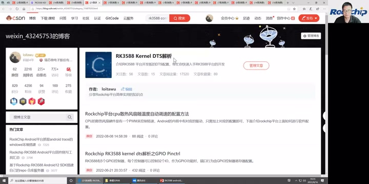

*讲者演示搜索后进入 RK3588 Kernel DTS 解析博客栏目 · [原片 55:56](https://www.bilibili.com/video/BV19U4y1673R/?t=3356)*

DDR 会兼容一些不同容量的。我们在网上会更新 DDR 的注意事项和支持列表，大家可以通过支持列表去获取。

> 整理注：3130 秒附近“低调”根据连续的“容量、注意事项、支持列表”校读为 DDR；本段口述未给出可可靠抄录的支持列表网址，截图保留博客查找演示，不增补外部地址。

U-Boot 阶段，我们现在的启动时间差不多一秒以内。如果想更快，可以做一些裁剪，也可以再快一点点。但是，一秒以内的时间再继续缩，优化程度也不会很高，你再优化一点时间——

> 整理注：末句的具体毫秒数原转写为“几多秒”，不能确定，正文不确定具体数量，只保留继续缩短时间的意思，接下一段“意义也不大”。

## 52:47 Android 开机、RKNN 与音频 3A

> 原视频：[本段 52:46](https://www.bilibili.com/video/BV19U4y1673R/?p=1&t=3166.6000000000004)

意义也不大。但是，如果做裁剪，也可以再进行裁剪、再进行优化。RK3588 的 Android 12 开机速度，我们目前差不多在 12 秒左右。大家看一下，还有什么问题，可以现场再给大家解答。

“Android 有提供 AI 算法的 demo 吗？”我们有 NPU 的 RKNN 开发包，SDK 里面也有带。大家如果有兴趣，可以拿去看我们的 NPU RKNN 开发包。

“RK3588 的 3A 算法有支持吗？”3A 算法我们也有支持。如果有兴趣，可以通过我们的 Redmine 提问，我们会指派给对应工程师解答。因为 3A 这一块跟硬件的耦合性比较高，要针对你们的硬件做对应适配。所以，各位需要跟我们的业务，或者通过 Redmine 跟我们沟通，我们再以 case by case 的方式来支持。这指的是音频的 3A 算法。

> 整理注：工单渠道在原转写中为“日卖/的卖”，按连续提问、指派工程师的语境校读为 Redmine，未得到画面文字确认；不扩写成具体网址。

## 54:47 ISP 出图、异常掉电与数据保护

> 原视频：[本段 54:46](https://www.bilibili.com/video/BV19U4y1673R/?p=1&t=3286.6000000000004)

“RK3588 ISP 到出图需要多长时间？”这个时间差不多 150 毫秒左右。RK3588 ISP 到出图的时间，差不多是 150 毫秒左右。

我们前面通过问卷调查收集了一些问题，看看里面主要的问题。比如，有客户提到异常掉电的场景：设备不带电池，关机时直接掉电，容易产生数据丢失，导致无法开机。

针对这个，只能说尽量避免、尽量减少发生概率。一些措施是：能尽量不用磁盘加密，就把磁盘加密关掉；文件系统用〔名称音近“EXT”，未辨清〕；另外，主要是应用开发上要做好数据保护。一些关键数据，要做好及时的回写。就是应用开发上要做一下保护。这是前面收集的问题。

> 整理注：此处磁盘加密、回写按连续语境校读；文件系统名在冻结及3320–3380秒恢复转写中均音近“一叉击式”，仍未辨清，不能直接确定为 ext4。尚无画面展示这些设置，应按原音复核未辨术语，不能把本段讲者的降低概率建议写成消除掉电风险的保证。

大家看，如果没有什么问题，今天直播就到这里。我们左上角还有一个……那我们看现场，这里还有一个问题：“擦除 flash，有什么方式进 loader 模式？”

## 56:50 擦除 flash、Maskrom、速率与货源

> 原视频：[本段 56:49](https://www.bilibili.com/video/BV19U4y1673R/?p=1&t=3409.78)

擦除 flash 完，flash 里面就没有固件了，这时没办法进 loader。因为 loader 在 U-Boot 里面，你把代码都擦掉了，就没办法进，只能进 Maskrom。擦掉之后直接插进去，就是 Maskrom 模式。Maskrom 下面也可以进行固件烧写，但是要完整烧写。

大家还有问题可以继续，我看还有很多问题。

这里有客户问“3.0”的测试速率最高能达到多少。你指的是 PCIe 3.0 的测试速率吗？如果是 PCIe，我上面已经讲过理论数据和实测数据，大家可以回放看前面的介绍。

“RK3588 现在货源稳定吗？”货源部分，我们现在已经量产，这个可以咨询对应业务。货源肯定是有保障的，RK3588 现在是我们主推的高端芯片。

“RK3588S 平板的关机电流大概是多少？”关机漏电流大约在 50mA 左右。

> 整理注：50mA 为冻结转写和 3510–3585 秒独立局部恢复转写共同识别的讲者口径；现场没有电流测量画面或单位文字，本稿保留来源，不依据常识静默改成 µA，也不把该数值当作独立验证的硬件指标。

## 58:50 Maskrom 烧写、DDR 频率、发热与待机 GPIO

> 原视频：[本段 58:49](https://www.bilibili.com/video/BV19U4y1673R/?p=1&t=3529.78)

“Maskrom 烧写失败。”Maskrom 烧写失败，要先检查板子的硬件是不是有问题。一般在 Maskrom 下面，如果硬件没问题，烧写是不会失败的，除非硬件有问题。

> 整理注：3530–3557 秒冻结转写被大量“RK353/关机电流”机械重复污染，以上根据 3510–3585 秒局部恢复补回问题和回答，未把重复识别当成讲者反复强调。这里是讲者对烧写失败的回答口径，未替他补加未讲的排查条件。

“RK3588 LPDDR4 支持的最高频率是多少？”最高频率可以达到 2112 兆，前面讲过，最高支持 2112 兆。LPDDR5 最高可以支持到——2.7G。

> 整理注：LPDDR5 处原转写经历“2”“262.7”“2.7兆2.7G”的回绕，保留最后的 2.7G 口述概数；前面 DDR bin 文件名出现 `lp5_2736MHz` 是另一处屏幕证据，不用它覆盖本句说法。

“RK3528 的发热情况怎么样？”我们目前看来还好。跑安兔兔的时候，测到芯片端的最高温度，差不多都维持在 50 度以下。就是跑安兔兔烤机这种高负载情况下，温度在 50 度以内。

> 整理注：3593–3598 秒问题与复述中的芯片型号，冻结和3580–3630秒局部恢复均为“3528”，因此保留 RK3528，而非按场次主题改成 RK3588；画面只有答疑页，未提供型号文字；本段温度也没有另行补加散热配置、环境温度等原讲述未提供的条件。

“待机模式下，GPIO 配置在什么状态功耗最低？”GPIO 在待机状态下，一般没用的 GPIO 都会断电；比如那些需要中断的，才不断电。

## 60:50 最大内存与结束

> 原视频：[本段 60:49](https://www.bilibili.com/video/BV19U4y1673R/?p=1&t=3649.78)

RK3588 最大支持的内存，可以达到 32G。

大家还有什么问题？没问题，我们今天的时间差不多就到这里了。

