# 99%利用率的RKNN模型

> RK3588公开课 L07 · Hunter · 原发布课件日期：2022.08。本文为清理后的忠实图文讲稿，按视频原时间顺序保留讲述。技术能力、版本规划和性能口径沿用当时发布内容；截图来自640×320原视频，小字无法确认处另行注明。

## 00:00 开场与今天的四个部分

我是来自RK的工程师Hunter。我们的工作主要是针对RKNPU的模型软件栈支持，还有RKNPU的设计验证相关工作。今天我们要讲的题目是《99%利用率的RKNN模型设计》。

今天的内容主要分四个部分：第一个部分是RKNPU加速与利用率的介绍；第二个部分是基于RKNPU的高利用率模型结构建议；第三个部分是基于RKNPU的高利用率算子尺寸建议；第四个部分是Q&A。

今天要讲的方向有这么几个。关于RKNPU加速与利用率的介绍，主要介绍性能指标跟利用率指标。关于模型结构建议，我们主要讲通过什么样的规则，或者通过图的变换，在模型的图级别优化模型的效率。第三点，高利用率算子的尺寸建议，主要就是说，针对特定算子，我们怎么样约束它，或者怎么样设计这样的算子尺寸，达到更高的效率。

## 01:49 先看接近100%利用率的实测模型

首先放个图镇个楼。这个模型是我们在RK3588上跑出来的效率，单核2T。内存是LPDDR4，频率在两个G左右；NPU在1G左右，CPU频率在1.8G，是INT8类型的模型。

我们可以看到，在这样一个模型下，针对性地设计，RKNN模型是真的能够跑到接近100%利用率的实测性能。这个先大概看一下就行，后面会再详述。

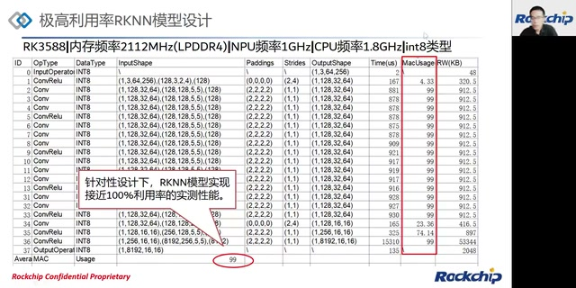

*RK3588极高利用率模型实测表：固定内存、NPU、CPU频率，平均MAC利用率99。 · [原片 02:12](https://www.bilibili.com/video/BV1cG411t7m3/?t=132)*

> 画面参数补记：课件表头写为RK3588、内存频率2112MHz（LPDDR4）、NPU频率1GHz、CPU频率1.8GHz、INT8；底部圈出Average MAC Usage 99。讲述中的“两个G左右”保留其口径。

## 02:35 RKNPU加速：峰值与利用率要一起看

首先是第一个部分，RKNPU加速与利用率的介绍。在加速性能分析指标上，我们主要有两个：一个是理论峰值性能，一个是NPU的利用率。

NPU主要用在以卷积运算为主的模型推理加速，当然这里不只包含卷积，还包含矩阵乘加等等这类运算。分析NPU性能的时候，我们会考虑这两点。为什么要同时兼顾？因为峰值性能只能说明NPU硬件的极限性能，但实际上，在真正运算场景下，往往还要兼顾NPU利用率。它能说明实际运算场景下的真实效率。

## 03:33 理论峰值性能如何计算

理论峰值性能怎么样算？NPU的卷积类运算主要由MAC实现。MAC就是我们的乘加单元，矩阵乘加单元。理论峰值性能，就是说这个乘加单元，乘上一个加和乘这样的两个操作，在每一个NPU时间周期内，也就是每个cycle里面所能达到的效率。把频率换算一下，就能够得到下面这样的式子：performance等于MAC的数量，再乘2，再乘频率。

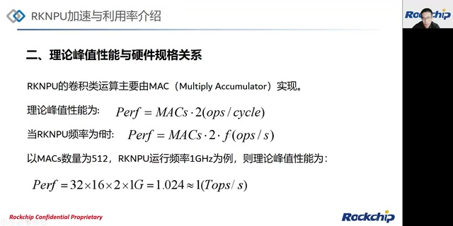

*理论峰值性能与MAC数量、每周期乘加次数和运行频率的关系。 · [原片 04:24](https://www.bilibili.com/video/BV1cG411t7m3/?t=264)*

把具体MAC的大小，也就是硬件规格，假如说是512，还有实际运行频率1GHz，代进去算，这样的理论峰值性能就能算到接近1T，也就是1T。我们1T这样的TOPS规格就是这么来的。

> 课件原式：`Perf = MACs × 2 (ops/cycle)`；频率为f时，`Perf = MACs × 2 × f (ops/s)`；例子写作`32 × 16 × 2 × 1G = 1.024 ≈ 1 (Tops/s)`，单位记法保留原课件口径。

## 04:50 层级利用率与影响因素

NPU利用率，我们这边分两个。首先是NPU的层级利用率，也就是每一层、每一个算子实际执行性能与理论峰值性能的比率。这个R_layer，是通过每层的操作数量，包括乘、加等等这样的运算数量，除以这一层实际执行推理的时长，得到性能，再跟理论峰值性能去比较。

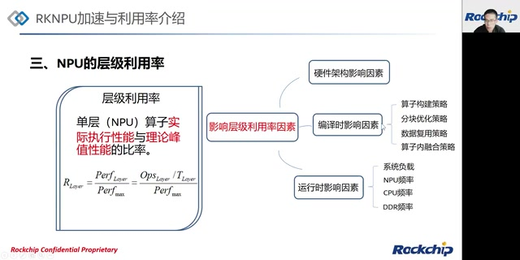

*层级利用率公式与硬件、编译时、运行时三类影响因素。 · [原片 06:00](https://www.bilibili.com/video/BV1cG411t7m3/?t=360)*

影响层级利用率的因素有这么几个。一个是硬件架构的影响。比如不同代际之间的NPU，通过每一代的优化和改进，可以看到，相同层、相同尺寸的算子，利用率能够提高，所以这是一个影响因素。

还有编译时的影响。在做模型的解构、模型的生成导出过程中，我们会完成这么几个策略，会影响层级利用率：一个是算子的构建策略；另一个是分块优化策略，比如尺寸特别大，就需要分块计算，分块策略也会影响利用效率；还有数据复用；还有算子内融合策略。这些后面有些也会提到，会解释为什么这样的策略有助于提高利用率。

还有客户在实际运行过程中设定的NPU、CPU、DDR频率，以及实际在跑的场景下系统负载重还是轻，这些也会极大程度影响实际运算中的层利用率。

## 07:06 模型级利用率才是最终要看的效率

说完层级利用率，还要考虑整个模型级利用率。整个模型是由非常多个层组成的，模型总体效率，是客户在真实场景跑出来的性能。比如单帧性能跑得不够好，单某个算子效率特别高，其实没有意义，所以最终还是要看整个模型级利用率。

模型总体实际性能跟理论峰值性能的比例，其实跟刚才层级利用率的算法一样：单帧所有操作数，除以单帧推理时间，再比上整体性能。那因为模型级是从层级组合而来的，所以它受到的影响其实也几乎一致。比较不同的是编译时影响因素，它更注重考虑整个算子与算子之间的策略。比如算子构建策略，这个跟刚才一样；但是算子分块优化策略、数据复用策略，会更多兼顾整个模型，或者某个小子图里面的优化。然后，算子间融合策略，待会儿也会详细讲。

## 08:49 模型结构建议：尽量规避低效算子

第二个部分开始展开，讲基于RKNPU的高利用率模型结构建议。我们知道，NPU主要加速对象是卷积类模型。有些算子，它可能比较不擅长，或者会受到一些制约，所以在设计上，我们尽量规避一些低效算子，比如数据搬运类、尺寸变换类，以及非ReLU类的激活函数。

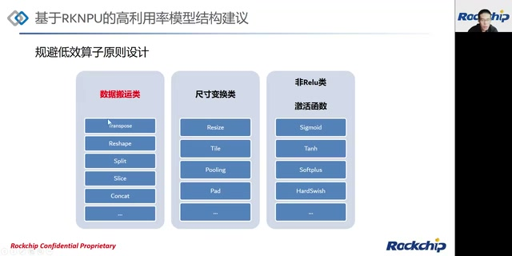

*原课件列出的数据搬运、尺寸变换、非ReLU激活函数三类低效算子。 · [原片 10:00](https://www.bilibili.com/video/BV1cG411t7m3/?t=600)*

最重要的是数据搬运类，因为这类算子其实没有具体计算，主要是对数据进行搬运、拆分、整合或者转置。很多客户在诟病我们的Transpose跟Reshape。当然，这两个如果能在设计之初规避掉，对任何一个模型来说，都是很好的效率提升。如果实在不能规避，我们后面还会讲一些其他的优化方式和原则。

还有比较常见的是非ReLU类激活函数，比如Sigmoid、Tanh、SiLU、Softplus，这种各类的有很多。这些激活函数在执行效率上肯定不如ReLU。但是，如果客户能够选择把这类激活函数替换成ReLU，或者Clip、PReLU、Leaky ReLU这样的ReLU类激活函数，然后重新训练，发现基本不怎么掉点，我们会建议通过替换再重新训练的方式去替换。当然不能替换的话，接下来也会有相应优化方向，后面介绍。

## 11:09 算子近似替换：YOLOv5-nano图变换

无法规避低效算子的时候，我们会使用一些策略。这里介绍算子的近似替换。举一个YOLOv5的图的例子：最开始有一堆Slice，然后Concat。本质上，就是把416×416这样的image去拆分、挑选、重排，然后Concat成一个新图，送到卷积里面。

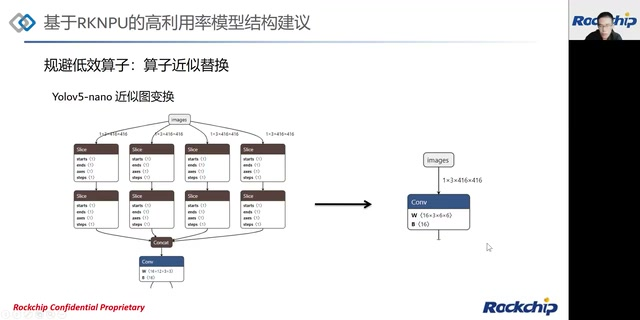

*YOLOv5-nano的Slice、Concat及卷积子图，变换为一个卷积的示意。 · [原片 12:00](https://www.bilibili.com/video/BV1cG411t7m3/?t=720)*

其实可以做一个等效变换，把这个卷积重新做一个变换，变换完以后在数学公式上等效。这个在YOLOv5的GitHub一个issue里，我们看到有人这样尝试，所以我们介绍这样一种方式。这样的变换，可以节省大量Slice跟Concat上的带宽损耗，效率会相对高很多，在整体性能上能看到比较好的提升。

## 12:27 用卷积替换Channel Shuffle

还有一个类似例子，是我们当时在做模型的时候自己搞的：ShuffleNet v2 0.5这样的模型，里面有一个Channel Shuffle操作模块。我们把这一部分操作直接替换成一个卷积。

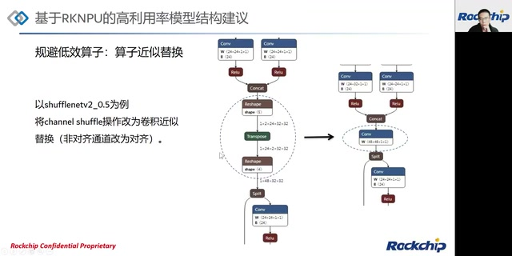

*ShuffleNet v2 0.5的Channel Shuffle子图与卷积替换示意。 · [原片 13:00](https://www.bilibili.com/video/BV1cG411t7m3/?t=780)*

为什么能等效替换？因为卷积里面的weight，权重都是0跟1，相当于把Channel Shuffle里面重排的思想应用在卷积上。通过乘0、乘1这样的操作，把数据进行重排，这个也是可以等效、近似地替换的。

> 图中文字限定：课件将此标为“卷积近似替换（非对齐通道改为对齐）”。保留讲者关于等效与近似的原表述。

## 13:17 利用融合规则，调整算子顺序

如果刚才规避的方法也难以解决，比如某些Channel Shuffle确实不能取消或者优化掉，我们就要在稍微大一点视野的图里面看，利用融合规则。

比如这样一个场景：卷积、Channel Shuffle，接一个Clip，或者接一个ReLU之类的。Transpose没有办法优化掉，这时候观察前后算子，可以发现，如果把Clip往上提、Transpose往下拉，实际上不影响计算结果。但是可以很好利用硬件融合原则，把卷积跟Clip融合在一起。

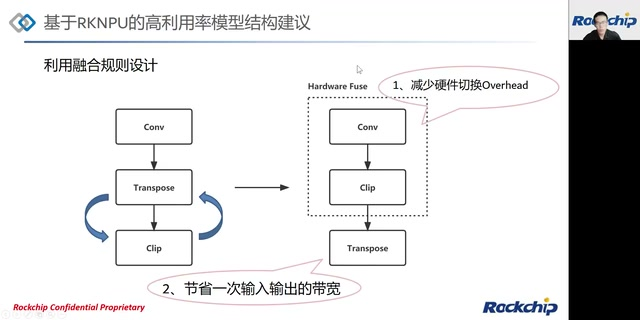

*将Clip提前到Transpose前，与Conv融合，减少硬件切换开销和一次输入输出。 · [原片 14:00](https://www.bilibili.com/video/BV1cG411t7m3/?t=840)*

这样有一个好处，就是减少硬件切换的overhead；第二，能够节省一次输入跟输出带宽，因为融合以后，数据就少掉一次出跟入。这样也能提升性能。

## 14:29 Fuse支持情况与当时规划

关于Fuse规则，我们可以看到这么几种：比如卷积跟各种ReLU类算子；也可以看到卷积跟刚才说的非ReLU类激活函数融合，但是目前还没有开放支持，后续会开放。还有卷积做Add、Mul，还有Add、Mul加ReLU这种类型融合，都是后续计划支持的。更多Fuse支持情况，希望大家看后续发布的OP LIST文档，里面会有比较多介绍。

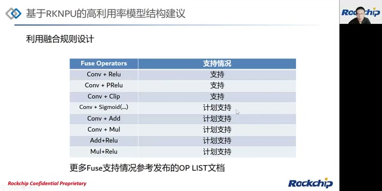

*课程当时的Fuse算子支持表，区分已支持与计划支持。 · [原片 15:00](https://www.bilibili.com/video/BV1cG411t7m3/?t=900)*

> 原课件表：Conv+ReLU、Conv+PReLU、Conv+Clip标为“支持”；Conv+Sigmoid(…)、Conv+Add、Conv+Mul、Add+ReLU、Mul+ReLU标为“计划支持”。此处保留2022年课程当时的发布口径。

## 15:24 算子尺寸建议的四个方向

再讲第三部分，基于RKNPU的高利用率算子尺寸建议。这部分主要分四点：一个是尺寸对齐；一个是尺寸约束；第三是兼顾融合的尺寸约束；第四会单独拎出来讲卷积尺寸设计。

因为卷积计算的操作，占整个模型的大头，而且从模型库看，卷积算子的占比也是占大头的这样一个算子。所以最重要的就是怎么样设计一个高效率卷积。通过这样的方式，我们完成对整个算子尺寸的设计建议和介绍。

## 16:29 算子对齐：读写效率与计算并行度

首先讲算子的对齐规则。往期如果有同学听过我们的课程，会有很多工程师说，要对输入输出的通道数量做对齐。比如不同平台、不同精度，有不同的对齐数量。这个对齐操作能贴合实际硬件读取数据的方式，相当于比较带宽友好，这样读写速率会增加。

还有，在实际运算中，有些算子的运算并行度和对齐数量有关系。比如16个通道对齐，如果实际只用12个通道，计算时是按16个一起计算，实际上浪费了一部分通道计算单元，在真实利用率上吃亏。

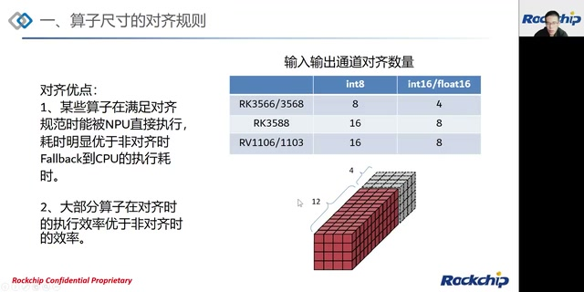

*通用算子通道对齐表，以及12个有效通道占用16通道计算的示意。 · [原片 17:30](https://www.bilibili.com/video/BV1cG411t7m3/?t=1050)*

对齐的优点，一个是某些算子满足对齐规范时，NPU能很好地执行，能得到比较好优化，耗时明显优于非对齐的时候。因为非对齐，比如NPU不能直接执行，就会fallback到CPU，这时耗时相对比较大。所以很多时候，客户模型优化重点，是先把一些非NPU类算子优化成在NPU上执行，效率更高一点。

第二，大部分算子对齐时执行效率优于非对齐。就是刚才说的，比如12 channel也能进去算，但它跟16 channel的推理时间其实一样，这时候它的效率就打了折扣。

> 课件通用输入输出通道对齐表：RK3566/3568的INT8为8、INT16/FLOAT16为4；RK3588的INT8为16、INT16/FLOAT16为8；RV1106/1103的INT8为16、INT16/FLOAT16为8。这是此页通用表，后面的卷积表另有输入输出要求。

## 18:56 查OP LIST：特定维度的对齐规则

这边是后续会发布的算子OP LIST、Support List，也就是我们的支持情况。大家需要经常翻阅这个文档，因为有些算子怎么样支持，或者有些约束条件超限就支持不了，存在这种情况。

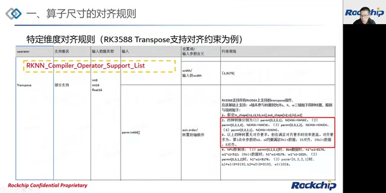

*RK3588 Transpose在OP LIST中的特定维度对齐要求；原视频表内小字较小。 · [原片 19:42](https://www.bilibili.com/video/BV1cG411t7m3/?t=1182)*

特定维度的对齐规则，以RK3588的Transpose为例，文档会讲，这四种转换，也就是perm值的四种转换，没有对齐要求；但是满足对齐要求时，效率更高。大家可以尝试，确实更高。对齐要求会有具体表述。

## 19:59 硬件约束：超限会回退到CPU

硬件限制上的约束，还是以Transpose为例。如果某些尺寸过大，超过NPU限制，这时候NPU不会做这个Transpose，会把Transpose递交、fallback给CPU做。那么性能上会有比较大的下滑。换算到利用率看，其实就是降低了实际NPU利用效率。

再举个Resize的例子。设置放大倍率的时候，如果宽度乘以放大倍率，再加放大倍率减一，这个数据小于等于8192，是会在NPU上做的；如果超限，就fallback到CPU，这样也影响效率。

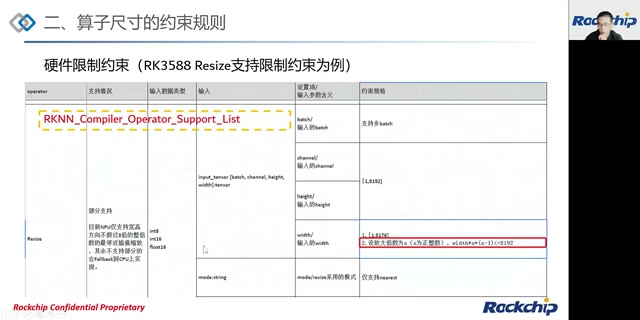

*Resize宽度与放大倍数相关约束，超限会回退到CPU。 · [原片 20:54](https://www.bilibili.com/video/BV1cG411t7m3/?t=1254)*

> Resize课件红框条件可辨为`width × k + k − 1 <= 8192`，k为宽度放大倍数。Transpose页的多项小字边界受640×320源分辨率限制，讲者未逐项口述，本文不猜填。

## 21:01 兼顾融合后的主体算子尺寸约束

以上手段都使用过以后，还有一个就是兼顾融合。有些时候看起来两个算子应该能融合，比如Pad跟Conv，因为卷积本身就可以带Pad。如果前面Pad特别大，就要注意。

以这里为例，zero pad的size是5，而我们的限制是15，所以可以融合。当然，之前遇到一个客户，他的Pad size达到30或者更多，这时候它会以独立算子的形式存在，就影响效率。所以考虑融合时，也要注意，融合本身是不是在文档要求里面、不超限。不超限的情况下，效率会有比较大的提升。

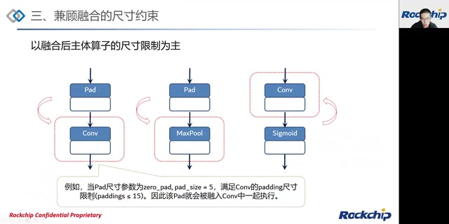

*以融合后主体算子为准：Pad与Conv、MaxPool及Conv与Sigmoid的示例；Pad size=5满足15限制。 · [原片 21:30](https://www.bilibili.com/video/BV1cG411t7m3/?t=1290)*

比较常见的有Pad跟Conv、Pad跟Pooling；还有靠近的融合规则，这就跟前面提到的融合规则相关。

## 22:25 普通卷积的利用率计算

最后一个比较大头的，是来看卷积高利用率尺寸设计。首先，卷积利用率计算，以普通卷积DC Conv为例，暂时不展开讲Deconv或者Depthwise这类卷积。

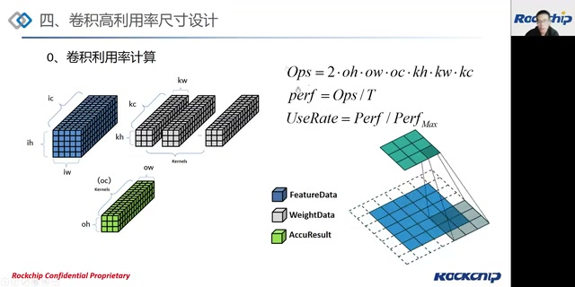

*普通卷积输入、权重、输出的维度示意及操作数、性能、利用率公式。 · [原片 23:18](https://www.bilibili.com/video/BV1cG411t7m3/?t=1398)*

普通DC卷积操作数，就是2乘以oh、ow、oc，再乘kh、kw、kc。oh、ow、oc是输出的高、宽、深度，kh、kw、kc是kernel的高、宽、深度，这里kc其实等价于ic，这样能算出操作数量。T是此时这一层卷积实际执行时间、推理时间，可以得到performance，再比较，就得到该层卷积实际利用率。

> 画面公式：`Ops = 2 × oh × ow × oc × kh × kw × kc`；`perf = Ops / T`；`UseRate = Perf / PerfMax`。

同样，卷积也会有相应文档，描述各个参数限制、各个参数大小，还有别的精度支持、广播等等内容。欢迎大家看OP LIST。

然后尺寸对齐设计，其实相对于前面说的，普通任何一个算子的feature的一个对齐，在这个基础上，还有更进一步的对齐建议。当然不对齐也没关系，它不是强制的，但满足对齐条件下，性能更优一点。除了输入输出channel对齐量，还有经常说的Surface对齐量，就是宽高乘积大于1的时候，要对齐到4。这个建议，是因为这样对DDR更友好，读写效率也相对高一点。

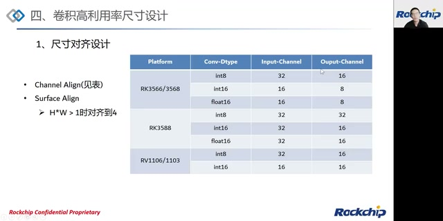

*卷积通道对齐表和Surface对齐要求，与前面的通用算子表不同。 · [原片 24:40](https://www.bilibili.com/video/BV1cG411t7m3/?t=1480)*

> 此页卷积对齐表按输入/输出通道记录：RK3566/3568 INT8为32/16，INT16和FLOAT16均16/8；RK3588 INT8为32/32，INT16和FLOAT16均32/16；RV1106/1103 INT8为32/16，INT16为16/16。Surface条件原文为“H*W > 1时对齐到4”。

## 25:03 对齐与非对齐的实测比较

看一下对齐跟非对齐模型的比较。这是3588，也是刚才的模型环境。看第1层跟第4层，这两层尺寸主要区别，是输入通道。3通道是非对齐的，256通道是32对齐的；刚才前一张表说到，3588输入channel在INT8下对齐是32。

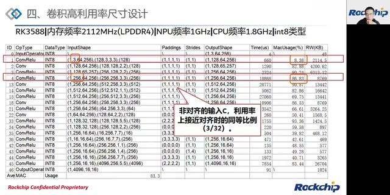

*相同测试频率下，第1层3输入通道与第4层256输入通道的利用率比较。 · [原片 26:04](https://www.bilibili.com/video/BV1cG411t7m3/?t=1564)*

可以看到，两个利用率有很明显的差值。比较一下，非对齐输入channel的利用率，接近对齐时同等比例。虽然是3 channel，但相当于以32 channel去算，所以这个比例会体现出来，不到11倍；这边八十多和八之间，也是不到11倍的关系。

> 图上第1层MacUsage为8.38%，第4层为86.83%；图注直接写出“非对齐的输入c，利用率上接近对齐时的同等比例（3/32）”。此处保留讲者近似比较。

## 26:29 输入尺寸：通道适当小、形状尽量矮扁

第二个，是对卷积尺寸的建议。第一个，输入通道建议小一点。当然所有这些建议不是必须，因为有些时候设计模型，它长成什么样子，我们没办法规定。但是我们的建议是，当输入channel在这样范围里面，效率相对更高一点。输入C尺寸越来越大时，效率会有一定下降，超过256以后的下降可能比较明显。

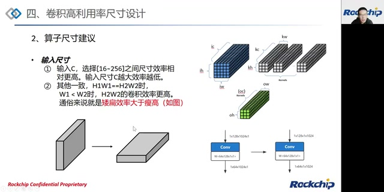

*输入C建议16～256；在其他条件一致、面积相同时，矮扁输入比瘦高输入效率更高。 · [原片 27:40](https://www.bilibili.com/video/BV1cG411t7m3/?t=1660)*

第二，其他参数条件一致的时候，有两个卷积，输入宽高乘积一样，一个瘦高、一个矮扁，矮扁输入进卷积，得到的效率相对更高。比如这个例子：128通道输入，高1024、宽1；另一个高1、宽1024。这两个卷积在数学表达上其实一样，得出的结果一致，但是我们能发现，后面矮扁输入的效率会高于瘦高的效率。从原因角度探究，是因为这样对DDR读写效率相对更好。

> 课件第一条范围写为输入C选择[16～256]；第二条前提是其他条件一致、H1×W1=H2×W2，W1<W2时后者卷积效率更高。图示使用1×1卷积。此处“结果一致”为讲者针对该示例的表述。

回过来再讲一句：如果大家在遇到一些模型设计时，宽高其实不敏感，我们建议整体把大的一头放到宽上，这样整体跑下来性能会相对更优一点。

比如看刚才例子的第15层跟第18层，中间有些类同的层，我省略掉了。这两层主要差异是什么？输入通道数，一个512，一个256。会发现512通道输入的利用率，小于256通道输入。这就印证刚才说的，输入通道选比较小时，相对利用率更高一点。

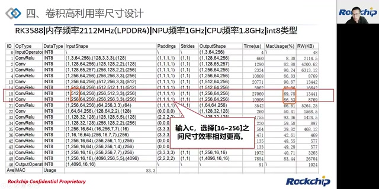

*第15层512通道输入与第18层256通道输入的实测比较，利用率分别69.75%与86.53%。 · [原片 29:16](https://www.bilibili.com/video/BV1cG411t7m3/?t=1756)*

## 29:37 算子尺寸：先限制单个Kernel大小，再看Kernel与Stride比例

然后是算子尺寸。卷积里面主要看kernel大小。第一，尽量选择比较小的kernel，也就是weight的大小。我们建议一个weight最好在0到6KB以内，过大可能触发硬件上相应分块计算，利用率会相对低一点，效率会相对低一点；稍微小一点的kernel，其实跑起来比较快。

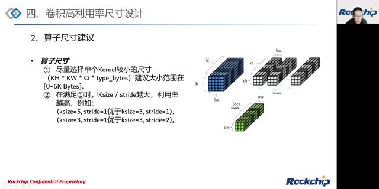

*单Kernel建议小于约6KB；满足此前提时，Ksize/stride越大利用率越高。 · [原片 30:28](https://www.bilibili.com/video/BV1cG411t7m3/?t=1828)*

在满足第一点时，kernel size跟stride的比例越大，利用效率越高。比如下面两个例子，假如K size是5，stride是1，利用率会明显优于K size是3、stride是1，因为5比1大于3比1。同样，kernel size都是3，stride一个1、一个2，stride 1的相对利用率更高一点。

> 单个Kernel大小课件表达为`KH × KW × Ci × type_bytes`，建议[0～6K Bytes]。ASR此处将第一组比较对象一次识为“1”，下一句及画面均为“3”，据课件记为3。

## 30:57 实测：比例更大通常更高，但受Kernel大小前提限制

看这个例子，第2层跟第34层。这两层主要区别，宽高区别其实无所谓，主要是K size跟stride的大小。比如K size是2、stride是1，和K size是2、stride是2比较，2比1肯定比2比2大，利用效率明显高出一大头，这边能达到82%[源转写数值，画面表值为92.88%，存在差异]，那边只能接近60%左右。

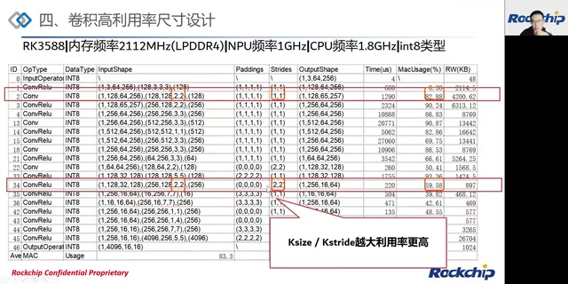

*第2层与第34层比较，Ksize/stride为2/1和2/2，表中利用率为92.88%与59.58%。 · [原片 31:28](https://www.bilibili.com/video/BV1cG411t7m3/?t=1888)*

> 此处ASR为“82%”，画面第2层MacUsage明确为92.88%、第34层59.58%。音频数值尚未独立听辨确认，正文保留源转写并明确列出画面差异。

再看第43层跟第44层，两个卷积尺寸。按理说7比1是比较大的K size跟stride比例，这边1比1和4比1，比例都是1[源转写原表述，数值关系有疑问，以图中参数为准]，相对应该小很多。那么为什么体现在最后利用率上，反而小的比较高一点？这就是刚才说的尽量选择kernel size比较小的尺寸。看这边，一个kernel是256×7×7，INT8类型，每个是1 byte，乘起来其实已经比较大，超过6K。正因为kernel尺寸过大，第二条规则不生效，因为转入分块运算，拖累效率。

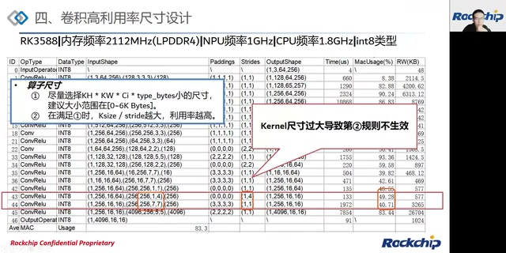

*第43、44层反例：Kernel过大超过约6KB，会导致第二条比例规则不生效。 · [原片 32:32](https://www.bilibili.com/video/BV1cG411t7m3/?t=1952)*

再看这个例子，128跟256输入通道比较。stride都是1，kernel size一个3、一个2，3比1和2比1看，第4层看着应该效率更高。但是兼顾刚才输入尺寸规则，输入尺寸越大，效率相对偏弱。Layer 4跟Layer 3比较，第一点和第二点其实是正负效应相互对冲的状态，两相比较会互相折衷。所以往往比较的时候，要注意别的变量影响。

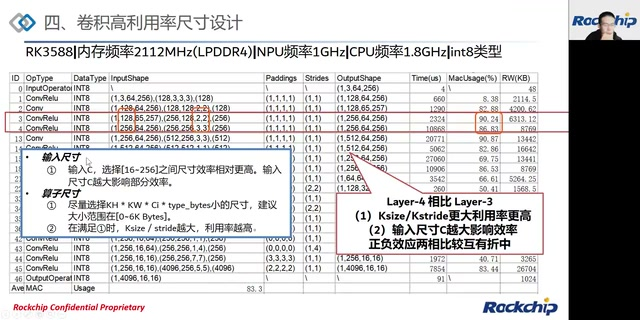

*Layer 4与Layer 3比较，输入C增大和Ksize/stride增大的影响互相折衷。 · [原片 33:20](https://www.bilibili.com/video/BV1cG411t7m3/?t=2000)*

## 33:53 输出尺寸：面积至少16，满足后输出通道越大越有利

关于输出尺寸建议，第一，输出宽高oh×ow，尽量大于等于16；小于16时，利用率会下降，这个下降可能比较大。建议还是以这个尺寸为准。如果实在很大，还要看上面其他尺寸、利用率的折衷。

这里举个例子，第35跟第36层的比较，输出通道数特别大。刚才漏了一点：满足第一点的时候，输出通道越大，利用率越高。在这个例子里面，8192远大于256。当然可以兼顾输入通道，256比128大，但两相权衡，这个效应比较高，所以最后体现出来，输出C越大、利用率越高的因素占主导，它的效率能达到很高程度。

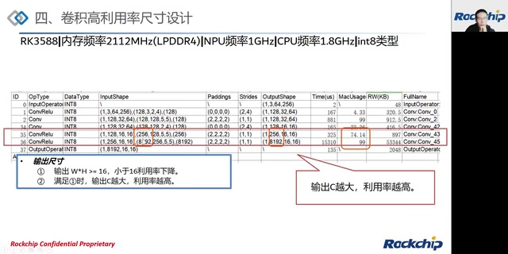

*输出面积满足至少16后，第35、36层的输出C=256与8192及对应利用率。 · [原片 35:00](https://www.bilibili.com/video/BV1cG411t7m3/?t=2100)*

> 第35、36层画面输出分别为256与8192通道，利用率分别74.14%和99%。ASR将8192识成“849”，据同画面OutputShape更正。

## 35:36 回到99%利用率模型：这是针对性的验证设计

所以看，还是刚才镇楼那张图。当规避一些低效算子时，硬件能够达到很高的实测性能。比如这里比较多用5×5、stride为1这样的模型尺寸，输入通道也尽量选偏小一点。当然，这只是为了追求高利用率的测试，我们需要测试NPU是不是真正能达到理想的性能利用率范围时，设计了这样一个模型。确确实实能达到比较好的效率。比如output shape，输出尺寸，也都是刚才说要大于16，最后达到效率就偏高，能达到99左右这样的利用率。

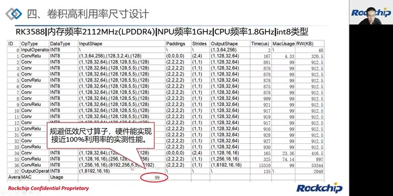

*针对性设计的高利用率模型：大量5×5、stride=1卷积，平均MAC Usage为99。 · [原片 36:32](https://www.bilibili.com/video/BV1cG411t7m3/?t=2192)*

实际上很多时候，不同模型，比如分类或者识别等网络，有些效率相对高，有些我们不能完全达到99利用率，这是不太现实的。

还有一点，遇到很多算子，并不都以卷积为主。比如有些乘、加，包括比较复杂的LSTM、RNN这类算子，它们的加速又是另一种效率。以后有时间，或者开课，我们还会跟大家讲，怎么样优化一些特定算子。

## 37:52 Q&A与问题反馈渠道

第四部分，我们来到Q&A环节。还是先提一句，左上角有RKNN交流群，欢迎大家加入，跟大家一起交流。RK会有工程师定期解答问题。有时候问题解答不及时，也欢迎大家在GitHub工程提issue，或者有Redmine的话可以提Redmine，这样我们能比较及时跟进。

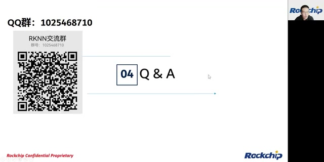

*Q&A开始，课件展示当时的RKNN交流群及群号。 · [原片 38:17](https://www.bilibili.com/video/BV1cG411t7m3/?t=2297)*

> 原发布画面交流群号：1025468710；此为课程当时展示的渠道信息。

我们现在看一下目前这些问题。

### 39:03 NPU相对于GPU加速的优势是什么？

NPU相对于GPU的加速，一个是NPU设计本身就是针对深度学习模型设计的，所以做卷积、做MatMul，还有其他算子，会有比较快的优势。它是针对性地做，所以更快一点。

### 39:41 NPU2网络里两个Tensor相减，结果对不上怎么办？

这个问题，目前因为没有case，我们看不到问题。可能要关注的点，比如广播，还有量化是不是对的，量化参数是不是给对。其他的，我们没办法仅从这些信息看出为什么。建议给一个case，提个issue，或者在群里面发出来，看一下。

### 40:22 福袋抽奖与寄送说明

现在有福袋，大家可以参与抽奖。抽到奖的小伙伴，可以把自己的地址发给我们的助理，到时候我们会送出礼品、寄出。看一下还有什么，大家还有什么问题吗？

### 40:58 为什么NPU工具要分一和二，不能只有一个？

主要原因刚才讲了，我们3566、3568、3588，还有RV1106、1103，这些芯片上的NPU是我们自研NPU。在工具上需要分开，因为底层架构不一致。

### 41:40 输出C大了，下一层是不是变慢？

这个确实这样。实际要根据具体需求来，不能为了体现一个良好利用率，影响实际模型。有一些模型最后输出C本来就比较大，比如分类模型最后一层，本身输出C比较大，这样就可以用刚才说的设计，提高它的利用率。

### 42:25 视频哪里看回放？

关注我们的公众号和视频号，后面会发出来。

### 42:39 同样代码、同一个模型，1.3正常，2.0一直卡推理？

同样的code、同一个模型，在[芯片型号识别不清，ASR为“3268”]上，1.3运行正常，使用2.0一直卡推理。这有个问题：我记得我们的发布版本还没到2.0吧？要不要检查一下，用的版本是不是不对，是不是用到别的版本上去了。我们正式发布版本没有那么高。

### 43:19 NPU驱动版本怎么看？

有一个命令，在文档里面有体现。可以看一下文档，可以去看一下文档。还有什么问题？有问题大家可以提出来。

### 43:52 第二代NPU相比第一代升级哪些，后面还会优化吗？

[问题中“针对”后的具体优化对象在源转写中缺失，画面没有问题文字，未猜填。]

第二代NPU是我们自研嘛。你这边说的第二代NPU，问题里面应该指RKNPU2，而不是指我们3588这个第二代吧，就是说整体自研的NPU，我们在利用率上会有比较大提升。目前看，我们性能还是不错的；还有软件栈还在持续优化中，后续性能会不断提高。

还有，一些算子层出不穷，包括新模型，比如你说到的这些类型模型，在新的NPU平台和软件栈上，我们会逐步优化、逐步支持。有些算子或者功能支持，大家可以跟进Toolkit2和RKNPU2版本发布。

### 45:24 可以支持PyTorch自定义算子吗？

这里指PyTorch支持的自定义算子，我们目前的转换，好像还是不支持。但是后续可能会逐步开放一部分自定义算子，就是说，可以用RKNN软件栈定义自定义算子，然后自己实现。

### 45:55 实时利用率有没有接口查看？

这个的话，开Log Level等于4级以上，就有看到实时利用率。实时利用率，可能Toolkit那边有接口，可以看文档。也可以进RKNN交流群，我们问一下Toolkit2工程的一些工程师。

### 46:32 Paddle模型转RKNN有没有指导手册？

GitHub上Toolkit2工程里的example，那里有各种模型转换样例，也可以阅读文档。当然直接看样例也可以，因为Paddle里面应该有一个export该模型的接口吧。

### 47:04 将来会支持INT4这样的低比特量化吗？

这是个好问题。首先，硬件上能做到。从3588开始，包括后面的RV1106、1103，这几个NPU硬件上可以支持INT4。但是目前软件栈实现还在进行中，所以值得期待。

当然，INT4量化精度是会有损失的。INT4可能更多用在模型混合量化上，比如某些层上，用INT4量化精度掉点不多、不高，那可以先把这一层转成INT4，做卷积、做乘加各种运算，再转回INT8或者更高精度，然后再去做。就是混合量化，可能是INT4以后比较好的利用方式吧。

### 48:32 BF16、TF32与当时精度支持规划

除了INT4，我们其实还可以支持BF16，然后3588上可以支持TF32。这两个精度，也会后续有新版本出现，可能加上这部分支持，也是值得期待的。

目前来说，INT8和FP16是主要两个推理精度。可能接下来版本，还会逐渐开放INT16；INT4和BF16可能会稍后。

> 此段是原课程当时的硬件能力与后续软件开放计划，保留讲者的“可能”“稍后”。ASR将BF16、FP16识为“B 16”“LP16”，由同段再次提到BF16及上下文修正；不据此推断当前软件版本的支持状态。

### 49:22 交流群与后续公开课

如果有问题的小伙伴，可以提出来一起交流。请大家多关注RKNN交流群，也可以关注瑞芯微电子的视频号和公众号。因为接下来下一周，还会有其他老师给大家介绍3588相关课程。

### 49:55 MMSE量化时Python异常退出、内存用得多怎么办？

MMSE量化，Python经常报[异常编号不清，ASR为“173”]，异常退出，内存使用过度。MMSE量化确实比较费内存，而且费时间。这个问题可以咨询Toolkit2工程师，可以进今天交流群，把内存问题报一下，我们看能不能解决和优化。

### 50:30 NPU能做健康码OCR识别吗？

NPU可以实现健康码OCR识别吗，绿码、时间？可以。NPU有挺多OCR应用场景，而且跑一些模型，比如LSTM这样的模型，性能相对还是可以的，是可以做的。

### 50:59 再次邀请提问与反馈

大家还有问题吗？如果没有问题，今天先到这里。有问题可以提，也可以进交流群，跟大家一起交流分享，会有RK工程师定期回答。也欢迎大家多在GitHub提issue，有Redmine的话可以提Redmine。

### 51:30 驱动最新版本与查询命令

驱动版本，刚才有回答。最新的版本，我具体也忘了，可以看一下工程上的版本。驱动版本有一个命令，应该也在文档里面有。

如果没有什么问题，我们今天先到这里。

> 52:02末尾源转写有“在这要看”的不足一秒残片，视频在52:02.752结束，无法确认完整语义，保留此说明，不补成结束语。源视频以外的ASR段已由冻结输入的scope-audit记录排除。
