# 官方文档-ROS命令行入门

## 内容目标

通过 ROS 2 Jazzy 官方命令行教程，理解如何在 Docker 容器中配置 ROS 环境，并使用 ros2、turtlesim、rqt、topic、service、launch 和 bag 检查及驱动系统。

## 整体脉络

这篇记录从容器和 ROS 环境初始化开始，沿着 turtlesim 的节点、主题、服务、动作、日志、launch 与 rosbag 操作展开，命令既用于启动系统，也用于观察 ROS 图和验证消息。

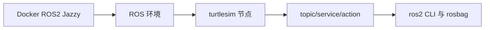

## 核心解析

官方文档-ROS命令行入门

我们以 ROS Jazzy 版本作为学习案例

参考官方链接：https://docs.ros.org/en/jazzy/Tutorials/Beginner-CLI-Tools.html

我们以 ROS Jazzy 版本作为学习案例

### Docker安装ROS2 Jazzy

#### 1. 拉取 ROS2 Jazzy 镜像

```Plain
docker pull ros:jazzy-ros-base
```

#### 2. 创建并后台启动容器

```Plain
docker run -d \
  --name ros2-jazzy \
  -v "$(pwd)/work:/workspace" \
  ros:jazzy-ros-base \
  sleep infinity
```

说明：

- `-d`：后台运行
- `--name ros2-jazzy`：容器名称
- `-v "$(pwd)/work:/workspace"`：挂载当前目录下的 `work`
- `sleep infinity`：让容器持续运行

#### 3. 进入容器

```Plain
docker exec -it ros2-jazzy bash
```

#### 4. 在容器内加载 ROS2 环境

进入容器后执行：

```Plain
source /opt/ros/jazzy/setup.bash
```

验证：

```Plain
echo $ROS_DISTRO
ros2 --help
```

应该看到：

```Bash
jazzy
```

#### ROS 环境配置

如果您不想每次打开新 shell 时都执行 setup 文件（跳过任务 1），则可以将该命令添加到 shell 启动脚本中：

```Bash
echo "source /opt/ros/jazzy/setup.bash" >> ~/.bashrc
```

加载 ROS 2 安装文件会设置运行 ROS 2 所需的几个环境变量。如果您在查找或使用 ROS 2 软件包时遇到问题，请确保使用以下命令正确设置您的环境：

检查环境变量

```JavaScript
printenv | grep -i ROS
```

输出

```JavaScript
ROS_VERSION=2
ROS_PYTHON_VERSION=3
AMENT_PREFIX_PATH=/opt/ros/jazzy
ROS_AUTOMATIC_DISCOVERY_RANGE=SUBNET
PYTHONPATH=/opt/ros/jazzy/lib/python3.12/site-packages
LD_LIBRARY_PATH=/opt/ros/jazzy/lib/aarch64-linux-gnu:/opt/ros/jazzy/lib
PATH=/opt/ros/jazzy/bin:/usr/local/sbin:/usr/local/bin:/usr/sbin:/usr/bin:/sbin:/bin
ROS_DISTRO=jazzy
```

### 使用`turtlesim`，`ros2`和`rqt`

Turtlesim 是一个轻量级的 ROS 2 学习模拟器。它以最基本的层面演示了 ROS 2 的功能，让您了解以后使用真实机器人或机器人模拟器时会遇到的问题。

ros2 工具是用户管理、检查和交互 ROS 系统的方式。它支持多种命令，可以控制系统及其运行的不同方面。用户可以使用它来启动节点、设置参数、监听主题等等。ros2 工具是 ROS 2 核心安装的一部分。

rqt 是 ROS 2 的图形用户界面 (GUI) 工具。rqt 中的所有操作都可以在命令行中完成，但 rqt 提供了一种更友好的方式来操作 ROS 2 元素。

#### 安装 TurtleSim

```Shell
sudo apt update
sudo apt install ros-jazzy-turtlesim
```

要检查软件包是否已安装，请运行以下命令，该命令应返回 turtlesim 可执行文件的列表：

```Shell
ros2 pkg executables turtlesim
turtlesim draw_square
turtlesim mimicturtlesim 
turtle_teleop_key
turtlesim turtlesim_node
```

#### 开始海龟模拟

要启动 TurtleSim，请在终端中输入以下命令：

```Shell
ros2 run turtlesim turtlesim_node
[INFO] [turtlesim]: Starting turtlesim with node name /turtlesim
[INFO] [turtlesim]: Spawning turtle [turtle1] at x=[5.544445], y=[5.544445], theta=[0.000000]
```

#### Docker 缺少了组件遇到的问题

```Shell
root@97dadf09cb70:/# ros2 run turtlesim turtlesim_node 
qt.qpa.xcb: could not connect to display 
qt.qpa.plugin: Could not load the Qt platform plugin "xcb" in "" even though it was found.
This application failed to start because no Qt platform plugin could be initialized. Reinstalling the application may fix this problem.

Available platform plugins are: eglfs, linuxfb, minimal, minimalegl, offscreen, vnc, wayland-egl, wayland, wayland-xcomposite-egl, wayland-xcomposite-glx, xcb.

[ros2run]: Aborted
```

这不是少装了 turtlesim，而是容器里的 Qt 找不到宿主机的图形显示器。你现在的容器能找到 turtlesim_node，但还没有配置 X11 图形转发；我先确认 macOS + Docker Desktop 的当前配置方式，再给你可以直接复制的命令。

你使用的是 macOS + Docker Desktop，需要安装并配置 XQuartz。

一、在 macOS 宿主机执行

注意：下面命令不要在 `root@容器` 里面执行，要在 Mac 的 Terminal 中执行。

1. 安装 XQuartz

如果你安装了 Homebrew：

```Plain
brew install --cask xquartz
```

也可以从 [XQuartz 官网](https://www.xquartz.org/)下载安装。

1. 启动 XQuartz

```Plain
open -a XQuartz
```

1. 允许 XQuartz 接收容器连接

```Plain
xhost +localhost
```

如果后面仍然提示权限问题，可以临时执行：

```Plain
xhost +
```

这会放宽 X11 访问权限，只建议在本机学习时临时使用。完成后可以恢复：

```Plain
xhost -
```

如果你刚安装了 XQuartz，建议退出并重新打开 XQuartz，必要时注销 macOS 后重新登录。

1. 在 ROS2 容器内执行

回到你现在的容器终端：

```Plain
export DISPLAY=host.docker.internal:0
```

检查：

```Plain
echo $DISPLAY
```

应该输出：

```Plain
host.docker.internal:0
```

加载 ROS2 环境：

```Plain
source /opt/ros/jazzy/setup.bash
```

启动小乌龟：

```Plain
ros2 run turtlesim turtlesim_node
```

正常情况下，macOS 桌面上会弹出 turtlesim 窗口。Docker Desktop 提供的 `host.docker.internal` 用于让容器访问宿主机服务。[Docker ROS2 指南](https://docs.docker.com/guides/ros2/)

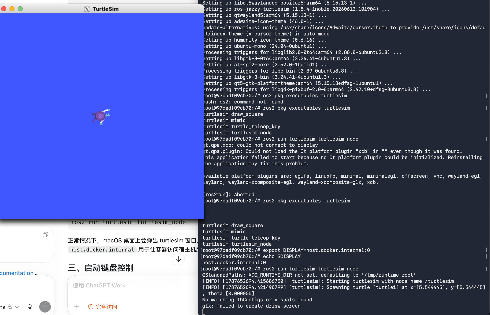

#### 使用方向控制乌龟

使用方向键控制小乌龟：

- ↑：前进
- ↓：后退
- ←：左转
- →：右转

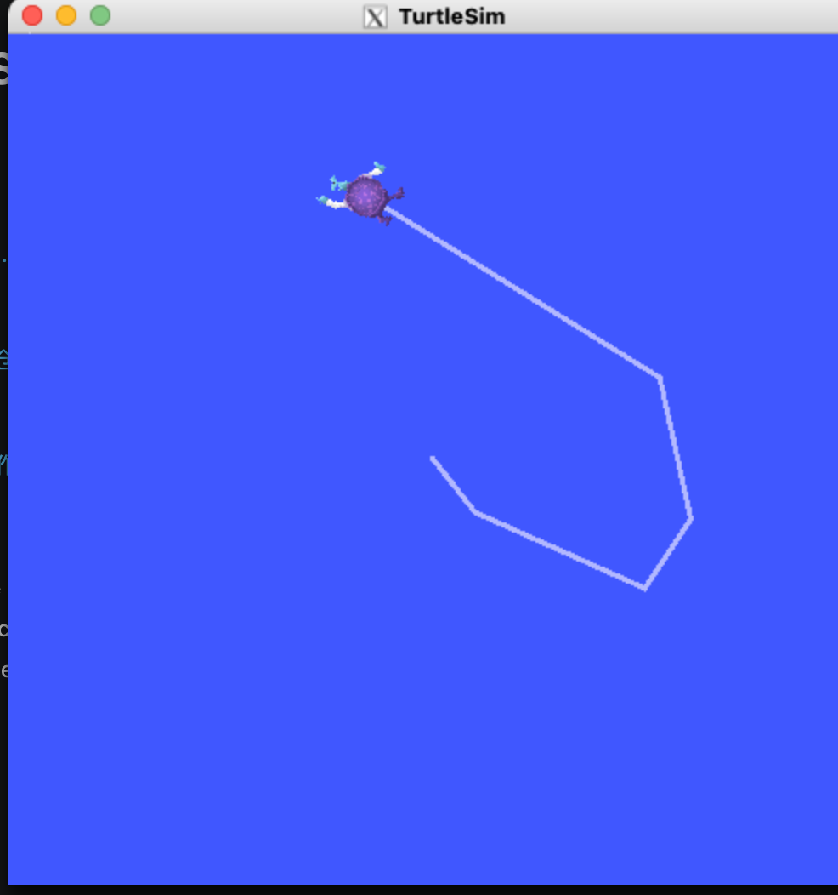

```Shell
Reading from keyboard
---------------------------
Use arrow keys to move the turtle.
Use g|b|v|c|d|e|r|t keys to rotate to absolute orientations. 'f' to cancel a rotation.
'q' to quit.
```

这些字母让小乌龟旋转到绝对方向：

| **按键** | **方向** |
|-|-|
| g | 0° |
| t | 45° |
| r | 90° |
| e | 135° |
| d | 180° |
| c | -135° |
| v | -90° |
| b | -45° |

#### 安装 rqt

```Shell
sudo apt update
sudo apt install ros-jazzy-rqt ros-jazzy-rqt-common-plugins
```

运行 rqt

```Shell
rqt
```

rqt 启动遇到问题

```Shell
root@97dadf09cb70:/# rqt
could not connect to display 
This application failed to start because no Qt platform plugin could be initialized. Reinstalling the application may fix this problem.

Available platform plugins are: eglfs, linuxfb, minimal, minimalegl, offscreen, vnc, wayland-egl, wayland, wayland-xcomposite-egl, wayland-xcomposite-glx, xcb.
```

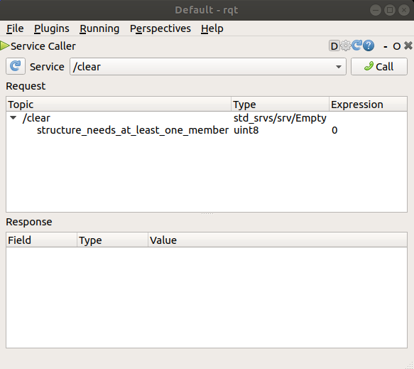

这里创建了另一个乌龟后，开启新终端 run 命令的，把 turtle1/cmd_vel 改成 turtle2/cmd_vel。

```Shell
ros2 run turtlesim turtle_teleop_key --ros-args --remap turtle1/cmd_vel:=turtle2/cmd_vel --remap turtle1/rotate_absolute:=turtle2/rotate_absolute
```

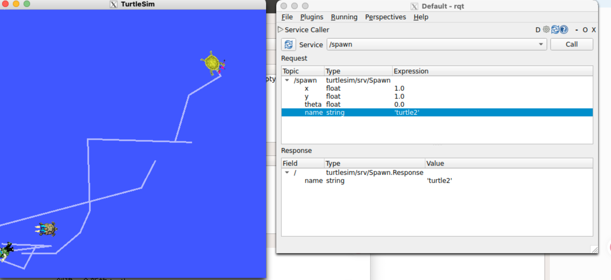

创建一个新的 turtle

```Shell
ros2 service call /spawn turtlesim/srv/Spawn \
"{x: 2.0, y: 2.0, theta: 0.0, name: 'turtle2'}"
```

### Topic

ROS 图是一个由 ROS 2 元素组成的网络，这些元素同时处理数据。它包含了所有可执行文件以及它们之间的所有连接（如果您将它们全部绘制出来并可视化的话）。

ROS 中的每个节点都应负责单一的模块化功能，例如控制车轮电机或发布来自激光测距仪的传感器数据。每个节点都可以通过主题、服务、动作或参数与其他节点发送和接收数据。

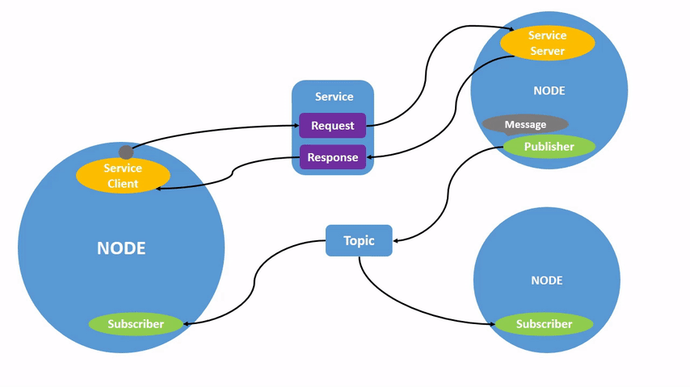

一个完整的机器人系统由许多协同工作的节点组成。在 ROS 2 中，一个可执行文件（C++ 程序、Python 程序等）可以包含一个或多个节点。

#### 任务

1. ros2 运行

该命令会启动软件包中的可执行文件。`ros2 run`

```Shell
ros2 run <package_name> <executable_name>
```

要运行 turtlesim，请打开一个新的终端窗口，然后输入以下命令：

```Shell
ros2 run turtlesim turtlesim_node
```

软件包名称是`turtlesim`，可执行文件名是`turtlesim_node`。

如果不知道节点名称。可以使用以下方法查找节点名称。`ros2 node list`。

`ros2 node list`将显示所有正在运行的节点的名称。当您想要与某个节点交互，或者您的系统运行着许多节点并需要跟踪它们时，此功能尤其有用。

1. ros2 node list

在 TurtleSim 仍在运行的情况下，打开一个新的终端，并输入以下命令。终端将返回节点名称：

```Shell
ros2 node list
/turtlesim
```

1. ros2 node info

现在您已经知道了节点的名称，可以通过以下方式访问有关它们的更多信息：

```Bash
root@97dadf09cb70:/# ros2 node info /turtlesim 
/turtlesim
  Subscribers:
    /parameter_events: rcl_interfaces/msg/ParameterEvent
    /turtle1/cmd_vel: geometry_msgs/msg/Twist
    /turtle2/cmd_vel: geometry_msgs/msg/Twist
    /turtle3/cmd_vel: geometry_msgs/msg/Twist
  Publishers:
    /parameter_events: rcl_interfaces/msg/ParameterEvent
    /rosout: rcl_interfaces/msg/Log
    /turtle1/color_sensor: turtlesim/msg/Color
    /turtle1/pose: turtlesim/msg/Pose
    /turtle2/color_sensor: turtlesim/msg/Color
    /turtle2/pose: turtlesim/msg/Pose
    /turtle3/color_sensor: turtlesim/msg/Color
    /turtle3/pose: turtlesim/msg/Pose
  Service Servers:
    /clear: std_srvs/srv/Empty
    /kill: turtlesim/srv/Kill
    /reset: std_srvs/srv/Empty
    /spawn: turtlesim/srv/Spawn
    /turtle1/set_pen: turtlesim/srv/SetPen
    /turtle1/teleport_absolute: turtlesim/srv/TeleportAbsolute
    /turtle1/teleport_relative: turtlesim/srv/TeleportRelative
    /turtle2/set_pen: turtlesim/srv/SetPen
    /turtle2/teleport_absolute: turtlesim/srv/TeleportAbsolute
    /turtle2/teleport_relative: turtlesim/srv/TeleportRelative
    /turtle3/set_pen: turtlesim/srv/SetPen
    /turtle3/teleport_absolute: turtlesim/srv/TeleportAbsolute
    /turtle3/teleport_relative: turtlesim/srv/TeleportRelative
    /turtlesim/describe_parameters: rcl_interfaces/srv/DescribeParameters
    /turtlesim/get_parameter_types: rcl_interfaces/srv/GetParameterTypes
    /turtlesim/get_parameters: rcl_interfaces/srv/GetParameters
    /turtlesim/get_type_description: type_description_interfaces/srv/GetTypeDescription
    /turtlesim/list_parameters: rcl_interfaces/srv/ListParameters
    /turtlesim/set_parameters: rcl_interfaces/srv/SetParameters
    /turtlesim/set_parameters_atomically: rcl_interfaces/srv/SetParametersAtomically
  Service Clients:

  Action Servers:
    /turtle1/rotate_absolute: turtlesim/action/RotateAbsolute
    /turtle2/rotate_absolute: turtlesim/action/RotateAbsolute
    /turtle3/rotate_absolute: turtlesim/action/RotateAbsolute
  Action Clients:
```

`ros2 node info`返回订阅者、发布者、服务和操作的列表，即与该节点交互的 ROS 图连接。

现在尝试在`/teleop_turtle`节点上运行相同的命令，看看它的连接与之前的有何不同`my_turtle`。

#### 理解 Topic

##### 背景信息

ROS 2 将复杂系统分解成许多模块化节点。主题是 ROS 图的重要组成部分，它们充当节点间交换消息的总线。

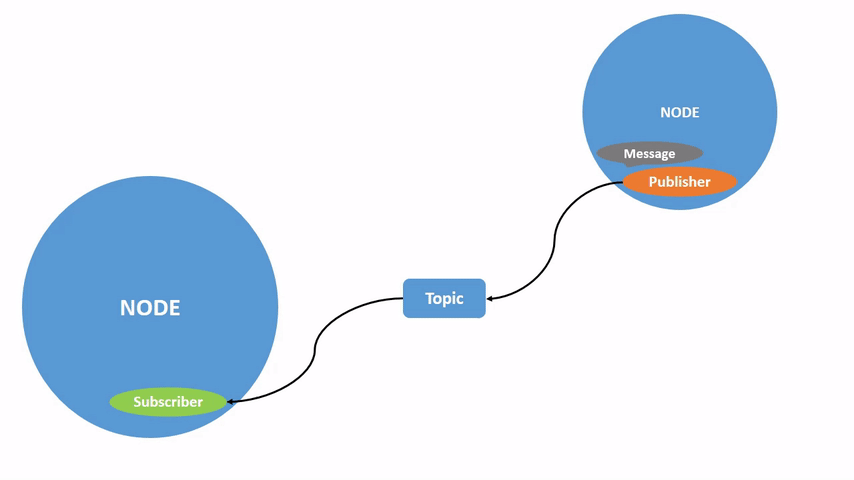

一个节点可以向任意数量的主题发布数据，并同时订阅任意数量的主题。

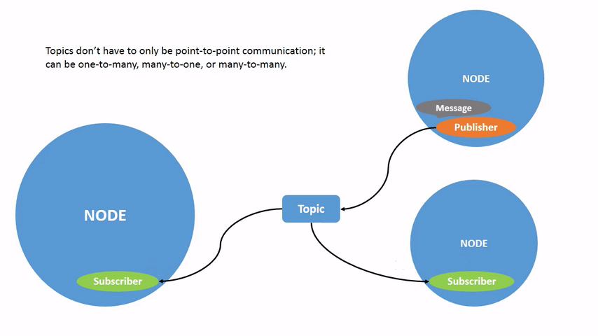

#### rqt graph

先运行之前的乌龟 demo

```Shell
ros2 run turtlesim turtlesim_node
```

另一个终端启动 node 发键盘事件

```Shell
ros2 run turtlesim turtle_teleop_key
```

我们将使用`rqt_graph`可视化工具来展示不断变化的节点和主题，以及它们之间的连接。

```Shell
ros2 run rqt_graph rqt_graph
```

Node Graph，它展示的是当前 ROS2 系统中的“计算图”。计算图的核心含义是：有哪些节点正在运行，以及这些节点之间通过哪些 topic、service 或 action 发生通信。

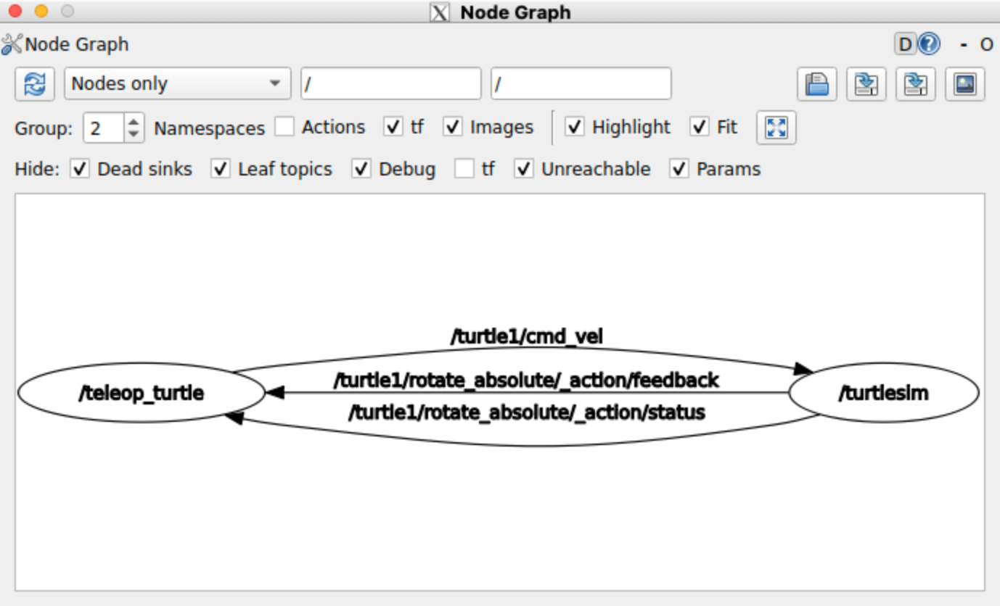

- 这表示 /teleop_turtle 正在发布 /turtle1/cmd_vel 这个 topic，而 /turtlesim 正在订阅这个 topic。这个 topic 的消息类型是：

```Plain
geometry_msgs/msg/Twist
```

下面两条连接属于 `/turtle1/rotate_absolute` 这个 Action 的内部通信：

```Plain
/turtle1/rotate_absolute/_action/feedback
/turtle1/rotate_absolute/_action/status
```

这和普通 topic 有些不同。Action 用于执行一个可能持续一段时间的任务，例如“让 turtle1 旋转到指定的绝对方向”。

- `/teleop_turtle` 是 Action Client，它负责发起旋转目标；
- `/turtlesim` 是 Action Server，它负责真正执行旋转任务。执行过程中，`/turtlesim` 会把当前执行状态和反馈发送回 `/teleop_turtle`，所以截图中这两条箭头的方向是从右边的 `/turtlesim` 指向左边的 `/teleop_turtle`。
- `/turtle1/rotate_absolute/_action/feedback` 表示执行过程中的反馈，例如旋转还剩多少距离、当前执行到了什么阶段；
- `/turtle1/rotate_absolute/_action/status` 表示 Action 当前处于什么状态，例如目标已经接受、正在执行、已经完成或被取消。你在

#### ros2 主题列表

在新终端中运行该命令将返回系统中当前所有活动主题的列表：ros2 topic list

```Shell
ros2 topic list
/parameter_events
/rosout
/turtle1
/cmd_vel
/turtle1
/color_sensor
/turtle1/pose
```

ros2 topic list -t将返回相同的主题列表，这次会在括号中附加主题类型：

```Bash
ros2 topic list -t
/parameter_events [rcl_interfaces/msg/ParameterEvent]/rosout [rcl_interfaces/msg/Log]/turtle1/cmd_vel [geometry_msgs/msg/Twist]/turtle1/color_sensor [turtlesim/msg/Color]/turtle1/pose [turtlesim/msg/Pose]
```

这些属性，特别是类型，使得节点能够知道它们在主题之间传递时讨论的是相同的信息。

如果您想知道 rqt_graph 中所有这些主题的位置，您可以取消选中“隐藏”下的所有复选框\*\*：\*\*

#### 查看主题发布数据

要查看某个主题已发布的数据，请使用：

```Shell
ros2 topic echo <topic_name>
```

既然我们知道它会发布关于该主题的`/teleop_turtle`数据，那么让我们用它来深入探讨该主题：`/turtlesim/turtle1/cmd_velecho`

```Shell
ros2 topic echo /turtle1/cmd_vel
```

一开始，这条命令不会返回任何数据。这是因为它正在等待`/teleop_turtle`发布某些内容。

返回运行程序的终端`turtle_teleop_key`，使用方向键移动海龟。`echo`同时观察运行程序的终端，你会看到每次移动都会发布位置数据：

```YAML
root@97dadf09cb70:/# ros2 topic echo /turtle1/cmd_vel
linear:
  x: 0.0
  y: 0.0
  z: 0.0
angular:
  x: 0.0
  y: 0.0
  z: 2.0

```

现在返回 rqt_graph 并取消选中**“调试”**框。可以看到多了两个

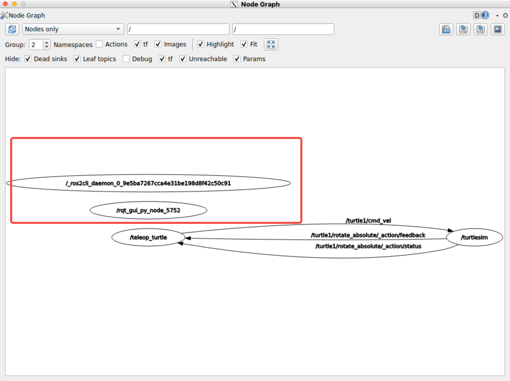

话题不一定非得是一对一的沟通；也可以是一对多、多对一或多对多的沟通。

换个角度来看，那就是运行：

```Shell
ros2 topic info /turtle1/cmd_vel
```

```Shell
Type: geometry_msgs/msg/Twist
Publisher count: 1
Subscription count: 2
```

#### ros2 topic 信息-详细

要了解某个主题的更多详细信息，您可以使用`--verbose`（或`-v`）标志：

```Shell
ros2 topic info /turtle1/cmd_vel --verbose
```

这将返回更多详细信息，包括：

- 发布者和订阅者的节点名称和命名空间
- 主题类型
- QoS配置文件

#### ros2 接口显示

节点通过主题以消息的形式发送数据。发布者和订阅者必须发送和接收相同类型的消息才能进行通信。

之前运行后看到的那些主题类型，让我们知道每个主题使用的消息类型。回想一下，主题的类型如下：ros2 topic list -t

```Bash
root@97dadf09cb70:/# ros2 topic list -t
/parameter_events [rcl_interfaces/msg/ParameterEvent]
/rosout [rcl_interfaces/msg/Log]
/turtle1/cmd_vel [geometry_msgs/msg/Twist]
```

这个就是消息类型

```Shell
geometry_msgs/msg/Twist
```

这意味着在包中`geometry_msgs`有一个`msg`被调用的`Twist`。

现在我们可以对这种类型进行分析，以了解其详细信息。具体来说，就是了解消息期望的数据结构。ros2 interface show <msg_type>

```Shell
ros2 interface show geometry_msgs/msg/Twist
```

返回结果：

```Go
root@97dadf09cb70:/# ros2 interface show geometry_msgs/msg/Twist
**This expresses velocity in free space broken into its linear and angular parts.**

Vector3  linear
        float64 x
        float64 y
        float64 z
Vector3  angular
        float64 x
        float64 y
        float64 z
```

这说明`/turtlesim`节点期望收到一个包含两个向量的消息，`linear`这两个向量各有三个元素。

#### ros2 主题发布

可以使用以下命令直接从命令行向主题发布数据：

```Shell
ros2 topic pub <topic_name> <msg_type> '<args>'
```

参数`'<args>'`是你要传递给主题的实际数据，其结构与你在上一节中发现的结构相同。

使用该`pub`命令主要有四种方法，如下所示。

1. 发布字典字符串

要将数据发布到主题，需要以 YAML 字符串的形式传递数据。

```Shell
ros2 topic pub /turtle1/cmd_vel geometry_msgs/msg/Twist "{linear: {x: 2.0, y: 0.0, z: 0.0}, angular: {x: 0.0, y: 0.0, z: 1.8}}"
```

1. 发布一条空白消息：

```Shell
ros2 topic pub /turtle1/cmd_vel geometry_msgs/msg/Twist
```

这将以 1 Hz 的频率发布该消息类型的默认值。在本例中，这等效于以下命令：

```Shell
ros2 topic pub /turtle1/cmd_vel geometry_msgs/msg/Twist "{linear: {x: 0.0, y: 0.0, z: 0.0}, angular: {x: 0.0, y: 0.0, z: 0.0}}" --rate 1
```

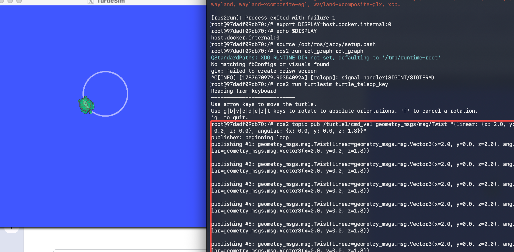

可以看到虽然只执行了一次 pub，但是终端会源源不断的发布命令。

有时您可能只想向主题发布一次数据（而不是持续发布）。要仅发布一次命令，请添加相应选项`--once`。

```Shell
ros2 topic pub --once -w 2 /turtle1/cmd_vel geometry_msgs/msg/Twist "{linear: {x: 2.0, y: 0.0, z: 0.0}, angular: {x: 0.0, y: 0.0, z: 1.8}}"
```

- `--once`是一个可选参数，意思是“发布一条消息然后退出”。
- `-w 2`这是一个可选参数，意思是“等待两个匹配的订阅”。这是必需的，因为我们同时订阅了 turtlesim 和 echo 主题。

```Shell
root@97dadf09cb70:/# ros2 topic pub --once -w 2 /turtle1/cmd_vel geometry_msgs/msg/Twist "{linear: {x: 2.0, y: 0.0, z: 0.0}, angular: {x: 0.0, y: 0.0, z: 1.8}}"
Waiting for at least 2 matching subscription(s)...
Waiting for at least 2 matching subscription(s)...
Waiting for at least 2 matching subscription(s)...
Waiting for at least 2 matching subscription(s)...
```

在你的系统中，`/turtlesim` 节点是这个话题的一个订阅者，因为它需要接收速度命令来控制 turtle1。因此你至少有：

```Plain
/turtlesim → 订阅 /turtle1/cmd_vel
```

但是你还没有启动：

```Plain
ros2 topic echo /turtle1/cmd_vel
```

所以目前可能只有一个订阅者，而你命令中写的是：

```Plain
-w 2
```

也就是要求至少发现两个订阅者以后才开始发送。

你可以先在当前终端查看实际订阅数量：

```Plain
ros2 topic info /turtle1/cmd_vel
```

如果只运行了 `turtlesim_node`，通常会看到类似：

```Plain
Type: geometry_msgs/msg/Twist

Publisher count: 0

Subscription count: 1
```

增加 ros2 topic echo

```Shell
root@97dadf09cb70:/# ros2 topic echo /turtle1/cmd_vel
linear:
  x: 2.0
  y: 0.0
  z: 0.0
angular:
  x: 0.0
  y: 0.0
  z: 1.8

```

再回去看

```Shell
publisher: beginning loop
publishing #1: geometry_msgs.msg.Twist(linear=geometry_msgs.msg.Vector3(x=2.0, y=0.0, z=0.0), angular=geometry_msgs.msg.Vector3(x=0.0, y=0.0, z=1.8))
```

#### ros2 topic hz

您还可以使用以下命令查看数据发布速率：

```Shell
ros2 topic hz /turtle1/pose
average rate: 59.354  min: 0.005s max: 0.027s std dev: 0.00284s window: 58
```

`/turtlesim`它将返回节点向主题发布数据的速率数据`pose`。

### ros2 服务

服务是 ROS 图中节点间另一种通信方式。服务基于呼叫-响应模型，而非主题的发布-订阅模型。主题允许节点订阅数据流并持续获取更新，而服务仅在客户端明确调用时才提供数据。

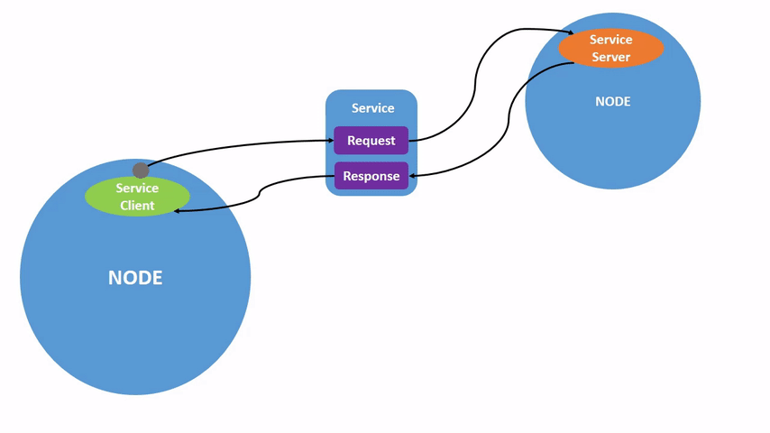

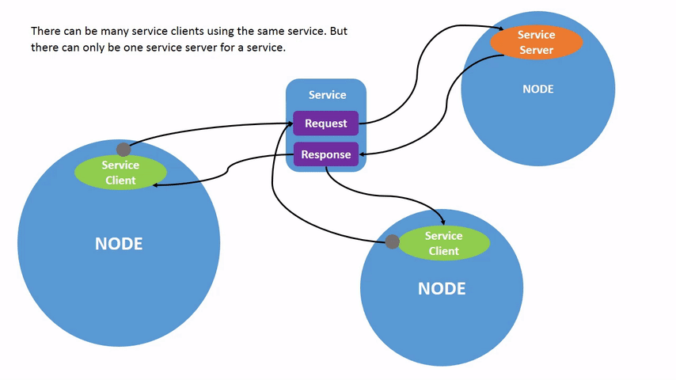

启动两个 turtlesim 节点，`/turtlesim`并且`/teleop_turtle`。

打开一个新的终端并运行：

```Shell
ros2 run turtlesim turtlesim_node
```

打开另一个终端并运行：

```Shell
ros2 run turtlesim turtle_teleop_key
```

#### ros2 服务列表

在新终端中运行该命令将返回系统中当前所有活动服务的列表：`ros2 service list`

```Bash
root@97dadf09cb70:/# ros2 service list
/clear
/kill
/reset
/spawn
/teleop_turtle/describe_parameters
/teleop_turtle/get_parameter_types
/teleop_turtle/get_parameters
/teleop_turtle/get_type_description
/teleop_turtle/list_parameters
/teleop_turtle/set_parameters
/teleop_turtle/set_parameters_atomically
/turtle1/set_pen
/turtle1/teleport_absolute
/turtle1/teleport_relative
/turtlesim/describe_parameters
/turtlesim/get_parameter_types
/turtlesim/get_parameters
/turtlesim/get_type_description
/turtlesim/list_parameters
/turtlesim/set_parameters
/turtlesim/set_parameters_atomically
```

让我们重点关注 turtlesim 特有的服务，`/clear`即`/kill`、`/reset`、`/spawn`、`/turtle1/set_pen`、`/turtle1/teleport_absolute`

#### ros2服务类型

服务具有类型，用于描述服务的请求和响应数据的结构。服务类型的定义与主题类型类似，但服务类型包含两部分：一部分是请求消息，另一部分是响应消息。

要了解服务的类型，请使用以下命令：

```Shell
ros2 service type <service_name>
```

我们来看看turtlesim的`/clear`服务。在一个新的终端窗口中，输入以下命令：

```Shell
ros2 service type /clear
std_srvs/srv/Empty
```

该`Empty`类型表示服务调用在发出请求时不发送任何数据，在接收响应时也不接收任何数据。

同时查看所有活动服务的类型

```Bash
root@97dadf09cb70:/# ros2 service list -t
/clear [std_srvs/srv/Empty]
/kill [turtlesim/srv/Kill]
/reset [std_srvs/srv/Empty]
/spawn [turtlesim/srv/Spawn]
/teleop_turtle/describe_parameters [rcl_interfaces/srv/DescribeParameters]
/teleop_turtle/get_parameter_types [rcl_interfaces/srv/GetParameterTypes]
/teleop_turtle/get_parameters [rcl_interfaces/srv/GetParameters]
/teleop_turtle/get_type_description [type_description_interfaces/srv/GetTypeDescription]
/teleop_turtle/list_parameters [rcl_interfaces/srv/ListParameters]
/teleop_turtle/set_parameters [rcl_interfaces/srv/SetParameters]
/teleop_turtle/set_parameters_atomically [rcl_interfaces/srv/SetParametersAtomically]
/turtle1/set_pen [turtlesim/srv/SetPen]
/turtle1/teleport_absolute [turtlesim/srv/TeleportAbsolute]
/turtle1/teleport_relative [turtlesim/srv/TeleportRelative]
/turtlesim/describe_parameters [rcl_interfaces/srv/DescribeParameters]
/turtlesim/get_parameter_types [rcl_interfaces/srv/GetParameterTypes]
/turtlesim/get_parameters [rcl_interfaces/srv/GetParameters]
/turtlesim/get_type_description [type_description_interfaces/srv/GetTypeDescription]
/turtlesim/list_parameters [rcl_interfaces/srv/ListParameters]
/turtlesim/set_parameters [rcl_interfaces/srv/SetParameters]
/turtlesim/set_parameters_atomically [rcl_interfaces/srv/SetParametersAtomically]
```

#### ros2 服务信息

要查看特定服务的信息，请使用以下命令：

```Shell
ros2 service info <service_name>
```

这将返回服务类型以及服务客户端和服务器的数量。

例如，您可以查找该服务的客户端和服务器数量`/clear`：

```Shell
root@97dadf09cb70:/# ros2 service info /clear
Type: std_srvs/srv/Empty
Clients count: 0
Services count: 1
```

ros2 服务查找

你可以从命令行调用服务，但首先你需要了解输入参数的结构。

```Shell
ros2 interface show <type_name>
```

请尝试对`/clear`服务类型执行此操作`Empty`：

```YAML
root@97dadf09cb70:/# ros2 interface show std_srvs/srv/Empty

```

对 /Spawn 服务类型进行操作

```YAML
root@97dadf09cb70:/# ros2 interface show turtlesim/srv/Spawn
float32 x
float32 y
float32 theta
string name # Optional.  A unique name will be created and returned if this is empty

string name
```

#### ros2 服务调用

现在您已经了解了什么是服务类型、如何查找服务类型以及如何查找该类型参数的结构，您可以使用以下方式调用服务：

```Shell
ros2 service call <service_name> <service_type> <arguments>
```

```Shell
ros2 service call /clear std_srvs/srv/Empty
```

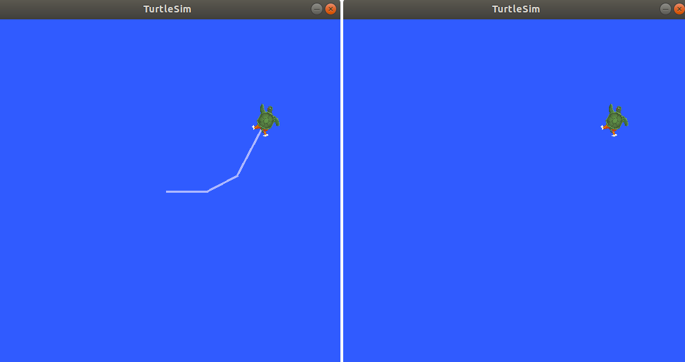

现在让我们通过调用`/spawn`并设置参数来生成一个新的海龟。`<arguments>`从命令行调用服务时，输入必须采用 YAML 语法。

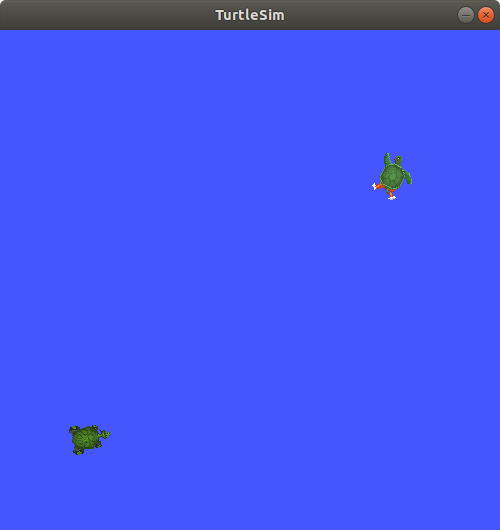

### Ros2 参数

参数是节点的配置值。您可以将参数理解为节点的设置。节点可以将参数存储为整数、浮点数、布尔值、字符串和列表。在 ROS 2 中，每个节点都维护自己的参数。

要查看节点的参数，请打开一个新的终端并输入以下命令：

```Bash
root@97dadf09cb70:/# ros2 param list
/teleop_turtle:
  qos_overrides./parameter_events.publisher.depth
  qos_overrides./parameter_events.publisher.durability
  qos_overrides./parameter_events.publisher.history
  qos_overrides./parameter_events.publisher.reliability
  scale_angular
  scale_linear
  start_type_description_service
  use_sim_time
/turtlesim:
  background_b
  background_g
  background_r
  holonomic
  qos_overrides./parameter_events.publisher.depth
  qos_overrides./parameter_events.publisher.durability
  qos_overrides./parameter_events.publisher.history
  qos_overrides./parameter_events.publisher.reliability
  start_type_description_service
  use_sim_time
```

您可以看到节点命名空间，`/teleop_turtle`以及`/turtlesim`每个节点的参数。

每个节点都有一个参数`use_sim_time`；它并非 turtlesim 独有。

根据它们的名称来看，这些参数似乎是`/turtlesim`使用 RGB 颜色值来确定 turtlesim 窗口的背景颜色。

要确定参数的类型，可以使用。`ros2 param get`

#### ros2 参数获取

要显示参数的类型和当前值，请使用以下命令：

```Shell
ros2 param get <node_name> <parameter_name>
```

让我们来找出`/turtlesim`该参数的当前值`background_g`：这里指的是获取 RGB 的值

```Shell
ros2 param get /turtlesim background_g
Integer value is: 86
```

#### ros2 参数集

要在运行时更改参数值，请使用以下命令：

```Shell
ros2 param set <node_name> <parameter_name> <value>
```

让我们更改`/turtlesim`背景颜色：

```Shell
ros2 param set /turtlesim background_r 150
```

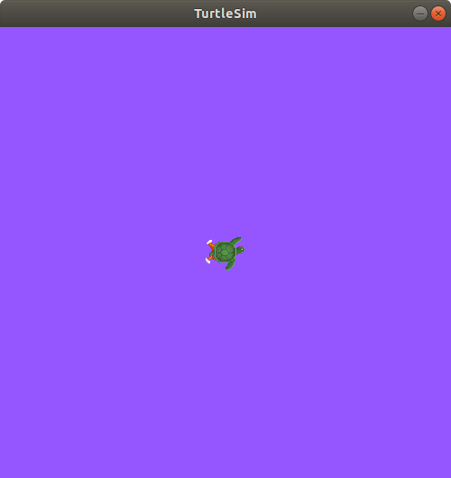

使用该命令设置参数`set`只会更改当前会话中的参数，不会永久生效。但是，您可以保存设置，并在下次启动节点时重新加载这些设置。

#### ros2 参数转储

您可以使用以下命令查看节点的所有当前参数值：

```Shell
ros2 param dump <node_name>
```

该命令默认将输出打印到标准输出 (stdout)，但您也可以将参数值重定向到文件以保存以供后续使用。要将当前配置的`/turtlesim`参数保存到文件中`turtlesim.yaml`，请输入以下命令

```YAML
root@97dadf09cb70:/# ros2 param dump /turtlesim > turtlesim.yaml
root@97dadf09cb70:/# cat turtlesim.yaml 
/turtlesim:
  ros__parameters:
    background_b: 255
    background_g: 86
    background_r: 150
    holonomic: false
    qos_overrides:
      /parameter_events:
        publisher:
          depth: 1000
          durability: volatile
          history: keep_last
          reliability: reliable
    start_type_description_service: true
    use_sim_time: false
```

如果将来想要使用相同的参数重新加载节点，导出参数会很有帮助。

#### Ros2 参数加载

可以使用以下命令将参数从文件加载到当前正在运行的节点：

```Shell
ros2 param load <node_name> <parameter_file>
```

要将`turtlesim.yaml`生成的文件加载到节点的参数中，请输入以下命令：`ros2 param dump/turtlesim`

```SQL
root@97dadf09cb70:/# ros2 param load /turtlesim turtlesim.yaml 
Set parameter background_b successful
Set parameter background_g successful
Set parameter background_r successful
Set parameter holonomic successful
Set parameter qos_overrides./parameter_events.publisher.depth failed: parameter 'qos_overrides./parameter_events.publisher.depth' cannot be set because it is read-only
Set parameter qos_overrides./parameter_events.publisher.durability failed: parameter 'qos_overrides./parameter_events.publisher.durability' cannot be set because it is read-only
Set parameter qos_overrides./parameter_events.publisher.history failed: parameter 'qos_overrides./parameter_events.publisher.history' cannot be set because it is read-only
Set parameter qos_overrides./parameter_events.publisher.reliability failed: parameter 'qos_overrides./parameter_events.publisher.reliability' cannot be set because it is read-only
Set parameter start_type_description_service failed: parameter 'start_type_description_service' cannot be set because it is read-only
Set parameter use_sim_time successful
root@97dadf09cb70:/# 
```

#### 节点启动时加载参数文件

要使用已保存的参数值启动同一节点，请使用：

```Shell
ros2 run <package_name> <executable_name> --ros-args --params-file <file_name>
```

这是你一直用来启动 turtlesim 的相同命令，添加了标志`--ros-args`和`--params-file`，后面跟着你要加载的文件。

停止正在运行的 turtlesim 节点，然后尝试使用保存的参数重新加载它，方法如下：（这个时候 turtlesim.yaml 就是保存了我们修改后的紫色配置了）

```Shell
ros2 run turtlesim turtlesim_node --ros-args --params-file turtlesim.yaml
```

turtlesim窗口应该像往常一样出现，但背景会变成你之前设置的紫色。

### Ros2 Action

在 ROS 2 中，动作是通信类型之一，专为长时间运行的任务而设计。它们由三部分组成：目标、反馈和结果。

操作基于主题和服务构建。它们的功能与服务类似，但操作可以取消。此外，它们提供持续的反馈，而服务只返回一次响应。

Actions 使用客户端-服务器模型，类似于发布者-订阅者模型（详见[主题教程](https://docs.ros.org/en/jazzy/Tutorials/Beginner-CLI-Tools/Understanding-ROS2-Topics/Understanding-ROS2-Topics.html)）。“Action 客户端”节点向“Action 服务器”节点发送目标，后者确认目标并返回反馈流和结果。

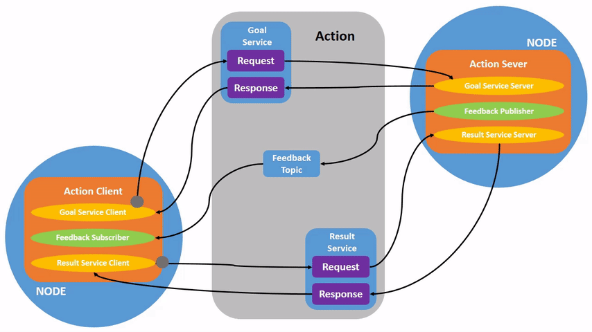

启动两个 turtlesim 节点，`/turtlesim`并且`/teleop_turtle`。

打开一个新的终端并运行：

```Shell
ros2 run turtlesim turtlesim_node
```

打开另一个终端并运行：

```Shell
ros2 run turtlesim turtle_teleop_key
```

启动`/teleop_turtle`节点后，您将在终端中看到以下消息：

```Shell
Use arrow keys to move the turtle.Use G|B|V|C|D|E|R|T keys to rotate to absolute orientations. 'F' to cancel a rotation.
```

我们重点关注第二行，它对应于一个操作 Action。

请注意`/turtlesim`运行节点的终端。每次按下这些键，您都会向`/turtlesim`节点中的一个动作服务器发送一个目标。该目标是使海龟旋转到特定方向。海龟完成旋转后，应显示一条消息，传达目标的结果：

```Shell
[INFO] [turtlesim]: Rotation goal completed successfully
```

关键`F`在于取消正在执行中的目标。

尝试按下该`C`键，然后`F`在海龟完成旋转之前再次按下该键。在`/turtlesim`节点运行的终端中，您将看到以下消息：

```Shell
[INFO] [turtlesim]: Rotation goal canceled
```

不仅客户端（您在远程操作中的输入）可以停止目标，服务器端（节点`/turtlesim`）也可以。当服务器端选择停止处理目标时，称为“中止”该目标。

尝试在第一次旋转完成之前按下第一个`D`键，然后再按下第二个键。在节点运行的终端中，您将看到以下消息：`G/turtlesim`

```Shell
[WARN] [turtlesim]: Rotation goal received before a previous goal finished. Aborting previous goal
```

注意后面的

```Shell
ction Servers:
    /turtle1/rotate_absolute: turtlesim/action/RotateAbsolute
  Action Clients:
```

```Bash
root@97dadf09cb70:/# ros2 node info /turtlesim
/turtlesim
  Subscribers:
    /parameter_events: rcl_interfaces/msg/ParameterEvent
    /turtle1/cmd_vel: geometry_msgs/msg/Twist
  Publishers:
    /parameter_events: rcl_interfaces/msg/ParameterEvent
    /rosout: rcl_interfaces/msg/Log
    /turtle1/color_sensor: turtlesim/msg/Color
    /turtle1/pose: turtlesim/msg/Pose
  Service Servers:
    /clear: std_srvs/srv/Empty
    /kill: turtlesim/srv/Kill
    /reset: std_srvs/srv/Empty
    /spawn: turtlesim/srv/Spawn
    /turtle1/set_pen: turtlesim/srv/SetPen
    /turtle1/teleport_absolute: turtlesim/srv/TeleportAbsolute
    /turtle1/teleport_relative: turtlesim/srv/TeleportRelative
    /turtlesim/describe_parameters: rcl_interfaces/srv/DescribeParameters
    /turtlesim/get_parameter_types: rcl_interfaces/srv/GetParameterTypes
    /turtlesim/get_parameters: rcl_interfaces/srv/GetParameters
    /turtlesim/get_type_description: type_description_interfaces/srv/GetTypeDescription
    /turtlesim/list_parameters: rcl_interfaces/srv/ListParameters
    /turtlesim/set_parameters: rcl_interfaces/srv/SetParameters
    /turtlesim/set_parameters_atomically: rcl_interfaces/srv/SetParametersAtomically
  Service Clients:

  Action Servers:
    /turtle1/rotate_absolute: turtlesim/action/RotateAbsolute
  Action Clients:
```

#### ros2 操作类表

操作也有类型，类似于主题和服务。要查找`/turtle1/rotate_absolute`操作的类型，请运行以下命令：

```Shell
ros2 action list -t
/turtle1/rotate_absolute [turtlesim/action/RotateAbsolute]
```

每个操作名称（在本例中仅限此操作）右侧的括号内`/turtle1/rotate_absolute`是操作类型`turtlesim/action/RotateAbsolute`。当您想从命令行或代码执行操作时，需要用到此信息。

#### ros2 action type

如果要检查操作的类型，请运行以下命令：

```Shell
ros2 action type /turtle1/rotate_absolute
turtlesim/action/RotateAbsolute
```

#### ros2 action info

您可以`/turtle1/rotate_absolute`使用以下命令进一步分析该操作：

```Shell
ros2 action info /turtle1/rotate_absolute
```

```Shell
root@97dadf09cb70:/# ros2 action info /turtle1/rotate_absolute 
Action: /turtle1/rotate_absolute
Action clients: 1
    /teleop_turtle
Action servers: 1
    /turtlesim
```

#### ros2 action interface

```Shell
ros2 interface show turtlesim/action/RotateAbsolute
```

本消息中第一部分以上`---`是目标请求的结构（数据类型和名称）。下一部分是结果的结构。最后一部分是反馈的结构。

```YAML
root@97dadf09cb70:/# ros2 interface show turtlesim/action/RotateAbsolute
**The desired heading in radians**
float32 theta

**The angular displacement in radians to the starting position**
float32 delta

**The remaining rotation in radians**
float32 remaining
```

#### ros2 action send_goal

现在让我们使用以下语法从命令行发送一个操作目标：

```Shell
ros2 action send_goal <action_name> <action_type> <values>
```

`<values>`需要采用 YAML 格式。

请留意 turtlesim 窗口，并在终端中输入以下命令：

```Shell
ros2 action send_goal /turtle1/rotate_absolute turtlesim/action/RotateAbsolute "{theta: 2.57}"
```

```Shell
root@97dadf09cb70:/# ros2 action send_goal /turtle1/rotate_absolute turtlesim/action/RotateAbsolute "{theta: 2.57}"
Waiting for an action server to become available...
Sending goal:
     theta: 2.57

Goal accepted with ID: 7d78b88d3db141d39ea42cec36309699

Result:
    delta: -1.0080000162124634

Goal finished with status: SUCCEEDED
```

你应该能看到乌龟在旋转。

所有 goal 都有一个唯一的 ID，显示在返回消息中。您还可以看到结果，即名为“偏移量”的字段`delta`，它表示进球点到起始位置的偏移量。

要查看此目标的反馈，请`--feedback`在命令中添加：`ros2 action send_goal`，您将继续收到反馈，剩余的弧度，直到目标完成。

```Shell
ros2 action send_goal /turtle1/rotate_absolute turtlesim/action/RotateAbsolute "{theta: -1.57}" --feedback
Waiting for an action server to become available...
```

```YAML
Waiting for an action server to become available...
Sending goal:
     theta: -1.57

Goal accepted with ID: ee8ea4230b3242a691313d8ea46ff316

Feedback:
    remaining: 2.1531853675842285
。。。

Feedback:
    remaining: 0.009185194969177246

Result:
    delta: -2.1439998149871826

Goal finished with status: SUCCEEDED
```

### rqt_console 查看日志

`rqt_console`是一个用于在 ROS 2 中查看日志消息的图形用户界面工具。通常，日志消息会显示在终端中。使用`rqt_console`，您可以收集一段时间内的日志消息，以更清晰、更有条理的方式查看它们，进行筛选，保存它们，甚至可以重新加载已保存的文件以便在其他时间查看。

节点使用日志以多种方式输出有关事件和状态的消息。日志内容通常是为用户提供信息。

在新终端中运行`rqt_console`以下命令：

```Shell
ros2 run rqt_console rqt_console
```

为了生成`rqt_console`要显示的日志信息，我们让海龟撞墙。在一个新的终端窗口中，输入以下命令（详见[主题教程](https://docs.ros.org/en/jazzy/Tutorials/Beginner-CLI-Tools/Understanding-ROS2-Topics/Understanding-ROS2-Topics.html)）：`ros2 topic pub`

```Shell
ros2 topic pub -r 1 /turtle1/cmd_vel geometry_msgs/msg/Twist "{linear: {x: 2.0, y: 0.0, z: 0.0}, angular: {x: 0.0,y: 0.0,z: 0.0}}"
```

由于上述命令以稳定的频率发布主题，海龟会不断撞墙。`rqt_console`你会看到相同的消息及其`Warn`严重级别反复显示，如下所示：

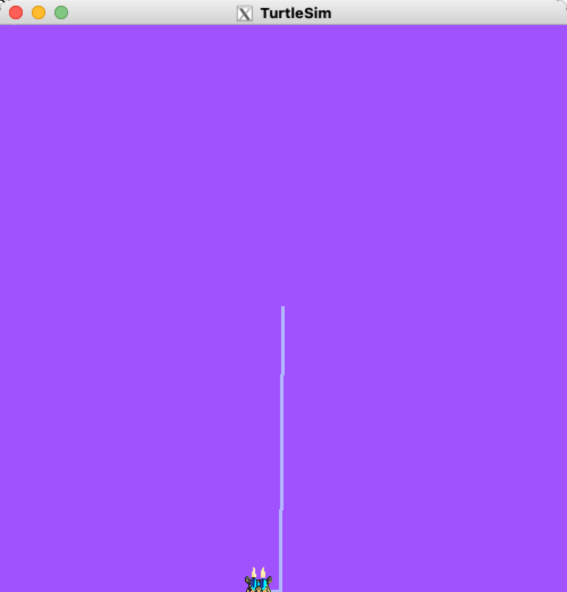

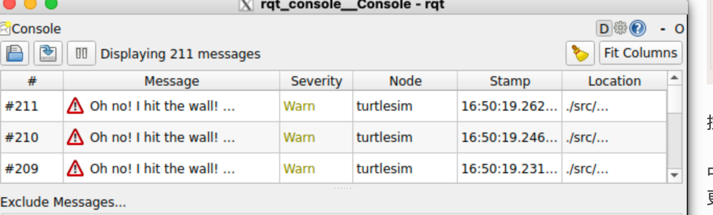

#### ros2 日志级别

ROS 2 的日志级别按严重程度排序：

> 1. 致命的
> 2. 错误
> 3. 警告
> 4. 信息
> 5. 调试

每个级别的具体含义并没有确切的标准，但可以肯定的是：

- `Fatal`消息表明系统即将终止运行，以保护自身免受损害。
- `Error`这些信息表明存在一些重大问题，这些问题不一定会损坏系统，但会阻止系统正常运行。
- `Warn`消息表明出现了意外活动或不理想的结果，这可能代表着更深层次的问题，但不会直接损害功能。
- `Info`消息指示事件和状态更新，可直观地验证系统是否按预期运行。
- `Debug`消息详细记录了系统执行的整个步骤过程。

默认级别为`Info`。您只会看到默认严重级别及更高级别的消息。

通常情况下，只有`Debug`消息会被隐藏，因为它们是唯一比严重级别低的消息级别`Info`。例如，如果您将默认级别设置为`Warn`，则只会看到严重级别为`Warn`、`Error`和的消息`Fatal`。

#### 设置日志默认级别

首次运行节点时，您可以使用重映射功能设置默认日志级别`/turtlesim`。在终端中输入以下命令：

```Shell
ros2 run turtlesim turtlesim_node --ros-args --log-level WARN
```

现在您将不会再看到`Info`上次启动时在控制台中出现的初始级别消息`turtlesim`。这是因为`Info`这些消息的优先级低于新的默认严重级别`Warn`。

### Ros2 Launch

在大多数入门教程中，您每次运行新节点都需要打开新的终端。随着您创建的系统越来越复杂，同时运行的节点也越来越多，打开终端并重新输入配置信息会变得非常繁琐。

启动文件允许您同时启动和配置多个包含 ROS 2 节点的可执行文件。

运行带有该命令的单个启动文件将一次性启动您的整个系统——所有节点及其配置。`ros2 launch`

#### 运行启动文件

打开一个新的终端并运行：

```Shell
ros2 launch turtlesim multisim.launch.py
```

这将运行两个 TurtleSim 节点：

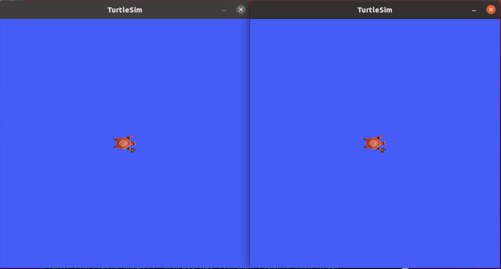

现在这些节点已经运行，您可以像控制其他 ROS 2 节点一样控制它们。例如，您可以通过打开两个额外的终端并运行以下命令，使海龟朝相反方向移动：

在第二个终端中：

```Shell
ros2 topic pub  /turtlesim1/turtle1/cmd_vel geometry_msgs/msg/Twist "{linear: {x: 2.0, y: 0.0, z: 0.0}, angular: {x: 0.0, y: 0.0, z: 1.8}}"
```

在第三个终端中：

```Shell
ros2 topic pub  /turtlesim2/turtle1/cmd_vel geometry_msgs/msg/Twist "{linear: {x: 2.0, y: 0.0, z: 0.0}, angular: {x: 0.0, y: 0.0, z: -1.8}}"
```

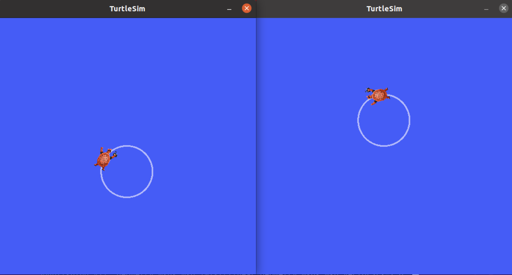

### 数据记录和回放

`ros2 bag`是一个命令行工具，用于记录 ROS 2 系统中主题和服务上发布的数据。它会收集任意数量主题和服务上传递的数据，并将其保存到数据库中。之后，您可以重放这些数据，从而复现测试和实验的结果。记录主题和服务也是分享您的工作成果并允许其他人复现它的绝佳方式。

#### 管理 Topic 数据

您将在`turtlesim`系统中记录键盘输入，以便保存和稍后回放，因此请先启动`/turtlesim`and`/teleop_turtle`节点。

打开一个新的终端并运行：

打开一个新的终端并运行：

```Shell
ros2 run turtlesim turtlesim_node
```

打开另一个终端并运行：

```Shell
ros2 run turtlesim turtle_teleop_key
```

我们也创建一个新目录来存储保存的录音：

```Shell
mkdir bag_files
cd bag_files
```

`ros2 bag`可以记录发布到主题的消息数据。要查看系统主题列表，请打开一个新的终端并运行以下命令：

```Shell
root@97dadf09cb70:/bag_files# ros2 topic list
/parameter_events
/rosout
/turtlesim1/turtle1/cmd_vel
/turtlesim1/turtle1/color_sensor
/turtlesim1/turtle1/pose
root@97dadf09cb70:/bag_files# 
```

在主题教程中，您了解到`/turtle_teleop`节点会向主题发布命令`/turtle1/cmd_vel`，以使 turtlesim 中的海龟移动。

要查看正在发布的数据`/turtle1/cmd_vel`，请运行以下命令：

```Shell
ros2 topic echo /turtle1/cmd_vel
```

一开始不会显示任何内容，因为远程操作尚未发布任何数据。返回运行远程操作的终端，选中它使其处于活动状态。使用方向键移动海龟，您将在运行的终端上看到数据发布。`ros2 topic echo`

#### 记录主题

要记录发布到某个主题的数据，请使用以下命令语法：

```Shell
ros2 bag record <topic_name>
```

在对所选主题运行此命令之前，请打开一个新的终端并进入`bag_files`您之前创建的目录，因为 rosbag 文件将保存在您运行它的目录中。

```Markdown
root@97dadf09cb70:/# ros2 bag record /turtle1/cmd_vel
[WARN] [ros2bag]: Positional "topics" argument deprecated. Please use optional "--topics" argument instead.
[INFO] [1787677033.023889768] [rosbag2_recorder]: Press SPACE for pausing/resuming
[INFO] [1787677033.023900977] [rosbag2_recorder]: Event publisher thread: Started
[INFO] [1787677033.026560734] [rosbag2_recorder]: Starting recording to 'rosbag2_2026_08_25-16_57_13'
[INFO] [1787677033.029053697] [rosbag2_recorder]: Listening for topics...
[INFO] [1787677033.029062989] [rosbag2_recorder]: Recording...
[INFO] [1787677033.029068739] [rosbag2_recorder]: Topics discovery started.
[INFO] [1787677033.132594482] [rosbag2_recorder]: Subscribed to topic '/turtle1/cmd_vel'
[INFO] [1787677033.132614274] [rosbag2_recorder]: All requested topics are subscribed. Stopping discovery...
[INFO] [1787677033.132619608] [rosbag2_recorder]: Topics discovery stopped.
```

现在正在记录已发布的相关数据。返回遥控终端，再次移动海龟。移动方式并不重要，但请尝试找出可识别的模式，以便稍后回放数据时查看。`ros2 bag/turtle1/cmd_vel`

按下此键`Ctrl+C`停止录制。

数据将累积到一个名为 `<bag_name>` 的新目录中`rosbag2_year_month_day-hour_minute_second`。该目录将包含一个 \` `metadata.yaml`<bag_name>\` 以及记录格式的 \`<bag_file>\` 文件。

```Shell
Setting up tree (2.1.1-2ubuntu3.24.04.2) ...
root@97dadf09cb70:/bag_files# tree .
.
└── rosbag2_2026_08_25-16_57_13
    ├── metadata.yaml
    └── rosbag2_2026_08_25-16_57_13_0.mcap

2 directories, 2 files
```

#### 记录多个 Topic

您还可以录制多个主题，以及更改保存文件的名称。`ros2 bag`

运行以下命令：

```Shell
ros2 bag record -o subset /turtle1/cmd_vel /turtle1/pose
```

此`-o`选项允许您为文件包选择一个唯一的名称。在本例中`subset`，以下字符串即为文件名。

要同时记录多个主题，只需列出每个主题，并用空格分隔即可。在本例中，上面的命令输出证实了两个主题都已被记录。

```Shell
root@97dadf09cb70:/bag_files# tree subset/
subset/
├── metadata.yaml
└── subset_0.mcap
```

#### 检查 Topic 数据

您可以通过运行以下命令查看录制详情：

```Shell
ros2 bag info <bag_file_name>
```

对`subset`bag 文件运行此命令将返回有关该文件的信息列表：

```YAML
root@97dadf09cb70:/bag_files# ros2 bag info subset

Files:             subset_0.mcap
Bag size:          47.9 KiB
Storage id:        mcap
ROS Distro:        jazzy
Duration:          9.089883521s
Start:             Aug 25 2026 17:00:18.210152355 (1787677218.210152355)
End:               Aug 25 2026 17:00:27.300035876 (1787677227.300035876)
Messages:          573
Topic information: Topic: /turtle1/cmd_vel | Type: geometry_msgs/msg/Twist | Count: 4 | Serialization Format: cdr
                   Topic: /turtle1/pose | Type: turtlesim/msg/Pose | Count: 569 | Serialization Format: cdr
Service:           0
Service information: 
```

#### 播放 Topic 数据

```Shell
ros2 bag play subset
[INFO] [rosbag2_storage]: Opened database 'subset'.
```

乌龟会沿着我之前的操作再走一遍

```Markdown
root@97dadf09cb70:/bag_files# ros2 bag play subset
[INFO] [1787677309.554189897] [rosbag2_player]: Set rate to 1
[INFO] [1787677309.558838745] [rosbag2_player]: Adding keyboard callbacks.
[INFO] [1787677309.558852455] [rosbag2_player]: Press SPACE for Pause/Resume
[INFO] [1787677309.558856413] [rosbag2_player]: Press CURSOR_RIGHT for Play Next Message
[INFO] [1787677309.558858913] [rosbag2_player]: Press CURSOR_UP for Increase Rate 10%
[INFO] [1787677309.558861164] [rosbag2_player]: Press CURSOR_DOWN for Decrease Rate 10%
[INFO] [1787677309.560107996] [rosbag2_player]: Playback until timestamp: -1
```

因为该`subset`文件记录了`/turtle1/pose`主题，所以只要 turtlesim 还在运行，即使你没有移动，该命令也不会停止。`ros2 bag play`

这是因为只要节点处于活动状态，它就会定期`/turtlesim`发布关于该主题的数据 。您可能已经注意到，在上面的示例结果中，该 主题的信息量只有 9；这正是我们在录制过程中按下方向键的次数。`/turtle1/poseros2 bag info/turtle1/cmd_velCount`

#### 管理服务数据

为了记录服务数据，支持以下选项。服务数据可以同时与主题一起记录。

记录特定服务：

```Shell
ros2 bag record --service <service_names>
```

记录所有服务：

```Shell
ros2 bag record --all-services
```

运行命令：

```Shell
ros2 bag record --service /add_two_ints
```

```Shell
root@97dadf09cb70:/bag_files# ros2 bag record --service /add_two_ints
[INFO] [1787677392.480550188] [rosbag2_recorder]: Press SPACE for pausing/resuming
[INFO] [1787677392.480560106] [rosbag2_recorder]: Event publisher thread: Started
[INFO] [1787677392.483370894] [rosbag2_recorder]: Starting recording to 'rosbag2_2026_08_25-17_03_12'
[INFO] [1787677392.484261654] [rosbag2_recorder]: Listening for topics...
[INFO] [1787677392.484271363] [rosbag2_recorder]: Recording...
[INFO] [1787677392.484279446] [rosbag2_recorder]: Topics discovery started.

```

正在记录服务上发布的服务数据。要停止记录，请在终端中输入。`ros2 bag/add_two_intsCtrl+C`

数据将累积到一个名为 `<bag_name>` 的新目录中`rosbag2_year_month_day-hour_minute_second`。该目录将包含一个 \` `metadata.yaml`<bag_name>\` 以及记录格式的 \`<bag_file>\` 文件。

## 内容小结

本文说明了官方文档-ROS命令行入门所对应的核心对象、执行关系和适用范围，并保留了文章中的关键事实与操作依据。