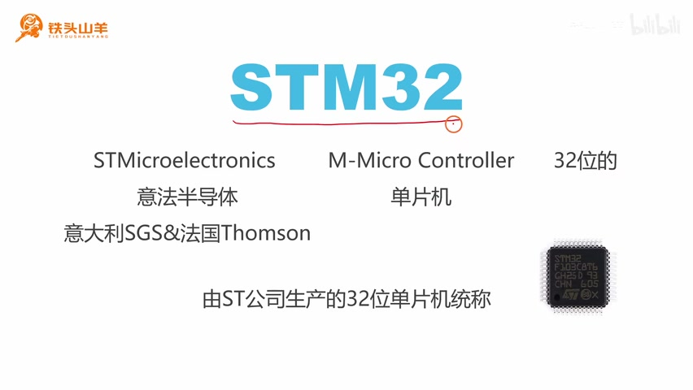
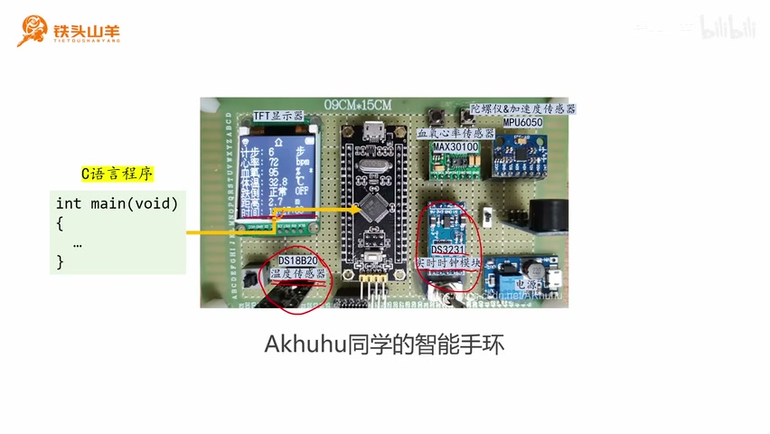
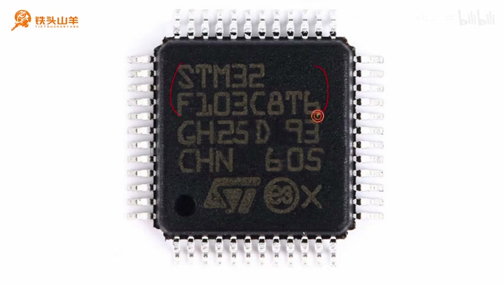
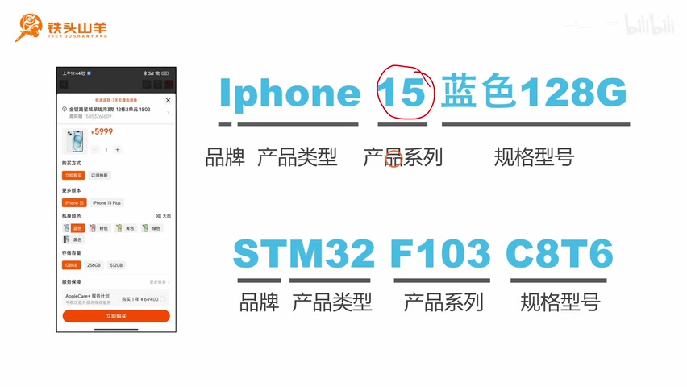
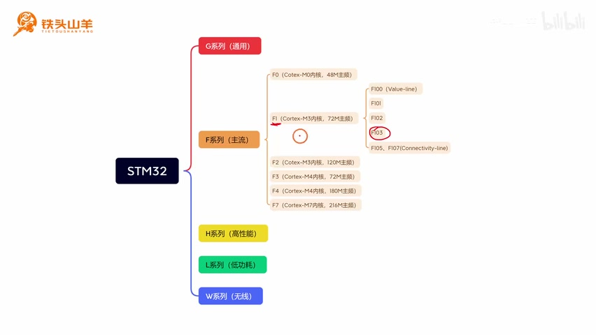
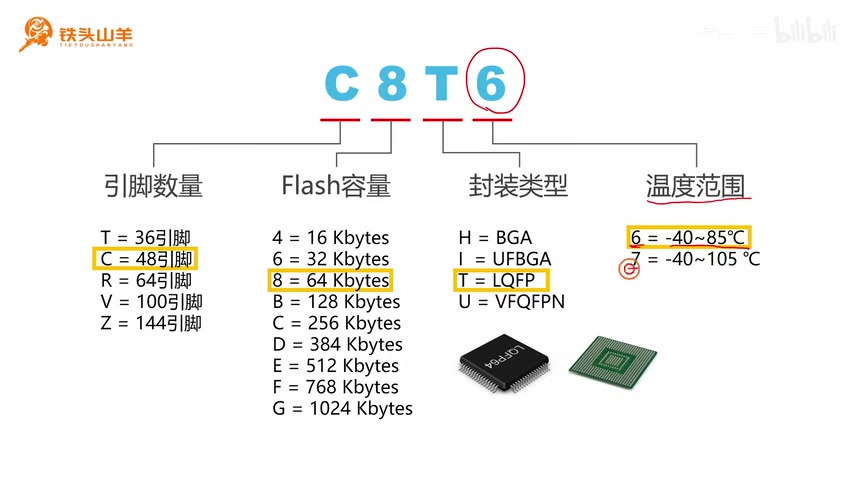
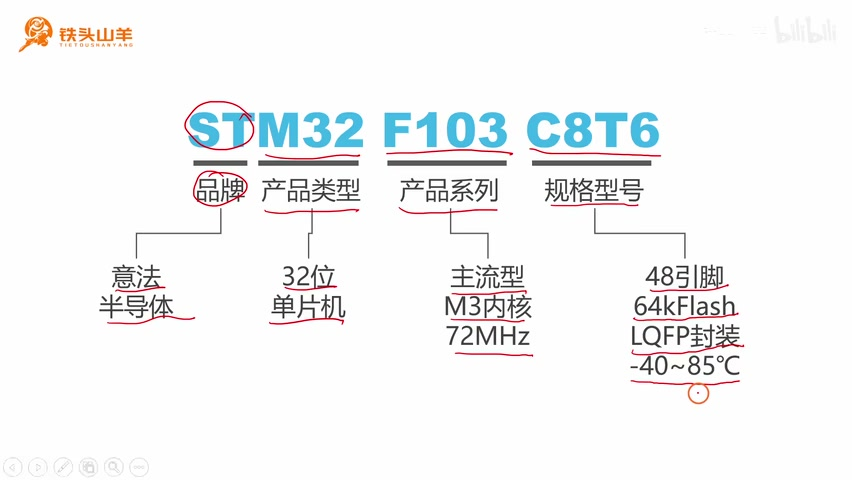
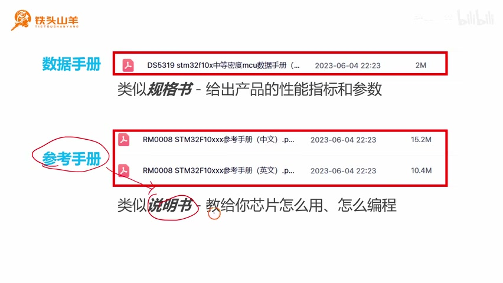
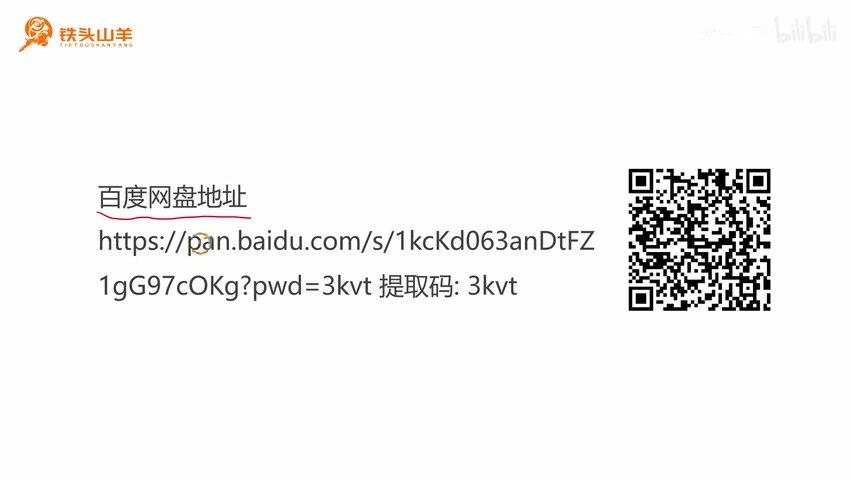
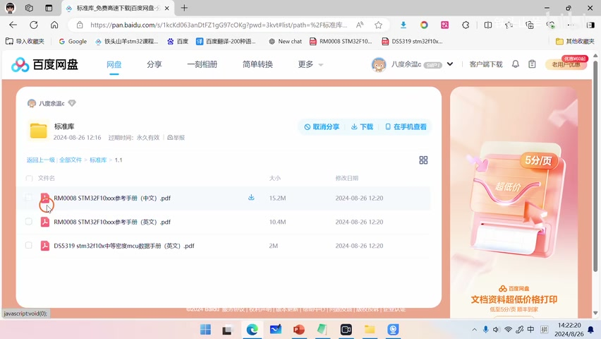

# P003 · 1.1 （准备） STM32的基本信息

> 忠实整理讲义稿｜铁头山羊 STM32 入门教程｜BV11X4y1j7si · P3｜全片 00:00—14:23。按原讲述顺序和口吻整理，非逐字音频转录；课件与“最新款”等时点表述按原视频保留。图注及文末整理说明为编者说明。

[打开本课视频](https://www.bilibili.com/video/BV11X4y1j7si/?p=3)

## 开场与本课安排

各位同学大家好，我是铁头山羊。今天我们开始讲解本套视频的第一节——STM32 的基本信息。通过本节课的学习，你将对 STM32 有一个最基本的了解。

本套视频所需要的所有材料都包含在这个开发套件包里。大家可以扫描屏幕上的二维码，进入我们的淘宝店铺购买它。购买套件之后，你将获得课程所有的课件和源码，还能加入答疑群，和 UP 主直接交流。

本期视频，我们将分成以下四个部分来讲：

1. 首先，我们介绍一下所使用的 STM32 是什么。
2. 然后，我们介绍 STM32 在电子设计中扮演什么样的角色，以及我们怎么使用 STM32。
3. 第三部分，我们讲解 STM32 的型号及其背后代表的含义。
4. 最后，我们介绍本套视频所使用的一些课程参考资料。

## STM32 是什么

下面我们从第一部分开始。首先来解答第一个问题：STM32 是什么？要想理解 STM32 是什么，我们先从它的名字入手，把这个名字分成三个部分。

我们先来看第一部分 ST。ST 代表 STMicroelectronics，也就是意法半导体。这是一个公司的名字，就是由这个公司设计和生产 STM32 的。

关于这个公司为什么叫意法半导体，其实背后还有一个故事。这个公司最初是由意大利的 SGS 微电子公司和法国的汤姆森半导体合并而来的。合并的新公司在两家公司的名字上各取一个首字母，就组成了 ST。我们中国人翻译的时候，把它们国家名称的首字摘出来，就组成了“意法半导体”。这就是它名字的来源。

看完了 ST，我们再来看第二部分，这里的 M。M 代表 Microcontroller，也就是微控制器，也就是我们平常所说的单片机。比如说 51 单片机，它就是一种单片机。最后，这里的 32 代表这个单片机是 32 位的。

现在我们把这三个部分联合起来，就可以得出这样一句话：STM32 其实就是由 ST 公司生产的 32 位单片机的统称。比如说，我们来看右下角这张图，这就是一颗 STM32 芯片。我们可以把这种芯片应用到电子设计当中。

_STM32 名称拆解：ST 是公司，M 表示微控制器，32 表示 32 位。 ·_ [_原片 02:00_](https://www.bilibili.com/video/BV11X4y1j7si/?p=3\&t=120)

## STM32 在电子设计中的角色

现在我们已经知道了什么是 STM32。下面再来看第二个问题：STM32 在我们的电子设计当中扮演什么样的角色？我们应该如何使用它？

要想理解 STM32 在电子设计中扮演什么样的角色，我先给大家举一个例子。这个例子是网络上一位同学做的毕业设计，他毕业设计的题目是做一个智能手环。

我们首先来看这个智能手环有什么功能。来看这个屏幕，上面显示，它可以计步、测量人的心率和血氧浓度，以及测量人的体温，还能显示现在的时间。

这么多功能是怎么实现的？答案就是靠板上一个一个的模块。比如这里的 MAX30100，它就是一个血氧和心率传感器。有了它，我们就能测量人的血氧和心率。

这里的 MPU6050，是一个陀螺仪和加速度传感器。有了这个模块，我们就可以实现计步功能。还有下面的 DS3231，这是一个实时时钟模块，它可以显示当前的时间。

最后，这里还有一个 DS18B20，它是一个温度传感器。有了这个温度传感器，我们就能测量人的体温。这里还有一个显示器，用来显示最终的内容。

这么多的模块，我们如何让它们协调在一起工作呢？答案就是中间这个黑色的电路板。在这个黑色的电路板上，有一颗小小的芯片，这个芯片就是我们要学习的 STM32。

我们可以通过 C 语言编写一段程序，再把这段程序烧到芯片里，用这段程序控制周围的这些模块工作。这样，我们就可以实现智能手环的功能了。

_智能手环示例：STM32 主控板与显示器、心率血氧、运动、时钟和温度模块共同组成系统。 ·_ [_原片 03:24_](https://www.bilibili.com/video/BV11X4y1j7si/?p=3\&t=204)

通过这个例子，我们可以看得出来，STM32 在整个电子设计之中扮演的是一个管理者，或者说，起一个控制器的作用。

## 获取并理解 STM32 的型号

然后，我们再来看第三个问题，了解 STM32 的型号以及型号背后的含义。首先，我来教大家如何获取芯片的型号。

我们看到中间这颗芯片，就是我们的 STM32 芯片。把板稍微转一下，让它冲着光，就可以看到上面有很多激光雕刻的文字。这些文字里面就包含了 STM32 的型号。我们把这些文字放大一下。

可以看到，激光雕刻的文字有很多行，其中前两行代表的就是芯片的型号，也就是 STM32F103C8T6。这样，我们就获得了芯片的型号。

_芯片表面前两行刻字组合成 STM32F103C8T6。 ·_ [_原片 04:36_](https://www.bilibili.com/video/BV11X4y1j7si/?p=3\&t=276)

但是现在问题又来了：这个型号代表什么含义呢？我们这颗芯片的型号是 STM32F103C8T6。这个型号比较长，如果直接讲它的含义，大家理解起来会有点困难。所以，这里我给大家举一个生活中的例子。

比如说，我们去网上买一款苹果手机，选最新款的 iPhone 15，喜欢的颜色是蓝色，容量选择 128G。这样，我们就生成了一个 iPhone 手机的型号，就是“iPhone 15，蓝色，128G”。

为了方便理解，我们把这个型号拆分成几个部分来看。首先来看第一部分，这里的字母 i。这个字母 i 代表品牌，也就是说，这个品牌是苹果。苹果的很多产品都是以字母 i 开头的。

再来看第二部分，这里的 Phone 代表产品的类型。Phone 代表的就是手机，也就是苹果生产的智能手机。苹果当然还生产很多其他产品，比如它的平板电脑叫 iPad，它的智能手表叫 iWatch；而这里的 Phone，代表的就是它生产的智能手机。

后面的 15 代表手机的产品系列。从 iPhone 4S 至今，苹果已经发布了很多产品系列，其中 iPhone 15 就是一个最新的产品。最后，这里的“蓝色，128G”表示手机的规格型号。

_课件将 iPhone 15 蓝色128G 与 STM32F103C8T6 对照，用品牌、类型、系列和规格解释型号拆分。 ·_ [_原片 06:00_](https://www.bilibili.com/video/BV11X4y1j7si/?p=3\&t=360)

理解了这部分内容之后，我们再尝试来看下面单片机的型号。跟刚才一样，我们还是把这个型号分成几个部分来看。

首先来看第一部分，这里的 ST。ST 代表品牌，表明这个东西是由 ST，也就是意法半导体这家公司生产的。后面的 M32 代表产品类型，也就是它是一个 32 位的微控制器。这里的 F103 代表产品系列。

## F103 在 STM32 家族中的位置

下面我们具体来看 F103，也就是产品代号所代表的含义。首先，因为 STM32 是由 ST 公司生产的 32 位单片机的统称，所以在 STM32 下面有很多细分型号。我们课上要学习的 F103，就是众多型号之一。

对于 STM32 家族来说，从整体上可以分成五个系列，分别是 G 系列通用型、F 系列主流型、H 系列高性能、L 系列低功耗和 W 系列无线。

我们的 F103 属于 F 系列主流型。这个主流型是主打性价比的一种类型，也就是说，它的性能还可以，但是价格也不高。

在 F 系列下面，还有 F0、F1、F2、F3、F4 和 F7。F103 属于 F1 系列，它是一种具有 Cortex-M3 内核、72 MHz 主频的单片机。F1 内部又进一步分成 F100、F101、F102、F103、F105 和 F107。这些芯片的使用方法基本上是一样的，我们课上学习的就是 F103。

_课程分类图：STM32 的 F 分支下，F1 使用 Cortex-M3，F103 是其中一个型号。 ·_ [_原片 07:24_](https://www.bilibili.com/video/BV11X4y1j7si/?p=3\&t=444)

## C8T6 的规格含义

再次回到单片机的型号。现在我们来看最后一部分，也就是规格型号这一部分 C8T6，它代表什么含义呢？其实 C8T6 这几个字符，我们可以把它单独拆出来，拆成四个部分来看。这四个字符分别代表芯片的引脚数量、Flash 的容量、封装的类型，以及芯片工作的温度范围。

首先来看第一个字母。第一个字母代表单片机的引脚数量。对于这个单片机来说，引脚数量是可以选择的，可以选 36、48、64、100，最大是 144 个引脚，它们对应的字母分别是 T、C、R、V 和 Z。

而我们这颗单片机，这个字母是 C，就代表它有 48 个引脚。比如说，我们来数一下这颗芯片的引脚数量：1、2、3、4、5、6、7、8、9、10、11、12。这一边是 12 个引脚，一共有四个边，那么是不是一共就是 48 个引脚？

再来看第二个字符。第二个字符代表的含义是 Flash 的容量。那什么是 Flash 呢？大家可以把 Flash 理解成电脑里面的硬盘，我们所有写的程序、数据都是存储在这个 Flash 存储器当中的。

Flash 存储器的容量也是可以选择的，从 16K、32K、64K，一直到最大 1024K，也就是 1M 的容量。Flash 容量越大，当然这个芯片就越贵。而我们使用的单片机，这个字符是 8，也就是代表它有 64K 的容量。

再来看第三个字母。第三个字母代表封装的类型。我们的单片机可以选择几种封装类型：H 代表 BGA 封装，I 代表 UFBGA 封装，T 代表 LQFP 封装，U 代表 VFQFPN 封装。

我们再来解释一下什么是封装。这么一颗芯片要让它工作起来，得把它焊到一个电路板上。电路板要想焊接芯片，得有焊盘，而封装就表示焊盘的形状。

举个例子，我们课上使用的这个芯片，它的字母是 T，也就是代表它使用 LQFP 这种封装。单片机的形状就类似于图中这样，它有很多引脚延伸出来。

假设我们使用另外一款芯片，它采用的封装是 H，也就是 BGA 那种封装，它对应的芯片形状就是图中另一种形状。芯片的焊盘位于芯片背面，是一个一个的小圆点。

再来看最后一个字符。最后一个字符代表芯片的工作温度范围。有两种温度范围可选：一种是 6，代表 −40～85 ℃；另外一种是 7，代表 −40～105 ℃。

我们所使用的这款芯片，这个字符是 6，代表它的工作范围就是 −40～85 ℃。一般这个范围就可以满足绝大多数场景了。

如果我们使用的是一些比较恶劣的环境，比如用在工业场合，或者对安全可靠性要求比较高的军事场合，那么我们就可能选择下面 7 这种，也就是 −40～105 ℃ 的温度范围。当然，这种芯片肯定比 6 这种型号要贵。

_C8T6 对照表：引脚数量、Flash 容量、封装类型和工作温度范围。 ·_ [_原片 10:36_](https://www.bilibili.com/video/BV11X4y1j7si/?p=3\&t=636)

刚才我们就把 STM32 型号的知识全都给大家讲完了。现在我们回过头来，再看一下这个型号具体代表什么含义。

ST 代表品牌，是意法半导体；M32 代表产品类型，是一个 32 位单片机；F103 代表产品系列。我们使用的单片机产品系列，是主流型、M3 内核、72 MHz 主频的产品。

后面的 C8T6 代表这颗芯片的规格型号。这颗芯片有 48 个引脚，具有 64K 的 Flash 容量，采用 LQFP 封装，工作温度范围是 −40～85 ℃。所以你会发现，这么一分析，这个型号就变得非常清晰了。

_型号汇总：STM32F103C8T6 的品牌、类型、内核主频和具体规格。 ·_ [_原片 12:00_](https://www.bilibili.com/video/BV11X4y1j7si/?p=3\&t=720)

## 课程参考资料

讲完了第三部分 STM32 芯片型号的含义之后，我们再来看本节课最后一个部分，也就是我向大家推荐两本 ST 官方提供的参考资料。这两本资料非常重要。

ST 官方给我们提供的参考资料总共有两本：一本是数据手册，也就是这里的 DS5319，STM32F10x 中等密度 MCU 数据手册；还有一本是参考手册，也就是这里的 RM0008，STM32F10xxx 参考手册。

其中，参考手册我给大家提供了两份，一份是中文版，另外一份是英文版。如果大家去读，一般读中文版就可以了。

现在我们就产生了一个疑问：既然 ST 官方给我们提供了这两种类型的手册，那么它们各自有什么区别？各自是用来做什么的呢？

首先来看数据手册。我们可以这样理解：数据手册就类似于单片机的一本规格书。所谓规格书，给出的是产品的性能指标和一些参数，比如最基本的芯片工作电压范围、输出功率范围、工作温度等等。

而下面的参考手册，更类似于单片机的一本说明书。这个说明书会教给你，芯片里面的每一个模块怎么用，它的工作原理是什么样的，以及我们怎么对单片机进行编程等等。

_课件将数据手册比作规格书、参考手册比作说明书，并列出 DS5319 和 RM0008。 ·_ [_原片 13:24_](https://www.bilibili.com/video/BV11X4y1j7si/?p=3\&t=804)

这两本手册，我已经放在百度网盘里了。这里是百度网盘的地址，大家可以直接去百度网盘，把这两本手册下载下来。下面我给大家演示一下下载的过程。

_视频展示课程资料的百度网盘链接与提取码，供后续复制链接的操作参照。 ·_ [_原片 13:36_](https://www.bilibili.com/video/BV11X4y1j7si/?p=3\&t=816)

首先，我们先复制这个链接，复制到画面指示的这个位置就可以了。然后打开浏览器，把这个链接粘贴到浏览器当中。

找到我们的课程资料“标准库”，打开第一章的第一节。这里面的这三本手册，就是我们的参考手册和数据手册，我们把它们都下载下来就可以了。

_课程网盘“标准库 / 1.1”目录中显示三份 PDF：数据手册和中、英文参考手册。 ·_ [_原片 14:00_](https://www.bilibili.com/video/BV11X4y1j7si/?p=3\&t=840)

以上就是本期视频的全部内容。在本期视频当中，我们了解了 STM32 是什么，以及它在电子设计中扮演什么样的角色，理解了它型号的含义，最后下载了两本参考资料。

好的，本期视频就到这里。我是铁头山羊，让我们下期视频再见。

## 整理说明（编者）

本文完整保留本课讲解进程、第一人称口吻、举例、设问、原因、条件、课程范围提示和片尾回顾。仅去掉停顿、口头赘音、无新增含义的即时重复，并按上下文及画面校正明确识别错误。

“铁头晒阳”“依法半导体”“单面机”“Mess30-100”“Cortez-M3”“C86”等依画面和重复术语更正为铁头山羊、意法半导体、单片机、MAX30100、Cortex-M3、C8T6；温度字幕中个别“−45”按课件及同段反复说明统一为 −40 ℃。封装 U 的名称按课件写作 VFQFPN。原始字幕仍保留在 sources 中。

原讲述中的 iPhone 15“最新款”、iWatch 称呼、STM32 五类系列划分、“所有程序数据都存储在 Flash”、封装与焊盘形状的类比及数据手册“输出功率范围”等表述均保留为讲者当时的教学内容，未自行改成另一套讲法，也未作独立技术事实核验。

完整来源为 P3《STM32的基本信息》，已通过片头、中段型号课件和末尾资料下载画面核对本地媒体与时间轴字幕。原视频为 852×480，分类图小字受源分辨率限制。HTML、样式和截图均可离线阅读；原片时间链接需联网。网盘分享的当前有效性和课件 PDF 未另行核验。旧版摘要保留于 editions/summary\_20261016。
