# P005 · 2.1 （GPIO）4种输出模式

> 来源：铁头山羊 STM32 入门教程，第 2.1 课，Bilibili P5。原视频时间范围 00:00–32:52.309。 体例：经标点、段落和明确识别错误整理的忠实讲稿；保留原讲者的解释、例子与顺序。

## 开始学习 GPIO

各位同学大家好，我是铁头山羊。从今天开始，我们开始学习本套教程的第二章。在上一章的过程中，我们仅仅是为 STM32 的学习做了一个准备工作，所以从本章开始，我们才是正式开始学习 STM32。本章我们要讲的内容叫做 GPIO。既然我们要学习 GPIO，所以首先对 GPIO 是什么来做一个简单的介绍。

本套视频所需要的所有材料，都包含在这个开发套件包里。大家可以扫描屏幕上的二维码，进入到我们的淘宝店铺来购买它。购买套件之后，你将获得课程所有的课件和源码，还能加入答疑群和 UP 直接交流。

要想解释清楚 GPIO 的概念，我得给大家举一个例子。比如说我们来看屏幕上这一张图，这张图就是我们人体的一个结构图。我们知道，对于人体来说，最重要的一个器官就莫过于大脑。大脑虽然重要，但是它除了能够思考之外，其实它本身是不能够执行其他任何独立的任务的。

比如说，如果我们想要看到某样东西，我们得借助眼睛；如果我们想要闻到气味，是不是就得借助鼻子？如果想要说话，就得借助嘴巴；如果想要走路，我们就必须得借助双腿；而如果想要拿起某些东西，我们就得借助手，对吧？我们的 STM32 单片机跟人体的原理基本上是一样的。

现在我们就来看一下 STM32 单片机的内部结构。请同学们拿出我们芯片的数据手册，也就是 DS5319 这本手册。打开这本手册之后，我们翻到手册的第 11 页。在第 11 页这个位置，这里有一张图，这张图就是单片机内部的一个结构框图。这张图比较复杂，对吧？所以我们把这张图简化一下，放到 PPT 上。经过简化之后，我们就会得到这么一张图，这张图就是我们单片机内部的结构框图。

我们仔细来观察一下，我们这个单片机里边长什么样。首先，我们在这张图的左上角这个位置看到有一个八边形，这个八边形是我们单片机的 Cortex-M3 内核。这个 Cortex-M3 内核，其实就是我们单片机里边的一个 CPU。这个 CPU 专门执行运算任务，但是跟我们的大脑一样，这个 Cortex-M3 内核除了能够执行运算任务或者执行指令之外，它本身是不能独立地去做其他的事情的。

所以，Cortex-M3 内核想要完成某些任务，它就必须得借助我们单片机里边的一些其他的模块，比如说这些模块。这些就是我们单片机里面一个一个的模块。我们给这些模块起一个名字，把它们叫做“片上外设”。片上外设就类似于我们人体一个一个的器官，每一个片上外设都可以完成一个独立的任务。比如说本章我们要学习的 GPIO，就是我们单片机里边的一个片上外设。

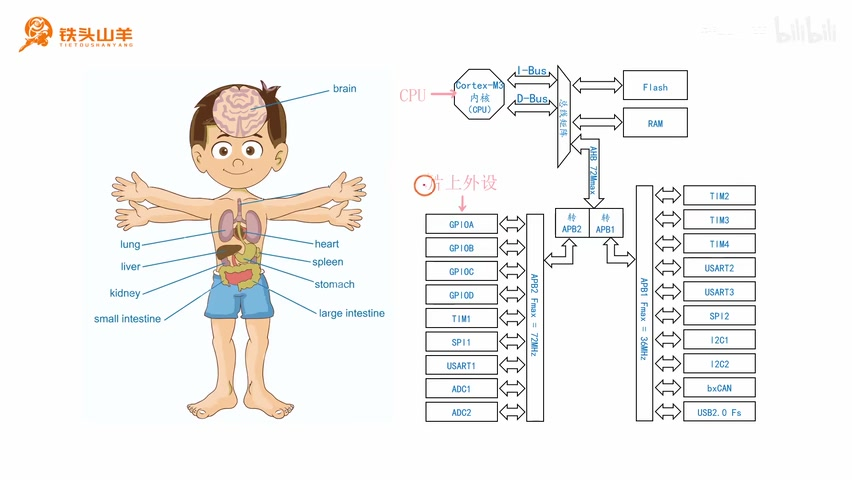

_人体器官与 STM32 内部框图并列：CPU 与片上外设的位置。 ·_ [_原片 02:48_](https://www.bilibili.com/video/BV11X4y1j7si/?p=5\&t=168)

GPIO 这种片上外设，它有什么功能呢？它的功能其实就是用来控制我们单片机上的 IO 引脚。比如说，我们拿出开发套件包里面的最小系统板，可以看到，在这个最小系统板的中间，这个位置有一个黑色的芯片，对吧？这个芯片就是我们要学习的 STM32 单片机。在这个单片机的周围，这里是不是有很多银白色的引脚？我们今天学习的 GPIO 模块，就是用来控制这些引脚的。

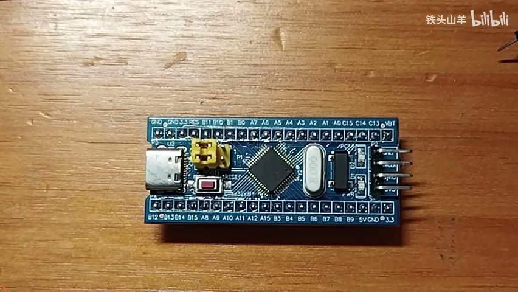

_最小系统板实物：中央芯片与周围的引脚。 ·_ [_原片 03:12_](https://www.bilibili.com/video/BV11X4y1j7si/?p=5\&t=192)

我再给大家打一个比方。我们今天要学习的这种 GPIO 片上外设，可以把它比作人体的一个手。我们知道，如果我们想要拿起某样东西，大脑是不能够独立地去执行这个任务的，它必须得借助手，对吧？大脑只有去控制手，它才能把某样东西给拿起来。

对于我们的 Cortex-M3 内核也是一样。Cortex-M3 内核只能执行运算任务，但是如果它要想控制芯片四周的这些引脚，它本身是办不到的。那怎么办？是不是就得借助我们 GPIO 这些片上外设？我相信讲到这里，大家应该清楚 GPIO 是什么了。

了解了 GPIO 是什么之后，下面我们再来看一下。在单片机内部，我们可以找一下，这里有四个 GPIO 模块，分别是 GPIOA、GPIOB、GPIOC 和 GPIOD。为什么会有这么四个 GPIO 模块呢？下面我们来解释一下这个原因。

要想解释清楚为什么单片机里会有四个 GPIO 模块，我们就得回顾一下之前所讲的 IO 引脚命名的知识。我们来看，这是我们所使用的单片机，对吧？对于我们所使用的这个单片机来说，它的封装类型是 LQFP48，说明这个单片机一共有 48 个引脚，也就是这么一圈，一共是 48 个引脚。

在这些引脚当中，有一部分引脚是带有特殊功能的，比如说这些引脚，都是带有特殊功能的。除去这些引脚之外，其余剩下的这些引脚，都是一些普通的 IO 引脚。它们的功能比较类似，所以为了区别这些引脚，我们就得给这些引脚命名，对吧？因为这些引脚的数量比较多，所以在对它进行命名之前，我们首先对这些 IO 引脚进行编组。怎么进行编组呢？我们可以按照字母进行编组，分成了四组，分别是 A、B、C、D。

GPIOA 用来控制 PA0 到 PA15 这些引脚，而 GPIOB 就是 PB0 到 PB15，GPIOC 就是 PC13、PC14、PC15，GPIOD 就是 PD0 和 PD1。

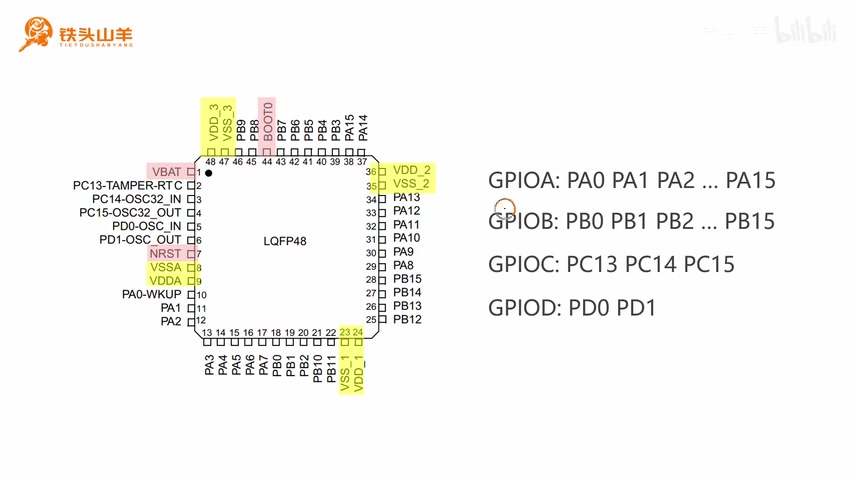

_LQFP48 引脚图及 GPIOA、GPIOB、GPIOC、GPIOD 分组。 ·_ [_原片 05:24_](https://www.bilibili.com/video/BV11X4y1j7si/?p=5\&t=324)

现在我们就可以解释清楚这些模块的作用了。其中，GPIOA 就是用来直接控制 PA0 到 PA15 的。GPIOB 这个片上外设，就是用来控制 PB0 到 PB15 的。而 GPIOC 就是用来控制 PC13、PC14 和 PC15 的，GPIOD 就是用来控制 PD0 和 PD1 的。

有了这四个模块，是不是我们就把芯片上的所有 IO 引脚都给它控制起来了？刚才我们把 GPIO 模块比作人的手。我们单片机里边有这么四个 GPIO 模块，就可以把这四个 GPIO 模块比作一个人有这么四个手。而手上的这些手指头，就相当于 GPIO 模块所控制的 IO 引脚。

比如说，我们假设这个手代表 GPIOA，那这里就是 GPIOA，对吧？这个手指头就是 PA0，这是 PA1、PA2、PA3、PA4，一直到 PA15，一共有 16 个手指头。这 16 个手指头就代表 GPIOA 的 16 个引脚。我们再假设这个是 GPIOB，那这里就是 PB0、PB1、PB2，一直到 PB15，对吧？如果这里是 GPIOC，那这里就是 PC13、PC14、PC15；如果这里是 GPIOD，这里就是 PD0 和 PD1。这就是我们本章要学习的 GPIO 模块的含义。

## GPIO 的工作模式

本章我们剩下的任务，就是把 GPIO 的使用方法学会。要想学会 GPIO 模块的使用方法，我们就必须得学习 GPIO 的八种工作模式。GPIO 的八种工作模式，可以说是我们本章学习的最重要的知识点了。

在学习八种工作模式之前，首先我们先来解释一下什么是 GPIO 的工作模式，为什么 GPIO 模块会有这么多种工作模式。其实这里所谓的工作模式，就是我们单片机 IO 引脚的一种使用方式。这个工作模式是针对于我们单片机上的一根 IO 引脚来说的。比如说，对于我们单片机上的这些 IO 引脚来说，每一根 IO 引脚都可以选择这八种工作模式之一。

然后我们再来解释一下，为什么会有这么多种工作模式。原因其实是因为 IO 引脚需要承担许多不同的任务，所以我们在设计的过程中，需要把 IO 引脚设计得足够灵活。有的时候，我们需要通过这个引脚向外输出高电压或者低电压；还有的时候，我们需要通过这个 IO 引脚，把外部的信号输入到单片机当中，然后对这个信号进行测量，等等。它有很多种不同的工作场景，所以这就决定了 IO 引脚会有很多种不同的工作模式。

刚才我大概介绍了一下工作模式的概念。我们来看一下，GPIO 的八种工作模式都有什么。下面这就是我们单片机 IO 引脚的八种工作模式，我们每一根 IO 引脚都可以选择这八种工作模式之一。

按照输出和输入，我们把这八种工作模式可以一分为二。其中输出有四种，分别是通用输出推挽、通用输出开漏、复用输出推挽和复用输出开漏。这些名字比较拗口，现在大家也不需要记，等会儿我会给大家解释清楚这些名称的含义。对于输入来说，也是有四种模式，分别是输入上拉、输入下拉、输入浮空，还有模拟模式。

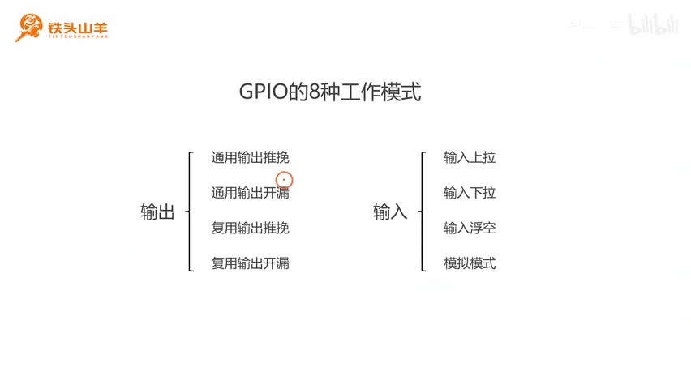

_GPIO 的八种工作模式，按输出和输入分成两组。 ·_ [_原片 08:36_](https://www.bilibili.com/video/BV11X4y1j7si/?p=5\&t=516)

因为这八种工作模式比较多，我们一节课讲不完，所以本节课我们就只讲前半部分，也就是这四种跟输出有关的工作模式。所以我们可以看到，本节课我们的标题就是去讲 GPIO 的四种输出模式，也就是在八种工作模式里边，把前四种输出模式给大家摘出来，本节课我给大家讲一下。

我们再回到 GPIO 的八种工作模式。刚才我们通过输出和输入，把八种工作模式一分为二，左边四种、右边四种，对吧？所以接下来，我们首要的任务就是给大家解释清楚，输出和输入各自代表什么。只有学会了这两个概念，我们才能继续往下学这四种输出模式。

## 输出和输入

我们使用这么两张图，给大家解释一下输出和输入的概念。首先我们先来看左边的这么一张图，在左边这张图里面，这里有一个横线加一个方框。我们用这个横线加方框的形式，表示单片机里面的一个 IO 引脚。

我们来看，在单片机的周围，是不是有很多这些 IO 引脚？刚才这个横线加方框，就是表示这些引脚里面的其中一根。对于这个引脚来说，这里有一个小方框，这个小方框就代表引脚的外边。比如说，我们现在把这一部分圈起来，这一部分其实就代表 STM32 单片机的内部，也就是那个黑色的壳体；这里就是代表引脚延伸出来的那一部分。

所以我们可以看得出来，对于输出和输入两种分类来说，它们最大的不同就在于信号的流向。对于输出来说，它的箭头是往右的，也就是它的信号是从芯片的内部流向芯片的外部的。对于输入模式来说，它正好相反，它的信号是从外部输入进来的，然后通过这个 IO 引脚流到单片机里边。

针对这两种模式，我分别给大家举一个例子。我们先来看输出。对于输出模式来说，我们最常用的一个用法，就是使用输出模式去控制 LED 的点亮或者熄灭。比如说，我们在这个 IO 引脚上接一颗 LED，像这样一个 LED。LED 就是发光二极管的意思，就是一颗灯。对于这个 LED 来说，如果我们给它输出一个高电压，这个 LED 就亮；如果输出的是一个低电压，这个 LED 就熄灭。

那我们怎么去控制 LED 的点亮和熄灭呢？就是通过左边的这个寄存器。这里有一个寄存器，我们可以通过编程的方式，向这个寄存器的比特位去写零或者写一。比方说，如果我们写零，这里对应输出的就是一个低电压，这个 LED 就熄灭；而如果我们写一，这里对应输出的就是一个高电压，这样 LED 就点亮了。所以我们可以看得出来，我们可以通过编程的方式，向这里写零还是写一，来控制 LED 的点亮或者熄灭。

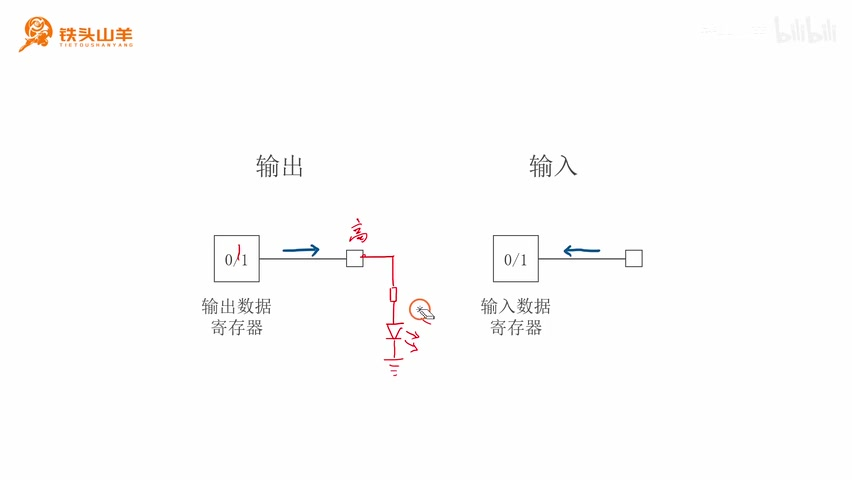

_输出数据寄存器与外接 LED 的连接示意。 ·_ [_原片 12:00_](https://www.bilibili.com/video/BV11X4y1j7si/?p=5\&t=720)

这就是输出模式最常用的一个用法。我们可以通过单片机的编程，去控制 IO 引脚的输出。然后我给大家看一个实际的例子。比如说，我们去写这么一段代码，现在大家还看不懂代码的含义，没关系，我现在给大家解释一下。

我们来看，在最小系统板上，这是不是有一颗 LED？所以我们现在就编程，通过单片机的 IO 引脚，去控制这颗 LED 的点亮或者熄灭。我们向这个 LED 交替地写零和写一，去控制这个 LED 一会儿点亮、一会儿熄灭，所以我们就可以看到这个 LED 开始闪烁了，对吧？

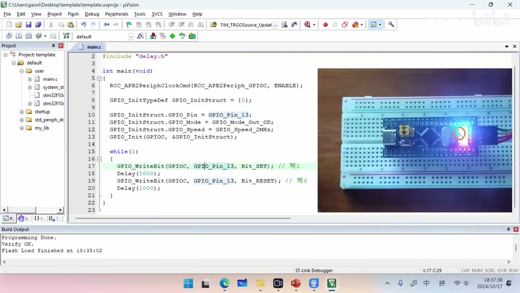

_代码窗口与 LED 最小系统板演示画面。 ·_ [_原片 12:36_](https://www.bilibili.com/video/BV11X4y1j7si/?p=5\&t=756)

然后我们再来看后边的输入模式。这个输入模式跟输出模式正好相反，它的信号是从外部流向单片机里边的。我们需要从外部接一个信号，当这个信号输入的是一个高电压的时候，这里的输入数据寄存器的值就是一；如果输入的是一个低电压，这个输入数据寄存器就是零。

然后，我们通过编程的方式去读取这个输入数据寄存器的值。读出来这个值如果是一，我们就知道这里是高电压，对吧？如果读出的是零，我们就知道这里当前输入的是一个低电压。我们通过这种方式，就可以去判断 IO 引脚上当前电压到底是高还是低。

对于这种输入模式来说，最简单的一种应用方式，就是往这个引脚上去接一个开关。我们假设这个开关当它断开的时候，这一点的电压是一个低电压，就是它给单片机输入的是一个低电压；如果开关闭合，它给单片机输入的是一个高电压。那么，我们如果从输入数据寄存器里面读到一个零，是不是就可以知道这个开关当前是断开的？如果我们读到的是一，是不是就可以知道这个开关当前是闭合的？我们就可以通过这种方式，去判断开关当前的状态。

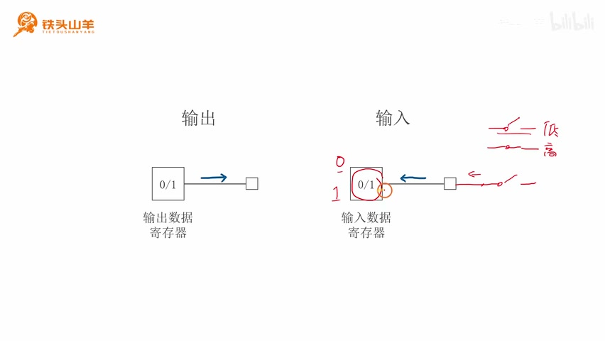

_输入数据寄存器、外接开关及高低电压标记。 ·_ [_原片 14:00_](https://www.bilibili.com/video/BV11X4y1j7si/?p=5\&t=840)

总而言之，输入模式就是从外部输入信号，通过电压的高和低，单片机会自动地将输入数据寄存器的这个比特位设置成零或者一。然后我们把这个值读出来，就知道外部输入给我们的电压到底是高还是低了。这就是输入模式。

刚才我们把输出和输入的区别给大家讲清楚了。所以现在，我们就可以按照输出和输入，把这八种工作模式一分为二了，左边四种、右边四种。我们今天要学习的就是左边这四种输出模式。

我们仔细来看一下这四种输出模式，来看一下它的名字。第一个叫做通用输出推挽，第二个叫做通用输出开漏，第三种叫做复用输出推挽，第四种叫做复用输出开漏。这些名字其实很有特点，有什么特点呢？我们来看，对于前两种来说，它们是不是都是通用？对于后两种来说，是不是都是复用？对于这两种，它们是不是都是推挽？对于这两种，是不是都是开漏？

所以我们可以看得出来，这四种输出模式，其实就是按照推挽、开漏、通用、复用进行划分的。因此，我们只需要把什么是推挽、什么是开漏、什么是通用、什么是复用这些概念搞清楚，我们这四种输出模式是不是就学会了？接下来的任务，就是去把这些概念搞明白。

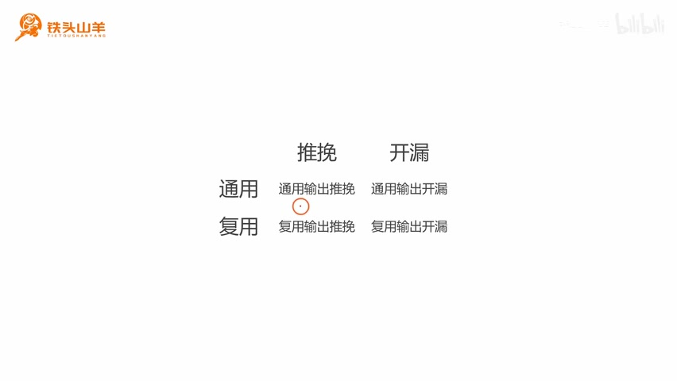

_四种输出模式按通用、复用与推挽、开漏排列。 ·_ [_原片 15:12_](https://www.bilibili.com/video/BV11X4y1j7si/?p=5\&t=912)

我们首先来看一下推挽和开漏的概念。要想解释清楚推挽和开漏的概念，我们就必须得回到单片机的参考手册。下面请同学们打开我们的参考手册，参考手册就是 RM0008 那本手册。这个手册有两种版本，一个是英文版本，一个是中文版本。中文版本是在英文版本的基础上翻译过来的。如果你的英文水平不是特别好，我推荐你读中文版本。

下面我们就打开中文的版本。我们点开这个手册的目录，可以看到目录里面有很多章，对吧？其实每一章基本上都是讲了单片机上的一种片上外设，也就相当于人体里边的一个器官。

刚才我们打了这么一个比方。在第八章这个位置，我们看这里有一个“通用和复用功能 IO”，这个就是我们今天要讲的 GPIO，第八章讲的就是 GPIO。我们打开第八章，打开之后，稍微往下翻一下，就可以看到这里有一张图，对吧？这张图就代表我们单片机 IO 引脚内部的电路图。这个图非常重要，所以我们把这张图摘出来，来分析一下这张图。

我们来看一下这张图。首先在这张图里边，我们来看右边这个位置，这里有一个横线加一个方块。刚才我们见过这个符号，这个符号就表示单片机的一个 IO 引脚。然后，我们从 IO 引脚这个位置画一条竖线，把这张图一分为二。右边这一部分就代表单片机的外部，所以这一部分就是 IO 引脚延伸出来的这一部分；左边就代表芯片的内部，所以这一部分图就代表 IO 引脚的内部电路图。

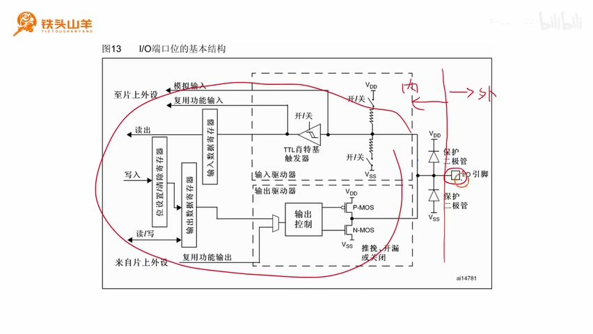

_IO 端口基本结构图及芯片内、外的手绘分界。 ·_ [_原片 17:12_](https://www.bilibili.com/video/BV11X4y1j7si/?p=5\&t=1032)

大家需要注意，对于我们这个单片机来说，我们说过它有 48 个引脚。其中普通的 IO 引脚，GPIOA 有 16 个，GPIOB 有 16 个，GPIOC 有三个，GPIOD 有两个。16 加 16 是 32，再加上后边的五，一共是 37 个，对吧？对于这 37 个 IO 引脚来说，每一个 IO 引脚的内部电路都是这样的，所以在我们芯片里，这种电路一共有 37 份。

刚才我们说过，对于 GPIO 来说，它有八种不同的工作模式，我们可以按照信号的流向给它分成输出和输入。输出和输入各有四种工作模式，所以反映到这个电路图上，它也是可以分成两个部分的。比如说，我们从中间这个位置画这么一条线，这条线就可以把这张图分成上下两部分，对吧？其中上面这一部分是跟输入模式有关的，而下面这一部分是跟输出模式有关的。本节课我们要讲的是输出模式，所以我们就把下面这部分电路图摘出来分析一下。因为这个电路看起来比较乱，所以我们把这个电路整理一下。经过简化，我们可以把这张图变成这么一个图。这张图看起来就清晰多了，对吧？其实这张图跟刚才的这张图基本上是一样的，只不过我们把不需要学习的这一部分删除掉了，其他部分都是一样的。

我们来简单地对比一下。比如说，这里的一个横线加方框，表示单片机的一个 IO 引脚，对吧？在这张图里，这里就是那个 IO 引脚。顺着 IO 引脚往里走，这里有两个 MOS 管，一个 P-MOS 管、一个 N-MOS 管。我们来看后面这张图，这里就是那两个 MOS 管。

在 MOS 管的前面，这里有一个输出控制电路。这个输出控制电路是用来控制这两个 MOS 管的，在这里，这个就是输出控制电路。在输出控制电路的前边，我们看这里有一个梯形的结构，这个叫做一个复用器，这里就是那个复用器。

再往前走，这里有一个输出数据寄存器。在这张图里，我们就用这个零和一这样一个比特位，来表示刚才那个寄存器。我们把它简化了，简化成这么一个东西就可以了。这里我们把它删除掉了，这里我们不管。这里就是我们通过 CPU，可以去对这个输出数据寄存器进行读写，也就代表我们框图的这一部分。下面，这里还有一个来自片上外设的信号。关于这些东西是什么意思，我们稍后会给大家解释。

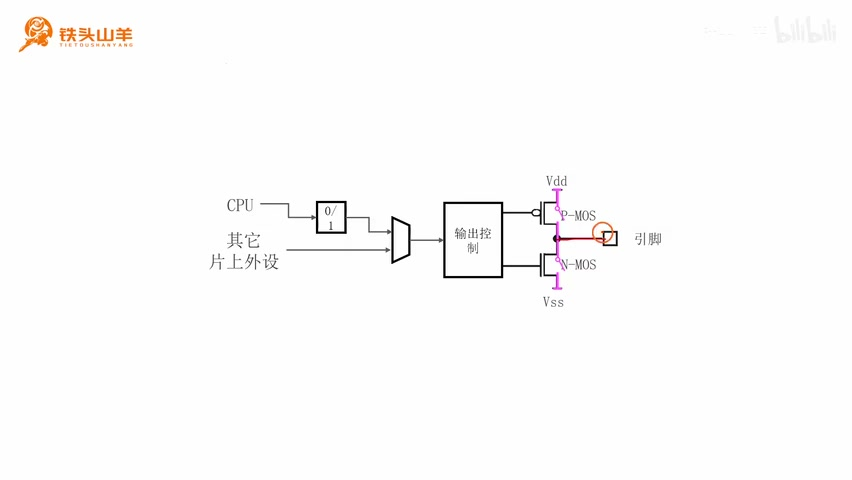

_简化后的输出电路：寄存器、复用器、输出控制和两个 MOS 管。 ·_ [_原片 18:48_](https://www.bilibili.com/video/BV11X4y1j7si/?p=5\&t=1128)

所以我们可以看得出来，这两张图其实是完全一样的。下面我们就以这张图作为依据进行分析。刚才我们不是说过吗，我们 GPIO 有八种工作模式，四种输出、四种输入，对吧？我们要学习这四种输出模式，而这四种输出模式，其实是根据通用还是复用、推挽还是开漏进行分类的。我们接下来就要了解一下，推挽和开漏之间的区别。

## 推挽模式

推挽和开漏，其实是跟我们后边这两个 MOS 管的工作方式有关。下面我们就来解释一下推挽和开漏的概念。我们首先来介绍一下推挽模式。其实“推挽”是由两个动词组成的，一个是推，一个是挽。其中“推”就是 push，也就是向外推电流、向外输出电流的意思；“挽”正好相反，它是英文单词 pull，这个挽就是拉的意思，也就是把电流从外边给它拉进来，这就是挽。

推和挽，其实是跟刚才介绍的这么一对 MOS 管有关。我们可以把这个 P-MOS 和 N-MOS 分别想象成两个开关。其中，推就跟上面的 P-MOS 有关，而下面的开关就跟挽有关。

我们先来分析一下推。比如说，我们来看右边的这么一张图。在这张图里边，我们把上面的 P-MOS 导通，让上面的 P-MOS 工作，下面的 N-MOS 我们给它断开。这个时候，我们看这个 IO 引脚，是不是通过上面这个开关跟 VDD 相连了？VDD 就是一个高电压，对吧？所以如果有电流，这个电流一定是从高电压往低电压流，对吧？所以这个就是推，也就是向外输出电流，这就是推。

再来看一下挽。所谓挽，就是下面这个 MOS 管工作，也就是我们把下面这个 MOS 管闭合上。我们看这个 IO 引脚，是不是就通过下面这个 MOS 管和低电压 VSS 相连了？这里是低电压，如果有电流，这个电流是不是一定是从这里往这里流的？所以它就是往里拉电流，这就是挽。

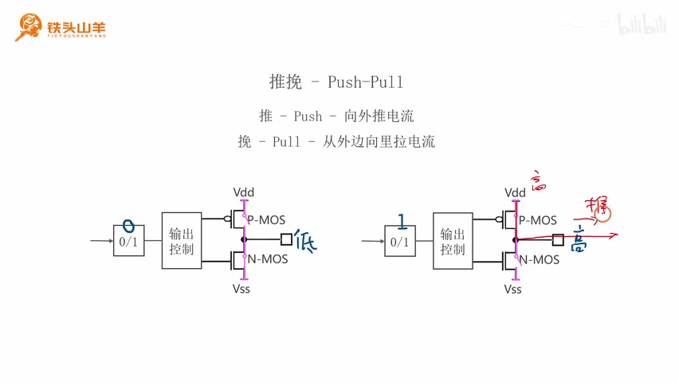

_推挽模式示意：向外推电流与向内拉电流。 ·_ [_原片 21:36_](https://www.bilibili.com/video/BV11X4y1j7si/?p=5\&t=1296)

在刚才分析的时候，不知道大家有没有注意到这么一个现象，就是对于这两个 MOS 管来说，它们是交替工作的。什么是交替工作呢？就是当上面这个 MOS 管断开的时候，下面的 MOS 管就导通，对吧？当下面这个 MOS 管关断的时候，上面这个 MOS 管就导通。这两个 MOS 管不能同时导通，也就是说，它们不能同时推和挽。为什么不能同时推和挽呢？我们来分析一下。如果这两个 MOS 管都一起工作，两个开关一起闭合，对吧？这里是高电压 VDD，这里是低电压 VSS，高电压和低电压之间直接通过一根导线连起来了，这不就短路了吗？所以大家一定要记住，对于推挽模式来说，这一对 MOS 管是交替导通的。到这里，大家应该了解推挽模式的工作原理了吧？

了解了推挽模式的工作原理之后，我们就来看一下，在我们的单片机里，如果把一个 IO 引脚设置成推挽模式，这个 IO 引脚应该怎么控制。比如说，我们来看这边的图。在这两个 MOS 管的前面，这里有一个输出控制电路，这个输出控制电路就是用来控制这两个 MOS 管到底是导通还是断开的。在这个输出控制电路前面，这里有一个寄存器，这就是输出数据寄存器。我们可以通过编程的方式，向这个寄存器写零或者写一。

对于我们这颗单片机来说，如果我们向这个位置写的是零，那么就是下面的 MOS 管导通，上面的 MOS 管关断。我们可以看一下，对于这种情况，这个 IO 引脚是不是就通过下面这个开关接了 VSS？VSS 是零伏，对吧？这两个点之间又短路，所以这一点的电压是多少？是不是也是零伏？零伏就是低电压，对吧？所以写零，输出的就是一个低电压。

再来看另外一种情况，就是写一的情况。如果我们向这个位置写一，它的工作状态正好相反，就是上面的 MOS 管导通，下面的关断。这个 IO 引脚是不是就通过这里跟 VDD 短路了？VDD 是 3.3 伏，所以这一点的电压，因为是短路的，所以也是 3.3 伏，对吧？这个时候，它向外输出的是不是就是一个高电压，3.3 伏？所以写一，输出的是高电压 3.3 伏。

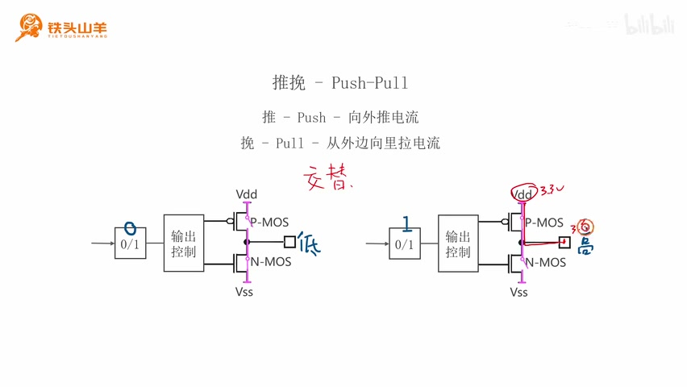

_推挽写零、写一两种状态，以及低电压、高电压和 3.3 V 标注。 ·_ [_原片 24:12_](https://www.bilibili.com/video/BV11X4y1j7si/?p=5\&t=1452)

因此，我们单片机如果 IO 引脚设置成推挽模式，写零输出的就是低电压，零伏；写一输出的就是高电压，3.3 伏。这跟我们的常识比较符合，也比较好记，对吧？

## 开漏模式

解释完了推挽模式，我们再来看一下开漏模式。什么是开漏模式呢？要想了解什么是开漏模式，我们得回顾一下 MOS 管的组成部分。我们把刚才那两个 MOS 管拿一个出来，把它的结构画出来。我们可以看到，这个 MOS 管是由三个极组成的，分别是这里的 G，G 就是 Gate，栅极；还有这里的 D，D 就是 Drain，漏极；还有这里的 S，S 就是 Source，源极。所谓开漏，其实指的就是这里这个漏极断开的一种模式。

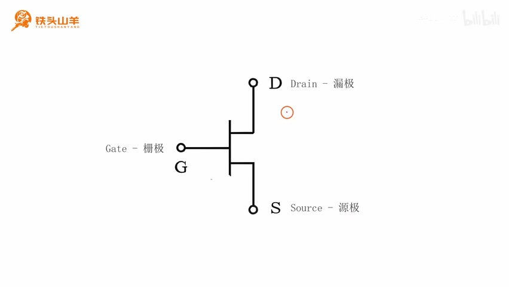

_MOS 管结构：G 为栅极，D 为漏极，S 为源极。 ·_ [_原片 25:00_](https://www.bilibili.com/video/BV11X4y1j7si/?p=5\&t=1500)

然后我们再回到刚才的电路图。在这个电路图里面，所谓开漏，其实指的是上面的 P-MOS 一直保持断开，就是不管在任何情况下，这个 P-MOS 一直保持断开。那为什么上面这个 P-MOS 保持断开的时候，就叫做开漏呢？我们来分析一下。

我们来看下面这个 MOS 管。对于这个 N-MOS 管来说，这里是不是 G 极，也就是栅极？下面这个就是 S 极，也就是源极；上面的这里就是漏极，也就是 D，对吧？因为这个 P-MOS 管连接的是下面这个 MOS 管的漏极，所以如果我们断开了上面的 MOS 管，是不是就相当于下面这个 MOS 管的漏极开路了？所以这就是开漏的含义。

大家一定要记清楚，对于开漏模式来说，上面这个 P-MOS 管是一直保持断开的，这就是开漏模式。

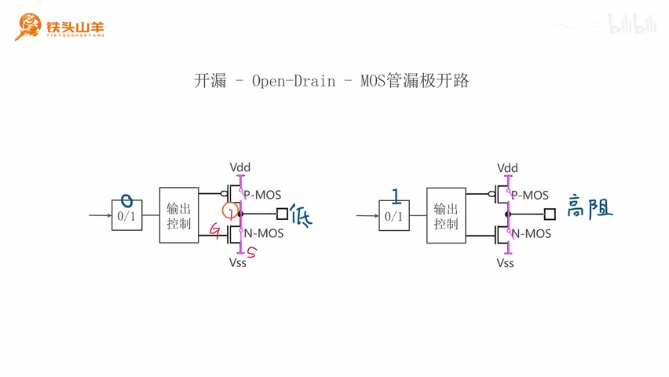

_开漏电路图：上方 P-MOS 保持断开。 ·_ [_原片 25:36_](https://www.bilibili.com/video/BV11X4y1j7si/?p=5\&t=1536)

了解了什么是开漏模式之后，下一步我们再来分析一下，如果我们把单片机的 IO 引脚设置成开漏模式，会出现一个什么样的现象。我们来看，在这两个 MOS 管前面，这里有一个输出控制电路，这个输出控制电路是受前面的输出数据寄存器控制的，对吧？在开漏模式下，如果我们向这个寄存器写一个零，下面的 MOS 管就闭合；如果写一个一，下面的 MOS 管就断开。但是无论我们写零还是写一，上面的 MOS 管始终是断开的，这也是开漏模式的一个特点。

我们先来分析写零的情况。如果是写零，我们来看这个 IO 引脚，是不是通过这个位置接了低电压 VSS？所以它输出就是一个零伏，输出的就是一个低电压。写零输出低电压，这跟刚才分析的推挽模式是一样的。

然后我们再来看一下写一的情况。写一的情况就有所区别了。如果我们写一，下面的 MOS 管就断开，对吧？因为上面的 P-MOS 本来就是断开的，所以这两个 MOS 管都断开了。这个 IO 引脚跟上面也断开了，跟下面也断开了，所以它是不是就悬空了？

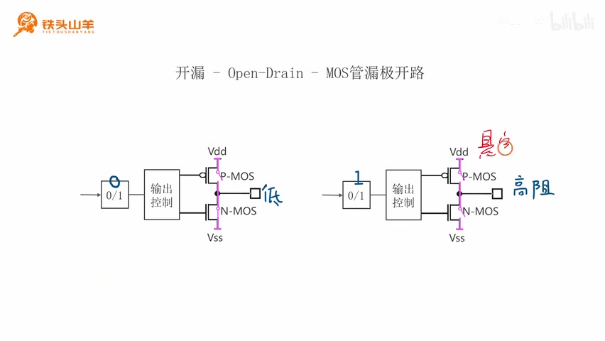

_开漏写零输出低电压，写一时两管断开、引脚悬空。 ·_ [_原片 27:12_](https://www.bilibili.com/video/BV11X4y1j7si/?p=5\&t=1632)

当这个 IO 引脚悬空的时候，无论我们从这个位置给这个 IO 引脚加多大的电压，这里的电流是不是都恒等于零？然后我们来算一下这个 IO 引脚当前的电阻。根据欧姆定律，电阻是不是就等于电压除以电流？这个电流恒等于零，所以算出来的电阻是不是就是无穷大？因为一个有限的数除以一个零，是不是就是无穷大？所以它的电阻是无穷大。我们把这种电阻无穷大的形式，称之为高阻抗。

所以当我们向 IO 引脚写一的时候，这个 IO 引脚既不会出现高电压，也不会出现低电压，而是出现这样一种高阻抗的形式，这也是开漏模式的一个特点。

好的，到这里我就把推挽和开漏的概念给大家讲清楚了，我们再来回顾一下。所谓推挽，就是那一对 MOS 管交替导通：上面的导通，下面的就断开；下面的导通，上面的就断开。在推挽模式下，如果我们向 IO 引脚写零，得到的就是一个低电压；写一，它输出的就是一个高电压。写零，低电压；写一，输出高电压。对于开漏模式来说，它是保持上面这个 MOS 管一直断开，也就是对于 N-MOS 来说，它的漏极一直断开，这就叫做开漏。在开漏模式下，写零输出的也是低电压；写一的话，它输出的比较特殊，它是 IO 引脚悬空，也就是输出的是一个高阻抗。这就是推挽和开漏。

学完推挽和开漏之后，下一步我们只需要把通用和复用的概念再给大家解释一下，这四种模式是不是大家就学会了？下面我们就来解释一下通用和复用的概念。

## 通用模式和复用模式

通用和复用的概念其实非常容易理解。所谓通用，就是我们通过 CPU 直接向这里的输出数据寄存器写值，通过输出控制电路去控制这两个 MOS 管的导通或者关断，然后去控制 IO 引脚的输出，也就是走上面的这条路，这就叫做通用。也就是通过编程直接去控制 IO 引脚输出高低电压。

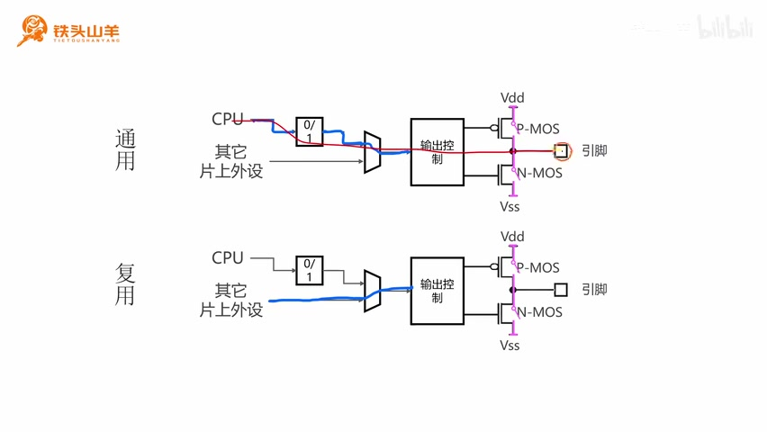

_通用与复用电路路径：CPU 和其他片上外设两种信号来源。 ·_ [_原片 29:12_](https://www.bilibili.com/video/BV11X4y1j7si/?p=5\&t=1752)

下面我给大家举一个例子，我们来看一下通用模式的例子。比如说，我们想使用 PA9 这个引脚去连接一颗 LED，比如像这样的一颗 LED。我们想控制这个 LED 点亮或者熄灭。当我们向这一点输出一个低电压的时候，LED 就熄灭；输出一个高电压的时候，LED 就点亮。

我们怎么控制 PA9 输出低电压或者高电压？如果使用通用模式，我们可以这样做：使用 CPU 直接向输出数据寄存器写零或者写一。写零的时候，输出的就是低电压，这个 LED 就熄灭；写一的时候，输出的就是高电压，这个 LED 就点亮，对吧？所以在通用模式下，我们是不是直接就使用 CPU，把 IO 引脚到底输出低电压还是高电压给控制到了？这就是通用模式。

刚才我们了解了通用模式，下面我们再来看一下复用模式。复用模式正好跟通用模式相反。通用模式是通过上面的 CPU，直接去控制这两个 MOS 管，去输出高电压或者低电压或者高阻抗。

而下面的复用模式，它的控制信号来自于下面这一部分，也就是来自于其他的片上外设。什么是其他的片上外设呢？下面我们来复习一下这个概念。我们来看一下之前介绍的这么一张图。我们知道，在单片机里边，这个位置是一个 CPU，它就相当于我们人类的大脑；下面还有很多这样的模块，这些模块就是单片机上一个一个的片上外设。

今天我们学习的就是 GPIO 这种片上外设。在单片机里面，有 GPIOA、GPIOB、GPIOC 和 GPIOD。除了 GPIO 这种片上外设之外，剩下的还有许多其他的片上外设。GPIO 专门是用来控制 IO 引脚的，对吧？但是其他这些片上外设，有的时候也会使用到这些 IO 引脚。如果它们要使用 IO 引脚，那怎么办呢？这个时候，我们就需要使用其他的片上外设去控制 GPIO 模块，然后使用这个控制信号去控制 IO 引脚，去输出高电压或者低电压。这就是所谓的复用模式。

在通用模式下，我们是使用 CPU 直接去控制 IO 引脚；在复用模式下，我们是把控制权交给其他的片上外设，这就是复用。

举个例子，刚才我们使用 PA9 去控制一颗 LED，让 LED 点亮或者熄灭，我们是使用 CPU 直接去控制的，就是使用这种通用模式。再来看右边这么一张图，现在我们不用它去控制 LED 了，而是使用 PA9 去连接串口模块。我们这个串口模块对应的发射引脚，就是在 PA9 上。

假设我们编写一段程序，让串口模块去发送这样一个 Hello 字符串。这个时候，串口模块就把 PA9 给接管了，它就会通过 PA9 向外发送这种高低变化的波形，从而把这个数据发送出去。在这种情况下，我们就应当把 PA9 设置成复用模式，对吧？这就是复用模式的一个例子。

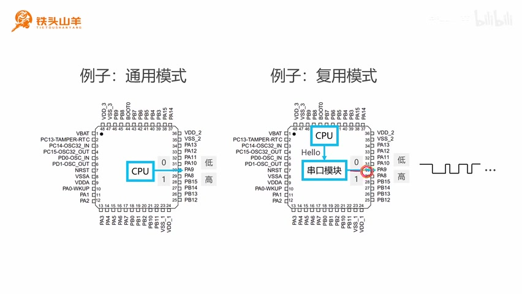

_PA9 通用控制 LED 与串口模块复用发送的例子并列。 ·_ [_原片 32:12_](https://www.bilibili.com/video/BV11X4y1j7si/?p=5\&t=1932)

好的，到这里，我们就已经把什么是通用、什么是复用、什么是推挽、什么是开漏这几个概念给大家讲清楚了。有了这几个概念之后，大家再来看一下这四种模式：通用输出推挽、通用输出开漏、复用输出推挽、复用输出开漏，是不是这几个模式的含义就非常清楚了？

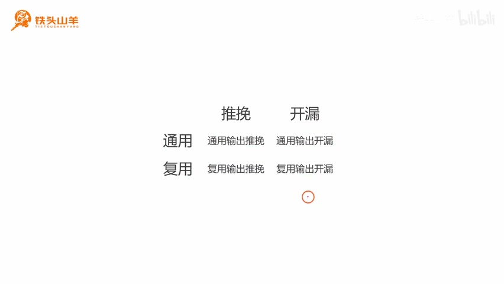

_课程结尾再次展示通用、复用、推挽、开漏组合的四种模式。 ·_ [_原片 32:48_](https://www.bilibili.com/video/BV11X4y1j7si/?p=5\&t=1968)

好的，以上就是本期视频的所有内容。感谢大家的收看，我是铁头山羊，让我们下期视频再见。

> 整理说明：原字幕中的 GPO、GPU 等按画面统一为 GPIO；推挽、开漏、片上外设、Cortex-M3、RM0008、Gate/Drain/Source 按可见术语整理。19 分钟和 26 分钟附近讲解输出电路时字幕写作“输入数据寄存器”，按所指图中“输出数据寄存器”整理。原讲者关于悬空电流恒为零、有限数除以零为无穷大的理想化解释保持原意，未据此增补课程外结论。 图像与预览：已查看全片联系表和全部 18 张最终截图。源视频为 852×480；代码画面细字受原始清晰度限制。当前会话浏览器已拒绝 file:// 访问，因此未实际验证桌面/窄屏布局、图片缩放和来源链接点击；已执行离线 HTML 与本地资源结构校验，未绕过该限制。
