# P007 · 2.3 （GPIO）LED闪灯实验

> 整理方式：忠实清理讲稿。保留讲者原有顺序、第一人称讲解、例子与操作细节；清理停顿、修正有画面依据的明显识别错误。 来源：[哔哩哔哩原视频，第 7 分P（P7）](https://www.bilibili.com/video/BV11X4y1j7si/?p=7)；范围 00:00–42:33，使用原始时间轴。

## 实验内容与 LED

各位同学大家好，我是铁头山羊。今天我们来学习第二章的第三节。首先我们先来回顾一下：在之前的课程里边，我们已经学习过 GPIO 模块八种工作模式中的四种。这四种模式是跟我们 IO 引脚的输出有关的。然后在上一期视频的过程中，我们还学习了 IO 引脚的最大输出速度。学完了这两部分内容之后，我们就可以利用这两个知识来做一个实验。本节课我们要做的这个实验的名字，叫做 LED 闪灯实验。首先我们先来看一下这个实验的内容。

本套视频所需要的所有材料，都包含在这个开发套件包里。大家可以扫描屏幕上的二维码，进入到我们的淘宝店铺来购买它。购买套件之后，你将获得课程所有的课件和源码，还能加入答疑群，和 UP 直接交流。

本期视频我们要做的实验是这样的：首先在我们的开发套件包里边，有这么一个电路板。这个电路板就是我们单片机的最小系统板。然后在这个最小系统板的这个位置，大家看，这里有一盏灯。这盏灯是一个 LED 灯，它上面有一个丝印，这里标注 PC13，大家可以看到吧？这里有一个 PC13，说明这盏灯是连接在我们单片机的 PC13 引脚上的。

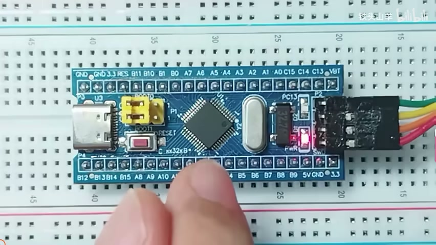

_最小系统板上的 PC13 标注与板载 LED。 ·_ [_原片 01:00_](https://www.bilibili.com/video/BV11X4y1j7si/?p=7\&t=60)

然后我们就可以使用 PC13 这个引脚，去控制这盏灯的点亮和熄灭。我们一会儿点亮这颗灯，一会儿熄灭这颗灯，循环地去做这个动作，就可以看到这个 LED 闪烁起来了。本节课我们就是要通过编程来实现这个 LED 闪烁的效果。

因为我们要控制这个 LED，所以我们首先来分析一下，我们这个 IO 引脚是如何让 LED 点亮和熄灭的。我们先来看看怎么去点亮一盏 LED。我们来看这么一个电路图，在这个电路图里面，这个符号就表示刚才所说的 LED。LED 的中文又叫做发光二极管。从它的名字我们就可以看得出来，这个 LED 就是一种能够发光的二极管。

所以我们在电路里边用这个符号来表示它。在这个符号当中，这一部分就表示一个普通的二极管，然后上面的两个箭头就表示这个二极管发出的光线。这个就是发光二极管的符号。

对于这个发光二极管来说，它也是有阳极和阴极的。我们在给这个二极管供电的时候，需要在阳极供一个正电压，阴极供一个负电压，这样就会有电流从这个二极管里面流过。当流过这个二极管的电流足够大的时候，这个发光二极管就会点亮。我们这个电流一般需要控制在 2～10mA 之间，也就是说，只要我们给这个二极管通一个 2～10mA 的电流，它就会发光。如果这里没有电流的话，这个二极管就会熄灭。

了解了这个原理之后，我们就知道了，要想点亮这颗 LED，我们只需要给它通一个 2～10mA 的电流就可以了。那我们怎么去通这个 2～10mA 的电流呢？可以通过这么一个电路。在这个电路里边，这里就是 LED。LED 的阳极我们给它接一个正电压，比如说我们单片机里边的 VDD，也就是 3.3V。然后 LED 的阴极，我们给它接地，也是低电压 0V。

在这个 3.3V 和 0V 之间，我们串这么一个电阻。这个电阻叫做限流电阻。顾名思义，这个限流电阻的作用就是去限制流过 LED 的电流，把它限制在 2～10mA 之间。比如说，我们这个限流电阻的阻值取 510Ω，我们来算一算流过这个 LED 的电流是多少。

首先，当这个 LED 导通的时候，因为它是一个二极管，对吧？所以它导通的时候，它的压降应该是 0.7V，这个就是二极管的导通压降。然后我们知道了这里的电压之后，这个限流电阻的电压，是不是就是用总的 3.3V 的电压，减去 LED 两端的 0.7V 的电压？这两个相减，得到的结果就是 2.6V，对吧？而这里的电阻的阻值是 510Ω。我们知道了电压，知道了电阻，是不是能求出这个限流电阻的电流？然后这里的电流和这个电流是不是相等的？因为它们两个是串联的，它们两个电流其实是一样的。所以我们就把这个电流求出来，是不是就可以得出流过这个发光二极管的电流了？这个电流是多少呢？就是用 2.6V 除以 510Ω，得出来的结果约等于 5mA 左右。这个 5mA 是不是就在 2～10mA 之间？所以通过这个电路，我们是不是就可以给这个 LED 通一个 2～10mA 之间的电流了？这个 LED 是不是就点亮了？

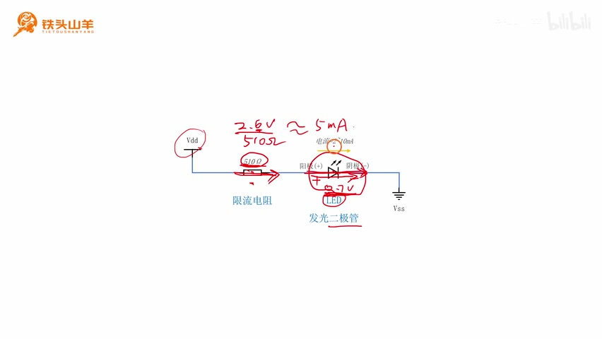

_510Ω 限流电阻、LED 和电压标注，画面给出约 5mA 的计算。 ·_ [_原片 04:30_](https://www.bilibili.com/video/BV11X4y1j7si/?p=7\&t=270)

现在我们知道了怎么去点亮 LED，接下来我们再来看一下怎么去熄灭 LED。要想熄灭这个 LED，就更加简单了。刚才我们不是给 LED 的阳极接了一个高电压 VDD 吗？只要我们把这个 VDD 给它撤下来，这个 LED 是不是就熄灭了？所以我们把这个电路图改变一下，在这里给它加一个开关。这个开关可以拨到这么两个位置：如果拨到上面这个位置的话，这个点是不是就跟高电压 VDD 相连了？这样这个 LED 是不是就点亮了？

如果我们把它拨到下面去的话，这个点是不是就跟下面的地相连了，也就是 0V 相连了？既然阳极这里是 0V，阴极这里也是 0V，所以这两个点之间是不是就没有电压差了？所以就不会有电流从这个地方流过，对吧？所以这个 LED 就熄灭了。因此我们就可以通过拨动这个开关，来控制这个 LED 的点亮和熄灭：拨到上面就是点亮，拨到下面就是熄灭。

我们注意观察一下这个开关。对于这个开关来说，如果它拨到上面的位置，那么这里就通过开关接高电压 VDD；如果拨到下面的位置，这个位置就通过开关接低电压 VSS。其实这个开关就跟我们之前学习的 IO 引脚的推挽输出特别相似。比如说现在我们就把这个开关替换成单片机上的一个 IO 引脚，就是这么一个 IO 引脚，后面的这一部分电路保持不变。我们把这个 IO 引脚的模式设置成推挽模式。我们知道，对于推挽模式来说，这个 MOS 管负责“推”，下面的这个 MOS 管负责“挽”，而且这两个 MOS 管是交替导通的。

比如说，我们导通上面的 MOS 管，然后关断下面的 MOS 管，这个位置是不是就通过上面的 MOS 管接高电压 VDD 了？这就相当于我们这个开关拨到上面，然后这一点通过这个位置接 VDD，对吧？反过来，如果我们把上面的断开，下面的导通，这个点是不是就通过下面的 MOS 管接低电压 VSS 了？这就相当于我们把这里的开关拨到下面去，然后这一点通过开关接低电压 VSS。是不是这个开关就跟我们这个 IO 引脚完全一样了？

所以我们就可以通过这个 IO 引脚，把它设置成推挽模式，然后通过编程的方式向这个 IO 引脚写 0 和写 1，来控制这个 LED 的点亮或者熄灭。我们把这种接法称为 LED 的一种推挽接法，这个就是推挽接法的电路。

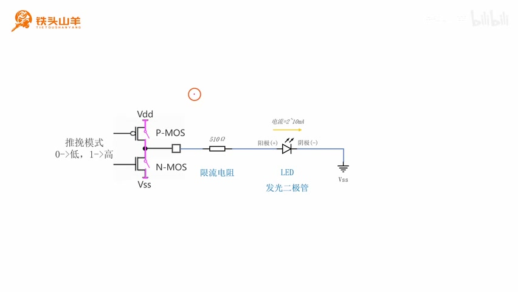

_推挽模式电路：P-MOS、N-MOS 与 LED 阳极侧连接。 ·_ [_原片 07:15_](https://www.bilibili.com/video/BV11X4y1j7si/?p=7\&t=435)

除了这种推挽接法之外，还有另外一种接法，这个接法就叫做开漏接法。我们来看这么一个电路图。这张电路图跟刚才所看的那个电路图基本上是一样的，只不过我们把刚才这里的开关，移动到了 LED 的阴极这个位置。我们通过使用这个开关，来控制 LED 的点亮或者熄灭。

首先我们先来看一下 LED 点亮的情况。要想点亮这颗 LED，我们就只需要把这个开关闭合上就可以了。闭合上这个开关之后，这个电路图是不是就跟我们一开始分析的那个电路图一模一样了？这样 LED 上就会流过一个 5mA 左右的电流，这个 LED 就点亮了，对吧？那现在我们再把这个开关断开。

断开开关之后，这个电路是不是就开路了？所以这个电流从这里流过来之后，到这个位置就没有回路了，对吧？所以在这个 LED 上就不会有电流，这个 LED 就会熄灭。因此我们就可以通过这个开关，去控制这个 LED 的点亮或者熄灭。而这个开关就比较类似于我们的 IO 引脚的开漏模式。

现在咱们就把这个开关替换成单片机的一个 IO 引脚，比如说替换成这么一个 IO 引脚。然后我们把这个 IO 引脚设置成开漏模式。我们知道，对于开漏模式来说，它要求下面的 N-MOS 管的漏极一直保持断开，这个就是开漏。其实也就是要求这个 P-MOS 管一直断开，这里一直断开。也就是说，这部分电路我们是不是就不需要考虑了？因为它始终是断开的。

所以我们可以看到，下面的 N-MOS 管的开关，是不是就类似于我们这里的这个开关？所以这两个电路是不是就是完全一样的了？因此我们只需要把这个地方设置成开漏模式，然后向这个开漏模式的 IO 引脚写 0 的时候，下面的这个开关闭合，也就相当于这里的开关闭合，对吧？所以这个 LED 就会点亮。而如果我们向这个开漏模式的 IO 引脚写 1 的时候，下面的 MOS 管也关断，对吧？就相当于这里的开关断开。那么这里没有回路了，所以这个 LED 就会熄灭。我们就可以通过这种方式，去控制 LED 的点亮和熄灭。

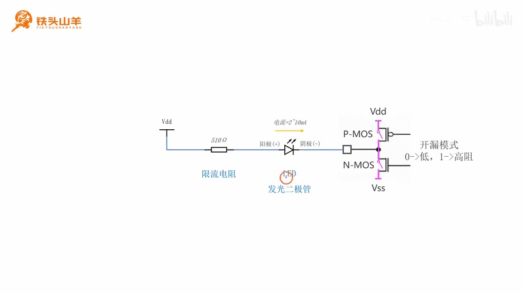

_开漏模式电路：LED 阴极接 IO，P-MOS 保持断开。 ·_ [_原片 09:38_](https://www.bilibili.com/video/BV11X4y1j7si/?p=7\&t=578)

刚才讲得有点乱，现在我们再来总结一下。我们的这个 LED，想要控制它点亮或者熄灭，我们有两种接线方式，就是这两种接线方式。其中前面的接线方式，我们把开关放到 LED 的阳极，也就是放到左边；而后边的接线方式，我们把开关放到阴极，也就放到这个位置。其中放到阳极的这个方式，就类似于我们在这里放了一个 IO 引脚，然后把这个 IO 引脚设置成推挽模式，所以这个接法就叫做推挽接法。而后面的这个开关，就类似于我们这个 IO 引脚设置成了开漏模式。也就是说，这个开关就等效于下面 N-MOS 管的开关。然后我们把这种接法叫做开漏接法。

通过刚才的学习，我们知道这颗 LED 有两种接线方式，一种是推挽接法，另一种是开漏接法。现在我们就产生了一个问题：我们本次实验要使用的这颗板载 LED，它到底是使用推挽接法连接的，还是使用开漏接法来连接的呢？要想回答这个问题，我们就得看一下这个最小系统板的电路图。

我在课程资料里边给大家准备了这么一个文件，这个文件就是我们刚才那个最小系统板的原理图。现在我们打开这个文档，然后我们来看一下原理图。在这个原理图的这个位置，这里有一个四方形的结构，这个结构就代表最小系统板上的这颗芯片，也就是我们的 STM32 单片机。

然后我们往上看，这里有两颗 LED，对吧？其中上面的这颗 LED 是 D1，这颗 LED 就是我们最小系统板上这颗红色的 LED。这个是一个电源指示灯，只要我们给这个最小系统板供上电，这个指示灯就会亮。然后剩下的，下面还有一颗 LED，就是 D2。D2 这个 LED 连接的是我们单片机上的 PC13 这个引脚，也就是连接的这个引脚，PC13 这个引脚。然后它就是我们本节课要用的这个蓝色的、闪烁的 LED。

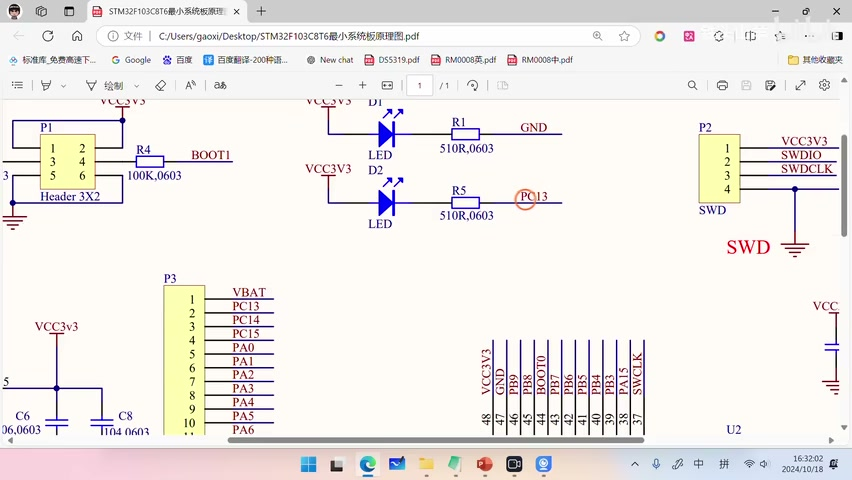

_最小系统板原理图中的 D1、D2，D2 经 R5 连接 PC13。 ·_ [_原片 11:31_](https://www.bilibili.com/video/BV11X4y1j7si/?p=7\&t=691)

下面我们就来分析一下这张电路图，它到底是属于我们刚才介绍的推挽接法，还是属于开漏接法呢？我们把刚才的电路图摘出来，放在这个位置。然后在下面，我们左边放推挽接法的电路图，右边放开漏接法的电路图。我们来对比一下，这种接法到底是属于左边的推挽接法，还是右边的开漏接法。首先告诉大家结论，这个电路图就是我们右边这种开漏接法的电路图。

比如说，我们来对比一下。这里就是我们的 LED，这里是 LED，然后 LED 的阳极接的是高电压 3.3V。我们来看这个 LED 的阳极，是不是接的高电压 VDD？然后这里是限流电阻，这个限流电阻用来控制电流，这里就是对应的限流电阻。然后这个 LED 的阴极，我们看它接的是单片机的 PC13 这个引脚，对吧？对于开漏接法来说，我们来看这里的 LED，它的阴极是不是就接到一个 IO 引脚？所以这种接法就是一个标准的开漏接法。

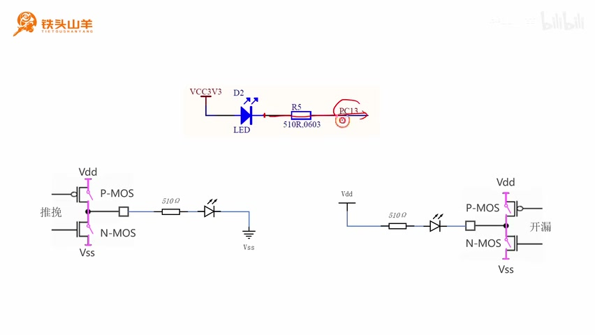

_板载 LED 原理图与推挽、开漏两种接法的对照。 ·_ [_原片 12:33_](https://www.bilibili.com/video/BV11X4y1j7si/?p=7\&t=753)

所以下面我们去设置这个 IO 引脚工作模式的时候，我们一定要把这个 IO 引脚的工作模式设置成开漏模式。好的，到这里，本节课所有的知识点我都给大家讲完了。讲完这些知识点之后，下一步我们就开始编写代码了。

## 从模板建立工程

要想编写代码，首先我们得先建立一个新的工程，然后我们才能把代码写到这个工程里面。那怎么去新建这个工程呢？我们来看，我在下面这个位置给大家准备了一个网址，这个网址就是我们课程资料的百度网盘。然后我们需要打开这个网址，在百度网盘里面去下载一个叫做模板工程的东西。这个模板工程，就是事先准备好的一个空的工程。我们把这个模板工程下载下来，然后对这个模板工程进行重命名，然后就可以新建一个工程了。然后我们再把代码写到这个工程里边。

所以下面我们就从这个百度网盘里面，把模板工程下载下来。现在我们就复制这个百度网盘的链接，就是复制到这个位置。当然你也可以扫右边的二维码，效果是一样的。我们复制这个链接，然后粘贴到浏览器里面，这样我们就可以打开百度网盘。打开百度网盘之后，这个“标准库”就是我们课程的资料。然后我们打开这个“标准库”，在底下这里有一个 template.rar，这个就是我们所说的模板工程。我们把这个文件下载下来就可以了。

下载完成之后，我们会得到这么一个文件，这个文件就是我们的模板工程。我们可以看到，这个文件其实是一个压缩包，对吧？所以我们在使用它之前，首先需要对这个压缩包进行解压。我们右键点击这个压缩包，然后把它解压到当前文件夹。注意，是解压到当前文件夹。解压之后，我们就会得到这么一个东西，就是这个 template，这个文件夹就是我们的模板工程。

然后我们需要对这个模板工程进行重命名，比如说我们给它起个新的名字，叫做 BlinkyLED。这个 Blink 就是闪烁的意思，LED 就是那个发光二极管，对吧？所以我们这个实验的名字就是一个闪灯实验。然后我们把这个名字复制一下，打开这个文件夹，然后对里边的这两个文件也进行重命名。重命名完之后，现在我们就可以双击打开下面这个文件了。这个文件就是工程文件，它的后缀是 .uvprojx，这就是工程文件。我们双击打开它，这样就把这个工程打开了。

打开工程之后，我们会在左边这个位置看到一个树形的结构，对吧？我们打开这个树形结构，然后打开 default 文件夹，打开 user 文件夹，下面有个 main.c。这个 main.c 就是我们主程序所在的位置。我们双击打开它。接下来我们在写代码的时候，就需要把程序写到 main.c 这个文件里面。

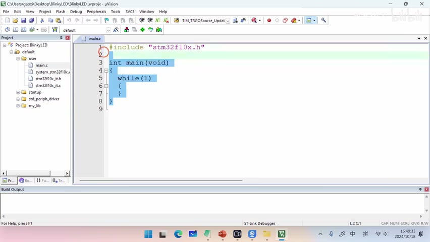

_Keil 工程树中的 user 与打开的 main.c 主程序。 ·_ [_原片 15:32_](https://www.bilibili.com/video/BV11X4y1j7si/?p=7\&t=932)

## 给 GPIOC 开启时钟

好的，下面我们开始编写这个程序。我们编程的第一步，就是为 GPIOC 去开启时钟。那为什么要给 GPIOC 开启时钟呢？原因是这样的，因为我们在编程的过程中，需要使用到 PC13 这个引脚去控制板载 LED，对吧？而这个 PC13 引脚又是归我们单片机里边 GPIOC 这个片上外设管的。所以我们在使用 GPIOC 之前，就得为这个 GPIOC 去开启时钟。然后我们再来解释一下什么是时钟，我们可以把这个时钟类比成人的心跳。

而这里“开启时钟”的含义，就是给我们身体里面的某个器官去提供心跳，也就是给身体里面这个器官去供血。我们曾经把单片机里边的这些模块，比作成人体里面一个一个的器官。比如说，我们把 GPIOC 比作成人的这么一只手，而给 GPIOC 开启时钟，就相当于给这只手提供心跳，也就是给这只手供血。只有我们给这只手供血之后，这只手才能开始工作，也就相当于我们这个 GPIOC 才能开始工作。所以我们在使用 GPIOC 之前，必须得为 GPIOC 去开启时钟。

我们在为 GPIOC 开启时钟的时候，使用的是这么一个编程接口，这个编程接口叫做 RCC\_APB2PeriphClockCmd。这个编程接口本来是要放到后边才去学的，但是因为我们现在用到了，所以提前把它拿出来。所以这个编程接口，大家不需要理解它的含义，这是一个固定的写法。

然后这个编程接口有两个参数。第一个参数，填写我们要开启的模块的名称。因为我们本次要使用的是 GPIOC 这个模块，对吧？所以我们这里就填 RCC\_APB2Periph\_GPIOC，这里的 x 给它替换成 C 就可以了。如果你想开启 GPIOA 的时钟，那你这里就填 GPIOA；如果是 B 的话，就填 GPIOB，以此类推。第二个参数填 ENABLE，ENABLE 就是开启时钟的意思。

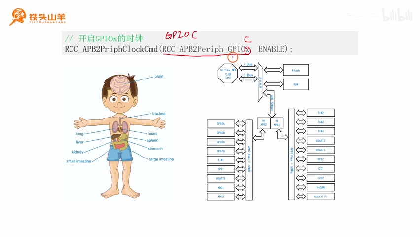

_开启 GPIOx 时钟的接口及将端口替换为 GPIOC 的标注。 ·_ [_原片 17:24_](https://www.bilibili.com/video/BV11X4y1j7si/?p=7\&t=1044)

这是一个固定的写法，等到后边我们讲到时钟树的时候，大家就明白这个编程接口的含义了。大家先不用理解它，我们直接把这个代码写到程序里面就可以了。下面我们来编写一下这段程序。我们找到 main.c 文件，也就是刚才打开的这个文件。我们把程序写在 main 方法里面。这个 main 方法，就是我们程序的起点。我们在 main 方法的第一行去编写程序。首先我们先写一个注释，第一行我们要做的事情，就是开启 GPIOC 的时钟。我们调用的编程接口，这是一个固定的写法，叫 RCC\_APB2PeriphClockCmd。第一个参数填 RCC\_APB2Periph\_GPIOC，然后第二个参数填 ENABLE。这样我们就把 GPIOC 的时钟给它开起来了。下面我们才能使用 GPIOC，对板载 LED 进行操作。

```c
// 1. 开启GPIOC的时钟
RCC_APB2PeriphClockCmd(RCC_APB2Periph_GPIOC, ENABLE);
```

## GPIO 的编程接口

给 GPIOC 开启了时钟之后，下一步我们就需要使用 GPIO 模块，对板载 LED 进行操作了。那这个程序应该怎么写呢？大家是不是现在就没有思路？为什么没有思路呢？因为我们还没有学习跟 GPIO 模块相关的一些编程接口。所以下一步我们就来学习这些编程接口。

我们从课程资料里面，拿出这么一个文件来，这个文件叫做 GPIO 的编程接口汇总。我们本章学习的就是 GPIO 模块，对吧？这里边这些编程接口，就是我们本章所需要学习的所有编程接口。下面我们打开这个文件。可以看到，本章我们一共需要学习这么四个编程接口。下面我们就逐一对这些编程接口的作用做一个介绍。

首先我们先来观察一下这些编程接口。对于这些编程接口来说，它都是以 GPIO\_ 开头的。这里 GPIO\_ 这个前缀，表示这些编程接口都是属于 GPIO 这个模块的。我们这个 GPIO 模块最常用的编程接口，一共有这么四个。本节课我们要学习的是这三个编程接口，这个编程接口我们下节课再学。然后在这三个编程接口当中，最后一个编程接口用得比较少，所以我们重点就是学习第一个和第二个编程接口就可以了。

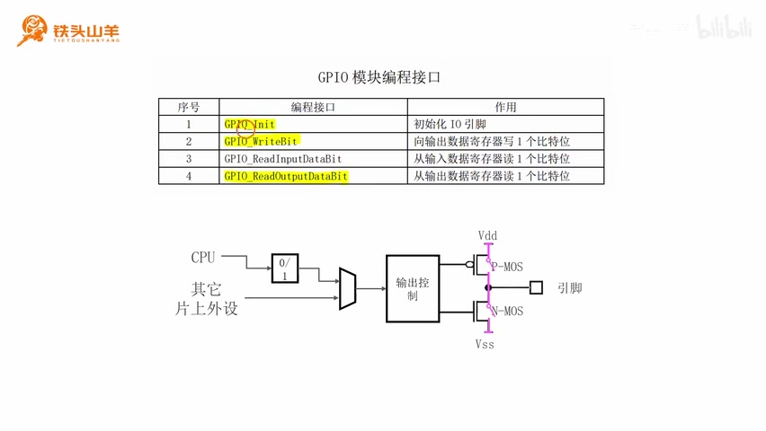

_GPIO 模块编程接口汇总及 IO 输出结构示意图。 ·_ [_原片 19:34_](https://www.bilibili.com/video/BV11X4y1j7si/?p=7\&t=1174)

首先我们先来看第一个编程接口。第一个编程接口叫做 GPIO\_Init，其中这里的 Init 是一个单词的缩写，这个单词叫做 initialize。initialize 就是初始化的意思。所以这个编程接口的作用，就是对我们的 IO 引脚进行初始化。我们知道，在单片机里边有很多引脚，这一圈一共是 48 个。而 GPIO\_Init 的作用，就是对其中的一根 IO 引脚进行初始化。我们每调用一次 GPIO\_Init，就是去初始化这一根 IO 引脚。然后我们再来解释一下初始化的概念。那什么是初始化呢？所谓初始化，就是我们在使用这个 IO 引脚之前，去配置一下这个 IO 引脚的参数，这个就叫做初始化。

具体是配置哪些参数呢？比如说，我们之前学习过，对于单片机的一个 IO 引脚来说，它总共有八种工作模式可选，对吧？四种输入、四种输出。那我们在使用这个 IO 引脚之前，是不是需要从这八种模式里面选择一种？另外，对于这个 IO 引脚来说，它还有一个最大输出速度的概念。那我们在使用 IO 引脚的时候，到底选的是 2MHz 的最大输出速度，还是 10MHz 的最大输出速度，还是 50MHz 的最大输出速度？这两个参数，都是通过 GPIO\_Init 这个编程接口进行配置的。

解释完了 GPIO\_Init，我们再来看第二个编程接口。第二个编程接口叫做 GPIO\_WriteBit，其中 write 就是写的意思，然后 bit 表示一个比特位。所以这个编程接口的作用，就是向我们的输出数据寄存器去写一个比特位，也就是向这里去写值。

比如说，我给大家举个例子：我们把这个 IO 引脚设置成通用输出推挽模式，那我们就可以调用 GPIO\_WriteBit，向这个比特位去写一个 0，或者写一个 1。在推挽模式下，如果我们写 0 的时候，这个位置当然输出的就是一个低电压，对吧？就是下面的 MOS 管闭合，上面的 MOS 管断开，这就是输出的低电压。如果我们在同样模式下写一个 1，那就是上面的闭合，下面的断开，那这里输出的就是一个高电压。所以我们就可以通过这里的写 0 和写 1，去控制这个 IO 引脚的输出状态了，对吧？这就是 GPIO\_WriteBit 的作用。也就是我们调用 GPIO\_WriteBit 的时候，其实是通过 CPU 向这个输出数据寄存器写 0，或者写 1，从而去控制这个 IO 引脚上的输出电压。

然后我们再来看一下最后一个编程接口。最后一个编程接口叫做 GPIO\_ReadOutputDataBit。read 当然就是读的意思，就是这里的这个读；然后 output 代表输出，data 代表数据，bit 代表一个比特位。所以这个编程接口的作用，就是从输出数据寄存器里边读一个比特位出来，其实读的就是这个比特位的值。

比如说，我们调用上面的这个编程接口，向这里写入了一个 1，接着再调用下面这个编程接口，把这个值读出来，那我们读的就是 1。如果我们调用它，往里边写入一个 0，那么我们紧接着调用它，把这个 0 就能给它读出来。所以这个编程接口读的，其实是我们上一次，就是最近一次使用上面这个编程接口写入的一个值。我们最近一次写入的是什么，那调用这个编程接口读出来的就是什么。这个编程接口用得比较少。

讲完了这些编程接口之后，下面我们来梳理一下本次实验的思路。本次实验，我们首先需要使用 GPIO\_Init，去对我们要使用的这个 IO 引脚进行初始化。因为我们的 LED 连接的是单片机的 PC13 引脚，所以我们要初始化的 IO 引脚就是 PC13，对吧？

然后在调用这个编程接口进行初始化的时候，我们需要设置两个参数。刚才我们说了，一个是 IO 引脚的模式，另一个是最大输出速度。我们先来看这个模式。对于单片机的 IO 引脚来说，我们知道它有八种工作模式，其中四种输出、四种输入，对吧？因为我们要使用这个 IO 引脚向外输出信号，去控制这个 LED，所以它应当选择输出模式。然后输出模式，又根据通用还是复用、推挽还是开漏，分成这么四种。那我们来看一下，我们到底应该选择通用还是复用？

选择推挽还是开漏？首先，因为我们这个 LED 使用的是一个开漏接法，对吧？所以这个地方我们应当选择开漏。然后我们需要调用这个编程接口，向输出数据寄存器里边写 0 或者写 1，来控制 LED 的点亮和熄灭，对吧？所以我们走的是这么一条路，就是通过 CPU 写程序，去往这里边写值，然后去控制这个 LED。所以我们采用的是通用模式。我们就可以确定，这个 IO 引脚的模式就是通用输出开漏模式。

然后我们再来确定一下 IO 引脚的最大输出速度。因为对于我们这个 LED 来说，它的工作速度比较慢，一般都不会超过 100Hz。而我们所使用的 IO 引脚的最大输出速度有 2MHz、10MHz，还有 50MHz。2 兆就是 200 万，10 兆就是 1000 万，50 兆就是 5000 万。所以跟这个 100Hz 比起来，这些频率都非常快，对吧？我们选一个最小的就可以了。所以我们选的是通用输出开漏模式，而且使用的是一个 2MHz 的最大输出速度。

然后初始化完这个 IO 引脚之后，下一步我们就调用 GPIO\_WriteBit，向这里的寄存器写 0 或者写 1，去控制这个 LED 点亮或者熄灭就可以了。所以我们总共分成两步，第一步初始化，第二步就是去控制这盏灯的亮灭。下面我们从第一步开始，首先我们调用 GPIO\_Init，对这个 IO 引脚进行初始化。

## GPIO\_Init 的两个参数

我们来看一下 GPIO\_Init 这个编程接口的使用方法。这个 GPIO\_Init，我们刚才介绍过，它的作用就是去初始化一个 IO 引脚。那我们来看一下，这个编程接口有这么两个参数。我们只看这个参数就可以了，前面的类型我们先不关注。然后第一个参数叫做 GPIOx，这个 GPIOx 用来填写我们要初始化的那个引脚的端口号。那什么是端口号呢？比如说，本次实验我们使用的是 PC13 这个引脚，对吧？PC13 这个引脚是归 GPIOC 管的，所以它的端口号就是 GPIOC。所以这个参数我们就填 GPIOC 就可以了，也就是把这里的 x 换成一个大写字母 C。

我们来写一下这个程序。这个程序是第二步，第二步我们需要初始化 IO 引脚，也就是把 PC13 初始化成通用输出开漏模式，最大输出速度是 2MHz。为了初始化这个 IO 引脚，我们调用的是 GPIO\_Init 这个编程接口。第一个参数我们说过，是填这个端口号，对吧？也就是 GPIOC。这样我们前半部分就写完了。

然后我们再来看一下第二个参数。第二个参数叫做 GPIO\_InitStruct。这个 GPIO\_InitStruct，它是一个这种结构体的指针类型的，前面这个表示一个结构体，这个星表示是一个指针，所以说它是这么一个结构体指针类型的变量。

然后这种结构体，就类似于一张菜单。比如说，我们去餐馆吃饭，点菜的时候就往菜单上去写入我们想要的菜，然后餐馆就会按照我们的要求给我们上菜，对吧？对于这个编程接口来说，这个参数的作用跟菜单是一样的。我们想把 PC13 引脚初始化成什么模式，最大输出速度选多少，我们把这些参数都填到这个结构体里边，然后这个编程接口就会按照我们的要求，对这里的 IO 引脚进行初始化。

下面我们就来看一下这个结构体的定义。这个位置就是这个结构体的定义。这个结构体有这么三个成员。首先第一个成员 GPIO\_Pin，用来填写我们要操作的引脚的编号，也就是我们要初始化的那个引脚的编号。比如说，本次实验我们要初始化的是 PC13 这个引脚，那么它的引脚编号是不是就是 13？然后这个位置，我们就填 GPIO\_Pin\_13 就可以了。它的范围是从 GPIO\_Pin\_0 到 GPIO\_Pin\_15，我们这里就填 GPIO\_Pin\_13 就可以了。然后第二个成员叫做 GPIO\_Speed，这个用来填写我们 IO 引脚的最大输出速度。如果我们把这个引脚设置成了一个输出模式之后，那么我们就需要去指定这个引脚的最大输出速度。这个最大输出速度可以选 2MHz、10MHz 或者 50MHz。如果我们把这个成员填成 GPIO\_Speed\_2MHz，就是选择 2MHz；这个 GPIO\_Speed\_10MHz 就代表 10MHz，下面这个 GPIO\_Speed\_50MHz 就代表 50MHz。

最后一个成员是 GPIO\_Mode，这个 GPIO\_Mode 用来选择我们 IO 引脚的模式。一共有八种模式，四种输出、四种输入。我们只学习了这么四种输出，对吧？这四种输出分别是 GPIO\_Mode\_Out\_PP，其中 Out 代表输出，PP 第一个 P 代表 push，就是推，第二个 P 代表 pull，就是拉。所以这种模式就是通用输出推挽模式。

然后下面这种模式叫做 Out\_OD，这个 Out 代表输出，然后 O 代表 open，也就是开，D 代表 drain，也就是漏，所以这个就是通用输出开漏。再往下这个模式叫做 AF\_PP，这个 AF 其实代表 alternate function，也就是复用的意思，然后 PP 代表推挽，所以这个就是复用输出推挽。再往下这里是 AF\_OD，这个就是复用输出开漏。所以这四种模式就对应 IO 引脚的四种输出模式。

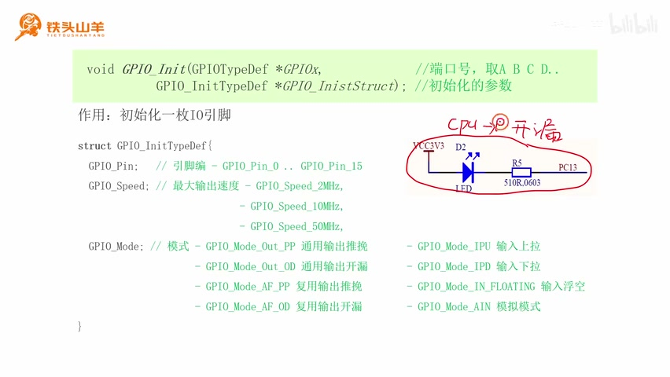

_GPIO\_Init 参数、结构体成员与四种输出模式。 ·_ [_原片 29:58_](https://www.bilibili.com/video/BV11X4y1j7si/?p=7\&t=1798)

对于我们这个电路图来说，我们使用的是开漏接法，对吧？准确地说是通用输出开漏接法。因为我们需要使用 CPU，直接向那个寄存器里边去写值，所以它是通用输出开漏。所以我们要选择的模式就是这种模式，也就是 GPIO\_Mode\_Out\_OD。

我们来写一下这个程序。因为我们这个编程接口需要使用到一个 GPIO\_InitTypeDef 这种结构体类型的变量，所以我们先用这个结构体类型，声明这么一个变量，也就是这种结构体类型。我们随便给这个变量起一个名字，我们一般就把这个结构体的名字叫做 GPIO\_InitStruct。然后后边这里，我们再给这个结构体赋一个零初值。这个数值一定要赋，不赋这个数值的话，有的时候可能会产生一些意想不到的错误。

然后我们就按照刚才的说法给这些成员赋值。第一个成员就是 GPIO\_Pin，也就是引脚的编号。我们要操作的是 PC13，对吧？所以这里就填 GPIO\_Pin\_13 就可以了。然后第二个成员是 GPIO\_Mode，我们要使用的模式就是通用输出开漏模式，也就是 GPIO\_Mode\_Out\_OD。然后第三个成员填的是最大输出速度，这个最大输出速度我们选 2MHz 就可以了，这个就代表 2MHz。填好了这些成员之后，我们再把这个参数取一个地址，给它放进去。这样我们这个程序就写好了。

```c
GPIO_InitTypeDef GPIO_InitStruct = {0};
GPIO_InitStruct.GPIO_Pin = GPIO_Pin_13;
GPIO_InitStruct.GPIO_Mode = GPIO_Mode_Out_OD;
GPIO_InitStruct.GPIO_Speed = GPIO_Speed_2MHz;
GPIO_Init(GPIOC, &GPIO_InitStruct);
```

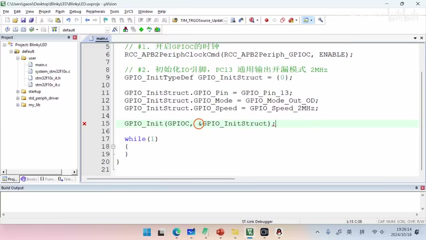

_main.c 中完成的 PC13 开漏、2MHz 初始化代码。 ·_ [_原片 31:15_](https://www.bilibili.com/video/BV11X4y1j7si/?p=7\&t=1875)

刚才我们调用了 GPIO\_Init，对下面这个 IO 引脚做了一个初始化。那初始化完这个 IO 引脚之后，我们是不是就需要调用 GPIO\_WriteBit，向 IO 引脚的输出数据寄存器写值了？我们知道，对于板载 LED 来说，它连接的是 PC13 引脚，然后使用的是开漏接法。所谓开漏接法，就是下边这种接法。对于开漏接法来说，上面的 P-MOS 管是不是始终是断开的？所以这部分电路我们就不用管了，对吧？

所以如果我们向这个开漏引脚写 0，那下面的 MOS 管闭合，这样就会形成一个回路，电流就顺着这里流到地了，对不对？这个时候 LED 就点亮。相反，如果我们向这个开漏模式的引脚写一个 1，那下面的开关就断开，所以这个地方就开路了。所以电流从这里往这边流，流到这个位置它就流不过去了，因为后边就没有路了，所以 LED 就是熄灭的。所以在这个开漏模式下，写 0，LED 点亮，写 1，LED 熄灭。下面我们就分别向这个 IO 引脚写 0 和写 1，我们来看一下 LED 的状态。

## GPIO\_WriteBit 与单步测试

现在我们来看一下 GPIO\_WriteBit 这个编程接口的使用方法。我们刚才说过，GPIO\_WriteBit 就是用来向我们这个 IO 引脚去写值的，写 0 或者写 1。然后这个编程接口有这么三个参数。

首先第一个参数叫做 GPIOx。这个 GPIOx 用来填写我们要操作的，就是我们要写值的那个 IO 引脚的端口号。因为我们本次实验使用的是 PC13 这个引脚，对吧？所以这里的端口号我们就填 GPIOC。我们把这个 GPIOC 填到这个参数里边就可以了。

然后第二个参数叫做 GPIO\_Pin。这个填的是我们要操作的这个引脚的引脚编号。引脚编号是不是就是从 0～15？比如说，我们本次实验使用的是 PC13，然后我们这个参数就填 GPIO\_Pin\_13 就可以了。

然后我们再来看第三个参数。第三个参数叫做 BitValue，这个 BitValue 就是填我们要向 IO 引脚写入的值。我们可以写 0，也可以写 1。如果你想要写 0，那这个参数就填 Bit\_RESET，Bit\_RESET 就表示 0。然后如果想写 1，就填 Bit\_SET，Bit\_SET 就是写 1。

比如说，我给大家举个例子，我们分别向 PC13 这个引脚写 0 和写 1，去控制 LED 的点亮和熄灭，那么程序就是这样的：首先我们调用 GPIO\_WriteBit，第一个参数填 GPIOC，这是端口号。然后第二个参数填 GPIO\_Pin\_13，这个是引脚编号。这两个加起来是不是就是 PC13？然后最后一个参数，我们写 0 的时候就填 Bit\_RESET，这样就是向 PC13 写一个 0 了。如果写 1 的话，就是下面这行代码，我们只需要改一下最后一个参数就可以了。

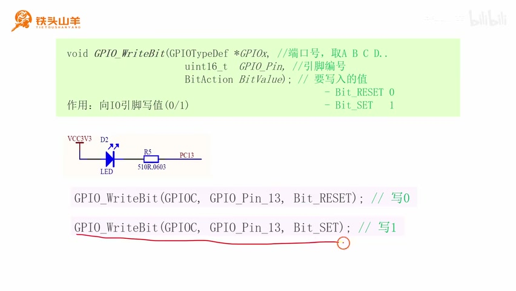

_GPIO\_WriteBit 三个参数与写 0、写 1 两行示例。 ·_ [_原片 34:19_](https://www.bilibili.com/video/BV11X4y1j7si/?p=7\&t=2059)

把最后一个参数，从上面的 RESET 换成下面的 SET，这个 SET 就表示 1。

下面我们来测试一下代码。比如说，我们先向这个 IO 引脚写一个 1，再向它写一个 0。那么我们写 1 的时候调用的参数，就是 GPIOC、GPIO\_Pin\_13，然后写 1 就是 Bit\_SET，对吧？这个就是写 1。写 0 的话，就是 GPIO\_WriteBit(GPIOC, GPIO\_Pin\_13, Bit\_RESET)，这个就是写 0。

```c
GPIO_WriteBit(GPIOC, GPIO_Pin_13, Bit_SET);   // 写1
GPIO_WriteBit(GPIOC, GPIO_Pin_13, Bit_RESET); // 写0
```

然后现在我们来测试一下这个代码。我们首先先来设置一下调试器，按这里这个按钮设置一下调试器。我们使用的调试器叫做 ST-Link 调试器，我们点 Debug 选项卡，这里选 ST-Link Debugger，然后点击确定。这样我们就把调试器设置好了。

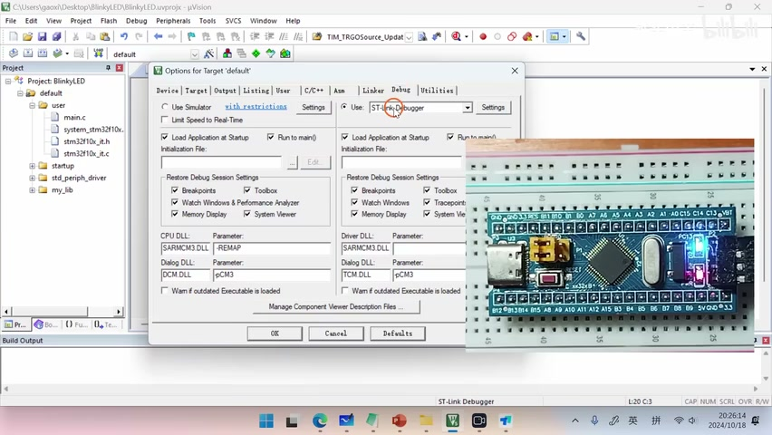

_Debug 选项卡中选择 ST-Link Debugger。 ·_ [_原片 35:16_](https://www.bilibili.com/video/BV11X4y1j7si/?p=7\&t=2116)

设置好调试器之后，下一步我们再点击左上角的第二个按钮，就是这个按钮，来编译一下代码。编译代码之后，这里会有一些日志。这个日志的倒数第二行，这里要出现“0 Error(s), 0 Warning(s)”，才表示编译成功。0 Errors 就是零错误，0 Warnings 就是零警告，说明我们这个代码没有问题。

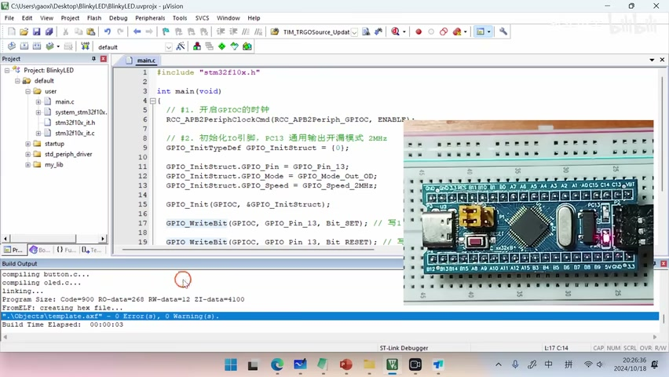

_编译日志显示 0 Error(s)、0 Warning(s)。 ·_ [_原片 35:38_](https://www.bilibili.com/video/BV11X4y1j7si/?p=7\&t=2138)

这个代码没有问题之后，下面我们使用一下代码的调试功能。我们把鼠标移到这个位置，看到这里有一个放大镜，里边有一个红色的 D，对吧？这个就是一个调试按钮。我们按一下调试按钮，然后单片机就进入了一个调试状态。然后我们就可以一行一行地去执行代码了。

首先我们先执行第一行，对吧？开启 GPIOC 的时钟。然后我们再来执行第二行，就是对这个 IO 引脚进行初始化。初始化完成之后，你会发现这个 LED 点亮了。为什么它会亮呢？

因为在初始状态下，这个 IO 引脚，就是 PC13，这个引脚初始值是 0，就是默认状态下是 0。0 就是表示这个 LED 点亮，对吧？

然后下一步，我们向这个 IO 引脚再写一个 1，也就是执行这一行代码。写 1 之后，这个 LED 是不是就熄灭了？我们来测试一下它会不会熄灭。我们再次单步来执行这一行，看，这个 LED 是不是就熄灭了？然后我们继续执行最后一行，最后一行是再写一个 0。写 0 的话，这个 LED 就会点亮。然后我们单步，看，这个 LED 是不是就点亮了？所以我们就可以通过这样的代码，去向这个 IO 引脚写 0 或者写 1，控制这里的 LED 点亮或者熄灭。

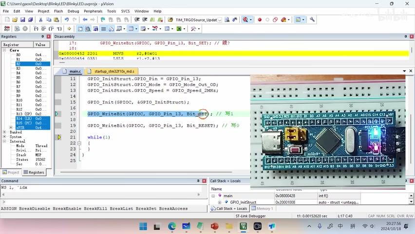

_单步执行写 0 代码后，右侧板载蓝色 LED 点亮。 ·_ [_原片 36:58_](https://www.bilibili.com/video/BV11X4y1j7si/?p=7\&t=2218)

调试完成之后，大家再按一次上面这个放大镜按钮，就可以退出调试模式了。

## 让 LED 循环闪烁

刚才我们已经学会了怎么去点灯、怎么去灭灯。知道了怎么点灯、怎么灭灯之后，下一步我们再引申一下，我们来看一下如何通过编程让 LED 闪烁起来。其实要让 LED 闪烁起来非常简单，我们就是先点亮这颗 LED，然后等一段时间再把它熄灭，然后再等一段时间，再点亮这个 LED。如此循环往复，这个 LED 就闪烁起来了。

我们可以用上面这么一张图，表示这个闪亮的过程。我们来看一下这张图。首先我们先向 PC13 这个引脚写一个 0，我们知道在开漏模式下写 0，这个 LED 是不是就被点亮了？然后点亮这颗 LED 之后，我们延迟一段时间，就是延迟这么长时间，那这个 LED 是不是就亮这么长时间？延迟完这一段时间之后，我们再向这个引脚写一个 1。写 1 之后，这个 LED 就熄灭了。然后我们再延迟一段时间，这个灯就会灭这么长时间。

延迟完这段时间之后，我们再向它写 0，这个 LED 又点亮了。我们不断地去重复这个步骤：写 0，延迟一段时间；写 1，再延迟一段时间；写 0，延迟一段时间。然后这么不断地循环往复地执行下去，我们就可以看到 LED 先点亮，后熄灭，再点亮，再熄灭，对吧？这样它是不是就闪起来了？然后下面我们把这个图转换成一个程序。

首先，因为我们这个写 0、写 1 和等待的过程，是一个循环的过程，所以我们使用程序里面的一个 while 循环，来表示这个过程。并且这个 while 循环里面，条件是 1，1 表示永远为真，对吧？所以这个循环就会一直执行下去，也就意味着我们的灯会一直闪下去。

然后在 while 循环里边，首先我们先调用刚才学习过的 GPIO\_WriteBit，先向 PC13 这个引脚写一个 0，也就是这里的这个 0。写 0 之后，我们这个 LED 是不是就点亮了？点亮了之后，这里是不是要延迟一段时间？比如说我们延迟 100ms，那么我们就调用一个 Delay 函数。这个 Delay 函数，它并不是标准库里面的函数，这是我提供给大家的，不过大家直接拿来用就可以了。这个 Delay 就是一个延迟函数，然后它延迟的单位就是毫秒。我们这里如果要延迟 100ms，这个位置就填 100 就可以了，这个就是延迟 100ms。

延迟完这 100ms 之后，下一步我们是不是要把这个 1 给它写进去了，就是熄灭这个 LED，对吧？所以我们填下 GPIO\_WriteBit(GPIOC, GPIO\_Pin\_13, Bit\_SET)，这个灯就灭了。灭了之后我们再延迟 100ms，然后如此循环往复，就实现了一个闪灯的效果了。

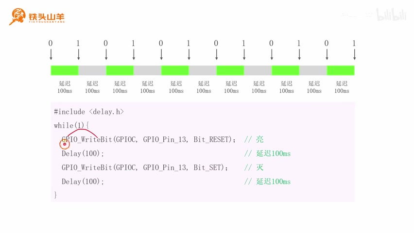

_写 0、延迟、写 1、延迟的时间图与 while(1) 闪灯代码。 ·_ [_原片 39:44_](https://www.bilibili.com/video/BV11X4y1j7si/?p=7\&t=2384)

下面我们来编写一下这个程序。我们回到刚才的代码，首先刚才写了这么两行测试代码，一个是写 1，一个是写 0。写 1 就是灭灯，写 0 就是亮灯。这两行代码是测试代码，对于闪灯没有帮助，所以我们把这两行代码注释掉。我们看到这里有一个绿色的双下划线，对吧？这个就是一个注释的按钮。我们按这个按钮，这两行就被注释掉了，那这两行就从代码里面给它删除掉了。

然后接下来我们就开始写刚才那个程序。我们的程序要写在 while 循环里面，正好 main 方法里面，这里是不是有个 while 循环？所以我们就把刚才的程序写到这个 while 循环里面就可以了。

然后第一行我们要写的代码，就是 GPIO\_WriteBit(GPIOC, GPIO\_Pin\_13, Bit\_RESET)，这个是亮灯。亮灯结束之后，我们需要延迟一段时间，使用 Delay 这个函数去延迟 100ms，这里是延迟 100ms。

但是 Delay 这个方法，是包含在——我们来看左边这个 my\_lib，这里有一个 delay.h 这个头文件里面的。所以我们在使用 Delay 方法之前，先要引用 delay.h 这个头文件。所以我们把代码移动到上面最顶部，这里我们在这行写一个 include delay.h，把这个头文件引用进来。这样我们看，是不是这个错误就消失了？我们就可以使用 Delay 这个函数进行延迟了。

然后延迟完，我们再次调用 GPIO\_WriteBit(GPIOC, GPIO\_Pin\_13, Bit\_SET)，这个就是熄灭 LED。熄灭完这个 LED 之后，我们再次调用 Delay 这个延迟函数，再延迟 100ms，对不对？这样我们的程序是不是就写完了？

```c
#include <delay.h>

// main中的while循环
while (1)
{
    GPIO_WriteBit(GPIOC, GPIO_Pin_13, Bit_RESET); // 亮
    Delay(100);                                // 延迟100ms
    GPIO_WriteBit(GPIOC, GPIO_Pin_13, Bit_SET);   // 灭
    Delay(100);                                // 延迟100ms
}
```

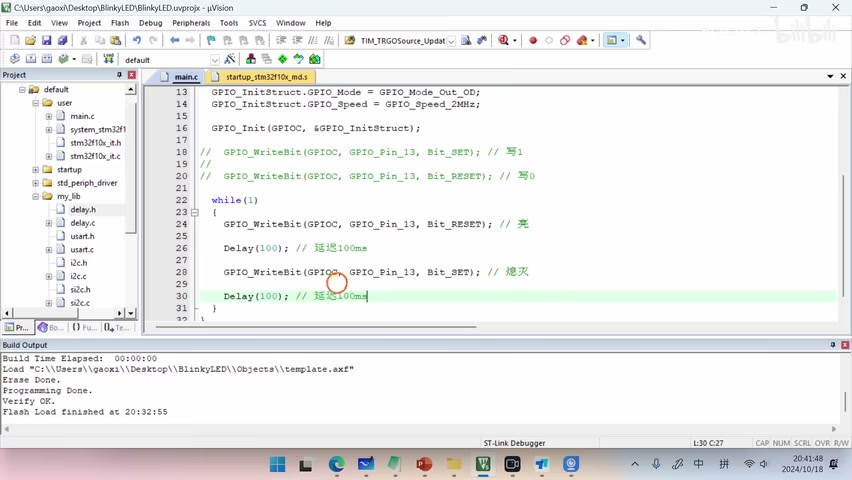

_while 循环中的 GPIO\_WriteBit 与两次 Delay(100)。 ·_ [_原片 41:36_](https://www.bilibili.com/video/BV11X4y1j7si/?p=7\&t=2496)

现在我们还是按左上角的第二个按钮，编译一下程序。然后这一次，直接把代码下载到单片机当中。我们按这里这个按钮，两个向下的箭头，上面有个 LOAD。我们按这个按钮，把它下载到单片机当中。

下载完成之后，你会看到这里有三行：Programming Done，就是下载完成；Verify OK，就是代码验证完成；然后它跟你说 Finished，就是完成了。出现这三行，就说明我们的代码已经下载成功了。

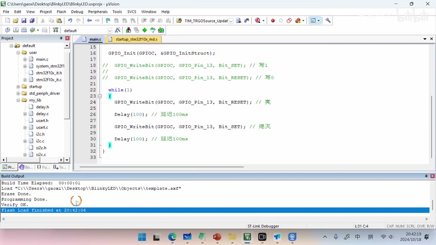

_LOAD 下载后的 Programming Done、Verify OK 与 Finished 日志。 ·_ [_原片 42:07_](https://www.bilibili.com/video/BV11X4y1j7si/?p=7\&t=2527)

然后我们回到单片机，我们按一下单片机的复位按钮，刚才写的程序就会开始执行。我们按一下这个复位按钮，可以看到这个 LED 是不是就闪烁起来了？就证明我们这个程序已经写完了，就成功了。

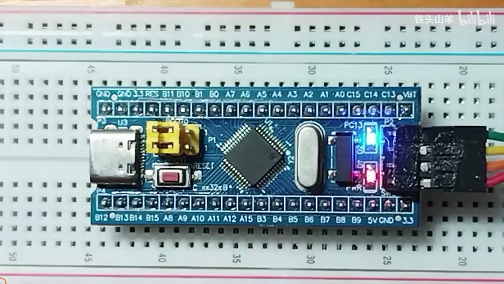

_复位后运行闪灯程序，板载蓝色 LED 点亮的瞬间。 ·_ [_原片 42:26_](https://www.bilibili.com/video/BV11X4y1j7si/?p=7\&t=2546)

好的，以上就是本期视频的全部内容。感谢大家的收看，我是铁头山羊，让我们下期视频再见。
