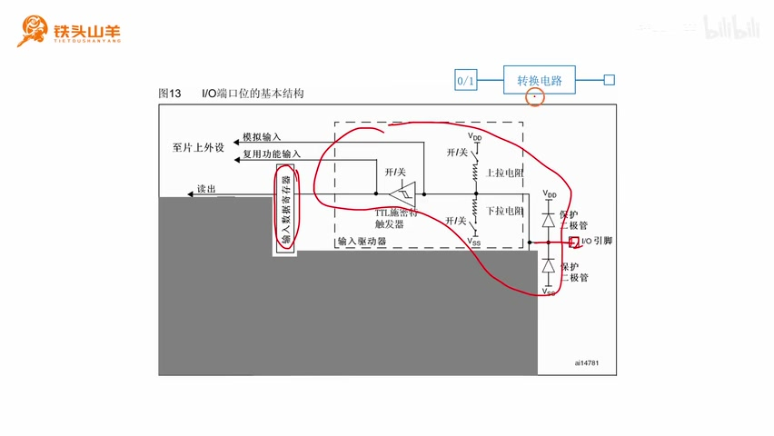
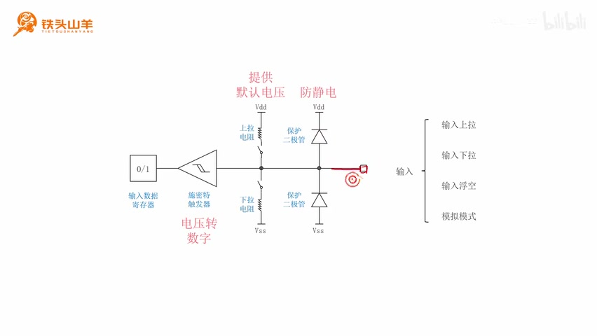
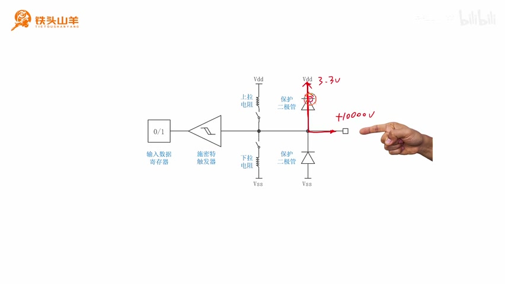
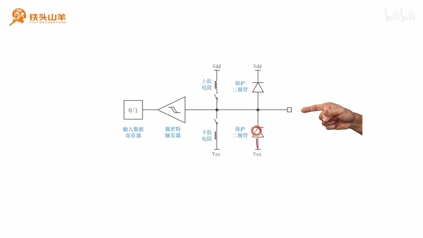
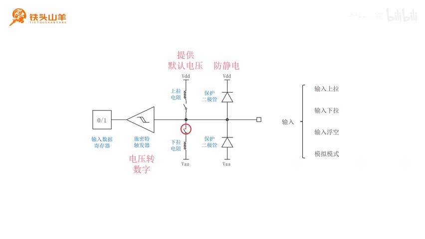
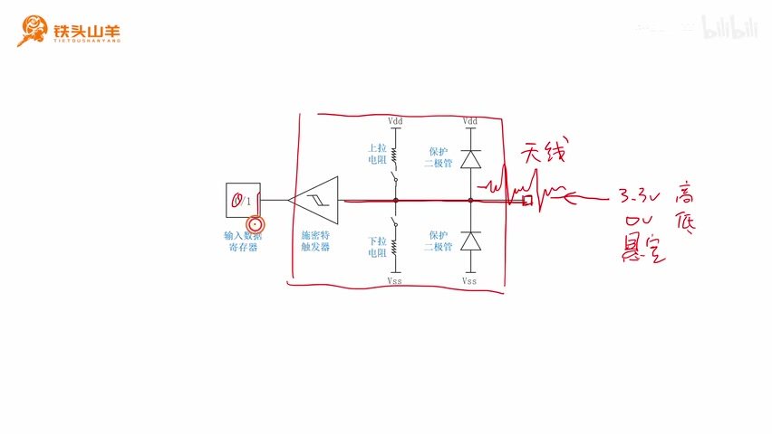
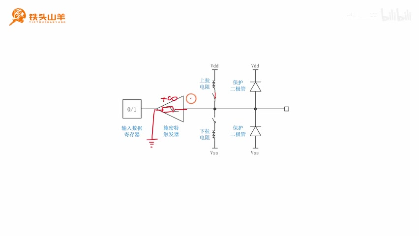
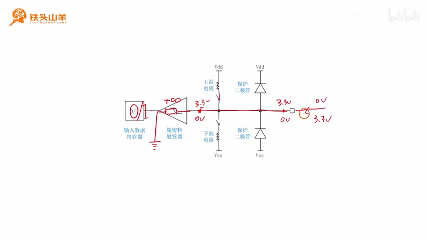
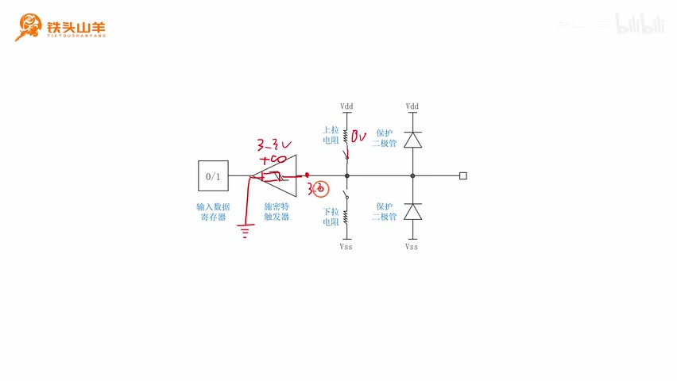
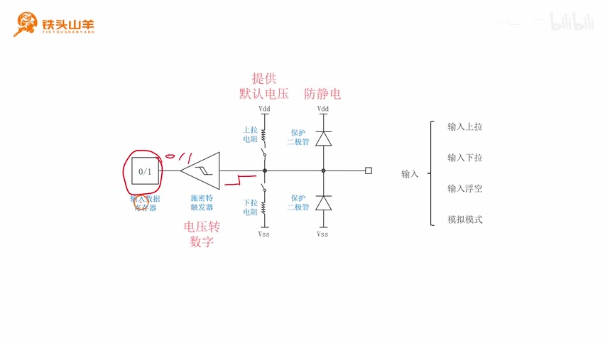

# P008 · 2.4 （GPIO）4种输入模式

> 来源：[铁头山羊 STM32 入门教程，P8](https://www.bilibili.com/video/BV11X4y1j7si/?p=8)；原视频范围 00:00–15:36。本文为按原顺序清理口语的忠实讲稿，保留讲解、例子与课程说明。

## 输入模式是用来干什么的

各位同学大家好，我是铁头山羊。今天我们来讲解第二章的第四节，本节课要讲的知识点是 GPIO 的四种输入模式。

首先我们先来回顾一下。我们之前说过，对于单片机的 IO 引脚来说，它总共有八种不同的工作模式可选。在这八种工作模式中，我们按照输出和输入可以分成两大类，总共有四种输出模式和四种输入模式。之前我们已经把这四种输出模式给大家讲了，所以本节课我们要学习的，就是剩下的这四种输入模式。

在学习输入模式之前，我们首先来回顾一下，这个输入模式到底是用来干什么的。比方说，我给大家画这么一张图：我们用一个横线加一个方框，来表示单片机的一个 IO 引脚。在输入模式下，我们可以通过这个 IO 引脚，输入这么一个高低变化的电压信号。

然后，在 IO 引脚的内部有一个转换电路。这个转换电路可以把外部输入的电压，转换成 0 或者 1 这样的数字。比方说，当我们从外部输入一个低电压的时候，这个转换结果就是一个 0，所以这个比特位就变成了 0。如果我们读到的是一个高电压，这个时候转换的结果就会是 1，所以我们从这里就可以读到一个 1。

我们通过编程的方式，把这个比特位的值读出来。如果我们读到 0，就证明这里输入的是低电压，对吧？如果读到的是 1，就证明这里读到的是高电压。所以，我们可以通过读取的值到底是 0 还是 1，判断输入到这个 IO 引脚的电压到底是低电压还是高电压。这个就是所谓的输入模式。

本套视频所需要的所有材料，都包含在这个开发套件包里。大家可以扫描屏幕上的二维码，进入到我们的淘宝店铺来购买它。购买套件之后，你将获得课程所有的课件和源码，还能加入答疑群，和 UP 直接交流。

现在请同学们拿出单片机的参考手册，也就是我们之前介绍的 RM0008 这本手册。我们看中文版本的这个手册，然后翻开手册的目录，同样在第八章，找到跟 GPIO 相关的这么一章。然后我们往下翻，就找到我们昨天所讲的那张框图。这张框图就是 IO 引脚的内部电路图。

## 从参考手册整理输入电路

在上期视频的过程中，我们曾经把这个框图通过这么一条线，划分成了上下两个部分，对吧？我们上期视频学习的是下半部分，也就是跟输出电路相关的部分。本节课学习的输入模式，就是跟电路的上半部分有关。

既然我们只需要学习这张框图里面，跟输入相关的上半部分电路，所以我们就把无关的部分先给它遮起来。这样，这一部分就表示输入电路。

_参考手册的 I/O 基本结构框图；输出部分已遮住，上半部输入路径与输入数据寄存器保留。 ·_ [_原片 03:24_](https://www.bilibili.com/video/BV11X4y1j7si/?p=8\&t=204)

其实，这部分输入电路，跟我们刚才讲输入模式工作原理时使用的电路图是一样的。比如说，我们来看这里的横线加方框，就表示单片机上的一个 IO 引脚。这个 IO 引脚，就对应框图里面的这个引脚。

然后，这里有一个 0 和 1。这个 0 和 1 代表我们的一个比特位，这个比特位叫做输入数据寄存器，它就对应框图里面这里的输入数据寄存器。然后，在输入数据寄存器和 IO 引脚之间的这一部分，就代表转换电路。转换电路的作用，就是把高低变化的电压，转换成 0 或者 1 这样的数字量，然后输出给输入数据寄存器。

这张图比较乱，所以我们现在把电路整理一下。整理过后，我们就得到了这么一张电路图。我们来观察一下整理之后的这张图：在这张图里面，这里的横线加方框，是不是就代表刚才单片机的一个 IO 引脚？然后这里的 0 和 1，就代表我们刚才所说的输入数据寄存器；中间这一部分，就是我们所说的转换电路。

_整理后的输入电路：引脚在右，输入数据寄存器在左，中间保留保护二极管、上下拉电阻和施密特触发器。 ·_ [_原片 03:48_](https://www.bilibili.com/video/BV11X4y1j7si/?p=8\&t=228)

## 保护二极管与静电

这个转换电路可以分成这么几个部分。首先，最右边这里有两个二极管。这两个二极管是起保护作用的，所以我们把它们称为保护二极管。保护二极管的作用，就是用来防静电的。

我们的人体一般是含有静电的，特别是在一些比较干燥的季节，比如说秋天或者冬天，空气比较干燥的时候，静电尤其强烈。比如说，我们在秋天脱毛衣的时候，如果把灯关上，就会看到毛衣上有噼里啪啦的火光。这其实就是人体的皮肤对毛衣放电。

因此，我们不建议使用手直接去触摸单片机的 IO 引脚，因为我们手上也有可能会带有静电。静电的电压非常高，一般就是几千伏。如果用手直接触摸 IO 引脚，这么高的电压直接输入到单片机内部，就会把芯片烧坏。所以，为了防止芯片被烧坏，我们需要在单片机的 IO 引脚上加一些保护电路。这个保护电路，就是我们刚才所说的保护二极管。

比如说，我给大家举一个例子。我们用手直接去触摸单片机的 IO 引脚，假设手上带有静电。这个静电可能是正的，也可能是负的。比如说，我们手上是一个正电荷，电压非常高，假设是正的 10000 V。我们把正的 10000 V 输入到单片机里面，如果没有保护二极管，是不是后边这个电路直接就被烧坏了？

现在我们来看一下，保护二极管是怎么工作的。首先，这里是正的 10000 V，然后 VDD 是不是 3.3 V？所以这边高、这边低，上面的二极管是不是就导通了？所以静电就会顺着这条路流出去，这样就不会伤害到后边的电路了。

_正静电例子中，红线标出从引脚经上方保护二极管通向 VDD 的路径。 ·_ [_原片 05:49_](https://www.bilibili.com/video/BV11X4y1j7si/?p=8\&t=349)

那我们再假设，我们手上的静电是一个负电荷，比如说它的电压是负的 10000 V。这里是负的 10000 V，这里是 VSS，也就是 0 V。所以这里高、这里低，是不是下边的二极管就导通了？所以静电就顺着这里流走了。有了这两个保护二极管之后，我们就可以保护电路，不受静电的影响了。

_负静电例子中，下方保护二极管被圈出，红线标出通向 VSS 的支路。 ·_ [_原片 06:08_](https://www.bilibili.com/video/BV11X4y1j7si/?p=8\&t=368)

## 上拉、下拉和浮空

刚才我们解释了保护二极管的作用。看完保护二极管之后，我们继续往左看。左边这里会有两个电阻，上面的电阻叫做上拉电阻，下面的电阻叫做下拉电阻。另外，在这两个电阻旁边，各自有一个开关。

当我们闭合对应的开关的时候，就是使能这个电阻；如果断开这个开关，就是禁止这个电阻，也就是把这个电阻从电路里面删除掉。这两个电阻，其实是跟 IO 引脚输入的四种模式有关的。

我们来看，对于 IO 引脚来说，它有八种工作模式，其中四种输出、四种输入。这四种输入模式，分别是输入上拉、输入下拉、输入浮空和模拟模式。其中模拟模式跟单片机里面的 ADC 和 DAC 有关，这个我们先不学。剩下的三种模式，就是输入上拉、输入下拉和输入浮空。

所谓输入上拉模式，就是闭合上面的开关，使能上拉电阻，这个就是输入上拉模式。对应的所谓输入下拉，就是闭合下面的开关，使能下拉电阻，这个就是输入下拉模式。如果两个开关都给它断开，这个模式就叫做输入浮空。所以，这就是输入上拉、输入下拉和输入浮空的解释。

_输入电路右侧列出四种输入模式；讲师正在标示下拉支路的开关。 ·_ [_原片 07:20_](https://www.bilibili.com/video/BV11X4y1j7si/?p=8\&t=440)

然后我们再来讲一下，上拉电阻和下拉电阻的作用。其实这两个电阻的作用，就是起一个稳定的作用，也就是给 IO 引脚提供一个默认的电压。其中，上拉电阻能给 IO 引脚提供一个默认的高电压，而下拉电阻能给 IO 引脚提供一个默认的低电压。

下面我给大家解释一下，什么叫做默认的高电压，什么叫做默认的低电压。比如说，我给大家举一个例子，我们通过这里的 IO 引脚，从外边给它输入一个电压。比如说，输入一个 3.3 V 的电压，这个 3.3 V 的电压是不是一个高电压？经过这一部分的转换之后，这里是不是会得到一个数字 1？所以输入数据寄存器当前就是 1，对吧？

然后我们再假设，通过 IO 引脚输入一个 0 V 的电压。这个 0 V 是不是就是一个低电压？低电压经过这一部分的转换，是不是就会在这里得到一个 0？这些都是没问题的。

其实还有第三种情况。第三种情况，就是 IO 引脚这里既不接高电压，也不接低电压，而是给它悬空，也就是什么都不接。这个时候，我们转换的结果到底是高电压还是低电压？其实这个时候是不确定的。因为 IO 引脚什么都不接，所以它是一个悬空的状态。在悬空的状态下，这个引脚就相当于一根天线，它会接收空间的电磁波。所以，它上面的电压就会呈现这么一种波形，也就是一会儿高、一会儿低，一会儿高、一会儿低，就是这么一个波形。

经过转换之后，我们就会在输入数据寄存器里面，一会儿读到 0，一会儿读到 1，一会儿读到 0，一会儿读到 1。那这个电路是不是就不稳定了？所以，为了防止这种不稳定的发生，我们就增加了上拉电阻或者下拉电阻。

_浮空引脚被标注为“天线”，右侧画出波动的输入信号，并保留高、低、悬空三种情况的手写标记。 ·_ [_原片 09:10_](https://www.bilibili.com/video/BV11X4y1j7si/?p=8\&t=550)

上拉电阻和下拉电阻的原理基本上是一样的，所以我们就以上拉电阻为例。比如说，我们闭合这里的开关之后，上拉电阻就会起作用了。这个上拉电阻，会给 IO 引脚提供一个默认的高电压。

这个“默认高电压”的意思就是：如果 IO 引脚不悬空，比如说，我们给它输入一个 3.3 V，这里读到的就是 1；输入一个 0 V，这里读到的就是 0。不悬空的时候，默认的高电压对转换的结果是没有影响的。只有当 IO 引脚悬空的时候，上拉电阻才会把这里的引脚拉成一个高电压。所以这个时候，我们在输入数据寄存器里面，就可以读到一个稳定的 1 了，就不像刚才那样是一个随机的值了。这样就会让我们的电路更加稳定。

刚才我们讲了上拉电阻的使用方法，就是当 IO 引脚悬空的时候，上拉电阻可以给 IO 引脚提供一个默认的高电压，也就是给这里提供一个默认的 1。了解了它的用法之后，下一步我们再来看一下，上拉电阻到底是如何起作用的。

## 上拉电阻为什么能提供默认高电压

为了分析上拉电阻的作用，我们闭合这里的开关，去使能上拉电阻。使能上拉电阻之后，我们再来看一下左边的这一部分电路。这个电路叫做施密特触发器。

我们刚才没有讲施密特触发器的作用。其实，它的作用就是把从 IO 引脚上输入进来的高低电压，转换成 0 或者 1 这样的数字。它就是实现从电压到数字转换的这么一个器件，也是我们输入模式的一个核心器件。

对于施密特触发器来说，这里是不允许流过电流的，也就是这里的电流恒等于 0。意思就是说，无论我们从右边给它加多高的电压，这里的电流都等于 0。所以，我们就可以计算出施密特触发器的一个等效电阻。它的电阻等于电压除以电流，电流等于 0，所以这个电阻是不是就是无穷大？所以，我们就可以使用一个无穷大的电阻，来替代施密特触发器。

_施密特触发器的输入被等效为通向地的无穷大电阻，图上保留 +∞ 标记。 ·_ [_原片 11:28_](https://www.bilibili.com/video/BV11X4y1j7si/?p=8\&t=688)

有了这个等效电路之后，下面我们就来分析一下上拉电阻的工作原理。首先，我们先来看 IO 引脚不悬空的情况，也就是我们通过这个位置，给 IO 引脚输入一个信号。

比如说，当我们给 IO 引脚输入一个 0 V 的电压的时候，这一点是不是就是 0 V？然后，这个点和这个点之间，是使用导线直接连接起来的。所以，这个点的电压跟这个点的电压是不是相等的？它也是一个 0 V。那么，这个 0 V 的电压经过施密特触发器的转换之后，这里是不是就会得到一个数字 0？

然后反过来，如果我们从这里输入的是一个 3.3 V 的电压，那么这一点的电压是不是也是 3.3 V？所以这个点的电压也是 3.3 V。因为它们是用导线连接起来的，所以电压肯定是一样的。所以，这个 3.3 V 的电压经过施密特触发器的转换之后，是不是这里就会得到一个 1？

所以我们就可以看得出来，当 IO 引脚不悬空的时候，上拉电阻是不会影响转换结果的，对吧？

_非悬空输入的演示图上同时保留 0 V、3.3 V 和寄存器 0、1 的对应标记。 ·_ [_原片 12:24_](https://www.bilibili.com/video/BV11X4y1j7si/?p=8\&t=744)

然后，我们再来看当 IO 引脚悬空的情况。悬空的时候，就是这里断开，对吧？我们先把保护二极管去掉，因为保护二极管只是起一个保护作用，不会对我们的电路产生任何影响，所以我们直接把它去掉。然后，因为这里是悬空的，所以它是开路的，我们把这部分电路也去掉。

然后，下拉电阻这里的开关没有闭合，对吧？所以，这一部分电路相当于没有接入到电路当中，我们也给它去掉。去掉这些电路之后，我们再观察一下，这个电路是不是就只剩这么一部分了？也就是由一个上拉电阻，还有一个施密特触发器的等效电阻串联，也就是一个有限大的上拉电阻，串联一个无限大的等效电阻。

它们两个电阻，一起去分这个 VDD，也就是 3.3 V 的电压。一个有限大的电阻和一个无限大的电阻分压，那么所有的电压，是不是都分给这个电阻了？也就是这里的电压是 3.3 V，上面这个电阻分得的电压是 0 V。所以，这个点的电压是多少？是不是就是 3.3 V？

_悬空分压示意：右侧引脚断开，上拉电阻旁标 0 V，等效输入电阻旁标 3.3 V。 ·_ [_原片 13:34_](https://www.bilibili.com/video/BV11X4y1j7si/?p=8\&t=814)

所以我们就可以看得出来，即使 IO 引脚悬空，上拉电阻也能为这里提供一个默认的 3.3 V 高电压。这个默认的 3.3 V 高电压，经过转换之后，是不是就会在这里得到一个 1？所以，有了上拉电阻之后，这里就不是一个随机值了，而是一个默认的 1。这个就是上拉电阻的工作原理。

## 本节课回顾

到这里，本节课的所有知识点就都讲完了。讲完这些知识点之后，我们再来简单回顾一下，本节课所学的知识。我们学的是这么一张图，这张图就是 IO 引脚的输入电路图。

在这张电路图里面，横线加方框就表示单片机的一个 IO 引脚。左边这个部分，这里有一个输入数据寄存器，这个就表示转换的结果，对吧？在输入数据寄存器和引脚之间，这一部分就是转换电路。

这个转换电路由这么几部分组成。首先是这里的两个二极管，这两个二极管是保护二极管，保护二极管的作用是防静电。然后往里走，这里有两个电阻，一个上拉电阻，一个下拉电阻。这两个电阻跟我们的输入模式有关。

输入模式一共有四种。如果是使能上拉电阻，那就是输入上拉；如果是使能下拉电阻，那就是输入下拉；如果两个电阻都不使能，那就是输入浮空，对吧？上拉电阻和下拉电阻的作用，就是为 IO 引脚提供一个默认的电压，也就是当这里的 IO 引脚悬空、什么都不接的时候，上拉电阻会给 IO 引脚提供一个默认的高电压，而下拉电阻则是给它提供一个默认的低电压。这两个电阻，我们使能一个就可以了。

然后再往里走，这里是一个施密特触发器。施密特触发器的作用，是把通过 IO 引脚输入进来的高低电压，转换成 0 或者 1 这样的数字，最终保存在输入数据寄存器里面。然后我们的编程人员，再从这里面把这个数字读出来，我们就可以知道，这里输入的到底是高电压还是低电压了。

_课程末尾回到完整输入电路图，标有“提供默认电压”“防静电”和“电压转数字”等说明。 ·_ [_原片 15:22_](https://www.bilibili.com/video/BV11X4y1j7si/?p=8\&t=922)

以上就是本节课的所有内容了。感谢大家的收看，我是铁头山羊，让我们下期视频再见。
