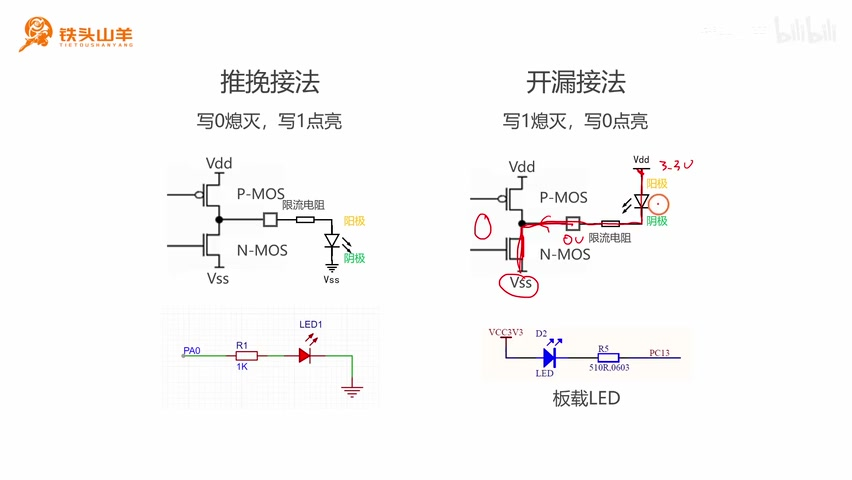
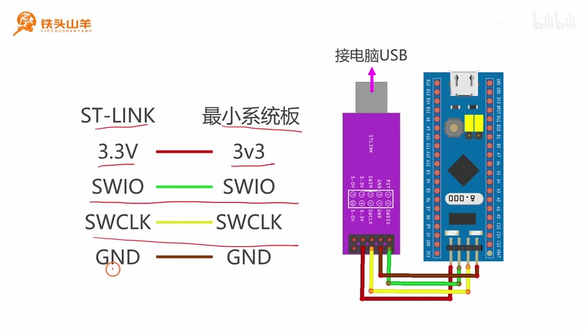

# P009 · 2.5 （GPIO）按钮实验

> 原视频第 9 P，00:00–20:32。以下是保留原讲解顺序、表达、例子与操作细节的整理讲稿；配图说明为编辑说明。

各位同学大家好，我是铁头山羊。今天我们要学习的是第二章的第五节，我们一起来做一个按钮实验。本套视频所需要的所有材料都包含在这个开发套件包里，大家可以扫描屏幕上的二维码，进入到我们的淘宝店铺来购买它。购买套件之后，你将获得课程所有的课件和源码，还能加入答疑群，和 UP 直接交流。

我们要做的这个实验是这样的：我们使用一块面包板，然后把我们的最小系统板插在这个面包板上，旁边放上一颗按钮，然后再连接这样一颗 LED。我们要实现的效果是，当我们按下这个按钮的时候，LED 点亮；松开这个按钮的时候，LED 熄灭。

.jpg>)

_按钮控制外接 LED 的面包板实验装置 ·_ [_原片 00:36_](https://www.bilibili.com/video/BV11X4y1j7si/?p=9\&t=36)

本次实验我们将分成以下三个部分来讲。首先第一部分，因为我们的实验中要使用一颗外接的 LED，所以第一部分我们就先来回忆一下 LED 的接线方法。然后第二部分，我们来学习一下按钮的接线方法，以及这个按钮的工作原理。第三部分，我们来学习一个编程接口，并且编写本次实验的代码。

## LED 的两种接法

首先我们先从第一部分开始，我们来复习一下 LED 的接线方法。在过去的视频中，我们曾经学习过 LED 有两种不同的接线方式，分别是推挽接法和开漏接法。

首先我们先来回顾一下什么是推挽接法。所谓推挽接法，就是把我们的 IO 引脚设置成推挽模式，然后用它去驱动这么一颗 LED。在推挽模式下，这两个 MOS 管是交替导通的。当我们向这个 IO 引脚写 1 的时候，上面这个 MOS 管导通，下面的 MOS 管关断，所以这个 IO 引脚就被连接到了高电压 VDD，所以它输出的电压就是 3.3 伏。

然后又因为我们这个 LED 的阴极连接的是零伏，所以在阳极和阴极之间就会有 3.3 伏的电位差，然后就会有电流流过。这个时候，我们这个发光二极管就会被点亮。所以在推挽接法下，写 0 熄灭，写 1 点亮。

.jpg>)

_推挽接法：写 1 时上管导通、LED 阳极获得高电平 ·_ [_原片 01:50_](https://www.bilibili.com/video/BV11X4y1j7si/?p=9\&t=110)

看完了推挽接法，我们再来看一下第二种接线方式，就是这种开漏接法。所谓开漏接法，就是我们把这个 IO 引脚设置成开漏模式，然后让它去驱动这么一颗 LED。在开漏模式下，上面的这个 MOS 管一直是关断的，我们写程序可以控制下面的这个 MOS 管导通或者是关断。

如果我们向这个 IO 引脚写 0 的时候，那么下面的这个 MOS 管就导通，所以这个 IO 引脚就被连接到了低电压 VSS，所以它输出的电压就是零伏。而这边的这个电压是 3.3 伏，这样就形成了一个电位差，并且形成了一个回路，就有电流从这个 LED 上流过，所以这个 LED 就被点亮了。因此，在开漏接法下，写 1 熄灭，写 0 点亮。

_开漏接法：写 0 时下管导通，LED 回路形成 ·_ [_原片 02:38_](https://www.bilibili.com/video/BV11X4y1j7si/?p=9\&t=158)

我们之前的视频做那个板载 LED 实验的时候，使用的是这种开漏接法。今天我们想尝试另外一种接法，我们用一下这个推挽接法。所以我们把这颗外接的 LED 使用推挽接法，把它连接到我们单片机的 PA0 引脚上。这里是 PA0，这是限流电阻，这是我们的 LED。这是 LED 的阳极，阳极接的是 PA0；这是 LED 的阴极，阴极接地。

在开始接线之前，我们先来做一些准备工作。我们从开发套件包里面拿出我们的最小系统板，还有 ST-LINK 调试器，使用四根杜邦线，把最小系统板和 ST-LINK 连接在一块。关于接线的规则，我们已经说过了，就是这个 ST-LINK 调试器和最小系统板的引脚对应相连。比如 ST-LINK 调试器的 3.3 伏连接最小系统板的 3V3，然后它们的 SWIO、SWCLK 和 GND 分别对应相连。连接好之后，我们再把这个 ST-LINK 调试器插到我们电脑的 USB 接口上。

_ST-LINK 与最小系统板四根线一一对应 ·_ [_原片 03:40_](https://www.bilibili.com/video/BV11X4y1j7si/?p=9\&t=220)

这是我们刚才的电路图，然后根据这张电路图，我们把它转换成右边的这样一张接线图。这是那颗 LED，这是 LED 的阳极，这边是 LED 的阴极。

LED 的阳极连接的是这么一颗限流电阻，然后限流电阻的另一端连接的是我们单片机的 PA0 这个引脚。LED 的阴极是直接接到了单片机的 GND，也就是这个位置。现在我们根据这张接线图去连接我们的电路。

.jpg>)

_PA0 经 1 kΩ 电阻连接 LED 阳极，阴极接地的接线图 ·_ [_原片 04:11_](https://www.bilibili.com/video/BV11X4y1j7si/?p=9\&t=251)

为了连接这个电路，我们得准备一些材料。请大家从我们的开发套件包里拿出这么几样东西。我们的开发套件包里面有两颗 LED，一颗红色的，一颗蓝色的，这两颗 LED 拿一颗就可以，哪颗都行。然后我们这里有四个电阻，这四个电阻都是 1000 欧姆的，我们拿一个就可以了。除此之外，我们还需要准备这么一颗按钮，这个按钮待会我们要用到。最后，我们还需要准备几根杜邦线。

我们注意观察右边这张图，我们的最小系统板是直接插在这个面包板上的，并且最小系统板的最右侧的这个针，跟我们面包板最右侧的这个孔是对齐的。现在我们把这个最小系统板插到面包板上。

现在我们拿出这个最小系统板和面包板，把这个最小系统板的最右边这根针对准我们面包板的最右边这个孔，然后我们用力把这个最小系统板压到面包板里边去。压好之后，它的效果是这样的，就是这个针完全进入到面包板的里边，这样就可以了。

然后下一步，我们把这颗 LED 插到面包板上，长的这边是阳极朝右，短的这边是阴极朝左。我们拿出一颗 LED，注意观察，这个 LED 有两根针，一根长的，一根短的。我们这个长的就是 LED 的阳极。我们阳极朝右，阴极朝左，这样把它插到这个面包板上。

下一步，我们连接这颗限流电阻。我们把限流电阻的一端连接 LED 的阳极，另一端连接到这个孔上。现在我们拿出这个电阻，把电阻折成这个样子，把两边的这个脚都给它折弯，然后直接把这个电阻插上去就可以了。

插好之后，这个效果是这样的。然后我们连接这么两个杜邦线。首先，这个 LED 的阴极我们接到最小系统板的 GND，也就是最左边的这个引脚。然后 LED 的阳极连的是这个限流电阻，限流电阻的另一端连接的是我们单片机的 PA0，也就是这个引脚。连接好之后，效果是这样的。

连接完这个电路之后，我们来测试一下，我们连的这个电路是不是正确的。我们写一段代码，把这颗 LED 给它点亮。因为我们这个电路使用的是推挽接法，所以首先我们需要把这个 PA0 初始化成推挽模式。然后在推挽模式下，我们必须向这个 PA0 写 1，这个 LED 才会点亮。所以我们写了下面这样一段程序。

.jpg>)

_PA0 输出推挽初始化与写 1 点灯的完整示例代码 ·_ [_原片 07:46_](https://www.bilibili.com/video/BV11X4y1j7si/?p=9\&t=466)

这个程序我们之前已经讲过了，所以这里我们简单地来过一下。首先第一步，我们调用 `RCC_APB2PeriphClockCmd` 这个编程接口来开启 GPIOA 的时钟。为什么开的是 GPIOA 的时钟？因为我们使用的是 PA0，它的端口号就是 GPIOA，所以开的是 GPIOA 的时钟。

然后下一步，我们调用 `GPIO_Init` 对这个 PA0 进行初始化。参数是这样的：这个 `GPIO_Pin` 填 `GPIO_Pin_0`，因为这个引脚编号是零。然后 `GPIO_Mode` 填 `GPIO_Mode_Out_PP`，表示的是输出推挽模式。第三个参数 `GPIO_Speed`，我们选择最慢的速度，也就是 2 MHz。

初始化完这个 IO 引脚之后，我们向 PA0 写一个 1。写 1 的时候，我们调用 `GPIO_WriteBit`，参数填 GPIOA、`GPIO_Pin_0`，填 `Bit_SET`，这个就表示写 1。写 1 之后，我们这颗 LED 就应该会点亮。

首先请大家登录百度网盘，先把我们百度网盘里边的这个模板工程下载下来，因为我们待会要写程序。这个是我们百度网盘的地址，当然你可以扫描右边的这个二维码，直接去下载。我们在浏览器里打开这个百度网盘，然后点进去，这里有个 `template.rar`，上次我们已经下载过了，我们把它下载下来就可以了。

下载完成之后，我们得到的是这么一个压缩包。我们把这个压缩包给它解压，解压到当前文件夹，然后解压的结果就是这么一个 template 文件夹。我们打开它，然后里边有一个工程文件，我们双击运行这个工程文件，这样我们就可以打开这个模板工程。

在这个模板工程左边这个位置，这里是导航栏。我们在 default 文件夹、user 文件夹下边找到这个 main.c 文件，我们双击打开它。我们把程序写到这个 main.c 文件里面，写到 main 方法的内部。

首先咱们先开启这个 GPIOA 的时钟，对应的代码就是 `RCC_APB2PeriphClockCmd(RCC_APB2Periph_GPIOA, ENABLE);`，这样我们这个时钟就开启了。

第二步，我们对 PA0 这个引脚进行初始化。我们先声明一个这种类型的变量，然后填参数。填完参数之后，我们调用 `GPIO_Init` 来完成这个初始化。我们先声明这个变量，它的类型是 `GPIO_InitTypeDef` 这种类型的，然后我们给它起个名字，这个名字随便起。

然后我们给这个变量的成员给它赋值。首先引脚的编号是零，因为我们使用的是 PA0。然后我们再填一下它的模式，也就是 `GPIO_Mode`，这个模式我们选择推挽模式，这个就是推挽模式。然后第三步，我们再选一下这个最大输出速度，我们选择最低的就可以了。

最后，我们调用 `GPIO_Init` 来完成这个初始化。第一个参数填 GPIOA，第二个参数我们对上面的这个变量取个地址，把它传进去，这样就 OK 了。

最后一步，我们调用 `GPIO_WriteBit`，向 PA0 这个引脚写一个 1。写 1 之后，后边的这个 LED 就点亮了。

所以我们的代码就应该这样写，我们写 `GPIO_WriteBit(GPIOA, GPIO_Pin_0, Bit_SET);`。写完这个代码之后，我们的 LED 就应该被点亮了。

现在我们按左上角的第二个按钮，来编译一下我们的代码。编译成功之后，就是 `0 Error(s), 0 Warning(s)`。然后我们把鼠标放在两个向下的箭头这个位置，点击它，这样我们的这个代码就已经被下载到了单片机当中。

现在我们按一下最小系统板上的这个复位按钮，也就是红色的按钮。按下之后，我们这个 LED 就被点亮了，说明我们这个电路连接是成功的。如果你的 LED 没亮，很有可能是这个限流电阻接得比较松，调整一下限流电阻的这个位置，这个 LED 就会亮。

.jpg>)

_下载并复位之后，外接 LED 已点亮 ·_ [_原片 10:46_](https://www.bilibili.com/video/BV11X4y1j7si/?p=9\&t=646)

## 按钮接线与输入上拉原理

然后接下来，我们再来学习一下本节课的第二部分。我们来看一下这个按钮的接线方法，以及这个按钮的一个工作原理。

我们来看这样一张图，我们要接的这个电路非常简单。我们先拿一颗按钮出来，按钮的一端接地，另一端接 IO 引脚。比如说我们随便选了一个 IO 引脚，比如选择 PA1，然后我们把这个 IO 引脚设置成输入上拉模式。

这是我们 IO 引脚输入模式的一个电路图，所以输入上拉模式，就是闭合这里的开关，从而使能这里的上拉电阻。然后现在我们来分析一下这个电路的一个工作原理。

这个电路的工作原理非常简单。我们首先来分析一下这个按钮松开的情况。当这个按钮松开的时候，这两个点之间是没有连接的，也就是这里是开路的，所以这个 PA1 这个 IO 引脚是悬空的。但是因为我们使用的是输入上拉模式，所以由于这个上拉电阻的存在，它会把这一点的电压拉高到 3.3 伏，所以我们在这个输入数据寄存器里边读到的值就是 1。

.jpg>)

_按钮松开时，上拉电阻把 PA1 拉至 3.3 V ·_ [_原片 11:53_](https://www.bilibili.com/video/BV11X4y1j7si/?p=9\&t=713)

然后我们再分析一下，把这个按钮按下的情况。当这个按钮被按下的时候，这两个点之间就通了，然后这一点通过这个按钮直接接地。地是零伏，所以这里也是零伏，所以我们从这个输入数据寄存器里面读到的就是 0。所以结论就是，当按钮按下的时候，我们读到的是 0；按钮松开的时候，我们读到的是 1。

因此，我们在写程序的时候，只要把这个值从输入数据寄存器里面读出来，去判断一下它是 0 还是 1，我们就可以知道这个按钮当前是按下还是松开了。这个就是按钮电路的一个工作原理。

.jpg>)

_按钮按下接地时，从输入数据寄存器读到 0 ·_ [_原片 12:13_](https://www.bilibili.com/video/BV11X4y1j7si/?p=9\&t=733)

根据刚才所讲的内容，我们得到了这样一张电路图，也就是把这枚按钮直接接到 PA1 这个引脚上，按钮的另一端给它接地。然后我们把这个电路图再转换成右边的这样一张接线图。这个接线图非常简单，就是把按钮摆在这个位置，然后按钮的一端我们接的是 PA1 这个引脚，按钮的另一端我们接的是单片机的 GND，这样就可以了。

.jpg>)

_按钮一端接 PA1、另一端接地的电路与面包板接线图 ·_ [_原片 12:53_](https://www.bilibili.com/video/BV11X4y1j7si/?p=9\&t=773)

在我们连接这个按钮的时候，有一点是需要特别注意的，就是这个按钮它本身是带方向的。我们来看一下，当我们把按钮这个方向摆的时候，它边上是没有引脚的，对吧？如果我们旋转 90 度，看一下它是不是有引脚的呀？现在我们把这个带有引脚的这一边朝上，然后把它插到这个面包板里面。一定注意，是有引脚的这边朝上，插到这个面包板里面，这样就可以了。

最后，我们再连接这两根杜邦线，一个是接地，一个是接 PA1 这个引脚。所有的电子元器件都连好之后，效果是这样的，大家可以对照一下。

.jpg>)

_按钮和 LED 的所有元件接线完成后的实物对照 ·_ [_原片 13:41_](https://www.bilibili.com/video/BV11X4y1j7si/?p=9\&t=821)

下一步，我们来编写一下对应的程序。首先，我们在使用这个 PA1 之前，需要对这个 PA1 进行初始化。我们刚才说了，这个 PA1 应当被初始化为输入上拉模式。我们看一下这个程序应该怎么写。

首先要调用 `RCC_APB2PeriphClockCmd`，来开启 GPIOA 的时钟。刚才我们已经开过一遍了，就是我们写 LED 程序的时候，已经把这个 GPIOA 的时钟开了一遍了，所以这行代码没必要重复去写，当然你再写一遍也没有什么问题。

然后第二步，我们需要调用 `GPIO_Init`，对我们的这个 PA1 的参数进行初始化。在调用这个编程接口之前，我们先要声明这么一个变量。因为刚才这个变量已经声明过了，所以这个变量就没必要再次声明了，所以这行代码我们也不写。

然后我们看一下它的参数。首先第一个参数 `GPIO_Pin`，因为我们使用的是 PA1，所以这里的 `GPIO_Pin` 填 `GPIO_Pin_1`。然后下面的这个 `GPIO_Mode`，用来选择 GPIO 的模式。我们说过，我们应该选择输入上拉模式，这个 IPU 对应的就是输入上拉模式。待会我们再去解释，为什么这个 IPU 是输入上拉模式。

然后我们再来看第三个参数 `GPIO_Speed`。这个 `GPIO_Speed` 我们说过，它用来设置 IO 引脚的最大输出速度。我们使用的是输入模式，那输入模式肯定没必要去设置这个输出速度，对吧？所以这行代码我们也不写。

.jpg>)

_PA1 输入上拉初始化：复用变量，不重复开时钟，不设置输出速度 ·_ [_原片 15:04_](https://www.bilibili.com/video/BV11X4y1j7si/?p=9\&t=904)

现在我们就来解释一下，为什么这里的 IPU 对应的是我们想要的这种输入上拉模式。我们知道，IO 引脚有八种工作模式。我们在编程的时候，使用这么八个变量来表示八种工作模式，我们逐一来看一下。

首先最上面的这个 `GPIO_Mode_Out_PP`，它代表的是通用输出推挽。为什么是通用输出推挽呢？我们来看，这里的 Out 代表的是输出，而 PP 是 Push Pull 的缩写，这个 Push Pull 就是推挽的意思，所以连起来就是通用输出推挽。

然后这里的 OD，它代表的是 Open Drain。Open Drain，Open 就是开，Drain 就是漏极，所以它对应的就是通用输出开漏。

然后下面这里的 AF\_PP 和 AF\_OD，这个 AF 其实是 Alternate Function 的缩写。Alternate 是可选的，Function 是功能，连起来就是复用功能。然后它就是复用输出推挽和复用输出开漏。

而下面这里的 IPU，它其实是 Input Pull-up 的缩写。Input 是输入，对吧？Pull 是拉，Up 是上，所以说就是输入上拉。然后这个 IPD，就是 Input Pull-down，Pull 是拉，Down 是下，Input 是输入，所以就是输入下拉。

然后这里的 IN\_FLOATING，Floating 是漂浮的意思，IN 是输入，所以就是输入浮空。最后一种 AIN，AIN 是 Analog Input 的缩写，代表的这个 Analog 就是模拟，Input 就是输入，所以代表的就是模拟模式。

.jpg>)

_八种 GPIO 模式名称及 PP、OD、AF、IPU、IPD、AIN 的展开 ·_ [_原片 16:42_](https://www.bilibili.com/video/BV11X4y1j7si/?p=9\&t=1002)

下面我们把 PA1 引脚初始化的代码写一写。首先，我们先把这一行代码，也就是向 PA0 写 1 的这行代码先给它注释掉，这行代码我们用不到。然后我们直接写这个初始化的代码。

首先第一个参数 `GPIO_Pin`，我们填 `GPIO_Pin_1`，代表我们使用的是 PA1。然后第二个参数就是 `GPIO_Mode`，我们填 `GPIO_Mode_IPU`，IPU 就代表这个输入上拉。然后第三个参数 `GPIO_Speed` 我们就不用填了，因为输入模式用不到。最后，我们就调用这个 `GPIO_Init`，对我们的这个 PA1 引脚进行初始化。这样，这个 PA1 引脚就初始化完了。

## 读取输入数据并控制 LED

下面我们来学习一个新的编程接口，就是这个 `GPIO_ReadInputDataBit`。这个编程接口的作用，就是把我们 IO 引脚的值，从那个输入数据寄存器里面给它读出来。

然后这个编程接口的使用方法非常简单，我们来看，它有两个参数。一个是这个 GPIOx，用来填写端口号；另外一个是 GPIO\_Pin，用来填写引脚编号。就比如说我们这个按钮连接的是 PA1，所以我们需要读这个 PA1 的值。那么这个时候，这里的 GPIOx 就填 GPIOA，这里的 GPIO\_Pin 就填 `GPIO_Pin_1` 就可以了。

然后调用完这个方法之后，它会有一个返回值。这个返回值如果返回的是 `Bit_SET`，就表示这个 IO 引脚的值是 1；如果是 `Bit_RESET`，就表示它的值是 0。

然后本次实验我们要达到的效果，就是按下按钮，LED 点亮；松开按钮，LED 熄灭。所以我们的程序就应该这样写：我们先调用这个 `GPIO_ReadInputDataBit`，去读一下按钮对应的这个 PA1 引脚的值。如果我们读到的这个值是 0，就说明这个按钮按下了。因为只有这个按钮按下的时候，这两个点才导通，然后 PA1 的电压才是接地的，才是低电压。所以如果这个值等于 RESET 的时候，就说明这个按钮按下了，否则就说明这个按钮松开了。

按钮按下的时候，我们向 PA0，也就是连接 LED 的这个引脚写一个 1，把这个灯给它点亮。否则的话，我们就向它写一个 0，把这个灯给它熄灭。这个就是我们最终要编写的程序。

.jpg>)

_读取 PA1，并分别向 PA0 写 SET 或 RESET 的循环程序 ·_ [_原片 19:00_](https://www.bilibili.com/video/BV11X4y1j7si/?p=9\&t=1140)

我们来写一下这段代码。首先，我们调用 `GPIO_ReadInputDataBit`，去读取一下 PA1 的值。PA1 连的是按钮，如果按钮按下的话，那么我们读到的就是 0，对吧？就是 RESET。如果我们读到的是 RESET，就证明按钮按下了，否则的话就证明按钮是松开的。

按钮按下的时候，我们就点灯，也就是我们向这个 PA0 写一个 1，写 1 就是 SET。否则的话，我们就向这个 PA0 写一个 0，写 0 就是 RESET，这样我们就把这个灯给它熄灭了。

> 校正说明：19:44 附近原话将熄灯引脚说成 PA1；画面实际写的是 `GPIO_WriteBit(GPIOA, GPIO_Pin_0, Bit_RESET)`，并与前面“PA0 连接 LED”的说明一致，此处据此整理为 PA0。

然后到这里，我们这个程序就写完了。现在我们按左上角的这个按钮编译一下代码，然后再按有两个向下箭头的这个按钮，把我们的代码下载到单片机当中。

最后，我们再来观察一下这个实验现象。首先，我们需要按这个单片机的复位按钮，让我们的程序开始执行。然后我们看这个按钮，我们按这个按钮，LED 点亮；松开这个按钮，LED 熄灭。这样我们这个实验就成功了。

.jpg>)

_按住按钮时，外接红色 LED 点亮 ·_ [_原片 20:16_](https://www.bilibili.com/video/BV11X4y1j7si/?p=9\&t=1216)

.jpg>)

_松开按钮后，外接 LED 熄灭 ·_ [_原片 20:19_](https://www.bilibili.com/video/BV11X4y1j7si/?p=9\&t=1219)

好的，以上就是本期视频的全部内容，感谢大家的收看。我是铁头山羊，让我们下期视频再见。
