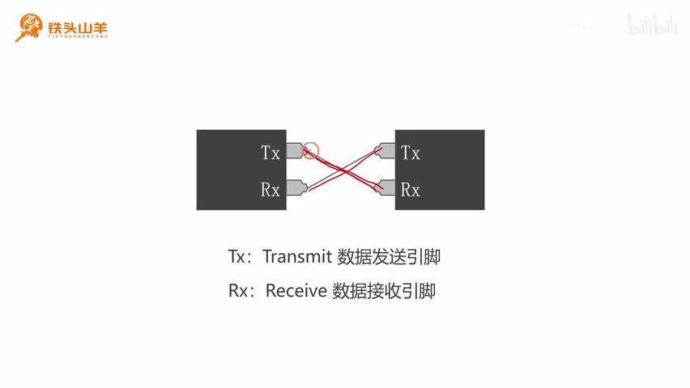
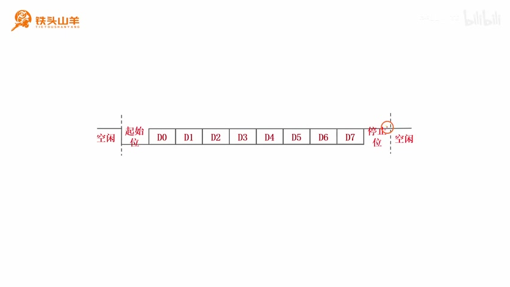
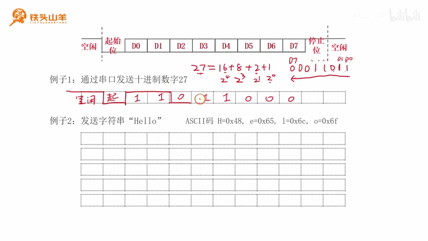
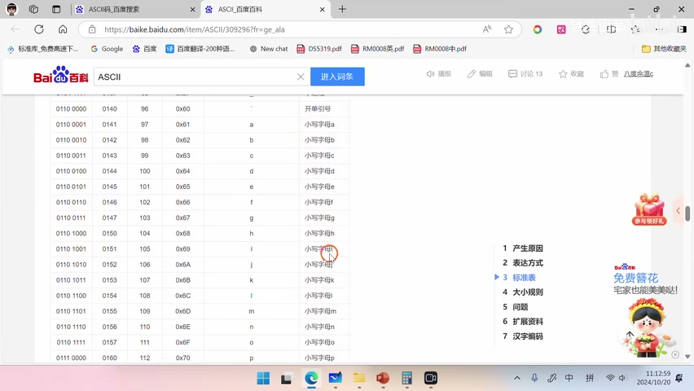
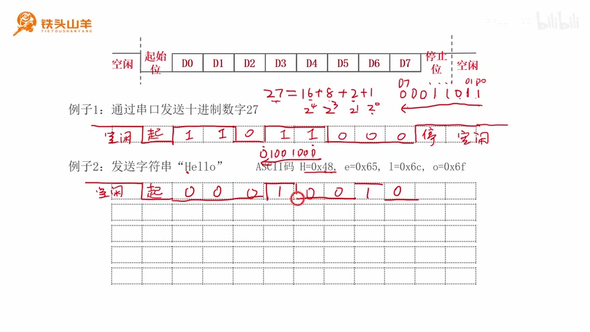
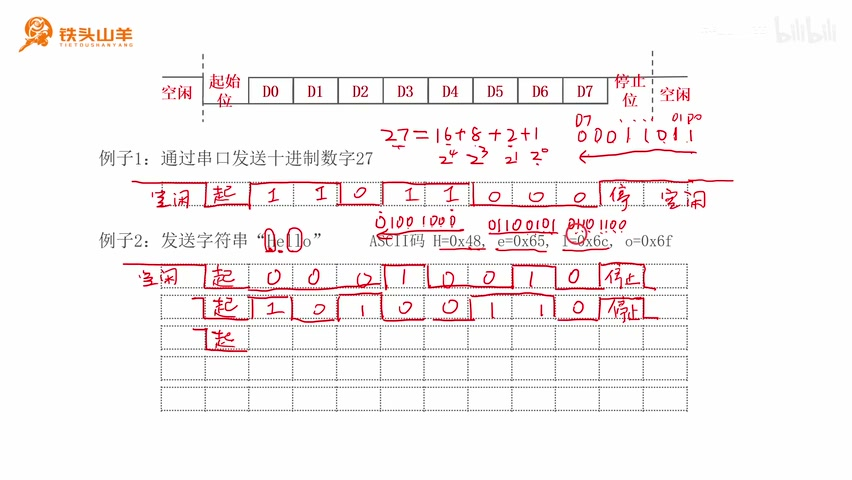
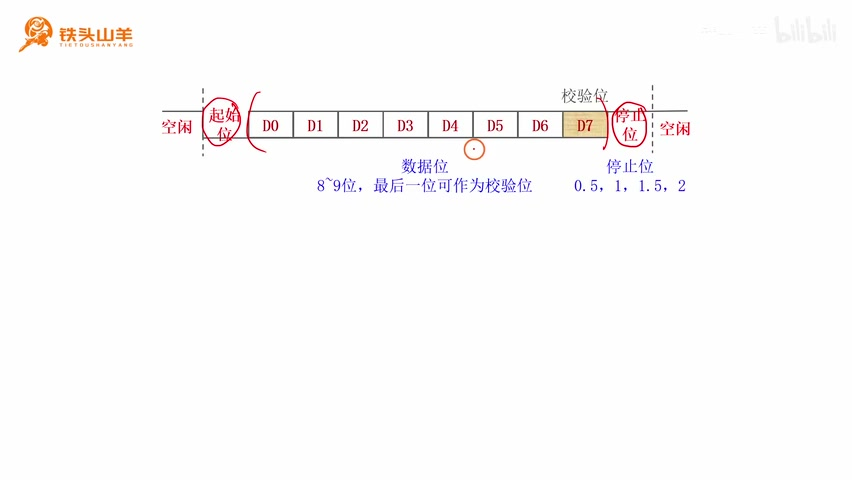
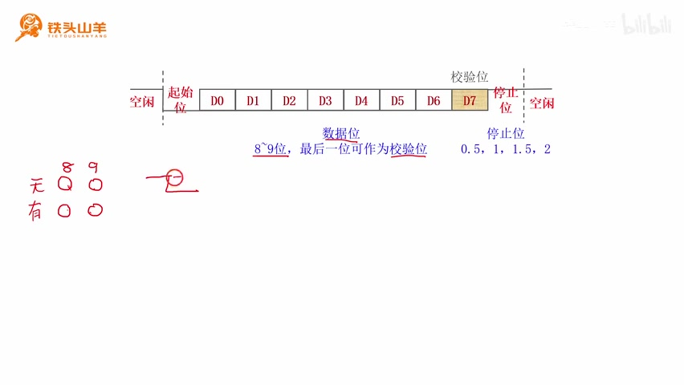
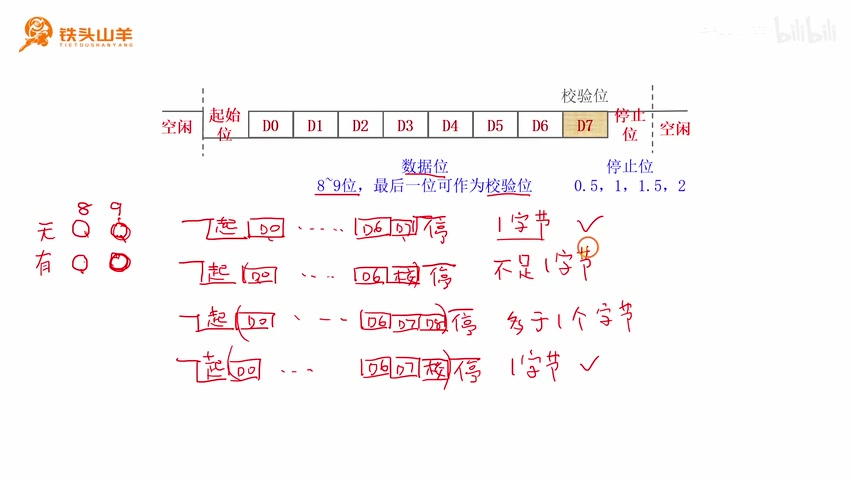
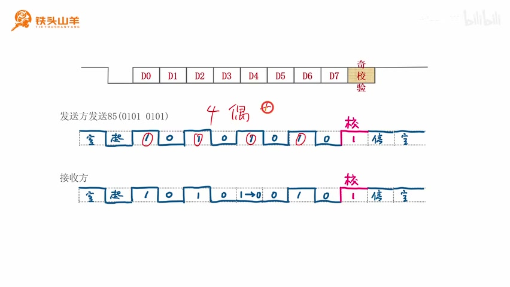

# P010 · 3.1 （串口）通信协议

各位同学大家好，我是铁头山羊。从今天开始，我们学习本套教程的新一章，也就是第三章。第三章要学习的东西叫串口。串口是 STM32 单片机中非常重要、也很常用的片上外设。学习之前，我们先了解串口究竟是什么。本套视频所需的材料都包含在开发套件包里，大家可以扫描屏幕上的二维码进入淘宝店铺购买。购买套件后，可以获得课程的课件和源码，还能加入答疑群，直接和 UP 主交流。

## 串口的定义与 Tx/Rx 接线

我们今天要学的串口是一种通信接口，也就是用来传输数据的接口。比如有两颗芯片，要在它们之间传输数据，就可以用导线把两边的串口连接起来。一个串口由两个引脚组成：Tx 是 transmit 的缩写，表示数据发送引脚；Rx 是 receive 的缩写，表示数据接收引脚。一个引脚负责发送，另一个负责接收。

接线时，要把收发双方的 Tx 和 Rx 交叉连接：左边的 Tx 接右边的 Rx，右边的 Tx 接左边的 Rx。这样一根线负责从左往右发送，另一根线负责从右往左发送，用两根导线就能实现双向数据传输。这就是串口。

_Two serial interfaces connect Tx to the other device’s Rx, with the return direction crossing the opposite pair. ·_ [_原片 01:31_](https://www.bilibili.com/video/BV11X4y1j7si/?p=10\&t=91)

## 通信协议与数据帧格式

了解串口的概念后，接下来探究串口怎样用一根导线传输数据。串口要在导线上传输数据，需要遵从一定的数据格式。数据格式可以类比成语言：甲乙两个人交流要使用相同的语言，甲说汉语、乙也说汉语才可以；如果甲说英语，乙也得说英语。两个人讲的语言不一样，就没办法交流。串口也一样，发送方和接收方要采用相同的数据格式，发出来的数据才能被正确接收。这种数据传输格式就叫串口通信协议，所以本章第一节讲串口通信协议。

收发双方通过一根导线连接，在导线上传输高低变化的电压。串口不传输数据时，线路保持高电压，表示空闲。空闲状态下，发送方突然发送一个低电压，这个低电压就是起始位，标志数据传输开始；接收方发现线路从空闲的高电压变成低电压，就知道要开始接收数据了。起始位之后，后面跟着要传输的数据。传输数据时，每次传一个字节，用高电压表示 1、低电压表示 0。

例如要传输十进制数 1，先把它写成二进制；这一个字节有八个比特位，依次是 D0 到 D7。

八个比特位从 D0 往 D7 传，也就是先传最低位。十进制数 1 的二进制数据中，最低位是 1，后面跟着七个 0。高电压表示 1，低电压表示 0，这样就把八个比特位传输出去了，这就是传输的一个数据。

传完一个字节后，发送方发送高电压作为停止位，标志这一帧结束。如果接下来还要传一个字节，就再发一个起始位；如果不需要传数据，线路保持高电压，表示又进入空闲状态。这就是串口数据帧的基本格式。

把数据帧画出来看：左右两侧的高电压表示空闲，中间先是低电压起始位，再后面是数据位；数据位里低电压表示 0、高电压表示 1，数据位结束后用高电压停止位结束这一帧。刚才介绍的是一位起始位、八位数据位、一位停止位的格式。

_The frame diagram labels the idle level, start bit, eight data bits D0–D7 and stop bit. ·_ [_原片 05:20_](https://www.bilibili.com/video/BV11X4y1j7si/?p=10\&t=320)

## 示例一：发送十进制数 27

再看第一个例子：通过串口发送十进制数 27。串口传输的是二进制数。27 可以写成 16+8，再加 2+1。

其中 1 是 2 的零次方，2 是 2 的一次方，8 是 2 的三次方，16 是 2 的四次方，所以 27 转成二进制就是 00011011。八个数据位按 D0 到 D7 排列，串口从 D0 往 D7 发送，也就是先发送最低位。因此在线路上的数据顺序是 11011000。先假设串口处于空闲状态，用高电压表示空闲，然后发送低电压起始位，表示传输开始，再从 D0 到 D7 发送数据。高电压表示 1，低电压表示 0。八个数据位发送完，发高电压停止位。后面没有新数据，就保持高电压，串口又进入空闲状态。

_The 27 example is filled into the frame as a start bit, data bits sent D0 first, and a stop bit. ·_ [_原片 07:06_](https://www.bilibili.com/video/BV11X4y1j7si/?p=10\&t=426)

## 示例二：发送字符串 Hello

下面看第二个例子：用串口发送字符串 “Hello”。串口只能发送二进制数，而字符串由一个个字符组成。在计算机中，用 ASCII 码表示字符。ASCII 码占一个字节，串口每次能发送一个字节，所以每次用一个串口数据帧发送一个 ASCII 码，也就是传输一个字符。

现在的任务是查出字符串里每个字符的 ASCII 码。可以在百度搜索 ASCII 码，打开百度百科里的 ASCII 码表，在表中查找字符。大写字母 H 的 ASCII 码是 0x48；小写字母 e 是 0x65；小写字母 l 是 0x6C；小写字母 o 是 0x6F。这样就查到了这五个字母的 ASCII 码，把刚才查到的编码写在例子旁边，接下来用串口把这些字母发送出去。

_The on-screen ASCII table is scrolled to the lowercase letter entries used for Hello. ·_ [_原片 08:46_](https://www.bilibili.com/video/BV11X4y1j7si/?p=10\&t=526)

先假设数据开始传输前串口处于高电压空闲状态，发送一个低电压起始位，然后发送第一个大写字母 H。H 的 ASCII 码是 0x48，十六进制的 4 写成二进制是 0100，8 是 1000。按 D0 到 D7、即低位到高位发送，因此 H 的八个数据位顺序为 00010010。低电压表示 0，高电压表示 1。数据位之后发送停止位，表示这一帧结束，这样大写字母 H 就发送出去了。

_The first Hello character is encoded as a start bit, eight H data bits and a stop bit. ·_ [_原片 09:54_](https://www.bilibili.com/video/BV11X4y1j7si/?p=10\&t=594)

H 发完之后不要停，继续发送小写字母 e，所以 H 的停止位后面紧跟一个新的起始位。e 的 ASCII 码是 0x65：6 是 4+2，也就是 0110；5 是 4+1，也就是 0101。按低位到高位发送，八个数据位的顺序是 10100110。仍然是高电压表示 1、低电压表示 0，连好电平后，最后发送停止位，这一帧表示小写字母 e。

发完 e，紧接着发送两个小写字母 l。先发送一个起始位，再发送第一个 l。它的 ASCII 码是 0x6C，6 是 4+2，也就是 0110；C 是十进制 12，等于 8+4，也就是 1100。所以按低位到高位发送，数据位顺序为 00110110。低电压表示 0，高电压表示 1，把电平连起来，最后再发送停止位。

_The Hello example continues with the ASCII-derived data bits and stop bits for the letters. ·_ [_原片 11:40_](https://www.bilibili.com/video/BV11X4y1j7si/?p=10\&t=700)

第一个小写字母 l 发完，紧接着发送第二个 l。两个 l 的 ASCII 码相同，所以数据位还是 00110110，按相同的方式连好电平并发送停止位。

最后一个字母是小写字母 o。先发起始位。o 的 ASCII 码是 0x6F：6 是 0110，F 是四个 1；按低位到高位发送，数据位为 11110110。1 用高电压表示，0 用低电压表示，把电平连起来，最后发送停止位，表示这一帧结束。o 发完后没有更多数据，串口进入空闲状态，也就是用高电压表示。通过这个波形，字符串 “Hello” 就发送出去了。

## 数据帧的可配置格式

刚才学习数据帧格式时，曾经假设格式固定为一位起始位、八位数据位、一位停止位。实际上数据帧格式可以设置，主要有三个地方：数据位长度、校验位使能或禁止，以及停止位长度。先看数据位长度。

_The example frames are followed by a slide introducing configurable data-bit length, parity and stop-bit length. ·_ [_原片 13:40_](https://www.bilibili.com/video/BV11X4y1j7si/?p=10\&t=820)

前面认为数据位固定为八位，也就是 D0 到 D7。实际上还可以选择九位数据位，在后面增加一个 D8，一共九个比特位。

第二个可设置参数是校验位的使能或禁止。可以把数据位的最后一位拿出来作为校验位，用来检查数据帧传输过程中有没有出错。例如使用八位数据位 D0 到 D7并使能校验时，校验位会放在 D7 这一位。D7 本来用于传数据，此时改作校验位检查传输；剩下七个比特位用来传有效数据。

第三个可设置的地方是停止位长度。前面把停止位固定为一位，实际上还可以设置成 0.5 位、1.5 位或两位，不过最常用的还是一位停止位。

现在重点看数据位长度和校验位这两个参数。数据位长度可以选八位或九位，校验位可以没有，也可以有，因此有四种数据帧格式：八位无校验、八位带校验、九位无校验、九位带校验。下面把四种情况依次画出来。

_The frame diagram highlights the data-bit area and the optional parity bit. ·_ [_原片 15:44_](https://www.bilibili.com/video/BV11X4y1j7si/?p=10\&t=944)

第一种是八位无校验，就是刚才介绍的格式：一位起始位、八位数据位、一位停止位。D0 到 D7 全部用来传有效数据，所以每次能传一个字节。

第二种是八位带校验。最后一个比特位 D7 用作校验位，前七个比特位传有效数据，所以每次传七个比特位，不足一个字节。

第三种是九位无校验：一位起始位，再加九位数据位 D0 到 D8，最后是一位停止位。九位数据全部用来传有效数据，所以每次传九个比特位，多于一个字节。

第四种是九位带校验，D8 被拿来作为校验位，校验位之后是停止位。总共九个数据位里，前八位传有效数据，所以每次传的也是一个字节。

平时串口通常以字节为单位传输，因此通常使用第一种和最后一种。第一种每次传一个字节，最后一种也可以每次传一个字节。所以最常用的是八位无校验和九位带校验：不想使用校验位就使用八位无校验，想使用校验位就使用九位带校验。中间两种用得比较少。刚才提到帧里有一个校验位，下面介绍它的使用方法。

_The four frame configurations distinguish data-bit lengths, parity usage and the stop bit. ·_ [_原片 18:10_](https://www.bilibili.com/video/BV11X4y1j7si/?p=10\&t=1090)

## 奇校验和偶校验

校验位有两种校验方式：奇校验和偶校验。奇校验要求数据位中有奇数个 1；偶校验要求数据位中有偶数个 1。下面以奇校验为例，看校验位怎样使用。

假设采用九位数据位并使能校验，把最后一个比特位拿出来作为校验位，校验方式选奇校验，用这种帧格式传输十进制数 85。先把 85 转换成二进制。数据从右往左、也就是从低位往高位发送，所以先发送起始位，再按 1、0、1、0、1、0、1、0 的顺序传输数据。

现在先不考虑校验位，数一下前面的数据有几个 1：一、两个、三个、四个，一共四个，是偶数。但是采用的是奇校验，所以发送方要通过校验位再补一个 1。加上这个 1 后，1 的数量变成五个，满足奇校验要求。然后发送方把数据帧发送给接收方。

_The odd-parity example adds a parity 1 so the transmitted data contains five 1 bits. ·_ [_原片 20:00_](https://www.bilibili.com/video/BV11X4y1j7si/?p=10\&t=1200)

接收方收到数据后要进行检验，检查数据位里有没有奇数个 1。如果有奇数个 1，就证明数据传输没有出错；如果检测到偶数个 1，就说明传输过程中出错了。

假设传输时某个比特因为某些原因从 1 变成 0，接收方再数数据位里的 1：一个、两个、三个、四个，是偶数个，于是就知道数据传输出错了。这就是奇校验的使用方法。偶校验的使用方法差不多，只是要求数据位里有偶数个 1。

以上就是本期视频的所有内容，感谢大家收看。我是铁头山羊，让我们下期视频再见。
