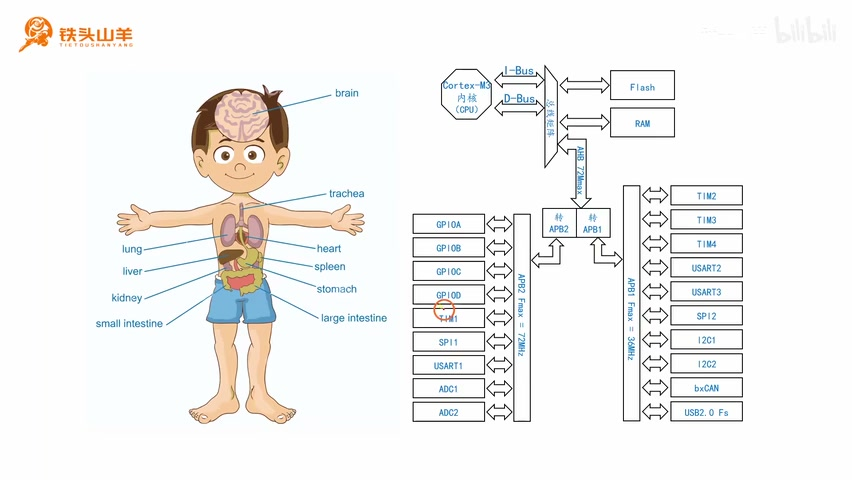
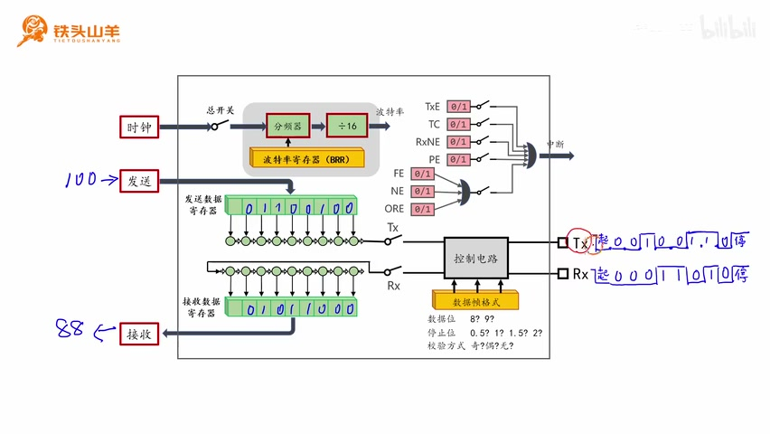
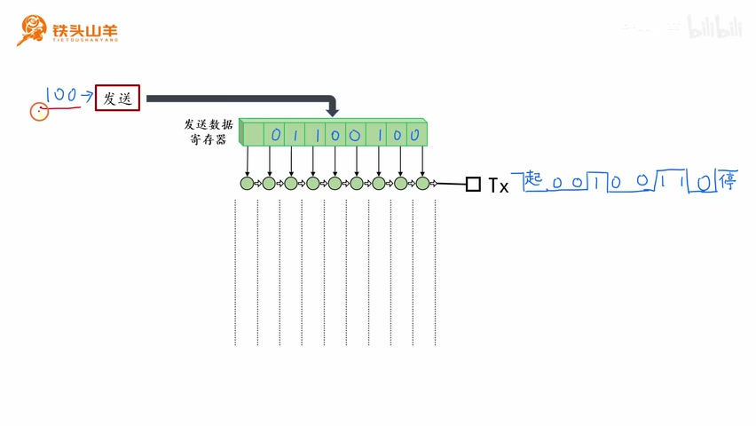
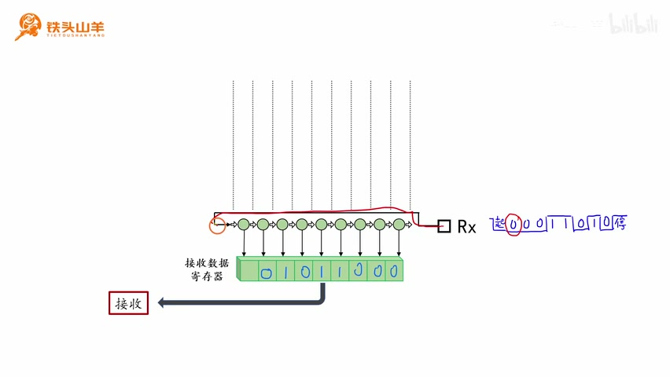
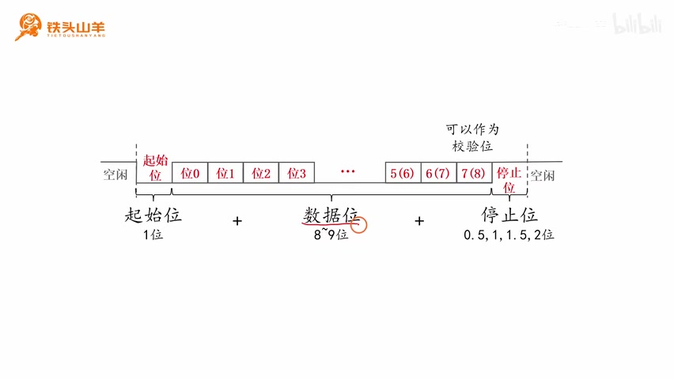
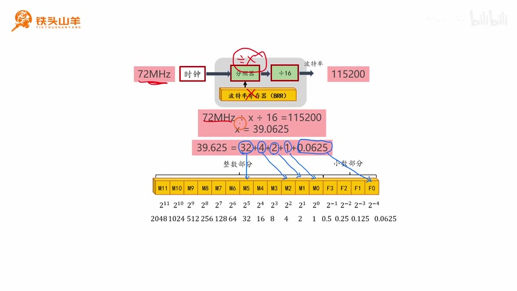
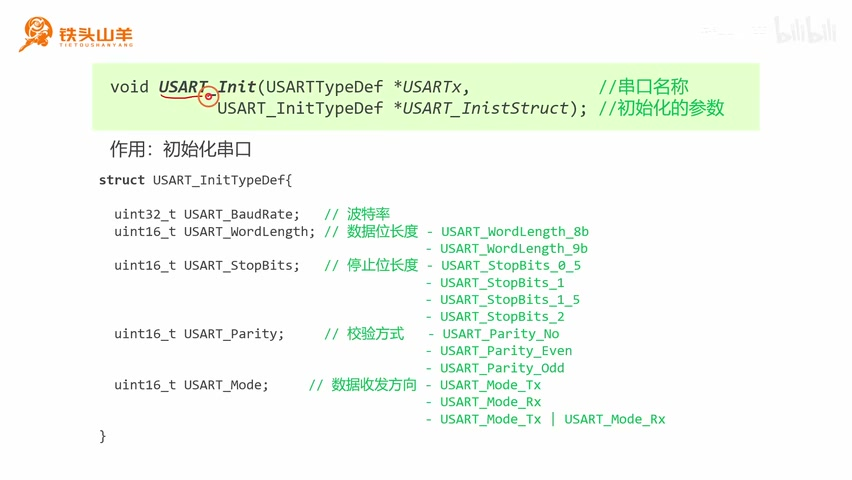
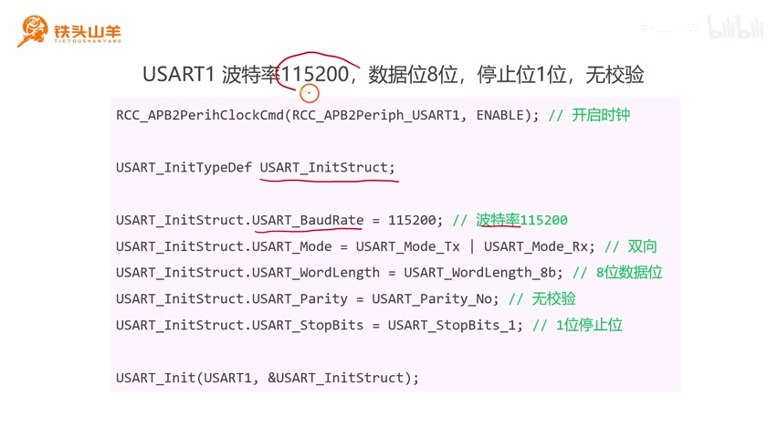

# P011 · 3.2 （串口）UART模块的使用方法

大家好，我是铁头山羊。今天继续学习第三章“串口”的第二节：USART 模块的使用方法。本套视频所需材料都包含在开发套件包里，大家可以扫描屏幕上的二维码进入淘宝店铺购买。购买套件后，可以获得课程全部课件和源码，还能加入答疑群，直接和 UP 主交流。

本期分六部分：第一，介绍 USART 模块，并了解什么是 UART；第二，介绍 USART 模块的基本用法；第三，学习移位寄存器，以及如何用它进行串并转换；第四，学习数据帧格式的设置；第五，学习波特率的设置；第六，介绍一个和串口初始化有关的编程接口。下面从第一部分开始。

## 一、USART 模块简介

我们今天学习的 USART，就是单片机里的串口。对于这里使用的单片机，内部有三个串口。

_单片机结构图标出内部的 USART1、USART2 和 USART3。 ·_ [_原片 01:15_](https://www.bilibili.com/video/BV11X4y1j7si/?p=11\&t=75)

从芯片结构图右侧可以找到 USART1、USART2 和 USART3，也就是串口一、串口二和串口三。可以把 USART 模块比作人的嘴巴和耳朵：它既能通过“嘴巴”向外发送信息，也能通过“耳朵”接收信息，这就是 UART 模块。

了解 UART 是什么之后，我们进入第二部分，学习它的基本使用方法。

## 二、USART 模块的基本用法

_USART 内部框图连接发送数据寄存器、接收数据寄存器以及 TX、RX 引脚。 ·_ [_原片 02:01_](https://www.bilibili.com/video/BV11X4y1j7si/?p=11\&t=121)

这张图是 USART 模块的内部结构框图。最右边有两个引脚：TX 是数据发送引脚，我们通过它向外发送数据；RX 是数据接收引脚，我们通过它接收对侧设备发来的数据。

USART 模块怎么用？方法很简单。图中有两个寄存器：上面是发送数据寄存器，下面是接收数据寄存器。要发送数据，只需把数据写入发送数据寄存器，模块就会把数据按数据帧格式从 TX 引脚发送出去。比如要发送十进制数字 100，就把它的二进制形式 `01100100` 写进发送数据寄存器。写好后不必再管它，串口会自动按起始位、数据位和停止位的格式从 TX 发出。

接收时，对侧设备要从 RX 引脚把串口数据帧发过来。UART 会解析这个波形，把其中的数据取出来并存入接收数据寄存器。图中的数据是 `01011000`；解析后，这个值会存到接收数据寄存器里，我们直接读出即可。由此可见，编程者不需要关心框图右侧的内部过程：发送时把数据写进发送数据寄存器，接收时从接收数据寄存器读出数据。

刚才只是了解了基本用法，下面进一步看它的工作原理，进入第三部分：移位寄存器和串并转换。

## 三、移位寄存器与串并转换

我们继续看这张框图。蓝色框出的上下两部分结构一样，都是移位寄存器。上面的移位寄存器负责把并行数据转换为串行数据；下面的移位寄存器负责把串行数据转换为并行数据。

什么是串行和并行？多个比特位一起操作，就叫并行；一个比特位接一个比特位地操作，就叫串行。发送时，我们把八个比特同时写入发送数据寄存器，它们同时存放在那里，所以这是并行。通过 TX 引脚按数据帧向外发送时，是先发一个比特，再发一个比特，再发后面的比特，逐位发送，因此这是串行。这里是并行，那里是串行，中间需要移位寄存器来完成串并转换。

接收也是同样的道理：通过 RX 引脚一个比特一个比特地接收高低电压，再把它们转换成数据存入接收数据寄存器。接收数据寄存器里是一整块存储，可以同时存放多个比特，所以这里是并行；RX 上一个比特一个比特地接收，所以这里是串行。我们得使用移位寄存器，把串行数据转换成并行数据，这里同样要做一次串并转换。

下面用发送数字 100 的例子说明移位寄存器如何把并行数据转为串行数据。

要通过 UART 发送数字 100，只需把它写入发送数据寄存器，也就是写入 `01100100`。写进去后，UART 会自动把数据移到移位寄存器中，原来的发送数据寄存器位置就被清空。

移位寄存器的特点是每个周期向右移动一位。第一次移动时，每个比特都向右挪一格，末尾的 0 被移出寄存器。我们通过 TX 引脚发送一个低电压来表示这个 0；再移动一次，又有一个 0 被移出，就再发送一个低电压。下一次移出的是 1，就发送高电压。不断重复这个步骤，直到所有数据都发送完。

所有数据移出后，得到的波形正好是串口数据帧中的数据部分，发送顺序是低位在前、高位在后。

_发送移位寄存器逐位右移，并把移出的比特转换为 TX 引脚上的电平。 ·_ [_原片 06:10_](https://www.bilibili.com/video/BV11X4y1j7si/?p=11\&t=370)

图中逐步标出了数据移位以及 TX 引脚对应的电平。

看完发送，再看接收。对侧设备通过 RX 引脚把波形发来。首先收到起始位，它表示数据帧开始；接着收到第一个 0，这个 0 沿着 RX 方向进入移位寄存器相应位置。下一个周期里已有的 0 向右移，再接收第二个 0；之后继续右移并接收第三个 0。图中接下来接收到的是 1。重复这个过程，直到所有数据位都接收完。

_RX 收到的比特逐个进入移位寄存器，再形成并行数据。 ·_ [_原片 08:20_](https://www.bilibili.com/video/BV11X4y1j7si/?p=11\&t=500)

对侧通过 RX 引脚发来波形后，首先收到起始位，它表示数据帧开始。接着收到第一个 0，这个 0 沿着 RX 引脚进入移位寄存器对应的位置；到下一个周期，它向右移动一位，然后再接收第二个 0，第二个 0 进入相应位置，两个比特整体再向右移。接着收到第三个 0，第三个 0 出现在对应位置，三个比特再一起右移，图中此时形成 `000`。随后收到第四个比特 1。不断重复这个步骤，直到所有数据都接收完。图示中，接收完成后移位寄存器里形成相应的数据，然后把它移动到接收数据寄存器中。编程人员最后只需要读取接收数据寄存器里的值即可。移位寄存器和串并转换是 UART 模块工作的核心原理；弄懂这里，后面的知识就简单了。

## 四、数据帧格式的设置

进入第四部分：设置数据帧格式。先回顾上期学过的串口数据帧：它由起始位、数据位和停止位组成。起始位占 1 位；数据位占 8～9 位；停止位可以占 0.5、1、1.5 或 2 位。

数据帧有一些可以设置的参数：可以选择数据位长度为 8 位或 9 位；可以决定是否把数据位的最后一位作为校验位，并选择奇校验或偶校验；还可以选择停止位长度为 0.5、1、1.5 或 2 位。这些就是串口数据帧的参数。

那么 USART 模块如何设置这些参数？我们回到它的内部结构框图。

_串口帧由起始位、数据位和停止位组成，图中标示各部分长度及校验位位置。 ·_ [_原片 10:05_](https://www.bilibili.com/video/BV11X4y1j7si/?p=11\&t=605)

框图中的控制电路控制发送和接收时串口数据帧的格式，也就是波形的格式。黄色部分用于设置数据帧参数，共有三个：数据位长度，可以选 8 位或 9 位；停止位长度，可以选 0.5 到 2 位；校验方式，可以选奇校验、偶校验或不使用校验。通过这个位置就能设置数据帧参数。

## 五、波特率的设置

进入第五部分：设置波特率。串口数据帧由一个一个的位组成，例如起始位占 1 位，数据位可以是 8 位或 9 位，停止位占 0.5 到 2 位。波特率表示每秒发送多少个位，发送的位越多，数据传输速度就越快。常用波特率有 9600、115200、921600 等。

USART 模块如何设置波特率？这和框图左上角的电路有关。最左边输入的是模块外部的时钟信号，往里经过一个分频器。分频器下方有波特率寄存器，用来设置这个分频器的分频系数。分频器就是对频率做除法的结构：比如寄存器设为 2，分频器就是二分频；输入 32 MHz 时钟，除以 2 后得到 16 MHz。后面还有一级固定为 16 分频的分频器，16 MHz 再除以 16，得到 1 MHz，这就是最终产生的波特率。

接着看一个实际例子：假设输入时钟频率为 72 MHz，希望产生 115200 的波特率。

_波特率寄存器示例：口述计算得到 X = 39.0625；画面下方将分解式总数写成 39.625，与口述和算式不符，是课件标注笔误。 ·_ [_原片 13:20_](https://www.bilibili.com/video/BV11X4y1j7si/?p=11\&t=800)

在这个例子里，只有图中波特率寄存器对应的分频系数可以设置。把寄存器值设为 X，则 72 MHz 除以 X，再除以 16，应该等于目标波特率 115200。解出 X = 39.0625，再把这个值填入波特率寄存器。画面下方将这个数值写成了 39.625；按上面的计算和分解式，正确结果是 39.0625，这是课件中的标注笔误。

怎样把 39.0625 填进寄存器？看下一张图。寄存器可以分成两部分：前 12 个比特表示整数部分，后 4 个比特表示小数部分。39.0625 可以拆成 `32 + 4 + 2 + 1 + 0.0625`。32 是 2 的 5 次方，所以在对应位置写 1；4 是 2 的 2 次方，对应位置也写 1；2 是 2 的 1 次方，写 1；1 是 2 的 0 次方，再写 1。0.0625 对应小数部分中的一个位置，写 1，其余位置填 0。

这样得到最终的比特组合，把这些 0 和 1 填进波特率寄存器，波特率就设置完成了。到这里原理讲完，下面进入第六部分，通过编程接口来完成初始化。

## 六、串口初始化编程接口

_屏幕展示 USART\_Init 接口、初始化结构体及其配置成员。 ·_ [_原片 15:00_](https://www.bilibili.com/video/BV11X4y1j7si/?p=11\&t=900)

编程接口的名字叫 `USART_Init`：USART 表示串口，Init 表示初始化，顾名思义，它的作用就是初始化串口。

这个接口有两个参数。第一个参数叫 `USARTx`，用来填写串口名称。单片机里有 USART1、USART2、USART3，要使用哪个串口，就把它的名字填进去。第二个参数是 `USART_InitStruct`，用于填写初始化的具体要求。它像一份菜单，填好后，模块就按这份菜单的要求完成配置。这个参数是一个结构体指针。

结构体有几个成员。先看 `USART_BaudRate`，它用来设置波特率，例如填 9600、115200 或 921600。填好后不必手动操作波特率寄存器，`USART_Init` 会自动计算寄存器值。

第二个成员 `USART_WordLength` 设置数据位长度。可选 `USART_WordLength_8b`（8 位）或 `USART_WordLength_9b`（9 位），按需要选择。下一个成员 `USART_StopBits` 设置停止位长度，可以选 `USART_StopBits_0_5`、`USART_StopBits_1`、`USART_StopBits_1_5` 或 `USART_StopBits_2`，也就是 0.5、1、1.5 或 2 位，把对应参数填进去即可。

`USART_Parity` 用来选择校验方式。选择 `USART_Parity_No` 表示不使用校验；选择 `USART_Parity_Even` 表示偶校验；选择 `USART_Parity_Odd` 表示奇校验，根据要求选择即可。

最后一个成员 `USART_Mode` 用于选择数据收发方向，可以是 TX（只发送）、RX（只接收）或 TX 和 RX（收发双向）。对应框图里的两个开关：只闭合上面的开关就是只发送，只闭合下面的开关就是只接收，两个开关都闭合就是收发双向。

下面用实际例子练习。先从百度网盘的课程资料中下载模板工程：打开百度网盘和课程资料，在课程资料根目录找到 `template` 文件夹，下载后解压，右键选择“解压到当前文件”，得到 `template` 文件夹。双击打开，再打开里面的 `template`，进入 UV project，找到 `user` 文件夹下的 `main.c`，双击打开；代码写在这个 main 函数里。

实验要求把串口一配置为波特率 115200、8 位数据位、1 位停止位、不使用校验。代码先调用 `RCC_APB2PeriphClockCmd` 开启 USART1 的时钟：第一个参数填 `RCC_APB2Periph_USART1`，第二个参数填 `ENABLE`。然后调用 `USART_Init` 初始化串口。因为它的第二个参数是结构体指针，所以先声明一个 `USART_InitTypeDef` 结构体变量，再给成员赋值。

_示例代码配置 USART1 为 115200 波特率、8 位数据、无校验和 1 位停止位。 ·_ [_原片 19:20_](https://www.bilibili.com/video/BV11X4y1j7si/?p=11\&t=1160)

示例中先设置波特率成员为 115200。再设置 `USART_Mode`；题目没有规定数据传输方向，就默认选择收发双向，也就是 TX 和 RX。第三个成员 `USART_WordLength` 用于设置数据位长度，这里要 8 位，所以填 `USART_WordLength_8b`。校验成员 `USART_Parity` 设为 `USART_Parity_No`，表示无校验。最后 `USART_StopBits` 设置停止位长度；题目要求 1 位，就填 `USART_StopBits_1`。

最后调用 `USART_Init`：第一个参数填 `USART1`，表示使用串口一；第二个参数传入刚才结构体变量的地址。这样初始化就完成了。下面开始在代码编辑器里实际编写。

先开启 USART1 的时钟。写好后，USART1 的时钟就打开了。接下来使用 `USART_Init` 初始化串口。在调用前，由于第二个参数是结构体指针，先声明一个结构体变量；变量名可以随便起，这里叫 `USART_InitStruct`。

然后逐项给成员赋值：波特率填 115200；收发方向选双向，即 TX 或 RX。只填 TX 就是只发送，只填 RX 就是只接收。数据位长度选 8 位，停止位长度选 1 位，校验设为不使用。例子里不使用校验，当然也可以按需要选择奇校验或偶校验。

最后调用 `USART_Init`，第一个参数填 `USART1`，也就是所用串口的名称；第二个参数填这个结构体变量的地址。这样串口初始化完成。屏幕上的代码示例也列出了对应的配置：开启 USART1 时钟，结构体波特率为 115200、模式为 TX/RX、字长为 8 位、无校验、1 个停止位，再将结构体传给 `USART_Init`。

以上就是本期视频的全部内容。感谢大家收看，我是铁头山羊，我们下期视频再见。
