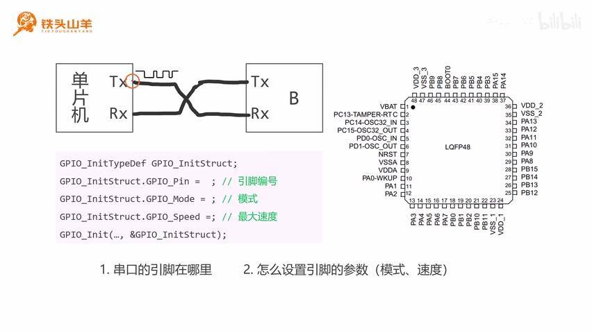
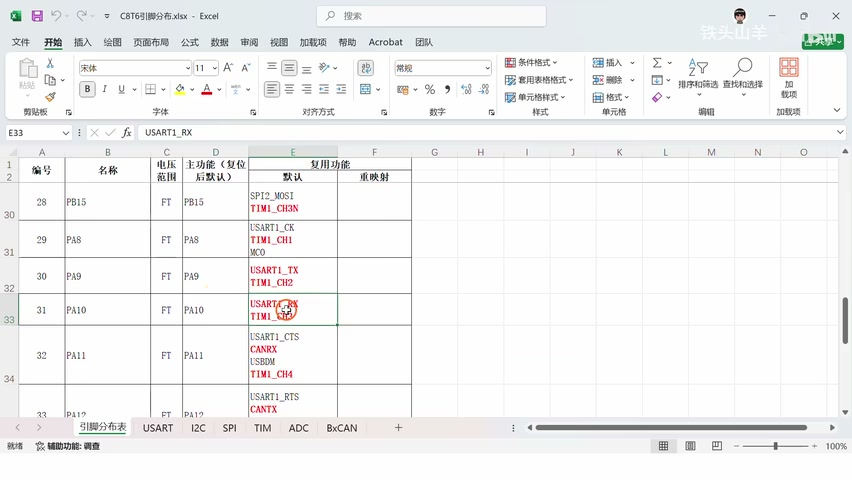
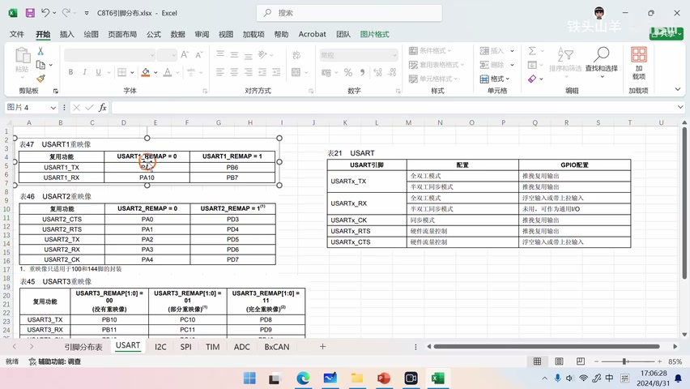
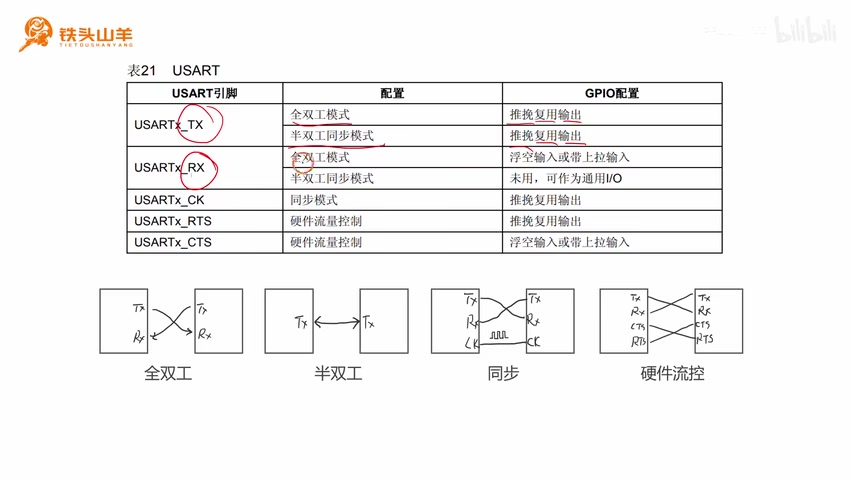
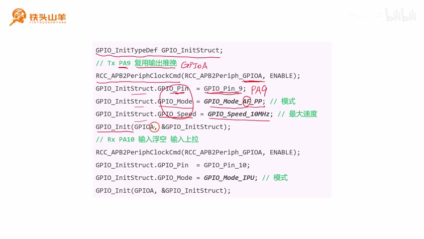
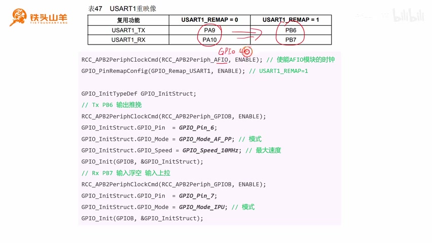

# P012 · 3.3 （串口）为串口初始化IO引脚

来源：[哔哩哔哩第 12 部分](https://www.bilibili.com/video/BV11X4y1j7si/?p=12)

各位同学大家好，我是铁头山羊，今天我们要学习第三章的第三节，通过本节课的学习，我们将了解到，如何对串口的IO引脚进行初始化，本套视频所需要的所有材料，都包含在这个开发套件包里，大家可以扫描屏幕上的二维码，进入到我们的淘宝店铺来购买它。

_串口 TX 与 RX 交叉连接示意，以及 GPIO\_Init 的初始化结构体字段。 ·_ [_原片 00:30_](https://www.bilibili.com/video/BV11X4y1j7si/?p=12\&t=30) 购买套件之后，你将获得课程所有的课件和源码，还能加入答疑群和up直接交流，我们之前学习过串口由两个引脚组成，分别是TX和RX，其中这个TX是发送引脚，它可以把数据发送出去，而RX 引脚是接收引脚，我们通过这个引脚接收对侧发来的数据。

所以在使用这个串口之前，我们必须对TX 引脚和RX 引脚进行初始化，那么怎么对这两个引脚进行初始化呢，其实我们之前学习过相关的代码，也就是这个代码，我们可以调用GPIO\_Init这个编程接口，对我们的IO引脚进行初始化，首先声明一个结构体类型的变量。

然后对变量的成员赋值，这个变量的成员里边就包含了IO，初始化的参数，包括引脚的编号，我们选择的引脚模式，如果选择的是输出模式的话，我们还需要指定这个IO引脚的最大输出速度，最后呢我们就调用GPIO\_Init来完成这个初始化，但是现在呢就出现了两个问题。

首先第一个问题，我们怎么在单片机上找到这里的，TX和RX这两个引脚呢，我们仔细找一下右边的这个单片机的引脚图，发现这张图里边并没有，我们想要的这个TX和RX 引脚，然后就算我们在单片机里边找到了这个，TX和RX 引脚，我们怎么指定它的模式和最大输出速度呢。

以上这两个问题就构成了本节课要讨论的，终极问题，就是串口的引脚在哪里，怎么设置串口引脚的参数，所以下面呢就让我们带着这两个问题，来开始本节课的学习，本期视频我们将分成以下六个部分来讲。

## USART1 的引脚

首先第一个部分，我们先来认识一下对于USART1这个模块来说，它有哪些引脚，然后第234这三个部分我们将学习三张表，这三张表呢分别是引脚分布表，重映射表和IO配置表，学习完这三张表之后，我们就能回答刚才的两个问题，然后第五和第六部分我们分别会编写一段代码。

通过这些代码我们来练练手，好的，下面就让我们从第一个问题开始，USART1 模块有哪些引脚，首先对于标准的串口来说，它们都有两个引脚，分别是TX 引脚和RX 引脚，其中TX 引脚是数据的发送引脚，我们通过这个引脚把数据发送出去，而RX 引脚呢是数据的接收引脚。

我们通过这个引脚呢来接收数据进来，我们的UART模块，除了可以执行这个标准的串口功能之外，它还有一些其他的功能，所以下面呢就多出了这么三个引脚，下面呢我们简单的来介绍一下，这些引脚都是干什么的，其中CTS和RTS呢负责硬件流控，硬件流控呢本套视频我们不会讲。

所以这两个引脚呢我们就用不到，然后下面的这个 CK用于串口的同步模式，在同步模式下呢，我们需要使用CK这个引脚，连接对侧的CK引脚，然后这样呢两个串口之间就可以传递时钟，但是我们不会讲这个同步模式，所以这个引脚呢我们也用不到。

所以呢这五个引脚里边这三个引脚都是没用的，我们只会使用到这里的TX和RX 引脚，刚才呢我们得出结论，对于我们这个USART1模块来说，它有两个引脚，分别是TX 引脚和RX 引脚，但是这个TX 引脚和RX 引脚，位于我们单片机的什么位置呢，要回答这个问题，我们就必须引入我们的第一张表。

## 从数据手册查找引脚分布

也就是这里的引脚分布表，对于我们的单片机来说，有两本非常重要的手册，一本是这个DS5319，也就是数据手册，还有一本呢是RM0008，也就是这个参考手册，我们首先打开DS5319数据手册。

然后我们看到这个手册的目录，第三部分，这里边呢有很多图，就是我们之前讲的这个单片机的一个，引脚分布图，然后在这些图后边这里有一个表，这个就是我们本节课要讲的这个引脚分布表，我们来看一下这个表啊，它非常长非常非常的长。

有这么多，为什么这个表会有这么长呢，我们来看一下这个表的表头哈，这个表的表头里边包含了这么七种不同的封装，也就是我们大面积要使用的七种不同的封装，比如说这个LFBGA100，UFBGA100，LQFP48。

TFBGA64，LQFP64等等等等，一共有七种，这些封装里边引脚数目最多的就是100个引脚，所以我们这个表呢它有100行，而对于我们所使用的这个单片机来说，它是LQFP48的封装，只有48个引脚，所以这个表，大部分内容对于我们来说是没有用的。

所以呢我把这张表整理了一下，得到了这么一个简化的表格，这个表格呢就短多了，我们首先来看一下这个表格的表头，表头有这么几列组成哈，首先第一列是编号，这个编号呢从1\~48，就对应了我们单片机上的48个引脚。

其实呢也就是我们单片机上这里的1\~48，这48个数字，我们曾经学习过这个引脚编号的一个规则哈，就是这个黑色的圆点所在的位置，最近的这个引脚是1 号引脚，然后我们逆时针沿着这个方向引脚的序号递增，这里是1、2、3、4、5，一直递增，最后一个引脚呢就是48 号引脚。

然后编号后边的这一列呢是名称，名称就没有什么好讲的了，我们之前讲过，这个单片机IO引脚命名的一个规则，有特殊功能的引脚，除掉特殊功能的引脚之后，就是ABCD4个组。

每组里边又是0\~15，它有引脚编号，然后名称后边这一列是电压范围，电压范围我们先不管电压范围，后边这里是主功能，它后边有个括号，说是复位后默认这是什么意思呢，就是说当我们的单片机重新上电之后，这个我们没有对这个IO引脚，做任何配置的情况下。

它默认就处于这些功能，比如说对于我们的10 号引脚来说，它的主功能就是PA0，也就是说当我们的单片机上电之后，不做任何配置，那么这个10 号引脚就当做普通的IO引脚，也就是PA0来使用，其实对于单片机上的大部分引脚，它们都是作为普通的IO引脚来用的。

都是默认是普通 IO 引脚，然后在这个主功能后边是两个复用功能，这个复用功能呢分成两种，一种是默认的复用功能，一种是重映射的复用功能，我们来回顾一下什么是复用功能，我们之前学习过单片机的IO引脚呢，有八种工作模式，其中四种输入。

四种输出，那这里是我们之前讲过的四种输出模式，可以有通用输出推挽，通用输出开路，复用输出推挽和复用输出开路，其中前两类呢都是通用，后两个呢都是复用，所谓通用呢就是我们通过编程的方式，直接命令CPU向这个IO引脚写零或者是写一。

以此来控制这个IO引脚呢输出低电压，高电压或者是高阻抗，而复用功能呢，就是我们不通过这个CPU，直接去控制这个IO引脚了，而是把这个控制权呢交给芯片上的其他模块，比如说我们今天学习的这个串口模块，比如说我们想使用这个串口模块，发送这么一个字符串hello。

那么我们就通过程序把hello，这个字符串写到串口里边，然后串口呢就会控制这个IO引脚，帮我们以这种串口数据帧的格式，把数据发送出去，这个就是复用，然后呢我们回到这张表。

_引脚分布表中 USART1\_TX 对应 PA9、USART1\_RX 对应 PA10；旁边列出其他复用功能。 ·_ [_原片 08:37_](https://www.bilibili.com/video/BV11X4y1j7si/?p=12\&t=517) 我们在复用功能默认的这一栏里面，找到我们USART1的TX和RX两个引脚，我们往下翻，好好的找一找，你就会发现他们其实是位于这个位置，看到没，第30行和第31行，这个PA9可以作为USART1的TX，也可以作为定时器1的通道2；PA10呢可以作为USART1的RX。

也可以作为定时器的通道，三，所以我们要找的USART1的TX和RX呢，就分别位于PA9 和 PA10，然后这里还有一个默认有一个重映射，这又是什么意思呢，这个默认啊，就是说我们不做任何其他配置的情况下，我们这个串口的发送和接收引脚呢，就是位于PA9 和 PA10。

但是如果由于某些原因，我们这两个引脚PA9 和 PA10用不了了，那么我们就需要把这两个引脚呢，搬到其他的地方去，这个时候呢我们就需要使用这个重映射，重映射之后，我们就可以把它搬家搬到别的地方去了，比如说这两个TX和RX 引脚呢，可以被重映射到下面这些位置。

我们来看啊，第42行和第43行，这里看到没，这里是TX和RX，也就是说它可以被重映射到PB6 和 PB7，这两个引脚上去，呃刚才讲的有点乱哈，我再来总结一下，刚才呢我们通过这个IO引脚分布的表，我们找到了UART1这个模块。

发送引脚和接收引脚所在的位置，在默认情况下，我们不做其他配置的情况下，他们就位于PA9 和 PA10，但是有些情况下PA9 和 PA10可能用不了，这个时候呢，我们的芯片就为这个USART1，准备了一组备用的引脚啊，这组备用的引脚呢就是啊PB6 和 PB7。

也就是说当我们不使用重映射的时候，它们位于PA9 和 PA10，如果我们使能了重映射，就位于PB6 和 PB7，学完了第一张表引脚分布表，我们再来看一下第二张表重映射表。

_USART1 重映射表对照 REMAP=0 时 PA9/PA10 与 REMAP=1 时 PB6/PB7。 ·_ [_原片 11:07_](https://www.bilibili.com/video/BV11X4y1j7si/?p=12\&t=667)

## 查找重映射引脚

这个重映射表呢其实就在我们这个RM0008，也就是参考手册里边，我们双击打开这个参考手册看中文版的哈，然后我们翻开手册的第八章，第八章介绍的就是通用复用功能，IO也就是GPIO和AFIO，然后我们翻到第八章的第三节，这个第八章章的第三节下边呢有很多小节。

每一小节呢就介绍了一种片上外设，它重映射之前和重映射之后，引脚所在的位置，8.3节的这个表有点多，所以我就把它分类整理到了，我们的这个电子表格里边，然后我们本节课用的是这个UART，也就是串口，我们打开USART 串口这个子表。

然后可以看到里面有USART1的一个表，USART2的一个表和USART3的一个表，这就是三个串口，比如说我们以刚才的这个USART1为例，刚才我们得出结论，如果不进行重映射的话，那么TX和RX分别位于PA9 和 PA10，就对应这一列，当remap等于零的时候，就是不不进行重映射。

它就在PA9 和 PA10，如果使能重映射的话，就是remap等于一，那么它就位于PB6 和 PB7，这和刚才的结论是一样的，所以去查找这种IO重映射表，是快速的找到这个片上外设引脚所在位置，的一个方式，看完了上面的这两张表之后，我们再来看一下第三张表。

## 查找 IO 配置表

就是这里的IO配置表，刚才呢我们已经找到了USART1的TX和RX，这两个引脚所在的位置，如果我们不进行重映射的话，那么它就位于PA9 和 PA10这两个位置，找到这两个引脚之后，我们需要对它进行初始化，但是现在我们怎么去确定这两个引脚的模式。

和最大输出速度呢，待会儿我们要学习的这个IO 配置表，就是用来解决这个问题的，这个IO配置表，仍然是位于我们这本RM0008，也就是参考手册里边，我们双击打开这个参考手册，然后找到参考手册的目录。

还是找到第八章，找到第八章的第一节，然后找到这里的8.1.11，这里有一个外设的GPIO配置，这一节里边呢有很多表格，这些表格呢详细地描述了我们这些片上外设，每一个引脚应当设置成什么模式，这里面都有。

因为刚才的这个IO配置表呢比较多，我还是把它按这个片上外设的种类，依次给它分类整理了一下，我把它放在了表格的右边，左边就是我们刚才的IO重映射表，右边的就是IO配置表，我们仔细来观察一下这个IO配置表，这张表格呢介绍了我们UART模块这么五个引脚。

每一个引脚应当被配置为什么模式，比如说对于这个数据发送引脚来说，在全双工模式下，我们应当把它配置为复用输出推挽，在半双工模式下呢，也应当是复用输出推挽，而对于这个数据接收引脚RX来说，在全双工模式下应当是输入上拉。

或者是输入浮空，而半双工模式下呢，这个引脚不使用，然后对于CK、RTS、CTS这三个引脚来说，他也给出了相应的这个模式，那么但问题是前面的这里的配置，全双工，半双工同步模式，硬件流控，这些都是什么意思呢，下面我们来解释一下这个概念。

## 全双工、半双工与引脚模式

首先我们先来看第一个概念，什么是全双工，所谓全双工就是数据通信的方向完全是双向的，这个就是我们标准的一个串口，我们使用一对交叉的导线，把这个TX和RX 引脚呢交叉连接，这样呢这根线就负责从左到右传输数据，这根线呢负责从右到左传输数据。

这两根线互不影响，所以数据传输的方向完全是双向的，所以这就是全双工，而半双工呢就是表示数据传输虽然是双向的，但是不能同时进行，它是这么连接的，就是把两个模块的这个TX 引脚呢相连接。

这样呢这根线既能从左向右发发送数据，也能从右向左发送数据，但是由于它们是共用一根线，所以这两个过程呢不能同时进行，这个就是半双工，然后我们再来看一下同步，所谓同步呢就是在标准的串口基础上，又增加了一根CK 线，这个CK 线呢。

负责在两个设备之间去传输时钟信号，这个时钟信号呢就能把两个设备同步起来，所以这种模式呢叫做同步模式，然后我们再来看一下硬件流控，所谓硬件流控呢就是在标准的串口基础上，增加了CTS和RTS这两个引脚啊，这两个引脚呢也是交叉连接，关于这个流控的概念呢。

_USART 引脚配置表给出 TX、RX、CK、RTS、CTS 在不同模式下的 GPIO 配置。 ·_ [_原片 13:07_](https://www.bilibili.com/video/BV11X4y1j7si/?p=12\&t=787) 我们就不做介绍了，那以上呢就是这四种模式所代表的一个含义，对于我们的这套教程来说呢，我们只学习这种标准的串口，也就是全双工模式的这种串口，所以呢对于TX 引脚来说，我们应当把它设置为全双工，也就是复用输出推挽模式，而对于接收引脚来说呢。

我们应当把它设置为输入浮空，或者是输入上拉模式，这里可以选择输入浮空，也可以选择输入上拉，但是我们最好选择输入上拉，为什么呢，原因是这样的哈，因为这个RX 引脚是负责接收数据的，那在接收数据的过程中，如果这根线意外的断开了，那这个引脚是不是就悬空了。

这个时候如果我们选择的是输入上拉模式，那么它就会给这个RX 引脚，提供一个默认的高电压，也就是一，这样，就避免外界的电磁波直接输入到这个引脚里边，对我们程序的运行造成影响，所以跟这个输入浮空相比，我们最好就是选择这个输入上拉模式，这里呢我再解释另外一个问题。

为什么我们这里选择的是输入上拉，而不是输入下拉，这是因为啊，这个输入上拉，能给我们的这个IO引脚，提供一个默认的高电压，我们回忆一下串口数据通信的格式，串口通信的格式是这样的，在空闲状态下。

我们发送一个低电压，表示起始位，然后后边跟着的是数据位，数据位之后呢是停止位，在这个起始位和停止位两边呢都是空闲，而我们正好也是用高电压去表示这个空闲的，所以当这根RX线意外断开的时候，因为我们使用的是输入上拉模式。

所以它默认是一个高电压，这样呢就表示我们的这个串口在空闲状态，这样就能对我们的断线造成一个最小的影响。

## 默认引脚 PA9 和 PA10 的初始化

好的以上呢就是我们这三张表的内容，学完了这三张表之后，我们下面来编一段代码来练练手，首先我们先来看一下，在默认状态下，也就是这个USART1的。

UART1的TX和RX分别位于PA9 和 PA10的时候，这两个IO引脚应当如何去初始化，这就是我们要写的代码，其实我们之前学习过这段代码，就是使用GPIO\_Init对我们的IO引脚进行初始化，我们先初始化PA9，再初始化PA10，首先我们先来声明一个这种类型的一个变量。

然后呢我们使用RCC\_APB2PeriphClockCmd，去开启GPIOA的时钟，为什么开的是GPIOA的时钟呢，因为我们使用的是PA9，PA9的端口号就是GPIOA，所以我们在使用它之前要先开它的时钟，然后呢我们往这个变量的成员里面去填值，首先是GPIO\_Pin引脚编号。

因为是PA9，所以引脚编号就是GPIO\_Pin\_9，然后去填这个模式，我们要使用的模式是复用输出推挽，复用输出推挽，对应的就是机票GPIO\_Mode\_AF\_PP，这里的AF代表alternate function，pp呢代表push-pull，也就是复用输出推挽模式，然后最大输出速度。

_PA9 配置为复用推挽输出、PA10 配置为输入上拉的 GPIO 初始化代码。 ·_ [_原片 18:01_](https://www.bilibili.com/video/BV11X4y1j7si/?p=12\&t=1081) 这里我们选的是10 MHz，最后呢我们调用GPIO\_Init，来对这个PA9呢进行初始化，初始化完了TX 引脚，我们再来初始化RX 引脚，也就是PA10这个引脚，PA10这个引脚呢可以是输入浮空。

也是也可以是输入上拉，我们选输入上拉，首先开启GPIOA的时钟，这里呢我们又开了一次时钟，这个重复了，其实重复没关系，我们多开一遍也是没问题的，然后我们开始设置这个参数，GPIO\_Pin呢填GPIO\_Pin\_10也就代表PA10。

GPIO\_Mode，我们填GPIO\_Mode\_IPU，GPIO\_Mode\_IPU呢就是input pull up，也就代表这个输入上拉模式，最后呢我们也是调用这个GPIO\_Init，对这个PA10进行初始化，这就是我们要编写的全部程序，请同学们拿出我们上期视频所编写的这个代码，我们双击打开这个文件夹，然后双击打开上期视频我们写的工程。

然后找到这里的user文件夹，双击打开main点C，这是我们上期视频所编写的代码，这段代码的作用呢是对UART模块进行初始化，本节课我们所需需要编写的这个IO引脚，初始化的代码呢可以在这段代码的前边，也可以在这段代码的后边，比如说我们把它放在后边。

首先我们先声明一个结构体类型的变量，然后我们需要开启GPIOA的时钟，使用RCC\_APB2PeriphClockCmd，开启这个GPIOA的时钟，然后我们对这个变量的成员进行赋值。

首先首先我们初始化的因为是PA9，所以这里的GPIO\_Pin呢我们就选择GPIO\_Pin\_9，然后我们选择一下IO引脚的模式，这个PA9呢是TX 引脚，所以我们需要把他初始化成这个复用输出。

推挽模式，也就是GPIO\_Mode\_AF\_PP，然后呢我们设置一下它的最大输出速度，最大输出速度呢我们选10 MHz就可以了。

最后我们调用GPIO\_Init，第一个参数呢填GPIOA，第二个参数呢对这个变量取一个地址填进来啊，这个就是PA9的初始化，然后我们在初始化PA10是RX 引脚，要初始化成输入上拉模式，首先我们先使能这个。

_通过开启 AFIO 时钟并调用重映射配置，将 USART1 引脚切换到 PB6/PB7。 ·_ [_原片 21:40_](https://www.bilibili.com/video/BV11X4y1j7si/?p=12\&t=1300) 使能GPIOA的时钟，然后呢我们填这几个参数，GPIO\_Pin呢我们填GPIO\_Pin\_10表示PA10，GPIO\_Mode呢我们填GPIO\_Mode\_IPU，也就是输入上拉。

GPIO\_Mode\_IPU就是输入上拉，然后最大输出速度不用设置，因为我们这是输入模式，所以最大输出速度我们就不用设置了，最后调用GPIO\_Init来完成这个初始化，这样呢我们的这个代码就写完了，刚才我们编写的代码选择的是默认的位置，也就是PA9 和 PA10。

## 重映射到 PB6 和 PB7

现在我们把这个TX 引脚和RX 引脚，给它重映射到PB6 和 PB7，然后我们再重新编写一下这个代码，为了将这里的PA9 和 PA10，重映射到PB6 和 PB7这个位置，我们需要使用到我们芯片里边的另外一个模块，这个模块的名字呢叫做AFIO，跟我们学习的这个GPIO模块是一样的。

它也是我们芯片内部的一个片上外设，所以我们在使用这个AFIO这个片上外设之前，需要先使用RCC\_APB2PeriphClockCmd，去开启这个AFIO的时钟，开启了这个时钟之后，我们就能使用它了，我们可以调用GPIO\_PinRemapConfig，这个编程接口参数呢填GPIO\_Remap\_USART1。

也就是使能USART1的重映射，也就是像USART1\_REMAP这个位去写一个，一下面呢我们来编写一下这两句代码。

回到我们的代码，刚才呢我们已经把这两个引脚呢，初始化到了PA9 和 PA10，现在我们要把它换到别的位置，所以先把这几行代码注释掉，按这里的这个两个绿色的斜杠，这个按钮就可以注释掉这个代码，现在这个代码就被注释掉了，然后我们开始编写新的代码，首先呢我们先开启这个AFIO的时钟。

我们调用RCC\_APB2PeriphClockCmd，第一个参数呢填RCC\_APB2Periph，AFIO，第二个参数呢填ENABLE，这样呢这个AFIO的时钟就被开启了，然后我们再调用GPIO\_PinRemapConfig。

这个编程接口来做一下这个重映射，这样呢这个重映射就做好了，这两句代码就写完了，然后之后的这些代码呢，就跟我们刚才初始化PA9 和 PA10是一样的了。

我们分别调用这个GPIO\_Init，对PB6 和 PB7进行初始化，首先声明这么一个变量，然后开启GPIOB的时钟，然后呢我们这个GPIO\_Pin填六，因为是PB6嘛对吧，所以这里填六，然后模式呢还是复用输出推挽模式，最大输出速度呢还是10 MHz，下面的这个PB7。

它的这个模式呢是IPU，我们照着之前的方式，把这个代码写出来就可以了，简单来编写一下这些代码，因为之前呢我们这个代码都写过了，所以我们直接照抄一下就行了，首先我们先初始化这个PB6，初始化成复用输出推挽模式，首先我们先开启GPIOB的时钟。

把这里的A改成B，这个B的时钟就被开启了，然后嗯然后我们设置一下这几个参数，我们把这个代码复制过来，这里有一个双斜杠，加一个红色的叉号。

这个就是取消注释，取消掉注释之后，我们改一下里面的参数，我们要初始化的引脚是PB6对吧，所以这里的pin就是六，然后模式呢还是复用输出推挽模式，最大输出速度呢还是10 MHz，这样呢这个PB6就被初始化完了，我们再初始化PB7。

同样我们把之前的代码粘过来就行了，还是按上面的这个双斜杠带叉的这个按钮，把注释取消掉，首先因为我们初始化的是PB7这个引脚，所以呢这里的GPIO\_Pin我们填GPIO\_Pin\_7。

哦对了，这里的A应该改成B，然后它的模式呢选择IPU，也就是输入上拉模式，这样呢我们这个PB6 和 PB7，也就初始化好了，这就是我们要写的一个完整的代码，好的到此为止呢，本期视频的所有内容都讲完了。

感谢大家的收看，我是铁头山羊，让我们下期视频再见。
