# P015 · 3.6 （串口）接收数据

各位同学大家好，我是铁头山羊。今天我们开始学习第三章的第六节，一起来了解如何使用串口接收数据。本套视频需要的材料都包含在开发套件包里，大家可以扫描屏幕上的二维码，进入我们的淘宝店铺购买。购买套件之后，你将获得课程所有的课件和源码，还能加入答疑群，和 UP 主直接交流。

本期视频分成五个部分：第一，简单回顾使用串口接收数据的过程；第二，学习一个新的标志位，名字叫 RXNE；第三，讲解接收数据的代码应该如何编写；第四，做一个简单实验，使用串口控制最小系统板上的板载 LED 点亮和熄灭；第五，介绍接收数据过程中这些错误标志位的含义。

## 第一部分：回顾串口接收过程

下面从第一部分开始，回顾使用串口接收数据的过程。

这是 USART 模块内部的结构框图。这里是 RX 引脚，这里是接收数据寄存器，它上面还有一个移位寄存器。接收串口数据时，对端先把串口数据帧通过 RX 引脚发送进来，USART 模块解析数据帧里的数据，再把数据一位一位地存入移位寄存器。一个数据帧存满之后，数据会一次性移入接收数据寄存器，编程人员只要把数据读出来就可以了。

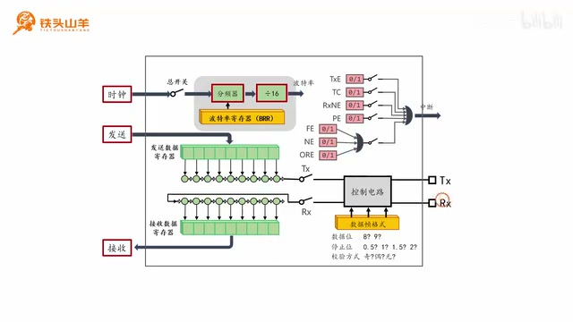

_USART 接收路径：RX 引脚、移位寄存器和接收数据寄存器。 ·_ [_原片 01:09_](https://www.bilibili.com/video/BV11X4y1j7si/?p=15\&t=69)

我们用一个简单例子描述数据接收过程。比如要通过 USART 模块接收五个字节，对端就发来五个字节。对端先发第一个数据，这个数据进入 USART 模块，在移位寄存器里一位一位地接收；等所有比特位接收完成，就移入接收数据寄存器。随后对端开始发送第二个字节。在第二个字节接收过程中，编程者看到接收数据寄存器里已经有数据，就把第一个字节读出来，这样就接收到了第一个字节。

接着第二个字节被接收并移入接收数据寄存器，对端又发来第三个字节。编程者看到寄存器里有数据了，就把第二个字节读出来。然后第三个字节一位一位地被接收，接收完成后存到这个位置。再发第四个字节时，我们又观察到接收数据寄存器里有数据，于是也把它读出来。依次执行这个过程，直到所有数据都接收完成；最后把第五个字节读出来，接收过程就完成了。

## 第二部分：RXNE 标志位

刚才我们简单回顾了使用串口接收数据的过程。下面学习一个新的标志位 RXNE。看框图右上角，很多粉红色的零和一就是标志位，反映 USART 模块当前的工作状态。之前学过 TXE 和 TC 标志位，它们跟数据发送有关；今天学 RXNE，它跟数据接收有关。

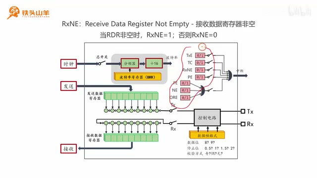

_USART 状态标志位示意，讲解转到 RXNE 接收状态。 ·_ [_原片 03:18_](https://www.bilibili.com/video/BV11X4y1j7si/?p=15\&t=198)

RXNE 是 Receive Data Register Not Empty 的缩写。Receive 是接收，Data 是数据，Register 是寄存器，连起来就是接收数据寄存器，也就是下面的这个寄存器。刚才读数据时，就是从接收数据寄存器里把数据读出来。后面的 NE 是 Not Empty：Not 是“非”，Empty 是“空”，合起来就是接收数据寄存器非空，也就是寄存器里有数据。

所以，当接收数据寄存器里有数据时，RXNE 标志位等于 1；如果里面没有数据，RXNE 就等于 0。我们可以通过这个标志位判断接收数据寄存器里有没有数据。只有里面有数据，也就是 RXNE 等于 1 的时候，编程者才可以把数据读出来。

## 第三部分：编写接收代码

学习完 RXNE 标志位，就开始编写数据接收代码。先认识一个新的编程接口：USART\_ReceiveData。USART 是串口的名称，Receive 是接收，Data 是数据，连起来就是从串口接收数据。它实际的作用是从接收数据寄存器里把接收到的数据读出来，也就是从这个寄存器读出数据。当然，读数据之前必须判断里面有没有数据；如果没有数据就去读，肯定不可以。

这个接口有一个参数，叫 USARTx，和之前一样，用来填写串口名称，这里不多讲。它还有一个返回值，类型是无符号 16 位整型，用来返回从接收数据寄存器读出的数据。串口传输的数据一般是一个字节，为什么返回值是 16 位整型？原因是串口数据帧格式是 1 位起始位，加 8 到 9 位数据位，再加停止位。数据位可能是 8 位，也可能是 9 位。

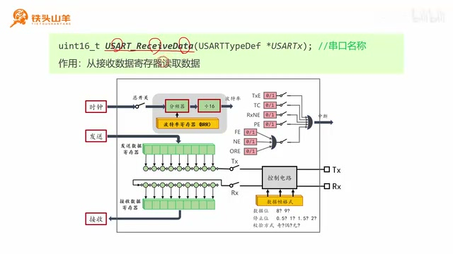

_USART\_ReceiveData 接口说明及其读取接收数据寄存器的作用。 ·_ [_原片 05:02_](https://www.bilibili.com/video/BV11X4y1j7si/?p=15\&t=302)

如果使用 9 位数据位并且不带校验，每次传输的数据就是 9 个比特位，比一个字节多。因此，如果返回的是无符号 8 位整型，9 个比特位就装不下，所以这里用无符号 16 位整型。

下面看使用串口接收数据的实际代码，总共分三步。第一步，等待接收数据寄存器非空，也就是等待 RXNE 标志位从 0 变成 1。为什么要等待寄存器非空？只有寄存器里面有数据时才能把它读出来；如果没有数据，读出的值肯定不对。可以使用 while 循环，像之前一样调用 USART\_GetFlagStatus，不断查询 RXNE 标志位的值。当它等于 RESET 时，while 循环就一直执行；当这个值从 RESET 变成 SET，也就是从 0 变成 1，循环条件为假，就退出了。这样就等到了接收数据寄存器非空。

第二步，寄存器里已经有数据，于是调用 USART\_ReceiveData，把数据读出来，保存在 byteReceived 变量里。第三步，对接收到的数据进行处理。具体怎么处理由不同应用决定，需要怎样处理，就在下面写相应代码。

## 第四部分：串口控制板载 LED

现在我们已经知道怎么从串口接收数据。下面进入第四部分，做一个小实验：通过串口控制板载 LED。实验效果是用电脑上的串口调试助手向单片机发送命令：发送字符“0”，板载 LED 熄灭；发送字符“1”，板载 LED 点亮。

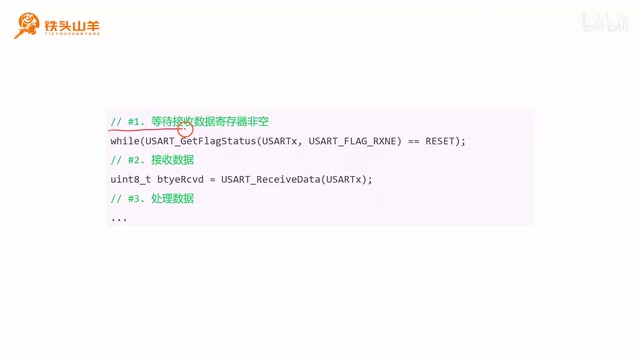

_接收流程的第一步：轮询 RXNE，等待接收数据寄存器非空。 ·_ [_原片 06:30_](https://www.bilibili.com/video/BV11X4y1j7si/?p=15\&t=390)

先拿出上期视频编写的代码。因为本期测试串口接收功能，我们把工程改名为 UART RX Test。打开文件夹，把里面的工程文件也重新命名为 USART RX Test，然后打开工程。上期视频里写了一些测试代码，本期用不到，就把多余代码删除。打开 USER 文件夹里的 main.c，只保留串口初始化相关代码，把其余代码删掉。删完之后，只保留串口初始化的声明和实现，在 main 函数里调用串口初始化，然后留一个 while 循环即可。

因为本期要使用板载 LED，使用前必须初始化它对应的 IO 引脚。板载 LED 连接的是单片机 PC13，丝印上写着 PC13。这个引脚应该设为输出开漏模式，因为灯采用开漏接法。下面编写板载 LED 初始化代码：先声明一个方法 `void My_OnBoard_LED_Init`。On Board 就是板载，这个方法的作用就是初始化板载 LED。

接着实现这个方法，把函数原型复制到下面的位置。文件最后一行要留一个空行，否则编译时会报警告。现在初始化 PC13 引脚：先声明一个结构体，然后开启 GPIOC 的时钟，因为端口号是 GPIOC。时钟打开后，再给变量参数赋值：引脚是 GPIO\_Pin\_13，模式选输出开漏模式。刚才说过这是输出开漏模式，OD 是 Open Drain，也就是开漏。

再设置最大输出速度。这个灯不用选太高，选 2 MHz 就可以；选得很高其实关系也不大，不过最好选择合适的速度。初始化完 IO 引脚后，给引脚赋一个初值，让 LED 熄灭：写 0 是点亮，写 1 是熄灭，所以这里写 1。这样板载 LED 的初始化就完成了。把这个函数放在上面调用。

下面再看具体代码。刚才分析过，串口接收数据分三步：第一步等待接收数据寄存器非空，也就是 RXNE 变成 1；第二步把数据读出来；第三步处理数据。

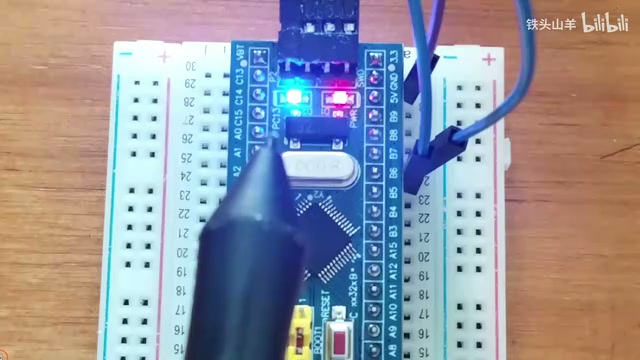

_开发板上的板载 LED 与 PC13 引脚位置，口述说明 LED 连接到 PC13。 ·_ [_原片 09:45_](https://www.bilibili.com/video/BV11X4y1j7si/?p=15\&t=585)

先看怎么等待接收数据寄存器非空。使用 while 循环，通过 USART\_GetFlagStatus 不断读取 RXNE 的值。当它等于 RESET 时，条件成立，while 循环会一直循环，直到它从 0 变成 1，也就是从 RESET 变成 SET，条件不成立，循环退出。循环退出就证明接收数据寄存器里有值了。然后用 USART\_ReceiveData 把数据读出来，第一个参数是串口名称，再把读到的数据保存到 byteReceived 变量里。第三步处理数据：判断得到的数据是不是字符“0”；如果是，就熄灭 LED，也就是给 PC13 写 1。如果是字符“1”，就点亮 LED，给 PC13 写 0。

这里更正一个地方：刚才删代码时删错了。本来应该保留的是 `My_USART1_Init`，也就是初始化 USART1 的代码；现在保留的却是发送多个字节的代码，这段用不到，把它删掉，再把串口初始化代码粘回来。

下面开始编程。首先在 while 循环里调用 `USART_GetFlagStatus` 查询 RXNE 标志位。当它从 RESET 变成 SET，就表示接收数据寄存器里有值了。第二步，把数据从接收数据寄存器读出来，保存在 byteReceived 变量里。

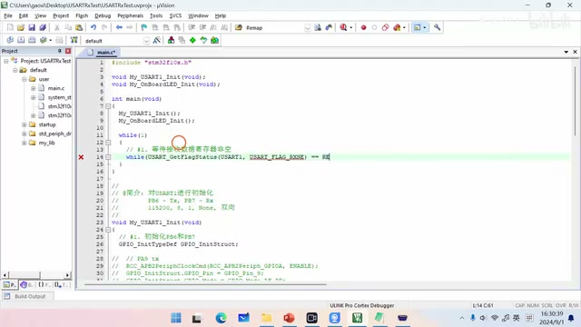

_接收循环的代码：轮询 RXNE 并把接收数据保存到变量。 ·_ [_原片 13:49_](https://www.bilibili.com/video/BV11X4y1j7si/?p=15\&t=829)

这个编程接口是 `USART_ReceiveData`，第一个参数填 USART1。第三步是处理数据，方式很简单：先用 if 判断接收的数据是不是字符“0”，如果是，就灭灯；否则再判断是不是字符“1”，如果是，就亮灯。如果既不是字符“0”也不是字符“1”，就不需要做任何处理。

亮灯、灭灯的代码是 `GPIO_WriteBit(GPIOC, GPIO_Pin_13, Bit_SET)`：写 1 是灭灯。亮灯代码就是把同一个引脚写成 `Bit_RESET`，也就是写 0。加上注释，这段代码就写完了。

现在测试代码。先按左上角第二个按钮编译，没有错误，也没有警告。然后把代码下载到单片机里，这里报错了，因为调试器没设置。刚才给工程改了名，所以调试器配置不对了。点魔术棒按钮，找到 Debug 选项卡，在框里选择 ST-Link Debugger，也就是 ST-Link 调试器，点击 OK，再次下载就可以了。

现在测试代码：先按单片机的复位按钮，然后在串口调试助手里先发送字符“0”，这时 LED 是熄灭的；再发送字符“1”。发送字符时，发送设置一定要选择 ASCII。

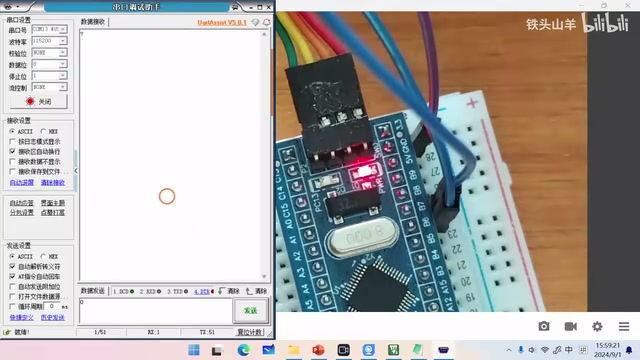

_串口调试助手与连接到开发板的硬件，用来发送字符测试 LED。 ·_ [_原片 15:57_](https://www.bilibili.com/video/BV11X4y1j7si/?p=15\&t=957)

发送字符“1”时，板载 LED 点亮；发“0”熄灭，发“1”点亮，这样实验就成功了。

## 第五部分：串口错误标志位

做完实验之后，再补充一些和串口错误标志位有关的知识。简单理解就可以，不需要掌握。框图右上角有很多标志位，我们已经学过 TXE、TC 和 RXNE。剩下的几个标志位 PE、FE、NE 和 ORE，后面都带 E，是 Error（错误）的意思，它们是错误标志位。下面逐个看用法。

先看 PE，是 Parity Error 的缩写，Parity 代表奇偶，Error 是错误，所以这个标志位表示奇偶校验错误。什么是奇偶校验？简单回顾一下：串口数据帧由起始位、停止位和中间的数据位组成，数据位的最后一位可以拿出来作为校验位。

比如发送数据 85，采用奇校验。发送方检查数据位里 1 的个数，1、2、3、4，正好有四个 1。奇校验要求有奇数个 1，所以就在后面补一个 1，这样就变成五个 1，是奇数个，再把数据发给接收方。假设传输中有一个比特位出错，由 1 变成 0。接收方接收时检查数据位中 1 的个数；奇校验要求奇数个，但现在只有四个 1，是偶数个，于是接收方知道数据传错了，发生了奇偶校验错误。此时接收方的 PE 标志位从 0 变成 1，表示奇偶校验出错。

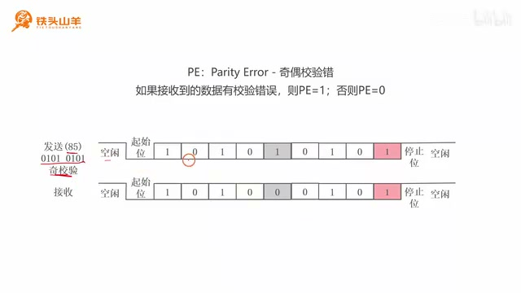

_奇校验示例：数据位中原有四个 1，发送端补 1 后成为奇数个。 ·_ [_原片 17:22_](https://www.bilibili.com/video/BV11X4y1j7si/?p=15\&t=1042)

第二个错误标志位是 FE，是 Frame Error 的缩写，Frame 是帧，Error 是错误，合起来就是帧格式错误。什么是帧格式错误？看这张串口数据帧图，假设使用 8 位数据位加 1 位停止位。这里是起始位，后面应该有 8 位数据位，紧跟着数据位后面应该有一位高电压，表示停止位。

假设发送方发来一段杂乱波形。这里可以认为是起始位，后面跟着数据，看起来也没问题；但是在应该检测到停止位的地方没有高电压。接收方就知道这个数据帧格式肯定有问题，这叫帧格式错误。发生帧格式错误时，我们没有接收到有效的数据帧，接收方的 FE 标志位就从 0 变成 1，指示帧格式错误发生了。

第三个错误标志位是 NE，是 Noise Error 的缩写，Noise 代表噪声，所以合起来是噪声错误。看图：接收方收数据时，实际上会对每一位进行多次采样。比如进行三次采样，三次都是高电压，才认为是 1；三次都是低电压，才认为是 0。

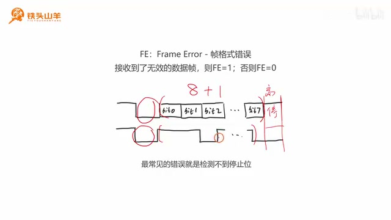

_帧格式错误示意：在停止位位置没有检测到高电平。 ·_ [_原片 18:58_](https://www.bilibili.com/video/BV11X4y1j7si/?p=15\&t=1138)

但是如果两次采样到低电压，一次采样到高电压，到底是 0 还是 1？其实既不是 0，也不是 1，这是因为噪声干扰造成接收错误，所以认为这是无效数据，既非 0 也非 1，这就是噪声错误。遇到这种情况时，接收方会把 NE 标志位从 0 变成 1，告诉编程者接收到的数据不可靠，因为有噪声干扰。

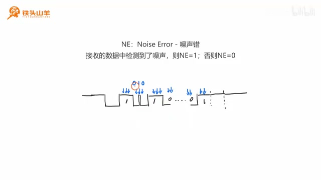

_噪声错误示意：同一位的多次采样结果不一致。 ·_ [_原片 19:45_](https://www.bilibili.com/video/BV11X4y1j7si/?p=15\&t=1185)

最后一个错误是 ORE。ORE 是 Overrun Error 的缩写，Overrun 代表过载，Error 代表错误，合起来就是过载错误。下面用简单例子解释：比如通过串口接收数据，对端发来三个字节。它先发第一个字节，第一个字节进入移位寄存器，再进入接收数据寄存器。然后对端发第二个字节，这时我们先不把第一个字节读出来，让它留在接收数据寄存器里。

对端再发来第二个字节，第二个字节进入移位寄存器。当第二个字节接收完后，它不会移动到接收数据寄存器里，因为那个寄存器现在有数据，所以第二个字节会一直留在移位寄存器里。然后再接第三个字节。第三个字节进来时就发生问题了：第三个字节把第二个字节覆盖掉，第二个字节丢失了。因为对端发送数据的速度比我们接收数据的速度快，我们读得太慢，导致中间的字节丢失。这种错误就叫过载错误。

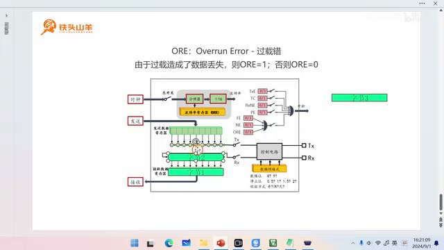

_ORE 过载示意：接收寄存器未及时读取时，中间字节会丢失。 ·_ [_原片 21:01_](https://www.bilibili.com/video/BV11X4y1j7si/?p=15\&t=1261)

好的，到这里第三章第六节就讲完了。感谢大家收看，我是铁头山羊，让我们下期视频再见。
