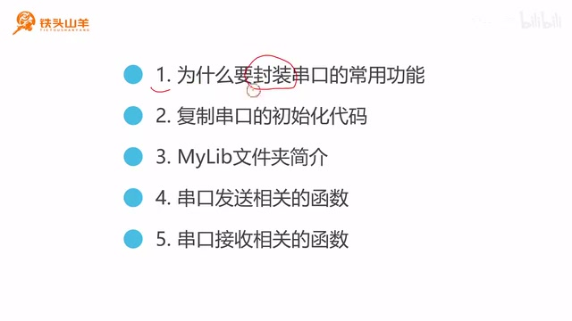
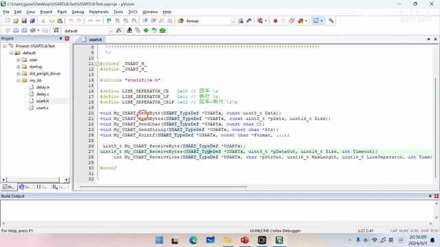
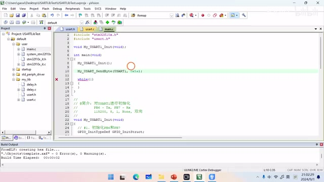
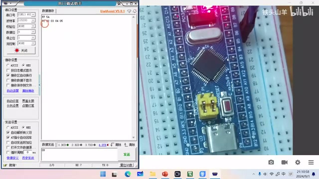
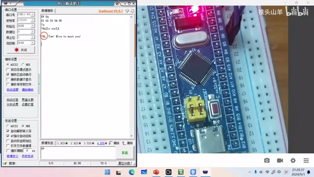
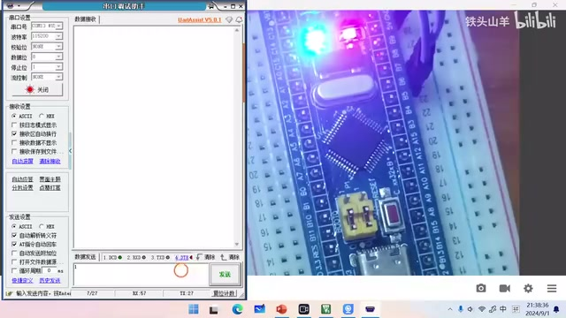
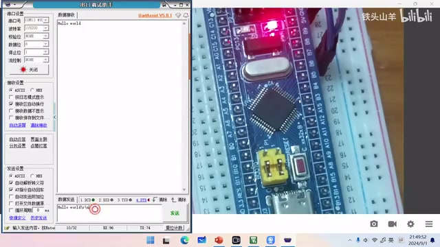

# P016 · 3.7 （串口）封装常用功能

各位同学大家好，我是铁头山羊。今天我们学习第三章的第七节，讲怎样把之前写过的串口数据发送和接收代码封装成库函数，方便以后调用。

## 本节安排

本期分成五部分：为什么要封装过去的代码；为新工程做准备，把串口初始化代码复制过去；介绍 MyLib 文件夹；以及串口发送、串口接收接口的用法。

## 为什么要封装

先看为什么要封装。回顾之前的代码，如果要通过串口发送数据，我们得查询 TXE 标志，再查询 TC 标志，还要把数据写入发送数据寄存器。要用 `printf` 格式化打印字符串，还得在下面重写 `fputc`。接收数据也一样，需要查标志位、操作寄存器。这些步骤很繁琐，而且会重复，所以不如把重复代码分别封装成函数；用到时直接调用，就能大大简化编程过程。

_本节课将依次讲封装原因、复制初始化代码、MyLib 文件夹、发送接口和接收接口。 ·_ [_原片 00:24_](https://www.bilibili.com/video/BV11X4y1j7si/?p=16\&t=24)

## 为新工程复制串口初始化代码

了解封装的原因后，开始为新工程做准备。登录百度网盘，在课程资料根目录找到模板工程并下载。下载完成后得到压缩包，把它解压到当前文件夹。给解压出的模板工程重新命名为 `Uslib Test`，也就是 UA 库测试工程；里面的工程文件也改成同名 `Uslib Test`，然后打开这个工程。

还要打开上期视频的 `printf Test` 工程。进入它的 `Default/User` 文件夹，打开 `main.c`。上期写的 `My_USART_Init` 就是串口初始化代码，把这段代码整体复制到新工程的 `main.c`。再把函数原型也复制出来，粘贴到 `main` 方法前面，并在 `main` 方法里调用串口初始化。这样复制就完成了。之后可以关闭之前的工程，只保留新工程。

## MyLib 文件夹的作用

新工程里有一个 MyLib 文件夹，接下来简单介绍它。打开新工程目录，可以看到 `MyLib`。顾名思义，这里放我们自己写的库。课程里会写各种代码，有些以后会重复用到，比如本章的串口代码；不想每次从头一点点重写，就把它封装在库里。

本章封装了两个文件：`USART.h` 是头文件，`USART.c` 是源文件。以后要用串口相关代码，引用头文件就可以使用其中的函数。在工程左边的导航栏里也能找到 `MyLib` 文件夹。打开后可以看到这次封装的头文件和源文件；双击打开头文件，里面列着已经封装好的编程接口。上面的是数据发送相关接口，下面的是数据接收相关接口。用这些接口会方便很多，也能节省时间。

## 串口发送接口总览

下面进入第四部分，介绍串口数据发送函数。库里一共有五个发送接口，我们逐一看用法：

_头文件中把串口发送接口列在上方、接收接口列在下方。 ·_ [_原片 05:13_](https://www.bilibili.com/video/BV11X4y1j7si/?p=16\&t=313)

## 发送一个字节

第一个接口叫 `My_USART_SendByte`。`Send` 是发送，`Byte` 是字节，顾名思义，它通过串口发送一个字节，比如 `0x01` 或 `0x02` 这样的数值。单个字节就用这个接口发送。

第二个接口是 `My_USART_SendBytes`，比前一个名字多了复数的 `s`，表示一次可以发送多个字节。比如发送一个字节数组，就用这个接口。

第三个接口叫 `My_USART_SendChar`。`Char` 是 character 的缩写，代表字符，所以它用来发送字符，比如字母 A、B、C。第四个是 `My_USART_SendString`，用来发送字符串，比如 `Hello World`。最后一个接口是 `My_USART_Printf`，用来发送格式化字符串；有了它，就不用自己重写 `fputc` 函数。

下面动手测试这些代码。硬件电路和前几期视频一样，直接沿用之前的电路，把 ST-Link 和 USB 转 TTL 模块都插到电脑上。

先测 `My_USART_SendByte`，也就是一次发送一个字节。回到代码，先编译工程（按左上角第二个按钮）。双击打开 `USART.h`，找到要测试的接口，把鼠标放到接口名上按 F12，跳到函数源码。上面的注释说明接口的作用是通过串口发送一个字节，有两个参数：第一个填串口名称，比如 USART1、USART2 或 USART3；本例使用 USART1。第二个参数是 `data`，类型是一个字节，要发送什么字节就填什么。

打开 `User/main.c`，找到 `main` 方法，在串口初始化下面写调用。因为要用 `USART.h` 里的函数，先在文件上方 `#include "USART.h"`，然后再调用 `My_USART_SendByte`。

随便发送一个字节，比如 `0x5A`。这句代码写好，`0x5A` 就会发出去，比之前简单很多。按左上角的编译按钮，编译没有错误也没有警告；接着点下载按钮，把代码下载到单片机。这里弹出错误，是因为还要设置调试器：点魔术棒，打开 Debug，选择 ST-Link Debug，也就是 ST-Link 调试器，确定后再次下载。

打开串口调试助手，简单设置串口号、波特率、校验位、数据位、停止位和硬件流控，这些保持默认即可，然后点“打开”。接收显示选择 HEX，因为收到的是一个字节，希望按字节显示。按一下单片机复位键，可以看到出现 `0x5A`。前面的 `0xFF` 不用管，那是单片机启动时发出的；由刚才那行代码发出的就是 `0x5A`。

_在 main.c 中调用 My\_USART\_SendByte，通过 USART1 发送 0x5A。 ·_ [_原片 09:00_](https://www.bilibili.com/video/BV11X4y1j7si/?p=16\&t=540)

## 一次发送多个字节

再测第二个接口 `My_USART_SendBytes`，一次通过串口发送多个字节。仍在 `USART.h` 找到接口名，按 F12 跳到源码，注释说明它可以一次发送多个字节，共有三个参数：第一个是串口名称，这里不再展开；第二个叫 `pData`，是要发送的数据，因为可以发送多个字节，所以它是数组；第三个 `size` 表示要发送的数据数量，单位是字节，数组有几个字节这里就填几。

回到 `main.c`，把刚才发送单字节的代码注释掉，另写一行。声明一个数组，名字比如 `buffer`，成员填 `1、2、3、4、5`，再调用 `My_USART_SendBytes`：第一个参数填 USART1，第二个填数组名，第三个填数量 5。编译没有错误、没有警告后，把代码下载到单片机。按复位键，左边就能看到 `1 2 3 4 5`，这就是发出的五个字节。

_串口调试助手显示发送的五个字节 1、2、3、4、5。 ·_ [_原片 11:58_](https://www.bilibili.com/video/BV11X4y1j7si/?p=16\&t=718)

## 发送一个字符

第三个接口是 `My_USART_SendChar`，就是发送字符。比如发送字母 ABC，可以用它。把前面两行测试代码注释掉，另写一行：调用 `My_USART_SendChar`，第一个参数填串口名，第二个参数填要发送的字母。这里发送小写字母 `a`。编译，再下载到单片机。

在串口调试助手的接收设置里，把显示模式改成 ASCII，也就是字符模式。按单片机复位键后，会输出小写字母 `a`，这就是预期结果。

## 发送字符串

第四个接口叫 `My_USART_SendString`，作用是通过串口发送字符串。先把刚才那行代码注释掉，再调用这个函数。第一个参数仍填 USART1，第二个参数填要发送的字符串，比如 `Hello World`，最后再加上 `\r\n`。字符串就这样准备好了。按编译按钮编译，再把代码下载到单片机。按复位键，可以看到输出一行 `Hello World`，后面带了回车换行。

## 发送格式化字符串

最后一个发送接口叫 `My_USART_Printf`，用来格式化发送字符串。有了它，就不用一遍遍重写 `fputc`，用起来很方便。把上一行代码注释掉，另写 `My_USART_Printf`。它的用法和 C 语言里的 `printf` 一样，只是在前面多写串口名称。

比如写一个打招呼的程序：先声明一个变量保存人的名字，例如 `Tom`。用 `printf` 格式化打印 `Hi, %s! Nice to meet you!`，这里不要直接写 Tom，而是用 `%s` 作占位符；后面再跟 `\r\n`，并把 `strName` 这个变量作为对应参数传进去。通过这一行，就可以打印“Hi, Tom! Nice to meet you!”。

编译并下载代码，按单片机复位键，屏幕上就打印出了格式化字符串：“Hi, Tom! Nice to meet you!”。这样，串口数据发送相关的接口就都测试完了。

_串口调试助手显示格式化输出的问候语。 ·_ [_原片 15:08_](https://www.bilibili.com/video/BV11X4y1j7si/?p=16\&t=908)

## 串口接收接口总览

刚才测完了所有和串口数据发送有关的接口，下面进入第五部分，看串口数据接收接口。一共有三个：`My_USART_ReceiveByte`、`My_USART_ReceiveBytes` 和 `My_USART_ReceiveLine`。`Receive` 是接收，`Byte` 代表字节，所以第一个接口接收一个字节；`Bytes` 表示多个字节，第二个接口接收多个字节；`Line` 代表一行，第三个接口接收一行字符串。

先看第一个接口，用它接收一个字节。打开 `main.c`，找到 `My_USART_ReceiveByte`。可以看到它只有一个参数，就是串口名称；它有一个返回值，返回读到的那个字节。因此这个接口的用法很简单。

## 接收单字节控制板载 LED

现在用这个接口复现通过串口控制板载 LED 的例子。先把所有与串口发送有关的代码注释掉，然后调用接收接口读取一个字节；根据字节内容决定点亮还是熄灭板载 LED：0 熄灭，1 点亮。要熄灭 LED，就对 PC13 写 `GPIO_ResetBits`；要点亮则写 `GPIO_SetBits`。

因为用到了 PC13，还要初始化这个引脚。开启 GPIOC 的 RCC 时钟，选择 GPIOC，填写参数并设置模式。这里使用输出推挽模式还是输出开漏模式，画面/语音有识别不清之处；随后调用 `GPIO_Init` 完成初始化。代码写完后编译、下载，先检查运行现象：刚才看灯没有亮，于是找到原因——少写了一行代码，没有指定 GPIO 的最大输出速度。把这个最大输出速度填上，再次编译并下载。

按单片机复位键，在串口调试助手里把发送设置改成 ASCII 格式，选择左边的输入位置。先发送 `0`，LED 熄灭；再发送 `1`，LED 点亮。效果和上期视频的一样。

_串口发送设置为 ASCII 后输入 0、1，分别熄灭和点亮板载 LED。 ·_ [_原片 18:55_](https://www.bilibili.com/video/BV11X4y1j7si/?p=16\&t=1135)

## 接收一行字符串：接口参数

再看第二个接口。一次性读取多个字节的接口不常用，时间关系这次先不测试，直接测最后一个接口：一次性读取一行字符串。打开 `USART.h`，找到 `My_USART_ReceiveLine`，按 F12 进入源码，查看注释。它一共有五个参数，逐一看：第一个填串口名称，这个不再多讲；第二个是输出参数，把读到的字符串保存到给定数组；第三个填数组最大长度。如果要接收的字符串比数组还长，就不接收；第四个是 `line separator`，用来选择行分隔符，可以选回车、换行，或者换行加回车。

第五个参数是 `timeout`，填写超时时间，单位是毫秒。比如填 100，就是 100 ms；调用接口读一行字符串时，如果超过 100 ms，就不再读，直接返回 1 表示超时。若成功读到一行字符串，则返回 0 表示成功。

下面编写一个小程序：通过串口调试助手向单片机发送一行字符串，末尾用 `\r\n`，单片机再把它返回来。把刚才写的代码都注释掉，在 `while` 循环中写新代码。先声明一个数组 `buffer` 用来保存收到的一行字符串，长度随意指定，例如 100，写 60 也可以。

调用 `My_USART_ReceiveLine` 接收一行字符串：第一个参数填串口名；第二个参数填接收缓冲区；第三个填缓冲区长度 100；第四个填行分隔符，这里用 `\r\n`，也就是 CRLF；第五个参数填 1，表示超时时间无限大。若函数调用成功，会返回 0。收到字符串后，再调用前面学过的 `My_USART_SendString` 把字符串发回去。

这样代码就写完了。编译一下。用了这些编程接口后，代码写得很简短。然后把代码下载到单片机，测试程序效果：按单片机复位键，在串口调试助手中把接收设置和发送设置都选成 ASCII。

发送一行 `Hello World\r\n`，可以看到这里返回 `Hello World`；再发送 `123\r\n`，这里出现 `123`。如果只发 `123`、不加 `\r\n`，就没有返回结果；再补上 `\r\n`，它就把这之前的 `123` 返回来。

_串口调试助手显示单片机返回的 Hello World 行。 ·_ [_原片 22:41_](https://www.bilibili.com/video/BV11X4y1j7si/?p=16\&t=1361)

## 结束

以上就是本期视频的全部内容，感谢大家收看。我是铁头山羊，我们下期视频再见。
