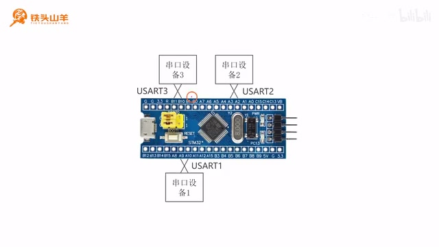
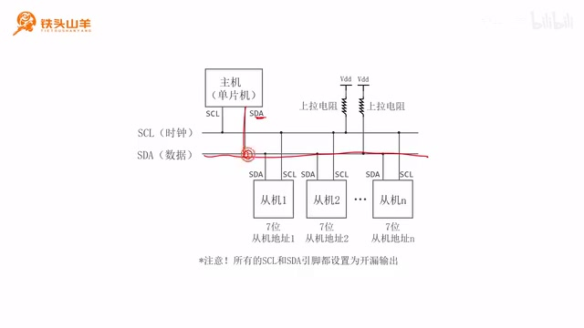
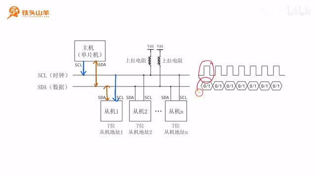
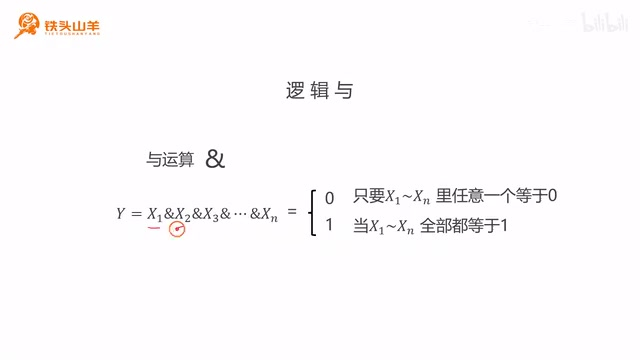
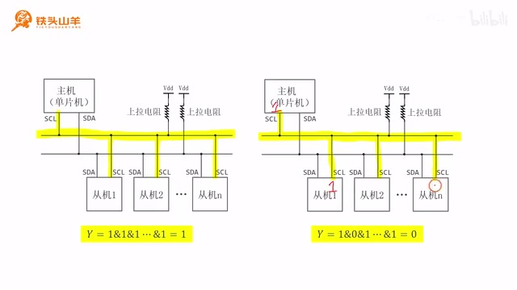
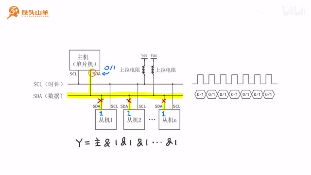
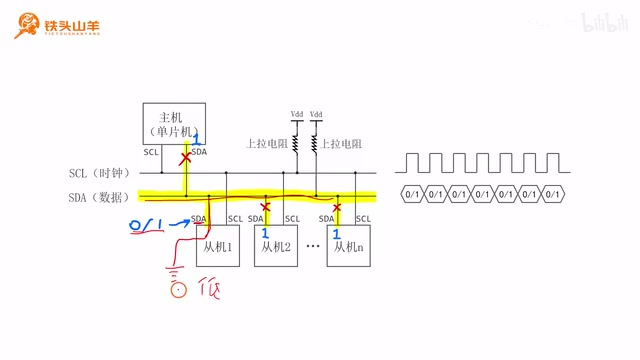

# P017 · 4.1 （I2C）基本电路结构

各位同学大家好，我是铁头山羊。从今天开始我们学习第四章。上一章我们学习了串口这种通信接口，本章要学习一种新的通信接口，也就是 I²C 总线。本节先来看 I²C 总线的基本电路结构。本套视频需要的材料都包含在开发套件包里，大家可以扫描屏幕上的二维码，进入淘宝店铺购买。购买套件后可以获得课程的课件和源码，也可以加入答疑群，直接和 UP 主交流。

本期视频分成七个部分：先讲串口的缺点；再介绍 I²C 总体电路结构；接着讲时钟线和数据线的作用；第四部分讲逻辑线与；最后三部分分别讲主机如何发送时钟、主机如何发送数据，以及从机如何发送数据。下面从第一部分开始。

## 串口通信的缺点

上一章我们学习了串口这种通信接口。串口由 TX 和 RX 两个引脚组成，通信双方用一对交叉的导线，把一方的 TX 接到另一方的 RX、另一方的 TX 接到这一方的 RX，这样两个设备就可以双向通信。

这种接口的缺点是只能一对一通信，也就是说，一个串口只能连接一个串口设备。以我们使用的单片机为例，它有三个串口，分别是 UART1、UART2 和 UART3，因此最多只能连接三个串口设备。

_开发板上的 UART1、UART2、UART3 标注，说明示例单片机有三个串口。 ·_ [_原片 02:00_](https://www.bilibili.com/video/BV11X4y1j7si/?p=17\&t=120)

如果还想连接更多设备怎么办？这样就没办法了，所以我们需要寻找另一种通信接口：最好只用一个接口，就能连接很多设备。有没有这样的接口呢？有，就是今天要学习的 I²C 总线。通过 I²C 总线连接的设备数量几乎不受限制。

## I²C 总线的基本电路结构

下面来看 I²C 总线的基本电路图。I²C 总线主要由两根线组成：上面这根叫 SCL，也就是串行时钟线；下面这根叫 SDA，也就是串行数据线。

对于 I²C 总线来说，只有一个主机，一般由单片机担任主机，其他连接到总线上的设备作为从机。每个设备都有 SCL 和 SDA 两个引脚。把所有设备的 SCL 都接到中间的 SCL 总线上，再把所有设备的 SDA 都接到中间的 SDA 总线上，最后分别给 SCL 和 SDA 加一个上拉电阻，这就组成了 I²C 总线最基本的电路结构。

_主机和多个从机共享 SCL、SDA 两条总线，线上各接上拉电阻。 ·_ [_原片 03:22_](https://www.bilibili.com/video/BV11X4y1j7si/?p=17\&t=202)

每个从机都有一个七位地址，范围从 7 个 0 到 7 个 1。7 个 0 是 0，7 个 1 是十进制的 127，所以一共有 128 个地址。扣除一些特殊地址，也还有 100 多个可用地址。因此 I²C 总线最多能够同时和 100 多个设备通信。

通信时，主机想向从机 1 发送数据，就先发送从机 1 的地址；发送地址后，主机就和从机 1 建立通信，然后可以向它发送数据。发送完后，如果主机想从从机 2 读取数据，就发送从机 2 的地址，与从机 2 建立通信，再从它读取数据。重复这个步骤，就是 I²C 总线通信的基本原理。

## 时钟线和数据线的作用

刚才电路结构里提到了 SCL 和 SDA：SCL 代表时钟线，SDA 代表数据线。顾名思义，时钟线用来传输时钟，数据线用来传输数据。

图中上面的是时钟信号，总是由主机，也就是单片机发送给从机；下面的是数据信号，通信方向可以是双向的，既可以由主机发给从机，也可以由从机发给主机。时钟信号是一系列高低变化的电压。每一个时钟周期，数据线上会传输一位数据，所以时钟频率控制数据传输的快慢。数据线上传输的是有效数据：低电压表示 0，高电压表示 1。这就是时钟线和数据线的作用。

_示意图中时钟线由主机发出，数据线在两类设备间传输，电平表示数据位。 ·_ [_原片 05:40_](https://www.bilibili.com/video/BV11X4y1j7si/?p=17\&t=340)

## 开漏输出与逻辑线与

接下来学习逻辑线与。观察 I²C 电路图，SCL 和 SDA 分别接有上拉电阻，图中还提醒我们，总线上所有设备的 SCL 和 SDA 引脚都应该设置为开漏输出。

简单回顾一下：单片机或其他设备通过一对 MOS 管驱动 IO 引脚，输出高低电压。开漏模式下，上面的 MOS 管一直断开，只控制下面的 MOS 管。写 0 时，下面的 MOS 管闭合，输出低电压；写 1 时，下面的 MOS 管也断开，输出的就是高阻抗。

I²C 总线这样连接，是为了实现逻辑线与。所谓逻辑线与，就是用硬件电路实现逻辑与运算。逻辑与可以写作 Y = S1 & S2 & S3 & … & Sn：只有当 S1 到 Sn 全部等于 1 时，结果才是 1；只要其中任何一个是 0，结果就是 0。比如三个数都为 1，结果为 1；三个数里只要有一个为 0，结果就是 0。这就是逻辑与运算，而逻辑线与就是用硬件电路实现这个运算。

_逻辑与的规则：所有输入均为 1 时结果为 1，任一输入为 0 时结果为 0。 ·_ [_原片 07:30_](https://www.bilibili.com/video/BV11X4y1j7si/?p=17\&t=450)

它的关键是上拉电阻和开漏输出。SCL、SDA 两条线的原理相同，这里只分析 SCL。把所有 SCL 引脚都设置为开漏输出，并全部写 1 时，所有引脚都呈高阻抗，相当于从电路中断开，中间的线就悬空了。上拉电阻会把悬空的导线拉到高电压，因此输出为 1。这对应了所有 S1 到 Sn 都为 1 时，输出为 1。

再看第二种情况：所有引脚都写 1，只有其中一个引脚（图中从机 2）写 0。写 1 的引脚仍然断开；写 0 的引脚输出低电压，相当于接地，于是中间的线通过这个引脚接地。上拉电阻不起作用，输出低电压，也就是 0。这对应了 S1 到 Sn 中任意一个为 0，Y 的结果就为 0。这样就实现了逻辑线与。

_一个从机引脚写 0 并接地时，总线被拉低；写 1 的其他引脚处于断开状态。 ·_ [_原片 09:16_](https://www.bilibili.com/video/BV11X4y1j7si/?p=17\&t=556)

逻辑线与对学习 I²C 非常重要，大家要把这个电路理解透彻。下面通过三个部分来看如何通过逻辑线与往总线上发送信号。

## 主机如何发送时钟信号

第五部分讲主机如何通过逻辑线与向 I²C 总线上发送时钟信号。右边的波形就是时钟信号，它是一系列高低变化的电压。时钟只能由主机，也就是单片机产生，再发送给从机，方向是单向的。

单片机这样产生方波：先把所有从机的 SCL 引脚都设置成 1，使它们相当于从电路上断开；然后控制主机的 SCL 引脚，交替写 0 和 1。写 0 时，SCL 这条线通过引脚接地。开漏模式输出低电压，相当于接地，于是总线上输出低电压。向 SCL 写 1 时，引脚也断开，线变成悬空；由于上拉电阻的存在，线上输出高电压，对应波形中的高电平位置。

也可以用前面的公式理解：所有从机都写 1，所以它们对应的输入都是 1；主机往 SCL 写 0 时，与运算里有一个 0，结果就是 0，也就是低电压。主机写 1 时，所有输入都是 1，与运算结果就是 1，也就是高电压。因此主机通过写 0 和写 1，就能输出低电压和高电压，发送时钟信号。

## 主机如何发送数据

第六部分讲主机如何向从机发送数据。右边的波形是数据线上的信号，低电压表示 0，高电压表示 1。

主机要向从机发送数据，先让所有从机的 SDA 引脚都写 1，相当于从这条线上断开。然后控制主机的 SDA 引脚，写 0 或写 1。写 0 时，开漏模式输出低电压，SDA 线通过这个引脚接地，所以线上是低电压；写 1 时，引脚断开，SDA 线在上拉电阻作用下被拉到高电压。因此通过这种方式输出低电压和高电压，就可以表示 0 和 1。也可以用下面的公式理解，和刚才的解释一样，这里就不赘述了。

_主机控制 SDA：写 0 时将总线拉低，写 1 时释放总线并由上拉电阻拉高。 ·_ [_原片 12:30_](https://www.bilibili.com/video/BV11X4y1j7si/?p=17\&t=750)

## 从机如何发送数据

最后来看从机如何向主机发送数据。前面说过，I²C 总线的数据通信是双向的：主机既可以向从机写数据，也可以从从机读数据。主机要从从机读数据，就要先把自己的 SDA 引脚写成 1，也就是释放 SDA 线，让这个引脚断开。除了正在通信的从机之外，其他从机也都写 1，使它们的引脚从 SDA 线上断开。

此时要发送数据的从机开始向 SDA 上写 0 或写 1。写 0 时，开漏模式输出低电压，SDA 线通过这个引脚接地，线上输出低电压；写 0 就是低电压。写 1 时，这条线也断开，然后在上拉电阻作用下被拉到高电压，所以写 1 输出的就是高电压。这样，从机就能向主机发送数据。

_选中的从机驱动 SDA 发送数据，其他从机保持断开；写 0 拉低，写 1 后由上拉电阻拉高。 ·_ [_原片 13:58_](https://www.bilibili.com/video/BV11X4y1j7si/?p=17\&t=838)

好的，以上就是本期视频的全部内容。我是铁头山羊，感谢大家的收看，让我们下期视频再见。
