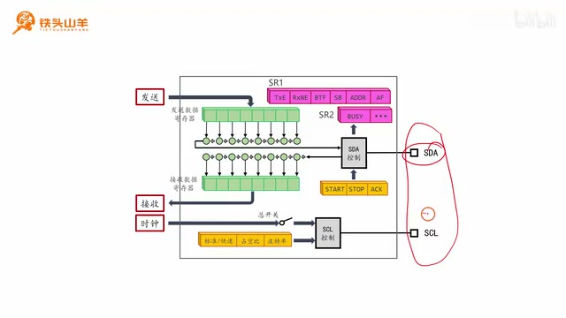
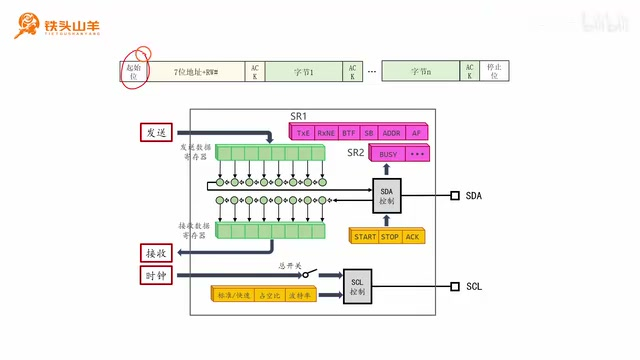
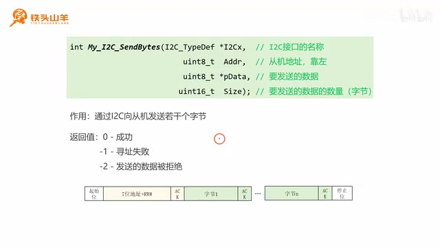
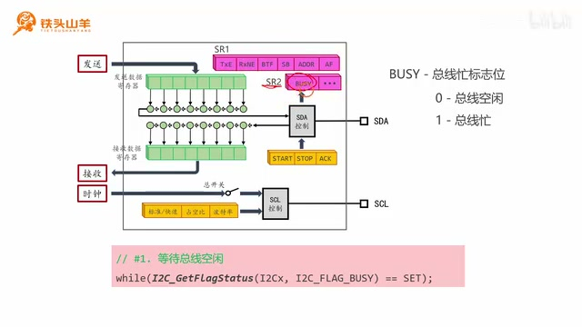
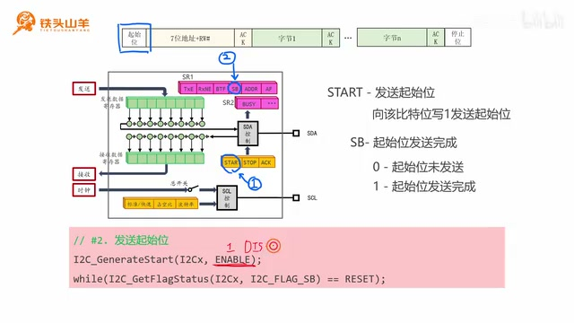
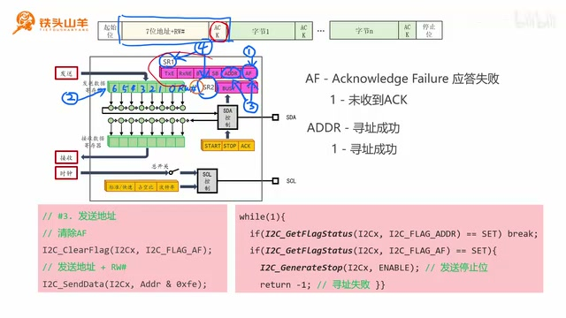
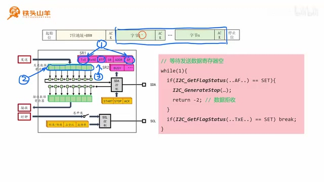
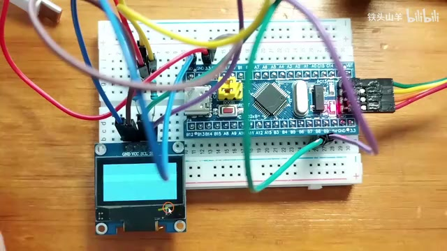

# P020 · 4.4 （I2C）写数据

各位同学大家好，我是铁头山羊。今天开始学习本章第四节，了解如何通过单片机里的 I2C 模块向从机写数据。本套视频需要的材料都包含在开发套件包里，可以扫描屏幕上的二维码进入淘宝店铺购买；购买套件后可获得课程全部课件和源码，也能加入答疑群直接交流。

本期分七部分：第一部分看 I2C 模块的内部结构图，第二部分简介数据发送过程，第三至第七部分分阶段编写 I2C 数据发送代码。先看内部结构框图。右侧有两个引脚：SDA 是数据引脚，SCL 是时钟引脚。

_I2C 内部结构框图标出了 SDA、SCL、发送与接收寄存器等组成部分。 ·_ [_原片 01:00_](https://www.bilibili.com/video/BV11X4y1j7si/?p=20\&t=60)

图中发送数据部分有发送数据寄存器和移位寄存器。先把要发送的数据写入发送数据寄存器，I2C 模块再把它移到移位寄存器，逐位经 SDA 引脚发送出去。

接收部分则反向工作：从机把波形送入后，I2C 模块解析波形，逐位放进移位寄存器，再把解析好的数据放入接收数据寄存器，编程者从中读出数据。

右上角两个粉红色寄存器分别是 SR1 和 SR2。SR 是 status register（状态寄存器）的缩写，两个寄存器里有很多标志位，反映 I2C 模块的运行状态，后面的代码会用到。中间的 SDA 控制电路控制 SDA 引脚，既能向外发送波形，也能解析收到的波形；它下面的黄色寄存器是控制寄存器，写入其中的位可以控制 I2C 模块的行为。

再下面是 SCL 控制电路，负责向外发送时钟信号。前面的配置寄存器可设置时钟波特率、标准模式 SM 或快速模式 FM，以及 2:1 或 16:9 的占空比。这些之前讲过，这里不再赘述。以上就是模块内部结构。

接着回顾数据帧格式：起始位、七位寻址阶段、数据传输阶段，最后是停止位。

_数据帧示意图展示起始位、寻址阶段、数据传输阶段和停止位。 ·_ [_原片 03:45_](https://www.bilibili.com/video/BV11X4y1j7si/?p=20\&t=225)

先看起始位。起始位由主机发送，发送后表示数据传输开始。

起始位的发送很简单：向黄色控制寄存器的 START 位写 1，I2C 模块会主动把 SDA 拉低，从而发送起始位。

寻址阶段由主机发送七位从机地址，再加 R/W 位表示方向。本节要写数据，所以 R/W 等于 0。主机发出地址后，由被寻址的从机响应；从机响应表示寻址完成。发送地址和方向位与发送普通数据相同：把七位地址 A6 到 A0 放在发送数据寄存器的前七位，最后一位放 R/W，I2C 模块便经 SDA 自动发送，之后查询标志位等待 ACK。

寻址成功后进入数据传输阶段。主机发送一个字节，从机回复 ACK；然后主机再发一个字节、从机再应答，直到数据发完。每个数据字节先写入发送数据寄存器，并通过标志位确认发送是否成功。最后发送停止位：向 STOP 位写 1，模块把 SDA 拉高，发出停止位，数据发送过程结束。

这只是发送过程的简单介绍，实际过程复杂得多，所以下面逐个阶段写代码。

## 声明多字节发送接口

第一步是等待总线空闲。请拿出上期写好的代码，打开工程，依次进入 default、user 文件夹，再打开 main.c。本期任务是通过 I2C 总线向从机写数据，因此把写数据的代码封装到 `My_I2C_SendBytes` 函数中。I2C 是总线名，send 是发送，bytes 是字节；末尾带 s 表示一次发送多个字节，这个接口的作用就是通过 I2C 一次向从机发送多个字节。

函数有几个参数。第一个参数选择 I2C 接口，使用 I2C1 就填 I2C1，使用 I2C2 就填 I2C2。第二个参数是从机地址，地址靠左对齐：一个字节有八位，但地址只有七位，把 A6 放在最左边、A0 放在第七位，最后一位留给 R/W。第三个参数 `pData` 是要发送的数据数组，第四个参数 `size` 是数据数量，例如发五个字节就填 5。老师口头说明返回值时说：返回 0 表示发送成功，1 表示寻址失败，2 表示数据发送被拒绝。屏幕上的函数说明以及后续代码却写成 -1 表示寻址失败、-2 表示数据发送被拒绝；按屏幕和代码实现时应以这两个负值为准，口述的正数与它们存在不一致。后文再提到返回 1 或 2 时，是沿用老师的口述；实际代码分别返回 -1 和 -2。

_幻灯片展示多字节发送函数的接口和参数说明。 ·_ [_原片 06:33_](https://www.bilibili.com/video/BV11X4y1j7si/?p=20\&t=393)

代码写入上期工程的 `main.c`。`My_I2C_SendBytes` 中 Send 表示发送，Bytes 表示字节并以复数表示一次发多个字节。地址参数必须左对齐：A6 放最左端，A0 放第七位，留下最低位给 R/W。若使用不同外设，就在第一个参数选 I2C1 或 I2C2；数组和 size 参数则描述要发送的内容与数量。 如果主机已经发出七位地址和 R/W，但没收到从机 ACK，就是寻址失败，返回 1。如果寻址成功后，主机发送某个数据字节而从机没有回 ACK，表示该字节被拒收，返回 2。

函数原型的返回类型是 `int`，名称为 `My_I2C_SendBytes`；第一个参数类型是 `I2C_TypeDef*`，其余参数分别是从机地址、数据数组和数据个数。把函数声明写在 main.c 中，再复制到下面开始实现。

### 等待总线空闲

进入函数后先等待总线空闲。I2C 总线不传输数据时，SDA 和 SCL 都是高电平；如果它们还不是高电平，就需要等上一次传输结束，直到两根线上都是高电平。通过 SR2 中的 BUSY 标志位判断总线是否忙：BUSY 为 1 表示总线忙，为 0 表示空闲。

声明写好之后，把它复制一份放在下面作为函数实现。返回 1 只表示寻址阶段没有 ACK；返回 2 表示已经开始发送数据，但从机拒绝了某个字节；成功才会返回 0。函数体的第一阶段不是发地址，而是先确认总线空闲。

函数原型声明用于告诉编译器函数名、返回类型和调用时需要提供的参数；下面复制的是同一个接口的实现位置。第一个参数选择外设，第二个确定目标从机，第三、第四参数一起描述要发送的数据及其数量。

若地址阶段没有 ACK，函数返回 1；数据阶段从机拒收字节时返回 2；正常完成返回 0。这些返回值让调用者区分失败发生在哪个阶段。

_代码讲解画面说明通过 BUSY 标志等待 I2C 总线空闲。 ·_ [_原片 10:03_](https://www.bilibili.com/video/BV11X4y1j7si/?p=20\&t=603) 因此用 `while` 循环持续调用 `I2C_GetFlagStatus` 查询 BUSY；当它从 SET 变为 RESET，总线空闲，继续下一步。

## 发送起始位

总线空闲后发送起始位。向控制寄存器的 START 位写 1 会让 I2C 模块发出起始位，对应接口是 `I2C_GenerateSTART`。第一个参数填 I2C 接口名称 I2Cx，第二个参数是写入值：ENABLE 表示写 1，DISABLE 表示写 0，因此这里选 ENABLE。

调用接口发出起始位后，还要等待它发送完成。SR1 的 SB 标志位用于判断起始位是否已发完：等于 0 表示未完成，等于 1 表示完成。写一个 `while` 循环，不断调用 `I2C_GetFlagStatus` 查询 `I2C_FLAG_SB`；标志由 RESET 变为 SET 后，才进入地址阶段。

BUSY 为 1 就表示当前总线仍在忙，程序留在循环中等待；BUSY 变为 0 时意味着总线空闲。老师把这个第一阶段写入刚才声明的函数中：使用 while 循环，传入 I2Cx 和 BUSY 标志调用 GetFlagStatus，不断查询，等它由 SET 变 RESET。

START 中的 generate 是产生，START 是起始位；这个接口的作用就是产生起始位。

_起始位步骤展示 START 位和 I2C\_GenerateSTART 的调用方式。 ·_ [_原片 12:00_](https://www.bilibili.com/video/BV11X4y1j7si/?p=20\&t=720) 第二步代码调用 `I2C_GenerateSTART(I2Cx, ENABLE)`，向 I2Cx 发出起始位。发出之后并不代表发送动作已经完成，所以继续查询 SB，等到由 RESET 变为 SET。起始位是数据传输的开始，完成后才能进入下一步。

## 发送地址并判断寻址结果

寻址时主机发送七位从机地址和 R/W 位。发出后，主机释放 SDA，等待从机把 SDA 拉低作为 ACK。收到 ACK 表示寻址成功；没有收到就代表寻址失败。判断结果要看 ADDR 和 AF 两个标志位。

起始位完成后，进入第五部分所说的发送地址。主机发出七位从机地址和一个 R/W 位后释放 SDA，等待从机将 SDA 拉低，这个低电平表示 ACK。程序要判断是否收到 ACK；若没有收到，就是寻址失败。这两个结果分别由 ADDR 与 AF 标志反映。

老师先说明起始位对应 START 位，向该位置 1 后模块主动把 SDA 拉低；而不是软件直接去模拟每个电平。接口参数中第一个填 I2Cx，第二个填 ENABLE。由于启动和完成是两个不同状态，调用后还需要等待 SR1 的 SB 置位。 老师把这一段称作第五部分“发送地址”，并回顾主机发送七位从机地址后要由被寻址从机作出响应；ACK 是通过 SDA 线拉低表现出来的。 接收到起始位后，主机才进入发送地址的阶段。

_代码与标志位示意图展示寻址阶段检查 ADDR、AF 并清除 AF。 ·_ [_原片 14:00_](https://www.bilibili.com/video/BV11X4y1j7si/?p=20\&t=840) AF 是 Acknowledge Failure（应答失败）的缩写，是应答失败标志；没有收到 ACK 时 AF 从 0 变为 1。ADDR 是寻址成功标志，收到 ACK 后 ADDR 从 0 变为 1。后面要检查这两个标志，但 ADDR 比较特殊，这里先只清 AF。

第一行调用 `I2C_ClearFlag`，第一个参数填 I2Cx，第二个参数填 `I2C_FLAG_AF`，预先清除寻址失败标志。接下来主机发送七位从机地址和 R/W。发送仍和普通数据一样，把地址写入发送数据寄存器：前七位写地址，最后一位写方向。由于本节是写操作，最后一位要为 0。

调用 `I2C_SendData` 将 `Addr & 0xFE` 写入发送寄存器。`0xFE` 的二进制是七个 1 后跟一个 0；地址的高七位与 1 相与后保持不变，最后一位与 0 相与后变成 0，因此这一写法保留地址并清零 R/W 位。

`Acknowledge` 是应答，`Failure` 是失败，因此 AF 就是应答失败标志。若从机没有收到/没有返回 ACK，AF 会从 0 变成 1；若 ACK 成功，ADDR 会从 0 变成 1，表示寻址成功。虽然后面两个标志都要查，老师先说明 ADDR 的清除方式特殊，这里只清 AF。

ADDR 与 AF 之后会分别用于判断应答成功和失败。ADDR 不能像 AF 一样提前清，因为清除它需要后续的特定读取顺序；所以此处只用 ClearFlag 清 AF，保留 ADDR 状态供 ACK 判断。

## 发送地址并等待 ACK

地址与方向位要通过普通的数据发送寄存器发出。`I2C_SendData` 的第一个参数是 I2C 接口，第二个参数是待发送字节。给它传入 `Addr & 0xFE`：对二进制数与 1，结果仍是原值；地址的 A6 到 A0 因而保留。与 0，结果一定是 0，所以最低位被清零。这正是把七位从机地址和写方向合成一个字节的做法。地址发出后，下一步就是等待 ACK。

向 `I2C_SendData` 写入的是一个字节：从机的七位地址和方向位。由于该字节最低位原本可能不为 0，要先与 `0xFE`。二进制中 A6、A5、A4、A3、A2、A1、A0 对应的掩码都是 1，所以这些地址位仍是自身；最后一位掩码是 0，因此无论原值为 1 还是 0，相与后都得到 0。这样明确表示写方向。

老师把掩码展开为二进制逐位说明：任意数与 1 的结果仍是原数，例如 0 与 1 得 0、1 与 1 得 1；地址高七位因此不变。最后一位与 0 后一定为 0，包括原值为 1 的情况。 这个参数的作用是对 ADDR 的最后一位清零；前七位保留从机地址，最低位用来表达读写方向。因为本次要向从机写数据，最后一位必须是 0。 送出后再进入等待从机应答的步骤。 通过 ADDR 和 AF 两个标志判断地址阶段结果。写一个一直循环的 `while`，先查 ADDR；如果它等于 1，就跳出循环，继续下面的操作。如果 ADDR 还没有置位，再查 AF；AF 等于 1 就表示寻址失败。

发生寻址失败不能直接退出，要先产生停止位，调用 `I2C_GenerateSTOP(I2Cx, ENABLE)`，然后返回 1，表示寻址失败。这样总线有明确的结束信号，调用函数的代码也能根据返回值知道问题发生在地址阶段。

等待循环中 ADDR 置位表示寻址成功，程序不再等，直接执行后面的操作；AF 置位则表示失败。失败分支通过 GenerateSTOP 发停止位，并返回 1。返回值让上层知道寻址失败，而不是误以为后面的字节已经成功发送。

判断分支位于一直执行的 while 中：如果 ADDR 为 SET 就 break；如果 AF 为 SET 就调用 GenerateSTOP，第二个参数传 ENABLE，然后 return 1。地址成功的路径才会离开等待并去执行清除 ADDR 和后续发送。 如果成功标志 ADDR 先变为 1，就不必继续等失败标志，直接跳出 while；如果失败标志 AF 置位，就要在函数返回之前结束总线传输。 寻址成功后 ADDR 已从 0 变成 1。要继续操作，必须按单片机的规定清除 ADDR：先读 SR1，再读 SR2。调用 `I2C_ReadRegister` 先读 `I2C_Register_SR1`，然后再读 `I2C_Register_SR2`；这个顺序不能颠倒，也不要把两次读取写到等待循环里面。

寻址结束后进入发送数据阶段。本例发送 `size` 个数据，因此声明无符号 16 位整型变量 `i`，从 0 开始，每轮加 1，直到执行 size 次。把数据发送操作写在这个 `for` 循环里，每次发送一个字节。

SR1、SR2 的读取顺序是硬性要求：先读 SR1，再读 SR2，才会清掉 ADDR。完成这一步以后，函数才开始数据传输。`size` 是从上面函数参数传进来的，要发几个字节就由它决定循环次数；`i` 每轮自增 1，因此每轮取数组里下一个数据。

循环次数完全由接口的 `size` 参数控制，传几个字节就发几次；`i` 初始为 0，循环体每次处理一项，末尾自增。老师在这里从寻址阶段转入第四部分“发送数据”，并按主机一个字节、从机一个 ACK 的顺序解释数据传输。 每一轮先等发送数据寄存器空出来。若它已有值就写入新值，会把旧数据覆盖，造成数据丢失，因此在写数据前检查 TXE 标志位。同时查 AF，确认上一个字节没有被拒收。使用 `while` 循环反复检查 AF 和 TXE：先看 AF，若为 1，说明上一个数据被拒收，停止发送，发一个 STOP 并返回 2；再看 TXE，若为 1，表示寄存器空，`break` 跳出循环。

然后调用 `I2C_SendData`，把数据数组里的第 i 个字节 `pData[i]` 写到发送数据寄存器。这样随着 i 递增，按数组顺序逐个写入数据。

_代码编辑器展示按字节发送并等待寄存器就绪的实现。 ·_ [_原片 22:30_](https://www.bilibili.com/video/BV11X4y1j7si/?p=20\&t=1350)

TXE 是发送数据寄存器空标志。只有它为 SET，才能放心写入新的值；否则新值会覆盖仍待处理的旧值。AF 为 SET 则说明上一个数据没被接收，流程不能继续。老师演示的结构是在 while 中先检查 AF 失败分支，再检查 TXE；TXE 为 SET 时 break，随后把数组中本轮数据写出去。

发送数据之前既查 AF，也查 TXE。老师先说明若 AF 置位，说明上个字节被拒收，这次发送必须停止，发送 STOP 后返回 2；若没有失败，再等 TXE 变成 SET。TXE 置位说明寄存器已空，才能写入下一项，避免覆盖之前的数据。 TXE 代表 transmit data register empty，意思是发送数据寄存器为空。 数据装入发送数据寄存器还不等于线路发送完成。这个寄存器放的是下一个将要发送的数据，移位寄存器放的是正在发送的数据。只有这两个位置都空，才表示当前数据确实发完。

AF 标志表示从机没有确认前一个数据字节；遇到 AF 时发送停止位并返回 2，TXE 为 SET 时则通过 break 离开等待，再发送当前数组项。

因此 for 循环结束后还要再等发送完成，同时继续检查 AF。用 `while` 循环查询 AF 和 BTF：AF 标志置位表示从机拒收了上一个字节，BTF 置位表示发送数据寄存器与移位寄存器都空了。

发送数据寄存器保存“下一个要发”的数据，移位寄存器保存“正在发”的数据；一个字节的发送涉及这两个位置。即便程序已经把所有数组项逐个写入，也要等 BTF 才能判断两处都空。等待的同时查询 AF，可以防止最后一字节仍被拒收却误认为完成。

发送数据的代码刚把数组项写入寄存器后，仍不能立即继续到停止阶段；它们可能还在移位寄存器中逐位发送。BTF 用来判断发送数据寄存器和移位寄存器均为空；检查 AF 则能发现对方拒收。两种条件中，拒收优先执行停止和错误返回，BTF 才标记正常完成。 当 AF 与 BTF 同时作为条件被查询时，前者表示失败，后者表示正常完成；所以循环分别处理拒收错误与发送完成两种情况。 确认两个寄存器都空，才进入后续停止位阶段。 等待循环内，如果 AF 为 1，先产生停止位，再返回 2，表示数据被拒收；如果 BTF 为 1，就跳出循环，说明数据发送完成。至此发送数据阶段结束。

## 发送停止位

最后发送停止位，调用 `I2C_GenerateSTOP(I2Cx, ENABLE)`，第一个参数填 I2C 接口，第二个参数 ENABLE 表示向 STOP 位写 1。整个发送流程完成后，函数返回 0 表示成功。老师提到这段代码很长，I2C1 的使用有时确实挺挑战人的极限。

BTF 从 RESET 变 SET，表示两个寄存器都空，循环便 break，数据阶段完成。其后才到第七部分发送停止位；正常成功路径调用 GenerateStop，再 return 0。前面失败路径也会发停止位，但返回值分别是 1 或 2，让调用者区分寻址失败与数据被拒收。

停止位是第七部分。之前介绍过向 STOP 位写 1 的方式，这里实际调用 GenerateStop，参数是 I2Cx 和 ENABLE。正常发完全部数据后才走到函数末尾返回 0；AF 错误则在前面的循环里发 STOP 并返回 2。 第一个参数指定所使用的 I2C 外设。

## 用 OLED 屏幕验证发送

停止位表示本次 I2C 传输结束。函数在正常路径的最后返回 0；寻址失败或数据被拒收的路径已提前发送停止位并分别返回 1 或 2。

接下来拿出刚才连接的电路，电路上接了一块 OLED，希望通过写好的代码发送数据并把屏幕点亮。屏幕地址是 `0x78`，写成二进制 `0111 1000`；地址占前七位，最后一位是 R/W 方向位，本次写操作把它置 0。

点亮屏幕需要发送五个字节：`0x00`、`0x8D`、`0x14`、`0xAF`、`0xA5`。在 main 方法中声明数组 `command` 存放这五个命令，再调用发送接口：I2C 名称填 I2C1，地址填 `0x78`，数据传 `command`，大小填 5。

编译代码时点击左上角第二个按钮，结果显示 0 errors、0 warnings。随后把程序下载到单片机：点击魔术棒打开配置，进入 Debug 页，选择 ST-Link Debug，点击 OK，再按下载按钮。

_STM32 开发板连接 OLED 屏幕，画面用于演示发送命令后的实验结果。 ·_ [_原片 28:30_](https://www.bilibili.com/video/BV11X4y1j7si/?p=20\&t=1710)

老师把数组变量叫作 `command`，把五个命令按顺序放进数组，再把数组和大小 5 传给接口。传入的 `0x78` 中七位地址是 `0111100`，最低位 0 表示写。编译画面显示没有错误和警告后才进行下载配置。 地址字段按左对齐方式传给函数。

## 实验结果与课程收尾

接下来见证实验现象。按一下复位按钮，可以看到 OLED 屏幕点亮，实验成功。以上就是本期全部内容；I2C1 的使用有时确实挺挑战人的极限。下期将学习 I2C 数据接收，接收过程比发送还要难一点。好的，我们下期再见。

画面和字幕随后又重复了开场：“各位同学大家好，我是铁头山羊。今天我们开始学习本章的第四节，我们一起来学习如何通过单片机的 I2C 模块向从机写数据。”
