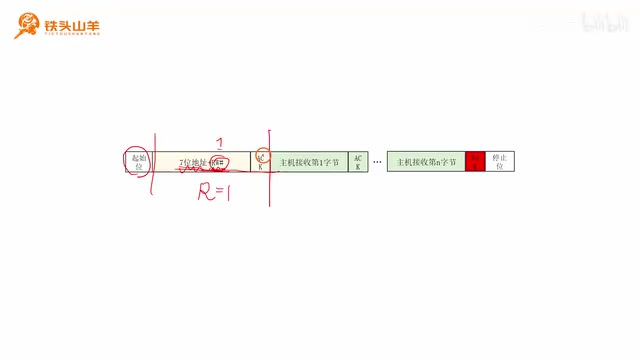
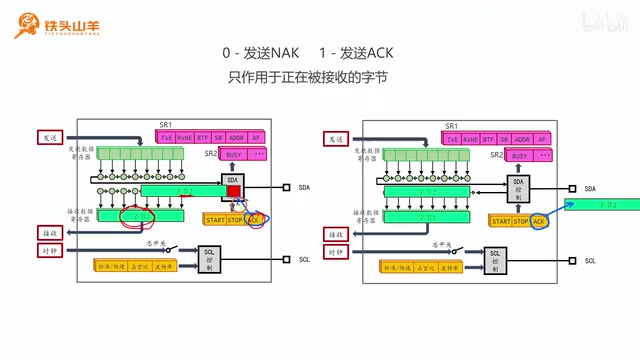
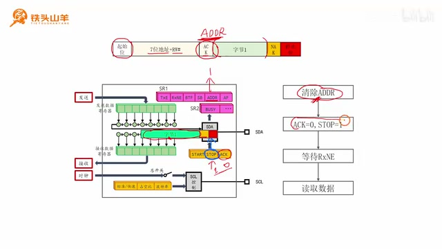
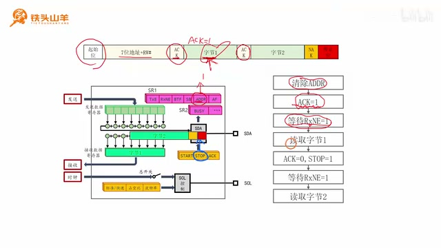
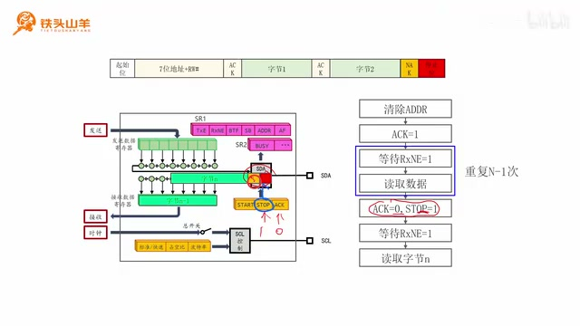
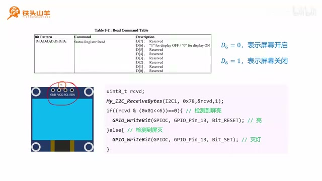

# P021 · 4.5 （I2C）读数据

大家好，我是铁头山羊。今天学习第四章第五节，了解如何通过 I²C 从从机读取数据。本套视频需要的材料都包含在开发套件包里，扫描屏幕上的二维码可以进入淘宝店铺购买；购买后可以获得课程课件和源码，也能加入答疑群直接和 UP 主交流。

本期要编写的函数叫 `My_I2C_ReceiveBytes`。`My_` 表示这是我们自己编写的函数，`Receive` 表示接收，`Bytes` 表示多个字节，所以它的作用是通过单片机的 I²C 接口从从机读取多个字节。函数有四个参数：第一个是 `I2Cx`，填写所用 I²C 接口的名称；这块单片机有 I²C1 和 I²C2，用哪个就填哪个。第二个参数 `Addr` 填从机地址。七位地址从 A6 到 A0，向左对齐，末位留给 R/W 方向位。第三个参数 `pBuffer` 是接收缓冲区，也就是事先准备的数组；函数读到的数据会保存在这个数组里。最后的 `Size` 表示要接收多少字节，接收几个字节就填几。刚才函数示意中的注释写错了，`Size` 是要接收数据的数量。

函数前面还有一个 `int` 返回值：返回 0 表示读取成功，返回 1 表示寻址失败。

函数原型在屏幕上写作 `int My_I2C_ReceiveBytes(I2C_TypeDef *I2Cx, uint8_t Addr, uint8_t *pBuffer, uint16_t Size)`。地址的七位 A6 到 A0 靠左，最后一位原本空出；在实际读操作中，这一位作为 R/W 方向位使用。读到的数据不是由函数直接逐个返回，而是放进调用者预先提供的数组。

寻址失败是指主机发送七位地址和 R/W 位之后，从机没有返回 ACK。返回 1 就表示没有收到这个 ACK。现在把函数声明添加到上期工程里：打开 `default/user` 文件夹中的 `main.c`，在已有的发送多字节函数声明下面写接收函数的声明。它的参数依次是 I²C 接口、从机地址、接收缓冲区指针和要读的字节数。把声明复制到文件下方并加上花括号，接着在里面实现函数体。

本期分七部分：先了解通过 I²C 读取数据的大致流程；第二，复用之前发送起始位和地址的方法；第三、第四，分别学习发送 ACK/NAK 和停止位；最后分三种情况编写接收代码：`Size = 1`、`Size = 2` 和 `Size > 2`。

## 读取数据的流程与起始位

先看读取数据的大致流程。它和上期写数据有区别，但前半段相同：主机先发起始位，再进入寻址阶段，发送七位从机地址和 R/W 位。因为这次是读数据，R/W 要置 1。发送地址和方向位后等待从机 ACK；收到 ACK 才继续数据接收，没有收到就直接发送停止位结束。

数据阶段的方向与写数据正好相反：从机发送一个字节，主机接收并回应 ACK；从机再发一个字节，主机再回应 ACK。一直到主机接收的第 N 个、也就是最后一个字节，主机必须回应 NAK。

_读操作的帧先包含起始位和七位地址加读方向，随后由从机发送数据、主机逐字节回应，最后以 NAK 和停止位结束。 ·_ [_原片 05:15_](https://www.bilibili.com/video/BV11X4y1j7si/?p=21\&t=315)

如果最后一个字节后仍发送 ACK，从机会认为主机还要继续接收，于是又发送第 N+1 个字节；这个字节可能与主机的停止位冲突，导致停止位发不出去。因此最后一个字节必须回应 NAK。这是读数据与发送数据最大的区别之一。I²C 数据帧由起始位、寻址阶段、数据传输和停止位组成；起始位与地址的发送上期已经学过，这里复习并写入代码。

发送起始位分两步：先向 `START` 位写 1，命令主机发起始位；再查询 `SB` 标志位，等待它从 0 变成 1，表示起始位发送完成。代码中调用 `I2C_GenerateSTART(I2Cx, ENABLE)`，然后通过 `I2C_GetFlagStatus` 查询 `I2C_FLAG_SB`。

## 发送起始位和从机地址

起始位发送完成后进入寻址阶段。先清除 `AF` 标志位，再把七位从机地址和方向位写入发送数据寄存器。因为要读数据，方向位 R/W 为 1。查询 ACK 时用 `AF` 和 `ADDR` 两个标志位：`AF = 1` 表示应答失败，`ADDR = 1` 表示寻址成功。

寻址过程分成四步。第一步准备标志位：`ADDR` 的清除比较特殊，这里先清 `AF`，调用 `I2C_ClearFlag(I2Cx, I2C_FLAG_AF)`。第二步把七位地址和 R/W 位写入发送数据寄存器。

要把末位方向位设为 1，代码写 `Addr | 0x01`。上期写数据时用的是 `Addr & 0xFE`，这次则用按位或。`Addr` 的七位地址左对齐，末位原本不确定；`0x01` 的前七位为 0、最后一位为 1。按位或的规则是两个数有一个为 1，结果就是 1；与 0 做或会保留原值，所以 A6 到 A0 不变，末位则被置为 1。这样就得到读方向地址。代码调用 `I2C_SendData(I2Cx, Addr | 0x01)`。

第三步等待 ACK。进入一个 `while` 循环持续检查 `AF` 和 `ADDR`：若 `AF` 变成 1，说明寻址失败，发送停止位并返回 1；若 `ADDR` 变成 1，说明寻址成功，跳出循环继续下一阶段。

## ACK、NAK 和停止位

接下来讲两个重要问题：如何回应 ACK/NAK，以及如何发送停止位。读数据时，从机向主机发送数据，主机再回复 ACK 或 NAK。假设读取 N 个字节，前 N−1 个字节都回应 ACK，最后一个字节回应 NAK。NAK 中的 N 表示 not，ACK 是 acknowledgement；也就是不确认。

举例来说，从机发来最后一个字节后会释放 SDA 线，等待主机回应。主机把 SDA 拉低就是回应 ACK；主机不拉低、不做动作，就是 NAK。外设黄色寄存器中的 `ACK` 位控制回应类型：写 0 发 NAK，写 1 发 ACK。

需要注意，`ACK` 位只作用于当前正在接收、尚未接收完成的字节。比如第一个字节已放入接收数据寄存器、第二个字节正在接收时，当前 `ACK` 值决定第二个字节后面发 ACK 还是 NAK；若第二个字节已经接收完成，ACK/NAK 也已发出，这时再改 `ACK` 位影响的是后面的第三个字节。若字节已经接收完、回应已经发出，再设置这个位就来不及影响它。

_I²C 外设的 ACK 位决定当前接收字节后的应答：0 对应 NAK，1 对应 ACK；设置值只影响尚未接收完成的当前字节。 ·_ [_原片 14:25_](https://www.bilibili.com/video/BV11X4y1j7si/?p=21\&t=865)

停止位的发送也很简单：向黄色寄存器中间的 `STOP` 位写 1。但停止位要等当前字节接收完成之后才会发送。例如字节一正在接收时写 `STOP = 1`，只有等字节一接收完成后，后面才会跟停止位。

## 接收一个字节

现在按三种情况编写数据接收代码：一次接收一个字节、两个字节或多个字节。先看最简单的 `Size = 1`。主机发起始位和七位地址加读方向位，从机 ACK 后表示寻址成功，`ADDR` 标志位置 1。先清除 `ADDR`，否则后面的第一个字节不能开始接收。

清除 `ADDR` 后，第一个字节马上开始接收。它后面要跟 NAK 和停止位，所以必须赶在该字节接收完成之前把 `ACK` 写 0、把 `STOP` 写 1；若等接收完成再做就来不及。随后等待字节接收完成并进入接收数据寄存器。此时 `RxNE`（接收数据寄存器非空）标志位从 0 变成 1，等待它置位后读取数据。这就是单字节接收的四步流程：清 `ADDR`、配置 NAK 和停止位、等待 `RxNE`、读取数据。

_单字节接收按顺序清除 ADDR、设置 ACK=0 和 STOP=1、等待 RxNE，再读出数据。 ·_ [_原片 17:20_](https://www.bilibili.com/video/BV11X4y1j7si/?p=21\&t=1040)

代码用 `if (Size == 1)` 进入单字节分支。清除 `ADDR` 的方法沿用上期内容：依次读取 `SR1` 和 `SR2` 寄存器。接着调用 `I2C_AcknowledgeConfig(I2Cx, DISABLE)` 向 ACK 位写 0，再调用 `I2C_GenerateSTOP(I2Cx, ENABLE)` 向 STOP 位写 1。

第三步用 `while` 循环持续调用 `I2C_GetFlagStatus` 查询 `I2C_FLAG_RXNE`，直到标志从 RESET 变成 SET，表示数据已经收到。第四步调用 `I2C_ReceiveData(I2Cx)` 从接收数据寄存器取出数据，并保存到传入的缓冲区第 0 个元素 `pBuffer[0]`。

实际写代码时，把这段放在刚才的循环下面；这部分就是 `Size = 1` 的接收实现。先读 `SR1`，再读 `SR2` 清除 `ADDR`；立即配置 `ACK = 0` 和 `STOP = 1`；随后等待 `RXNE` 置位，最后把读出的数据放进 `pBuffer[0]`。这样单字节接收代码就写好了。

## 接收两个字节

再看 `Size = 2`。主机发送起始位、七位从机地址和读方向位，从机应答后 `ADDR` 置 1。清除 `ADDR` 后第一个字节马上开始接收；因为第一个字节后面还要继续接收第二个字节，所以第一个字节后回应 ACK。在它接收完成前把 `ACK` 设为 1，然后等待 `RxNE = 1`，读取第一个字节。

读取第一个字节后，第二个字节马上开始接收。第二个字节后面是 NAK 和停止位，所以必须在它接收完成前把 `ACK` 写 0、把 `STOP` 写 1。设置完成后再次等待 `RxNE` 置位，再读出第二个字节。这样两个字节都接收完成。

_接收两个字节时，第一个字节后回应 ACK；第二个字节前切换到 NAK 并安排停止位。 ·_ [_原片 22:40_](https://www.bilibili.com/video/BV11X4y1j7si/?p=21\&t=1360)

代码中使用 `else if (Size == 2)`。先像单字节分支一样读 `SR1`、`SR2` 清 `ADDR`，马上调用 `I2C_AcknowledgeConfig(I2Cx, ENABLE)` 使 ACK 为 1，再等待第一个字节的 `RXNE` 标志置位。

标志置位后调用 `I2C_ReceiveData` 读出第一个字节，把它放到缓冲区第 0 个元素 `pBuffer[0]`。第一个字节读出后，马上把 ACK 设为 0、STOP 设为 1：ACK 的 0 对应 `DISABLE`，停止位仍用 `I2C_GenerateSTOP(I2Cx, ENABLE)`。

然后继续等待第二个字节的 `RXNE` 置位，接收完成后再调用 `I2C_ReceiveData`，把第二个字节放到 `pBuffer[1]`。这样 `Size = 2` 的接收就完成了。

## 接收多个字节

已经学会一次读取一个和两个字节，下面看一次读取多个字节。流程和读取两个字节差不多：发起始位、七位地址和读方向位，等待从机 ACK，清 `ADDR`，然后开始接收第一个字节。接收过程中先把 ACK 设为 1；等待 `RxNE` 置位后读出第一个字节。前 N−1 个字节都重复“等待接收完成、读取数据”的步骤。

读最后一个字节时要特别注意：在它接收完成之前把 `ACK` 设为 0、`STOP` 设为 1。这样最后一个字节之后跟的是 NAK 和停止位。

\*多字节读取循环处理前 N−1 个字节，最后一个字节单独等待并读取，前面先设置 NAK 和停止位。 · [原片 27:15](https://www.bilibili.com/video/BV11X4y1j7si/?p=21\&t=1635)\*设置好以后等待最后一个字节接收完成，再将第 N 个字节读出来。

代码中已有 `Size = 1` 和 `Size = 2` 两个分支，其他情况放在 `else` 中，也就是 `Size > 2`。先复用上面的代码清除 `ADDR`，再把 ACK 设为 1。接着写一个循环执行 N−1 次：`I` 从 0 开始，只要 `I < Size - 1` 就递增。每次循环先等 `RXNE` 置位，再读数据，保存到 `pBuffer[I]`。这会读出前 N−1 个字节。

读完倒数第二个字节后，马上把 ACK 改为 0，并把 STOP 设为 1；这里 ACK 参数要改成 `DISABLE`，别漏掉。然后等待最后一个字节接收完成，最后再读出它，并保存到 `pBuffer[Size - 1]`，也就是数组最后一个元素。至此整个数据接收阶段完成。

## 用 OLED 读取状态验证

_OLED 状态寄存器示例只用 D6 判断屏幕开关，并将读取结果用于控制 PC13 板载 LED。 ·_ [_原片 30:07_](https://www.bilibili.com/video/BV11X4y1j7si/?p=21\&t=1807)

接收代码写完后，用 OLED 显示器测试。从 OLED 读出一个字节，D0 到 D7 中大多数位没有意义，D6 表示屏幕亮灭：D6 为 0 表示屏幕点亮，D6 为 1 表示屏幕熄灭。把这个字节读出来判断屏幕状态，再加一颗指示灯：屏幕亮就点亮指示灯，屏幕灭就熄灭指示灯。

调用 `My_I2C_ReceiveBytes`，从屏幕地址 `0x78` 读取一个字节到变量 `rcvd`。然后判断 `rcvd` 的第六位：用 `0x01 << 6` 得到只在第六位为 1 的掩码，与接收到的数据做按位与。与 1 保留该位本身，与 0 得到 0，因此其余位都被清掉；如果运算结果为 0，D6 就是 0，屏幕亮，否则屏幕灭。屏幕亮时向板载 LED 的 PC13 写 0 点亮 LED，否则写 1 熄灭 LED。

先初始化板载 LED：定义 `My_OnBoardLED_Init`，把 PC13 配置为输出开漏模式。开启 GPIOC 时钟，声明并配置 GPIO 初始化结构体，`GPIO_Pin = GPIO_Pin_13`，模式选 `GPIO_Mode_Out_OD`，速度选低速 2 MHz，最后调用 `GPIO_Init` 初始化 PC13。

把板载 LED 初始化放到 `main` 中调用。接着沿用上期代码发送点亮 OLED 屏幕的那些字节，再调用接收函数从地址 `0x78` 读一个字节，存进 `rcvd`，读取数量填 1。判断 `rcvd & (0x01 << 6)`：若结果为 0，调用 `GPIO_WriteBit(GPIOC, GPIO_Pin_13, Bit_RESET)` 点亮 LED；否则调用 `GPIO_WriteBit(GPIOC, GPIO_Pin_13, Bit_SET)` 熄灭 LED。

按左上角第二个按钮编译。第一次出现一个 warning；查看后发现 `My_I2C_ReceiveBytes` 是 `int` 函数，但成功路径忘了返回 0。补上 `return 0`，再次编译后没有错误或警告。把代码下载到单片机后，OLED 亮着是上期程序点亮的；按一下单片机复位键，看到板载 LED 亮起，表示检测到了屏幕点亮状态，验证代码工作正常。

以上就是本期内容：通过 I²C 总线读取数据。下期介绍软件 I²C。我是铁头山羊，我们下期再见。
