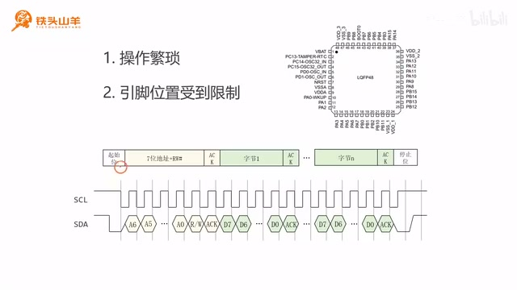
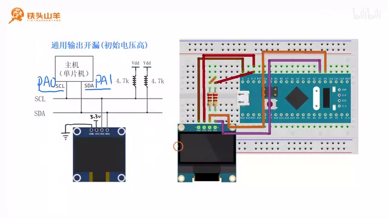
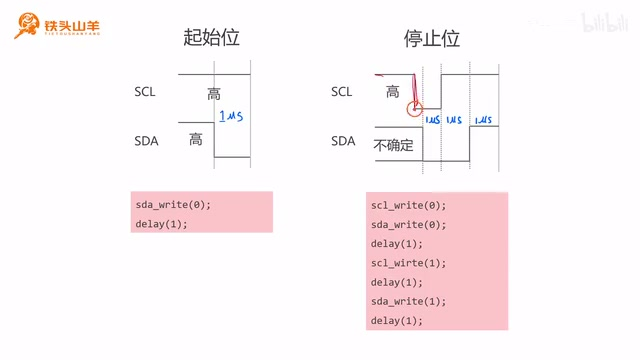
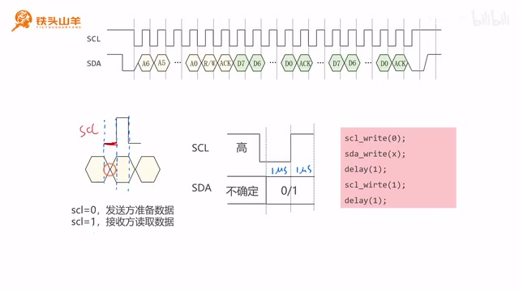
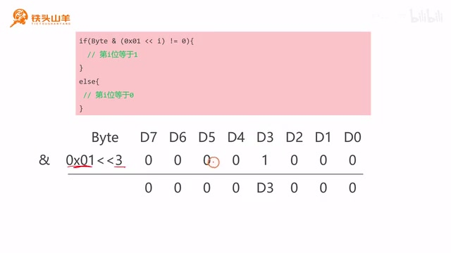
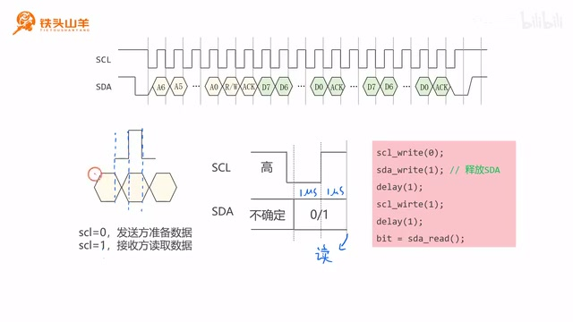
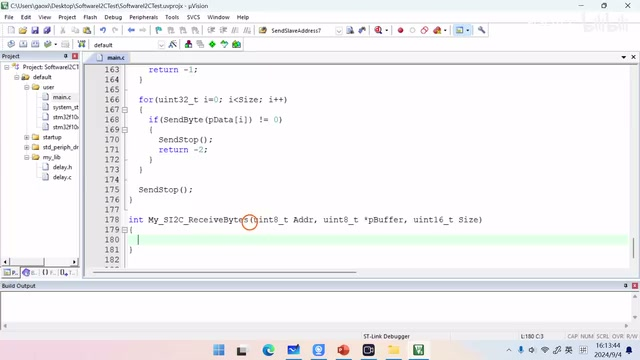
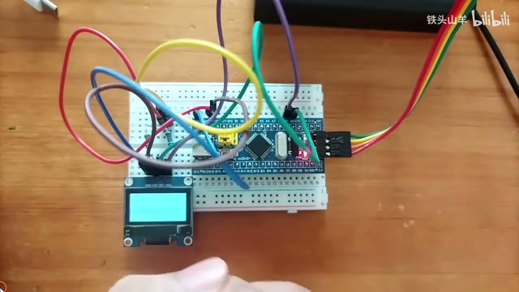

# P022 · 4.6 （I2C）软I2C

## 课程目标与硬件 I²C 的局限

各位同学大家好，我是铁头山羊，今天我们开始学习第四章的第六节，通过本节课呢，我们来讲解一下软件 I²C 的一个使用方法，首先声明一下。

本期视频的内容比较多，也比较难，所以本期视频呢我只带领大家去写一下，这个软 I²C 的代码，只写一次，后续呢我们会把它封到这个库函数里。

所以大家只需要了解这个软 I²C 是怎么来的，就可以了，不需要掌握具体的编程方法，首先来思考一个问题，我们为什么需要使用软件 I²C呢，其实这是因为我们单片机里边的两个硬件。

I²C呢，它有一些缺点，有两个缺点哈，首先第一个缺点就是操作非常繁琐，我们回忆一下前几期视频呢，我们学习了I²C 的一个初始化。

以及读数据和写数据，我们的I²C初始化和读写数据呢都异常复杂，所以这是硬件 I²C 的一个致命的缺点，然后第二个缺点就是，它的引脚的位置会受到限制，比如说对于我们这个单片机来说。

I²C 的I²C1 的引脚呢就位于PB6 和 PB7，然后如果进行重映射的话，可以重映射到PB8 和 PB9，而这个I²C2 呢，它只能在这里的PB10 和 PB11，所以如果这些引脚被别的功能占用了。

那么我们这个I²C 的功能就不能使用了，而且呢单片机里的硬件 I²C，我们并不是非用不可，因为我们之前呢已经学习过，I²C 的一个数据帧格式，比如说我们来看这张图。

_I²C 帧格式示意：起始位、寻址阶段、数据传输和停止位。 ·_ [_原片 01:30_](https://www.bilibili.com/video/BV11X4y1j7si/?p=22\&t=90)

这个就是I²C 数据帧的一个格式，他无非就是由这么几部分组成的，分别是起始位，寻址阶段，数据传输阶段，以及最后的这个停止位。

而且每一个阶段呢，波形呢我们都知道应该怎么去发，比如说对于起始位来说，就是SCL 为高电平的时候发一个下降沿，这个就是起始位，而对于这个停止位来说呢。

就是SCL 高电平的时候，我们发送一个上升沿，这个就是停止位，然后如果要发送数据的话，就是高电压代表一，低电压代表零。

## I²C 帧格式与软件模拟原理

如果要发送这里的时钟信号的话，就是高低变化的电压，所以我们可以在单片机上，直接找一些普通 IO 引脚出来，来充当这个SCL 和 SDA，我们按照这个I²C 数据帧的格式来发送。

这些波形，就可以在我们的单片机上模拟出一个软件的，I²C出来，这个就是软件 I²C 的一个原理，本期视频呢我们将分成这么七个部分来讲，首先我们先来看一下第一部分。

IO 引脚的初始化，既然我们要使用软件的方式去，模拟出一个I²C 接口，那么这个I²C 接口的位置呢，我们可以随便去选，我们可以任意的在我们的单片机上。

选择两个普通 IO 引脚，作为我们安放 I²C 接口的SCL 和 SDA，比如说我们选PA0 作为SCL，选PA1 作为SDA，那么我们就得到了右边的这个电路图，上期视频呢。

我们是把这个I²C 接口接在PB8 和 PB9，这两个引脚上的，本期视频呢我们把它挪到PA0 和 PA1上，也就是把这根橙色的线接PA0，把这根紫色的线接PA1，这是连接好之后的电路。

_软 I²C 接线改用 PA0 作 SCL、PA1 作 SDA；图中同时给出上拉与 OLED 接线。 ·_ [_原片 03:17_](https://www.bilibili.com/video/BV11X4y1j7si/?p=22\&t=197)

我们可以看到，原本在PB8 和 PB9上的这个杜邦线呢，被移到了PA0 和 PA1这两个位置上，确定了这两个引脚的位置之后，我们再来看一下这两个引脚应当怎么设置参数，首先因为我们要通过软件的方式去模拟出。

I²C 的波形，所以我们需要直接向这些IO 引脚写零写，一，直接向IO 引脚写零写，一对应的就是通用输出，然后因为我们这个I²C 总线呢要实现逻辑线与。

所以呢它必须使用开漏输出，所以连起来就是通用输出开漏模式，所以我们需要把PA0 和 PA1 都设置成通用输出，开漏模式，而且呢对于我们的这个I²C 总线来说，在一开始的时候。

这个总线处于空闲的状态，那在空闲状态下，这两个引脚都应该是高电压，所以在初始状态下，我们应当把PA0 和 PA1 都设置成高电压。

## 选择 IO 引脚并配置开漏输出

下面呢我们来写一下这段代码，在写代码之前呢，我们首先要新建一个工程，请大家打开我们百度网盘的课程资料，然后在这个百度网盘的课程资料里面下载模板，工程。

下载完成之后，我们会得到这么一个压缩包，然后我们把这个模板工程的压缩包给它解压，重新给我们的工程起一个名字，因为我们要测试软件 I²C，所以我们把它叫做software iphone c test。

然后给我们的工程文件也重新起个名字，也叫这个名字，software i方c test，给上面的这个文件也重命名，然后我们双击打开我们的工程文件，首先我们找到default文件夹。

user文件夹下的main.c，双击打开它，我们把代码写在这个min点C文件里，我们要对IO 引脚进行初始化，写一个方法叫做买soft i fc in it，这个S呢就是soft software软件的意思就是软 I²C。

然后我们把这个方法的原型复制一下，在main方法呢下面对它进行实现，我们要将PA0 和 PA1初始化成输出开漏模式，所以我们首先使能这个GPA的时钟，然后我们声明一个变量结构体类型的变量，对我们的PA0 和 PA1进行初始化。

因为他们两个的参数都一样，所以我们使用一个或运算符，对这两个引脚的同时进行初始化，两个引脚呢分别是PA0 和 PA1，这里是零，后边是一。

然后他们的模式呢都是通用输出开漏模式，通用输出开漏模式呢其实就是g p o mode out o d，这个就是通用输出开漏模式。

## 新建工程并初始化 PA0、PA1

然后我们再来选择一下它的最大输出速度，最大输出速度呢，我们选选择那个两兆赫兹的就够了，设置完成之后，我们调用GPIO\_Init，来完成这个初始化。

这样呢我们PA0和pa一两个引脚就初始化完了，然后我们在main方法里面调用一下这个函数，把它放在第一行，初始化完PA0 和 PA1之后，第二部分呢我们再来写一组编程接口，这组编程接口呢主要是用来读写SCL 和 SDA。

那两个引脚以及做延迟用的，因为我们要使用软件的方式去模拟，I²C 的一个输出波形，所以我们需要直接对这个SCL 和 SDA，这两个引脚进行操作，所以为了方便呢。

我们写了下面的这么一组编程接口，我们来看一下这些编程接口都是用来干什么的，首先第一个编程接口SCL right，就是像这个SCL这个引脚写值，也就像这个时钟线写值，后边有一个参数。

这个参数如果填零的话，那么SCL就输出一个低电压，如果填一的话，就是像SCL上输出一个高电压，然后下面的这个sda\_write也是一样，它是向SDA。

也就是这条数据线上写值，如果后面的这个参数填零的话，那么输出的就是低电压，如果填一的话，输出的就是高电压，然后有的时候我们还需要从这个SDA上。

读取电压的高低，所以我们就声明了一个编程接口叫做sd a read，它会有一个返回值，如果这个SDA上当前是高电压，那这个返回值返回的就是一，如果当前是低电压。

那返回的就是零，最后呢我们还要做一个这样的延迟函数，这个延迟函数的名字呢叫做delay\_us，后边的这个US呢代表微秒，它是能够实现微秒级的延迟，然后它有一个参数用来指定要延迟的微秒数。

比如说我们要延迟五微秒，就把这个五填到参数里就可以了，那它是怎么实现的呢，其实它是通过这个for循环实现的。

## 编写 SCL、SDA 与延迟接口

对于我们单片机的当前配置来说，每执行一次for循环要消耗18微秒，所以我们要延迟多少微秒，就在那个延迟的时间上，时间的基础上呢，给它乘以一个八。

我们就可以得出这个for循环的一个执行次数，然后我们再让这个for循环执行这么多次，就可以实现我们要延迟的那个时间了，下面呢我们来实现一下这些编程接口，首先先声明他们的原型，第一个是SCL write。

它是向SCL引脚上写值写零，或者是写一，我们使用这个参数呢，来指定它到底写的是零还是一，第二个编程接口呢是sda write，是向这个数据线上写值。

然后第三个编程接口呢是sda\_read，第四个编程接口呢是一个延迟函数，用来做微秒级的延迟的，它有一个参数用来指定我们要延迟的时间，然后我们把这几个编程接口的原型复制一下，放到下面进行实现。

放到最后边的这个位置，逐一对它进行实现，首先我们先来实现第一个编程接口，就是这个SCLright，因为SCL呢位于PA0，所以我们要向他写值的话。

直接调用这个GPIO\_WriteBit去写就可以了，T a0，我们根据这个level的值，如果这个level等于零，那么我们就向这个引脚写零，也就是Bit\_RESET。

否则的话如果这个level是一，那么我们就向他写写写Bit\_SET，这样呢我们第一个编程接口就做好了，然后我们再来看第二个编程接口，Sd a write，sda write呢SDA位于PA1。

所以我们把上面的这个代码复制一下。

## 实现引脚读写和延迟

稍作修改就可以了，我们把PA0的这个位置呢移动到PA1，就是把这些都是是零的地方都改成一就可以了，然后我们再来看第三个编程接口哈，是sd a read s d a，我们要想读取这个SDA 线上的高低电压呢。

我们可以调用GPIO\_ReadInputDataBit，Bit\_SET这个编程接口，去读一下这个PA1的值，如果我们读到的是bit set，是不是就证明现在是SDA这条线上是高电压，我们就返回一个一。

否则的话如果读到的是低电压呢，我们就返回一个零，这样我们第三个编程接口也写好了，最后一个编程接口呢是做微秒级的延迟，我们首先算出这个for循环执行的次数，N就等于微秒的值。

再乘以一个八，然后我们使用for循环进行延迟，i开始等于零，然后我们让他执行N次，每一次I加一，这样呢我们这些编程接口就都做好了。

第三部分，我们来看一下起始位和停止位应该怎么发，我们首先复习一下，起始位和停止位的发送规则哈，首先来看起始位，所谓起始位呢就是在SCL 为高电平的时候。

SDA上出现一个下降沿，这个就是一个起始位，然后我们再来看一下停止位，所谓停止位就是在SCL 为高电平的时候，SDA上出现一个上升沿，这个就是停停止位。

我们先来看一下这个起始位代码应该怎么写，我们假设在起始位发送之前，总线上是处于空闲状态的，那空闲状态下SCL 和 SDA上的都是高电压，所以我们只需要简单的，将SDA上输出一个低电压就可以了。

这样呢就会出现一个下降沿，所以我们就是将SDA写一个零。

## 起始位与停止位的规则

然后呢我们再延迟这么一段时间，delay1微秒，下面呢我们来编写一下，这个发送起始位的一个代码，首先我们先把这个main.c文件翻到最顶部，我们在这个位置声明一下。

这个发送起始位的函数原型叫做SendStart，参数和返回值都是空哈，然后我们复制这个函数的原型，翻到文件的最底部，我们在最底部对这个函数进行一个实现，写一对花括号来表示这个函数的函数体。

然后我们按照刚才的这个方式，去发送一个起始位，首先呢我们先向SDA上写这么一个低电压，也就像SDA写零，写一个零，然后呢。

我们再延迟一微秒，这样呢我们这个起始位就发送出去了，发完了起始位，我们再来看一下停止位的发送方式，所谓停止位呢就是SCL 为高电平的时候，这里出现一个上升沿。

这个就是一个停止位，那停止位的发送过程呢比起始位要复杂，我们来看一下，我们可以假设在发送停止位之前呢，这个时钟线上是高电压，但是这个数据线上到底是高电压还是低电压。

这个不确定，根据我们之前的操作的不同，这个SDA上可能是零，也可能是一，所以我们要发送一个这个停止位，就必须要保证这个SDA上一开始是低电压。

因为它是低电压的时候，我们写一个一才会出现一个上升沿嘛对吧，如果他本来就是高电压了，我们再写一，它也不可能再出现上升沿了，所以我们要确保在发送这个停止位之前。

_起始位和停止位的时序示意，标出 SCL 为低时改变 SDA 以及停止条件。 ·_ [_原片 13:59_](https://www.bilibili.com/video/BV11X4y1j7si/?p=22\&t=839)

SDA上是一个低电压，然后呢我们改变这个SDA的值，一定要确保SCL是低电压的时候，我们才能改变，所以我们需要这样做，我们首先像SCL写一个零。

它就变成低电压了，然后呢像SDA上也写个零，这样呢SDA也变成低电压了对吧，这两个都是低电压了，然后呢我们延迟一段时间。

## 起始位实现

再让SCL变成高电压，之后呢，我们再延迟一段时间，再再让SDA也变成高电压，这样呢是不是就出现一个上升沿了，而且这里是高电压。

这个停止位就发送出去了，所以根据这个步骤呢，我们写可以写出这样的代码哈，首先我们向SCL写零，这里向SCL写零，然后我们再向SDA写零。

这里向SDA写零，然后延迟一微秒，这里延迟一微秒，然后向SCL写一，这里是向SCL写一，然后再延迟一微秒。

这里是延迟一微秒，然后再向SDA写一个一，这里是向SDA写一个一，然后我们再延迟一微秒，这个就是延迟一微秒，所以这就是我们最终的一个代码。

然后我再给大家补充一点，为什么我们一定要确保，这个SCL是低电压的时候，我们才向SDA去写一个值呢，其实原因是这样的哈，我们假设如果这个SCL 为高电平的时候。

我们去改变这个SDA的值，比如他一开始是高电压，我们向他写一个零，那这个时候SCL 高电平一个下降沿，这不就等于发了一个起始位了嘛对吧，所以我们不能在SCL 为高电平的时候。

对SDA进行操作，一定要把它先写成低电压，现在呢我们来写一下发送这个停止位的代码，首先翻到最顶部，我们先声明一下这个函数的原型叫做SendStop，这个是发送停止位的一个编程接口。

我们把这个代码呢翻翻到最底部，对它进行一个实现，按照我们刚才的这个图哈，首先我们向SCL写一个零，然后向SDA写一个零，零延迟一微秒。

SCL写一个零，SDA也写一个零，然后延迟一微秒，延迟完这个一微秒之后，我们向SCL写一个一，然后再延迟一微秒。

## 停止位实现及原因

然后我们延迟完这个一微秒之后，向SDA也写一个一，然后再延迟一微秒，这样呢我们发送停止位的这个代码也写好了，我们刚才已经学会了如何发送起始位和停止位，那下面呢我们就来学习一下如何收发数据。

首先我们通过第四部分来看一下，如何去发送一个字节，首先我们先来看一下上面这里数据帧的波形，我们想要传输数据的时候，发送方呢首先得发送一个字节的数据，然后接收方呢回应一个ACK或者是NAK。

而前面的这一个字节的数据呢，是由一个一个的比特位组成的，所以我们想要发送这个字节，那么我们得先学会如何发送一个一个的比特位，下面我们就来介绍一下这个比特位的发送方法，那怎么去发送一个比特位呢。

我们先把这一部分给大家放大一下，看看，放大之后我们就得到了这边的这样一张图，我们可以看到一个比特位的发送呢，我们可以把它分成这么两个阶段，其中这里是第一个阶段。

_数据位分为准备和采样两个阶段：SCL 低时发送方设置 SDA，SCL 高时接收方读取。 ·_ [_原片 17:32_](https://www.bilibili.com/video/BV11X4y1j7si/?p=22\&t=1052)

这里是第二个阶段，在第一个阶段里边，这条时钟线上也就是SCL上是一个低电压，然后当SCL等于低电压的时候，发送方呢开始准备数据，也就是如果他要发送一个零的话。

那他就把这个电压事先调成零，调成低电压，如果他要发送一个一的话，它就事先把这个电压呢拉高，拉成一个高电压，然后第二部分呢。

SCL这个引脚上应该是一个高电压，然后此时呢发送方的这个电压呢，就应该保持不变了，因为接收方要在这个阶段去读取上面的数值，所以说它就不能变了，然后我们接收方呢把这个高低电压读出来。

就可以读出数据了，所以总结一下两个阶段，第一个阶段SCL等于零的时候，发送方准备数据，第二个阶段SCL等于一的时候，接收方从这个地方读取数据。

## 发送数据位

下面呢我们来看一下实际的波形，我们来看右边这张图，右边这张图呢，就是我们发送一个比特位的实际波形，SCL呢代表时钟线，SDA代表数据线。

在开始发送这个比特位之前，SCL 上的电压是高电压，然后SDA上的电压是不确定的，这个SDA上电压的高低，跟上一个比特位发送的是零还是一有关，如果上一个比特位发送的是零。

那这个SDA就是低电压，如果上一个比特位发送的是一，那么这个SDA上就是高电压，然后这张图呢也是分成了这么两个阶段，这是第一阶段，这是第二阶段。

在第一阶段的时候呢，SCL是低电压，然后我们的发送方开始准备数据，因为主机是发送方对吧，主机要向从机发送数据，所以这个时候呢。

我们的主机就应该把这个SDA拉低或者是拉高，高还是低，就取决于我们要发送的这个比特位是零还是一，然后我们根据这个波形，就可以编写出我们的代码，首先我们先向SCL上输出一个低电压。

也就是向SCL写零，这个是像SCL写零，然后紧接着我们根据要发送的这个比特位的值，向这个SDA上写零，或者是写一，这里是向SDA上写零。

或者是写一，我们用X代表这个比特位的值是零还是一，稍后呢我们会介绍这个X的值应该怎么算，然后发完了这个零和一之后，我们要延迟这里的一微秒，这里是延迟一微秒。

然后我们再把SCL这条线给它拉高，这里是向SCL写一，最后呢我们再延迟这么一微秒，这里是延迟一微秒，通过刚才的学习呢，我们已经知道怎么去发送这么一个比特位了。

然后我们把一个一个的比特位给它组合起来，是不是就能发送这么一个字节了，现在呢我们声明一个函数哈，用来发送这个字节，这个函数的名字叫做send byte，send呢是发送byte呢是字节。

所以连起来就是用来发送一个字节的函数，那对于这个编程接口来说呢，它有一个参数，这个参数就是我们要发送的内容，也就是那个字节，然后呢他还有一个返回值。

## 发送一个字节的接口

这个返回值呢用来返回，我们发送完这个字节之后，接收方回复的到底是ACK还是NAK，如果回复的是ACK，我们就返回一个零，如果是NAK呢。

这个位置就返回一个一，我们翻到main.c文件的这个最顶部，我们把这个函数声明一下，首先这个函数的返回值呢是一个无符号，八位整形的，然后他的名字呢叫做send the byte。

也就是发送一个字节，它有一个参数，这个参数呢表示我们要发送的这个字节的内容，然后我们把这个函数的原型复制一下，拿到文件的底部对它进行实现，我们先把刚才发送一个比特位的这个代码。

先写出来，回到我们的代码哈，首先第一步我们向SCL写一个低电压，然后呢我们向SDA上，根据我们要发的这个零，还是一写一个高电压或者是低电压。

也就是s d a right x，这个X就表示我们要发送的这个比特位的值，这个X我们先这么填，一会呢我们再说这个X怎么计算，然后第三步呢，我们需要延迟这么一段时间。

延迟完这段时间之后，我们再让SCL变成高电压，然后再延迟一段时间，比如像SCL写一，然后再延迟一小段时间，这样呢我们一个比特位就发出去了。

我们注意看一下这段代码，其中这一部分就是刚才我们写的，发送一个比特位的代码，而用我们要发送一个字节的时候，需要一个比特位，一个比特位的发送。

先发第七第六第五一直到这个D0，所以我们写这么一个for循环，for循环呢从七开始一直到零，每次呢中间这里发送一个比特位，我们把这个for循环呢写在这些代码的外边，把它包起来。

## 按 D7 到 D0 发送

for循环呢我们先声明一个带符号的八位整形，注意这里不是无符号的八位整形，是带符号的八位整形，是这个，然后这个I呢从七开始，也就是先发第七。

然后呢最后发这个D0，每循环一次呢，这个A的值减一，然后在这个循环里边，我们一个比特位，一个比特位的去发。

也就是把这段代码给它包起来，下一步的任务呢我们就是计算这个X的值，也就是计算当前这个比特位到底是零还是一，我们怎么去计算这个X的值呢，其实我们可以通过这行代码进行检测，假设我们要检测的是第I个比特位。

那么我们就把0x01左移I位，然后用这个结果去与一下，我们要发送的这个字节与之后的这个结果呢，我们判断一下，如果与之后的这个结果不等于零，那么我们要发送的这个比特位就是一。

否则的话就是零，这个是个什么原理呢，我们来看下面这样一张图哈，比如说这是我们要发送的那个字节，它由八个比特位组成，分别是第七第六第五。

_用 0x01 左移到目标位后与待发送字节相与，判断该位是 0 还是 1。 ·_ [_原片 23:32_](https://www.bilibili.com/video/BV11X4y1j7si/?p=22\&t=1412)

第四一直到第零，然后我们假设我们假检测的这个位呢，I等于三，也就是我们检测的是D3，这个比特位到底是零还是一，所以我们把这个0x01左移三位。

0x01呢就是七个零，后边跟着一个一，这个一左移三次之后，是不是就移到这里来了，所以这里这个就是0x01左移三位的一个值，然后我们把这两个值做一个区域的运算。

我们知道对于与运算来说，任何数与零都等于零，所以这一部分是零，这一部分也是零，唯独第三这个比特位他与的是一，任何数与一之后得到的都是它本身。

所以这里的第三就被保留下来了，如果D3本来就是零的情况下，那么这个地方就是零，所以整个的这个数就是零，所以如果如果整个的这个数等于零的话，那么第 i 位就等于零。

否则的话。

## 用位掩码取出当前位

如果这个D3等于一，那么与出来的结果就是00004个零，一个一三个零对吧，这个结果显然是不等于零的，那就对应上面的这个分支，也就是D\_i 等于 1。

通过这种方式呢，我们就可以得出这个比特位，当前是零还是一下面呢，我们就按照刚才的方式去写一下代码，我们使用一个if if去判断一下，如果这个byte的值与上0x01左移I位。

这个值如果如果不等于零的话，那是不是说明第 i 位就是一，所以我们就发一个高电压就可以了，我们这里发送一个高电压，也就是向SDA写一，否则的话我们发的是不是就是一个零。

通过这种方式呢，我们就确定出了这个S的值了，刚才咱们已经通过代码把D7到D0，这么八个比特位发送出去了，发送完这八个比特位之后，主机需要主动的释放掉SDA这条线。

然后等待从机发送ACK或者是NAK，如果从机想发ACK的话，他就会把这条线重新拉低，否则的话他就不做任何事情，所以我们可以通过检测，这里到底是高电压还是低电压。

来检测，我们从机发送的到底是ACK还是NAK，那怎么去检测ACK和NAK 呢，我们可以通过下面的这么一个波形哈，这个波形呢比较复杂，这里我们就不再深入的去讲了。

我们只需要按照这个波形进行编程就可以了，首先我们先向SCL这条线写一个零，所以这里就是向SCL写零，然后呢我们再向SDA写一个一，写一的目的呢是会释放掉这个SDA这条线，所以呢我们向SDA写一个一。

然后中间这里呢我们再延迟一微秒，这是延迟一微秒，然后呢我们再向SCL这个地方写一个一，这里是向SCL写一。

## 接收 ACK 或 NAK

写完一之后，我们再延迟一微秒，也是这里延迟一微秒，最后呢我们再去读取一下SDA上的电平，也是从这里从这里把这个电平读出来，所以最后一句话就是sda\_read。

就是读取SDA上的高低电压，如果SDA上是低电压的话，那么读到的就是一个零，我们把这个零返回回去，就表示这个数据发送成功了，如果SDA上是一个高电压呢。

它返回的就是一一就代表没有成功对吧，我们把这个一也返回回去就可以了，我们按照这张图进行编程哈，首先我们这一步要做的是，读取ACK或者NAK，然后我们首先向SCL写一个零。

写完零之后，我们向SDA写一个，一来释放掉SDA这条线，然后写完一之后，我们延迟这么一段时间，比如说延迟一微秒。

延迟完这一微秒之后，我们再将SCL拉到高电压，也就是向他写一个一，然后写完一之后，我们再延迟一段时间，也就是延迟的是这么一段时间。

然后延迟完之后，我们就可以读取这个SDA上的值了，我们通过sda\_read来读取一下它的值，然后把这个值作为返回值，返回回去就可以了，刚才呢我们已经学会了。

如何向I²C 总线上发送一个字节，接下来呢我们来学习一下，如何从I²C 总线里接收一个字节，要想接收一个字节的数据，那么和刚才一样，我们还是要学习如何去接受一个比特位的数据。

接收数据的过程呢，跟发送数据的过程其实是差不多的，也是像这张图分成两个阶段，那第一个阶段呢就是SCL 低电平，然后发送方准备数据，第二个阶段呢就是SCL 高电平。

发送方读取接收方读取数据。

## 接收数据位

_接收数据位时释放 SDA；发送方在 SCL 低电平准备数据，接收方在 SCL 高电平采样。 ·_ [_原片 28:18_](https://www.bilibili.com/video/BV11X4y1j7si/?p=22\&t=1698)

本次呢我们要作为接收方，其实我们接收方要做的事情就比较简单了，我们只要释放掉SDA这条线，也就像SDA这条线写一，然后先向SCL上发送一个低电压，让发送方给我们把数据准备好。

然后再发送一个高电压，发送完高电压之后，我们把这个SDA 线上的电压读出来就可以了，我们来看一下右边这样一个实际的波形，其中这里到这里，是我们这个数据接收的第一个阶段。

然后这里呢是数据接收的第二个阶段，那在第一个阶段呢，我们只需要简单的把这个SDA释放掉，就可以了，在第二个阶段呢，我们把这个数据读出来就OK了。

所以现在呢我们按照这个波形进行编程，首先第一步我们先向SCL写一个零，这里是像SCL写一个零，然后呢向SDA写一个一，来释放掉SDA这条线，这里是向SDA写一个一。

然后我们延迟一微秒，等待这个发送方把数据准备好，然后我们再向SCL写一个一，这里是向SCL写一个一，然后再延迟一微秒，延迟一微秒。

然后把这个数据读出来就可以了，学会了如何读取一个比特位的数据，然后我们把一个一个的比特位组合起来，这样就可以读取一个字节了，当读完这个字节之后，我们要向发送方回复一个ACK或者是NAK。

为此呢我们编写这么一个编程接口哈，这个编程接口的名字叫做receive byte，receive是接收byte是字节，所以这个编程接口的作用，就是去读取一个字节的数据，然后对于这个编程接口来说呢。

它有一个参数，这个参数呢是ACK，如果这个ACK等于零的时候，那这个地方我们回的就是一个NAK，如果这个ACK等于一的时候，这个地方我们回的就是一个ACK。

然后他还有一个返回值，这个返回值就是返回，我们读到的这个字节的数据，我们翻到main.c文件的顶部，然后声明一下这个函数，首先它有一个返回值。

返回的是我们读取到的那个字节，然后函数名叫receive byte。

## 读取一个字节

他还有一个参数，这个参数呢用来指定我们到底是返回，返回ACK还是NAK，我们把这个方法呢他的声明复制一下，放到底部进行实现，首先咱们先按照这张图。

把读取一个比特位的这个代码写上二，这张图呢我们首先向SCL这里写一个零，写完零之后，我们向SDA写一个一去释放掉SDA这条线，然后我们延迟一微秒，等待发送方把这个数据准备好。

延迟完这一微秒之后，我们再向SCL写一个一把这个电压给它拉高，最后呢我们再延迟一微秒，延迟完这一微秒之后，我们就可以把这个SDA上的高低电压，给他读出来了。

所以呢我们读到的这个值就是sd a read，这个就是我们读到的值，然后因为我们一个字节里边有八个比特位，所以我们把这个读取一个比特位的这个操作呢，给他重复八遍，从D7D六一直到D0。

所以我们这个for循环的顺序呢，是从I等于七到I等于零，这里是大于等于零，咱们写一个for循环，这个for循环呢也是，带符号的八位整形。

不要写成无符号的了，这个I从七开始一直到大于等于零，注意这里是大于等于零哈，刚才我写错了，然后I每循环一次减一，然后我们把读取一个比特位的这个代码哎。

给他整个的复制到上面去，现在呢我们声明一个变量，这个变量呢是一个字节类型的名字叫做byte，这个byte呢就是我们这个函数的一个返回值，也就是我们读取到的这个数据。

## 回复 ACK/NAK 并完成接收

我们先给这个变量赋个初值零，然后我们在这个for循环里面每读一个比特位，就给这个byte的这个比特位呢赋一个值，也就是这这两句代码，我们声明这个变量哎名字叫做byte，赋个初值零。

然后然后在下面这个for循环里，这个位置我们把这个数读出来了对吧，如果SDA是高电压的话，就是一低电压的话就是零，所以我们判断一下哈，到底是高电压还是低电压。

如果它如果它不等于零，就是高电压的时候，那么我们就往这个byte的第二个字，第二个比特位呢写一个一就好了，像像byte的第二个比特位写一的方法是这样的，这个地方呢我们就不深入的讲了。

因为和之前的原理是一样的，我们就不深入的讲，这样我们就给这个bu赋赋好值了，写完了这么一段代码之后，我们就已经读取到了这八个比特位的值了，这一个字节就读完了。

读完这个字节之后，不要忘记向发送方要发送ACK或者是NAK，那怎么去发送ACK或者NAK，我们通过这里的这么一张图，这个图呢同样是比较复杂，我们这里也不讲了。

大家有兴趣的可以自己去琢磨一下，这张图到底是什么意思，我们只需要按照这张图进行编程就可以了，根据这张图呢，首先我们向SCL写一个零，也是这里像SCL写一个零。

然后呢，我们根据我们要发的是ACK还是NAK，我们去写这个SDA的值，如果要发ACK的话，我们写的就是一个零，如果要发NAK的话。

我们写的就是一个一，所以我们可以看到，我们在ACK这个参数前面取了一个非，取了一个非，然后发完这个ACK或者NAK之后，我们这里延迟一微秒。

所以这里就有一个延迟一微秒，延迟完之后，我们再向SCL写一个一，这里就像SCL写一个一，选完一之后，我们再延迟一微秒。

这就是延迟一微秒，然后呢，我们再把刚才读到的这个字节的值作为返回值。

## 综合批量读写接口

返回回去就可以了，现在呢咱们开始编程，我们首先向SCL写一个零，写完零之后，我们向SDA，也写一个值。

这个值呢根据我们输入的这个参数，ACK来决定，如果这个ACK是零的话，说明我们返回的是NAK对吧，NAK就写一，如果他这个ACK是一的话。

那么我们就需要回复一个ACK，ACK就是写零，所以正好跟我们输入的参数是相反的，所以前面我们写了一个非，这个非就是取反的意思，然后回完这个ACK之后。

我们这里要延迟一微秒，就是这一段，延迟完一微秒，我们来看我们需要把这个SCL再拉高，然后拉高之后我们再延迟一微秒，最后呢我们把刚才的这个结果给他返回回去。

然后这个receive bt这个函数就写完了，到此为止呢，我们所有的零部件都准备好了，包括如何发送起始位，如何发送停止位，如何发送一个字节。

如何接收一一个字节，这些东西我们都会了，现在呢我们把这些部分给它组合起来，第六部分综合，现在我们想做这么两个编程接口，这两个编程接口呢跟我们过去使用硬件I²C。

做的那两个编程接口是一模一样的，我们首先看第一个编程接口哈，叫做my s i方c send bts，这里的S呢代表software，也就是软 I²C 的意思，然后send呢是发送BS呢。

是字节后边带着S表示一次性发送多个字节，所以这个编程接口的作用呢跟之前一样，就是通过软 I²C向外发送多个字节，那它有这么几个参数哈，首先第一个参数是从机的地址，这个从机的地址呢靠左写。

然后第二个参数呢是我们要发送的这个数据，因为一次性的要发送多个数据，所以这是一个数数组。

## 实现批量发送

然后第三个参数size呢，就是填写要发送数据的数量，我们要发几个字节，这里就填几就好了，然后下面的这个my si方c receive bs，是通过这个软I²C去接收一定数量的数据。

那参数呢这里也是从一的地址，这个是接收缓冲区，我们读到的这个数据呢，就存在这个接收缓冲区里，然后最后一个参数呢是要接收，这里是接收。

这里是要接收的数据的数量单位也是字节，然后我们把这两个编程接口的声明呢，先写到我们的这个代码里，我们把慢点C这个文件往上翻，翻到最顶部，翻到这里。

我们来声明这两个函数，首先他们的返回值都是int类型的，第一个方法呢叫做my s i方C，剩的B次，先填从机的地址，然后就是要发送的数据。

然后就是要发送数据的数量，然后第二个编程接口呢返回值也是int类型的，叫做my sfc receive bs，这个是用来接收数据的，第一个参数呢填地址，第二个参数呢填接收缓冲区。

第三个参数呢体验要接收数据的数量，这样呢我们这两个函数的原型都声明好了，复制这两个原型，我们在下面做一个实现，拉到MF，拉到这个main.c的底部。

我们对它做一个实现，好的，下面呢我们就按照这个FC数据帧的格式，来编写这个数据读写的代码，上面的这个是写数据，下面的这个是读数据。

我们先来看写数据哈，写数据呢先发一个起始位。

## 实现批量接收

发起始位呢我们就调用新的SendStart对吧，这个就是发起始位，然后第二步呢我们就是发七位的重新地址，加上这个RWV，用SC剩的data，send byte去发送这个地址。

与上联赛F1，因为我们是要写数据嘛，所以与上联赛F1，这里呢我们要判断一下这个send bt返回值，它到底返回的是零还是一，如果它返回的是。

如果他返回的是零的话，就说明这个寻址成功了，如果返回的不是零，就说明我们没有收到ACK对吧，没有收到ACK，我们返回的应当是一。

在返回一之前，我们还应该发一个stop，就是发一个停止位，然后这个寻址阶段我们也结束了，下面呢就是去发送这个数据了，发送数据呢我们使用一个for循环。

一共发size个数据，然后然后每次我们都调用这个send的byte，去发送一个字节对吧，发送一个字节，那个字节呢，就是p data a这个数组里面的第I个元素。

就是我们要发送的这个字节，那发的这个字节呢，我们还需要判断一下这个函数的返回值，如果返回的不是零，就说明没有收到ACK对吧，没有收到ACK怎么办呢。

就说明我们的数据被拒收了，我们先发一个停止位，然后再return一个二，这个就表示我们的数据被拒收了，然后所有的数据都发送完成之后，我们就发一个停止位就可以了。

_综合读写流程在代码中按起始位、地址与读写位、数据和停止位组合。 ·_ [_原片 40:00_](https://www.bilibili.com/video/BV11X4y1j7si/?p=22\&t=2400)

就是SendStop，这样呢我们这个数据发送的代码就讲完了，我们再看一下数据接收的代码，数据接收的代码也是先发一个起始位，SendStart，然后发完这个起始值位之后。

我们发七位的重新地址，加上这个RW，send的data AD d r，这个就是起始位再获一个。

## OLED 测试与编译警告

0x01，哦不是sign的data，而是CINEBYTE，名字记错了或一个0x01就表示方向是读，然后我们判断一下这个返回值哈，如果返回值不是零的话。

就说明寻址失败，寻址失败返回的是一，发送一个停止位，然后这里的寻址阶段结束了，我们就开始读取数据了，一共读取size个数据。

我们先读取前size减一个数据，因为前size减一个数据返回的都是ACK，而最后一个数据呢返回的是NAK，最后一个数据不太一样，所以我们先发前面的写一个for循环，I从零开始循环size减一次。

I加加，然后每循环一次呢，我们就读取一次数据，这个读取数据呢就是receive byte对吧，Receive byte byte，然后我们对所有的这个前size减一个数据呢。

我们都回ACK，所以这里是一，然后我们把读到的这个数据呢，给它保存到这个缓冲区的，这个数组的第I个元素里面，然后我们再来读最后一个数据。

并把它保存到这个p buffer的，最后一个元素里面哈，最后一个我们回到是NK，最后我们再SendStop，这样呢停止位就发送出去了，这就是这两个函数的一个实现方法。

其实综合的这一部分呢还是比较简单的，比起前面来说就简单多了，代码写完之后，我们再来测试一下我们这个代码到底好不好用，那我们还是用这个OLED显示器去测，我们还是写这么五个字节。

这五个字节发出去之后，我们这个屏幕就会点亮，我们通过这个代码来测一测。

## 发送测试命令并排查初始化遗漏

我们的这个写的程序好不好用，在测试这个代码之前，首先我们先编译一下这个工程，看看我们写的这个代码到底有没有错，因为这个代码实在是太长了，很有可能呢在其中就会有一些错误。

我们按左上角的第二个按钮进行编译，果然会有两个警告，我们来看一下这两个警告是什么意思，他说第一个在这个函数里边，我们没有，本来这里是有一个返回值的。

我们没有写这个返回值，这里是SendBytes，这个返回值我们要返回的，这里是应该是成功之后，我们返回一个零，这里我们写一个返回零。

然后我们再来看下面这个，下面这个呢是I方c receive bts这个编程接口，我们也没有返回值，我们这个返回值呢也应该是返回一个零，最后我们也应该是返回一个零，这样呢我们这个代码就没问题了。

我们再编译一下，没有错误，也没有警告，然后我们就向这个屏幕上发送那个命令，就可以了，我们翻到这个main方法的顶部。

首先我们先声明一个数组，把那五个字节写进去，我们看一下那五个字节都是什么，0x000s8 d 0x14，然后0xAF和0xA5，然后我们就调用这里的my phone sisbs。

把这个字节呢都给他发送出去，地址呢我们这个屏幕的地址是0x78，然后要发送的字节就是这个commands，要发送的字节数量就是五个，这样呢我们这个代码就写完了，我们再编译一下。

把它下载到我们的单片机当中，下面呢又到了见证奇迹的时刻，我们来看一下这个代码到底好不好用，我们按一下这个复位按钮，诶，不好使。

同学们找到原因了哈，原因是因为我们在初始化这个PA0，PA1这两个IO 引脚的时候呢。

## 修正总线空闲电平并验证

应该初始的应该初始条件下给它置一个高电压，我们说要做这个动作，但是我们忘了，那么回到这个代码哈，这里是我们初始化这个软 I²C 的这个地方，这里是初始化PA0 和 PA1。

我们初始化完成之后，一定要给他写一个，写一个高电压，然后现在应该就没问题了，我们再编译一下这个代码，然后把它下载到单片机当中。

_修正 PA0、PA1 初始化后，实验 OLED 屏幕成功点亮。 ·_ [_原片 45:08_](https://www.bilibili.com/video/BV11X4y1j7si/?p=22\&t=2708)

那现在呢我们再来测一次哈，我们按一下这个复位按钮，可以发现这个屏幕点亮了，好的我们这个软件 I²C 的代码呢就写完了，好的以上就是本期视频的全部内容，感谢大家的收看。

我是铁头山羊，让我们下期视频再见。
