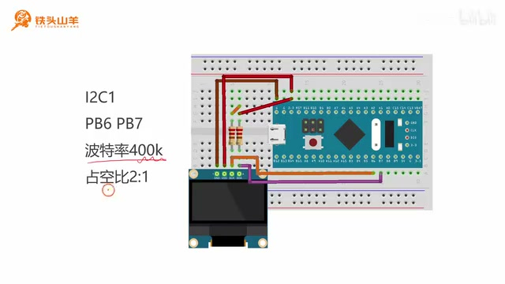
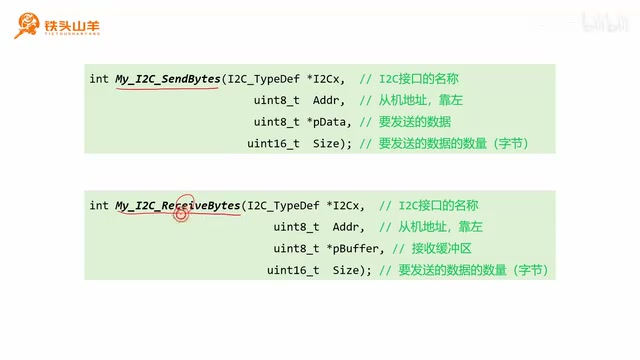
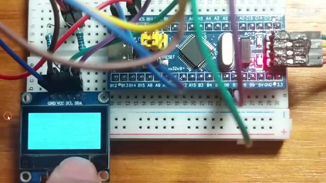
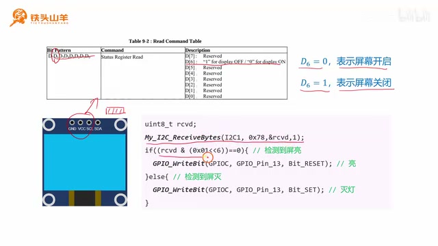
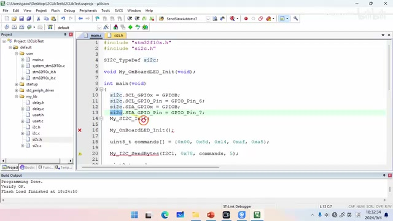
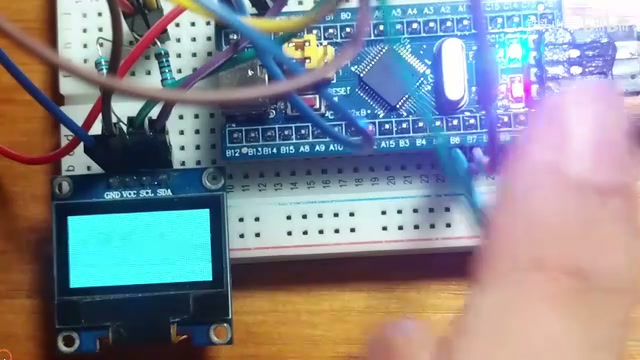

# P023 · 4.7 （I2C）封装常用功能

## 本节安排与工程准备

各位同学大家好，我是铁头山羊。今天我们学习第四章第七节：封装常用功能。前几节我们已经学过软件 I²C 和硬件 I²C 的代码写法，也写了不少代码。不过，之前的编程方式比较繁琐，所以我们把常用代码封装进了 MyLib 库。本期视频就来介绍这个库里面封装的库函数该怎么使用。之前写过的那些常用代码封装起来以后，后面调用起来就方便得多。

本套视频需要的材料都包含在开发套件包里。大家可以扫描屏幕上的二维码，进入淘宝店铺购买。购买套件后可以获得课程课件和源码，也可以加入答疑群，直接和 UP 主交流。

现在打开百度网盘里的课程资料，下载并解压模板工程。给新工程起名为 `I2CLibTest`，因为本次要测试库函数里的 I²C 功能；`Lib` 是 library（库）的缩写。工程文件也重命名为 `I2CLibTest`，然后打开工程。

进入 `default` 文件夹下的 `my_lib`，可以看到四个和 I²C 有关的文件。上面的 `i2c.h` 和 `i2c.c` 对应硬件 I²C，也就是单片机自带的 I²C；下面的 `si2c.h` 和 `si2c.c` 前缀 `s` 表示 software（软件），对应软件 I²C。本节分成两部分：先测试硬件 I²C，再测试软件 I²C。

## 初始化硬件 I²C1

先看硬件 I²C 库函数的用法。测试硬件 I²C 需要自己编写代码进行初始化。

_实验连接示意与硬件 I²C1 参数：PB6/PB7、400 kHz、2:1 占空比。 ·_ [_原片 02:30_](https://www.bilibili.com/video/BV11X4y1j7si/?p=23\&t=150)

本次实验测试单片机里的 I²C1，不重新配置它的引脚，而是使用默认引脚 PB6 和 PB7。大家要注意，接线分别连到 PB6 和 PB7 上，自己根据实际接线调整。参数方面，波特率选择 400 kHz，也就是最高的波特率，接着把占空比选为 2:1。参数选择 400 kHz（最高波特率）和 2:1 占空比。

现在打开 `user` 文件夹里的 `main.c`。为了让代码更工整，先声明 `My_I2C1_Init` 函数，再把初始化代码写在函数内部。首先初始化 IO 引脚 PB6、PB7。先使能 GPIOB 时钟，再声明 GPIO 初始化结构体并给成员赋值：引脚选择 `GPIO_Pin_6 | GPIO_Pin_7`，模式为复用开漏输出（AF\_OD），最大输出速度选 2 MHz。最后调用 `GPIO_Init` 初始化这两个引脚。

接着初始化 I²C1。使能 I²C1 时钟，然后对 I²C1 复位：先施加复位信号，再释放复位信号，这样就完成了外设复位。

声明 `I2C_InitTypeDef` 类型的结构体变量，例如 `I2C_InitStruct`，给成员设置参数。`I2C_ClockSpeed` 设为 400000；模式选标准 I²C（`I2C_Mode_I2C`）；占空比选 2:1（`I2C_DutyCycle_2`）；其他参数不需要设置。调用 `I2C_Init` 完成 I²C1 初始化，最后用 `I2C_Cmd(I2C1, ENABLE)` 打开 I²C 总开关。这样硬件 I²C1 就初始化好了。初始化函数写完之后，最后不要忘记打开 I²C 的总开关。我们调用 `I2C_Cmd`，把 `I2C1` 和 `ENABLE` 传进去。这样 I²C1 的初始化才算完成。然后在 `main` 方法里面把这个函数调用一下。

## 硬件 I²C 库函数：发送与接收

_硬件 I²C 的发送和接收接口及其参数。 ·_ [_原片 06:30_](https://www.bilibili.com/video/BV11X4y1j7si/?p=23\&t=390)

接下来看看硬件 I²C 的两个文件提供了什么接口。打开 `i2c.h`，里面有两个编程接口。第一个叫 `My_I2C_SendBytes`，`Send` 是发送，`Bytes` 表示字节，它通过 I²C 一次向从机发送多个字节。第二个叫 `My_I2C_ReceiveBytes`，用于通过 I²C1 一次从从机读取多个字节。这两个接口其实在前几期视频里已经写过，和我们之前写的代码是一模一样的。只不过我在课上写的代码基础上自己又增加了一些修饰，让代码运行起来更加稳定。现在简单看一下这两个接口的参数和返回值。

两个接口的参数中，`I2Cx` 填 I²C 接口名称；`Addr` 填从机地址，地址需要靠左填；`pData` 是待发送数据数组；接收时 `pBuffer` 是接收缓冲区；`Size` 是我们要收发的数据数量，单位是字节。看清楚这几个参数，调用时就分别把 I²C 名称、从机地址、数据或缓冲区以及字节数填好。

先测试向从机写数据，也就是发送接口。我们仍然向右边的屏幕写五个字节来点亮它。注意，这次接线调整到了 PB6 和 PB7，检查线路是否接对，并把线换到这两个引脚。

回到 `main.c`。要使用 `i2c.h` 里的内容，先引用 `i2c.h`，然后直接调用刚才的发送函数即可。

调用 `My_I2C_SendBytes` 时，接口填 `I2C1`，从机地址填 `0x78`。先声明一个数组装要发送的数据。五个字节分别是 `0x00`、`0x8D`、`0x14`、`0xAF` 和 `0x5A`。把这五个字节发送出去，数量填 5。

这样五个字节就发送出去了。大家看，是不是跟之前相比编程方式简单多了？我们只要引用一下这个头文件，然后写一行代码，数据就发出去了，省了很多时间。点击左上角的编译按钮，编译没有错误也没有警告，然后把代码下载到单片机。

_向 OLED 发送五个字节后，屏幕点亮。 ·_ [_原片 09:10_](https://www.bilibili.com/video/BV11X4y1j7si/?p=23\&t=550)

按一下复位按钮，屏幕就点亮了，现象和之前的实验相同。过去要半个小时做的事，现在一分钟就完成了。

发送测试完成后，再测试数据接收。仍然使用前几节课的例子：用板载 LED 作为屏幕状态指示灯。通过 I²C 从屏幕读出一个字节，

_OLED 状态寄存器中 D6 的含义及读取后控制 PC13 LED 的代码。 ·_ [_原片 09:44_](https://www.bilibili.com/video/BV11X4y1j7si/?p=23\&t=584)

其中 D6 表示屏幕是点亮还是熄灭：D6 为 0 表示屏幕开启，D6 为 1 表示屏幕关闭。读取后判断 D6，再控制板载 LED（PC13）。因此先初始化板载 LED，单独声明初始化函数，把初始化代码放进去，这样代码更工整；再把函数原型复制到下面。

初始化板载 LED 时，先使能 GPIOC 时钟，再初始化对应引脚。这个代码已经写过很多遍了。调用 `GPIO_Init`，把 PC13 配置为推挽输出，速度选 2 MHz。然后调用 `GPIO_Init(GPIOC, &GPIO_InitStruct)`，初始化 GPIOC 的 PC13。

这样板载 LED 就初始化完了。最后最好加一行这样的代码，向 PC13 写一个 1，让它在默认状态下熄灭，这样是最好的。`Bit_SET` 就是熄灭。然后把这个初始化方法放到 `main` 方法里调用，在这里调用一下就行。把这个方法放到 `main` 方法里调用。

接下来从屏幕读一个字节并判断 D6。声明一个字节类型的变量，例如 `rcvd`，用来接收从 I²C 读出的字节。调用库函数 `My_I2C_ReceiveBytes`，接口填 `I2C1`，地址填 `0x78`，接收缓冲区填变量 `rcvd` 的地址，数量为 1。读出这个字节后就判断它。

如果接收到的这个字节与 `0x01 << 6` 做按位与，结果等于 0，就说明屏幕点亮了，对吧？那我们就把板载 LED 点亮；否则就把这个 LED 熄灭。这样程序就写完了。写完之后编译一下代码，再把代码下载到单片机当中。现在按一下单片机的复位按钮，可以看到 LED 点亮了，这说明我们的代码运行正确。

至此，硬件 I²C 的两个编程接口都测试完了，大家应该已经会用了。接下来测试软件 I²C。我们再来看软件 I²C 的使用方法。软件 I²C 更简单。上面的硬件 I²C 初始化，包括初始化 IO 引脚以及初始化 I²C 本身，这些代码都用不着了，可以直接删除；剩下的代码保留就 OK。这些代码都不用，下面原先调用硬件初始化的地方也删掉。

打开 `si2c.h`。这里有三个编程接口：第一个是初始化软件 I²C，第二个发送数据，第三个接收数据。我们先来初始化软件 I²C。需要声明一个变量代表软件 I²C，最好声明为全局变量。使用这个软件 I²C 之前，先引用它的头文件，也就是 `si2c.h`。然后声明这个变量，例如把它命名为 `si2c`。接下来要给这个变量设置初始化参数。

## 配置软件 I²C 并复用读写接口

_软件 I²C 结构体中的 SCL/SDA GPIO 端口、引脚配置和初始化调用。 ·_ [_原片 15:00_](https://www.bilibili.com/video/BV11X4y1j7si/?p=23\&t=900)

初始化很简单：在 `si2c` 结构体里分别指定 SCL、SDA 两个引脚的位置。SCL 所在端口填 GPIOB，引脚编号要按实际接线填写。引脚接在别的位置，编号也要跟着变；这次演示的接线是 PB6 和 PB7这次恰好接在 PB6 和 PB7 上，所以代码中的引脚编号也填写 PB6 和 PB7。选好两个参数后，其他不用管，直接调用 `My_SI2C_Init` 并把参数传进去，软件 I²C 就初始化完成了。

剩下的工作是调用软件 I²C 的数据读写接口。写数据用 `My_SI2C_SendBytes`，用法基本和硬件 I²C 一样，只是一开始填的不是硬件 I²C 名称，而是软件 I²C 的名称，也就是传入 `si2c` 的地址；其他参数相同。把刚才的发送代码粘过来，再删除原先那行硬件 I²C 调用。

接收数据也一样。调用 `My_SI2C_ReceiveBytes`，第一个参数填刚才声明的 `si2c` 变量，后面的地址、缓冲区和数量都和刚才一样，直接粘过来，再删除原来的硬件 I²C 接收调用。把代码整体替换过来后，就可以测试了。

编译没有问题就下载。可能有同学会怀疑，不写屏幕代码，屏幕也一直亮，这是因为屏幕没有断电。要严谨地测试，可以把屏幕拔下来再插回去。

_重新插接 OLED 并复位后，OLED 和板载 LED 都亮起。 ·_ [_原片 16:35_](https://www.bilibili.com/video/BV11X4y1j7si/?p=23\&t=995)

重新插好后，屏幕现在是不亮的；按一下复位按钮，屏幕点亮，灯也亮了，说明软件 I²C 工作正常。

软件 I²C 比硬件 I²C 更简单，不用初始化硬件 I²C 外设，也不用自己初始化 IO 引脚，因此更方便。

到这里，我们已经掌握软件 I²C 和硬件 I²C 的使用方法。我们一步一步把代码写过来，经历了不少挫折，但现在你的水平已经很高了。我相信，99% 的工程师都没办法自己动手把软硬件 I²C 代码都完整写出来；一次性调试成功也很难，所以现在大家的水平确实已经很高了。

以上就是本期视频的全部内容，感谢大家收看。下期讲 OLED 显示器的使用方法，内容会更好玩。好的，我是铁头山羊，我们下期视频再见。
