# P024 · 4.8 （I2C）OLED显示器

今天我们一起来学习第四章的第八节，通过本期视频，我们来了解一下OLED 显示器的使用方法，本套视频所需要的所有材料，都包含在这个开发套件包里。

大家可以扫描屏幕上的二维码，进入到我们的淘宝店铺来购买它，购买套件之后，你将获得课程所有的课件和源码，还能加入答疑群和up直接交流。

首先呢我要告诉大家，本期视频的内容会非常的多，但是每一个知识点呢又不难，所以我们就抱着玩的心态来学习，这期视频就可以了。

本期视频呢我们将分成以下五个部分来讲。显示图像的一个基本的原理，然后第二部分，我带领大家一起来对这个屏幕进行初始化，第三部分。

我们介绍一些基本的概念和基本的操作，第四部分我们把文字显示在这块儿屏幕上，第五部分呢，我们介绍一下如何在屏幕上进行绘图

## OLED显示图像的基本原理

下面呢我们从第一部分开始，首先我们先来解释一下，OLED 显示器是如何显示图像的，我们的这块OLED 显示器是如何显示内容的呢，其实原理是这样的哈。

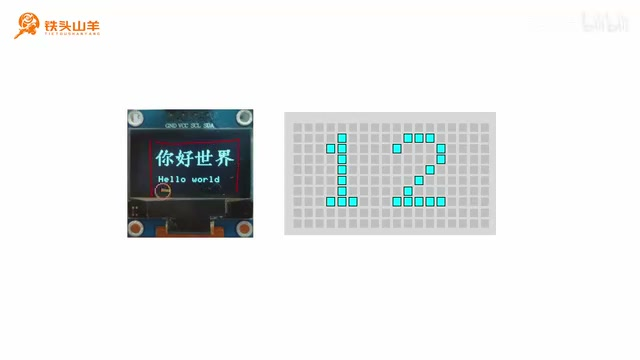

_课件用像素点阵示意 OLED 的像素状态和显示效果。 ·_ [_原片 01:12_](https://www.bilibili.com/video/BV11X4y1j7si/?p=24\&t=72) 在这个OLED 显示器的内部呢有一个内存，我们可以通过I2C总线对这个内存呢进行读写，然后这个内存里边的每一个比特位，都代表我们屏幕上的一个像素，而我们的这个屏幕呢。

就是由这样一个一个的像素组成的，如果我们向对应的比特位写零，那么这个像素就熄灭，如果我们向这个比特位写一呢，这个像素就点亮。

我们通过I2C 总线，向我们的这个内存里边写入数据，来调整我们这个内存的内容，然后就可以显示对应的图像了，这个就是OLED 显示器显示图像的一个基本的原理。

刚才呢我们简单的了解了一下这个OLED 显示器，显示图像的一个基本原理

## 屏幕初始化

那么下面呢就让我们通过第二部分来看一下，这个屏幕应当如何被初始化，因为呢我们待会儿要写代码，所以首先我们先新建一个工程，我们打开我们百度网盘的课程资料。 然后把那个模板工程下载下来，下载完成之后呢，我们会得到这么一个压缩包，然后我们先解压这个模板工程的压缩包，然后就会有这么一个文件夹。

我们给这个文件夹重命名，比如说叫做oled test，也就是测试我们的这个OLED 显示器，然后我们给里边的这个工程文件呢，也进行重命名。

也叫做oled test，上面的这个呢也给它起一个名字叫做oled test，然后我们打开这个工程。那下面呢我们开始编写这个屏幕初始化的代码，首先因为我们这个屏幕是使用这个MC总线。

给我们的单片机进行通信的，所以我们在使用这块屏幕之前，必须得初始化我们单片机上的这个MC接口，我们单片机上呢I2C接口呢既可以是软件I2C，也可以是硬件I2C。

那本期视频呢我们就用这个软件I2C吧，所以第一步呢，我们先对这个软件I2C进行初始化，我们现在来看一下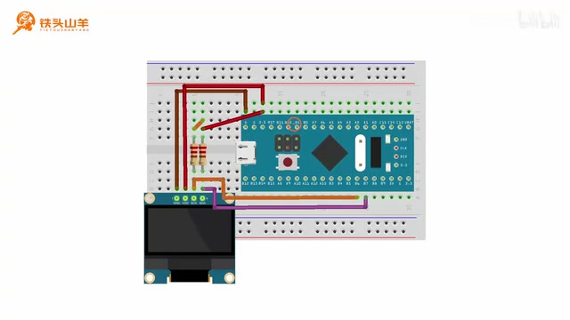

_接线示意图显示 OLED 与 STM32 开发板的连线。 ·_ [_原片 03:00_](https://www.bilibili.com/video/BV11X4y1j7si/?p=24\&t=180) 我们本期视频使用的这个电路图，这个电路图呢跟上期视频用的电路图是一样的，我们还是把这个软件 I2C放在PB6和PB7，这两个引脚上，PB6是软件 I2C的SCL。

PB7呢是软件 I2C的SDA，当然你连其他的引脚也没问题，因为我们这个软件 I2C的这个引脚呢，是可以随便选的，现在呢大家就按照这个电路图去连接电路。

如果你上期视频已经连好了，那现在就不用连了，就直接用上期视频的就可以了，我们这个电路呢连好之后是这样的，我们的SSCL和SDA。

分别看这里接的是PB6和PB7，这两个引脚不要接错了，我们来回忆一下软件 I2C初始化的代码，应该怎么写，首先因为我们要使用到软件 I2C。

所以我们得引用这个SFC点H这个头文件，其中这里的S呢就代表software，也就是软件的意思，这个就是我们软件 I2C的一个头文件，然后呢我们需要为这个软件 I2C声明一个变量。

这个变量的类型呢叫做SI2C type d f，名字呢大家随便取，比如说我们就叫它SSFC就可以。 然后下一步呢，我们需要对这个变量里面的成员进行赋值，这个成员呢分别用来指定SCL和，SDA引脚的位置，其中这个SCL呢在PB6。

SDA呢在PB7，然后指定完这些成员之后，我们调用SI2CINIT，对这个软件 I2C呢进行初始化，这样呢我们就结束了。

现在呢我们开始编写这一部分代码，首先我们在user文件夹里面找到慢点C文件，然后双击打开它，然后我们把这个代码呢，写在ma点C这个文件里面。

首先我们先要引用刚才的这个头文件，头文件的名字呢就叫做SI2C点H，这个就是头文件，然后我们初始化的代码呢为了写的更工整，我们单独封装一个函数去写。

比如说这个代码的名字呢就叫做my software，I2C in it。这个就是我们初始化的这个函数的一个名字，然后我们在这里边，对我们的这个软件 I2C进行初始化。

那在初始化之前，我们首先要为我们的这个软件 I2C呢，声明一个变量，这个变量的类型呢就是啊SI2C，type d f这么一个类型的。

然后给它起一个名字，起了名字之后呢，我们在下面这个位置给它赋值对吧，SSCL引脚的这个GPIO port呢就是GPIOB，它的GPIO pin呢就是GPIO\_Pin\_6。

啊这这就是PB6，然后我们再给SDA也赋值，这个SDA引脚呢也是GPIOB，但是他是PB7，然后这里是PB7。

嗯这些成员都填完之后，我们直接就调用这个嗯SI2C unit，ISI2C in it，对我们的这个软件 I2C进行初始化，参数呢就是我们这个软件 I2C的一个变量。

也就是他的一个名字啊，这样呢我们这个软件 I2C的初始化就写好了，我们把这个初始化的函数呢，放到main方法里面去调用一下。 这个就是嗯我们写个注释，对软件 I2C进行初始化，呃刚才呢咱们已经把这个软件 I2C初始化完了，然后下一步呢，我们就需要对这个OLED 显示器进行初始化。

我们来看一下这个OLED 显示器初始化的代码，是怎么编写的，现在呢请同学们看左边这个位置，左边这里呢，我们的my lab文件夹里面呢有很多的文件对吧。

其中这个OLED点H和OD点C，就是我们这个OLED 显示器的一个驱动程序，我们双击打开这个OLED点H，可以看到里边有很多的函数啊，从这里开始啊。

这里开始有很多的函数，分别代表了不同的功能，各种各样的函数有很多，然后这里的第一个函数就是oled in it，他就负责OLED 显示器的一个初始化。

我们接下来呢就要使用这个函数，对我们的这个显示器进行初始化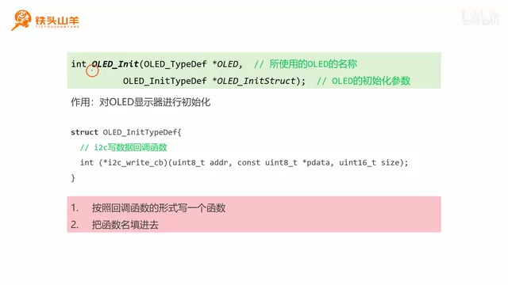

_课件列出 OLED\_Init 的两个参数及其用途。 ·_ [_原片 07:00_](https://www.bilibili.com/video/BV11X4y1j7si/?p=24\&t=420) 接下来呢咱们仔细来看一下这个OLEDINIT，这个编程接口的一个使用方法，首先这个OLEDINIT呢它有两个参数，第一个参数呢是这种类型指针的一个参数，那这种类型呢。

其实就代表我们这个OLED 显示器，然后这个参数所填的呢，就是我们这个OLED 显示器的一个名称，所以我们在使用这个OLED之前，先要用这种类型去为我们的这个显示器呢。

声明一个变量，我们回到main点C这个文件哈，首先因为我们要使用到OLED点H这个头文件，所以我们先把这个头文件的引用给它添上，include o e d点H。

然后接下来呢我们再声明，为我们的OLED 显示器声明一个变量，我们把这个变量的声明呢，放在这个软件 I2C声明的底下，它们的作用呢其实是一样的嗯。

Type df，然后我们随便起个名字，比如说就叫它OLED，然后这个变量我们就声明好了，现在呢我们再回到刚才介绍的这个编程接口。

也就是oled in it，然后我们来看第二个参数哈，第二个参数呢是一个结构体指针类型的。 它用来填写OLED初始化的一个参数，我们先来看一下这个结构体的一个声明，这个就是结构体内部的一个声明，那这个结构体呢只有一个成员，也就是这个成员。

但是这个成员的样子呢看起来怪怪的，其实呢它是一个函数指针。那什么是函数指针呢，这里我们先不解释哈，我们先来看一下这个嗯。

变量这个成员的一个名字叫做I2CWRCB，I2C呢就是I2C接口，right呢就是写CB呢是英文单词call back的一个缩写，叫做回调函数，所以呢它就是I2C写数据的一个回调函数。

我们的单片机，要把图像传递给这个OLED 显示器，那是不是要通过I2C 总线，向这个OLED显显示器写数据啊，当他想要向这个OLED 显示器写数据的时候。

它就会调用我们提供给他的这个啊函数，这个就是回调函数大概的一个用法，然后现在你不懂也没关系，我们按照下面的步骤一步步的去操作，操作完了之后你就明白是什么意思了。

首先我们分两步哈，首先第一步，我们先按照这个回调函数的格式，去自己写一个函数，就是把这个回调函数给它实现了。

那什么格式呢，就这样的一个格式哈，我们来看这个回调函数呢，它后边有个三个参数对吧，首先第一个参数是ADDR。

也就是从机的地址。然后第二个参数p data呢，也就是我们要发送的这个数据，第三个参数size呢就是要发送的这个数据的数量，然后他还还有还会有一个返回值。

我们就按照这种格式自己去声明一个函数，然后把这个函数实现了就可以了，我们使用那个软件 I2C对这个函数进行实现，我们先来完成这里的第一步，按照这个格式去写这么一个函数。

我们就是按照这种格式去写这个函数，首先呢我们先在main main点C这个文件的底部呢，顶部呢对这个函数进行声明，它的返回值是int类型的，然后随便给它起一个名字。

比如叫做I2C write bytes。 随便起哈，但是不要跟别的这个函数重名就好了，然后他的第一个参数呢是一个，无号八位整形的啊，代表我们这个从机的一个地址。

然后第二个参数呢是一个嗯这种类型的，这个用来传递我们要写入的数据，然后第三个参数呢是一个无符号，16位整形的啊，用来填写我们要传递数据的数量。

我们来看一下这个格式是不是对的，123哎，正好三个参数，那我们这个格式写完了，然后我们复制一下这个函数原型。

放到底下进行实现。那怎么实现通过I2C，向像我们的这个从机写数据呢，我们可以调用我刚才初始化好的，这个软件 I2C哈。

软件 I2C里边有一个my si方C嗯，write啊，Send bts，这个是不是就是写数据啊，所以我们把这些参数对应的传进去就可以了。

这是从一的地址，这是要发送的数据，然后这是要发送数据的数量嗯，除此之外呢，对于我们这个软件 I2C来说。

它前面还需要添加一个这个软件 I2C的名字，对吧，这样呢我们这个函数就写好了，最后呢，我们把这个软件 I2C的这个返回值返回给他。

这样的，我们这个函数就实现好了，然后第二步呢，我们就是把刚才我们声明的那个函数的函数名，作为参数。

传到这个结构体的这个成员里去就可以了，那下面呢我们来写一下这个屏幕初始化的代码，首先我们先声明，再声明一个函数哈，叫做my y d screen啊。

INIT这个用来初始化我们这个OLED 显示器啊，我们就写这么一个名字啊，只要不重名就好，然后我们把它放在下面进行实现，然后在这个函数里面呢。

我们先声明一个OLED，init type df这样的一个结构体类型的变量啊，随便给它起一个名字，比如说叫这个名字，然后呢我们给它里边的这个成员赋值。 就是刚才的这个回调函数，这个成员对吧，我们刚才这个函数已经写好了，我们把这个函数呢，函数名作为参数传进来就行了。

然后呢，这个结构体变量里面的内容就填好了，最后我们就调用oled in it，对我们的这个OLED进行一个初始化。嗯这样所有的代码都写完了。

我们把这个my ord screen in it，这个方法放到我们main嗯main方法里面去进行调用。也就是写在这里，对OLED 显示器进行初始化，刚才呢我们就把屏幕的初始化的代码写完了。

## 画笔、画刷、坐标系与光标

那下面呢让我们通过第三部分，来看一下跟OLED 显示器相关的基本概念，和一些基本的操作，这个第三部分基本概念和基本操作呢，我们分成下面这么三个小的部分来讲。

分别是画笔和画刷，屏幕坐标系以及光标，首先我们先来看第一个小部分，画笔和画刷，我们来看这样一个软件哈。

这个软件呢就是我们windows里面最常用的，这个画图软件，想必大家对这个软件都非常熟悉了，然后这个软件里边的前景色和背景色的概念，就特别像我们今天要学习的这个OLED。

显示器里边的画笔和画刷的概念，其中前景色呢就相当于画笔，背景色呢就相当于画刷，比如说我们把画笔设置成黑色，把画刷设置成白色。

那么如果我们用一个铅笔去画画的话，那么这画出来的是不是就画笔的颜色，就是这个黑色，然后这个画笔呢还能设置粗细，比如说我们可以把它设置成粗一点的。

比如说八个像素，这样呢我们画出来的线条就会更粗一点，然后再比如我们画一个这样的矩形框儿，那这个矩形框的外边就是画笔，就是画笔的颜色。

黑色里边的填充色呢就是画刷的颜色，也是这里的白色，这个就特别像我们OLED 显示器里边，画笔和画刷的一个概念。 在我们今天要讲的这个OLED 显示器里面呢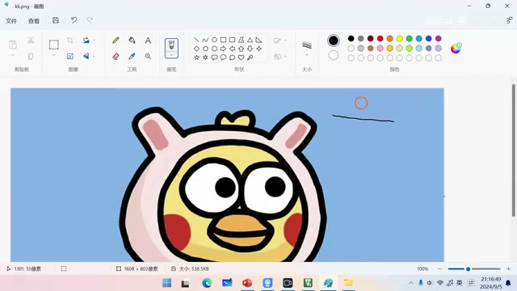

_Windows 画图窗口中显示卡通图案，画布右上方有一段细黑线。 ·_ [_原片 13:40_](https://www.bilibili.com/video/BV11X4y1j7si/?p=24\&t=820) 有三种不同颜色的画笔，分别是白色的画笔，黑色的画笔和透明的画笔，我们知道对于我们这个OLED的显示器来说，它只有两种。

它的像素点呢只有两种状态，一种是点亮，另一种是熄灭，那点亮呢就对应白色，熄灭呢就对应黑色。

这个透明呢就表示什么都不做，然后我们来看一下，当我们画一条线的时候，那这个画笔的颜色就决定了这条线的颜色，比如说我们设置是白色的画笔。

大家来看这个划线的地方，是不是这个led的像素就被点亮了，而如果我们设置的是一个黑色的画笔的话，那对应的这个像素是不是就被熄灭了，这个就是黑色的画笔。

而如果我们设置的是透明画笔的话，那这条线根本就画不出来，因为我们是对这个像素呢什么都不做，所以它是一个透明的，然后再比如如果我们画一个矩形的话。

那这个画笔的颜色就决定了这个矩形，这些外框的颜色，如果是白色的话，它就点亮，如果是黑色的话。

像这里它就熄灭，像这个圆形来说也是一样，这里这个边框的颜色就是画笔的颜色，然后如果我们画的是一个位图，也就是一张图片的话。

比如说这个苹果，那这个画笔的颜色呢，就决定了我们这个苹果的一个图像的一个颜色，比如说是白色，那这个苹果就是白的。

如果我们的画笔颜色是黑色，那么这个苹果就是黑的，然后如果我们写的是一个字符串的话，比如说我们想在屏幕上打印一个123，那这个画笔的颜色呢。

决定的就是我们这个字的一个颜色，比如说如果我们是白色的画笔的话，那这个字就是白的，而如果我们是黑色的画笔的话，那这个字就是黑的。

然后除了能够设置画笔的颜色之外，我们还可以设置这个画笔的粗细，我们来看，比如这是我们这个一个像素的画笔，这是两个像素的画笔。

三个四个五个像素的画笔，可以看出它画出来的这个线呢是越来越粗，然后对于我们画一个矩形来说也是一样，因为这个画笔呢决定了这个矩形的外边框。 如果我们设置的这个画笔很细的话，那画出来这个外边框就很细，后边的这个呢画笔就很粗，所以他画出来的这个边框就很粗，看完了画笔。

我们再来看一下画刷，对于这个画画来说呢，它只有颜色，没有粗细，这个画刷的颜色呢也是分三种。

分，分别是白画刷，黑画刷和透明画刷，比如说如果我们画矩形的时候使用的是白画刷，那它这个填充颜色就是白色。

如果我们使用的是白色的画笔，黑色的画刷，那么它的边框就是白的，然后它里边的填充色呢就是黑色的，这就是黑化刷。

然后我们再来看一下透明化刷，我们看前面的这个黑化刷，是不是能把后边的这个长条挡住啊，但是如果我们使用的是透明画刷的话，那它就会透过这个矩形能看到后边的这些东西。

这个就是透明化刷，这个画画的颜色呢，除了可以影响到这些东西之外呢，还可以影响到我们画的这个图像的一个背景色，比如说我们画这么一个苹果。

我们把这个画笔呢设置成黑色，那么画的苹果就是黑的对吧，然后呢我们再把画刷设置成白色，那么它背景的这个边框里边的填充色，是不是就是白的了。

画刷决定的是这个背景的填充色。然后除了可以影响这个图像的背景之外，我们这个画刷呢还能影响到我们打印的这个，字符串的一个背景，比如说我们打印一个123。

我们把画笔设置成黑色，那么这个123的字就是黑色的对吧，后边的这些背景呢就是由我们的画刷决定的，我们把画刷设置成白色，那么这个背景就是白色的。

刚才我们已经从大体上了解了，这个画笔和画刷的一个概念，下面我们来看一下，如何去设置这个画笔和画刷的参数，我们刚才学习过这个画笔呢。

可以设置颜色和粗细，这个画刷呢只能设置颜色，那个颜色呢可以是白色，可以是黑色，也可以是透明。

然后下面呢我们通过这么两个编程接口，分别来设置画笔和画画，首先来看第一个编程接口set pen。 set呢是设置pen呢是画笔的意思，所以所以这个编程接口的作用呢，就是去设置画笔的参数，那它有这么两个参数可选哈，分别是pen color。

这个pen color呢用来设置画笔的这个颜色，可以选白，也可以选黑，也可以选透明，然后后面的这个位置呢决定了我们画笔的粗细。

你画一条线到底是细线还是粗线，都是由这个位置来决定的，我们再来看第二个编程接口，Oled set，Brush。

set呢是设置brush呢是画刷，所以这个编程接口的作用呢，是用来设置画刷的参数，对这个画刷来说呢，它只有一个参数。

就是这个color，也就是画刷的颜色也是白色，黑色和透明色，这四这三个选项可选，刚才呢我们介绍了画笔和画刷的概念。

下面我们通过第二部分

### 屏幕坐标系与光标

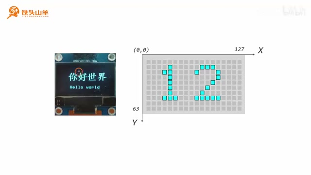

_课件展示 OLED 屏幕像素坐标系及坐标轴方向。 ·_ [_原片 20:00_](https://www.bilibili.com/video/BV11X4y1j7si/?p=24\&t=1200) 来看一下屏幕坐标系的一个概念，我们刚才说过，我们这个屏幕呢，其实是由一个一个的像素点组成的，横着呢有128个像素点。

竖着呢有64个像素点，然后我们想要在这个屏幕上作画，就得啊给这些坐标呢定义，给这些像素点呢定义坐标，这样呢我们才能方便的找到它们。

那怎么定义这个坐标系呢，我们可以选取这个屏幕的左上角，这个点作为这个原点哈，往下延伸就是Y轴，就是也就也就是纵坐标。

往右延伸呢就是X轴，也就是横坐标，这样呢，我们就可以给屏幕上的每一个点都定义坐标了，也就是这是纵坐标。

这是横坐标，比如说我们来看屏幕上这么一个点，那这里横坐标是0123，这里的纵坐标是012，所以这个点的坐标我们就可以很轻易的写出来。

就是三二，这就是这个点的坐标，刚才呢我们说过，我们屏幕呢是由一个一个的像素点组成的，我们想要在这个屏幕上作画。

那么我们就需要精确的定位到，每一个像素点的位置，那怎么去定义它的位置呢，我们可以去建立一个坐标系哈。 我们以这个屏幕左上角这个点，作为这个坐标系的原点，然后往下延伸呢，这个是Y轴，也就是纵轴。

然后往右延伸呢，这个是X轴，也就是横轴，这样呢我们就建立了一个坐标系，那对于我们这个屏幕来说。

它的宽呢是128个像素点，高呢是64个像素点，所以我们对于我们这个坐标系来说，它的这个横坐标呢最大就是127，范围是从0\~127。

那纵坐标的范围呢就是从0\~63，给大家举个例子哈，比如说我们在屏幕上找这么一个点，我们想定位这个点的坐标，那这个坐标是多少呢。

我们就可以很轻易的写出来，这里是0123，所以它的横坐标是三，这里是012，所以它的纵坐标是二。

那么这个点的坐标就是三二，刚才呢我们学习了这个屏幕坐标系的概念，下面我们再通过第三个小部分，来看一下这个光标的概念，那什么是光标呢。

所谓光标呢就是我们作画的当前位置，比如说我们把这个光标放在这个坐标点，然后我们去画一个矩形的话，那么这个矩形就会被划到这个位置，它的左上角点就是我们当前光标所在的位置。

如果我们移动一下这个光标，比如说把它移动到这里来，我们做同样的矩形，那这个矩形呢就会显示在这里。再比如我们想要画一个圆。

我们把光标放在这个位置，那么我们画出来的圆呢，它的圆心就在光标的当前点，所以可以看得出来这个光标的位置呢，就决定了我们下一步去作画的时候。

那个图形所在的位置，现在呢请同学们回到我们的代码，然后我们找到左边的这个OLED点H，也就是我们这个显示器的一个头文件，双击打开它。

然后找到我们刚才嗯这些函数，这里有很多函数哈，其中这一部分从这里到下面这个位置，都是跟这个光标的移动，或者是获取当前的这个光标。

相关的一些编程接口，我们这些编程接口呢简单了解一下，后边呢我们会具体的介绍它的这个使用的方法。 简单了解一下这些编程接口，这些编程接口呢虽然数量很多，但是呢用起来都不难，我们逐一来看一下，首先第一个编程接口叫做set cursor。

set呢就是设置cursor呢就表示光标的意思，也就是说它会设置这个光标的当前位置，怎么去设置这个光标的当前位置呢，你得给它指定X坐标和Y坐标，我们把这个X坐标和Y坐标传给这个编程接口。

调用它之后呢，我们就能把这个当前的光标，设置在XY这个位置，然后下面的这个编程接口呢就是set cursor x，也就是只设置这个光标的X坐标。

纵坐标不动，所以呢它只有一个参数，也就是我们要设置的这个X坐标，比如说本来这个嗯光标的坐标呢是零零，如果你调用这个编程接口。

把这里改成这里的这个X呢，传的是十，那这个光标就会被移动到零十啊，十零十零横坐标变成了十，纵坐标保持不变。

然后下面的这个编程接口呢叫做set cursor y，也就是只设置这个Y坐标，跟上面正好相反哈，他设置的是Y坐标，X坐标保持不变。

然后再往后这里有一个move cursor，这个move cursor的作用呢就是移动光标，那它也有两个参数哈，一个是DX，一个是DY。

就是我们往X方向和Y方向移动的距离，比如说我们还是假定这个光标一开始在零零，然后呢我们给这个给这个DX赋一个值是五，给DY呢传进去的是十，然后我们去调用这个编程接口移动光标。

那么移动了这个光标之后，它就会在原来的基础上X加五，Y加十。所以移动之后它的坐标就变成了（5，10），然后下面两个编程接口。

一个是只移动X坐标，也就是目cursor x，另一个呢是指移动Y方向的坐标，move cursor y嗯，再举个例子。

比如说我们的坐标还是零零，然后我们调用这个编程接口。 去移动这个光标的X坐标，然后这个DX呢我们填十，那么移动之后它的坐标就是十零，可以看到X呢增加了十，但是Y呢保持不变。

然后下面的这个呢是单独的移动，光标的这个Y坐标，比如说我们给DY赋一个十，然后调用这个变身接口，那么它就会从这个十零进一步的移动到十十。

大家来看X坐标保持不变对吧，Y坐标增加了十，然后再往后这个编程接口l e d get cursor，get呢是获取cursor呢是光标，这个编程接口的作用呢。

就是去获取光标的当前位置，比如说他现在已经到了实时这个位置对吧，然后我们调用这个编程接口，就会给我们返回两个十，代表当前的这个X坐标和Y坐标。

然后再往后这两个编程接口，一个用来获取X坐标，一个用来获取Y坐标，还是假设我们的这个光标当前在实时，如果换一个吧。

比如说比如说50，比如说当前在50这个坐标，如果我们调用这个get cursor x的话，返回的就是X坐标，所以这个返回值呢就是五。

如果调用的是get cos y的话，它返回的就是Y坐标，返回的这个值呢就是十，这就是这组编程接口的一个使用方法，虽然很多呢。

但是但是它们的使用方法是比较简单的，简单介绍了一下跟屏幕相关的一些基本概念，和一些基本的操作之后呢，下一步我们就开始往屏幕上显示内容了

## 在屏幕上显示文字

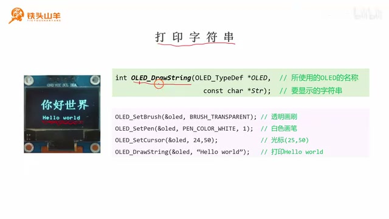

_演示代码和 OLED 屏幕展示文字输出操作。 ·_ [_原片 26:40_](https://www.bilibili.com/video/BV11X4y1j7si/?p=24\&t=1600) 首先呢我们先往通过第四部分来学习一下，如何向这个屏幕上去显示文字，那这个第四部分显示文字的这一部分呢，我们将分成四个这么小部分来讲。最基本的。

就是往屏幕上打印一个最普通的一个字符串，然后第二部分我们介绍一下，如何设置这个字符串的字呃，字体和字号，然后第三部分我们学习一下这个格式化。

打印字符串的方法，也就是类似于我们这个print f的一个方法，然后最后一部分我们需要学习一下。 如何在这个屏幕上去设置一个文本区域，这个文本区域呢就像一个文本框，待会儿我们再解释这个问题啊，首先我们先来看第一个小部分，打印最简单的一个字符串。

那什么是往屏幕上打印字符串呢，我给大家举个例子哈，比如我们要在屏幕上输出这么一个hello world，这个就是我们在屏幕上显示的一个字符串，那么怎么去打印这个字符串呢。

我给大家准备了这么一个编程接口哈，叫做oled draw，string draw呢是绘制的意思，string是字符串，那这个编程接口的作用呢。

就是用来绘制字符串了，然后我们来看这个编程接口呢，它有这么两个参数，首先第一个参数是这个OLED 显示器的一个名称，这个名称呢我们就不多说了嗯。

然后后边的第二个参数呢叫做SSTR，这个STR呢是一个字符串类型的，它要传入的就是我们要在屏幕上打印的，那个字符串，我们要打印什么。

就往这个字符串里面填什么，比如说我们要打印字符串123啊这么一行字，那么我们就把这个123加个双引号，传到这个STR这个变量里就可以了，那下面呢我们来看一个实际的例子。

就是我们要在屏幕的这个位置去显示这个hello world，那这个代码应该怎么写呢，首先我们先来观察哈这个字符串，它的这个字符串的颜色是白色的对吧，也就是说它这个画笔的颜色是白色的。

所以我们先set pen这个pen color white white就表示白色，然后宽度是一，这个就是我们设置一个白色的画笔，然后对于这个字符串来说，它的这个背景色。

大家来看看这个背景色是不是黑色的，或者是透明的，黑色或者透明的，所以呢啊，我们比如说我们把它的背景设置成透明的吧。

就是不绘制这个背景，然后我们就需要设置一下这个画刷，Set brush，set brush呢是设置画刷，把它这个画刷的颜色呢设置成透明色。

这个transparent呢就是透明，这个就是把画刷设置成透明色，然后设置好这两个部分之后，我们需要移动我们的光标哈，我们把这个光标呢移动到这个字符串。 我们要画字符串的这个位置的左下角的这个点，这个点的坐标呢我帮大家算出来了，这个点是二十四五十，所以我们就调用刚才学习的那个编程接口，叫做o r e d set cos。

把这个光标的位置呢设置到二十四五十，然后这些准备工作都做完了之后，我们就可以去绘制这个字符串了，我们调用刚才学习的这个oled draw string，然后这个参数呢。

我们就填我们要打印的这个字符串，Hello world，这样呢我们就可以把这个字符串呢，显示到这个屏幕上了，现在呢我们回到我们这个main点C这个文件哈。

我们把代码写在这个while循环之前，首先第一啊，第一步呢我们是要打印。Hello world。嗯我们先设置画笔和画刷的颜色。

先设置画笔oled set pen，然后第一个参数呢填我们OLED的名称，第二个参数填画笔的颜色，pen color white表示使用的是白画笔，宽度呢是一。

这个就是设置画笔的颜色。设置白画笔，设置完画笔之后，我们再设置一下画刷，Set brush。

brush呢就是画刷，然后这个画刷的颜色呢我们设置成透明色，Transparent，就是透明色透明画刷，然后第三步我们就是去移动这个坐标。

这个坐标的位置呢，我们把它设置到二十四五十这个位置，二十二五十看一下这个坐标点啊，二十四五时设置到二十四五时，横坐标是24。

纵坐标是50，设置这个就是设置光标，设置完光标之后，我们就可以去打印那个字符串了，叫做draw drain。

Draw drain，就是打印字符串，然后这个字符串的内容，我们要打印的就是hello world嗯。 不要加这个句号，就这样就可以了，最后我们这个绘制的这个hello world，这个内容呢只是在啊我们单片机里边，单片机的内存里面把它绘制出来了。

下面呢我们需要把这个绘制内容，发送到我们的屏幕上，我们得调用这个send buffer啊，把这个内容给它发送出去，嗯这样呢我们这个代码就写完了。

然后我们按左上角的第二个按钮，去编译一下代码。啊没有错误也没有警告，然后我们按这个下载按钮，把代码下载到单片机当中。

好的我们现在来测试一下这个代码的效果，我们按单片机上的复位按钮嗯，可以看到现在就显示了一行字符串，就是这个hello world，现在呢我们已经学会了。

如何去打印这种最基本的字符串了，然后我们再通过第二个小部分来看一下，如何去设置这个字的一个字体，还有这个字号，下面呢我们想在屏幕上显示一个中文的。

你好世界，然后这个拟好世界的，它这个坐标点呢是二十三十二，也就是左下角这个点的坐标呢是二十三十二，然后它的字号呢是16。

也就是这个字的高度呢是16号的，16个像素点，但是我们的这个单片机里边呢，没有关于这个中文字的一个字体，也就是说我们只能打印英文。

不能打印中文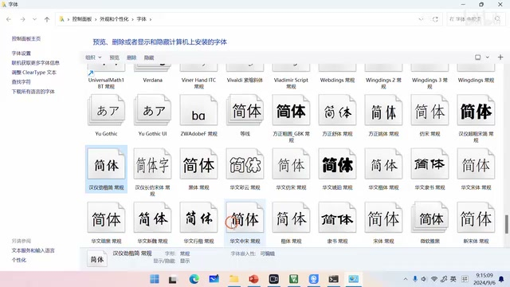

_桌面字体列表和工程 font 文件夹对应字体选择与拷贝步骤。 ·_ [_原片 32:20_](https://www.bilibili.com/video/BV11X4y1j7si/?p=24\&t=1940) 那我们怎么去制作一个这种中文字体呢，下面我们来教一下这个详细的步骤，首先呢先告诉一下大家，就是本次我提供给大家的这个驱动程序呢，是可以显示任意的字体的。

就是你电脑上能够有什么字体，那都我们都可以把它显示到这个OLED的屏幕上，我们来介绍一下具体的步骤哈，首先第一步我们先找到我们想用的这个字体，我们在windows里面打开这个字体管理器哈。

然后可以看到里面有很多的字体，我们选取一种自己喜欢的字体嗯，比如说我要这个等线的这个字体，或者是用下面的这种字体啊，这个字体是有版权的哈。

如果商用的话，大家不要用这个字体，我们就用这个汉译进凯吧，我们复制按CTRL加C复制这个字体。 然后回到我们这个工程的这个文件夹，找到my lab，然后找到这里的font，font代表的就是字体啊，我们双击打开这个文件夹。

然后这里边呢有一个TTFTTC，这个文件夹呢就是用来存储这个字体的，我们双击打开它，把刚才的字体粘进来，然后重新给它改个名。

把它改写成这个汉译近凯，这个就是我们字体文件的一个名称，改完了之后，我们返回来哈，返回这一级目录。

然后打开这个点map这个文件，我们把所有想要显示的这个字呢，都嗯给它复制到这个，都给它写到这个文件里面，当然你可以一次性的录入很多的文字。

就是啊你用的不用的都可以录入到里边，让他一次性的帮你生成就可以了，嗯比如说我们还有可能会使用到字母，那么我们就把ABCDEFG一直点点点，一直到这个Z我们都输入进去。

这个都是没问题的，我们本次呢只使用这个你好世界，就只使用这种字体显示你好世界，所以我们就只输入这四个，然后输入完成之后。

我们就可以运行这里的双击，运行这里的这个小红心，也就是t t f to c点ESE这个文件，然后双击运行它之后，它就会弹出来这么一个窗。

这个窗口呢它提示让我们输入这么几个东西啊，一个是我们这个TTF，TTC文件的一个文件名，我们还是回到刚才这个字体的这个文件哈，我们要用的这个字体的文件名呢叫做汉一进凯。

我们把它粘进来，然后第二个呢就是字号，也就是我们字的大小，我们要16号字，然后第三个呢就是我们生成。

要生成的这个字体的一个字体名，我们嗯尽量呢于用这些比较简单的名称，因为嗯待会儿呢我们还会用到它，叫做就是汉夷进K16，代表这个16号的汉译进凯。

按回车，然后呢他就已经帮我们生成好了，这个点H文件了，就是头文件，这个头文件的名称呢叫做HYJK16点H。

我们可以复制这个头文件的名称哈。 复制之后回到我们的这个工程里面嗯，然后我们把这个头文件给它引用上。引用这个头文件，现在呢我们就可以使用这个字体了，嗯刚才呢我们已经把这个字体生成好了。

下面呢我们需要使用这个字体去显示这么一个，你好世界的文字，那在显示这个文字之前，我们得把这个当前字体设置成啊，我们刚才生成的那种字体。

那怎么设置呢，我们使用这么一个编程接口啊，就是o l e d set，font set呢就是设置font呢就是字体，所以这个编程接口的作用呢。

就是去设置我们这个显示器的当前字体，然后呢，他的参数就是我们刚才生成的那个，字体的字体名，然后再取一个地址。

这样呢通过这个编程接口，我们就把这个字体设置好了，然后我们再观察一下啊，对于这个你好世界这四个字来说，我们要求它居中显示。

那怎么去居中显示呢，我们可以这样做啊，首先我们先获取一下屏幕的这个宽度，我们使用oled get screen with来获取屏幕的宽度，get呢就是获取screen呢。

就是屏幕位置呢就是宽度啊，这个编程接口是用来获取屏幕宽度的，那获取了这个屏幕的宽度之后，我们再来计算一下这个字符串的宽度，这个字符串的宽度怎么得到呢。

我们可以调用这么一个编程接口哈，叫做ORED，get s t r with s t r呢是字符串的一个缩写，所以这个编程接口的作用呢，就是去获取字符串的宽度。

然后我们把这个字符串给它输入进去，这样呢，我们这个字符串的宽度就已经计算出来了，再然后呢，我们使用屏幕的宽度。

减去中间这个字符串的宽度，是不是就得到了两边这个空白的一个宽度啊，这两边空白的宽度因为是居中显示，所以他说他们两个是一样的，所以我们把这个差除以二就可以了。

所以我们把这两部分相减，然后再除以二，就得到了我们要显示的这个文字的一个横坐标，也就是这里的这个横坐标，再然后呢我们调用o AD set cursor。

把当前的光标呢设置在X28这个位置。 横坐标是我们计算出来的，纵坐标呢是呃是28，28这个位置呢就正合适，设置好光标之后，我们就调用这个oled draw drain。

把这个拟好世界显示在屏幕上啊，这样就完成了，然后现在我们来编写一下这段代码啊，我们把这个代码呢放在啊这个send buffer之前，也就是在我们把啊。

实际的显示内容发送到屏幕之前，我们来打印这个文字，第二步呢就是嗯打印打印，你好世界，然后首先我们先设置这个字体。

Set font，就是设置字体第一个参数呢填ORED，也就是我们ORED的名称，第二个参数呢填这个嗯，我们刚才生成的那个字体。

那个字体的名字叫什么呀，就是这个啊叫HYJK16，复制粘贴，然后我们再计算这个横坐标，因为我们要居中显示。

我们嗯写一个int16杠T啊，X声明这么一个变量用来存储这个横坐标，它的呃横坐标怎么算呢，就是先获取一下嗯这个屏幕的宽度。我们用屏幕的宽度减去刚才那个字符串的宽度。

字符串的宽度呢，我们需要把拟好世界给它填进去，然后这两个相减之后，我们再除以二，就得到的是这个横坐标。

啊然后得到横坐标之后，我们再调用oled set cursor，去设置当前的这个光标的位置，光标的这个横坐标呢，就是我们刚才算出来的这个横坐标。

X纵坐标呢我们看一下是多少啊，纵坐标是28，我们纵坐标设置28就可以了。嗯然后画笔和画刷我们就不设置了，因为上面已经设置过了。

嗯然后我们就调用oled draw dream。 把这个你好世界也给它显示显示上去。嗯最后呢我们调用这个oll descend buffer，把这个显示内容发送到屏幕上，这样呢我们代码就写完了，然后我们还是按左上角的第二个按钮。

编译一下代码，没有错误，也没有警告，然后我们按这个按钮把代码下载到单片机当中，我们来看一下这个程序运行的效果哈。

首先我们按一下这里的复位按钮，可以看到这个拟好世界就显示出来了，下一部分呢我们在学习第三个小部分，第三个小部分呢，我教一下大家如何去格式化打印字符串。

那所谓格式化打印字符串呢，就是类似于我们在屏幕上去使用这个print f，这个函数，我给大家举这么一个例子哈，比如说我们想在屏幕右下角去显示今天的日期。

也就是2024年的9月5号，那么我们应该怎么做呢，首先哈因为我们刚才显示这个hello world的时候呢，使用的是这种default font，也就是默认字体。

这个默认字体呢可以显示所有的英文大，小写字母，以及加上这个标点符号，比如说点号，逗号啊。

冒号等等，这些标点符号啊，都是可以用这种默认的字体去显示的，而我们刚才生成的这种字体呢，只包含了这么四个汉字的一个字形。

所以我们得把这个字体呢还原成这个默认的，我们显示hello world的时候，这个字体我们就调用oled set font，再把这个字体给它还原回来，这是第一步。

把它还原成默认的字体，然后第二步呢，我们需要把光标移动到我们要打印字符串的，这个左下角的这个位置，那这个坐标的位置呢就是5864。

所以我们调用ord set set cursor，把这个坐标呢设置到5864这个位置，最后我们调用这个oled print f，也就是我们OLED里面提供的这个，格式化打印的这个函数。

然后我们按照年月日的形式，把当前的这个日期呢给它显示出来，那下面呢我们来写一下这段代码，我们还是把这个代码呢，写在这个o l d send buffer。

也就是实际上把我们这个内容发送到屏幕之前。 我们写这段代码，那第三步我们要做的工作就是格式化打印，打印当前日期，然后我们先设置一下这个字体，我们把字体还原成默认字体啊。

默认字体的名称呢叫做default font。就是这个default font，然后呃这个字体前面要取一个，要加一个取地址符，然后设置完当前字体之后。

我们再设置一下当前的光标嗯，把光标移动到我们要显示的那个位置，这光标的位置呢就是5864嗯，这是设置光标，设置完光标之后。

我们就可以去打印这行字符串了，就是oled print f，然后第一个参数呢填我们OLED的名称，第二个参数填格式化的这个字符串，这个字符串的内容呢就是百分号零四斜杠啊。

百分号零二，这个百分号零二呢是月，然后再一个百分号零二，这个就是日嗯，年呢就是2024年啊。

月呢就是今天今天是9月日呢，就是今天是6号，我们把这个年月日给它打印出来，这样呢我们这个代码就写完了，我们现在编译一下代码。

按左上角的第二个按钮编译代码，然后再把代码下载到单片机当中，下面呢我们来写一下这段代码，首先给他写个注释，我们这个代码呢还是写在这个o l d send buffer。

之前哈，就是我们实际发送这个图形到屏幕之前，我们去打印这行字符串嗯，第三部分要做的就是格式化打印当前日期，格式化打印当前日期嗯。

首先我们先还原一下这个字体，把字体呢还原成默认字体。把它还原成默认字体，前面加一个取地址符嗯，然后我们再设置一下光标。

把这个光标的位置呢设置到5864。 5864嗯，最后我们调用这个print f嗯，来显示这个实际的内容，先写格式化字符串，这个格式化字符串的形式呢是百分号。

04D斜杠，然后百分号02D斜杠，然后再百分号02D分别表示这个年月日嗯，今天的日期呢是2024年9月6号，9月6号了。

嗯这样我们代码就写完了，我们把鼠标呢放到左上角第二个按钮，这个位置进行编译，嗯然后我们再把代码下载到单片机当中，看一下这个显示效果哈。

我们按一下这个复位按钮，可以看到当前的这个日期，2024年9月6号，就已经显示在屏幕右下角这个位置了，最后一个小部分也就是第四小部分。

我们再来看一下，如何在我们的屏幕上去设置一个文本区域，首先来解释一下什么是文本区域，所谓文本区域呢，就是像我们屏幕上的这么一个文本框。

我们先假设不设置文本区域，那么我们在屏幕上，如果打印这么一行字符串的话，因为这个字符串的长度太长了，所以后边的这一部分就显示不出来了。

对吧，它不会自动换行，但是如果我们设置了这么一个文本区域之后，那当我们打印的这个字符串，遇到了这个文本区域的末尾。

那么它就有自动换行的功能，我们怎么去设置这么一个文本区域呢，给大家介绍这么两个编程接口哈，首先第一个编程接口r AD start test region，start呢就是开启test呢就是文本。

region呢就是区域，所以这个编程接口的作用呢，就是去开启文本区域，它有这么几个参数哈，Xy。

其中这个XY呢就代表这个文本区域，左上角的这个坐标，然后with height，with和height呢，分别代表文本区域的宽度和文本区域的高度。

我们调用这个编程接口，就可以开启这么一个文本区。 然后下面的这个编程接口呢叫做stop t s region，stop呢是停止，test呢是文本，region呢是区域，所以这个编程接口的作用呢。

就是把我们刚才设置的这个文本区域呢，给它清除掉啊，就是这么两个编程接口，下面呢我给大家举个例子，比如说我们要打印这么一行啊。

这么一些字符串，那我们可以这样做哈，首先我们先设置一个文本区域，就是调用start text region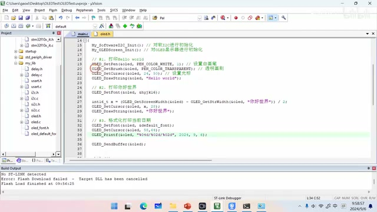

_代码编辑器中的文本框绘制与文本位置设置。 ·_ [_原片 45:20_](https://www.bilibili.com/video/BV11X4y1j7si/?p=24\&t=2720) 然后呢把这个文本区域的坐标放置在左上角，这个点也就是屏幕的这个原点的位置，宽度呢就是屏幕的宽度，高度呢就是屏幕的高度，所以这个文本框呢就占据了这么一个位置。

整个屏幕就是我们的那个文本框，然后我们在文本框里面去写这么几行文字。最后把它显示在屏幕上，我们来看一下这个执行的效果好，我们来编写一下这部分代码。

首先我们先把上面这三步编写的代码呢，我们给它注释掉，然后我们写第四步，第四步呢就是嗯设置文本区域，首先我们先来设置这个文本区域哈。

Oled start test region，然后第一个参数呢是OLED，第二个参数和第三个参数呢是零零，代表它的坐标点是零零，宽度呢是128。

高度呢是64，设置好文本区域之后，我们现在就可以去绘制这个文字了，我们设置这个文本区域的同时呢，它会帮我们把光标移动到一个合适的位置。

所以我们就不用设置光标了，我们直接去DRASTIN就行了，这就是这个啊文本框的另外一个好处，然后首先我们先来显示第一句嗯，从前有个人叫john。

There was a man named john g h o n，换行回车。然后第二句话，He was seventy years old。他的年龄是70岁。

然后第三句he really liked his name of john。 他真的很喜欢他的名字。第四句，But it didnt like the edge of seventeen，但是他不喜欢70岁的年龄，最后呢。

我们把这个显示的字符串呢发送到屏幕上，我们编译一下这个代码，把代码下载到单片机当中，然后我们代码实际执行的效果是这样的，可以看到它自动实现了这个换行的功能。

## 在屏幕上绘图

那文字相关的操作我们讲完了，下面呢我们再通过第五部分来讲一讲，如何在我们的屏幕上绘图，这个第五部分绘图呢，我们将分成四个小部分来讲啊。

分别是画点画线，画矩形和画圆，以及最后的这个绘制位图，首先我们先来看一下怎么在屏幕上画点，我们怎么在屏幕上去画点呢。

我们可以使用这样一个编程接口哈，叫做pao o AD draw，Dot，draw呢就是画dot呢就是点，所以这个编程接口的作用呢。

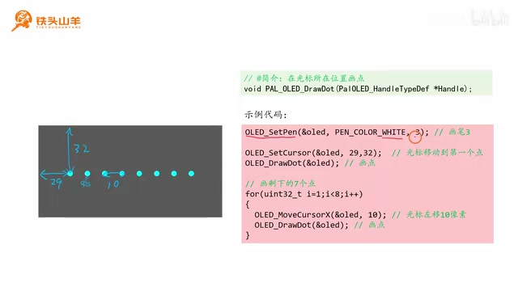

_左侧坐标示意标出一排点的位置和间隔，右侧代码用循环调用 draw dot 绘制这些点。 ·_ [_原片 48:00_](https://www.bilibili.com/video/BV11X4y1j7si/?p=24\&t=2880) 就是在光标所在的位置去画一个点，比如说我给大家举这么一个例子，我们要在屏幕上呢画这么一连串的点，其中第一个点的坐标呢是2932，然后后边每一个点之间呢。

隔着这个距离是十个像素，我们一共画这么八个点，那我们应该怎么写代码呢，我们应该这样做哈，首先我们先来设置一下这个画笔。

这个画笔的颜色呢很明显是白色，然后因为我们要画的这个点的这个大小呢，是三个像素，所以我们把画笔设置成三嗯，然后我们把这个坐标移动到第一个点。

所在的位置，也就是2932，也就是这个位置，再然后我们调用这个draw dot去画这么一个点，也就是画第一个点。

那剩下的七个点的画法呢，我们使用一个for循环啊，在这个for循环里面，我们每次把这个X坐标呢往右移动十，比如说移动一次就到这个位置了对吧。

然后我们画一个点啊，再移动时再画这么一个点，再往右移动时再画这么一个点，一共画后边的这么七个点，这样呢我们所有八个点都画出来了。

我们把刚才第四步的这个内容呢也给它注释掉。 然后注意保留这个o r d send buffer啊，我们在这个send buffer之前去写我们的代码啊，第五步。化点，那首先我们先来设置一下这个画笔。

Oled set pen，把我们的这个画笔呢设置成白色，喷color white，然后粗细呢设置成三个像素，设置完这个画笔之后。

我们再设置一下这个光标的一个坐标，我们来看一下这个坐标是哪里，是2932，然后设置完这个坐标之后，我们就可以调用draw dot去画第一个点了。

接下来呢我们使用一个for循环，这个for循环呢初值是零啊，数值是一，因为第零个点我们已经画了嗯，一共循环七次。

每循环一次呢，我们先把这个坐标光标啊移动，向向右移动十个像素点。然后我们就要用oled draw dot。把这个点给它画出来就好了。

嗯这样呢我们这个程序就写完了，最后调用ori descend buffer，把这个图像发送到屏幕上，然后我们按左上角的第二个按钮编译代码，再按这个下载按钮。

把代码把这代码下载到单片机当中啊，看一下这个程序执行的效果哈，按复位按钮，这个时候是不是就显示了八个点了，刚才我们学完了怎么画点。

下一步呢我们再来学习一下，如何在屏幕上去画线，为了在这个屏幕上划线，我给大家准备了这么两个编程接口，首先我们先来看第一个编程接口。

叫做oled draw，Line，draw呢是画line呢是线，所以这个编程接口的作用呢，就是去在屏幕上画线。

那它实际的用法呢是从我们光标的当前位置，到SY这个点呢去画一条线，其中这里的X和Y呢是通过参数传进来的。 比如说我们一开始的时候，先把这个坐标点呢设置在我们画布的原点，也就是零零这个位置，然后呢我们调用这个o d draw line参数，SY呢分别填128和六四。

这样呢我们就可以在这个128，六四和零零之间画这么一条线，这个就是这个编程接口的一个用法，那下面呢还有一个编程接口叫做ord line to，这个ord lan to呢。

会在上面这个编程接口的基础上画完线之后，它会把光标移动到这个线的末尾，也就是SY这个位置，给大家举个例子哈，比如说一开始我们把光标设置在这个点。

然后呢我们调用这个O2d line to，在这两个点之间画一条线，那么画完线之后，光标就到这里了，然后我们再调用一次这个line to。

在这两个点之间再画一条线，然后光标就被移动到这里了，我们再调用一次O2d line to，然后嗯在在这两个点之间再画一条线，那么通过这种方式呢。

我们就可以画连续的去划线，下面呢我们就用这两个编程接口，把例子中这个图形呢画到我们的屏幕上，我们来编写一下这段代码，首先嗯我们把这个画点的代码呢给它注释掉。

然后第六步写个注释，第六步就是划线。嗯首先我们把这个。嗯set cursor就是把光标移动到零零这个位置。也就是我们屏幕左上角的这个原点。

然后我们调用这个OLEDDRALINE。嗯12864，也就是在零零这个位置和这个右下角这个点呢，啊画一条线，这样呢我们这个第一条线就画出来了啊。

这句我们不要把它删除掉啊，嗯把这个oled send buffer放在下面，然后我们再画第二条线，第二条线呢用法呢是一样的，我们首先把这个嗯光标的点呢。

移动到这个064。 然后我们往这个1280去画一条画，画一条线，这样呢我们就画出来了斜向上的那条线，然后第三步我们再把这个光标设置到八十四，22这个位置。

设置完这个光标之后，我们调用这个ord lan to，不是调用JLINE了啊，是调用lan to line two，到哪里呢。

就是四十四二十二。我们再调用一遍嗯，横坐标不变，纵标纵坐标变成了42。然后再调用一遍。

然后按纵坐标不变，横坐标变成了八十四。那这样的我们所有的线都画完了，我们编译一下代码，然后把代码下载到单片机当中。

按一下复位按钮哈，这个图像呢我们就画出来了，那学会了怎么画线，我们再来看一下怎么画圆和画矩形，那为了绘制这个矩形和绘制圆。

我给大家准备了这么两个编程接口，它们分别是o AD draw，Direct，这个draw呢就是画react呢，就是英文单词rectangle的一个缩写。

这个rectangle呢就是表示矩形，所以说这个编程接口的作用呢就是画矩形，然后下面这个编程接口ODDRACIRCLE，就是用来画圆的，首先我们先来看一下画矩形的这个编程接口。

我们要绘制一个矩形呢，首先设置一下我们光标的位置，然后调用这个编程接口，它就会在这个光标以这个光标为左上角哎，来画这么一个矩形。

我们需要提供的是这个矩形的宽度和高度，所以它有两个参数，位置代表宽度，height代表高度，分别用来指定这个矩形的宽和高。

然后下面的这个做做circle的用法是这样的，首先我们还是设置这个光标的点，然后我们调用这个编程接口，提供一下这个圆，我们要画的这个圆的半径。

然后他就会以这个光标点作为原点，然后作为圆心，然后以这个我们提供的半径作为这个半径。 来画这么一个圆，我们来画下面的这样一张图哈。两边分别是两个矩形，然后中间呢有一个圆，首先我们先来画左边的这个矩形。

画这个矩形呢，我们先把这个光标移动到二十二十，这个点也就是这一句代码，然后呢我们设置一下画笔和画刷，画笔呢使用白色。

画刷呢使用黑色或者透明啊，画笔白色宽度，一画刷呢这里使用的是一个透明画刷，这看不出来到底是黑的还是透明的，这个我们看不出来。

然后我们就调用这个draw dradirect，去画这么一个宽度为40，高度为20，宽度为40，高度为20的这么一个矩形。

那第一个矩形就画完了，我们再画第二个圆，首先呢先把光标设置到圆心的这个位置，也就是六十五三十，设置圆心的位置。

然后因为画笔和画刷跟刚才的是一样的，所以我们就不用设置了，直接调用那个桌思考去画这么一个圆，Draw circle，半径是五。

然后第三步呢我们在绘制右边的这个矩形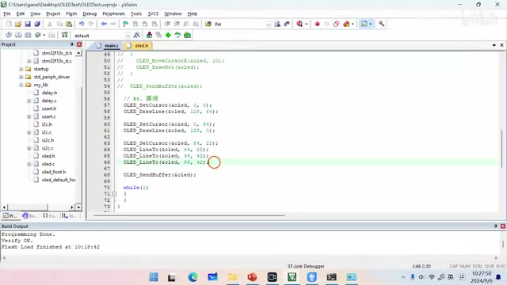

_IDE 中展示设置光标后调用 OLED\_DramLine 与 OLED\_LineTo 绘制线段的代码。 ·_ [_原片 56:24_](https://www.bilibili.com/video/BV11X4y1j7si/?p=24\&t=3384) 这个矩形呢我们也是设置这个光标的点，70嗯，七十二十，这个就是左上角的这个点，然后我们再设置一下画笔和画刷。

画刷很容易看出来是白色的对吧，画笔呢嗯可以可以是白色黑，可以是白色，黑色或者透明都行，因为呃没有什么影响。

所以我们就调用这个oled set pen嗯，把它设置成白色吧，然后画刷呢也设置成白色，这样呢我们再画一个矩形，宽度是20。

宽度呢是40，高度是20，这样我们这三个图形就都画完了，我们来写一下这个代码啊，首先把第六部分的代码注释掉。

保留下面的这个send buffer这行代码，然后写一下注释，第六步，第七步嗯，画矩形和语言。

首先我们先调用oled set cursor，去设置一下当前光标的这个点，把它移动到第一个矩形的左上角，也就是二十二十这个位置嗯。 然后我们设置一下画笔和画刷的颜色，画笔的颜色很明显是白色的。嗯画刷的颜色呢，我们设置成黑色或者透明都可以。啊比如说透明画刷吧。

然后我们现在就可以调用oled draw direct，去画这么一个矩形了，这个矩形的宽度40，高度20A四十二十，这样呢这又画了第一个矩形。

然后我们再画一下中间的这个圆，Set cursor，设置一下光标的位置啊，光标的位置是多少，六十五三十。

啊然后我们就直接把这个圆画出来就行了，嗯半径是五，所以这个radio就是指令是五，我们再画最后一个矩形，set嗯。

Set cursor，把这个坐标点呢移动到七十二十，嗯然后我们设置一下画笔和画刷，首先设置一下画笔，我们比如说把它设置成透明画笔。

这个画笔的颜色呢，对于刚好对于我们这个图形没有影响，随便怎么设置。然后再设置这个画刷的颜色。设置画刷的颜色。

说明上面这里少填了一个参数啊，这参数给他补上画刷的颜色呢，看一下画刷颜色是白色的。White，这样呢。

最后我们就调用这个做direct去绘制一个矩形，这个矩形的宽度和高度呢还是四十二十，我们这个跟上面是一样的，最后我们再调用这里的send buffer，把图像发送出去就可以了。

我们编译一下代码，下载代码来看一下效果哈。 啊现在呢就显示出来了，左右两个矩形，中间一个圆，这个显示的效果并不是特别好，是因为这个屏幕太小了。

嗯如果这个屏幕大一点，显示的就会更清楚，学完了怎么画点，怎么画线，怎么画矩形。

怎么画圆，我们最后来介绍一下，怎么在我们的屏幕上显示一张图像，那我们在这个OLED的驱动程序里边，给大家准备了这么一个编程接口。

叫做ord draw bit，Map，bit呢就是为map呢就是图，所以说这个作用呢就是去绘制一个位图，然后对于这个编程接口来说呢。

它有这么几个参数啊，with和height呢分别代表这个图像的宽度和高度，然后这里的p beat map呢，代表这个图像本身的一个数据，要想绘制这个图像呢。

首先我们得准备这个图像的数据，下面我教一下大家，如何去把这个图像转换成，我们单片机里边的数据，那为了把这种图像转换成我们要的。

单片机里的数据，我们得使用这么一个网站，这是这个网站的网址，大家把这个网址敲进去就可以找到它了，然后第一步我们先选择我们要转换的图像。

点击这里的这个按钮去选择这个图像，比如说我们选择这个图，然后第二步呢我们对图像的参数进行设置，首先设置这个画布的大小，Cover size。

也就是12864，我们屏幕的这个大小，我们想画一张充满屏幕的图，然后嗯然后再设置一下它的缩放模式，就是SKILLING。

因为这个图像太大了，我们需要让它适合我们的屏幕，选择这个stretch to feel conas，然后这样呢我们就有了这么一张图像了，这是预览的一个效果。

第四步呢我们就是把这个数据输出出来，我们输出的格式呢选择polin bus，也就是啊只输出这个字节就可以了，然后我们点这里generate code，这样呢就生成了啊这么一些数据。

我们复制这个数据，刚才呢我们已经复制了这个图像的所有数据，然后现在我们声明这么一个数组哈，说明这么一个数组，把我们刚才复制的这个数据呢。

填到这个花括号里边，然后我们设置这个坐标的原点，把它设置到我们这个左上角啊，屏幕左上角这个点，然后画一张图。

这个图的宽度呢是128，高度呢是64，就表示我们这个图呢充满了整个屏幕。 好，下面我们来写一下这部分代码，首先我们先把第七部分的这个代码注释掉，然后只保留这个send buffer这个函数就可以了，我们先注释掉它。

然后我们翻到顶部，先声明刚才那个变量啊，就是位图的一个数据，它是一个数组类型的，我们把它叫做bit map。

这个内容呢刚才我们已经复制了，我们直接粘贴就好了，粘贴完之后打一个分号，这样呢我们数据就准备好了，下面我们开始正式写代码嗯。

第八步。绘制图像哎或者说绘制位图，我们先设置一下这个光标的位置啊，把光标的位置呢设置到零零，然后第二步呢我们就可以调用这个draw bit map。

去绘制这个图像了，这个图像的宽度和高度呢，分别是128和64。然后我们最后把这个内容发送到屏幕上，就可以了。

嗯啊这里还少一个参数是bit map，就是我们这个图像的一个数据编译下载，看一下效果哈，我们按一下复位按钮，这样呢这个图像就已经显示在我们屏幕上了。

下面呢我们来做一个小动画，首先为了做这个动画呢，我们再生成一次这个图像，只不过现在呢我们把这个图像进行一下翻转，就是flip image嗯。

把它左右翻转一下，然后我们点generate code生成这个数据，然后我们把这个数据呢，还是粘贴到我们的这个程序当中，给它起个名字啊。

叫做image，还叫做beat map，Flipped，嗯flip吧。嗯把刚才的这个数据给它填充进来。

传入进来之后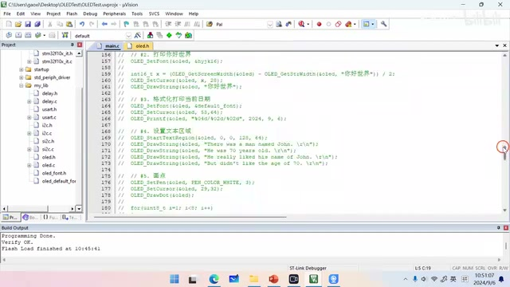

_IDE 中的 OLED 文本区域示例代码设置字体、光标和字符，并调用 OLED\_DrawString 写入多行文本。 ·_ [_原片 01:03:36_](https://www.bilibili.com/video/BV11X4y1j7si/?p=24\&t=3816) 我们把第八部分这个数据呢，这个代码呢给它注释掉，这里呢也注释掉，这个也不要了，然后在这个循环里面。

首先我们先显示啊正的这张图，也就是贝特map这张图，然后显示这张图之后，我们把它发送到屏幕上。 然后我们延迟一段时间再显示第二张图。啊因为我们要连续的去显示图像啊，下面也延迟一下啊，所以我们在显示这个图像之前，首先要清屏。

就是我把之前的这个显示内容呢给它清除掉啊，不清屏就没法看了，嗯这样因为我们要。这是显示反的图像，因为我们要做这个延迟。

所以我们先引用delay点H这个头文件，这里include delete点H，然后我们把这个延迟的函数写上。比如说我们延迟个500ms吧，500ms让这个图像变一次。

嗯这样呢我们就编译一下代码，然后把代码下载到单片机当中来，看一下这个程序的执行效果哈，啊这样呢我们就做了一个很有意思的小动画，好的以上就是本期视频的全部内容。

感谢大家的收看，我是铁头山羊，让我们下期视频再见。
