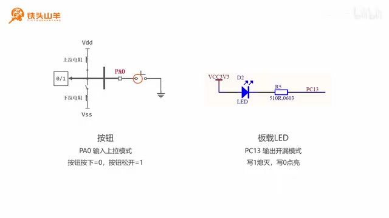
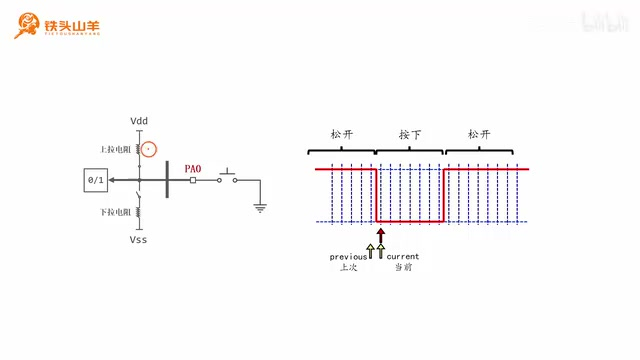
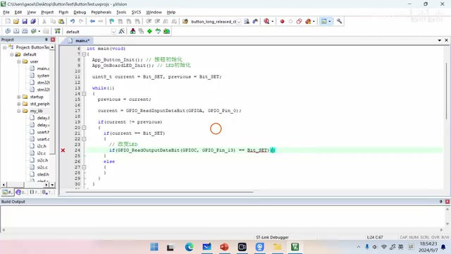
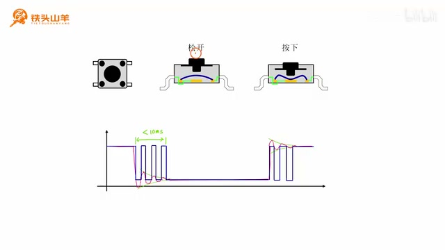
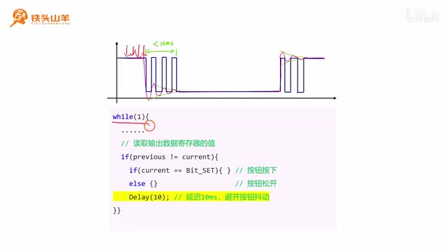
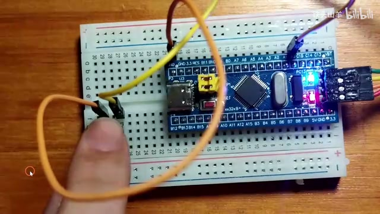

# P026 · 5.2 （番外） 按钮驱动程序编写

各位同学大家好，我是铁头山羊。从今天开始讲一个番外篇。上一期介绍了 SPI 总线的电路结构和通信协议；后续学习 SPI 时会做实验，实验里要用到按钮，所以这一节（第 5.2 节）一起学习按钮驱动程序的编写。本套视频需要的材料都在开发套件包里，屏幕上有二维码，可以进入淘宝店铺购买；购买后可以获得课程课件和源码，也能加入答疑群和 UP 主直接交流。

本期要做的事是用一枚按钮切换板载 LED 的亮灭：每按一次，LED 状态就切换一次。内容比较简单，所以只分四部分来讲：先看电路怎么接；再初始化板载 LED 和按钮所用的 IO 引脚；第三部分讲按钮程序的基本编写原理；最后给按钮消抖。下面从第一部分，也就是本次实验的接线开始。

## 按钮与板载 LED 的接法

本次电路里只有两个主要电子元器件：按钮和上面的板载 LED。板载 LED 固定连接在单片机 PC13 引脚；按钮的 IO 引脚可以自己选，比如这里把按钮接到 PA0。按钮与 LED 的连接方式之前的视频已经详细介绍过，这里再复习一遍。

先看按钮：在单片机上找一个 IO 引脚，例如 PA0；按钮一端接 PA0，另一端接地。再把这个 IO 引脚设置为输入上拉模式，也就是使能图里的上拉电阻。按钮松开时，PA0 悬空，在上拉电阻作用下电压被拉高到 3.3 V，因此读到的值是 1。把按钮按下后，两个点导通，PA0 通过按钮直接接地，电压变成 0 V，输入数据寄存器读到 0。所以按下读 0、松开读 1；看输入数据寄存器的值是零还是一，就能判断按钮是按下还是松开。

再来看板载 LED。它使用标准的开路接法：阳极接高电压 3.3 V，阴极通过限流电阻接到单片机 PC13，因此 PC13 应设为输出开漏模式。向 PC13 写 0 时，这个引脚输出低电压，LED 阴极被拉低，电流从上面流过 LED，LED 点亮；写 1 时这个点相当于断开，LED 熄灭。因此这里的逻辑是 PC13 写 1 灭、写 0 亮。

本次实验的接线示意图很简单。板载 LED 已经焊在最小系统板上，所以这部分不用额外接线；图中给出了左侧按钮的接法：一端接地，另一端接单片机 PA0，也展示了板载 LED 与 PC13 的连接。照着示意图把电路连好，接下来开始编写代码。

_PA0 上拉输入按钮按下时接地的电路，以及 PC13 板载 LED 的连接示意。 ·_ [_原片 02:25_](https://www.bilibili.com/video/BV11X4y1j7si/?p=26\&t=145)

## 初始化按钮与板载 LED

电路连接好后，第二步是初始化板载 LED 和按钮的 IO 引脚。先登录百度网盘并新建工程，把模板工程下载下来；下载完成后将压缩包解压到当前文件夹，文件夹命名为 `button_test`，里面的工程文件也重命名为 `button_test`，再打开工程。双击打开 `main.c`，程序就写在这个文件里。要做的初始化很简单：PA0 设成输入上拉，PC13 设成输出开漏。

为了让代码工整，按钮初始化和 LED 初始化各封装成一个函数。按钮函数叫 `App_MyButton_Init`；前面用过 `My_` 前缀，这里改用 `App_`，是为了防止与 `MyLib` 里的函数重名。另一个函数是 `App_OnboardLED_Init`，用来初始化板载 LED。先把这两个函数的声明写好，再复制到下面实现。

先实现按钮初始化。只要把 PA0 设为输入上拉模式即可。首先使能 GPIOA 的时钟；然后声明 GPIO 结构体类型的变量，并逐一给成员赋值：使用的引脚是 `GPIO_Pin_0`，模式指定为 `GPIO_Mode_IPU`，也就是输入上拉。因为是输入模式，不需要指定最大输出速度。最后调用 `GPIO_Init`，完成 PA0 的初始化。

再实现板载 LED 初始化。LED 使用 PC13，所以要使能 GPIOC 时钟；上面的使能时钟代码可以复制一份，把 GPIOA 改成 GPIOC。接着同样声明结构体并设置成员：引脚改成 `GPIO_Pin_13`，表示 PC13；模式设为输出开漏 `GPIO_Mode_Out_OD`。然后设置最大输出速度，选择最低的 2 MHz，最后调用 `GPIO_Init`，并把引脚对应的端口改成 GPIOC。这样两个初始化函数就都写好了。在 `main` 方法一开始调用按钮初始化和板载 LED 初始化，并分别加上注释。

## 通过状态变化识别松开瞬间

初始化完按钮和板载 LED 后，先回头看一下实验现象：每次按下按钮，LED 亮灭状态会切换，但仔细观察会发现，按钮按下时 LED 状态不变，只有松开按钮的瞬间状态才切换。也就是说，按下时不变，松开时切换；再按下不变，再松开切换。现在的问题就是如何捕捉按钮松开的瞬间。

回到电路图，因为 PA0 设置为输入上拉，按钮按下时 PA0 接地，读到 0；按钮松开时 IO 悬空并被上拉，读到 1。所以松开与按下对应两种不同的读数，持续读取 PA0 就能观察这些变化。

用两个变量，一个叫 `previous`，记录上一次读到的引脚值；另一个叫 `current`，记录当前值。比如当前读到 0、上一次读到 1，两值不相等，就说明按钮状态发生变化。再进一步判断是哪种变化：如果上一次读到 1，表示之前松开；当前读到 0，表示现在按下，这是按下的变化瞬间。反过来，如果之前读到 0，表示之前按下；现在读到 1，表示现在松开，这就是松开的瞬间。这样就能捕捉按钮松开。

照着图的思路编写代码。先声明 `previous` 保存按钮上一次状态，再声明 `current` 保存当前状态，两个变量都给初值 `Bit_SET`。`Bit_SET` 表示 1，也就是假设初始状态下按钮松开。然后写 `while` 循环，不断读取 IO 引脚值，用 `GPIO_ReadInputDataBit` 读取 PA0 并存进 `current`。读取前先将上一轮读到的值保存到 `previous`。这两步更新了当前值和上次值；接着判断是否相等。不相等表示按钮状态变化，再判断方向：当前是高电平，说明低到高、按钮松开；否则就是高到低、按钮按下。本次实验只在按钮松开时切换 LED，所以把改变亮灭状态的代码放在这个分支里。接下来按图逐行写出这段代码：先声明变量，再在循环里更新并判断。

_按钮松开、按下、再松开时，PA0 输入电平呈现的边沿变化。 ·_ [_原片 08:40_](https://www.bilibili.com/video/BV11X4y1j7si/?p=26\&t=520)

变量类型都是无符号 8 位整型。给 `current` 和 `previous` 的初值是 `Bit_SET`，也就是高电平，表示假设按钮最初是松开的。`while` 循环不断运行，每轮先把 `current` 赋给 `previous`，也就是保存按钮上一次状态；随后调用 `GPIO_ReadInputDataBit` 读取 PA0 的值并更新 `current`。更新后比较二者：不相等才说明出现了状态变化，再根据当前电压进一步判断是按钮松开还是按下。当前为高电平表示按钮松开；否则表示按钮按下。本实验在按钮松开时改变 LED 亮灭，所以操作写在这个条件分支中。

代码就是按这个顺序写：声明 `previous` 和 `current` 并设初值，进入 `while` 后先更新上次读数，再读入当前值，接着判断两值是否不同；只有状态变化才进入内部判断。内层判断当前值是否为 `Bit_SET`，满足时是按钮松开，另一种情况就是按钮按下。把思路落到代码上时，先定义两个变量，一个保存上次的值，一个保存当前值，再通过两次读数的不同捕捉状态变化。因为本次要在按钮松开时切换 LED，实际操作只放在松开的判断里。

## 读取 LED 原来的输出状态并翻转

接下来解释如何切换 LED 亮灭。先回顾 PC13 输出模式的内部电路：IO 引脚内部有 P-MOS 和 N-MOS 两个 MOS 管，通过控制它们的通断，向引脚输出不同电压。CPU 向输出数据寄存器写 0 或 1，再经过输出控制电路控制 MOS 管。之前学过 `GPIO_WriteBit`，它的作用就是向输出数据寄存器写零或写一。今天再学一个新接口 `GPIO_ReadOutputDataBit`：从名字看，`Read` 是读，`Output` 是输出，`Data` 是数据，`Bit` 是比特位；作用就是读取输出数据寄存器对应位到底是零还是一。

因此，在按钮松开的分支中先调用 `GPIO_ReadOutputDataBit`，读取上次向 PC13 写入的是零还是一。如果上次写入 1，本次就写 0，也就是 `Bit_RESET`；如果上次写入 0，本次写 1，也就是 `Bit_SET`。每次读取后写入相反值，输出就在 0、1 之间翻转，从而切换 LED 亮灭。到这里代码编写完成。

## 编写按钮状态判断

到这里先写变量初值：`Bit_SET` 表示初始状态下 PA0 为高电平，也就是按钮松开。程序已经有一个 `while` 循环，所以把代码写在现有循环里面，不需要再新建循环。每轮先保存上次状态，把 `current` 赋给 `previous`；再调用 `GPIO_ReadInputDataBit` 读取 GPIOA 的 PA0，更新当前值。两者更新后判断是否相等；不相等说明按钮状态变化，继续判断是按下瞬间还是松开瞬间。当前电压为高电平说明按钮松开，否则是按钮按下。因为要在按钮松开时调整 LED 亮灭，改变 LED 的代码放进这个条件分支。

换句话说，每轮开始要先保存上一次循环读到的值，再取新的输入值，这样 `previous` 和 `current` 才分别代表上次和当前状态。读完以后，如果二者相等，按钮状态没有变化；不相等时才往下判断。当前值为高，对应从低到高的变化，也就是松开；当前不是高则对应按下。这个判断框架写完后，按钮状态检测部分就完成了。

## 读取 LED 输出位并翻转

接下来考虑怎样切换 LED 状态。先回顾 PC13 输出模式的内部电路：IO 引脚有 P-MOS 和 N-MOS 两个 MOS 管，通过控制它们通断向引脚输出不同电压。CPU 向输出数据寄存器写 0 或写 1，再通过输出控制电路控制 MOS 管。之前学过 `GPIO_WriteBit`，作用是向输出数据寄存器写 0 或 1。现在再学一个接口 `GPIO_ReadOutputDataBit`：`Read` 是读，`Output` 是输出，`Data` 是数据，`Bit` 是比特位；它读取输出数据寄存器中对应位的值，判断此前写入的是 0 还是 1。

代码先用 `GPIO_ReadOutputDataBit` 读取 PC13 上次写入的值。如果上一次写入 1，这一次就写 0；如果上一次写入 0，这一次写 1。读出上一次写入的是 0 还是 1 后，写入相反值，输出便在 0 和 1 之间翻转，LED 的亮灭状态也就切换。

因此可以按伪代码理解：读出上次输出；如果上次为一就写零，否则就写一。按钮松开时执行这个分支，LED 状态就从当前状态变为相反状态。

_通过读取 PC13 输出数据位，并写入相反值来翻转 LED。 ·_ [_原片 15:35_](https://www.bilibili.com/video/BV11X4y1j7si/?p=26\&t=935)

## 编译、下载并检查初版效果

继续完成翻转代码：先读取 PC13 上次写入的值；如果是 1，这次写 `Bit_RESET`（0）；否则上次写的就是 0，这次写 `Bit_SET`（1）。到这里按钮和 LED 状态切换的代码就写完了。按左上角第二个按钮编译，先出现一个 warning。查看 warning，是最后一行没有加换行；补上换行后再编译，没有错误，也没有警告。把代码下载到单片机检查效果：先按单片机的复位按钮，再按左边的按钮；每按一下 LED 亮灭状态就切换一次。

编译时出现的 warning 指向文件最后一行。补好换行后再次编译，确认没有报错、也没有警告，再将程序下载到单片机。程序运行后，先按复位按钮，再操作面包板左侧的按钮，观察板载 LED；正常情况下按一次就切换一次。不过实际操作中可能会遇到按钮好像没有响应的情况，这就是接下来要解释的抖动问题。

不过有时会发现按钮好像突然失灵。原因是按钮会抖动。下面进入第四部分，看看怎么用软件消抖。先看左上角图中的实验按钮，把它拆开：左右各有一个引脚，上面是按钮帽，下面是按钮体，内部弧形的金属结构叫锅仔片。按钮松开时，锅仔片翘起，两个电极之间没有导通，两只引脚断开；按钮帽按下后挤压锅仔片，使它变成压下的形状，两个点通过锅仔片导通，因此两只引脚接通。

锅仔片是金属片，也有弹性。按下或松开按钮的瞬间，它不能立刻稳定下来，会出现图中那样的波形。按下时会抖，松开时也会抖，单片机读到的是 0、1 交替变化的毛刺，因此 LED 可能工作不稳定。

也就是说，按钮机械接点看似只导通一次，但弹片在稳定前会短暂反复接通、断开；输入脚因此出现多次高低电平跳变，而程序会把这些跳变当成真实状态变化。

_按钮金属弹片在按下或松开后会短暂弹动，输入因此出现抖动。 ·_ [_原片 17:40_](https://www.bilibili.com/video/BV11X4y1j7si/?p=26\&t=1060)

## 毛刺如何造成看似失灵

来看按钮为什么会失灵。我们的代码捕捉的是上升沿，也就是按钮松开的瞬间，并在这个时候切换 LED 亮灭。图中用 0 表示 LED 熄灭、1 表示 LED 点亮，每遇到一个上升沿，LED 状态就变化一次。假设图里有偶数个毛刺，也就是偶数个上升沿：LED 先从 0 变成 1，再从 1 变回 0；之后又从 0 变成 1，最后再从 1 变回 0。这样状态变化了偶数次，最后相当于没有变化。因为整个过程非常快，人眼看到的现象就是按下按钮之后 LED 亮灭状态没有改变，这就是看起来失灵的原因。

## 用 10 ms 延迟消抖

知道按钮失灵原因后，怎样避免？可以利用按钮抖动的持续时间来处理。图中标出的抖动最长不会超过 10 ms，一般在 1 ms 左右。首次检测到按钮状态变化后，做一个 10 ms 延迟；延迟结束时按钮上的电压已经稳定，相当于把中间的毛刺去掉，之后稳定地只触发一次。这个办法就能消抖。

图里的时间标记说明整个抖动过程短于 10 ms；因此延时选 10 ms，就能等这段不稳定时间过去再继续，而不是在毛刺期间把每个电平跳变都当成一次新的按钮动作。

代码里 `while` 循环不断查询按钮当前值到底是 0 还是 1。两次读数不同，就说明遇到边沿；在这个 `if` 里加入 10 ms 延迟，就能避开中间那段波形。找到刚才写的代码，在 `main` 方法里的循环中找到判断 `current` 和 `previous` 不相等的 `if`，按钮状态发生变化时就在这里加延迟。要调用 `Delay`，先翻到文件顶部引用 `delay.h`。

所以延迟是放在检测到状态变化的判断里面：先比较前一次和当前读数，发现不同后再等待，而不是对每次循环都做一次延迟。这里的 `delay.h` 代码稍作修改后，不需要再调用 `Delay_Init`，程序会自动帮我们调用这个初始化方法，所以这里只写一个 `Delay(10)`，也就是延迟 10 ms。修改完成后编译代码，再下载到单片机。先按单片机上的复位按钮，再按实验按钮，观察执行效果。

_检测到按钮状态变化后延时 10 ms，以避开抖动产生的快速毛刺。 ·_ [_原片 19:55_](https://www.bilibili.com/video/BV11X4y1j7si/?p=26\&t=1195)

复位后按一次按钮，LED 亮灭状态切换一次；再按一次，LED 又切换一次，效果非常稳定，这样本次实验就完全成功了。本期内容到此结束。下一期继续介绍与按钮相关的知识，会讲按钮单击、双击、三击或者长按等动作，以及这些动作是如何实现的。

_按下实验板上的按钮后，板载 LED 稳定切换亮灭状态。 ·_ [_原片 21:10_](https://www.bilibili.com/video/BV11X4y1j7si/?p=26\&t=1270)
