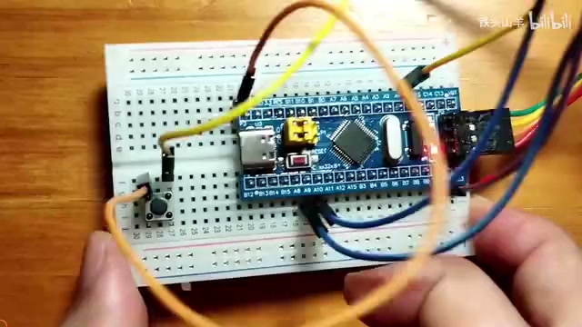
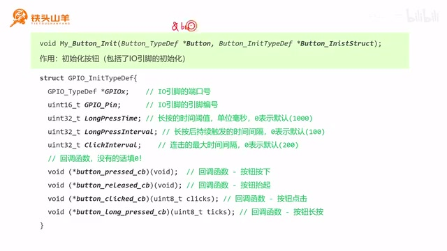
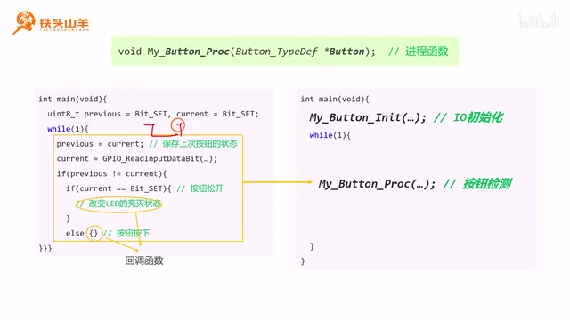
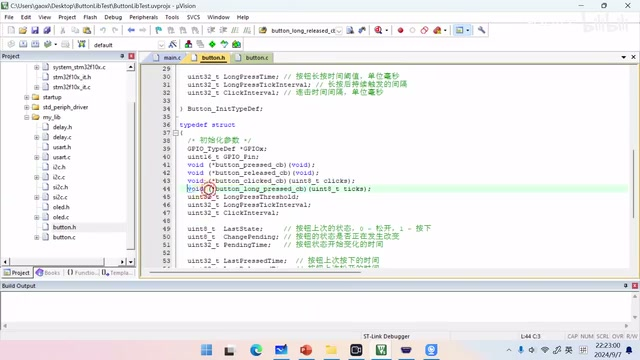
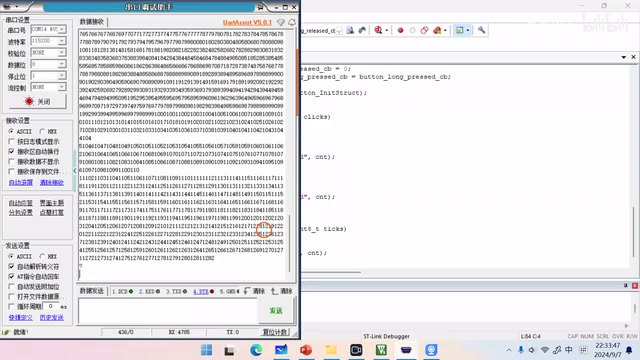

# P027 · 5.3 （番外） 按钮代码的封装

## 实验目标和本期安排

各位同学大家好，我是铁头山羊，在上期视频的过程中呢，我们学习了这个按钮驱动程序的一个编写方法。 既然我们已经学会了这个按钮驱动程序的编写，那么在后续的学习过程中，我们就没有必要一遍一遍的去再编写，这个底层的驱动代码了。 所以我把这些代码封装到了 `my_lib` 文件夹里。本期视频就来介绍这个按钮驱动程序的使用方法。

本套视频所需要的所有材料，都包含在这个开发套件包里，大家可以扫描屏幕上的二维码，进入到我们的淘宝店铺来购买它。 购买套件之后，你将获得课程所有的课件和源码，还能加入答疑群和up直接交流，本期视频呢我们要做这么一件事哈。 我们在这个电路板上还是放一颗按钮，然后把我们的这个最小系统板呢，通过串口连接到电脑上，然后左侧这里呢我们打开一个串口调试助手。

我们通过这里的按钮去控制这个串口，调试助手上显示一些数字，显示的这个规则是这样的哈，我们每单击一次按钮。 我们看这个串口调试助手上的这个数字呢，就增加1、2、3、4、5、6，然后如果我们长按这个按钮，按住不松。 他的这个数数字呢就会一直增加，然后如果我们双击这个按钮的话，它这个数字呢就会清零，我们一起来实现这么一个实验的现象。

本期视频呢我们将分成以下五个部分来讲，首先第一部分，我们先来介绍一下，本次实验我们用到的这个电路。 然后第二部分呢，因为我们的这个实验要用到串口，所以第二部分我们需要对这个串口，进行一个初始化。 第三部分呢，我们使用我们那个`my_lib`那个库里边的按钮驱动，对我们的这个按钮进行初始化，第四部分呢。

我们来讲一下，这个进程函数的一个概念和使用方法，第五部分呢我们一起来写一下回调函数，下面我们从第一部分开始搭建我们的电路。 这张图呢就是我们本期视频要用到的这个电路。

## 电路连接与串口初始化思路

本期视频我们用到的这个电路呢，跟上期视频呢其实差不多，只是在上期视频的基础上，又增加了这么一个USB转TTL模块。 这个USB转TTL模块呢，连接到我们大面积的这个USART1这个串口上，然后我们不对这个USART1进行重映射啊，它就位于默认的这个PA9和PA10这两个引脚。 其中PA9呢是TX，PA10呢是RX，然后这里的这颗按钮呢，跟上一视频的连接方式是一样的。

它也是连接到我们单片机的这个PA0引脚上，下面呢我们按照这张图来连接电路，这个电路连接好之后是这样的，大家可以对照一下。 刚才呢我们已经把这个电路搭建好了，由于本期实验呢，我们需要需要使用到这个串口跟电脑进行通信，所以呢我们需要先对这个串口进行一个初始化。 那怎么对这个串口进行初始化呢，我们需要先回忆一下我们串口的这么一个框图，我们这个串口的初始化呢可以分成两个部分，一个是对它的这个TX和RX引脚进行初始化。

其中这个TX引脚呢是发送引脚，我们把它初始化成AF\_PP模式，也就是复用推挽模式，然后这个RX引脚呢因为它是输入引脚。 所以我们可以把它初始化为这个输入浮空模式，也可以初始化为这个输入上拉模式，也就是IPU，一般我们选择的就是输入上拉模式。 因为IPU呢更稳定一些，然后第二部分呢，就是我们需要对这个串口本身的参数，进行初始化。

包含了数据帧的格式，以及这个波特率的一个配置，然后配置好这些参数之后，最后一步大家不要忘记。 就是闭合我们这里的一个总开关，这样呢这个串口才能开始工作，下面呢我们开始编写这个代码哈，首先我们把这个模板工程的压缩。 压缩文件呢进行解压，然后我们新建一个工程，这个工程呢我们给它重新起个名字，比如说叫做`ButtonLibTest`啊。

也就是对我们的这个按钮库进行一个测试哦，我们复制一下这个名字哈，给给我们的这个工程文件和上面的这个文件呢，也进行一个重命名。

_实物电路：最小系统板通过跳线连接，面包板上的按钮接入 PA0。 ·_ [_原片 02:40_](https://www.bilibili.com/video/BV11X4y1j7si/?p=27\&t=160)

## 创建工程并初始化串口引脚

重命名好之后，我们双击打开工程，再打开 `main.c` 文件。为了让代码更工整，我们先声明一个函数，把串口初始化代码封装在函数内部。 把我们初始化的代码封装在这个函数的内部，这个函数呢以这个app开头表示它是应用层的，这样呢就避免了跟我们其他的函数的重名，然后我们复制这个函数的原型哈。

放到下面进行实现，我们刚才说过，串口初始化分成两步。第一步是初始化 IO 引脚；这里不对 USART1 做重映射。 PA9 是 TX，PA10 是 RX。我们先初始化 PA9：使能 GPIOA 时钟后， 我们声明一个结构体类型的变量，然后给这个变量的起一个名字，然后我们给这个变量的成员赋值，因为是PA9。

因为是 PA9，这里填 `GPIO_Pin_9`。它是输出引脚，所以模式设为 `AF_PP`。再指定最大输出速度；串口波特率不高，选 2 MHz 就够了，也可以按需要调高。最后调用 `GPIO_Init` 完成初始化。

下面呢我们在初始化这个PA10哈，PA10 的 `GPIO_Pin` 成员填 `GPIO_Pin_10`。它是接收数据的输入引脚，所以模式设为输入，并使能上拉电阻。

## 初始化 USART1 参数

这样会更稳定一些，然后最大输入速度就不设置了，最后我们调用，还是调用`GPIO_Init`。 这样呢PA10也初始化完了，然后第二步呢我们是初始化UART1本身，首先呢我们也是开启这个USART1的一个时钟，R c c a p p2。 Prefer USART1，第二个参数呢，第二个参数呢填enable，然后呢我们也是声明一个结构体类型的变量啊。

随便起一个名字，我们给这个变量的成员逐一赋值，首先我们先来设置一下我们串口的波特率，比如说我们用最常用的这个115200。 然后设置一下模式，就是通信的方向，假设我们收发双向，当然在这个实验里面。 我们只选这个TX也是可以的，都可以，因为我们确实用不到这个数据，接收我们初始化成单向的也是没问题的。

下一步呢我们就设置一下这个数据帧的格式，先设置这个数据位的长度，我们用八位的数据位，然后再设置我们的这个校验。 我们不使用校验，诶嘶，不使用校验，然后下一步呢。 我们再设置一下这个停止位的长度，我们使用一位停止位就可以了，看一下还需要设置别的吗，这个硬件流控我们不需要设置。

因为我们压根就没学这个东西，这样呢这个参数就设置完了，我们调用这个`USART_Init`，对我们的USART1进行初始化。 然后第二个参数呢，对这个变量取个地址填进去就好了，然后初始化完之后，最后大家别忘了。 闭合我们这个USART1的一个总开关。

## 验证串口并查看按钮库

因为我我也经常忘这个步骤，千万不要忘记，要不然的话你的串口是不会工作的，初始化完之后。 我们把这个函数在main方法里面去调用一下，看看它的这个实际的效果，我们想测试一下这个方法到底到底写的对不对，那怎么办呢。 我们想发送一个`Hello world!`字符串来测一测，因为要发送这个`Hello world!`的字符串，我们发送字符串的话，我们还是要用到我们之前自己做的那个库对吧。

`#include "usart.h"`把这个库引进来，然后我们调用`My_USART_SendString`，发一个`Hello world!`看看。 如果我们初始化的是对的，那这个`Hello world!`就能发的出去是吧，加个杠R杠N吧，然后这样呢我们这个程序就写完了。 写完之后我们按左上角的第二个按钮进行编译，然后呢我们再把这个代码下载到单片机当中，下面呢咱们打开这个串口调试助手，然后简单设置一下参数。

选一下串口号，波特率 115200，校验位不使用，然后数据位呢八位停止位。 停止位设为 1 位，其他选项不使用或留空，然后我们把它打开，然后接收设置，这里选择 ASCII。 ASCII 也就是以字符的格式进行接收，然后这个时候呢，我们这个串口调试助手就设置好了，然后我们按一下单片机的复位按钮。

可以看到这里输出了一个`Hello world!`，就证明我们这个串口功能是正常的，串口没问题了，下一步呢我们需要对这个按钮进行初始化。 我们使用我们封装在`my_lib`这个库里边的，这个函数呢，对我们的这个按钮进行初始化，当然`my_lib`这个库里面的函数呢是我封装的。 所以没有带着大家去写这个代码，那怎么对它进行初始化呢，我们首先看一下我们工程，打开工程里的 `my_lib` 文件夹。

可以看到里面有两个文件哈，一个叫做`button.h`，一个叫做`button.c`，这两个文件呢是我封装的两个。 关于这个button驱动程序的一个文件，这个是头文件，我们双击打开头文件啊，可以看到在最下面这里呢有三个编程接口。 这三个编程接口呢其中第一个就是`My_Button_Init`。

## 按钮初始化接口和按钮变量

也就是对这个按钮进行初始化，我们知道这个按钮呢，它是接在单片机的IO引脚上的，我们需要把这个单片机的IO引脚呢。 设置成输入上拉模式对吧，这个`My_Button_Init`呢完成的任务，基本上就是去初始化这个IO引脚，下面呢我们来看一下这个`My_Button_Init`。 应该怎么用，我们来看一下这个编程接口的名字呢，叫做`My_Button_Init`，button呢就是按钮。

INIT就是initialize的缩写，代表初始化，所以它的作用呢就是对按钮进行初始化，然后呢它有这么两个参数。 首先我们先来看第一个参数，第一个参数呢是这种类型的一个指针，类型的一个变量，然后这个变量呢代表这个button。 也就是按钮本身为了使用这个按钮呢，我们首先用这种类型，给我们的按钮声明一个变量，我们回到我们的这个`main.c`这个文件。

为了使用这个按钮的驱动呢，我们首先引用他的头文件，也就是`button.h`，然后引用了它之后。 刚才我们不是说要声明一个变量吗，我们现在就把这个变量声明出来，这个变量的类型呢是`Button_TypeDef`，然后我们给这个变量起一个名字啊。 比如说叫button1吧，什么什么名字都可以啊，根据你的作用，根据你要要用这个按钮来做什么。

你可以给它起不同的名字，这样呢我们这个变量就声明好了，声明好了，刚才的变量之后呢。 我们只需要把刚才的那个变量的名儿，给它取一个地址，传到第一个参数里面就可以了，然后我们再来看一下第二个参数。 第二个参数是一个结构体指针，用来传入初始化参数。这个结构体类型是 `Button_InitTypeDef`，里面有多个成员，我们逐个来看。 我们一点点看啊，首先我们先来看前两个成员，因为我们这枚按钮是连接在单片机的一个，IO引脚上的对吧。 所以我们在初始化这个按钮的时候，需要告诉这个编程接口，我初始化的这个引脚的引脚编号，和这个端口号到底都是什么。

`Button_InitTypeDef` 的第一个成员 `GPIOx` 用来填写 IO 引脚的端口号。比如本次实验中，

_按钮初始化结构体中的引脚、长按阈值、长按间隔、连击间隔和回调函数成员。 ·_ [_原片 11:25_](https://www.bilibili.com/video/BV11X4y1j7si/?p=27\&t=685)

## 按钮引脚与长按时间参数

我们把这个IO引脚放在了PA0这个位置，那这个参数呢我们就填GPIOA就可以了，第二个成员是 `GPIO_Pin`，用来填写引脚编号。这里按钮接在 PA0，所以填 `GPIO_Pin_0`。 然后我们再来看后面的这么三个参数，这三个参数呢是跟时间有关的，首先我们先来看第一个参数，`LongPressTime`啊。

它代表的就是long press呢，就是长按对吧，time呢就是时间，它代表的是长按的一个时间阈值。 也就是说我们按下这个按钮多久算长，按这个单位呢是毫秒，如果我们给这个值呢填零，就表示使用默认值。 默认值呢就是1000，也就是说我们按这个按钮超过一秒之后，他认为就是长按了，然后我们再来看一下第二个时间参数。

第二个时间参数呢叫做`LongPressInterval`，long press呢就是长按interval呢就是间隔，这个参数的含义呢，就是去设置我们长按的一个长按。 触发的一个时间间隔，就比如说当我们长按下这个按钮之后呢，这个长按事件会不断的被触发，所以我们就会看到屏幕上的数字会一直增加。 所以啊在默认情况下呢，这个`LongPressInterval`的值呢是100，也就是这个长按事件会每隔100ms触发，触发一次。

如果我们不放开这个按钮的话，它会每隔100ms触发一次，所以我们就会看到屏幕上的数字呢，每秒钟增加十。 也就是每100ms增加一，比如我们还是看刚才那个例子哈，我们把这个长按的触发的时间间隔，设置成100ms了。 然后我们看一看是不是每一每每一秒钟增加十，我们长按下去，然后大家来看是不是，大概是每100ms增加一啊。

就是每一秒钟增加十，然后我们再来看第三个时间参数，第三个时间参数呢叫做`ClickInterval`，也就是click呢是点击interval呢就是间隔。 这个参数呢是用来设置连接的，一个最大的间隔的，那什么是连接啊，比如说我们敲鼠标的时候点一下叫单击对吧。

## 连击间隔与回调函数

点两下就叫双击，双击呢其实就是一个二连击，除了二连击之外呢，还还有三连击。 四连击，五连击，然后我们联机的时候，如果双击的时候。 如果这个鼠标按的太慢，那是不是就识别成两次单击了，那我们怎么去设置这个两次单击或者是双击的，这个标准呢。

就是通过这个`ClickInterval`哈，如果你按的这个时间长度超过了这时间间隔呢，超过这个`ClickInterval`了，那就它就识别成两次单击了。 然后这个`ClickInterval`如果填零的话，取的就是默认值，默认值是200ms，比如我们还是看刚才的例子。 我们这个按钮的默认的这个多机的，这个时间间隔呢是200ms，如果我们按的比较慢，比如说我们以比较慢的速度按两次啊。

大概500ms间隔吧，按两次试一下，你看它就识别成两次单击了，这个数字呢会会两次加一对吧。 就是两次单击，而如果我们按快一点，这个数字是不是就清零了，因为它识别成双击了。 这样呢，我们就把上面的这三个时间参数都讲完了，看完了这三个时间参数之后，我们再来看一下下面这里有一组回调函数。

那这个回调函数呢就是我们自己写代码，然后传给这些变量，这些函数在程序运行的过程中呢会被调用，我们来看一下这些回调函数啊。 首先第一个回调函数`button_pressed_cb`，这个也就是按钮按下的时候的一个回调函数，当我们的按钮按下的时候呢，我们提供来提供给他的这个函数呢会被调用。 然后下面的这个回调函数呢叫做`button_released_cb`，也就是在按钮抬起的时候会被调用，再往下呢，第三个就是`button_clicked_cb`。

在按钮被点击的时候会被调用，比如说单击双击三击，它会被调用，然后最后一个呢是`button_long_pressed_cb`。 也就是按钮长按的时候，这个回调函数被调用，然后可能有的同学不太理解，这个回调函数的含义。 其实大家不用懂这个含义哈，会用就可以了，那下面呢咱们对我们的这个按钮进行初始化，为了让代码更加工整。

我们还是单独写一个函数哈，叫做`My_Button_Init`。

## 填写按钮初始化参数

`App_Button_Init`，为了防止重名，我们换了个前缀，然后我们把这个函数呢给它复制。 再粘贴到下面来对它进行实现，首先呢我们先声明一个这个，`Button_InitTypeDef`的这么一个结构体，给它起个名字叫做`Button_InitStruct`。 然后呢我们给这个结构体的成员进行赋值，刚才我们已经讲了这些成员的含义了，首先呢，我们先设置这个引脚的端口号和引脚编号。

我们用的是这个PA0，所以端口号呢是GPIOA，然后引脚编号呢其实就是PA0，就是`GPIO_Pin_0`对吧。 啊然后这样呢这两个参数就设置好了，然后我们再来设置那三个时间参数，分别是`ClickInterval`，也就是啊多机的时候的最大时间。 这个默认是200ms，我们设置一个零，取它的默认值就可以了，当然你也可以自己去指定。

但是我觉得200ms，这个时间是比较比较恰当的，我们直接取默认值就OK了，不用自己去自己去试了。 然后这个长按的这个长按，连续触发的这个时间间隔呢，一般就是默认100ms，我们也取默认值。 然后再看一下第三个时间参数，参数就是这个长按的阈值就是多长时间按，算是长按，在这里。

`LongPressTime`，这个呢我们也写零啊，一秒钟算长按，然后写完这些之后。 我们下面有三个回调函数，四个回调函数对吧，我们把这些回调函数呢都赋一个零，待会儿呢我们再介绍这个回调函数的一个。 具体的写法，首先第一个回调函数呢是button，Button press，`button_clicked_cb`。

也就是按钮点击的，第二个呢是`button_pressed_cb`，也就是按钮按下的时候的回调函数，第三个回调函数呢是`button_released_cb`。 就是按钮松开的时候的回调函数，最后一个回调函数呢是button long press call back，就是按钮长按的时候这么一个回调函数，那所有的参数都指定完了。 现在呢我们调用这个button init。

## 进程函数的接口与调用

啧好应该是`My_Button_Init`对吧，对我们的这个按钮1做一个初始化，然后第二个参数呢把我们是填好的，这个变量传给它。 这样呢我们这个按钮的初始化就完成了，我们把这个按钮初始化包起来的，这个函数呢放到上面，我们main方法里面去调用一下。 因为我们这个串口已经测试过了，所以我们把这个代码给注释掉，这`Hello world!`，这个代码我们就注释掉好了。

这样呢我们这个代码就写完了，看完了这个按钮的初始化之后，我们再来看第四部分，也就是这个进程函数。 我们回到我们的代码哈，打开我们的这个`button.h`这个头文件，我们可以看到第二个编程接口呢，叫做`My_Button_Proc`。 这个`My_Button_Proc`呢就是进程函数，我们把这个鼠标呢放在这个函数的名上，然后按F12进入到它的这个函数的一个实现，我们可以看到啊。

这个函数上面呢有这么几行注释，他说这个函数呢是一个按钮的进程函数，然后它的参数呢是什么意义，最后呢。 他说注意，该方法呢，需要在main方法的while循环里面被调用，也就是这个函数`My_Button_Proc`。 需要在我们main方法的这个while循环里被调用，为什么需要在这个在这里被调用呢，下面我们解释一下这个原因啊，要想解释这个问题啊。

我们首先回顾一下，我们上期视频所写的这么一段代码，在上期视频中呢，我们已经编写了这个按钮的驱动程序了。 我们是这么写的哈，首先我们声明两个变量，一个叫做previous用来保存按钮上次的值，一个叫做current用来保存按钮的当前值。 然后我们在这个while循环里面，不断去查询这个按钮的当前状态对吧，不断的去更新prayers和current的一个值，然后当我们检测到这个previous。

和current的值不相等的时候，我们就认为捕捉到了这个按钮的一个变化，这就是捕捉到了按钮的变化在这里边，然后我们再进一步的去判断。 到底是一个按钮松开的变化，还是一个按钮按下的变化，怎么去判断，就是根据这个current的这个当前值。 我们进一步的去判断到底是按钮松开还是按钮，按下，所以这一部分代码的作用呢。

_进程函数把循环查询按钮状态、判断按下或松开的逻辑封装起来。 ·_ [_原片 20:00_](https://www.bilibili.com/video/BV11X4y1j7si/?p=27\&t=1200)

## 在主循环中检测按钮

就是不断的去检测我们这个按钮的，按钮上面的一个动作，因为这个代码写起来比较繁琐，所以我们把它整个呢打包。 封装到了右边的这个`My_Button_Proc`，这个进程函数里边，所以它和左边的这一部分是等价等效的，因为我们需要不断的去检测这个按钮的状态。 所以我们需要把它写在这个while循环里，那解释清楚这个原因了，那下面呢我们就直接把这个代码写出来吧，我们打开这个`main.c`这个文件啊。

找到main方法，main方法里面找到while循环，然后把 `My_Button_Proc(button1)` 写在 while 循环里，参数就是按钮变量的名称。这样，这行代码就写好了，好的讲完了这个进程函数的使用方法之后。 我们再来看一下第五部分，我们刚才在对这个按钮进行初始化的时候，碰到了一些回调函数，我们我们没有对这个回调函数呢进行赋值。

下面我们就通过第五部分来看一下，这个回调函数应该怎么去写，我们首先打开这个`button.h`这个文件，我们简单来复习一下。 这四个回调函数所代表的一个含义啊，这四个回调函数呢分别是这么四个，第一个呢是`button_pressed_cb`，也就是代表按钮按下的时候那个回调函数。 第二个呢是`button_released_cb`，代表是按钮松开的那个回调函数，第三个是 `button_clicked_cb`，按钮单击、双击或多击时会调用它。

三击这个时候的回调函数，然后第四个呢是`button_long_pressed_cb`，表示的是按钮长按的一个回调函数，然后呢。 我们再看一下我们所要达到的一个实验现象哈，我们要达到的实验现象是这样的，当按钮单击的时候，我们的这个变量呢每次增加一。 所以我们在这个按钮单按钮，click的这个回调函数里边呢，就应该写这个按钮自动增加的，这么这么一行代码。

然后如果我们双击的话，这个数字会清零，所以我们在click也是在click的那个函数里边，当它传进来的是双击的时候。

## 设计点击和长按行为

我们需要对这个数字呢进行清零，然后第三个呢就是当我们长按的时候，这个数字呢会快速的增加，就是这个长按事件每触发一次的时候。 他就会增加一，所以对应的这个长按的回调函数呢，我们也应当写这个增加的代码额，我们首先回到慢点C这个文件里边。 我们声明刚才那个变量，因为因为我们这里要保存一个数字嘛对吧，所以我们先声明一个数字，这个数字呢比如说是一个无符号。

32位的整形，我们给它起个名字叫做CNT，也是计数器的意思，它的初值是零对吧。 然后呢我们再看一下啊，当我们单击的时候，它的值会增加一，所以呢我们找到这里的`button_clicked_cb`这个回调函数。 我们复制一下啊，把它粘贴到我们这个main方法上面做一个实现，然后我们把这个括号和星号给它去掉，然后给。

然后我们就叫它这个button `button_clicked_cb`这个名称嘛，然后这个这个函数呢我们把它复制一下，放到下面进行实现，单击的时候CNT的值增加一。 我们首先得判断这个点击事件是单击，怎么判断是单击呢，就是通过这个参数，这个参数如果传进来的是一。 就是单击，如果传进来的是二呢，就是双击，如果三呢就是三级。

所以先通过参数 `clicks` 判断点击次数：如果 `clicks == 1`，就是单击，单击时让 CNT 加一；如果 `clicks == 2`，就是双击，这时把 CNT 清零。

双击的时候我们让CNT清零就行了，然后还有还有第三个啊，第三个就是长按长按的时候呢，它的值会每每长按触发一次。 它就会加一。

## 实现点击与长按回调

接下来找到长按回调函数，把它的函数原型复制到上方并实现。函数名可以沿用原名，也可以换成自己容易理解的名字，只要有意义即可。

长按回调函数的参数 `ticks` 表示长按事件触发的次数：第一次是 1，第二次是 2，之后会继续增加。这个实验用不到这个参数，只要在回调里让 CNT 加一即可。写好回调函数后， 我们把这些回调函数的函数名，传到刚才的这个初始化的这些成员里面去，也就是传到这里，大家看清楚了啊。

这是我们刚才初始化的代码，我们把这个函数名给他传进来，其他的事情我们就不用管了啊，这样呢我们这个程序就已经写好了。 下面呢我们编译一下代码，然后把代码发下载到单片机当中，现在呢我们回到`main.c`这个文件，然后呢我们看一下刚才我们做了这个实验。 里面呢里面有个数字对吧，我们操纵这个数字增加或者是清零，那我们首先要声明这个数字，我们需要在这个main方法里边。

比如在这里声明一个无符号 32 位整型变量 CNT，初值设为 0。接下来观察实验现象：每次单击，数字增加一。 所以我们需要在单击的那个回调函数里边，写一个CNT加加的代码，也是让CNT的值增加一，我们先来找一下哪个是单击的这个回调函数啊。

打开`button.h`，然后找到这里的button `button_clicked_cb`，这个`button_clicked_cb`呢是按钮点击的一个回调函数，它包括了单击、双击和三击都会调用它。因此我们把这个函数原型复制到 main 方法附近，再实现回调函数。

_button.h 中 Button\_InitTypeDef 的按钮回调函数指针成员声明，以及长按相关参数。 ·_ [_原片 24:18_](https://www.bilibili.com/video/BV11X4y1j7si/?p=27\&t=1458)

## 在 main 中编写回调函数

我们可以保留这个函数名，也可以自己改名；只要函数原型正确，名字可以自行决定。 然后我们复制这个函数的原型，放到下面进行实现，首先我们先来判断一下，这个按钮点击到底是单击双击还是单击。

通过传进来的 `clicks` 判断点击次数：如果 `clicks == 1`，就是单击，CNT 加一；如果是 2，就是双击。双击时 CNT 清零，所以接着写 `else if (clicks == 2)`。

如果是双击，我们就让这个CNT变成零就可以了，然后还有一个功能就是我们长按的时候，它的值呢会一直增加。 我们来实现一下这个长按的这个功能，我们得找一下长按的回调函数，还是回到这个`button.h`找到这里，`button_long_pressed_cb`。 这是长按回调函数，后面还有一个参数。我们把函数原型复制下来，放到 main 方法上方声明。

这个函数名我们可以保留，也可以换成自己容易理解的名字。把函数原型复制下来并在下面实现。它的参数 `ticks` 表示长按事件触发的次数：第一次是 1，第二次是 2，之后会继续增加。这个实验用不到这个参数。 所以这里不用处理 `ticks`，直接让 CNT 加一即可。写好两个回调函数后，把函数名填入刚才初始化结构体的对应回调成员中。

## 串口输出与实验验证

这个是我们刚才写的初始化的那个代码哈，我们把这两个函数的函数名呢，给传到这个回调函数的成员里面去对吧，填好之后。 哎我们这个代码就基本上写好了啊，但是呢还有一个功能我们没有做哈，就是我们得把得把这个数字变化之后的值，显示到这个屏幕上对吧。 这个我们刚才还没有做，我刚才忘记了，我们来写一下这部分的代码，我们用串口把它打印出来。

这里用 `My_USART_Printf` 打印数值，第一个参数填 `USART1`，因为我们使用的是串口 1。第二个参数是格式化字符串；这里只输出一个整数，用 `%d`，再把 CNT 作为参数传进去。单击、双击和长按这三处都要打印，别漏掉。

不要不要漏了，然后我们编译一下代码，然后下载代码，然后我们看一下这个代码的执行效果。 按单片机的复位按钮啊，按一下再按一下再按一下对吧，它就一直是增加一双击清零长按诶，这个长按有点问题啊。 刚才我检查了一下这个问题呢，不是我们代码编写的问题，是那个库函数里边有一个bug，我已经把它修复过来了。

大家再去编程的时候就不会碰到这个问题了。

_串口调试助手在左侧显示连续输出的数据，旁边是正在编写的回调代码。 ·_ [_原片 29:40_](https://www.bilibili.com/video/BV11X4y1j7si/?p=27\&t=1780)

好的，我们再来看一下：单击时增加，双击时清零。 长按的时候就是啊一直增加，这样呢我们这个实验现象就达到了好的，以上就是本期视频的全部内容，到此为止呢。 我们这个番外篇就结束了，那从下期视频开始呢，我们继续去介绍我们的这个SSPI，总线的一个用法。

好的本期视频的内容就到这里，我是铁头山羊，让我们下期视频再见。
