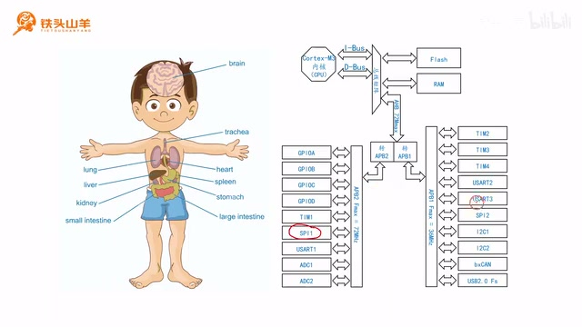
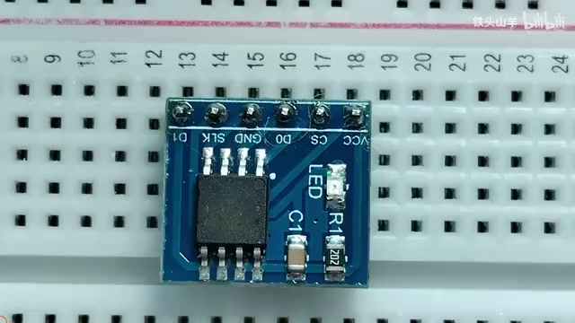
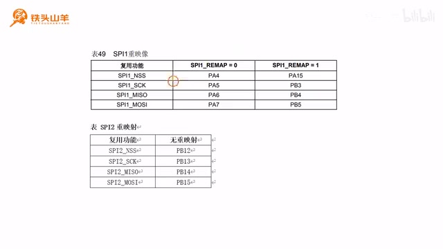
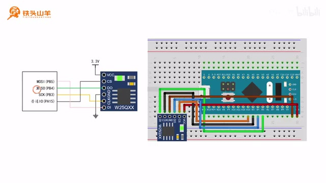
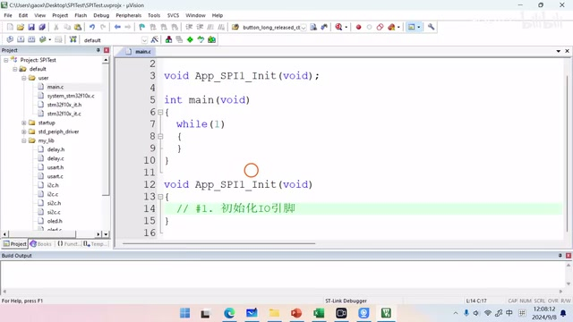
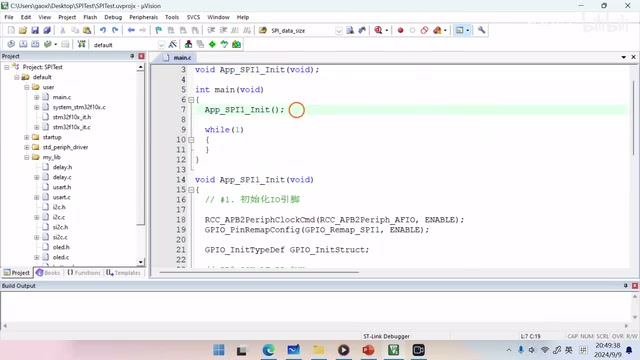

# P028 · 5.4 （SPI） IO引脚初始化

各位同学大家好，我是铁头山羊。前两期视频里，我们学习了按键驱动的编写方式。结束按键驱动之后，我们继续回到 SPI 这一章，本节通过 5.4 节学习 SPI 模块 IO 引脚的初始化。

本套视频需要的材料都包含在开发套件包里，大家可以扫描屏幕上的二维码，进入淘宝店铺购买。购买套件后，可以获得课程所有课件和源码，还能加入答疑群，直接和 UP 主交流。

本期视频分成下面五个部分来讲。第一部分，先对要学习的 SPI 模块做简单介绍。第二部分，因为学习 SPI 时要使用 W25Q64 做实验，所以简单介绍一下 W25Q64 是什么。第三部分，在单片机上定位所用 SPI 接口的引脚位置。第四部分，学习如何选择 IO 引脚模式。第五部分，学习如何选择 SPI 引脚的最大输出速度。下面从第一部分开始。

## SPI 模块简介

_STM32 内部结构图标出了 SPI1 与 SPI2 的位置。 ·_ [_原片 01:34_](https://www.bilibili.com/video/BV11X4y1j7si/?p=28\&t=94) 先从 SPI 模块开始。SPI 模块就是单片机上的 SPI 接口，和之前学过的许多模块一样，它属于单片机的片上外设。看右边的 STM32 内部结构框图，可以找到片上外设所在的位置，其中有 SPI1，也有 SPI2。因此，这颗单片机上有两个 SPI 接口：SPI1 和 SPI2。实际使用时可以选 SPI1，也可以选 SPI2，任选一个使用就可以了。

接下来进入第二部分，认识 W25Q64。我们先在开发套件包里找到这个模块。

_W25Q64 外接 Flash 模块的实物。 ·_ [_原片 02:00_](https://www.bilibili.com/video/BV11X4y1j7si/?p=28\&t=120) 这就是本节要学习的 W25Q64 模块，后续我们要使用它来做 SPI 实验。今天要学习的 W25Q64 是一种 Flash 芯片。什么是 Flash 呢？可以把它想象成电脑的一个硬盘，我们可以往 Flash 芯片里面存储数据。硬盘的特点就是掉电之后不丢失，所以数据存进去之后，下次再上电时还在里面。

回忆一下，单片机内部其实也有 Flash，比如图中这个位置。既然单片机里有 Flash，为什么还要外接一个 Flash 模块？原因是这样的：单片机里面的 Flash 像电脑内部的硬盘，我们用它存储所写的程序；而 W25Q64 这个外接 Flash 模块可以想象成移动硬盘，我们可以把一些单独的数据存储在这个移动硬盘里，这样方便管理。

W25Q64 使用 SPI 接口，也就是通过 SPI 总线和单片机通信。我们在单片机里选一个 SPI 模块，再用导线连接 SPI 总线，就可以向 W25Q64 写数据，或者从里面读数据。

这个模块有几个引脚：VCC、CS、DO、GND、CLK 和 DI。我们逐一来看。VCC 和 GND 用来接电源，VCC 接电源正极，GND 接地；这里把 VCC 接 3.3 伏，GND 接地。下面来看 DI。

DI 是英文 data input 的缩写，意思是数据输入。使用 W25Q64 模块时，它作为从机（slave），所以在前面加上 Slave，称为 Slave Data Input，即从机的数据输入。那从机的数据输入，是不是就是主机的数据输出？因此它对应 SPI 总线的 MOSI，也就是主发从收这个引脚。接线的时候要把主机和从机的 MOSI 连接在一起，所以我们把 DI 连接到主机的 MOSI。

再看上面的 DO 引脚。DO 是 data output 的缩写，表示数据输出；加上“从机”这个限定，就是从机的数据输出。那从机的数据输出是不是主机的数据输入？因此它对应 SPI 总线的 MISO，应当连接到单片机的 MISO。

下面一个引脚是 CLK，是 clock 的缩写，省略了 serial，表示 SPI 总线里的 SCK，也就是串行时钟。它应当连接主机的 SCK。图中的 CLK 接到主机 SCK，主机通过 SCK 向从机的 CLK 引脚发送时钟。

刚才我们简单地介绍了 W25Q64 模块，下面需要对这个模块接线。在接线之前，先定义单片机 SPI 总线那几个引脚所在的位置。所以第三部分，我们一起来定位 SPI 的引脚位置。

## 定位 SPI 引脚

先看这张 SPI 模块的内部结构框图。这里先不具体介绍框图，只看右边的引脚。

右边有四个引脚：MOSI（主发从收）、MISO（主收从发）、SCK（串行时钟）和 NSS（从机片选）。单片机一般作为 SPI 主机。作为从机的模式虽然也能实现，但这里不讲，因为比较复杂，平时也用不到。NSS 是从机的片选引脚，因此如果使用主机模式，这个引脚就用不到。我们只需要找到上面三个引脚的位置就可以了。

怎么找这三个引脚？把之前做的表格拿出来就可以。

_表格列出 SPI1 重映射前后的引脚，以及 SPI2 的默认引脚。 ·_ [_原片 07:00_](https://www.bilibili.com/video/BV11X4y1j7si/?p=28\&t=420)

表格分成很多模块，找到 SPI 部分，这两张表就表示 SPI1 和 SPI2 这两个模块的引脚所在位置。下面把这两张表摘出来，具体看一下内容。

上面这张表介绍 SPI1 的引脚位置。SPI 有四个引脚，刚才说过 NSS 只有做从机时才会用到，所以不用管它。这里需要区分口述和画面：讲解中说 SPI1 不进行重映射时使用 PB5、PB6、PB7，但旁边显示的表格在 SPI1\_REMAP=0 一栏列出的是 PA5、PA6、PA7；讲解和表格在重映射时列出的则都是 PB3、PB4、PB5。

第二张表介绍 SPI2 的引脚位置。SPI2 没有重映射，只能使用一组默认引脚，也就是 PB12、PB13、PB14、PB15。本次实验打算使用 SPI1，而且为了增加难度，不使用默认那组引脚，而是把它重映射到 PB3、PB4、PB5。

定位好这些引脚后就开始接线。先看左边的电路图，主发从收这个引脚……

_面包板接线示意图显示 SPI1 的 PB3、PB4、PB5 与 W25Q64 的 CLK、DO、DI 相连，并由 PA15 控制片选。 ·_ [_原片 08:12_](https://www.bilibili.com/video/BV11X4y1j7si/?p=28\&t=492) MOSI 位于单片机 PB5，所以把 PB5 接到右边模块的 DI。SPI1 的主收从发位于 PB4，把 PB4 接到模块的 DO。串行时钟位于单片机 PB3，把 PB3 接到模块的 CLK。

最后，在单片机上任意选一个普通 IO 引脚，比如 PA15，用它输出高低电压来控制模块的片选引脚 NSS。NSS 输出高电压时不选中模块，输出低电压时就选通模块。然后把模块 VCC 接高电压 3.3 伏，GND 接地，这样就是完整的电路图。有了电路图之后，可以生成右边的面包板接线图，我们按照这个接线图连接电路就可以了。这个电路连起来还是比较简单的，连接好之后就是这样。

刚才通过第三部分已经确定了 SPI 总线引脚的位置，也已经把电路接好。下一步就要初始化 IO 引脚。初始化 IO 引脚时，先需要确定它的参数，比如 IO 引脚选什么模式、最大输出速度选多少。

## 选择 IO 引脚模式

第四部分先来看 IO 引脚模式怎么选择。要知道 SPI 总线的 IO 引脚应当配置成什么模式，得看我们的表格。打开 SPI 模块，右边这张表就是 IO 配置表，详细说明每个引脚应当配置成什么模式。

SPI 模块有四个引脚。因为让单片机做主机，NSS 用不到，只看前面三个。首先看 SCK。

SCK 有主机和从机两种模式。单片机使用的是主机模式，所以只看表格上面这一行。SCK 应设置成复用输出推挽模式，也就是 AF\_PP。单片机的 SCK 要向外输出串行时钟信号，所以一定是输出模式，这里选 AF\_PP。

再看第二个引脚 MOSI，这是一个发送引脚。我们用到的是全双工主机模式，所以只看这个模式。它的模式也应设置成 AF\_PP，也就是复用输出推挽模式。第三个引脚 MISO 是输入引脚。看全双工主机模式这一行，它应设置成输入浮空或者输入上拉。设置成输入上拉之后，它就有一个默认的高电压，所以一般选择输入上拉模式就可以了。最后一个引脚用不到。

刚才简单了解了 IO 模式的选择方式，下面看最后一个参数。

## 选择 IO 的最大输出速度

第五部分，IO 引脚的最大输出速度应当怎么选？之前介绍过原则：选择满足要求的最小值。单片机有三个最大输出速度档位，分别是 2 兆、10 兆和 50 兆。W25Q64 模块应当选哪一种？要看 W25Q64 的说明书。

这是 W25Q64 模块的说明书，我把它放在百度网盘的课程资料里，感兴趣的话大家可以拿出来看。找到第二部分，也就是特性介绍。这里有一段文字，介绍 SPI 总线所应设置的最大输出速度。说明书上的文字是英语，可能看不懂，所以现在把它翻译成汉语，这样就看得明白了。其中有一句特别重要：它的 SPI 时钟频率最高可以是……

80 兆赫兹。这个时钟频率就是主机通过 SCK 引脚发送的时钟信号频率。每一个时钟周期，SPI 总线上就收发一个比特位，所以时钟频率决定数据传输速度。说明书这里说最高速度可以达到 80 兆赫兹，这个速度相当快。但是实际使用时要考虑一下实际情况：我们是用面包板连接，电路不是特别稳定，所以最好不要选这么高的频率，选一个小一点的。比如本次实验为了保险，就选一个很小的频率，例如 1 兆赫兹。

1 兆赫兹时，IO 最大输出速度选 2 兆那个档位即可。如果选择 8 兆赫兹，就选 10 兆的最大输出速度；如果更高，就选 50 兆。本次实验选小一点，选 2 兆就可以。

到这里我们定位了所有引脚的位置，确定了它们的模式，也确定了最大输出速度，得到这样一张表。总共使用四个引脚：SCK、MISO、MOSI 和一个普通 IO。普通 IO 负责驱动从机 NSS，也就是片选信号。对应引脚位置分别是 PB3、PB4、PB5 和 PA15。前面两个（PB3、PB5）选择复用输出推挽模式；MISO 接收数据，所以选择输入上拉；普通 IO 要驱动从机 NSS，因此选通用输出推挽。刚才也说过，实际实验时选用 1 兆赫兹时钟频率，所以 IO 最大输出速度档位选 2 兆就可以。

_工程编辑器中的 main.c 正在编写 SPI1 初始化函数。 ·_ [_原片 15:24_](https://www.bilibili.com/video/BV11X4y1j7si/?p=28\&t=924) 下面按这张表初始化 IO 引脚。本次实验需要新建一个工程，请大家登录百度网盘，把模板工程下载下来。下载模板工程后先解压，再重命名，比如叫 SPI\_test。然后把里面的工程文件也重命名为同一个名字 SPI\_test，把上面的名字复制下来即可。

双击打开模板工程。今天把程序写到 main.c 文件里，所以打开 default 文件夹，再打开 USER 文件夹，双击 main.c。代码要写得工整一些，我们仍然把 SPI 初始化单独写成一个函数，比如命名为 App\_SPI1\_Init。要初始化 SPI1，就复制这个函数原型放在下面实现。

初始化的第一步是初始化 IO 引脚。下面按表格初始化 SPI 引脚。因为 PB3、PB4、PB5 这三个引脚是通过 IO 复用重映射得到的，所以需要对 SPI1 的这三个引脚进行复用功能重映射。复用功能重映射要用 AFIO 模块，因此先使能 AFIO 时钟。第一句代码就是 `RCC_APB2PeriphClockCmd(RCC_APB2Periph_AFIO, ENABLE);`，使能 AFIO 模块时钟。使能之后，调用 `GPIO_PinRemapConfig` 对 SPI1 进行重映射。

`GPIO_PinRemapConfig` 的第一个参数填 `GPIO_Remap_SPI1`，第二个参数填 `ENABLE`，也就是使能重映射。这样两句代码就完成了重映射。

下面逐个初始化 IO 引脚。首先初始化 PB3，对应 SPI 的 SCK。主机通过 SCK 向外发送数据，所以模式是复用输出推挽，最大输出速度是 2 兆赫兹。表格里的“PB3、SCK、AF\_PP、2MHz”就是要使用的参数。

先使能 GPIOB 时钟，然后声明一个结构体类型的变量，把变量放在上面，再给成员赋值。`GPIO_Pin` 填引脚编号，因为这是 PB3，所以填 `GPIO_Pin_3`。然后选模式，刚才说 SCK 要设成复用输出推挽，所以填 `GPIO_Mode_AF_PP`。最后设置最大输出速度，选 2 兆。然后调用 `GPIO_Init`，对 PB3 进行初始化。

SCK 初始化完了，再初始化下一个引脚 PB4。它是 MISO，对于主机来说是输入引脚，所以把它配置为输入模式。

并且使用输入上拉。现在初始化 PB4。PB4 对应 MISO，模式是 IPU，最大输出速度不用设置。仍然开启 GPIOB 时钟，然后设置结构体成员：使用 PB4，所以引脚编号是 4；模式是输入上拉，因此填 `GPIO_Mode_IPU`。最后调用 `GPIO_Init` 初始化 PB4。

下面初始化 PB5，对应 MOSI。对于主机来说它是数据输出引脚，所以设为复用输出推挽模式，最大输出速度也是 2 兆赫兹。参数就是 PB5、MOSI、AF\_PP、2MHz。按照这个参数初始化，代码和 PB3 的基本一样，直接复制粘贴再稍微修改即可：引脚是 PB5，所以这里改成 5。

最后初始化普通 IO 引脚。我们要通过普通 IO 引脚向从机 NSS 写 0 或者写 1，直接控制单片机输出高低电平，所以使用通用模式，也就是通用输出推挽模式，最大输出速度也是 2 兆赫兹。下一步是 PA15，参数是 PA15、普通 IO、OUT\_PP、最大输出速度 2 兆赫兹。

还是复制上面的代码再修改。首先 PA15 属于 GPIOA 端口，所以使能的时钟应该是 GPIOA 的时钟；引脚编号应是 15，就填 15；模式改成 `GPIO_Mode_Out_PP`，也就是通用输出推挽模式；最大输出速度是 2 兆赫兹。最后把这里的 GPIOB 改成 GPIOA。

_代码编辑器显示 main 中对 App\_SPI1\_Init 的调用，以及初始化函数开头的 AFIO 配置。 ·_ [_原片 20:24_](https://www.bilibili.com/video/BV11X4y1j7si/?p=28\&t=1224) 这样所有引脚都初始化完了。初始化完成后，在上面的 main.c 的 main 方法里调用 `App_SPI1_Init`，放在这里调用就可以。

好的，到此为止，本期视频的内容讲完了。本期先简单介绍了 SPI 模块，再介绍实验中用到的 W25Q64，它是一个外部 Flash；然后定义了 SPI 引脚的位置，选择了引脚模式，并配置了引脚的最大输出速度，这样就把 SPI 的 IO 引脚初始化完了。下期视频将讲解 SPI 模块本身的初始化。好的，本期视频到这里，我是铁头山羊，感谢收看，我们下期再见。
