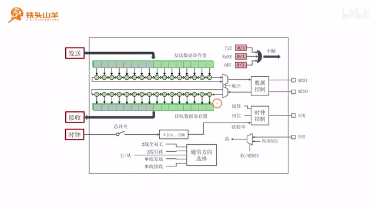
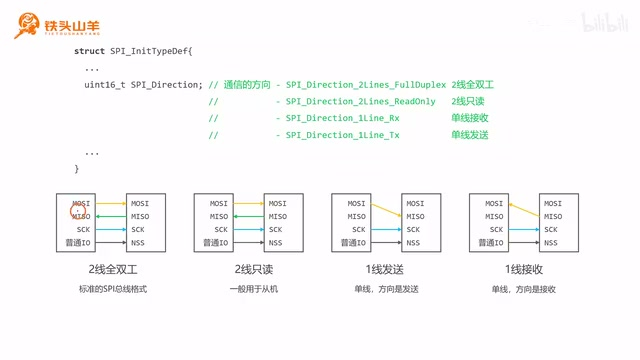
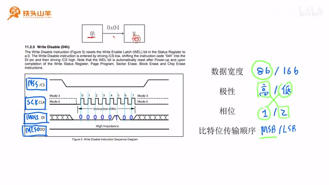
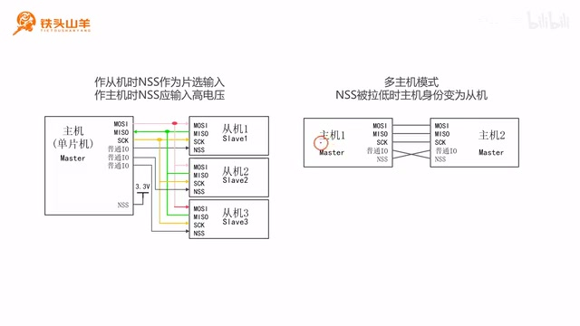

# P029 · 5.5 （SPI）SPI模块的初始化

各位同学大家好，我是铁头山羊。上期视频里我们已经学习了如何初始化 SPI 模块的 IO 引脚；这期继续学习如何初始化 SPI 模块本身。本套视频所需材料都在开发套件包中，可以扫描屏幕上的二维码进入淘宝店铺购买；购买后可以获得整套课程的课件和源码，还能加入答疑群，直接和 UP 主交流。

本期分六部分：先了解 SPI 模块的基本工作原理，再学习初始化接口 `SPI_Init`，然后选择数据通信方向；接着根据从机要求设置数据位宽度、时钟极性和相位、比特传输顺序；之后设置波特率，最后配置 NSS 引脚。

## SPI 模块内部的收发与时钟

下面从第一部分开始，看 SPI 模块的内部结构框图。这张图上期已经简单见过，本期来详细讲解。



_SPI 模块框图显示 MOSI、MISO 收发通路以及时钟与控制部分。 ·_ [_原片 01:34_](https://www.bilibili.com/video/BV11X4y1j7si/?p=29\&t=94)

先看右侧的引脚：MOSI 是主机发送、从机接收的数据线，主机通过它向外发送数据；MISO 是主机接收、从机发送的数据线，主机通过它接收从机发来的数据；SCK 是串行时钟，主机通过它向外发送时钟信号来控制通信速度。最后是 NSS，这个引脚一般在从机模式下使用：从机从对侧接收高低电平，收到低电平就表示自己被选中。课程里通常把 SPI 配成主机，所以 NSS 作为从机片选的用途较少。 框图中，连接 MOSI 和 MISO 两条数据线的内部电路与之前学过的串口、I²C 有相似之处。发送数据时，程序把数据写入发送数据寄存器，数据再进入移位寄存器，由移位寄存器逐位通过 MOSI 向外发送。接收时，波形从 MISO 输入，模块逐位解析；移位寄存器收满后，数据进入接收数据寄存器，程序再把它读出来。发送数据寄存器和发送移位寄存器负责发送，接收移位寄存器与接收数据寄存器负责接收。程序处理的是整组数据，底层移位寄存器负责逐位通信；这一点和串口、I²C 中见过的寄存器与移位结构相似。

再看下方连接 SCK 的部分，它负责产生时钟。SCK 由主机向外输出；时钟来自单片机内部，具体如何产生留到下一章讲。时钟经过一个总开关，开关闭合后数据收发才会开始。 接着时钟经过一个可设置的分频器，分频系数可以是 2、4，一直到 256；调节系数，就能在右侧产生不同速度的波特率。时钟控制电路还设置时钟极性和相位。极性说的是空闲状态下 SCK 的电平：空闲为高电平是高极性，空闲为低电平是低极性。相位说的是接收方在哪个边沿采集数据，可以在第一个边沿或第二个边沿采集。极性、相位和波特率这三个参数确定后，SCK 上输出的时钟波形也就确定了。也就是说，波特率决定时钟速度，而极性和相位一起决定时钟的空闲电平及接收方采样位置。

## 通信方向与状态标志

接下来是通信方向选择。SPI 既可以作为主机，也可以作为从机；此外还有两线全双工、两线只读、单线发送和单线接收几种配置，稍后逐一讲解。框图右侧还表示 NSS 引脚：一般只有从机模式才用它作片选，但 SPI 作主机时也需要对 NSS 做一些配置，具体留到后面说明。 框图上方的粉色方块表示标志位，值可以是 0 或 1。通过查询标志位，可以了解 SPI 模块的工作状态。一共有三个标志：TXE 表示发送数据寄存器空，对应发送部分；RXNE 表示接收数据寄存器非空，对应接收部分；OVR 是溢出标志，本课先不展开。到这里，框图的内容就介绍完了，希望大家对 SPI 模块的工作原理有一个最基本的认识。下面学习新的编程接口 `SPI_Init`，它的作用是初始化 SPI 模块。

## 初始化接口 `SPI_Init`

在讲接口前，先打开上期编写的工程，在 `main.c` 中找到 `App_SPI1_Init`。上次只完成了第一步，即初始化 SPI 的 IO 引脚；现在要加上第二步，初始化 SPI 本身。操作 SPI 前先使能它的外设时钟：调用 `RCC_APB2PeriphClockCmd(RCC_APB2Periph_SPI1, ENABLE)`，这样就打开了 SPI1 模块的时钟。

`SPI_Init` 的名字里，`SPI` 表示 SPI 模块，`Init` 是 initialize（初始化）的缩写。它有两个参数，大致形式为 `SPI_Init(SPI_TypeDef *SPIx, SPI_InitTypeDef *SPI_InitStruct)`。第一个参数 `SPIx` 填写要操作的 SPI 名称；芯片里有 SPI1、SPI2，本例使用 SPI1。

第二个参数是初始化结构体指针。它回答的不是“初始化哪个 SPI”，而是“要把这个模块初始化成什么样”。`SPIx` 用于选择外设，结构体指针则把一组配置成员交给接口。 这个结构体指针像一张菜单：想把 SPI 配成什么样，就把相应设置填进去，接口会根据菜单初始化硬件。先声明一个 `SPI_InitTypeDef` 结构体变量，变量名可以自己取；下面来看结构体成员。

先看 `SPI_Mode`，它选择主机或从机模式。单片机里的 SPI 可以作主机，也可以作从机，但通常作主机。本次实验中，单片机作为主机，W25Q64 Flash 作为从机，所以设为 `SPI_Mode_Master`。从机模式也可以使用，只是平时较少；本次由单片机访问 W25Q64，因此确定为主机。在代码中先声明变量，再给这个成员赋值：

```c
SPI_InitTypeDef SPI_InitStructure;
SPI_InitStructure.SPI_Mode = SPI_Mode_Master;
```

其他成员先认识名称和作用，后面再逐项讲如何设置：`SPI_Direction` 设置通信方向，`SPI_Mode` 设置主机或从机，`SPI_DataSize` 设置 8 bit 或 16 bit；`SPI_CPOL`、`SPI_CPHA` 设置时钟参数，`SPI_NSS` 设置 NSS 管理方式，`SPI_BaudRatePrescaler` 设置分频系数，`SPI_FirstBit` 选择 MSB 或 LSB。`SPI_DataSize` 设置数据宽度，可选 8 bit 或 16 bit；`SPI_CPOL` 设置时钟极性；`SPI_CPHA` 设置时钟相位；`SPI_FirstBit` 设置比特传输顺序。 对于一个字节，位编号是 7 到 0；bit 0 的权重是 2⁰，最小，叫最低有效位 LSB；bit 7 的权重是 2⁷，最大，叫最高有效位 MSB。SPI 可以先传 MSB（7 到 0），也可以先传 LSB（0 到 7），具体选择要看从机的要求。

## 选择数据通信方向

结构体成员 `SPI_Direction` 用来设置通信方向，有四个选项：两线全双工、两线只读、单线接收、单线发送。下面逐个看它们的含义。 两线全双工对应标准 SPI 总线。全双工表示既能发送也能接收，而且收发可以同时进行。标准总线还有 SCK 和 NSS：主机的 MOSI 接从机的 MOSI，主机沿这根线向从机发送；主机的 MISO 接从机的 MISO，主机沿这根线从从机接收。两条数据线各负责一个方向，所以称为两线全双工。主机发数据时，从机也可以同时沿另一条 MISO 路径返回数据；两根线分别承担发送和接收。



_课件并列展示两线全双工、两线只读、单线发送和单线接收的连线方式。 ·_ [_原片 16:40_](https://www.bilibili.com/video/BV11X4y1j7si/?p=29\&t=1000)

第二种方向叫两线只读，一般用于从机。MOSI 和 MISO 两根线仍然连接，但从机只通过 MOSI 接收主机数据，不通过 MISO 返回数据，因此叫只读。主机向从机广播、又不要求从机回复时可以用这种方式，不过它很少用，本课程后续也不会使用。 第三、第四种是单线接收（RX）和单线发送（TX），都只用一根线。图中把主机 MOSI 接到从机 MISO。主机向从机发送时，主机设为单线发送、从机设为单线接收；反向传输时，主机设为单线接收、从机设为单线发送。单线可以双向传输，但两个方向不能同时进行，只能发送或接收。因此要改变传输方向时，主机与从机的 RX/TX 设置也要互换，不能把单线模式当成两线全双工使用。

实际使用一般选择两线全双工。本次连接 W25Q64 用两根数据线，并且主机既要向 Flash 发指令，也要读取 Flash 返回的数据，所以选择 `SPI_Direction_2Lines_FullDuplex`。

```c
SPI_InitStructure.SPI_Direction = SPI_Direction_2Lines_FullDuplex;
```

## 数据宽度、时钟模式与比特顺序

接下来设置数据位宽度、时钟极性和相位、比特传输顺序。`SPI_DataSize` 有 8 bit 和 16 bit 两种选择。数据宽度就是每次通过 SPI 传输的位数：8 bit 每次传一个字节；16 bit 每次传 16 位，也就是编程中的半字。下面结合 W25Q64 手册，确定这些参数应当如何配置。本实验所连从机要求什么，SPI 主机就应当采用相应设置；不能只凭配置项的名字自行挑选。 `SPI_CPOL` 是 clock polarity，设置时钟极性；`SPI_CPHA` 是 clock phase，设置时钟相位。空闲时 SCK 为低，极性记为 0；空闲时为高，极性记为 1。接收方在第一个边沿采集，相位记为 0；在第二个边沿采集，相位记为 1。按“极性、相位”排列，四种组合 `00`、`01`、`10`、`11` 分别对应 SPI 模式 0、1、2、3。

最后一个成员 `SPI_FirstBit` 设置比特顺序，可选 MSB first 或 LSB first。LSB 是 least significant bit（最低有效位）：LSB first 就先传 bit 0；MSB first 则先传 bit 7。八位组成一个字节，图里一组八个时钟脉冲对应一个字节；十六位则是一组十六个脉冲，对应编程中的半字。所以一组八个时钟脉冲对应一个字节，一组十六个脉冲对应 16 位半字。到底选哪种位序、宽度、极性和相位，都要看所连接从机的要求。 本次实验使用 W25Q64，所以打开它的数据手册。目录第 11 部分的 11.2 是指令说明，可以从指令波形看 SPI 参数。这里看 11.2.5 Write Disable（写禁止）指令；波形图展示单片机向从机发送这条指令时 SPI 总线上的实际信号。手册不是让我们随便定一组参数，而是给出了 Flash 实际需要的总线时序；下面用这条容易读的指令，从从机要求反推主机配置。 波形中的 CS 是片选信号，对应 NSS；CLK 对应串行时钟 SCK；DI 对应 MOSI（主发从收）；DO 对应 MISO（主收从发）。通信时要选中 W25Q64，所以 NSS 拉低。MOSI 上发送的命令字节是 `04h`，即二进制 `00000100`，共 8 位：bit 7 是 MSB，bit 0 是 LSB。



_W25Q64 手册中的写禁止指令波形，标出片选、时钟和数据线。 ·_ [_原片 26:19_](https://www.bilibili.com/video/BV11X4y1j7si/?p=29\&t=1579)

波形先发送 bit 7，最后发送 bit 0，因此使用 MSB first；它以 8 位为一组，所以数据宽度选择 8 bit。图中连续的零并没有改变位序，传输仍然从 bit 7 到 bit 0。接下来根据 SCK 波形分析极性和相位。右侧课件也把要从手册确定的四项列在一起：8/16 bit、低/高极性、第一/第二边沿，以及 MSB/LSB 顺序，便于和初始化结构体对应起来。 手册波形显示 SCK 可以选择低电平或高电平空闲。低极性时，上升沿是第一个边沿，图中接收方在第一个边沿采集，对应极性 0、相位 0，也就是模式 0。高极性时，下降沿变成第一个边沿，上升沿是第二个边沿；图中在上升沿采集，也就是第二边沿采集，对应极性 1、相位 1，即模式 3。因此 W25Q64 支持模式 0 或模式 3，本次选择高极性、第二边沿的模式 3。 根据刚才的结论，回到代码设置四个参数：数据宽度用 `SPI_DataSize_8b`；时钟选高极性和第二边沿采集；位序用 MSB first。

```c
SPI_InitStructure.SPI_DataSize = SPI_DataSize_8b;
SPI_InitStructure.SPI_CPOL = SPI_CPOL_High;
SPI_InitStructure.SPI_CPHA = SPI_CPHA_2Edge;
SPI_InitStructure.SPI_FirstBit = SPI_FirstBit_MSB;
```

## 设置波特率

这些参数填好后，接下来设置波特率。W25Q64 的最高时钟频率在 80 MHz 以下。这个上限很高，但本次实验用面包板连接，电路没有 PCB 那么稳定，所以先选较低波特率观察实验现象。上期视频设在约 1 MHz，下面根据 SPI 的分频器来选择最接近的值。 主机通过 SCK 向外发送时钟，所以由主机决定波特率。这里暂时把单片机提供给 SPI 的时钟看作 72 MHz，具体如何产生后面再讲。分频器从 2 分频到 256 分频：72 MHz 除以 2 得到 36 MHz，除以 4 得到 18 MHz，除以 8 得到 9 MHz；一直到除以 256 得到 0.28125 MHz。分频候选依次可得 36、18、9、4.5、2.25、1.125、0.5625、0.28125 MHz；这是从 72 MHz 输入逐级分频的结果。目标是 1 MHz 左右，最接近的选项是除以 64，得到 1.125 MHz。因此把 `SPI_BaudRatePrescaler` 设成 `SPI_BaudRatePrescaler_64`。

## NSS 引脚的配置方式

设置好前面的参数后，就只剩最后一个参数 NSS 的配置方式。 NSS 这部分比较难。SPI 总线上有主机和从机两种设备。先看从机：NSS 就是片选信号，主机通过它给从机输入高电平时，从机没有被选中；输入低电平时，从机被选中。从机根据 NSS 上的高低电平判断自己有没有被选中。

再看主机。前面简单提到过主机似乎不用配置 NSS，实际并不是这样：主机也要处理 NSS，例如给它接一个高电平。原因是 SPI 支持多主机模式，即使本例没有使用多主机，也要适配这种机制。下面以两个主机为例说明。主机 NSS 不能完全不管：即使项目里只有一个主机，也要理解 NSS 电平变化可能影响主机身份。 

_多主机示意图展示主机通过交叉连接的 NSS 使另一主机转为从机。 ·_ [_原片 36:14_](https://www.bilibili.com/video/BV11X4y1j7si/?p=29\&t=2174)

多主机总线上，主机一和主机二的 MOSI、MISO、SCK 对应相连，再用普通 IO 与对方的 NSS 交叉连接。如果主机一要发起与主机二的通信，就通过普通 IO 给主机二的 NSS 输入低电平。主机二收到低电平后会失去主机身份，转为从机并被选中，于是主机一可以和它通信。反过来，主机二也可以用同样方式把主机一变为从机。

因此在多主机模式下，NSS 输入低电平会使原来的主机失去主机身份。单主机时也必须给 NSS 输入高电平，否则主机身份会丢失并产生错误。这就是需要把 NSS 接到 3.3 V 的原因。因此本例要保持主机的 NSS 为高电平，避免失去主机身份。 不过外接 3.3 V 会占用一个引脚，还要用导线连接。要省去这个引脚和导线，可以使用软件 NSS。回到模块内部框图，NSS 输入既可以来自外部引脚，也可以来自内部 NSS 位。这个内部位可以写 0 或 1：写 0 等效于输入低电平，写 1 等效于输入高电平。要使用内部来源，就先在初始化结构体的 `SPI_NSS` 成员中选软件 NSS（`SPI_NSS_Soft`）；选择 `SPI_NSS_Hard` 则表示硬件 NSS。

先把结构体成员 `SPI_NSS` 设为软件 NSS；另一个选项 `SPI_NSS_Hard` 表示硬件 NSS。设置好所有结构体成员后，调用 `SPI_Init` 完成 SPI 初始化，第一个参数传 `SPI1`，第二个参数传初始化结构体的地址。 软件 NSS 配好后，还要把内部 NSS 位写 1，表示输入高电平。使用 `SPI_NSSInternalSoftwareConfig` 配置这个内部信号：第一个参数是 SPI 名称，第二个参数选择 0 或 1；`SPI_NSSInternalSoft_Set` 表示 1，`SPI_NSSInternalSoft_Reset` 表示 0。本例传入 `SPI1` 和 `SPI_NSSInternalSoft_Set`。接口名可拆成 NSS、Internal、Software、Config，说明它用来配置 NSS 的内部软件信号；两个参数分别是 SPI 名称和要写入的电平。Set 写 1，Reset 写 0，所以这里选 Set 来维持主机 NSS 高电平。

```c
SPI_InitStructure.SPI_NSS = SPI_NSS_Soft;
SPI_Init(SPI1, &SPI_InitStructure);
SPI_NSSInternalSoftwareConfig(SPI1, SPI_NSSInternalSoft_Set);
```

以上就是本期 SPI 模块初始化的代码。回顾一下：先了解 SPI 模块的基本工作原理，学习 `SPI_Init` 接口，再设置通信方向、数据位宽度、时钟极性与相位、比特传输顺序、波特率，最后配置 NSS。好了，本期内容到这里结束。我是铁头山羊，我们下期再见。
