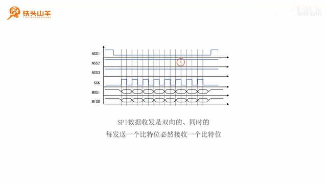
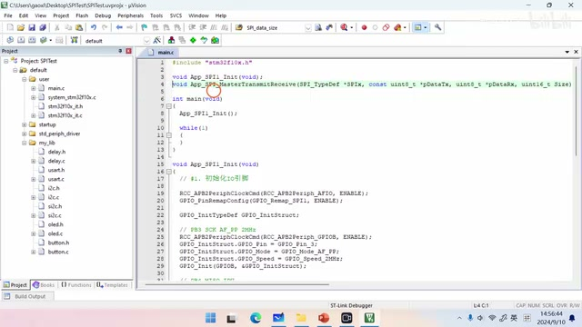
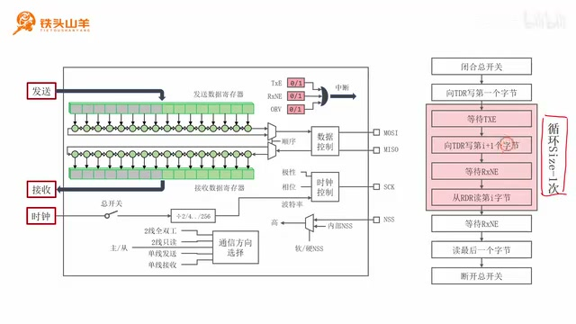
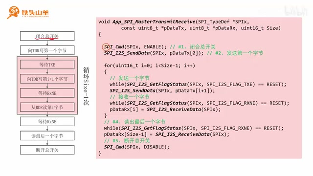
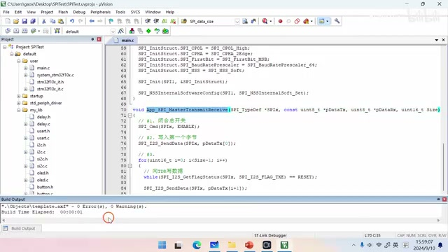

# P030 · 5.6 （SPI）数据收发

## 课程安排与 SPI 数据收发特点

大家好，我是铁头山羊。今天学习第五章第六节，通过 SPI 总线收发数据。本套视频需要的材料都包含在开发套件包里，屏幕上有二维码，可以扫描进入淘宝店铺购买。购买套件后，可以获得课程全部课件和源码，也可以加入答疑群直接交流。

本期分四部分：先简单介绍 SPI 数据收发的特点；再声明一个用于 SPI 数据收发的编程接口；接着简单介绍 SPI 总线数据收发的过程；最后编写数据收发代码。现在先从 SPI 总线的特点开始，看一下通信时的实际波形。

_SPI 波形图标出了 NSS、SCK、MOSI 与 MISO，展示主机时钟驱动下的同步双向传输。 ·_ [_原片 01:06_](https://www.bilibili.com/video/BV11X4y1j7si/?p=30\&t=66)

图中的 SPI 总线包括 MOSI（主发从收）、MISO（主收从发）、SCK 串行时钟和 NSS 片选信号。要和哪一个从机通信，就把对应的 SS 引脚拉低。随后主机通过 SCK 向从机发送时钟信号；每个时钟周期里，主机通过 MOSI 向从机发送一个比特，与此同时，从机也通过 MISO 向主机发送一个比特。

所以，SPI 和之前学过的串口、I²C 最大的不同，是数据收发必须双向、同时进行：主机每发送一个比特给从机，就必然从从机收到一个比特。接下来会用这个特点来理解后面的收发过程。

不只是每发送一个比特就收到一个比特；发送一个比特就会收到一个比特，发送一个比特仍然会收到一个比特。主机向从机发送多少字节，就会从从机收到多少字节。这是 SPI 通信最大的特点，大家一定要牢记。只有理解它，才能继续讲后面的 SPI 数据收发过程。

## 声明数据收发接口

刚才简单了解了 SPI 收发特点，下面开始编程。先声明一个用于 SPI 总线数据收发的编程接口。接口名是 `App_SPI_MasterTransmitReceive`：`App` 表示应用层，也就是用户自己编写的代码；`SPI` 表示 SPI 模块；`Master` 表示主机，即让单片机上的 SPI 模块工作在主机模式；`Transmit` 是发送，`Receive` 是接收。因此这个接口用 SPI 总线以主机身份收发数据。

接口有四个参数。第一个 `SPIx` 填写 SPI 的名称，使用哪个 SPI 就填哪个名称；本期使用 SPI1，因此填 `SPI1`。第二个 `pDataTx` 用来传入要发送的数据，它是一个数组，因为一次要发送多个数据。SPI 收发是双向的，发送数据的同时也会从从机接收数据。第三个 `pDataRx` 用来盛放收到的数据，接收后可以从这个数组读出。最后一个 `Size` 填写收发的数据数量。

## 函数声明与 SPI 寄存器收发原理

先打开上期视频编写的工程，找到 `main.c`，在文件开头声明本期的函数 `App_SPI_MasterTransmitReceive`。它让 SPI 以主机身份在 SPI 总线上收发数据。第一个参数是 `SPI_TypeDef *SPIx`，填写 SPI 名称；第二个参数是常量无符号八位整型指针 `pDataTx`，填写要发送的数据数组；第三个参数是接收从机数据的数组；最后一个参数是无符号 16 位整型变量，用来填写要收发的数据数量。这样编程接口的声明就完成了。把接口原型复制到文件最底部，随后在那里实现。

_屏幕上的完整函数声明依次列出 SPI 名称、发送数组、接收数组和收发数据数量四个参数。 ·_ [_原片 05:09_](https://www.bilibili.com/video/BV11X4y1j7si/?p=30\&t=309)

开始写代码前，先看 SPI 总线数据收发的简单过程。左边框图中，与发送有关的是发送数据寄存器、下面的移位寄存器和 MOSI 引脚；与接收有关的是接收数据寄存器、上面的移位寄存器和 MISO 引脚。

发送时，把要发送的数据写进发送数据寄存器；随后数据自动移动到移位寄存器，由它完成并行到串行的转换，再一个比特一个比特地移出去，经 MOSI 发送。接收时，从 MISO 引脚接收从机发来的数据并解析波形，把各比特依次存入移位寄存器。移位寄存器存满后，数据进入接收数据寄存器，编程者再把它读出来。

框图上方还有与收发相关的标志位，本期只用两个。`TXE` 表示发送数据寄存器空；寄存器没有数据时它等于 1，这和之前介绍的一样。`RXNE` 也和之前介绍的一样，表示接收数据寄存器非空：里面有数据时它才等于 1。

## 按流程图组织收发循环

刚才通过框图了解了 SPI 总线收发原理，接着看右边的流程图，梳理代码步骤。第一步闭合 SPI 总开关。只有开关闭合，上面这部分电路才能工作。闭合后，先向发送数据寄存器写入第一个字节，也就是提前把要发送的第一个字节放进去。

然后进入循环，循环执行 `Size - 1` 次。每次先向发送数据寄存器写入一个字节，再从接收数据寄存器读取一个字节，也就是每写一个字节就读一个字节，这正好对应 SPI 收发同时、双向的特点。

发送数据前一定要检查 `TXE`。只有它等于 1，发送数据寄存器才是空的，才能写入新数据；如果寄存器原本有数据就写新的，会把原来的数据覆盖。因此写 TDR 前要一直等待 `TXE` 变为 1。接收也分两步：先等待 `RXNE` 等于 1，因为只有接收数据寄存器有值时才能读；再从 RDR 读出数据。否则读到的会是随机数字。

这里还有一个细节：向 TDR 写数据时写 `pDataTx[i + 1]`，从 RDR 读数据时读到 `pDataRx[i]`。这是因为循环开始前已经预先向发送数据寄存器写入了一个字节；循环里的写操作会领先于从 RDR 读取的操作，所以发送索引是 `i + 1`，接收索引是 `i`。

循环执行 `Size - 1` 次，因此循环内部一共写 `Size - 1` 个字节，也读 `Size - 1` 个字节。加上循环前预先写入的那个字节，总共发送了 `Size` 个字节；但此时只读到 `Size - 1` 个字节。因此循环结束后还要再等待 `RXNE`，读取最后一个字节，这样才完整。所有数据读写完成后，断开总开关，电路停止工作。

_流程图强调循环处理 Size−1 个字节，并在循环后读取最后一个接收字节再关闭 SPI。 ·_ [_原片 09:48_](https://www.bilibili.com/video/BV11X4y1j7si/?p=30\&t=588)

用一个例子说明为什么流程是这样：通过 SPI 向从机发四个字节，与此同时也会收到四个字节。先闭合总开关，让电路工作；然后把第一个字节提前写入 TDR，进入循环。循环首先等待 `TXE`：当第一个字节移动到移位寄存器并开始发送，TDR 空出来，`TXE` 置位。此时写入第二个字节。字节发送时，主机也通过 MISO 开始接收；每发送一个比特就接收一个比特。等待 `RXNE`，等字节接收完成并进入接收数据寄存器后，再从 RDR 读出第一个字节。

## 用四个字节走一遍流程

重复循环：等待 `TXE`，字节二移动到移位寄存器并开始发送，TDR 空出来后写入第三个字节。与此同时，第二个字节开始发送，也在接收；发送和接收同时进行，每发一个比特就收一个比特。第二个字节发送、接收完成后进入接收数据寄存器，`RXNE` 变为 1，再从 RDR 读出第二个字节。

再次执行循环，这是最后一次，因为循环只执行 `Size - 1` 次；四个字节对应三次循环。等待 `TXE`，字节三移入移位寄存器开始发送，随后将第四个字节写入 TDR。字节三发送的同时也经 MISO 接收字节三；发送完成就意味着接收完成。它进入接收数据寄存器，`RXNE` 置位，然后读出第三个字节。循环结束时已经向 TDR 写了四个字节，但只接收并读出了三个。

所以最后还要等待 `RXNE`。第四个字节在发送的同时接收，发送完成时第四个字节也接收完成；`RXNE` 变为 1 后，从 RDR 读出最后一个字节，再关闭总开关，通信结束。

## 将流程转换为库函数调用

刚才已经详细解释了流程图，相信大家熟悉了它的含义。下面按照流程图一步一步编写代码。代码第一步是闭合 SPI 总开关，让 SPI 开始工作。使用新的编程接口 `SPI_Cmd` 控制总开关打开或闭合：参数填 `ENABLE` 就闭合，填 `DISABLE` 就断开。因此第一步传入 `ENABLE`。

第二步，提前向发送数据寄存器写入第一个字节。使用 `SPI_I2S_SendData` 向 TDR 写数据，数据是待发送数组的第 0 号元素，也就是第一个数据。

注意这个接口名里除了 SPI 还有 I²S。I²S 是用于传输声音的数字音频接口，通信方式和 SPI 很相似，所以 STM32 把两个模块合并在一起。这个编程接口既可以操作 I²S 总线，也可以操作 SPI 总线；本课程只学标准 SPI，不涉及 I²S。

## 实现循环发送与接收

下一步进入流程图里的 `for` 循环，循环执行 `Size - 1` 次。循环内部先发送一个字节，再接收一个字节。发送前查询 `TXE` 标志位；只有它变为 1，才可以发送。随后调用 `SPI_I2S_SendData` 发送 `pDataTx[i + 1]`。接收前也查询 `RXNE`，只有它等于 1 才能接收，然后读到 `pDataRx[i]`。发送用 `i + 1`、接收用 `i`，这里一定要写清楚。

`for` 循环退出时还差最后一个字节没有接收，所以最后要完成流程图中对应的读取步骤：等待 `RXNE` 置位，再调用 `SPI_I2S_ReceiveData` 读出数据，保存在数组最后一个元素 `pDataRx[Size - 1]`。最后调用 `SPI_Cmd` 并传入 `DISABLE`，断开 SPI 总开关。这就是要写的全部代码。现在按照流程图开始实际编写。

_代码示例显示启用 SPI 总开关后的完整收发流程。 ·_ [_原片 15:00_](https://www.bilibili.com/video/BV11X4y1j7si/?p=30\&t=900)

先完成第一步：闭合 SPI 总开关，调用 `SPI_Cmd`，第一个参数填 SPI 名称 `SPIx`，第二个参数填 `ENABLE`。

第二步向发送数据寄存器提前写入第一个字节，调用 `SPI_I2S_SendData`。第一个参数仍填 `SPIx`，第二个参数填要写出的字节，也就是 `pDataTx[0]`。

第三步进入 `for` 循环，执行 `Size - 1` 次：声明变量 `i`，从 0 开始，到 `Size - 1` 前结束，每次加 1。循环里做两件事：向发送数据寄存器写数据，并从接收数据寄存器读数据。

向 TDR 写数据之前，查询 `TXE` 标志位。调用 `SPI_I2S_GetFlagStatus`，第一个参数填 `SPIx`，第二个参数填标志位名称 `SPI_I2S_FLAG_TXE`。它从 `RESET` 变成 `SET`，说明发送数据寄存器空了，可以写数据。然后调用 `SPI_I2S_SendData` 发送 `pDataTx[i + 1]`。

发送之后要从 RDR 读取数据。先用 `while` 循环等待 `RXNE` 标志位置位；只有置位才有数据可读。然后调用 `SPI_I2S_ReceiveData` 把数据读出来，保存在 `pDataRx[i]`。

循环退出后仍要接收最后一个字节，这对应流程图的最后一次读取：等待 `RXNE` 置位，再通过 `SPI_I2S_ReceiveData` 读取，并保存到 `pDataRx[Size - 1]`。最后再次调用 `SPI_Cmd`，传入 `DISABLE`，断开 SPI 总开关。以上就是全部代码。

## 在工程中逐步编写函数

实际编写时，第二步调用 `SPI_I2S_SendData` 向发送数据寄存器写第一个字节，参数为 `SPIx` 和 `pDataTx[0]`。

然后进入 `for` 循环，变量 `i` 从 0 开始，每次增加 1，循环 `Size - 1` 次。循环内先查询 TDR 的 `TXE`。使用 `SPI_I2S_GetFlagStatus`，参数分别是 `SPIx` 和 `SPI_I2S_FLAG_TXE`。当标志由 `RESET` 变为 `SET`，发送数据寄存器就空了，可以写入数据。发送时仍用 `SPI_I2S_SendData`，这次发送的是 `pDataTx[i + 1]`，也就是把原来的 0 换成 `i + 1`。

发完数据后，从 RDR 读数据。先用 `while` 循环等待 `RXNE` 标志位置位；标志置位说明有数据可读。然后调用 `SPI_I2S_ReceiveData`，把读到的数据保存到 `pDataRx[i]`。

## 读取末字节并编译

循环执行完后，读取最后一个数据。还是分两步：先用 `while` 等待 `RXNE` 置位，再调用 `SPI_I2S_ReceiveData` 读出数据，保存在数组最后一个元素 `pDataRx[Size - 1]`。这样整个数据收发过程就结束了。不要忘记断开 SPI 总开关：调用 `SPI_Cmd`，第二个参数传 `DISABLE`。

_编译器给出无错误、无警告的结果，讲者据此确认代码完成。 ·_ [_原片 21:44_](https://www.bilibili.com/video/BV11X4y1j7si/?p=30\&t=1304)

代码完成后编译检查：点击左上角第二个按钮进行编译，没有错误，也没有警告，代码就写完了。本期主要讲如何编写使用 SPI 收发数据的代码。编写完成后，下期开始进行 W25Q64 模块实验。今天的内容到这里，我是铁头山羊，我们下期再见。
