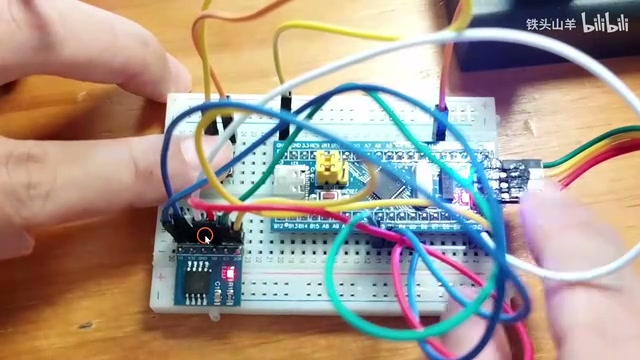
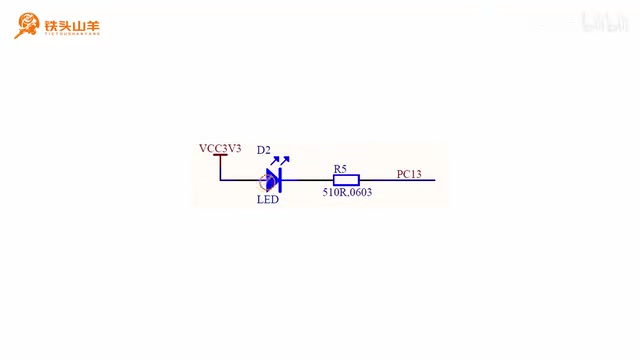
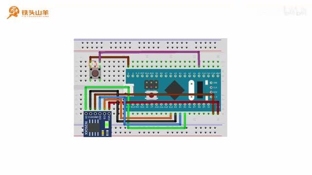
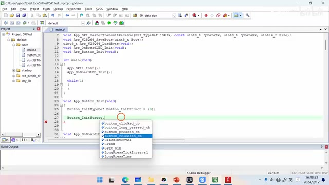
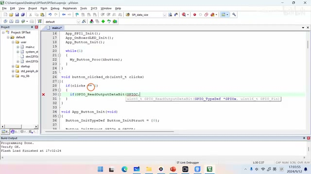
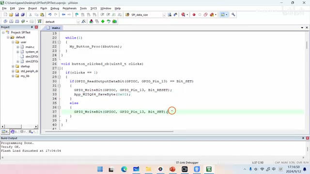
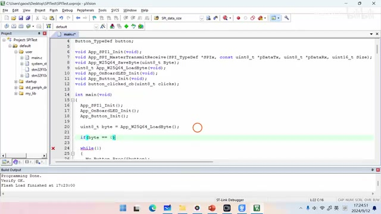
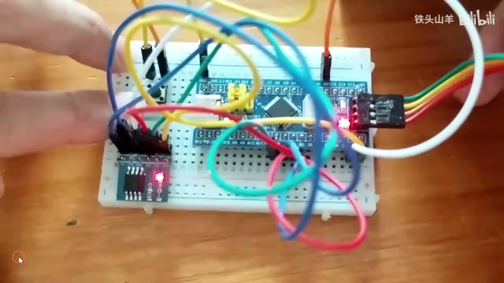

# P032 · 5.8 （SPI）W25Q64实验(下)

## 实验目标：按钮切换并记住 LED 状态

各位同学好，我是铁头山羊。今天学习第五章第八节，接着上期 W25Q64 实验的上半部分，完成下半部分。课程所需材料都在开发套件包中；购买套件可以获得课件和源码，也可以加入答疑群交流。

这次要做的效果是：按电路板上的按钮，切换最小系统板板载 LED 的亮灭。演示中 LED 起初熄灭，按左边按钮后点亮，再按一次熄灭，之后仍可继续切换。

_按下左侧按钮后，最小系统板上的板载 LED 点亮。 ·_ [_原片 00:44_](https://www.bilibili.com/video/BV11X4y1j7si/?p=32\&t=44)

在按钮切换的基础上，再用左下方的 W25Q64 模块保存板载 LED 当前状态：亮时写入 1，灭时写入 0。W25Q64 是 Flash，掉电后数据不会丢失，因此重新上电时可以恢复之前的状态。演示里先让 LED 点亮，断电再上电后仍然点亮；再用按钮将它熄灭，断电重启后仍然熄灭。这说明保存的状态能跨越断电保留。演示先断电重启并确认 LED 仍亮，随后用左侧按钮熄灭 LED，再次断电上电，确认它仍熄灭。

视频把实验分为五部分：初始化板载 LED、初始化按钮、使用按钮切换 LED 亮灭、用 W25Q64 保存 LED 当前状态，以及开机时恢复 LED 状态。下面先从 LED 初始化开始。

本节是在前一次已完成的 W25Q64 实验基础上继续做下半部分。演示还交代了材料来源：课程所需材料包含在开发套件包里，扫描画面中的二维码可以进入店铺购买；购买套件后可获得本课程课件、源码，并能加入答疑群直接交流。开始时他用按钮切换板载 LED，先展示熄灭状态，按左侧按钮点亮，再按一次熄灭，并说明可以持续按它改变亮灭。

## 初始化板载 LED

板载 LED 的电路图采用开路接法，LED 阴极接到单片机 PC13。因此要把 PC13 初始化成输出开漏模式。

打开上期编写的 `SPI test` 工程，在 `main.c` 中删除之前的测试代码和全局变量 `A`。然后封装 `App_OnBoard_LED_Init` 函数来初始化板载 LED，并在 `main` 中调用。

_板载 LED 的阴极连接到单片机 PC13。 ·_ [_原片 02:39_](https://www.bilibili.com/video/BV11X4y1j7si/?p=32\&t=159)

初始化函数 `App_OnBoard_LED_Init` 中先开启 GPIOC 时钟，再声明并配置 GPIO 初始化结构体：引脚选择 `GPIO_Pin_13`，模式选择输出开漏（`GPIO_Mode_Out_OD`），最大输出速度设为 2 MHz 即可，不必太高。最后调用 `GPIO_Init` 初始化 PC13。把函数实现在 `main` 方法下面，并在 `main` 中调用，第一部分就完成了。

板载 LED 大家已经比较熟悉，先看它的电路图，再据此决定引脚模式。随后打开上期的 `SPI test` 工程文件，进入 `main.c`，把之前用于测试的代码删掉（演示中指出了两行），前面声明的全局变量 `A` 也一并删除。之后才在 `main` 下面封装 LED 初始化函数，并在主函数里调用。

## 接入按钮并准备驱动

接下来初始化按钮，用它切换板载 LED。W25Q64 模块已经按上一期的接法连接好，这次只需在现有电路上增加一枚按钮：按钮一端接地，另一端接单片机 PA0，由 PA0 驱动。接线时要注意按钮有方向，安装时引脚要朝向图示的两侧，不能把方向弄错。

_按钮一端接地，另一端连接到 PA0；安装方向需按图示放置。 ·_ [_原片 05:15_](https://www.bilibili.com/video/BV11X4y1j7si/?p=32\&t=315)

接线后开始编写按钮驱动。使用之前封装的按钮库，先引用 `button.h`，声明 `Button_TypeDef` 类型的按钮变量，并准备初始化函数。初始化结构体要先赋初值 0；这一部分先填 GPIO 端口和引脚，其他回调函数与时间参数稍后再设置。

接线时先在已有 W25Q64 电路图上增加按钮。按钮从套件中取出，一端接地，另一端连到单片机 PA0；接好后，他再次提醒按钮有方向，两个引脚应朝向图中所示两边，方向不能装错。之后在代码里引用之前封装好的 `button.h`，声明按钮变量，并新建按钮初始化函数；此处结构体先清零，GPIO 端口和引脚先填好，其余设置留到后面处理。

## 完成按钮初始化

按钮初始化函数中，声明 `Button_InitTypeDef` 类型的变量，例如命名为 `Button_InitStruct`，并将它初始化为 0；这一步不能省略。结构体成员比较多，上面的四项是回调函数，另外几项与按钮时间参数有关，这些之后再补，本段先处理 GPIO 配置。

_按钮初始化结构体包含回调函数和时间参数等成员。 ·_ [_原片 07:42_](https://www.bilibili.com/video/BV11X4y1j7si/?p=32\&t=462)

把 GPIO 端口设为 GPIOA、引脚设为 GPIO\_Pin\_0，然后调用 `My_Button_Init(&button, &Button_InitStruct)`，第一个参数传按钮变量，第二个参数传初始化结构体的地址。最后在 `main` 中调用初始化函数，并在 `while` 循环中持续调用按钮的进程函数，按钮库才能处理按键事件。

按钮变量名可以自行取，例如 `button`。先声明初始化函数原型，再放到 `main` 下面实现；随后在 `main` 调用初始化，并在 `while` 循环中调用按钮进程函数，持续处理按键并触发回调。

初始化结构体中有多个成员：上面的四项是回调函数，另外还有与按键时间参数有关的成员，这些暂时不填。由于按钮连接 PA0，端口选 GPIOA、引脚选 GPIO\_Pin\_0。随后调用 `My_Button_Init`，第一个实参是按钮变量，第二个实参是刚填好的初始化结构体地址。主函数先运行按钮初始化；进入循环后还要执行 `My_Button_Proc(&button)`，让按钮库不断处理按键。

## 单击按钮时翻转 LED

要用按钮切换 LED，只需编写回调函数，在回调函数里改变 LED 亮灭，再在按钮初始化时把回调函数作为参数传入。这里补上此前漏写的 `My_Button_Proc(&button)`：它应放在 `while` 循环里。

_回调函数读取 PC13 输出状态，并写入相反电平以翻转 LED。 ·_ [_原片 10:01_](https://www.bilibili.com/video/BV11X4y1j7si/?p=32\&t=601)

声明回调函数原型，例如 `button_click_cb(uint8_t clicks)`，再复制到 `main` 后实现。`clicks` 表示点击次数，可区分单击、双击等情况；判断 `clicks == 1` 时才翻转 LED。读取 PC13 上次输出的数据：如果上次为 `Bit_SET`，本次写 `Bit_RESET`；否则写 `Bit_SET`。也就是上次为 1 就写 0，上次为 0 就写 1。再把回调函数填入按钮初始化结构体的回调项。

随后按左上角第二个按钮编译，结果没有错误或警告，再将程序下载到单片机。按复位键后反复按按钮，LED 会在熄灭与点亮之间切换，第三部分完成。

回调函数有一个参数 `clicks`，用来表示点击次数，按键库据此区分单击、双击等事件；这里仅在值等于 1 时执行翻转。读取上一次向 PC13 输出的数据，如果结果为 `Bit_SET` 就写 `Bit_RESET`，否则写 `Bit_SET`，两种情况下都与上次输出相反。最后把这个回调函数作为初始化结构体的回调参数传入。补上循环中的按钮进程调用后，编译并下载，复位单片机，再连续按按钮检查亮灭是否交替。

## 按状态变化保存一个字节

第四部分是在按钮改变 LED 状态时，把当前状态保存到 W25Q64。前面已经写好两个函数：`App_W25Q64_SaveByte` 用于把一个字节写入 Flash，另一个函数用于读出这个字节。现在先使用保存函数，在刚才的按钮回调函数中，根据 LED 状态变化写入对应的值。

_LED 点亮后向 W25Q64 保存 0x01，熄灭后保存 0x00。 ·_ [_原片 13:11_](https://www.bilibili.com/video/BV11X4y1j7si/?p=32\&t=791)

回顾回调函数：先判断当前 LED 状态。如果 LED 熄灭，就把它点亮，然后调用 `App_W25Q64_SaveByte(0x01)` 保存 1，表示点亮；否则 LED 当前是亮的，就将它熄灭，然后保存 `0x00`，表示熄灭。这些调用放在回调函数已有的条件分支里：点亮 LED 后保存 `0x01`，熄灭 LED 后保存 `0x00`。这样写入的是本次切换后的状态，供下一部分开机时调用读取函数取回。

在保存前，回调函数先根据 PC13 当前输出判断 LED 状态。若当前输出为复位电平、LED 熄灭，就将 PC13 置位点亮它，再写入 `0x01`；若当前输出为置位电平、LED 点亮，就将 PC13 复位熄灭它，再写入 `0x00`。所以 Flash 中保存的是改变后的结果，而不是改变前的状态。读字节函数此处先不调用，留到上电恢复部分使用。

## 上电时从 Flash 恢复状态

第五部分是把保存的数据读出来并恢复 LED。当前 LED 亮时，Flash 保存的是 `0x01`；灭时保存的是 `0x00`。断电后重新上电，单片机程序会从头执行，所以在初始化完成后、进入 `while` 循环之前，先读取 Flash 中保存的字节。读到 0 就熄灭 LED；读到 1 就点亮 LED。

_启动时读取 Flash 字节，并据此设置 PC13，恢复此前的 LED 状态。 ·_ [_原片 14:27_](https://www.bilibili.com/video/BV11X4y1j7si/?p=32\&t=867)

具体做法是调用 `App_W25Q64_LoadByte`，将读出的字节放入变量中。如果变量等于 0，说明断电前 LED 熄灭，调用 GPIO 写入函数向 PC13 写入 `Bit_SET` 来熄灭 LED；否则说明断电前 LED 点亮，向 PC13 写入 `Bit_RESET` 来点亮它。这个判断利用 W25Q64 掉电后数据仍保留的特性：程序重新从头执行时，先完成 LED、Flash 和按钮的初始化，再读取字节、设置 PC13，最后才进入循环处理按钮。

把程序流程连起来看：按钮回调在亮灭发生变化时分别保存 1 或 0；断电后这些 Flash 数据不丢失。重新上电的瞬间，单片机程序从头开始执行，因此先读取 Flash 中保存的字节。读出 0 说明断电前 LED 熄灭，就通过 PC13 的 `Bit_SET` 输出让它熄灭；否则说明之前点亮，就写 `Bit_RESET` 让它点亮。完成初始化和恢复之后，程序才进入 `while` 循环继续响应按钮。

## 编译、下载并验证掉电保持

编译没有错误或警告后，将程序重新下载到单片机。按复位键，先观察到 LED 点亮；按左上角按钮将它熄灭，再给整个电路断电并上电，LED 仍然熄灭。反复断电上电，效果稳定。之后再按按钮点亮 LED，重复断电上电后它仍保持点亮。这说明实验成功，W25Q64 中保存的状态在重新上电后正确恢复。

_连续断电再上电后，LED 继续保持按钮设置的熄灭状态。 ·_ [_原片 15:20_](https://www.bilibili.com/video/BV11X4y1j7si/?p=32\&t=920)

这个实验比较难，有疑问可以到答疑群交流。感谢收看，我是铁头山羊，我们下期再见。

测试时先按单片机复位按钮，观察到 LED 点亮；按左上角按钮使其熄灭，然后切断整个电路的电源并重新上电，检查 LED 仍熄灭。再重复几次断电和上电，结果保持稳定。接着再按左上角按钮把 LED 点亮，断电、上电多次，灯也一直保持点亮。通过两个方向的实物测试，确认存储和开机恢复功能都有效，实验成功。
