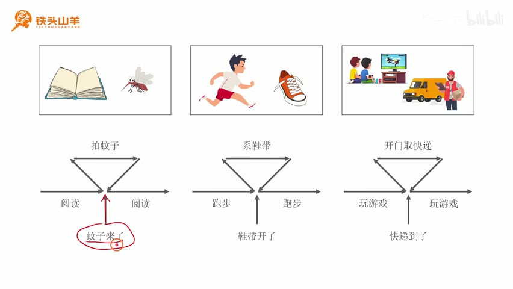
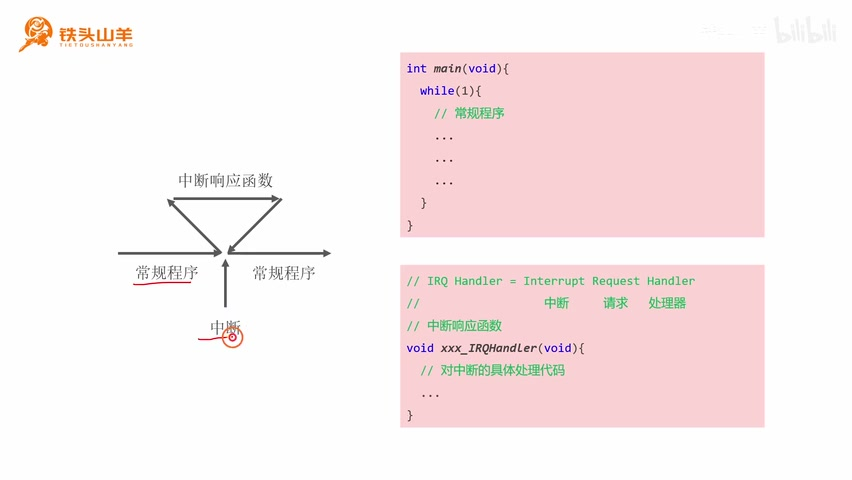
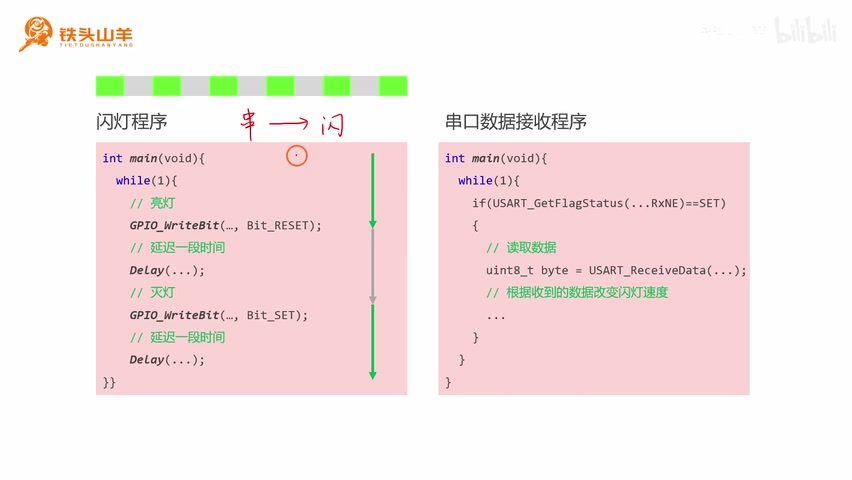
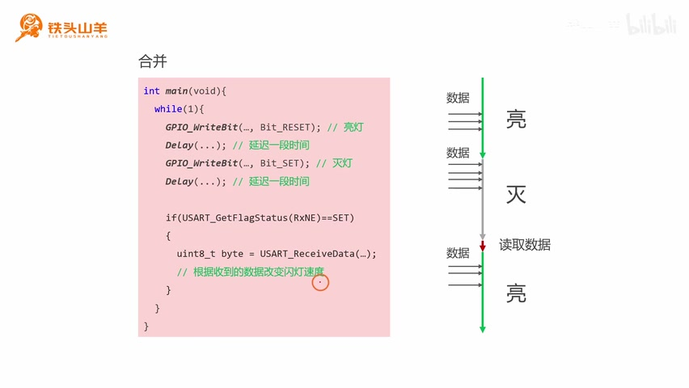
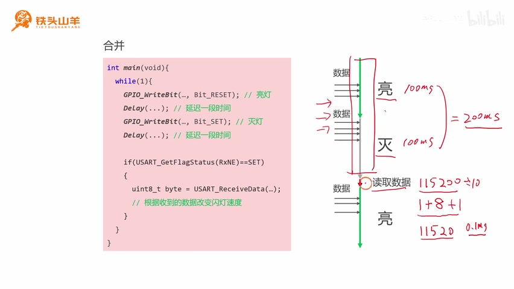
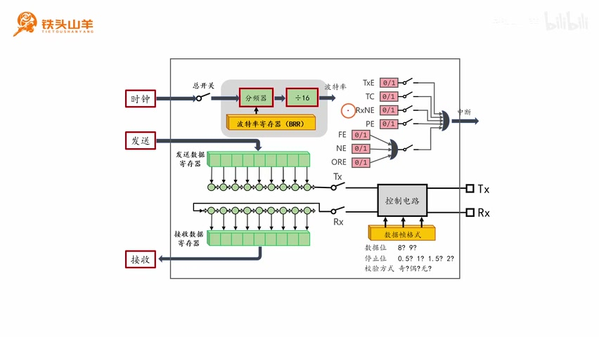
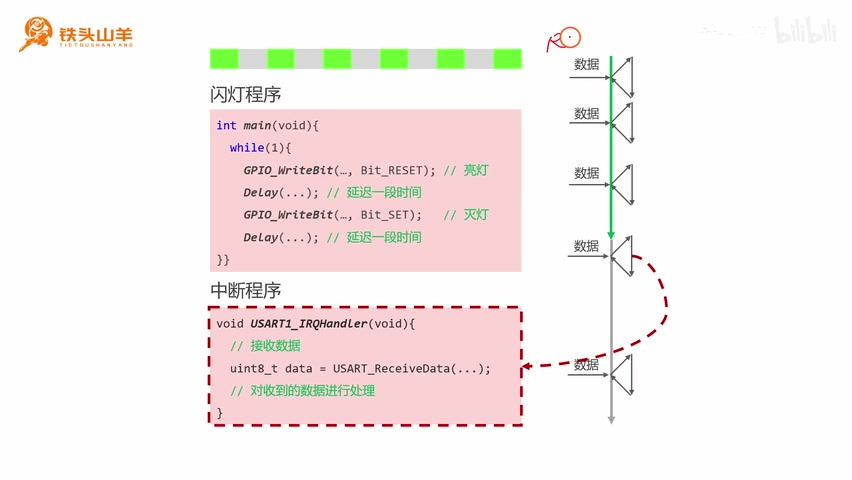

# P033 · 6.1 （中断）中断的概念

## 第六章：中断与本节安排

各位同学大家好，我是铁头山羊。从本期视频开始，我们学习新的一章，也就是第六章。第六章讲中断，通过本章学习，我会详细介绍如何使用 STM32 进行中断编程。下面先通过第 6.1 节来看中断的概念。

本套视频需要的所有材料都包含在开发套件包里。大家可以扫描屏幕上的二维码，进入淘宝店铺购买。购买套件之后，可以获得课程所有的课件和源码，还能加入答疑群，和 UP 主直接交流。

本期分成两个部分：第一部分先简单介绍中断的概念；第二部分举一个实际例子，看中断在实际编程过程中怎么使用。下面从第一部分开始。

## 中断是什么：图书馆里的蚊子

如果用一句话概括，中断就是单片机应对突发事件的一种方式。要了解单片机怎样应对突发事件，可以先看看人在生活中怎么处理。第一个例子是在图书馆读书：想象我们正读着一本书，读书时听到耳边有蚊子嗡嗡响，于是停下手里的书，伸手把蚊子拍掉，之后再回过头读这本书。

图中向右的箭头表示读书动作；阅读过程中蚊子突然来了，用向上的箭头表示这个突发事件。事件发生后，阅读动作被打断，我们转而伸手拍蚊子；拍完以后，再回头继续读书。

_三种生活场景用同一组流程箭头表现：阅读时蚊子飞来、跑步时鞋带松开、玩游戏时快递员敲门；突发情况会打断原来的活动。 ·_ [_原片 01:50_](https://www.bilibili.com/video/BV11X4y1j7si/?p=33\&t=110)

## 跑步系鞋带、玩游戏取快递

第二个例子是在操场跑步。我们跑着跑着，突然发现鞋带开了，就停下来系鞋带；系完之后接着跑步。图里仍用向右的箭头表示原来的动作，即跑步；向上的箭头表示鞋带开了这个突发事件。事件发生后跑步动作被打断，我们转去系鞋带，完成后再继续跑步。

第三个例子是和同学一起玩游戏。玩游戏的过程中突然听到有人敲门，敲门的是快递员，告诉我们有快递要取。这个时候停下手里的游戏，然后去开门取快递；取完以后，再回来和同学一起玩游戏。图中向右的箭头表示玩游戏，向上的箭头表示快递员敲门这个突发事件；事件发生后转去开门取件，再回头继续和同学玩游戏。

通过这三个例子不难总结：人处理突发事件的方式是，事件发生后暂停手头工作，转而处理突发事件；处理完成后，再回过头来做刚才的工作。单片机编程过程中处理突发事件的方式，和人在日常生活中处理突发事件的方式一样。

## 常规程序、中断与中断响应函数

单片机应对突发事件的过程也可以用类似的流程图表示。向右的箭头表示常规程序。通常在 `main` 函数里写一个 `while` 循环，循环中的几条代码会反复执行，这段循环往复执行的程序就叫常规程序。常规程序执行过程中如果来了突发事件，它就会被打断；在单片机编程里，这个突发事件叫作中断。

中断发生时，单片机先暂停常规程序，转去处理中断。为此需要调用中断响应函数：这是程序员预先准备好的一段代码，在函数内部写好如何处理这个中断。中断发生时，单片机会自动调用这段代码；每发生一次中断，函数就调用一次。函数执行完成，中断也就处理完毕，然后程序返回常规程序继续执行。

_流程图显示常规程序被中断后转入中断响应函数，处理完成后再回到常规程序。 ·_ [_原片 04:35_](https://www.bilibili.com/video/BV11X4y1j7si/?p=33\&t=275)

## 实际例子：串口控制板载 LED 闪烁

刚才已经简单介绍了中断的概念，下面进入第二部分，用一个实际编程例子说明中断的用法：通过单片机串口把单片机和电脑连接起来，在电脑的串口调试助手中发送字符控制最小系统板上的板载 LED 闪烁速度。发送 `0` 时慢闪，发送字符 `1` 时正常闪烁，发送字符 `2` 时快闪。

要实现这个效果，程序分成两部分：让 LED 闪烁，以及通过串口接收数据。先看闪灯程序。大家对闪灯已经很熟悉：在 `main` 的 `while` 循环里点亮 LED、延迟一段时间、熄灭 LED、再延迟一段时间。这样 LED 就会反复经历点亮、熄灭，周而复始地闪烁。由于这个过程还没有涉及中断，图中亮灯、灭灯等箭头连接成一条直线；绿色箭头表示点亮 LED 的两句代码，灰色箭头表示熄灭 LED 的两句代码。

_课件展示了常规闪灯程序与串口数据接收程序分开编写的思路。 ·_ [_原片 06:20_](https://www.bilibili.com/video/BV11X4y1j7si/?p=33\&t=380)

## 串口接收数据：先检查接收标志

下面看串口数据接收程序。先观察 USART 模块的内部结构框图：右侧有两个引脚，TX 引脚用于向外发送数据，RX 引脚用于接收对端发来的数据。对端以串口数据帧的格式发送，USART 模块根据数据帧波形逐个比特解析，每接收一个比特就存入移位寄存器。移位寄存器中的一帧数据接收完成后，数据转入接收数据寄存器。程序员之后可以把数据从接收数据寄存器读出来。

不过读取之前必须先检查上方的 RXNE 标志位。只有 RXNE 等于 1，才表示寄存器里有数据；确认有数据后才能读取。如果里面没有数据就去读，读到的会是错误的值。

因此，在 `main` 的 `while` 循环中先调用 `USART_GetFlagStatus` 检查 RXNE 标志；仅当它为 `SET`（也就是 1）时，再调用 `USART_ReceiveData` 从接收数据寄存器取出数据，存进变量。之后根据收到的值改变 LED 闪烁速度。

## 把两段程序直接合并的问题

到这里，闪灯程序和串口接收程序分别写好了。要用串口改变板载 LED 的闪烁速度，就得把两段程序合在一起：都写进 `main` 的 `while` 循环，先运行闪灯代码（点亮、延迟、熄灭、延迟），接着检查 RXNE、读取接收数据寄存器里的数据，并根据数据改变闪烁速度。

但是这种直接合并的程序不能正常执行。时序图用绿色箭头表示亮灯，灰色箭头表示灭灯，下面的箭头表示串口接收数据。循环要等闪灯动作结束之后，才会检查并读取串口数据，因此接收不及时，可能造成数据丢失。

_合并后的 while 循环把闪灯代码和串口轮询接收代码按顺序执行，时序图显示程序先完成亮灭灯再检查接收数据。 ·_ [_原片 09:50_](https://www.bilibili.com/video/BV11X4y1j7si/?p=33\&t=590)

## 为什么接收不及时会丢数据

下面演示接收数据不及时为什么会造成丢失。假设电脑通过串口给单片机发送五个字节。首先字节一进入移位寄存器，一个比特位一个比特位地被接收；接收完成后，它进入接收数据寄存器。假设这时还没有把字节一读出来，电脑紧接着发送字节二。字节二逐位接收并完成后，电脑又发送第三个字节；这时大家可以看到，字节二被字节三覆盖了。

紧接着发送字节四，字节四又把字节三覆盖；最后发送字节五，字节五再把字节四覆盖。所以如果不及时读取数据，最后读到的可能只剩字节一和字节五，中间三个字节都会被覆盖掉。

回到刚才的时序图，只有等亮灯和灭灯结束之后程序才读取串口数据。假设亮灯时间约 100 ms，灭灯时间也约 100 ms，两个过程加起来大概 200 ms。

_时序图标出亮灯和灭灯各约100 ms、合计约200 ms；旁边的计算把115200波特率除以每帧10位，得到每秒11520字节，并继续推到单字节约0.1 ms。 ·_ [_原片 12:36_](https://www.bilibili.com/video/BV11X4y1j7si/?p=33\&t=756)

## 串口速度与闪灯周期相差很大

串口波特率假设取最常用的 115200。再假设串口数据帧格式是一位起始位、八位数据位和一位停止位，也就是每传输十个位就传输一个字节。用 115200 除以 10，就得到串口每秒钟最多可以接收 11520 个字节。换算下来，每个字节接收时间大约是 0.1 ms。

这个 0.1 ms 远远小于亮灯和灭灯合起来约 200 ms 的时间。也就是说，在闪灯过程中，可能已经有大量字节通过电脑发送到单片机；程序却要等闪灯结束才把数据读出来，所以中间的字节会丢失。既然直接合并程序的方式不行，下面就试试中断。

再观察 USART 模块内部结构框图右上角的许多标志位。这些标志位都可以产生中断，例如 RXNE。使用 RXNE 标志位产生中断时，当标志的值从 0 变成 1，也就是下面的接收数据寄存器里有值的时候，就会产生一个中断。

_USART 框图突出 RXNE 标志位；接收数据寄存器有新数据时，RXNE 从 0 变为 1 并产生中断。 ·_ [_原片 13:10_](https://www.bilibili.com/video/BV11X4y1j7si/?p=33\&t=790)

## 用中断及时读取串口数据

加入中断之后，`main` 方法的 `while` 循环里只写闪灯程序：先点亮 LED，延迟一段时间，再熄灭 LED，再延迟一段时间。时序图里的绿色箭头表示亮灯的两句代码，灰色箭头表示灭灯的两句代码。

串口接收数据的代码则写在中断响应函数里。函数中先调用 `USART_ReceiveData`，把数据从接收数据寄存器 RDR 读出来，然后根据读到的数据调节闪灯速度。

再看时序图：每当接收数据寄存器 RDR 里有数据，就会产生一个中断，单片机调用刚才写好的中断响应函数，把数据读出来并处理。每来一次中断就调用一次函数。图里连续画出多次中断和多次函数调用。这样就不用等整个闪灯过程结束才读取数据，现在可以及时读取和处理；加入中断后，程序整个执行过程就合理了。

_课件把主循环里的 LED 闪烁代码与 USART 中断响应函数分开，并用虚线箭头表示接收事件转入处理函数。 ·_ [_原片 14:10_](https://www.bilibili.com/video/BV11X4y1j7si/?p=33\&t=850)

## 本节回顾

到这里，本期视频内容讲完了。先介绍了中断的基本概念，并绘制了中断的时序图；了解中断概念之后，又举了一个实际例子，也就是使用串口接收数据来控制板载 LED 闪烁。通过这个例子，大家大概了解到单片机编程过程中中断是怎么使用的。感谢大家收看，我是铁头山羊，让我们下期视频再见。
