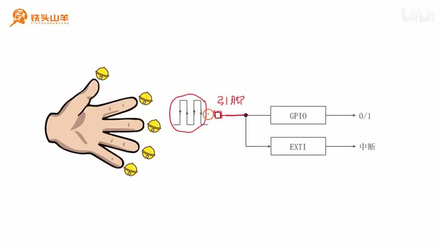
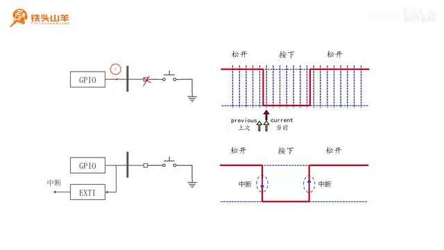
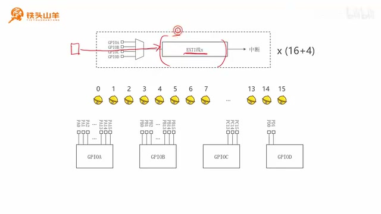
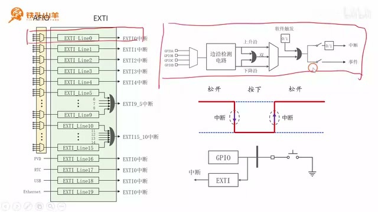
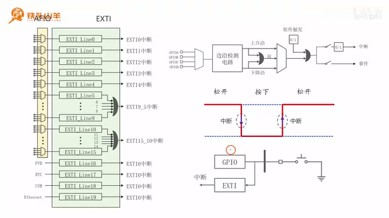
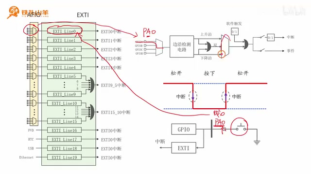

# P036 · 7.1 （EXTI）工作原理

## 本节安排与模块简介

各位同学大家好，我是铁头山羊。从今天开始我们学习第七章，讲一个新的片上外设——EXTI。课程所需材料都包含在开发套件包里，画面中给出了二维码和淘宝店铺；购买套件后可以获得课程课件、源码，也可以加入答疑群和 UP 主直接交流。

EXTI 是 **External Interrupt and Event Controller** 的缩写：external 是“外部的”，interrupt 是上一章讲过的“中断”，event 是“事件”，controller 是“控制器”，合起来就是“外部中断和事件控制器”。从名字能看出它与中断有关，具体用途稍后解释。本节是第七章第一节，介绍 EXTI 模块的工作原理。

本节分四部分：第一，简单介绍 EXTI 模块；第二，用实际例子说明编程时如何使用；第三，讲 EXTI 线的概念；第四，了解线的内部结构。现在先从第一部分开始，简单介绍 EXTI 模块。

此前我们把单片机内部结构比作人体：单片机里有许多模块，叫片上外设，像人体的一个个器官。最早学的片上外设是 GPIO。单片机里有很多组 GPIO，例如 GPIOA、GPIOB、GPIOC、GPIOD。GPIO 可以比作人的手掌。今天学的 EXTI 也是单片机的片上外设。

从这个比喻再转回单片机：我们刚才把片上外设比作器官，是为了理解单片机内部有很多不同模块；GPIO 是我们之前最早接触的一个外设，而这节要认识的是另一个模块 EXTI。先有了这些背景，接下来才看它与 IO 引脚之间怎么配合。

## GPIO 引脚变化与 EXTI

继续用手掌作比喻：假设手掌是 GPIOA，手指就是 GPIOA 上一个个引脚，例如 PA0、PA1，一直到 PA15。EXTI 可以想成栓在手指上的一个个铃铛，手指一动铃铛就响。

_GPIO 读取输入电平的当前值，EXTI 检测信号变化并可产生中断。 ·_ [_原片 03:25_](https://www.bilibili.com/video/BV11X4y1j7si/?p=36\&t=205)

右图说明 GPIO 与 EXTI 的关系。方框加横线表示单片机的一个 IO 引脚，外部输入信号通过它进入单片机。GPIO 可以读取引脚当前电压是高还是低：低电压读到 0，高电压读到 1。EXTI 关注的则不是电压当前是高还是低，而是电压有没有变化。

例如，信号原来是低电压，突然变成高电压，这个由低到高的变化叫**上升沿**。

也就是说，单片机的 IO 引脚可以接收外部输入。我们用 GPIO 去读引脚时，读到的是此刻的电平状态；如果电平保持不变，读数也就保持为 0 或 1。EXTI 要做的是另一件事：它不只是问“现在是高还是低”，而是留意输入从一种电平跳到另一种电平的那个变化过程。比如低电压突然升为高电压，这个变化发生时就出现上升沿。

因此 GPIO 和 EXTI 面对的是同一个外部输入，却各自做不同的事：GPIO 读取 IO 引脚电压值，告诉我们引脚此刻为低还是高；EXTI 则监测这个电压由低变高或由高变低的过程。两个模块配合起来，就可以既知道引脚状态，也能在状态发生变化时得到通知。

如果原来是高电压，突然变成低电压，这个由高到低的变化叫**下降沿**。EXTI 捕捉这些上升沿和下降沿。输入信号变化被 EXTI 捕捉到后，它会向外产生一个中断；我们把处理信号变化的代码写在中断响应函数里，就可以处理输入信号的变化。因此，用一句话总结：**EXTI 捕捉输入信号的变化并产生中断。**

## 按钮例子：用 EXTI 捕捉动作

下面通过实际例子看 EXTI 在编程中的应用。之前做过一个实验：在面包板上接一枚按钮，用它控制开发板板载 LED 的亮灭状态。要求是按下按钮时 LED 状态不变，只有松开按钮的瞬间才切换，反复操作也是“按下不变、松开切换”。所以需要捕捉按钮动作发生的瞬间。

先回忆之前的做法。按钮一端接地，另一端接单片机 IO 引脚。按钮松开时两点断开，IO 引脚悬空；引脚配置为输入上拉模式，因此有上拉电阻把引脚拉到高电平。按钮松开时 IO 引脚就是高电平。

刚才提到，EXTI 与上一章学过的中断相关；它具体的作用现在就可以说明了：输入信号变化时，EXTI 捕捉变化并产生中断，程序在中断响应函数中处理它。下面把这个功能放进一个大家之前做过的按钮实验里看。按钮安装在面包板上，目标是用它控制板载 LED 的亮灭，但切换时机有明确要求：不是按下时切换，而是松开按钮的那一瞬间切换。为了做到这一点，程序必须知道按钮何时发生状态变化。

松开时按钮把 IO 引脚与地断开，所以引脚原本会悬空；我们将它配置成输入上拉模式，上拉电阻使悬空的引脚保持高电压。这就是松开时引脚为高的原因。

按钮按下时，两点通过按钮导通，IO 引脚直接接地，读到低电平。为了捕捉按钮动作，之前的程序写一个 while 循环，不断查询按钮当前值。把当前值记在 `current` 变量里，把上一次的值记在 `previous` 变量里。`previous` 与 `current` 不相等，就说明按键发生了动作：`previous` 是 1、`current` 是 0，表示按钮按下；反过来，`previous` 是 0、`current` 是 1，表示按钮松开。这样可以通过循环捕捉按钮变化的瞬间。

_按钮松开时上拉使输入为高，按下时引脚接地变低；图中同时画出轮询记录的前值与当前值。 ·_ [_原片 05:48_](https://www.bilibili.com/video/BV11X4y1j7si/?p=36\&t=348)

加入 EXTI 后，程序可以更简单。原来只使用 GPIO，现在把 EXTI 也加进来。EXTI 可以捕捉输入信号的上升沿和下降沿：按钮按下的瞬间恰好是下降沿，松开的瞬间恰好是上升沿。我们可以使用 EXTI 捕捉上升沿；捕捉到后它会产生中断，在中断响应函数里切换板载 LED 的亮灭状态即可。引入 EXTI 后，不再需要 while 循环不断查询按钮当前值。

按下和松开因此对应两个相反的电平：按下时 IO 被按钮直接接地，读到低电压；松开时上拉电阻将 IO 拉高。原有的轮询程序要持续读取当前值，并保留上一次读取的值，再用两者是否相等来判断状态有没有改变。如果前一次为 1、当前为 0，就是按下；如果前一次为 0、当前为 1，就是松开。这样用 while 循环确实能找到动作瞬间，但程序必须不停地查询。

引入 EXTI 后，按钮按下是下降沿、松开是上升沿。既然只要在松开时切换 LED，就选择捕捉上升沿；EXTI 检测到后产生中断，再由中断响应函数完成 LED 切换。这个例子说明 EXTI 让程序不必反复读取按钮值，处理逻辑也随之简单。

## EXTI 线的概念

下面深入 EXTI 模块，看看它如何捕捉上升沿和下降沿。先介绍 EXTI 里“线”的概念。图中的一条 EXTI 线整体分成三部分：最左边是信号输入，来自 IO 引脚；中间是 EXTI 线本身，负责捕捉输入信号的上升沿或下降沿；捕捉到边沿后，线向外产生中断，图中第三部分表示这条线产生的中断。

EXTI 模块内部总共有 20 条这样的线，可以写成 16+4：前 16 条（EXTI 线 0 到线 15）的信号由 IO 引脚从外部输入；后 4 条是特殊线，本节不展开。因此，就这里讨论的外部 GPIO 输入而言，EXTI 可以同时捕捉 16 路信号的上升沿和下降沿，并产生 16 路不同的中断。前 16 条线就像 16 个铃铛。

_EXTI 总览图展示编号线、GPIO 端口输入选择器，以及 16+4 条线的划分。 ·_ [_原片 08:48_](https://www.bilibili.com/video/BV11X4y1j7si/?p=36\&t=528)

再看 GPIO 引脚图。GPIOA 的引脚是 PA0 到 PA15，共 16 个；GPIOB 是 PB0 到 PB15，也有 16 个。GPIOC 在本例芯片上有 PC13、PC14、PC15 三个引脚；GPIOD 有 PD0、PD1 两个引脚。换句话说，A、B 两组各有 16 个，C 组在这里列出 3 个，D 组列出 2 个。把这些数字加起来，本芯片总共有 37 个普通 IO 引脚，但 EXTI 线 0 到 15 只有 16 条，怎么分配？

把这些数字加起来，本芯片总共有 37 个普通 IO 引脚，而 EXTI 的 0 到 15 号线只有 16 条，这些铃铛怎样分配？一组 GPIO 最多有 16 个引脚，编号从 0 到 15，因此可以把 0 到 15 这 16 个铃铛分别分给编号 0 到 15 的 IO 引脚。然后使用上方的复用器选择每条线究竟分给 GPIO 的哪一组：GPIOA、GPIOB、GPIOC 还是 GPIOD。

例如，假设这条线是 EXTI 线 0，也就是编号为 0 的铃铛。复用器选择 GPIOA，它就分配给 PA0；选择 GPIOB，就分配给 PB0；选择 GPIOC，就分配给 PC0；选择 GPIOD，就分配给 PD0。本例所用的单片机没有 PC0，不过其他型号可能会有。

大家需要注意，这个分配是通过上方的复用器进行的，所以在同一时刻，PA0、PB0、PC0、PD0 这四个引脚里，只能有一个使能 EXTI 功能。比如选择 PA0 使用 EXTI，那么剩下的三个引脚都不能使用这条 EXTI 线。

刚才已经简单介绍了单条 EXTI 线的工作原理。整个 EXTI 模块由一条条线组成，总共 20 条，从线 0 到线 19。

## EXTI 线的内部结构

刚才介绍了 EXTI 线的概念和模块整体结构，现在把一条线放大，看它内部是什么样子。图左是 EXTI 模块整体图，其中一条线放大后就是右侧的结构框图。

_放大的 EXTI 线由 GPIO 选择器、边缘检测电路和触发路径组成。 ·_ [_原片 13:00_](https://www.bilibili.com/video/BV11X4y1j7si/?p=36\&t=780)

从左往右看，最左边是刚才讲过的复用器，用来选择把这条线分配给 GPIO 的哪一组：GPIOA、GPIOB、GPIOC 或 GPIOD。复用器右侧是**边缘检测电路**，顾名思义，它从输入信号中把上升沿和下降沿这些边缘检测出来。边缘检测电路有两路输出：上面是检测出的上升沿，下面是检测出的下降沿；两路信号还可以经过或门合并，得到双边沿信号。

这些信号进入右侧的复用器。选择上面一路，这条线就检测上升沿；输入信号出现上升沿时，右侧会触发中断。

边缘检测电路的两路输出分别是检测出的上升沿和检测出的下降沿。它们还可以经过一个或门，把两路取“或”，得到双边沿信号。图中的三个边沿信号都进入右边这个复用器，复用器负责决定线路最终用哪一路。

这里的意思是，先由左边选择器确定从哪一个 GPIO 端口引入信号，再送到边缘检测电路。检测电路把输入里原本连续的电平信号转换成表示变化方向的边沿信号：一路表示上升，一路表示下降。将两路输出做或运算后，任何一种边沿都会让双边沿结果有效。右侧选择器接收这三种选择，决定 EXTI 线要使用上升、下降还是双边沿检测结果；选上面路径时，输入只要出现上升沿，线路就发出中断。

选择下面一路，这条线就检测下降沿；出现下降沿时会触发中断。选择中间的双边沿一路，则无论输入出现上升沿还是下降沿，只要发生变化都会触发中断。

图中除了用硬件电路触发中断，还有软件触发。硬件触发需要输入信号出现上升沿或下降沿；软件触发比较简单，只需向相应位置的一个比特位写入 1，就可以产生中断。不过软件触发用得比较少，这里不深入讲解。

这条 EXTI 线除了能产生中断，图中还画有另一个箭头，表示它也可以产生事件。本节只讲中断，事件暂时不讲，等用到时再说。

后面再用按钮实验说明选择边沿：这和前面讲过的要求相同，按下按钮时板载 LED 亮灭状态不切换，只有松开按钮的瞬间才切换。因此只需要捕捉按钮松开的瞬间，也就是上升沿；对应的 EXTI 线路应选择上升沿通路。

_按钮松开产生要捕捉的上升沿；旁边的 EXTI 图显示线 0 和边沿选择路径。 ·_ [_原片 16:00_](https://www.bilibili.com/video/BV11X4y1j7si/?p=36\&t=960)

假定按钮接在 PA0 引脚上。先确定线的序号：PA0 的引脚编号是 0，因此对应 EXTI 线 0，也就是图中的最上面一条线。

按钮按下和松开时的电平变化在波形图中也标了出来：松开保持高电平，按下变为低电平，再松开恢复高电平。例子再次提出要求，按下按钮板载 LED 的亮灭状态不改变，只有松开按钮的瞬间才切换。由这个要求可以确定应捕获上升沿。接下来会把按钮假定接到 PA0，进一步确定具体配置。

接着配置前面的复用器。因为使用 PA0，它对应 GPIOA，所以复用器选择 GPIOA。后面还有一个复用器；因为要检测上升沿，就选择上升沿这一路。最后，因为要产生中断，还要把中断前面的开关闭合。

完成这些配置后，只要 PA0 上出现一个上升沿，就会触发中断。把切换 LED 亮灭状态的代码写到中断响应函数里即可。

_PA0 对应 EXTI 线 0，选择 GPIOA 和上升沿通路，并使能中断路径。 ·_ [_原片 16:30_](https://www.bilibili.com/video/BV11X4y1j7si/?p=36\&t=990)

到此，本期视频的内容讲完了。下期会做一个实验，巩固本期所学知识。好的，本期视频内容就到这里，感谢大家收看。我是铁头山羊，让我们下期视频再见。

也就是说，先按引脚编号找到线 0，再选它的输入来源为 GPIOA；随后按刚才确定的按钮松开条件，把边沿选择为上升沿；因为希望这一路产生中断，还要闭合中断路径前的开关。这样几个选择都完成以后，PA0 上只要出现上升沿，就能在这里触发中断。
