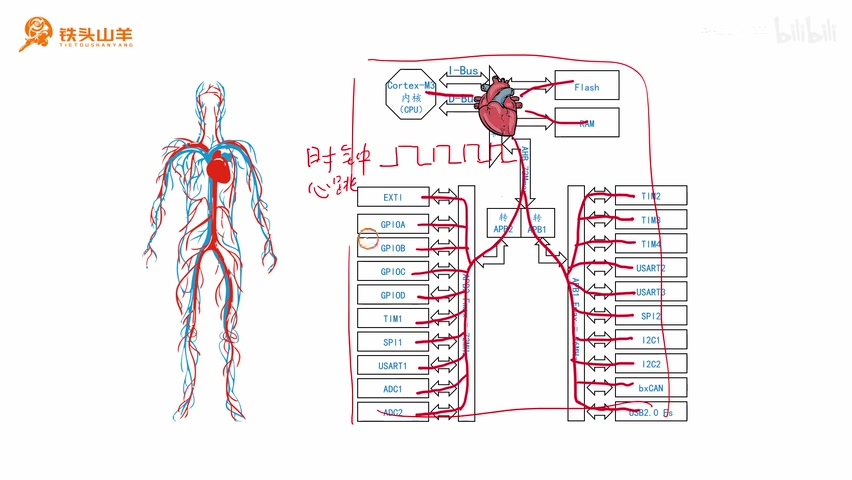
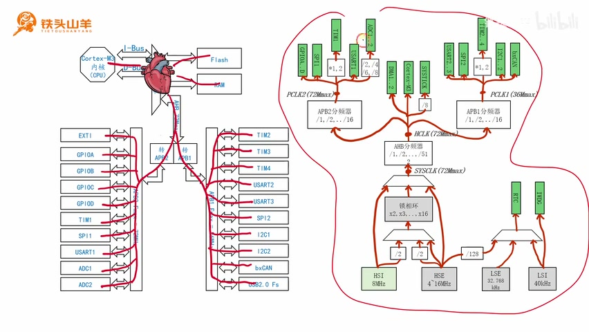
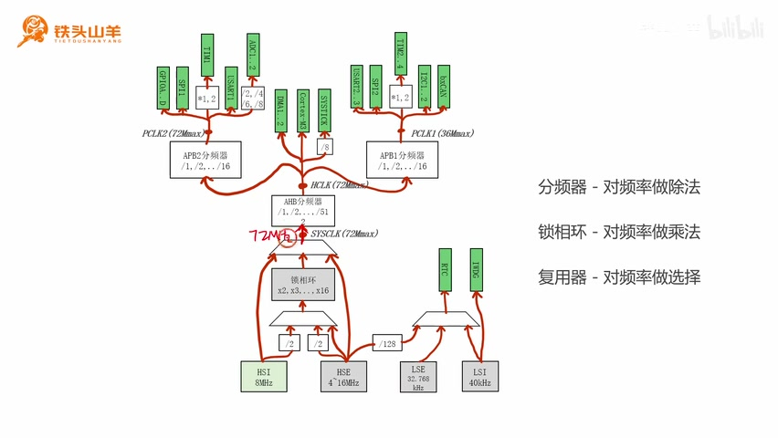
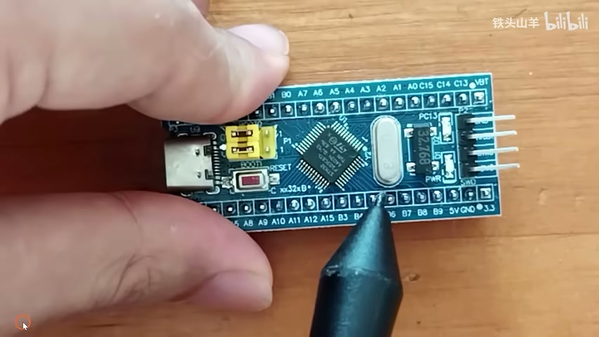
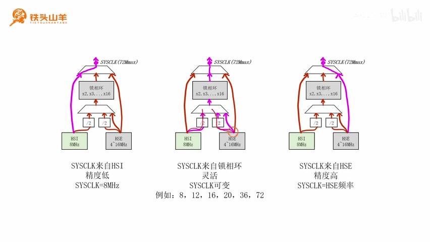
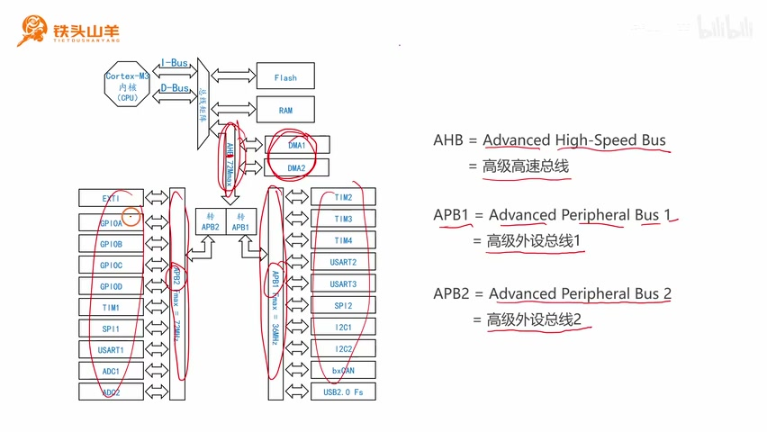
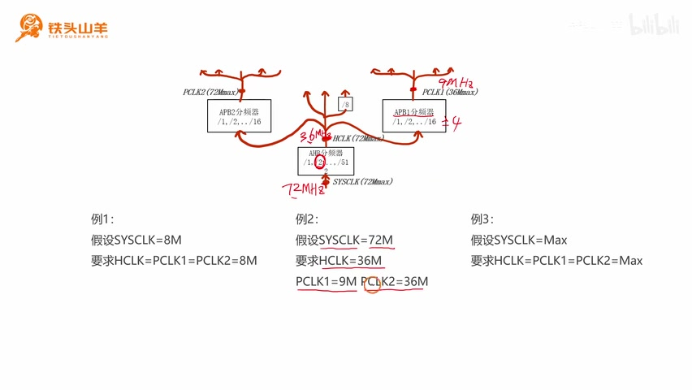

# P038 · 8.1 （时钟）时钟树

## 第八章开篇：时钟与时钟树

各位同学大家好，我是铁头山羊。从今天开始我们学习新的一章，也就是第八章“时钟”。此前我们提到过时钟这个概念，但一直没有深入讲解，这一章就一起来深入学习。首先通过第 8.1 节了解时钟树。

本套视频需要的材料都包含在开发套件包里，大家可以扫描屏幕上的二维码进入淘宝店铺购买。购买套件后可以获得课程全部课件和源码，还能加入答疑群，直接和 UP 主交流。

本期计划分成五个部分：第一，介绍时钟和时钟树的概念，让大家对这两个东西有基本认识；第二，讲时钟树里的几个基础零部件，分别是分频器、锁相环和复用器；第三、第四、第五部分分别讲树根、树干和树枝。

## 时钟是什么

先解释时钟的概念。什么是时钟？所谓时钟，其实就是高低变化的方波信号，比较类似人的心跳。我们看右边的图：这是之前学习过的单片机内部结构框图。单片机里有很多这样的模块，我们把它们叫作片上外设。片上外设要运行，都得输入时钟信号；只有输入了时钟，它才能工作起来。而且时钟信号频率的快慢，就决定了片上外设工作速度的快慢。

_单片机内部结构图展示了 CPU、总线、存储器和片上外设之间的连接。 ·_ [_原片 01:32_](https://www.bilibili.com/video/BV11X4y1j7si/?p=38\&t=92)

其实关于时钟，我们早就接触过了。比如最早写的 LED 闪灯代码：通过几句话控制单片机上的板载 LED 闪烁，先向 PC13 写 0 点亮 LED，延迟一段时间，再向 PC13 写 1 熄灭 LED，然后再延迟一段时间。

因为代码用到了 GPIOC 的 13 号引脚，所以在操作 GPIOC 之前，必须先调用代码开启 GPIOC 的时钟。我们写的是 `RCC_APB2PeriphClockCmd`。只有调用这句代码开启 GPIOC 时钟，GPIOC 端口才能被我们使用。

再比如之前讲串口时，我们看过 UART 模块的内部结构框图。使用 UART 之前必须设置参数，例如数据帧格式：选择 8 位还是 9 位数据位；停止位：选择 0.5 位、1 位、1.5 位还是 2 位；校验方式：选择奇校验、偶校验还是不使用校验。另一个参数是波特率。之前讲过波特率的产生方式：左边的时钟信号经过分频器分频，再经过第二级分频（这里再除以 16），就得到波特率。这里的时钟信号就是今天要讲的时钟。我们曾假设它的频率是 72 MHz；为什么是 72 MHz，本章稍后也会讲到。

## 时钟系统像一棵树

讲完时钟的概念，再来看什么是时钟树。刚才把时钟信号比作人的心跳，单片机里的时钟系统就可以比作人的血液循环系统：产生心跳的地方就是单片机的心脏，心跳顺着主动脉一级一级分叉，最终输送给单片机上每一个片上外设。这种分叉结构特别像一棵树。

## 时钟树的结构与组成

_课程用两棵树表示单片机的时钟系统，重点分析左侧高速树的树根、树干、树枝和树叶。 ·_ [_原片 04:10_](https://www.bilibili.com/video/BV11X4y1j7si/?p=38\&t=250)

因此我们把单片机的时钟系统画成两棵树的形式，这两棵树就是要讲的时钟树：一棵大树、一棵小树，主要研究左边的大树。大树最下面是树根，类似人的心脏，是时钟信号产生的地方；从树根向上是树干，类似主动脉；再往上有三个树杈，就是树枝，类似血管分支；最上面一片片的树叶，对应单片机上的一个个片上外设。也就是说，时钟源从树根产生信号，沿树干和树枝逐级分配，最后到达各片上外设。

例如，图中的 GPIOA 到 GPIO D 对应左边的 GPIOA 到 GPIO D；SPI1 对应 SPI 总线的 SPI1；USART1 对应之前学过的串口；右边的 USART2、USART3 则对应串口二和串口三，等等。所谓时钟树，就是用树的形式生动形象地表示左边的时钟系统。

了解时钟和时钟树的概念后，下一步学习时钟树里的基本零部件：分频器、锁相环和复用器。只有学会这些零部件的工作方法，才能看懂时钟树。刚才介绍的两棵树都是由一个个零部件组成的，零部件总共分成这三种。先看第一种：分频器。

## 分频器：对频率做除法

图中标出的这些部件都是分频器。分频器的作用是对输入信号的频率做除法。比如下面两个分频器都标着“÷2”，分频系数固定为 2，也就是二分频。HSI 输入 8 MHz，经过二分频后，输出频率就是 8 MHz ÷ 2 = 4 MHz，这就是分频器做除法的意思。

再看上面的 AHB 分频器，它的分频系数可以选择 ÷1、÷2、÷4、÷8 等选项，一直到最大 ÷512。假设输入到这里的时钟频率是 72 MHz：选择 ÷1，输出就是 72 MHz；选择 ÷2，输出为 72 MHz ÷ 2 = 36 MHz；选择 ÷4，输出为 72 MHz ÷ 4 = 18 MHz，也就是说，输入频率除以所选的分频系数，就是输出频率；例如 72 MHz 经过 ÷4 后为 18 MHz。以此类推，分频器就是对频率做除法。

_时钟树示意图标出 AHB 分频器，可通过选择分频系数改变输出频率。 ·_ [_原片 07:00_](https://www.bilibili.com/video/BV11X4y1j7si/?p=38\&t=420)

## 锁相环：对频率做乘法

第二种零部件叫锁相环。时钟树里只有一个锁相环，就是图中的这个部件。它的作用和分频器正好相反，是对输入信号的频率做乘法。锁相环的倍频系数可以选择 ×2、×3、×4、×5、×6，一直到 ×16。假设输入信号频率是 8 MHz，希望在输出点产生 72 MHz，就把锁相环倍频系数设置成 ×9，因为 8 × 9 = 72 MHz。

## 复用器：从多路输入中选择一路

解释完锁相环，再来看时钟树里最后一种零部件：复用器。左边两棵树里这些梯形结构都是复用器。复用器的作用是从多路输入信号里选择一路作为输出。

例如，锁相环输入信号前面有一个梯形结构，就是复用器；图中左边两棵树里画出的这些梯形也都是复用器。它可以从三路信号里选择一路，作为锁相环的输入。如果选其中一路，就是 HSI ÷ 2 作为锁相环输入；如果选另一路，就是 HSE ÷ 2；如果选左边这一路，就是 HSE 本身。因此，这个选择结果决定了锁相环实际接收哪一路输入；复用器的作用就是从多路输入中选一路输出。

刚才先介绍了时钟树的概念，再学习了每种零部件的工作原理。下一步把时钟树拆成三个部分，分别是树根、树干和树枝，逐一详细介绍。先看树根，它位于时钟树最底下。单片机里有两棵时钟树，相当于人体有两套血液循环系统；每棵树有两个时钟源，相当于人体里有四颗心脏。四个时钟源的名字分别是 HSI、HSE、LSE 和 LSI。名字比较奇怪，下面解释它们分别代表什么、名字怎么来的。

## 树根：四个时钟源的名称

把四个时钟源的名字填到表格里：上面一行是 LSI、LSE，下面一行是 HSI、HSE。观察表格，上面两个以 LS 开头，下面两个以 HS 开头。LS 是英文 low speed 的缩写，代表低速；HS 是 high speed 的缩写，代表高速。为什么区分低速和高速？看左边两棵树：大树上的时钟频率比较高，一般是几十 MHz。例如 HSI 是 8 MHz，HSE 是 4～16 MHz，系统时钟 SYSCLK、HCLK、PCLK2 的最高频率都是 72 MHz，PCLK1 的最高频率是 36 MHz，所以通常是几十 MHz。右边小树上的频率比较低，一般是几十 kHz，例如 LSE 是 32.768 kHz，LSI 是 40 kHz。

兆和千的关系是 1 MHz = 1000 kHz，所以有些情况下大树的时钟频率能达到小树的 1000 倍。形象地说，左边叫高速树，右边叫低速树。因此高速树根上的时钟源叫 HS，也就是高速时钟源；右边小树的时钟源叫 LS，也就是低速时钟源。这就是高速和低速的来历。

继续观察表格：第一列的两个时钟源以字母 I 结尾，第二列的两个时钟源以字母 E 结尾。I 是 internal 的缩写，代表内部，也就是说这两个时钟源位于单片机内部。LSI 是单片机内部的低速时钟源，HSI 是单片机内部的高速时钟源：一个给小树用，一个给大树用。

E 是 external 的缩写，代表位于单片机外部，因此这两个时钟源都需要外接。LSE 是需要外接的低速时钟源，接在 PC14 和 PC15 两个引脚上，要外接一颗晶振。HSE 是需要外接的高速时钟源，接在 PD0 和 PD1 上，也要外接一颗晶振。

_讲解者在最小系统板上指示外接晶振的位置。 ·_ [_原片 13:10_](https://www.bilibili.com/video/BV11X4y1j7si/?p=38\&t=790)

拿出最小系统板，可以找到两颗外接晶振。其中银白色的晶振标着 8.000，代表频率是 8 MHz，它就是外接的高速晶振。黑色晶振标着 32.768 kHz，频率比较低，就是外接的低速晶振。

讲到这里大家可能会有疑问：单片机里已经有两个内部时钟源，LSI 给小树提供时钟，HSI 给大树提供时钟，为什么还要外接两个时钟源？原因是内部时钟源位于单片机内部，使用起来比较方便，但是精度不高。如果对精度有要求，就需要外接时钟源；如果对精度没有要求，直接用这两个内部时钟源就可以。

树根讲完了。回顾一下：单片机里有两棵时钟树，一棵大树、一棵小树，总共有四个时钟源：LSI、LSE、HSI 和 HSE。其中 LS 是 low speed，代表低速，对应小树；HS 是 high speed，代表高速，对应大树；I 代表内部，E 代表外部。所以 LSI 是低速内部时钟，LSE 是低速外部时钟，HSI 是高速内部时钟，HSE 是高速外部时钟。这就是单片机里的四个时钟源。

## 树干：系统时钟 SYSCLK 的来源

学完树根，再来看树干。回顾一下，单片机里有两棵树：大树和小树；树根处有四个时钟源，分别是 LSI、LSE、HSI、HSE。LSI、LSE 是低速，HSI、HSE 是高速；I 表示内部，E 表示外部。树干位于刚才树根的上方，从树根获取时钟，对时钟信号进行加工，最终产生一个叫作 SYSCLK 的信号。SYSCLK 是 system clock 的缩写，system 代表系统，clock 代表时钟，中文叫系统时钟。接下来分析系统时钟是如何产生的。

从图里可以看出，SYSCLK 有三种不同来源：直接来自 HSI（图中的这条路）、直接来自 HSE，或者来自锁相环。下面分别分析这三种来源的区别。先画三张图表示 SYSCLK 的三种来源。

第一张图表示 SYSCLK 直接来自 HSI，也就是内部高速时钟。

SYSCLK 直接来自 HSI 时，中间没有任何环节，所以它的频率直接等于 HSI 的频率，也就是 8 MHz。这种方式有两个特点：第一，HSI 属于内部时钟源，精度比较低，因此 SYSCLK 的精度也比较低；第二，HSI 频率固定为 8 MHz，所以 SYSCLK 频率也固定为 8 MHz。

再看最右边的图：SYSCLK 直接来自 HSE。它也有两个特点。首先，因为 SYSCLK 直接从 HSE 获取，中间没有任何环节，所以 SYSCLK 频率直接等于 HSE 频率。HSE 外接晶振的频率范围是 4～16 MHz。例如刚才最小系统板接的是 8 MHz 晶振，那么 SYSCLK 就是 8 MHz；如果换一颗 12 MHz 晶振，SYSCLK 就是 12 MHz。总之 SYSCLK 频率与 HSE 频率严格相等。第二，因为 HSE 是外接时钟源，精度比较高，因此产生的 SYSCLK 精度也比较高。

最后来看中间的图：系统时钟来自锁相环。锁相环会对输入时钟频率做乘法。锁相环前面还有一个框图，代表锁相环输入信号有三种来源：HSI ÷ 2、HSE ÷ 2，还有 HSE 本身。这个框图比较复杂，对应的特点就是这种方式比较灵活：

_锁相环前的复用结构可选择 HSI ÷ 2、HSE ÷ 2 或 HSE 作为输入。 ·_ [_原片 17:58_](https://www.bilibili.com/video/BV11X4y1j7si/?p=38\&t=1078)

这样使用比较方便，不需要外接晶振；它也可以从 HSE 获取时钟，例如通过 HSE 的两条路径。若外接晶振，精度比较高。锁相环方式还可以灵活控制 SYSCLK 的频率，只需要改变倍频系数，就能产生不同频率的信号，例如 8、12、16、20、36、72 MHz。下面选其中三个频率点为例，看时钟信号如何产生。

首先看 8 MHz 的 SYSCLK，有两种不同方式。第一种是使用 HSI 并对它二分频。HSI 是内部 RC 振荡器，频率固定为 8 MHz；先经过前面的二分频，8 MHz ÷ 2 = 4 MHz，所以锁相环输入点是 4 MHz。再把锁相环倍频系数设成 ×2，4 MHz × 2 = 8 MHz，输出点的 SYSCLK 就是 8 MHz。

第二种是通过 HSE 做二分频，再把锁相环系数设成 ×2。假设 HSE 是一颗 8 MHz 晶振，先经二分频得到 4 MHz，锁相环再将 4 MHz 乘以 2，输出点就是 8 MHz。左右两种方式都能得到同一个 8 MHz 的 SYSCLK：选左边使用内部 HSI，比较方便；选右边使用外接 HSE，精度比较高。然后来看 20 MHz 的 SYSCLK 怎么产生；我们可以把 20 MHz 写成 4 × 5。

使用 HSE，假设频率是 8 MHz，也就是外接了一颗 8 MHz 晶振；先对 HSE 二分频，得到 4 MHz，再把锁相环倍频系数设为 ×5，最终就是 20 MHz。这是 20 MHz SYSCLK 的一种产生方法。使用 HSI 也可以产生 20 MHz，这里不再赘述。

最后看 72 MHz 的 SYSCLK 怎么产生。72 MHz 是 SYSCLK 的最高频率。这次必须使用 HSE：假设 HSE 频率为 8 MHz，也就是接一颗 8 MHz 晶振；这次走 HSE 直接输入锁相环的路径，所以锁相环输入点仍是 8 MHz；将倍频系数选为 ×9，8 MHz × 9 = 72 MHz，输出点就产生 72 MHz 的 SYSCLK。

树干部分讲完，回顾一下：树干的主要任务是产生 SYSCLK，也就是系统时钟。系统时钟有三种不同来源：HSI（内部高速时钟）、HSE（外部高速时钟），还有锁相环。如果追求方便，就选择 HSI；追求高精度，就选择 HSE；追求灵活，就选择锁相环。

## 树枝：单片机的三条总线

下面看第五部分，也就是树枝。在学习树枝之前，先回顾单片机的内部结构框图。左边这张图是单片机内部结构框图，在图中能看到三条总线。AHB 表示 Advanced High-Speed Bus，也就是高级高速总线；APB1 表示 Advanced Peripheral Bus 1；APB2 表示 Advanced Peripheral Bus 2。

_单片机内部结构图展示 AHB、APB1、APB2 三条总线及各自连接的片上外设。 ·_ [_原片 23:00_](https://www.bilibili.com/video/BV11X4y1j7si/?p=38\&t=1380)

三条总线上各自挂载不同的片上外设：AHB 上挂载 DMA1 和 DMA2；APB2、APB1 也各自挂载图中所示的一些片上外设。

这三根总线对应时钟树上的三根树枝。举例来说，之前开启 USART1 或 GPIO 模块时，使用 `RCC_APB2PeriphClockCmd` 开启时钟；开启 I2C1 或 I2C2 时，使用 `RCC_APB1PeriphClockCmd`，参数填写 APB1 上相应外设的使能位，例如 `RCC_APB1Periph_I2C1`。为什么开启 USART1 使用 APB2，而开启 I2C1 使用 APB1？原因就在图上：USART1 挂载在 APB2 总线上，所以用 APB2 的编程接口开启时钟；I2C1 和 I2C2 位于 APB1 总线上，所以用 APB1 的编程接口开启它们的时钟。

## 树枝：时钟树上的 AHB、APB2 与 APB1

现在观察时钟树：树干上方分出三根树枝。先是一根比较粗的树枝，在这根粗树枝基础上又分出两条比较细的树枝。这三根树枝对应刚才所说的三条总线：AHB 对应粗树枝；从 AHB 分出 APB2 和 APB1，分别对应另外两根树枝。树叶代表总线上的片上外设：AHB 上的两个外设、APB2 上的外设，以及 APB1 上的外设。

这三根树枝每一根都有一个分频器。粗树枝对应 AHB 分频器，分频之后产生 HCLK。HCLK 再往下分频，分别经过两个分频器：经过 APB2 分频器后得到 PCLK2，分配给 APB2 这边的树叶；经过 APB1 分频器后得到 PCLK1，供给 APB1 这边的树叶。

了解树枝的原理后做几个练习。第一个例子：假设 SYSCLK 为 8 MHz，也就是这个点的频率为 8 MHz。要求配置三个分频器，使 HCLK = PCLK1 = PCLK2 = 8 MHz，也就是三个点的频率都是 8 MHz。怎么配置？只需把三个分频器的分频系数都设为 ÷1：8 MHz ÷ 1 还是 8 MHz，再除以 1 仍是 8 MHz，这边再除以 1 也还是 8 MHz。这样就能通过这三个分频器依次得到 HCLK、PCLK1、PCLK2 三个 8 MHz 的频率点。

第二个例子：

_第二个分频练习以 SYSCLK 72 MHz 为起点，要求 HCLK 36 MHz、PCLK1 9 MHz、PCLK2 36 MHz。 ·_ [_原片 27:16_](https://www.bilibili.com/video/BV11X4y1j7si/?p=38\&t=1636)

假设 SYSCLK 为 72 MHz，也就是这个点的频率是 72 MHz。要求 HCLK 为 36 MHz，那么 72 除以多少等于 36？当然是 ÷2，所以 AHB 分频器选择 ÷2。然后要求 PCLK1 = 9 MHz，也就是这个点的频率是 9 MHz；36 除以多少等于 9？选择 ÷4，因为 36 ÷ 4 = 9，所以 APB1 分频器选 ÷4。还要求 PCLK2 = 36 MHz；36 ÷ 1 = 36，所以 APB2 分频器选 ÷1。这样第二个例子里，HCLK 是 36 MHz，PCLK1 是 9 MHz，PCLK2 是 36 MHz。

最后看第三个例子：假设 SYSCLK 达到最高频率，SYSCLK 最高是 72 MHz。要求通过配置三个分频器，让 HCLK、PCLK1 和 PCLK2 都达到各自的最高频率。先看 HCLK，最高频率也是 72 MHz，所以用 72 ÷ 1 得到 72，AHB 分频器设置为 ÷1。然后看 PCLK1，最高频率只有 36 MHz，所以需要 72 ÷ 2 得到 36，APB1 分频器设置为 ÷2。

PCLK2 的最高频率也是 72 MHz，所以这里直接 ÷1 就可以。把三个分频系数分别设成 1、2、1，就可以让每一个点都达到它的最高频率。

好的，到这里本期视频的所有内容都讲完了。本期视频中讲解了时钟树的使用方法。下期视频会继续讲解与时钟树相关的其他知识。感谢大家收看，我是铁头山羊，我们下期视频再见。
