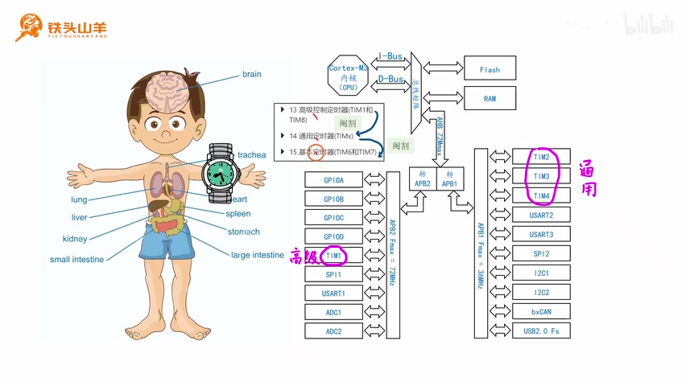
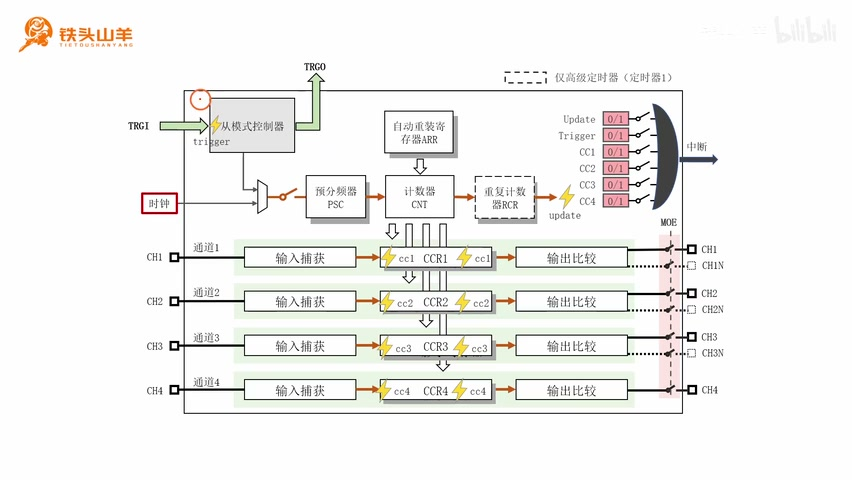
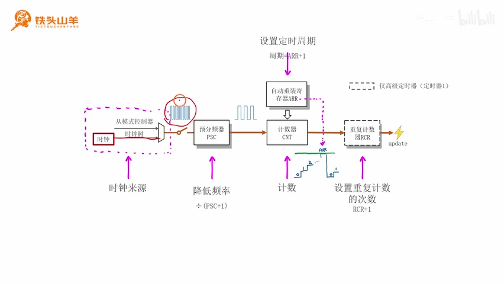
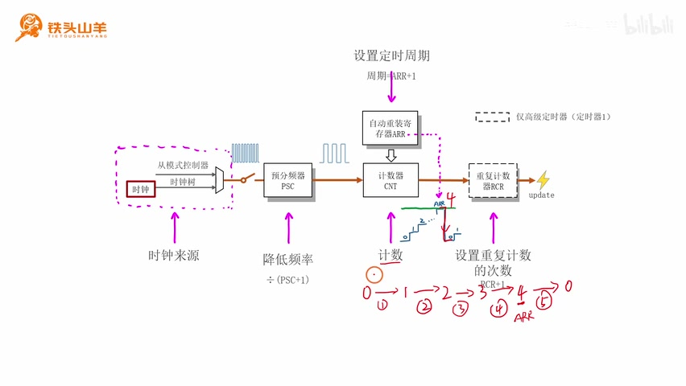
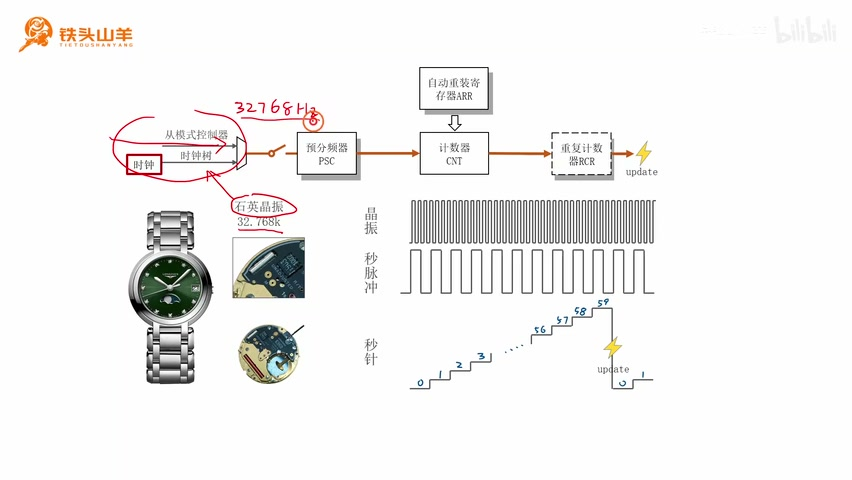
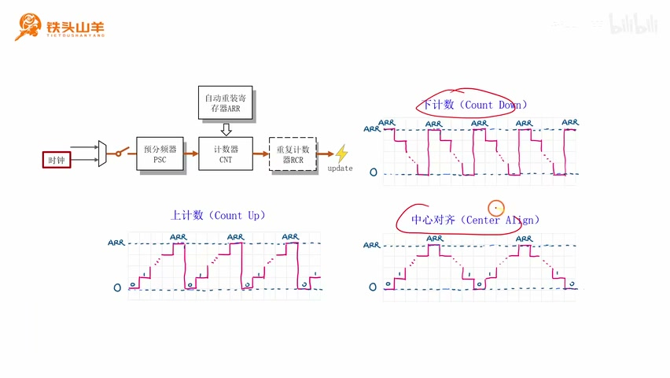
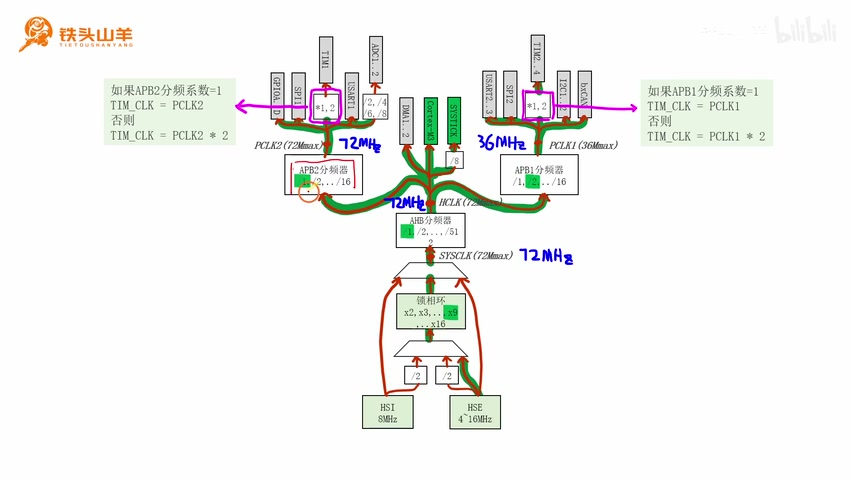
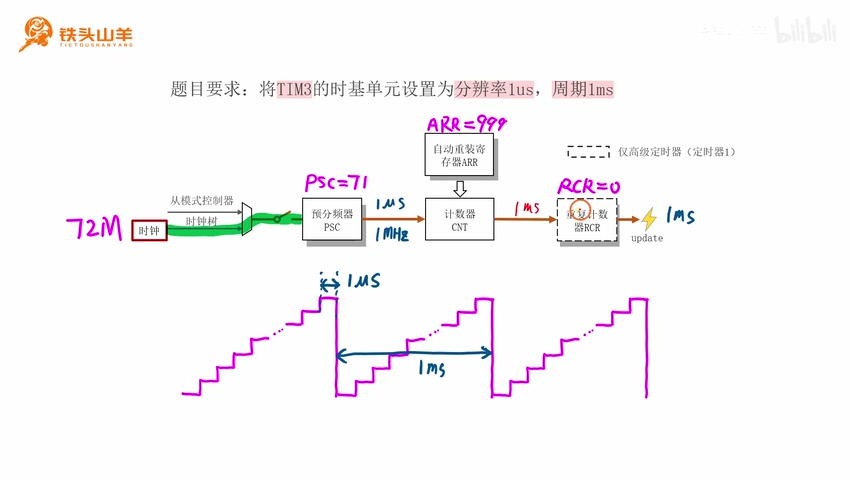
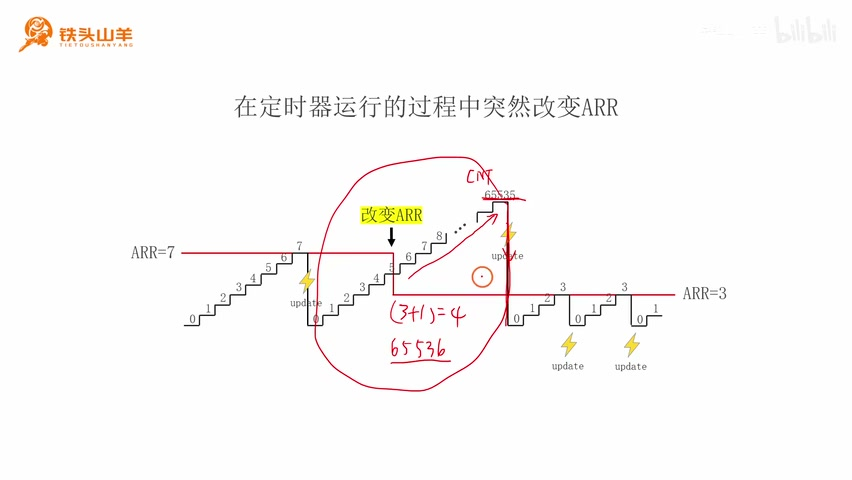
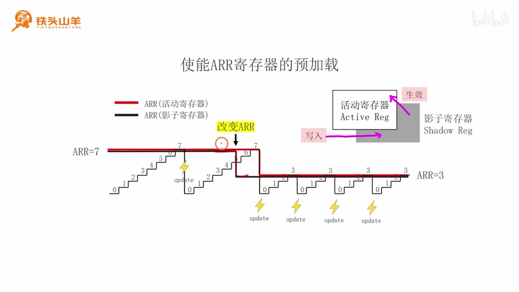

# P040 · 9.1 （定时器）时基单元

## 定时器简介

[00:00](https://www.bilibili.com/video/BV11X4y1j7si/?p=40\&t=0) 各位同学大家好，我是铁头山羊。今天开始学习第九章“定时器”。定时器是学习 STM32 时最重要的片上外设之一，同时也非常复杂。本节先讲定时器的第一部分——时基单元。课程所需材料都在开发套件包里，可以扫描屏幕上的二维码进入淘宝店铺购买；购买后会获得课程课件和源码，也可以加入答疑群与 UP 主直接交流。

本期按五部分展开：先介绍定时器，再看时基单元的基本结构；第三部分讲计数方向，包括上计数、下计数和中心对齐；第四部分讲时钟来源；第五部分讲寄存器预加载。先从定时器本身说起。和前几章类似，定时器也是单片机内部的片上外设。内部结构图里有 TIM1、TIM2、TIM3、TIM4；TIM 是 timer（定时器）的缩写。TIM1 挂在 APB2 总线上，TIM2 到 TIM4 挂在 APB1 总线上。

可以先把定时器想成一块手表：单片机里的这四个定时器，就像内部的四块手表。单片机里几乎所有与时间有关的操作都会用到定时器。

_内部结构图把 TIM1 标在 APB2 总线、TIM2–TIM4 标在 APB1 总线上。 ·_ [_原片 02:45_](https://www.bilibili.com/video/BV11X4y1j7si/?p=40\&t=165)

[02:00](https://www.bilibili.com/video/BV11X4y1j7si/?p=40\&t=120) 请拿出之前提到的参考手册 RM0008，翻到目录，可以看到第 13、14、15 章都在讲定时器。这是因为定时器分成三类：第 13 章是高级定时器，第 14 章是通用定时器，第 15 章是基本定时器。高级定时器功能最全；在它的基础上删减一部分功能得到通用定时器，再删减一部分功能得到基本定时器。

对于 STM32F1 系列，片内最多有 14 个定时器（TIM1 到 TIM14）：TIM1 和 TIM8 是高级定时器，TIM6 和 TIM7 是基本定时器，TIM2 到 TIM5 以及 TIM9 到 TIM14 是通用定时器。我们这颗芯片实际有四个定时器：TIM1 是高级定时器，TIM2、TIM3、TIM4 是通用定时器，也就是一个高级定时器加三个通用定时器。后续编程通常以高级定时器 TIM1 为例。

接着看本章定时器的内部结构框图。它非常复杂，远比之前学过的片上外设复杂；这张图只画出了大体结构，没画全部细节。

[04:00](https://www.bilibili.com/video/BV11X4y1j7si/?p=40\&t=240) 学这张复杂框图时，可以先拆成几个部分：时基单元、右下角的输出比较、左下角的输入捕获，以及左上角的从模式控制器。分成几部分后逐一学习，难度就会低很多。本期只学习第一部分——时基单元，框图里的各个方框稍后解释。

_定时器总框图展示时基单元、从模式控制器、输入捕获和输出比较等部分。 ·_ [_原片 04:05_](https://www.bilibili.com/video/BV11X4y1j7si/?p=40\&t=245)

## 时基单元的基本结构

下面进入第二部分。把总框图中的时基单元单独摘出来，从整体看有五部分：最左侧的时钟源、预分频器 PSC、下面的计数器 CNT、上面的自动重装载寄存器 ARR，以及最右侧的重复计数器 RCR。先看时钟源：顾名思义，它是时钟信号的来源。

_时基单元框图标出时钟源、PSC、CNT、ARR、RCR 及 update 输出。 ·_ [_原片 06:35_](https://www.bilibili.com/video/BV11X4y1j7si/?p=40\&t=395)

[06:00](https://www.bilibili.com/video/BV11X4y1j7si/?p=40\&t=360) 时基单元的时钟信号从最左侧输入。来源主要有两种：上一章学过的时钟树，以及定时器本身的从模式控制器。后者暂时不考虑，先假设时钟信号来自时钟树。输入时钟频率通常较高，我们往往用不到这么高的频率，因此用后面的预分频器降频，获得所需频率。预分频系数可设置，等于 PSC 的值加 1。例如输入时钟为 10 MHz，想得到 1 MHz，就将 PSC 设为 9，按 9+1 分频。

继续向右，预分频器后面是计数器 CNT。CNT 对分频后的脉冲计数：每输入一个脉冲，CNT 的值加 1。假设初值为 0，后续依次变为 1、2、3，于是形成阶梯状波形。CNT 上方的 ARR 专门用于设置定时周期。

[08:00](https://www.bilibili.com/video/BV11X4y1j7si/?p=40\&t=480) 看阶梯波形：绿色线表示 ARR 的值。假设 CNT 从 0 起步，每来一个脉冲就加 1，计到与 ARR 相等时，再来一个脉冲便溢出并从 0 重新计数。一次计数周期所经历的脉冲数因此是 ARR+1。例如 ARR=4 时，CNT 从 0 开始，前四个脉冲后依次到 1、2、3、4，第五个脉冲发生溢出并回到 0，所以周期是 4+1=5。

_计数阶梯与 ARR 水平线示意 CNT 计至 ARR 后溢出，周期为 ARR+1。 ·_ [_原片 09:05_](https://www.bilibili.com/video/BV11X4y1j7si/?p=40\&t=545)

CNT 右边还有重复计数器 RCR，用来设置重复次数。没有 RCR 时，CNT 每溢出一次，右边就产生一次 update 事件；加入 RCR 后，CNT 要溢出 RCR+1 次才产生 update。例如 RCR=1，1+1=2，CNT 溢出两次后才出现一次 update。至此，时基单元的基本结构就讲完了。

[10:00](https://www.bilibili.com/video/BV11X4y1j7si/?p=40\&t=600) 回顾这五部分：最左边是时钟来源，时钟由这里进入时基单元；PSC 把较高频率的时钟降到需要的频率；CNT 对左侧输入的脉冲计数，每来一个脉冲加 1；上面的 ARR 用于设置定时周期，周期数为 ARR+1；RCR 用来设置重复计数次数。

这套结构真的能计时吗？用石英手表来类比。手表内部结构与时基单元相似：拆开手表，可以看到表盘和内部电路；放大后能看到一颗银白色的石英晶振，频率是 32.768 kHz，也就是 32768 Hz。它相当于时基单元的时钟来源。这个频率驱动秒针显然太快，所以手表内部电路会分频，相当于 PSC，把 32768 Hz 分频得到 1 Hz 信号。

_手表晶振、分频电路和秒针波形说明 32768 Hz 如何经分频成为 1 Hz。 ·_ [_原片 11:40_](https://www.bilibili.com/video/BV11X4y1j7si/?p=40\&t=700)

[12:00](https://www.bilibili.com/video/BV11X4y1j7si/?p=40\&t=720) 1 Hz 时钟可以直接驱动秒针，就像 CNT 对输入脉冲计数。手表秒针从 0 开始，每秒跳一格；CNT 也从 0 开始，每输入一个脉冲就加 1。手表每转一圈是 60 秒，所以要把 ARR 设为 59，使计数周期为 59+1=60，每秒加一、60 秒走完一圈。这个手表和时基单元的结构确实一致；既然手表能计时，时基单元也能计时。

## 上计数、下计数和中心对齐

接下来补充 CNT 的计数方向。前面假设 CNT 从 0 开始，每个脉冲加 1，直到与 ARR 相等，再溢出回到 0；这叫上计数（Count Up）。还有两种方向。下计数（Count Down）与上计数相反：CNT 从 ARR 开始，每来一个脉冲减 1，减到 0 后溢出，再从 ARR 重新计数。

[14:00](https://www.bilibili.com/video/BV11X4y1j7si/?p=40\&t=840) 中心对齐（Center Align）比较复杂：先从 0 向上计数到 ARR，再转为向下计数，从 ARR 回到 0；从这里到下一次相同位置是一个定时周期。下计数和中心对齐用得较少，通常使用上计数；这三种方向了解即可，后两种以后遇到时认得出来就行。

_三种 CNT 波形分别表示上计数、下计数和中心对齐。 ·_ [_原片 14:30_](https://www.bilibili.com/video/BV11X4y1j7si/?p=40\&t=870)

## 时钟来源与 TIM3 的定时设置

现在进入第四部分：时基单元的时钟来源。先看一道题：把 TIM3 的时基单元设置成分辨率 1 微秒、周期 1 毫秒。分辨率和周期是什么？以手表为例，秒针每跳一格是一秒，手表计时最小单位就是一秒，无法记录 0.1 秒，所以分辨率是 1 秒，也就是计时的最小间隔；秒针转一圈要 60 秒，这就是周期。

[16:00](https://www.bilibili.com/video/BV11X4y1j7si/?p=40\&t=960) 类比到波形，CNT 每跳一下消耗的时间就是分辨率，本题设为 1 微秒；从一次溢出到下一次溢出是计数周期，本题设为 1 毫秒。如果分辨率为 1 微秒，预分频后的时钟周期就是 1 微秒，频率为 10^6 Hz，也就是 1 MHz。计数器每 1 毫秒溢出一次，对应题目要达到的周期。

如何得到 1 MHz？需要设置 PSC。若输入 10 MHz，则 PSC=9；若输入 20 MHz，则 PSC=19，因为都要除以 PSC+1 得到 1 MHz。因此 PSC 随输入时钟而变，先要确定输入频率。

时钟有两种来源：暂不考虑接下来几节才讲的从模式控制器，先看上一章的时钟树。假设单片机启动代码执行完，其他配置不变，此时 SYSCLK 来自 HSE 经锁相环得到的时钟，各处时钟达到当前配置的最大值。沿时钟树找出定时器的位置。

[18:00](https://www.bilibili.com/video/BV11X4y1j7si/?p=40\&t=1080) TIM1 是高级定时器，TIM2、TIM3、TIM4 是通用定时器。它们与总线之间各有一个倍频器，倍频系数为 1 或 2，由规则自动决定，不能手动设置。以 TIM1 为例：如果 APB2 分频系数为 1，倍频系数就是 1；否则就是 2。当前 APB2 分频系数是 1，所以 TIM1 时钟等于 PCLK2，即 72 MHz，再乘 1，还是 72 MHz。

TIM2、TIM3、TIM4 的规则相同：APB1 分频系数为 1 时，倍频系数为 1；否则为 2。当前 APB1 分频系数是 2，所以倍频为 2。PCLK1 为 36 MHz，乘 2 后也是 72 MHz。因此在当前配置下，这些定时器时钟都为 72 MHz，TIM3 也为 72 MHz。

_时钟树显示 APB2、APB1 分频及定时器时钟倍频关系。 ·_ [_原片 19:00_](https://www.bilibili.com/video/BV11X4y1j7si/?p=40\&t=1140)

[20:00](https://www.bilibili.com/video/BV11X4y1j7si/?p=40\&t=1200) 已知 TIM3 时基单元输入时钟为 72 MHz，要得到 1 MHz，PSC 应设为 71，因为 72 MHz ÷ (71+1)=1 MHz。这样一个计数脉冲的间隔就是 1 微秒，达到分辨率要求。

再设定计数周期。1 毫秒等于 1000 微秒，因此 CNT 每 1000 个脉冲应溢出一次；CNT 周期为 ARR+1，所以 ARR=1000−1=999。此时每 1 毫秒 CNT 溢出一次。最后把 RCR 设为 0，使每次溢出都产生一次 update 事件，update 周期就是 1 毫秒。

也可以按这个步骤理解：先用时钟树算出 TIM3 输入为 72 MHz，再用 PSC=71 降到 1 MHz，得到 1 微秒分辨率；ARR=999 让计数周期为 1000 个微秒，即 1 毫秒；RCR=0 表示每溢出一次就产生 update，因此 update 事件周期为 1 毫秒。

_TIM3 时基配置示意标出 72 MHz 输入、PSC=71、ARR=999、RCR=0，形成 1 μs 分辨率和 1 ms 周期。 ·_ [_原片 22:00_](https://www.bilibili.com/video/BV11X4y1j7si/?p=40\&t=1320)

[22:01](https://www.bilibili.com/video/BV11X4y1j7si/?p=40\&t=1320) 回看 RCR：它设定重复溢出的次数，次数为 RCR+1。RCR=1 时，每两次溢出产生一次 update；题目要求每一次溢出都产生 update，所以 RCR+1=1，RCR=0。到这里，TIM3 分辨率 1 微秒、周期 1 毫秒的要求就满足了。

## 寄存器预加载

下面进入本期最后一部分：寄存器预加载。这部分比较难，请认真听。框图中有些寄存器后面带灰色阴影，表示影子寄存器；前面的白色方框是活动寄存器。向寄存器写值时，值先写入影子寄存器，不会立即生效；等 CNT 溢出、产生 update 事件时，影子寄存器里的值才进入活动寄存器。这种缓存机制叫寄存器预加载。

[24:00](https://www.bilibili.com/video/BV11X4y1j7si/?p=40\&t=1440) 预加载有什么用？以 ARR 为例，它用于设置定时周期，周期数等于 ARR+1。看波形：CNT 从 0 计数，增长到 ARR 后溢出。假如定时器运行中 ARR 原来是 7，突然写入新值 3；若没有预加载，新值立刻生效。

看问题出现在哪里：CNT 从 0 数到 7，溢出后重新从 0 增长。计数过程中 ARR 从 7 变成 3，但此时 CNT 已经是 5，大于 3。CNT 继续增加就不可能再与 ARR 相等，于是会一直增长到计数器最大值 65535 才再次溢出。原本希望新的周期是 3+1=4，实际却变成 65536，这就是定时器“跑飞”，当然不希望发生。

_未启用预加载时，ARR 从 7 改为 3，而 CNT 已超过 3，只能计到 65535 才溢出。 ·_ [_原片 26:20_](https://www.bilibili.com/video/BV11X4y1j7si/?p=40\&t=1580)

[26:00](https://www.bilibili.com/video/BV11X4y1j7si/?p=40\&t=1560) 加入预加载后再看这个例子。写入 ARR 的新值 3 时，它先进入影子寄存器，所以黑色线（影子寄存器）从 7 变成 3；红色线（活动寄存器）仍保持 7。于是 CNT 继续从 0 数到 7并溢出，产生 update 事件；这时影子寄存器中的 3 才进入活动寄存器，红线从 7 变成 3。之后 CNT 从 0 数到 3再溢出，周期就从 8 平稳过渡到 4，不会发生跑飞。

_启用预加载后，新 ARR=3 先进入影子寄存器，等 update 事件后再切换到活动寄存器。 ·_ [_原片 27:30_](https://www.bilibili.com/video/BV11X4y1j7si/?p=40\&t=1650)

[28:00](https://www.bilibili.com/video/BV11X4y1j7si/?p=40\&t=1680) 本期内容讲完了：先介绍时基单元的基本结构和工作原理，最后讲了寄存器预加载。感谢大家收看，我是铁头山羊，我们下期视频再见。
