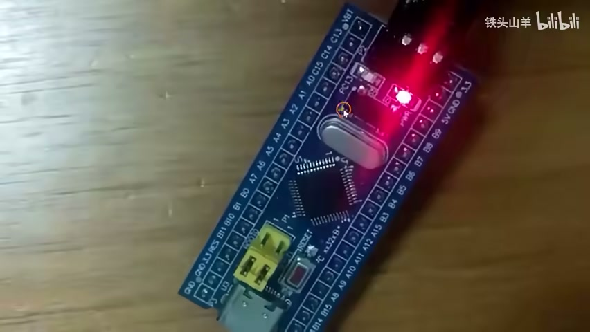
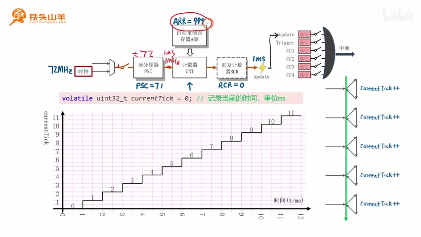
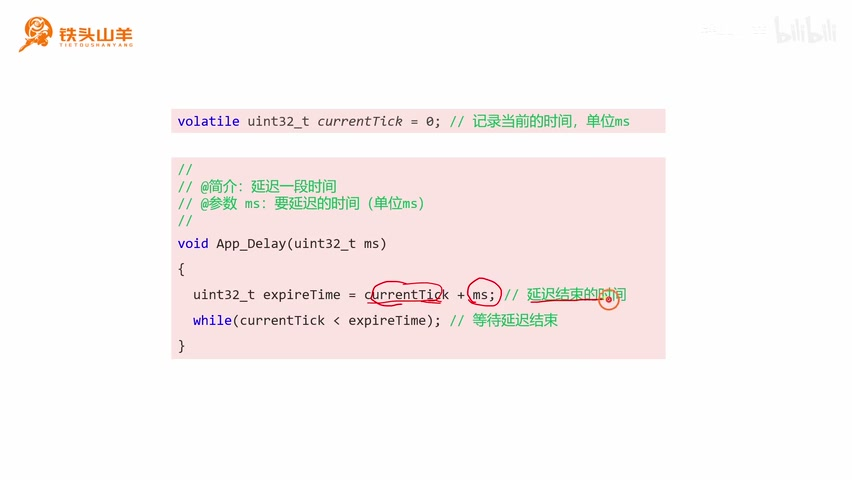
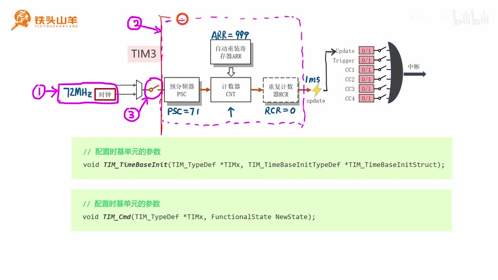
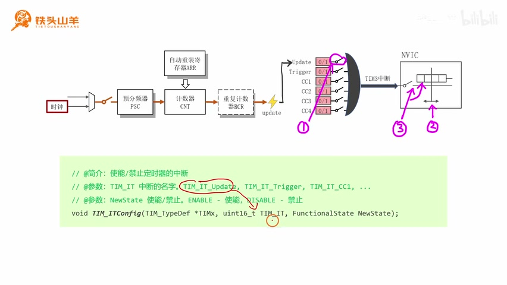
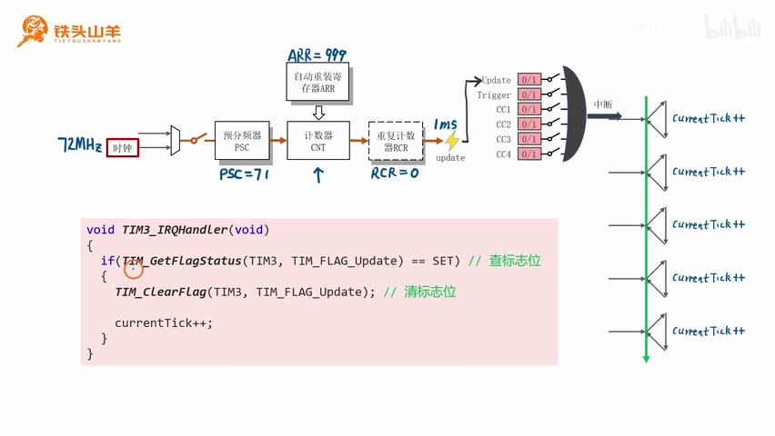
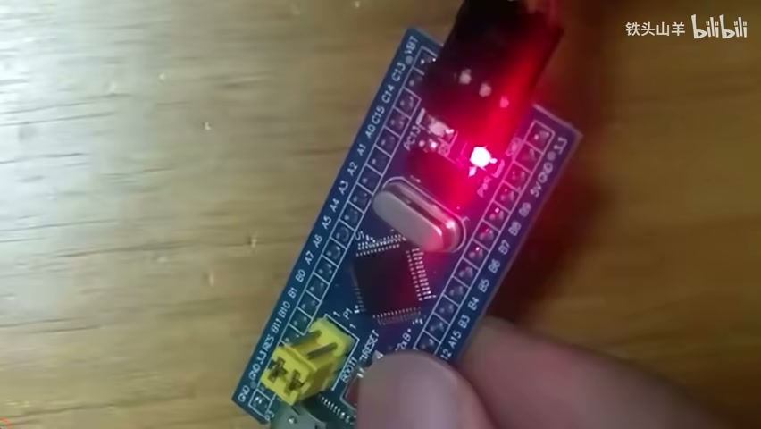

# P041 · 9.2 （定时器）自制延迟函数

## 从系统滴答定时器转向通用定时器

各位同学大家好，我是铁头山羊。今天我们来学习第九章第二节。在前几课里，我们学习了定时器这个外设的基本工作原理；这一节就利用定时器来写一个延迟函数。

本套视频所需的材料都包含在开发套件包里。大家可以扫描屏幕上的二维码，进入淘宝店铺购买。购买套件后，可以获得课程所有课件和源码，还能加入答疑群，通过 App 直接交流。



_板载 LED 的闪烁实验为延迟函数提供了直观测试对象。 ·_ [_原片 00:36_](https://www.bilibili.com/video/BV11X4y1j7si/?p=41\&t=36)

刚开始学习 STM32 时，我们做过闪灯实验，控制板载 LED 闪烁。之前的代码是在 `while` 循环里先点亮 LED，延迟一段时间，再熄灭 LED，再延迟一段时间。这里用到了我提供的 `Delay` 延迟函数。

`Delay` 的原理其实是使用单片机内部的系统滴答定时器。它是 STM32 内核里的一个定时器，通常不作为本课程学习的外设。前几课学的通用定时器，其工作原理与系统滴答定时器有相通之处，所以这一节我们改用单片机内部的普通定时器来实现延迟函数。

再说明一下：我提供的延迟函数是用系统滴答定时器实现的。这个定时器叫 SysTick，是 Cortex-M3 内核里的一个模块，本课程不讲它。课程中学习的是定时器 1、2、3、4；这一节从中任选一个实现延迟函数。

本期分五部分：第一，使用定时器获取单片机当前时间；第二，实现延迟函数；第三，初始化定时器；第四，配置中断；第五，编写中断响应函数。

## 用定时器中断记录毫秒时间

从第一部分开始：获取单片机的当前时间。做法是配置定时器，让它每隔 1 毫秒产生一次中断。



_图中标出定时器时钟、预分频器、计数器与更新事件之间的关系，并展示每毫秒递增的时间刻度。 ·_ [_原片 02:45_](https://www.bilibili.com/video/BV11X4y1j7si/?p=41\&t=165)

假设定时器输入时钟频率是 72 MHz，把预分频器 `PSC` 设置为 71，就能将输入时钟 72 分频，得到 1 MHz 的计数时钟，周期为 1 微秒。再把定时周期设置为 `ARR = 999`，即计数 1000 次；1000 微秒就是 1 毫秒，因此计数器 `CNT` 每 1 毫秒溢出一次。将重复计数器 `RCR` 设为 0，这样每次溢出都会产生一次更新事件（Update），更新事件频率也是每毫秒一次。再用更新事件激活更新标志位，产生中断。到这里，中断就是每 1 毫秒发生一次。

有了这个中断，我们声明一个无符号 32 位整数变量 `currentTick`，初值为 0，用来记录单片机当前时间，单位是毫秒。变量前面加上 `volatile`。这个关键字和中断有关，作用比较复杂，这里不展开，大家可以自行查阅学习。

刚才说过，中断每毫秒产生一次。每产生一次中断，就会调用一次中断服务函数。

## 在中断服务函数中递增时间

在中断服务函数里写一句 `currentTick++`，让 `currentTick` 的当前值增加 1。这样它会随时间递增：单片机刚开机时值为 0，开机 5 毫秒后是 5，10 毫秒后是 10，100 毫秒后是 100。也就是说，`currentTick` 记录了单片机当前时间，我们就用这种方式获取当前时间。

接下来按刚才的思路改造代码。先拿出模板工程并解压，给工程重新起名，例如 `UserDelay`，表示这是我们自己实现的延迟函数；工程里的文件也重命名为 `UserDelay`。打开工程，再打开 `main.c`，把代码写在这里。

首先声明刚才的变量：`volatile uint32_t currentTick = 0;`，用来记录当前时间，单位是毫秒。变量声明好后，按图示思路本来下一步应配置定时器、使能中断并编写中断服务函数；这些先放到后面做。我们先看有了 `currentTick` 后，如何实现延迟函数。

## 实现延迟函数

前面说过，声明 `currentTick` 后，接下来本来要配置定时器、使能中断并编写中断服务函数；这些工作先放到后面。现在先看有了 `currentTick` 后，怎样用它实现延迟函数。这是本课第二部分。

可以给延迟函数起名为 `App_Delay`，名字可以自己取。它有一个参数，单位是毫秒，表示要延迟的毫秒数。实现思路是先用 `currentTick` 获取当前时间，再加上要延迟的时间，得到延迟结束时间，把它存进 `expireTime`。然后用 `while` 循环等待当前时间超过结束时间；只要还没到，就一直等待。当前时间达到或超过 `expireTime` 后，循环退出，函数也结束，这样就实现了延迟。



_延迟函数将当前毫秒计数与请求时长相加，并轮询到期时间。 ·_ [_原片 06:45_](https://www.bilibili.com/video/BV11X4y1j7si/?p=41\&t=405)

按这个思路编写代码：先声明 `App_Delay` 函数，并把函数原型复制到文件底下，在那里实现。函数参数就是要延迟的时间，单位为毫秒。实现中声明变量 `expireTime`，令它等于 `currentTick` 加上延迟毫秒值；然后用空的 `while` 循环等待延迟结束：

```c
void App_Delay(uint32_t ms)
{
    uint32_t expireTime = currentTick + ms;
    while (currentTick < expireTime);
}
```

这段代码中只要 `currentTick < expireTime`，就继续等待；达到或超过结束时间后，循环结束。这样 `App_Delay` 就写完了。接下来需要初始化定时器，这也是本课第三部分。我们所用的单片机里有四个定时器。

## 初始化定时器 3：时钟与参数配置

第三部分是初始化定时器。本实验所用的单片机里有定时器 1 到 4：定时器 1 是高级定时器，定时器 2 到 4 是通用定时器。我们任选一个，这次用定时器 3。

定时器 3 的初始化主要有三个步骤：使能定时器 3 的时钟；配置定时器参数，包括 `PSC`、`ARR`、`RCR` 和计数方向；最后使能定时器，让它运行。



_TIM3 的时基配置围绕 72 MHz 输入、预分频、ARR 周期和更新事件展开。 ·_ [_原片 08:30_](https://www.bilibili.com/video/BV11X4y1j7si/?p=41\&t=510)

先使能定时器 3 的时钟。因为 TIM3 挂在 APB1 总线上，调用 `RCC_APB1PeriphClockCmd`。我们先声明一个函数来放定时器 3 初始化代码，例如 `App_TIM3_TimeBaseInit`；名字可以自行取，只要知道它的意思即可。在函数中调用 `RCC_APB1PeriphClockCmd(RCC_APB1Periph_TIM3, ENABLE);`，打开定时器 3 时钟。

开启时钟后配置定时器参数。新的结构体叫 `TIM_TimeBaseInitTypeDef`，用于设置定时器的时基，也就是定时器基本参数，和之前学过的初始化代码相似。它需要两个参数：第一个填要初始化的定时器名称（这里是 `TIM3`），第二个是结构体变量指针。

## 设置预分频、周期和计数方向

先声明结构体变量 `TIM_TimeBaseInitTypeDef TIM_TimeBaseInitStruct;`，变量名可以换，通常这样命名。然后给成员赋值。

`Prescaler` 用来设置预分频器 `PSC`。输入时钟是 72 MHz，要进行 72 分频得到 1 MHz，所以这里设置为 71。

`Period` 设置前面所说的自动重装载值 `ARR`。我们希望每 1 毫秒溢出一次，1 毫秒对应计数 1000 次，所以 `ARR = 1000 - 1 = 999`，这里填 999。

`CounterMode` 用来设置计数方向，有向上计数、向下计数和中心对齐几种模式。这里选向上计数，即 `TIM_CounterMode_Up`。中心对齐选项名称以 `TIM_CounterMode_CenterAligned...` 开头，向下计数是 `TIM_CounterMode_Down`，本例选 Up。

最后还有 `RepetitionCounter`，即重复计数器 `RCR`。我们需要每次溢出都产生更新事件，因此设为 0。

`ClockDivision` 也在结构体中，但本次用不到，可以不设置。参数填好后调用 `TIM_TimeBaseInit(TIM3, &TIM_TimeBaseInitStruct);`：第一个参数是 `TIM3`，第二个传入刚才填好参数的结构体。这样时基参数配置完成。

第三步是使能定时器。只有把图中的开关闭合，后面的电路才会工作。控制这个开关的接口叫 `TIM_Cmd`，第二个参数控制开关是闭合还是断开：填 `ENABLE` 表示使能，`DISABLE` 表示关闭。调用 `TIM_Cmd(TIM3, ENABLE);`，使能定时器 3。

把这段时基初始化代码放进初始化函数，并在 `main` 函数里调用。配置完定时器后，因为本实验需要中断，接下来要配置右侧的中断。第四部分是配置中断，第一步要打开更新中断对应的开关。

## 打开更新中断并设置 NVIC

控制定时器中断开关的接口叫 `TIM_ITConfig`。它有三个参数：要操作的定时器名称；要操作的中断来源；以及使能或禁用状态。

本例用定时器 3 的更新标志位产生中断，所以中断来源填 `TIM_IT_Update`。若要用触发事件，则填 `TIM_IT_Trigger`；若要控制捕获比较标志位，则填对应的 `TIM_IT_CCx`，其余同理。第三个参数填 `ENABLE` 表示使能，填 `DISABLE` 表示关闭。

在 `App_TIM3_TimeBaseInit` 函数里加入 `TIM_ITConfig(TIM3, TIM_IT_Update, ENABLE);`，这样就打开更新中断。

打开中断开关后还要配置 NVIC。NVIC 是中断的管理者，代码用到中断时需要配置它。先设置中断优先级分组。把优先级分组代码放在 `main` 函数开头比较合适。之后还要设置定时器 3 这个中断自身的优先级并使能它。

本例选择中断优先级分组 2，也就是两位抢占优先级、两位响应优先级。设置优先级分组后，第三步是配置定时器 3 中断本身的优先级并使能它。



_定时器标志位和 NVIC 共同决定中断请求是否送入处理器。 ·_ [_原片 15:00_](https://www.bilibili.com/video/BV11X4y1j7si/?p=41\&t=900)

回到定时器初始化代码，继续写第五步：配置 NVIC。使用 `NVIC_Init` 方法，它需要一个结构体指针变量。先声明 `NVIC_InitTypeDef NVIC_InitStruct;`，名字可以自定，然后设置结构体成员。

第一个成员是 `NVIC_IRQChannel`，表示中断通道名称。可以在工程的 `stm32f10x.h` 中查找枚举类型，找到定时器 3 的中断名称 `TIM3_IRQn`，填在这里。

然后设置其他成员。`NVIC_IRQChannelPreemptionPriority` 表示抢占优先级，可以先写 0。目前只有一个中断，所以优先级暂时设多少都可以；后面还有其他优先级设置。

接着设置子优先级，并把通道状态设为使能：`NVIC_IRQChannelCmd = ENABLE`。最后把填好参数的结构体传给 `NVIC_Init`，NVIC 模块就配置好了。

本期最后一步是编写中断响应函数。要写这个函数，先要知道它叫什么。之前讲过如何查找，这里再找一次：在左侧导航栏打开启动文件，向下找到中断向量表，查找定时器 3 的中断响应函数名 `TIM3_IRQHandler`。把这个函数放到 `main.c` 的合适位置实现，参数为空，返回值也是空。

处理这个中断时，先检查是不是由更新标志位触发，因为图中有多个标志位都能触发中断。调用 `TIM_GetFlagStatus` 检查 `TIM_FLAG_Update`；如果标志位为 1，说明是更新事件触发的中断。处理中断时最好先清除更新标志位，否则标志位始终是 1，中断会一直被触发。调用 `TIM_ClearFlag` 清除 `TIM_FLAG_Update` 后，再做真正的工作：让 `currentTick` 的值增加 1。

## 编写中断函数并初始化板载 LED

具体来说，在 `TIM3_IRQHandler` 中调用 `TIM_GetFlagStatus(TIM3, TIM_FLAG_Update)` 检查定时器 3 的更新标志位。如果它等于 `SET`，说明中断由更新事件触发。先调用 `TIM_ClearFlag(TIM3, TIM_FLAG_Update)` 清除更新标志，再执行 `currentTick++`。这样中断服务函数就写完了。



_中断服务函数先检查并清除 TIM3 更新标志，再递增当前时间计数。 ·_ [_原片 19:30_](https://www.bilibili.com/video/BV11X4y1j7si/?p=41\&t=1170)

下面写闪灯程序，测试延迟函数是否好用。先初始化板载 LED，它连接在 PC13 引脚。写一个函数初始化这个 LED，并在主函数中调用。具体实现放在文件底部：先使能 GPIOC 时钟，再声明 GPIO 初始化结构体，配置引脚为 PC13、输出开漏模式、最高输出速度 2 MHz，最后初始化 PC13。

初始化完成后先把灯关掉，LED 初始化代码就写完了。接下来回到 `main` 函数的 `while` 循环写闪灯程序：先灭灯，再亮灯，调用刚才写的 `App_Delay` 延迟 500 毫秒；然后再灭灯，并再延迟 500 毫秒。这样亮、灭各占一段延迟。测试代码也写好了。



_程序烧录后，板载 LED 显示定时延迟的闪烁效果。 ·_ [_原片 23:20_](https://www.bilibili.com/video/BV11X4y1j7si/?p=41\&t=1400)

编译看看代码是否正确：点击左上角第二个按钮进行编译，结果没有问题。再把代码写入单片机，按一下复位按钮。可以看到 LED 闪起来了，亮、灭的时间都差不多是 500 毫秒，亮灭一轮正好一秒，说明延迟函数工作正常。

如果觉得这样闪灯有点枯燥，也可以换一种写法，让它两次短闪、一次长闪，看起来更有意思：前两次亮 50 毫秒，最后一次亮 500 毫秒。按一下单片机复位按钮，可以看到效果比之前有意思一些。

好的，到这里本期内容就讲完了。本期我们做了一个小实验。感谢大家收看，我是铁头山羊，我们下期视频再见。
