# P042 · 9.3 （定时器）输出比较

各位同学大家好，我是铁头山羊。今天我们来学习第九章第三节，通过本期视频讲解定时器的输出比较。

之前我们介绍过，定时器可以分成四个部分：时基单元、输出比较、输入捕获，还有左上角的从模式控制器。前两期视频已经学习了时基单元，今天学习第二部分，也就是输出比较。本期分成五部分：先简单介绍输出比较，再举 PWM 的例子解释它的工作原理，接着学习输出比较的八种工作模式，然后了解互补输出，最后学习极性选择。

在解释输出比较之前，先认识定时器通道。前两期视频中已经介绍过时基单元；在它下方的四个长条结构代表定时器的四个通道，分别是通道 1、通道 2、通道 3 和通道 4。四个通道的结构相同，下面以通道 1 为例。通道中间是 CCRx 寄存器，x 可以是 1、2、3、4，分别对应四个通道；寄存器左边是输入捕获。

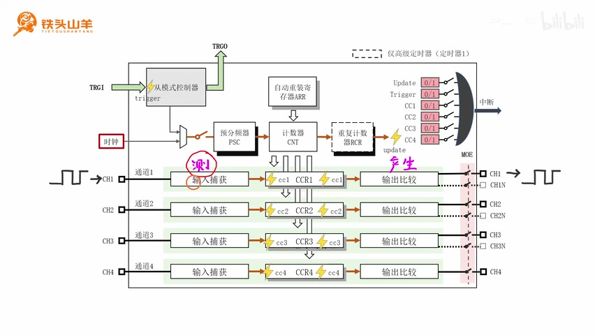

_定时器时基单元、四个通道以及输入捕获和输出比较在通道中的位置。 ·_ [_原片 01:50_](https://www.bilibili.com/video/BV11X4y1j7si/?p=42\&t=110)

输入捕获用来测量外部输入信号的时间参数。把外部信号从引脚输入定时器内部后，就可以使用输入捕获测量它的时间参数。

例如，可以测量输入信号的周期有多长、占空比是多少，所有跟时间有关的参数都可以通过输入捕获测量。CCR 寄存器右边是本节要学习的输出比较模块。它的作用是通过定时器产生精确定时的方波信号，再通过引脚输出。因为方波是由定时器产生的，而定时器本身的时间精度很高，所以产生的方波精度也很高，可以用来驱动各种外部设备，达到很好的效果。这就是输出比较：通过定时器产生精确定时的方波信号。

## 用 PWM 说明输出比较的工作原理

下面通过输出比较产生 PWM 信号的例子说明工作原理。PWM 是 Pulse Width Modulation 的缩写，意思是脉冲宽度调制。

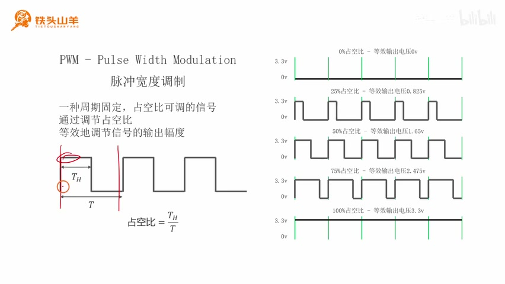

_PWM 周期固定，改变高电平持续时间即可改变占空比。 ·_ [_原片 03:45_](https://www.bilibili.com/video/BV11X4y1j7si/?p=42\&t=225)

对于这种信号，周期固定，可以调整的是占空比。占空比是一个周期内高电压所占的比例，也就是高电压持续时间 Tₕ 除以整个周期 T。调节占空比，可以等效地调节输出电压的幅度。

单片机如果没有 DAC（数模转换器），只能输出高电平 3.3 V 或低电平 0 V，不能直接输出 2 V。这个时候可以用 PWM，通过调节占空比，以面积等效的形式近似得到所需电压。先看占空比为 0% 的情况：高电压在整个周期中所占比例为 0，整个周期都输出 0 V，等效输出电压就是 3.3 V × 0% = 0 V。

占空比为 25% 时，周期的四分之一输出高电压，四分之三输出低电压；按面积等效，输出为 3.3 V × 25% = 0.825 V。占空比为 50% 时，一半输出高电压、一半输出低电压，等效电压就是 3.3 V 的一半，即 1.65 V。占空比为 75% 时，高电压占三份、低电压占一份，等效电压为 3.3 V × 75% = 2.475 V。由这些例子可以看到，改变占空比，就能等效地输出不同电压。

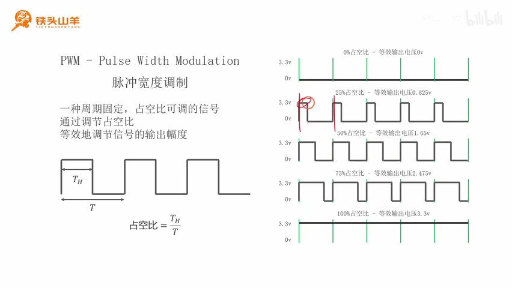

_占空比从 0% 到 100% 时的 PWM 波形和等效输出电压示例。 ·_ [_原片 04:57_](https://www.bilibili.com/video/BV11X4y1j7si/?p=42\&t=297)

了解 PWM 之后，来看怎样使用定时器的输出比较模块产生这种信号。为了方便分析，把时基单元和通道 1 的输出比较部分单独摘出来，得到左边这张图。

## PWM 信号的产生

启动时基单元后，计数器 CNT 左边每来一个时钟脉冲，计数值就增加 1。它从零开始计数，到达自动重装载寄存器 ARR 的值时发生溢出，然后重新开始计数。比如 ARR 写入 9，CNT 从 0 数到 9，一共是 10 个计数，因此一个定时周期就是 9 + 1 = 10。接着往 CCR 寄存器写入 3，图中的绿色线表示 CCR 的值。

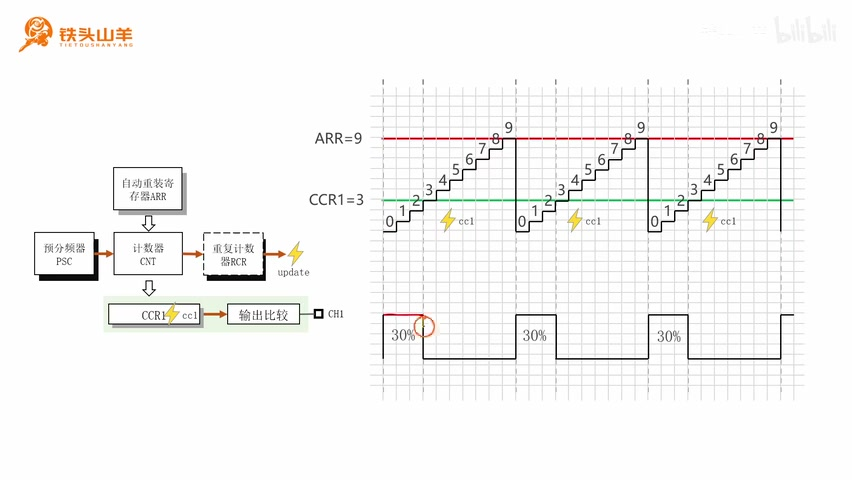

_CNT 从零计数并与 CCR 比较后得到高低电平 PWM 波形。 ·_ [_原片 06:59_](https://www.bilibili.com/video/BV11X4y1j7si/?p=42\&t=419)

输出比较模块会比较 CNT 与 CCR 的值。当 CNT 小于 CCR 时，输出位置为高电平；CNT 达到或超过 CCR 时，输出位置为低电平。计数器重复这个步骤，就会产生高低变化的方波，也就是 PWM 信号。PWM 的周期由 ARR 决定，这个例子里是 10；高电平所占时间由 CCR 决定，CCR=3 时高电平持续 3 个计数，所以占空比是 3/10，也就是 30%。如果把 CCR 改成 4，占空比就变成 40%；改成 5，占空比就是 50%。这样改变 CCR 就可以调节 PWM 的占空比，这就是输出比较产生 PWM 的原理。

刚才通过产生 PWM 的例子了解了输出比较的基本工作原理。下面深入输出比较模块内部，看看它具体怎样工作。图中左上是之前学习的时基单元；时基单元下方是 CCRx 捕获/比较寄存器，左边是输入捕获，右边是输出比较。输出比较框图内部可以分成三个大块：模式选择、极性选择和输出使能。

## 输出比较的八种工作模式

先看模式选择。输出比较总共有八种工作模式，可以在中间选择一种；模式不同，右边输出的 OCxREF 形状也不同。OCxREF 是 Output Compare x Reference 的缩写：OC 表示输出比较，x 表示通道编号，通道 1 到通道 4 分别使用 OC1REF 到 OC4REF；REF 表示 Reference，也就是参考信号，所以 OCxREF 是通道 x 的参考信号。

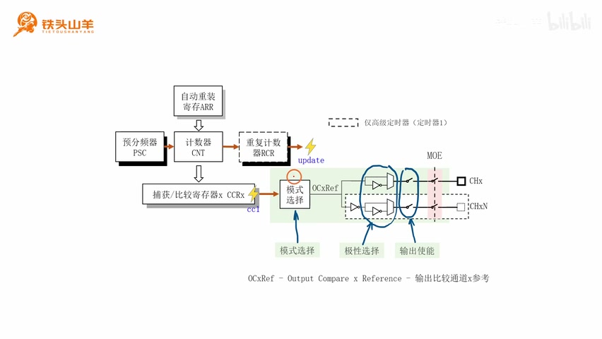

_输出比较模块由模式选择、极性选择和输出使能等部分组成，模式选择输出 OCxREF。 ·_ [_原片 09:10_](https://www.bilibili.com/video/BV11X4y1j7si/?p=42\&t=550)

八种模式依次是 Frozen（冻结）、Active on match（相等有效）、Inactive on match（相等无效）、Toggle（翻转）、Force inactive（强制无效）、Force active（强制有效）、PWM1 和 PWM2。前六种用得较少，简单了解即可；后两种用于输出 PWM，其中最常用的是 PWM1，PWM2 很少用，所以重点学习 PWM1，其余模式知道含义即可。

这八种模式都根据 CNT 和捕获/比较寄存器 CCR 的比较关系产生输出。第一种是 Frozen（冻结），比较结果如何都不改变 OCxREF。若开始时是高电平，之后一直输出高电平；若开始时是低电平，之后一直输出低电平。

第二种是 Active on match（相等有效）。“有效”代表高电平，“无效”代表低电平。CNT 和 CCR 相等时，OCxREF 输出高电平；两者不相等时输出低电平。

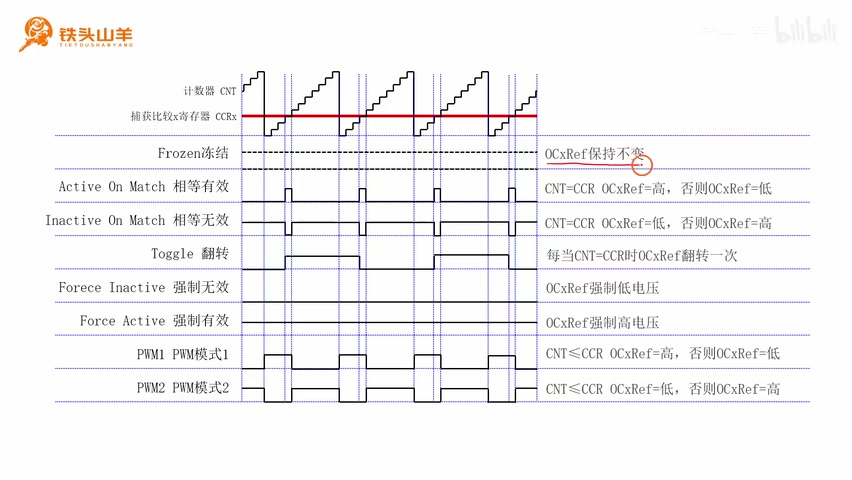

_CNT 与 CCR 的关系决定不同输出比较模式下 OCxREF 的波形。 ·_ [_原片 11:10_](https://www.bilibili.com/video/BV11X4y1j7si/?p=42\&t=670)

第三种 Inactive on match（相等无效）正好和相等有效相反：CNT 和 CCR 相等时输出低电平，否则输出高电平。

第四种是 Toggle（翻转）。每当 CNT 和 CCR 相等，OCxREF 的输出电压就翻转一次：原来是低电平就变成高电平，下次相等时再变成低电平，如此反复。

第五种 Force inactive（强制无效）：不管 CNT 和 CCR 的比较结果如何，都强制在 OCxREF 上输出低电平。第六种 Force active（强制有效）则不管比较结果如何，都强制输出高电平。以上六种模式使用很少，简单了解即可，不要求记忆。

下面两种 PWM1 和 PWM2 才是要学习的模式。刚才举例时的 PWM 波形有一处画错了，这里更正后回顾 PWM1：当 CNT 小于 CCR 时，注意是“小于”，不是“小于等于”，OCxREF 输出高电平；否则，也就是 CNT 大于等于 CCR 时，输出低电平。这就形成 PWM 波形。

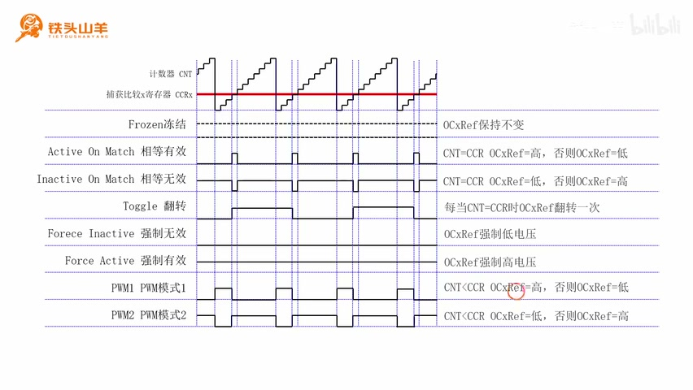

_PWM1 与 PWM2 的输出极性相反，比较条件为 CNT 小于 CCR 或大于等于 CCR。 ·_ [_原片 13:57_](https://www.bilibili.com/video/BV11X4y1j7si/?p=42\&t=837)

PWM2 正好和 PWM1 相反：CNT 小于 CCR 时输出低电平，大于等于 CCR 时才输出高电平，波形与 PWM1 相反。一般 PWM2 用得也比较少，通常使用 PWM1。

刚才简单了解了输出比较的八种功能模式，下面学习另一个概念：互补输出。

## 互补输出

回到定时器总体结构，可以看到有四个通道，每个通道都有输出比较功能。前三个通道的输出比较分别连接两个引脚，例如通道 1 连接 CH1 和 CH1N，通道 2 连接 CH2 和 CH2N，通道 3 连接 CH3 和 CH3N。

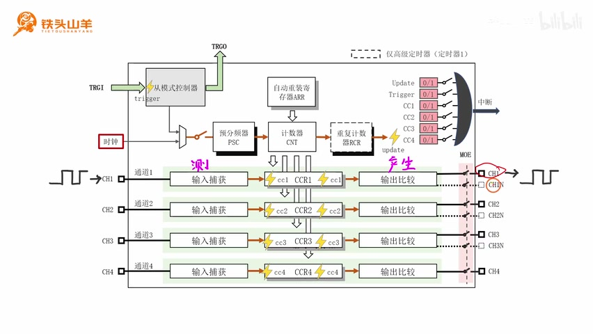

_定时器通道的正常输出引脚与互补输出引脚。 ·_ [_原片 15:15_](https://www.bilibili.com/video/BV11X4y1j7si/?p=42\&t=915)

CH1、CH2、CH3、CH4 表示正常输出；CH1N、CH2N、CH3N 表示互补输出。所谓正常输出，是将模式选择产生的参考信号直接输出。图中 OCxREF 通过连线直接接到正常输出，所以二者相同：参考信号为高电平，正常输出就是高电平；参考信号为低电平，正常输出也是低电平。

互补输出正好与正常输出相反。它走下面这条路径：参考信号经过一个反向器，再接到互补输出。因此 OCxREF 为高电平时，互补输出是低电平；OCxREF 为低电平时，互补输出是高电平。正常输出与参考信号相同，互补输出与参考信号相反，所以正常输出和互补输出也相反。

讲到这里，同学们可能会疑惑：既然 OCxREF 可以直接通过正常输出送出，为什么还要取反再产生互补信号？互补输出是有用的，下面举个例子。右边的电路图是同步 Buck 电路，也就是降压电源；它把较高的电压（例如 12 V）降成较低的电压（例如 3.3 V），提供给右边的负载。

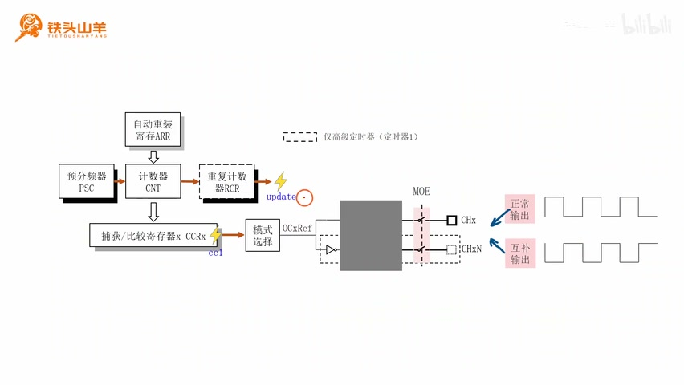

_OCxREF 直接送往正常输出，并经反相后送往互补输出。 ·_ [_原片 16:30_](https://www.bilibili.com/video/BV11X4y1j7si/?p=42\&t=990)

电路由输入电压、两个开关、储能电感、储能电容和负载组成。

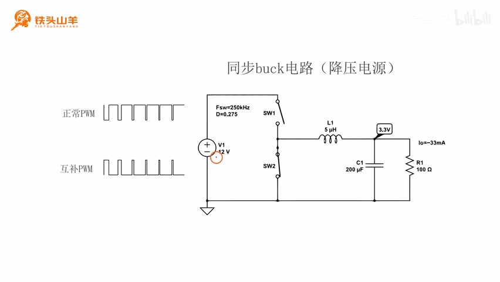

_同步 Buck 降压电路的输入、上下开关、电感、电容和负载。 ·_ [_原片 17:40_](https://www.bilibili.com/video/BV11X4y1j7si/?p=42\&t=1060)

工作时两个开关交替导通。比如闭合上面的开关时，下面的开关断开，输入电源就沿着这条路径给电感和电容充电。

上面的开关断开时，下面的开关闭合，电感和电容通过另一条回路放电。控制充电时间和放电时间的比例，就可以调节右边的输出电压。两个开关的控制逻辑正好相反：上面的导通时，下面必须断开；下面导通时，上面必须断开。给两个开关施加控制信号时，上面为高电平，下面就要为低电平；上面为低电平，下面就要为高电平。这样一对相反的信号就用到了正常 PWM 和互补 PWM。

这种一对开关交替导通的情况在其他电路中也常见，例如电机控制电路。因此单片机配置两路输出，一路正常输出，一路互补输出。

## 极性选择

了解互补输出之后，学习本节最后一部分：极性选择。回到输出比较框图，模式选择产生参考信号后分成两路：上面一路叫正常输出，下面一路经过反向器后成为互补输出。正常输出和互补输出各自还有一个结构，叫极性选择。

极性选择就是决定是否对输出信号取反。对于正常输出，如果不取反，就走上面这一路，叫高极性；这时 OCxREF 参考信号直接连接正常输出，所以二者相等。

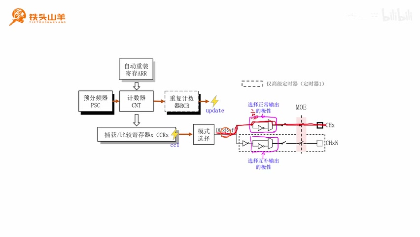

_输出极性选择中，正常与互补两路输出可经过反相或直通路径。 ·_ [_原片 20:00_](https://www.bilibili.com/video/BV11X4y1j7si/?p=42\&t=1200)

如果正常输出走下面这一路，就会经过反向器，对 OCxREF 取反后再接到正常输出；此时参考信号和正常输出相反。

对于下面的互补输出也一样。选择上面这一路时，OCxREF 经过一个反向器到达互补输出，所以互补输出与参考信号相反：参考信号输出高电平，互补输出低；参考信号输出低电平，互补输出高。

如果互补输出选择下面这一路，也就是低极性，路径上有一个反向器，再加上前面的一个反向器，两个反向器抵消了。因此 OCxREF 与互补输出相同：参考信号输出高电平时，右边也输出高电平；参考信号输出低电平时，右边也输出低电平。这就是极性选择的关系。

好的，到此为止，本节课的内容都讲完了。本节介绍了输出比较的工作原理，以及输出比较内部的详细结构和工作机制。今天就到这里，我是铁头山羊，让我们下期视频再见。
