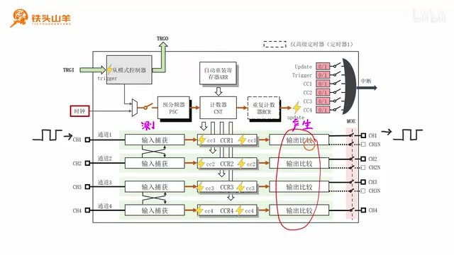
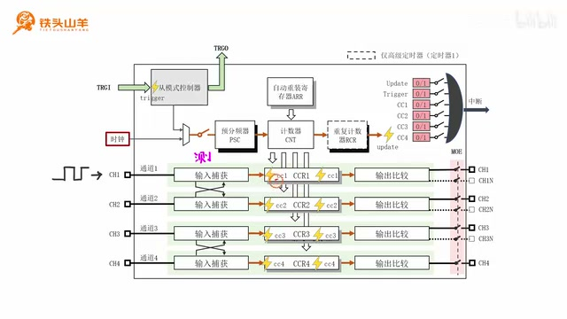
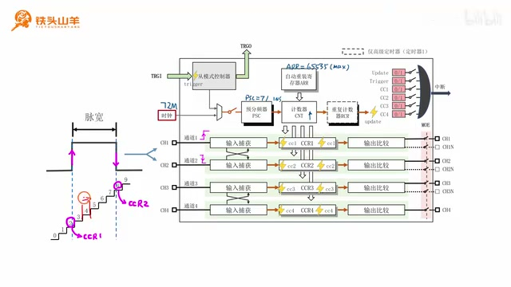
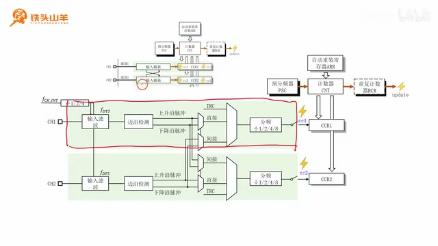
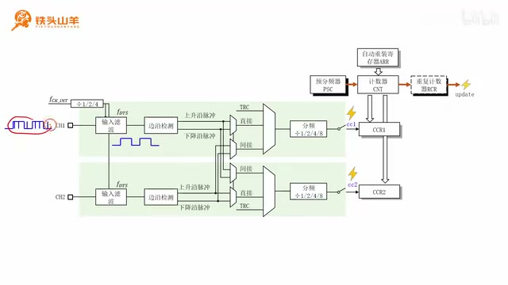
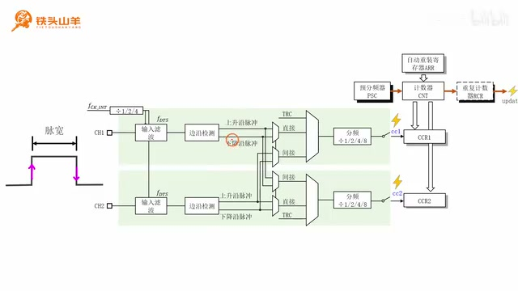
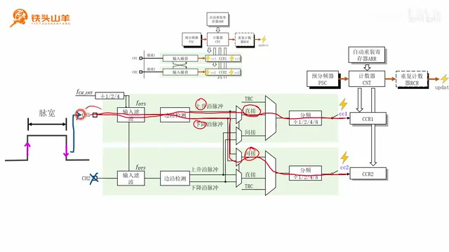
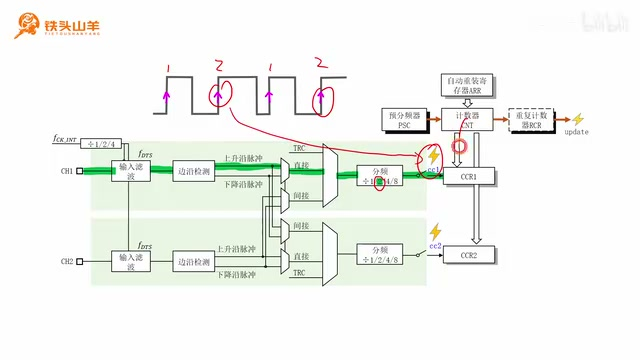

# P044 · 9.5 （定时器）输入捕获

## 本节位置与课程安排

各位同学大家好，我是铁头山羊。今天学习第九章第五节，定时器的另一个组成部分——输入捕获。之前我们把定时器分成四个部分，已经学过基本定时单元，也在前两期学习了输出比较；这节课看框图左边的输入捕获。回顾定时器框图，基本定时单元的下方有四个长条形结构，我们把它们叫作定时器的通道，分别是通道一、通道二、通道三和通道四。这四个通道的结构基本一样，所以后面只取其中一个通道来观察。

以通道一为例，中间是 CCR（捕获比较）寄存器。它右侧是输出比较功能，可以产生精确定时的方波，常用来产生 PWM 信号，例如上一期用 PWM 做呼吸灯。CCR 左侧就是本节要学的输入捕获。它的功能是测量输入信号的时间参数：把外部输入信号从左边送进定时器，输入捕获就可以测它的周期、脉宽、占空比等时间参数。 

_定时器框图中四个通道位于基本定时单元下方，通道一至四的结构基本相同。 ·_ [_原片 00:24_](https://www.bilibili.com/video/BV11X4y1j7si/?p=44\&t=24)

接下来分六部分讲：先看输入捕获的基本工作原理，再看内部电路结构；内部结构又分成四块，分别是输入滤波、边缘检测、信号选择和分频器。下面从基本原理开始。

## 输入捕获如何记录信号边沿

输入捕获可以测量外部输入信号的时间参数。观察输入信号，它由电平变化组成：从低电压变成高电压是上升沿，从高电压变成低电压是下降沿，后面又会出现上升沿。输入捕获电路正是用来捕捉这些变化的，可以捕捉上升沿或者下降沿。

捕捉到信号变化后，电路会向右触发一个 CCx 事件；图中的闪电图标表示事件。这种事件的名字叫 CCx：对于通道一就是 CC1，对于通道二就是 CC2。事件发生时就会触发一次“拍照”动作，也就是把当时计数器 CNT 的值拍一份，放进这个通道对应的 CCR 寄存器。等我们读取 CCR 里的值时，这个值就表示信号发生变化的时刻 CNT 走到了哪里。用这种拍照方式可以算出每个信号边沿发生的时间，进而得到信号的各种时间参数。这个说法可能有点抽象，下面用实际的脉宽例子说明。 

_输入边沿触发 CCx 事件，随后将 CNT 当前值保存到对应的 CCR 寄存器。 ·_ [_原片 03:38_](https://www.bilibili.com/video/BV11X4y1j7si/?p=44\&t=218)

## 用输入捕获测量脉宽

这是一个脉冲信号，我们想测它的脉宽。脉宽顾名思义就是脉冲的宽度，也就是从上升沿到下降沿之间经过了多长时间。

为了测这段脉宽，先配置定时器的基本定时单元。假设送到定时器的时钟频率为 72 MHz，再用预分频器 PSC 对时钟进行 72 分频。那么分频后的频率就是 1 MHz。所以计数器 CNT 的分辨率是 1 微秒：CNT 每增加一级，就经过 1 微秒；波形上每一个计数台阶的宽度也就是 1 微秒。设置好基本定时单元后，再把脉冲信号接入定时器。

设置好后，把脉冲接入定时器通道一和通道二：通道一捕捉上升沿，通道二捕捉下降沿。然后启动定时器，也就是闭合基本定时单元的开关。CNT 从零开始递增，每来一个计数脉冲就加一。 

_脉宽测量示意：PSC 将 72 MHz 时钟分频为 1 MHz，每个计数台阶为 1 微秒。 ·_ [_原片 05:03_](https://www.bilibili.com/video/BV11X4y1j7si/?p=44\&t=303)

接好电路并启动后，输入信号起初处于低电平。到这里它变成高电平，出现上升沿；通道一的输入捕获电路捕捉到这个边沿，触发 CC1 事件。CC1 发生时，把此刻 CNT 的值拍照保存到 CCR1。图中当前 CNT 是 2，因此 CCR1 里保存的就是 2。

继续往后，信号从高电平变为低电平，出现下降沿。通道二捕捉到它，触发 CC2 事件，把此时 CNT 的值保存到 CCR2。图中 CNT 是 8，因此 CCR2 保存 8。于是现在就可以计算脉冲宽度了。脉宽是从上升沿到下降沿的时间距离，也就是用 8 减 2，再乘以每个计数台阶代表的 1 微秒，结果是 6 微秒。这样就测出了脉宽。通过这个例子，输入捕获的工作原理就清楚了。

## 从定时器总框图看内部结构

理解原理后，接下来看看输入捕获内部如何工作。要讲清内部电路、进一步进行编程，需要从定时器总体结构框图谈起。四个通道都有输入捕获功能。仔细看，通道一和通道二之间有一组交叉箭头，通道三和通道四之间也有一组，表示每对通道的信号可以交叉引用。这两对通道的内部结构相同，因此接下来因为篇幅限制，只展开通道一、通道二和上方的基本定时单元来学习。

## 展开通道一、通道二的电路

把这部分图展开，就能看到基本定时单元、通道一与通道二的输入捕获电路，以及 CCR1、CCR2 寄存器。放大之后得到这张内部图。对照刚才的总框图，上面这一部分对应刚才说的基本定时单元；下面绿色框起来的部分对应通道一输入捕获，再下面的框对应通道二输入捕获。中间分别是 CCR1 和 CCR2。这样两张图就对应起来了。 

_展开的定时器内部框图标出基本定时单元、通道一和通道二的输入捕获电路及 CCR 寄存器。 ·_ [_原片 08:30_](https://www.bilibili.com/video/BV11X4y1j7si/?p=44\&t=510)

接下来的任务就是弄清这张内部结构图。虽然整体看起来复杂，但可以分成四块：输入滤波、边缘检测、信号选择和分频器。我们逐块看；每一部分的原理都很简单。

## 输入滤波：滤掉输入毛刺

先看输入滤波在电路里的位置。顾名思义，它用来对输入信号滤波。假设输入信号受到噪声影响，叠加了许多细小毛刺，这些毛刺会影响后续测量。因此测量之前需要使用输入滤波模块把这些毛刺滤除；滤除后得到相对纯净的信号，这个信号才交给后面的电路进行测量。

关于输入滤波，这里只需要知道它用来滤除输入信号上的细小毛刺，不必了解具体使用方法。一次讲太多大家可能接受不了；今后实验用到这个模块时，再学习具体用法。

## 边缘检测：区分上升沿和下降沿

学完输入滤波，再看第二块电路——边缘检测。它位于通道中的这个位置，由前面的边缘检测电路和后面的复用器组成。边缘检测顾名思义，就是检测输入信号的变化边缘。

示例输入信号有两个变化边缘，因此边缘检测电路有两路输出：上面一路代表上升沿，下面一路代表下降沿。比如要让通道检测输入信号的上升沿，就让信号走上面这条路；要检测下降沿，就让信号走下面这条路。边缘检测电路这里先了解这些就可以。关于边缘检测，这里知道这些就可以了。 

_输入滤波示意中，输入信号上的细小毛刺在后续测量前被滤除。 ·_ [_原片 09:54_](https://www.bilibili.com/video/BV11X4y1j7si/?p=44\&t=594)

## 信号选择电路

解释完边缘检测，来看第三部分：信号选择电路。它在通道中的这个位置，本质上是一个复用器，有三个输入，从中选择一路作为输出。我们来看这三路输入：分别是 TRC、直接、间接。TRC 来自定时器的从模式控制器，这个控制器还没有学到，而且 TRC 用得比较少，所以目前重点关注直接和间接。

回顾刚才的定时器总体框图：通道一和通道二是一对，通道三和通道四是一对，它们之间的交叉箭头表示可以交叉引用。也就是说，通道信号如果来自它自己本身，这种情况就叫直接；如果它从对侧的那个通道取信号，这种情况就叫间接。这就是直接和间接的概念。 

_边缘检测电路把输入变化分成上升沿和下降沿两路输出。 ·_ [_原片 11:12_](https://www.bilibili.com/video/BV11X4y1j7si/?p=44\&t=672)

再梳理这张框图：前面有两个边缘检测电路，输出四路信号，分别是通道一上升沿、通道一下降沿、通道二上升沿、通道二下降沿。通道一选择直接并选择上升沿，就是从通道一本身取上升沿；选择直接下降沿，则从通道一本身取下降沿。若选择间接上升沿，就从对侧通道取上升沿；选择间接下降沿，就从对侧通道取下降沿。

交叉引用有什么作用？回到测脉宽的例子：原先要把脉冲分别接到通道一和通道二，需要用两个引脚。同学们可能会问，这个交叉引用到底有什么用？刚才测脉宽需要把脉冲分别接入通道一和通道二，使用两个引脚。有交叉引用后，其中一个引脚就可以省出来，只需使用一个输入引脚。

比如把脉冲接入通道一。经过边缘检测后，会输出代表脉冲上升沿和下降沿的两路信号。让通道一选择直接上升沿；让通道二选择间接下降沿。通过这样设置，大家看只使用这一个引脚，就能让通道一捕获上升沿、通道二捕获下降沿，原来占用的另一个引脚就省出来了。省出的引脚可以做别的事情，比如驱动一个 LED，或者接一枚按钮。 

_将脉冲只接入通道一后，通道一直接捕捉上升沿，通道二间接取得下降沿。 ·_ [_原片 14:38_](https://www.bilibili.com/video/BV11X4y1j7si/?p=44\&t=878)

## 分频器：隔几个边沿触发一次捕获

最后看分频器，它位于电路后段，分频系数可以设置为 1、2、4 或 8 分频。信号从 IO 引脚输入，若通道一选择捕捉上升沿，设为 1 分频时，每出现一个上升沿，右侧就触发一次 CC1 事件并执行拍照。

设为 2 分频时，要出现两次上升沿才产生一次 CC1 事件并拍照；设为 4 分频时，就必须出现四次这个输入信号的上升沿，右侧才触发事件并执行拍照动作。其他分频系数以此类推。分频器平时用得比较少，一般选 1 分频就可以了。 

_分频器示意比较不同上升沿计数，达到设定次数后触发捕获事件。 ·_ [_原片 15:53_](https://www.bilibili.com/video/BV11X4y1j7si/?p=44\&t=953)

## 本节回顾

到此为止，本期视频的内容讲完了。本期视频主要分成两大块。第一大块先讲输入捕获的基本工作原理，并举了测量脉宽的例子。第二部分讲输入捕获的内部电路结构，内部结构主要分成四部分：输入滤波、边缘检测、信号选择和分频器。

本期视频就到这里，我是铁头山羊，我们下期再见。
