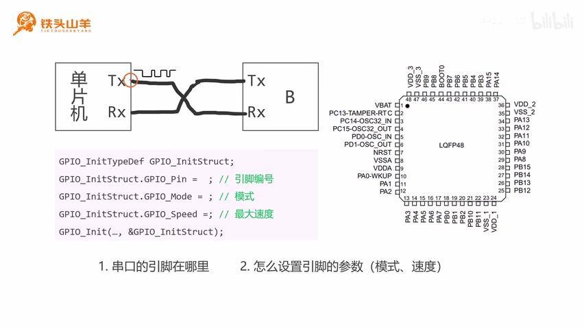

# 相对路径图片测试

这一页用来验证一件事：GitBook 通过 Git Sync 导入时，能否解析 **页面同目录下的相对路径图片**。

下面这张图用的是 Markdown 相对路径 `images/relpath-test.jpg`，文件实际位置是：

```
notes/ke-cheng-ji-lu/stm32/chapter-09/images/relpath-test.jpg
```



如果这张图能正常显示，说明可以把图片和 Markdown 放在同一个目录里，不必全部塞进 `.gitbook/assets/`。

本页为临时测试内容，验证完成后会删除。
