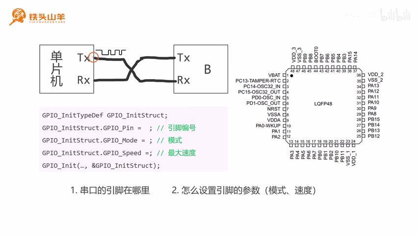

# 相对路径图片测试（课时目录结构）

这一页验证 **每节课一个独立目录** 的结构能否通过 Git Sync 正常工作。

当前目录布局：

```
chapter-09/relpath-test/
├── README.md                  ← 本页
└── images/relpath-test.jpg
```

下面这张图用的是相对路径 `images/relpath-test.jpg`，相对**本文件**所在目录解析。



本页为临时测试内容，验证完成后会删除。
