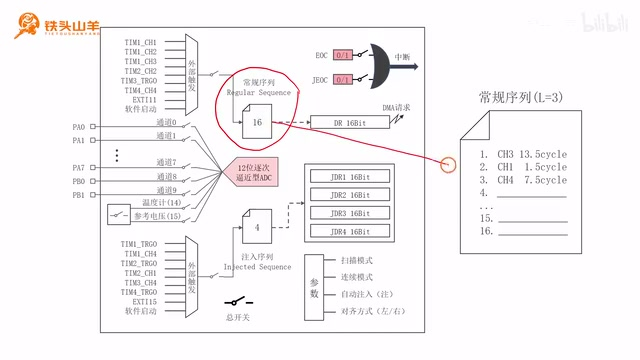
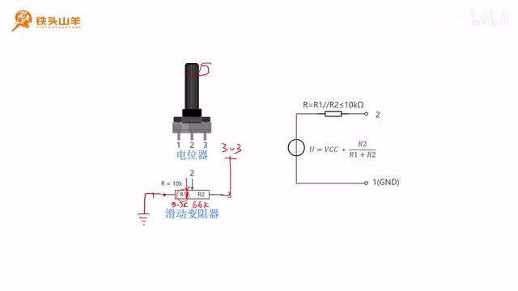
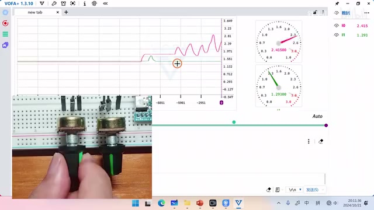
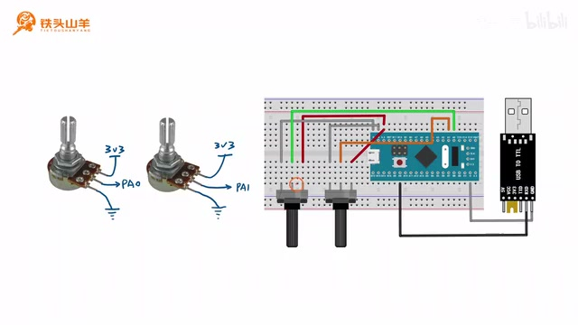
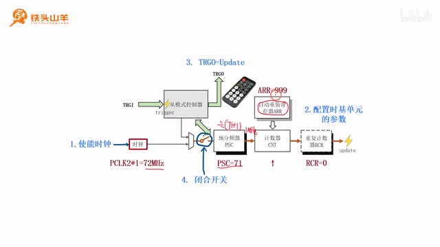
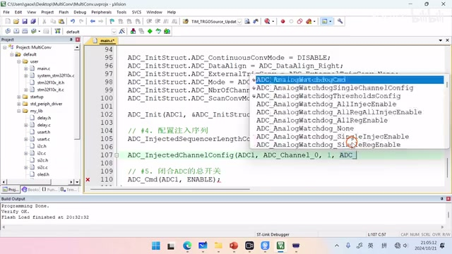
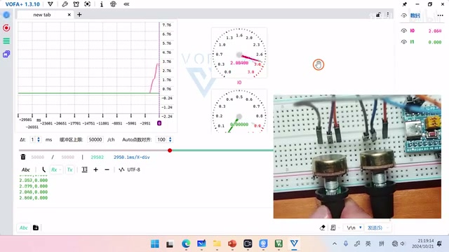

# P054 · 10.6 （ADC）扫描模式

## 扫描模式让序列中的多项计划生效

各位同学大家好，我是铁头山羊。今天学习第十章第六节，讲 ADC 的一种高级用法：扫描模式。要解释扫描模式，还是回到之前看过的 ADC 内部结构框图。请看框图右下角那一组参数，里面包括今天要讲的扫描模式，也包括连续模式、自动注入和对齐方式。之前配置这些参数时，我们把扫描模式、连续模式和自动注入都关闭了；今天打开扫描模式，看看它到底怎么用。

扫描模式的作用，是使能 ADC 同时对多路模拟信号进行转换。举个例子：常规序列就像一张计划表，总共有第 1 到第 16 行，最多能填 16 项计划。如果把序列长度 L 设为 3，就只用前三行；假设依次填入通道 3、通道 1 和通道 4，我们希望 ADC 按顺序转换这三个通道。不开扫描模式时，即使 L 已经设为 3，前三行也填了内容，ADC 仍认为我们只想转换第一项，也就是通道 3。只有使能扫描模式，它才会按要求依次转换通道 3、通道 1、通道 4。这就是扫描模式的用途。

_The regular-sequence diagram shows the 16 available ranks and the example using the first three for channel 3, channel 1, and channel 4. ·_ [_原片 01:02_](https://www.bilibili.com/video/BV11X4y1j7si/?p=54\&t=62)

## 用电位器产生变化的模拟信号

了解扫描模式之后，我们用它做一个实验。本套视频用到的材料都在开发套件包里，大家可以扫描屏幕上的二维码进入淘宝店铺购买；购买套件可以获得课程课件和源码，也能加入答疑群直接交流。请从套件里拿出一个电位器，用它产生模拟信号。这个电位器是最近加入套件的，较早购买的同学可能没有；这种情况下可以用套件里的按钮代替，效果差不多，也能产生模拟信号。

先介绍今天要用的电位器。它就是滑动变阻器，一共有 1、2、3 三个引脚，对应滑动变阻器的三个端点。引脚 2 处的箭头表示滑动触点，它把下面的电阻分成两段：左边叫 R1，右边叫 R2。拧旋钮时，箭头在电阻上的位置会变化，R1 与 R2 的比例也随之改变。

本次要把电位器接成分压电路：引脚 3 接高电压 3.3 V，引脚 1 接地。这样 R1、R2 串联，对 3.3 V 分压；转动旋钮改变触点位置，就能改变两段电阻的比例和分压关系。

## 从分压比例得到引脚 2 的电压

先把箭头放在 R1、R2 的正中间，也就是电阻的中点。套件里这个电位器的总阻值是 10 kΩ，所以两段各占一半，R1=5000 Ω，R2 也是 5000 Ω。经过分压，R1 分得 3.3 V 的一半，即 1.65 V；R2 也分得 1.65 V。因此引脚 1 和引脚 2 之间的电压是 1.65 V。

再拧一下旋钮，把箭头移到大约三分之一处：R1 占整个电阻的三分之一，R2 占三分之二。于是 R1 是 3.3 kΩ，R2 是 6.6 kΩ；R1 分得 3.3 V 的三分之一，约 1.1 V，R2 分得约 2.2 V。此时引脚 2 的电压就是约 1.1 V。可以看到，我们通过旋钮改变 R1、R2 的比例，就能改变引脚 2 输出的电压；这就是本节要测量的模拟信号。

要测引脚 2 的模拟信号，就要把它接入单片机 ADC。接入前还要计算这个信号的内阻，因为只有算出内阻，才能设置对应通道的采样时间。接下来把电路等效成电压源串联一个电阻的形式。

_The potentiometer divider is shown with R1 set to about 3.3 kΩ and R2 to 6.6 kΩ, producing about 1.1 V at the wiper. ·_ [_原片 05:06_](https://www.bilibili.com/video/BV11X4y1j7si/?p=54\&t=306)

## 估算信号源内阻并安排两个通道

等效电路中，串联的电阻就是模拟信号的内阻。这里的等效结果是 R1 与 R2 并联。电位器总阻值为 10 kΩ，也就是 R1+R2=10 kΩ；R1、R2 各自都比 10 kΩ 小，它们并联后一定也小于 10 kΩ。因此取极限值 10 kΩ 作为信号源内阻。按这个内阻计算，采样时间大约是 10.24 个周期，先记下这个数，后面实验配置要用。

现在用两个电位器做实验。两个电位器的引脚 1 都接地，引脚 3 都接 3.3 V；中间的引脚 2 分别接 PA0 和 PA1，也就是 ADC 通道 0、通道 1。我们要同时转换两个通道，因此使能扫描模式，并把通道 0、通道 1 写入注入序列。注入序列长度设成 2：第一行通道 0，第二行通道 1，两行采样时间都按刚才的 10.24 个周期来选。

注入序列还需要外部触发信号：外部信号出现上升沿，序列才启动。接下来我们用定时器产生这个触发信号。

## 用定时器触发并观察两路曲线

使用定时器 1 的 TRGO 产生一系列间隔 1 ms 的脉冲，送到注入序列的外部触发输入。这样注入序列每隔 1 ms 启动一次。每次执行完成后，通道 0 的采样结果放入 JDR1，通道 1 的结果放入 JDR2。读取这两个寄存器，就得到两个采样点；再过 1 ms 又得到一对点。把连续的点连起来，就形成两条曲线：上面一条是通道 0，下面一条是通道 1，最后可以显示到电脑上。

演示时，左边电位器接 PA0，也就是通道 0；右边电位器接 PA1，也就是通道 1。单片机 ADC 把模拟信号采进来并转换成数字信号，再由 USART1 串口发送给电脑，所以接上 USB 转 TTL 模块，并插到电脑。电脑上继续用上一期的 VOFA 软件显示实验现象。界面左侧放一张曲线图，可以看到红、绿两条曲线；红线代表左侧电位器，也就是通道 0。转动左边电位器，红线随之变化，显示它当前的值。绿色曲线代表右边电位器的通道 1。

_VOFA displays two changing traces for the two potentiometer inputs, with one meter for each channel. ·_ [_原片 10:00_](https://www.bilibili.com/video/BV11X4y1j7si/?p=54\&t=600)

除了曲线图，界面右边还放了两块仪表，用来反映两个电位器当前的实时电压。转动左边电位器时，上面的仪表指针变化，显示范围是 0 到 3.3 V；下面的仪表对应右边电位器，转动它时读数也会变化。本次实验就是用 ADC 分别采集两个通道，再把曲线和电压显示出来。

开始写代码之前先把实验电路连接好。需要两个电位器：每个的 1 脚接地，3 脚接高电压 3.3 V；2 脚是模拟信号输出。左边电位器的中间引脚接 PA0，也就是 ADC 通道 0；右边电位器的中间引脚接 PA1，也就是通道 1。接线图里可以看到两只电位器的地线、3.3 V 供电和两路独立输出。

_The wiring diagram connects the two potentiometer wipers to PA0 and PA1, with the outer pins tied to ground and 3.3 V. ·_ [_原片 11:30_](https://www.bilibili.com/video/BV11X4y1j7si/?p=54\&t=690)

因为转换结果还要经串口发送给电脑，所以电路里增加一个 USB 转 TTL 模块。使用单片机上的 USART1，只连接发送端就可以：串口的 TX 引脚接 USB 转 TTL 模块的 RXD。我们只向电脑发送数据，不需要接收，所以不接串口 RX；这里使用 PA9，把 PA9 接到模块的 RXD，并把模块与单片机接地。接线完成后，大家按图连接，再对照实物确认电路是否正确。

接好电路就开始写代码。先做简单的部分，初始化串口。拿出模板工程，解压到当前文件夹，然后重命名工程；因为本次要用扫描模式同时转换多个通道，示例工程名可以叫 MultiConv，意为多路转换。工程文件也一起重命名，再双击打开工程。代码写到 main.c 文件里。先声明一个串口初始化函数，初始化 USART1。我们回顾串口结构框图：需要先初始化 IO 引脚；TX 负责向外发送，RX 负责接收。本实验只发数据，因此只需要初始化 TX。

USART1 默认的数据发送引脚是 PA9，所以先把 PA9 初始化为复用推挽输出（AF\_PP）。第一步开启 GPIOA 时钟；然后声明 GPIO 初始化结构体变量，给变量赋初值，再逐个填成员：引脚号选 PA9，模式选 AF\_PP，最大输出速度选 2 MHz。选 2 MHz 就够了，因为串口波特率通常只有 100 多 K，例如 115200，不需要 10 MHz 这么高的速度。最后调用 GPIO\_Init 初始化 PA9。

PA9 配好后，下一步初始化 UART 模块。要先开启 UART1 的时钟，之后才能配置串口数据帧格式和波特率。设置这些参数时要调用 UART\_Init；它的第二个参数是结构体指针，因此需要先声明对应结构体变量，并给它一个初值，避免出现问题。

## 配置 USART1 的数据帧

先开启 UART1 时钟，调用 RCC\_APB2PeriphClockCmd，第一个参数选择 RCC\_APB2Periph\_USART1，第二个参数填 ENABLE。时钟开启后，开始设置串口的数据帧和波特率，调用 UART\_Init。

先声明 UART 初始化结构体并赋初值，再设置各成员。波特率示例用 115200；也可以选其他值，但串口调试助手必须设为相同波特率。硬件流控不用，因为本次不需要；串口模式只选发送方向；奇偶校验不需要，选无校验；停止位长度设为 1；数据位长度选 8 位。成员都设置完，把结构体传入 UART\_Init，USART1 参数就配置好了。

最后一步是闭合 USART1 总开关，调用 USART\_Cmd，第一个参数填 USART1，第二个参数填 ENABLE。到这里串口初始化函数完成了；把这个函数放到 main 方法中调用。

然后测试初始化是否正确。使用之前自己写的 uart.h 头文件，其中有 My\_USART\_Printf 函数，可以打印测试字符串，例如 “Hello world”，也可以换成自己想写的内容。按左上角第二个按钮编译，结果没有错误也没有警告，就把代码下载到单片机。讲解时发现 ST-Link 调试器还没连接，于是先把 ST-Link 接好，再插上 USB 转 TTL 模块，重新下载。

打开之前的串口调试助手，设置串口号；其他参数暂时保持默认，点击打开。打开串口后先清一下接收区里的数据，因为里面有一些乱码；接收设置要选 ASCII。按一下单片机复位按钮，可以看到串口打印出一行 Hello world，这就证明刚才的串口初始化程序没有问题。

串口完成后梳理程序思路：两只电位器接 PA0、PA1，也就是通道 0 和通道 1，并把它们放进注入序列。要让序列执行，左侧需要一个启动信号，也就是外部触发。根据刚才的思路，用定时器 1 的通道产生间隔 1 ms 的脉冲。具体来说，把定时器 1 的从模式控制器 TRGO 设为 Update 模式；每产生一个 Update 事件，TRGO 就对外输出一个脉冲。因此接下来要配置时基单元，让 Update 事件每 1 ms 发生一次。先为 TIM1 开启时钟。

声明 TIM1 初始化函数，并开启定时器 1 的时钟。开启后配置时基单元。先看输入时钟：来自 PCLK2，经过定时器的倍频后为 72 MHz。这个频率太快，需要用 PSC 预分频器分频；PSC 设成 71，72 MHz 除以 71+1，得到 1 MHz。

再设置自动重装寄存器 ARR 为 999。计数周期是 1000 次，每次计数为 1 微秒，因此总共 1000 微秒，也就是 1 毫秒。RCR 重复计数器设为 0。按这些参数配置后，Update 事件就每 1 ms 发生一次。

_The timer timing diagram marks PSC=71 and ARR=999, yielding a 1 ms update interval from a 72 MHz timer clock. ·_ [_原片 23:24_](https://www.bilibili.com/video/BV11X4y1j7si/?p=54\&t=1404)

设置时基参数时调用 TIM\_TimeBaseInit。它的第二个参数是结构体指针，因此声明时基结构体变量并赋初值，再填各成员：计数模式选向上计数；Period 就是 ARR，设成 999；Prescaler 是预分频器 PSC，设成 71；RepetitionCounter 是重复计数器 RCR，设成 0。ClockDivision 这项用不到，暂时不用设置。参数填完调用初始化接口，把结构体传进去，时基单元就配置完成。

这时已经可以每毫秒产生一次 Update 事件。接下来配置从模式控制器，把 TRGO 设为 Update 模式，调用 TIM\_SelectOutputTrigger，选择 TIM1 和 TIM\_TRGOSource\_Update。最后调用 TIM\_Cmd，参数选择 TIM1 和 ENABLE，闭合定时器总开关。这样每个 1 ms 的 Update 事件都会从 TRGO 输出触发脉冲。

TIM1 的 TRGO 初始化完成后，把初始化函数放到 main 中调用。刚才测试串口的 Hello world 发送代码已经用不到了，把它注释掉。现在串口、定时器都初始化好了，下一步配置 ADC 本身。

本实验使用 PA0、PA1 接两个电位器，先把这两个引脚初始化为模拟模式。新建 ADC1 初始化函数，开启 GPIOA 时钟；声明 GPIO 结构体变量并赋初值。引脚选择要同时包含 GPIO\_Pin\_0 和 GPIO\_Pin\_1，模式选择 GPIO\_Mode\_AIN，也就是模拟输入模式。模拟输入不是输出，因此速度成员不用设置。调用 GPIO\_Init 后，PA0、PA1 就都配置成模拟输入了。

PA0、PA1 配好后，还有一个准备工作：配置 ADC 时钟。ADC 前面有分频器，输入到 ADC 模块的时钟频率必须小于 14 MHz。接下来把分频系数设成六分频，调用 RCC\_ADCCLKConfig；设置好之后，再调用 RCC\_APB2PeriphClockCmd 开启 ADC1 时钟。

启用 ADC 之后初始化基本参数。前面学过，ADC 使用前要通过 ADC\_Init 设置扫描模式、连续模式、自动注入、对齐方式以及常规序列相关参数。虽然本节不使用常规序列，基本初始化接口仍然要调用。

调用 ADC\_Init 时，第二个参数也是结构体指针，所以先声明结构体变量并赋初值。首先设置 ContinuousConvMode，也就是连续模式；本次不用连续模式，填 DISABLE。DataAlign 决定数据对齐方式，我们选择右对齐，最容易操作。

ExternalTrigConv 是常规序列的外部触发源；本节不用常规序列，所以这个选项不影响实验，可以随便选一个，例如软件启动。ADC\_Mode 与双 ADC 模式有关。讲解者说双 ADC 模式实际很少用，99.9% 的情况下都不会用到；他也不知道芯片设计时为什么要加入这么复杂的功能。这里设为 Independent，关闭双 ADC 模式，让两个 ADC 独立工作。NumberOfChannel 用来设置常规序列通道数，本实验不使用常规序列，填 1 即可。最后把 ADC\_ScanConvMode 设为 ENABLE，打开扫描模式。把结构体传给 ADC\_Init，ADC1 基本参数就配置好了。

## 配置注入序列长度

ADC 基本参数初始化完成后，闭合 ADC 总开关。刚才已经设置了常规序列相关参数，接下来配置注入序列。注入序列需要配置序列长度、序列内容、外部触发来源以及触发开关。

先设置序列长度。本次要通过注入序列转换两个通道：通道 0 和通道 1，所以长度设为 2。查之前总结的 ADC 编程接口文档，文档分为通用、常规序列和注入序列几个部分；我们要用注入序列这一部分。第一项接口就是设置注入序列长度的 ADC\_InjectedSequencerLengthConfig。讲解者调整了一下代码位置，再写注释和调用，准备把长度配置为 2。

调用 ADC\_InjectedSequencerLengthConfig，参数选择 ADC1，长度填 2。四个注入序列位置中，实际只使用前两行。然后把通道 0、通道 1 分别填到第一行和第二行。

前面估算采样时间约 10.24 个周期，但芯片没有 10.24 周期这一档，只能选最接近的 13.5 个周期。回到接口汇总，在注入序列部分找到 ADC\_InjectedChannelConfig，它用来配置注入序列中的通道。要调用两次：先设置通道 0，第二个参数为通道编号 0，Rank 表示写入第几行，所以通道 0 的 Rank 填 1，采样时间选 13.5 个周期；复制这行代码，再把通道 1 填到 Rank 2，采样时间也选 13.5 个周期。两行设置好后，再配置左侧的外部触发来源。

_The editor shows the injected-channel setup code, with channel 0 assigned to rank 1 and channel 1 to rank 2 using the 13.5-cycle sample time. ·_ [_原片 35:47_](https://www.bilibili.com/video/BV11X4y1j7si/?p=54\&t=2147)

注入序列的外部触发来源要选 TIM1\_TRGO。仍然在编程接口表中找到 ADC\_ExternalTrigInjectedConvConfig，它就是选择注入序列外部触发来源的接口；调用时选择定时器 1 的 TRGO。还要调用下面的 ADC\_ExternalTrigInjectedConvCmd，闭合外部触发开关，参数使用 ADC1 和 ENABLE。这样注入序列就配置好了。

回看整个框图，刚才的总开关也已经闭合，所有参数都配置完。把这一段 ADC 配置接口放到上面的初始化流程中调用，位置放在定时器初始化之后。现在只要等待注入序列执行完成，再读出结果。

怎样判断注入序列执行完成？看框图上方的 JEOC 标志位。它从 0 变成 1 时，就表示注入序列执行完成。因此在 main 的 while 循环中不断查询这个标志；调用 ADC\_GetFlagStatus，参数选择 ADC1 和 ADC\_FLAG\_JEOC。当标志还是 RESET 时，while 继续等待；它变成 SET 后循环退出，表示转换完成。

转换完成后读取结果。查之前整理的注入序列接口，读取注入转换值要调用 ADC\_GetInjectedConversionValue。第一个参数填 ADC1，另一个参数选择要读的注入序列位置。先读 JDR1 的值并保存，再调用一次读取 JDR2。这样就得到两项转换结果，下一步将二进制值换算成电压。

声明两个变量 V1、V2，分别表示 JDR1、JDR2 换算成电压后的值。两个结果都用 ADC 转换值乘以分辨率，分辨率按 3.3 V 除以 4095。注意这里是 4095，不要写 4096；V2 同样用 JDR2 乘以这个值。换算完就是两路电压。

第三步通过串口发送结果。调用工程里自己写的 My\_USART\_Printf，而不是标准库的 USART1 函数；本次需要发送 V1、V2 两个值。先打开 VOFA 的“协议与连接”设置串口。注意如果软件的串口已经打开，要先把串口关闭，否则连接窗口可能无法打开。按示例设置好 VOFA 参数后再点击打开。数据格式选择 FireWater：每一条曲线之间用逗号隔开，最后加反斜杠 n 换行符。

按 FireWater 的格式，在 V1 和 V2 中间加逗号，最后加 `\n`，然后发送两个值。代码全部写完，先按第二个按钮编译；结果没有错误、也没有警告，再下载到单片机。下载完成后按复位键并打开 VOFA。第一次没有看到预期数据，讲解者觉得奇怪，于是回到代码找到 ADC 初始化函数，再检查注入序列配置。

检查后发现这里本来应该闭合注入序列的开关，却误用了闭合常规序列开关的接口；之前也犯过这个错误。把接口改成 injected 对应的版本，再编译、下载，按复位按钮。再次打开 VOFA 后已经能看到数据。接下来点击左边控件，拖出一张图表并把它拉宽；右键选择“上下填充”，再把 I0、I1 两条曲线都选到 Y 轴上，就能看到两条曲线。然后再拖出两个仪表盘，分别绑定 I0 与 I1。

_After changing the enable call to the injected-sequence version, VOFA begins receiving the two channel values. ·_ [_原片 43:46_](https://www.bilibili.com/video/BV11X4y1j7si/?p=54\&t=2626)

## 检查仪表量程并完成实验

把上面的仪表绑定 I0，也就是左边的电位器通道；下面的仪表绑定 I1，也就是右边电位器通道。检查效果时先拧左边电位器，可以看到曲线和仪表盘同时动作。

不过仪表盘看起来只有右半边刻度，没有左半边。原因是还没设置仪表量程。把量程设为 0 到 3.3 V，最大值设为 3.3；下面的仪表也一样设置成 0 到 3.3。设置好后再拧电位器，仪表显示恢复正常；右边电位器对应的仪表也正常。这个就是本次实验要达到的效果。好的，以上就是本节课的全部内容，感谢大家收看，我是铁头山羊，让我们下期视频再见。

_The final VOFA view shows both live traces and the two voltage meters operating over the configured 0–3.3 V range. ·_ [_原片 45:44_](https://www.bilibili.com/video/BV11X4y1j7si/?p=54\&t=2744)
